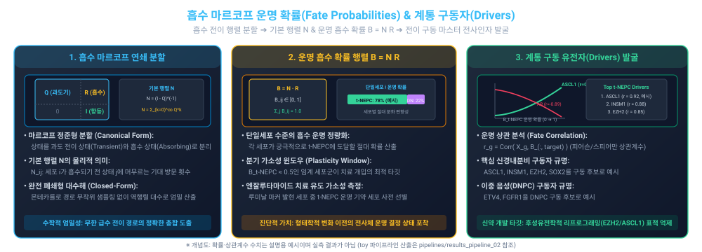

# Chapter 07. 흡수 마르코프 연쇄와 계통 운명 흡수 확률 (Absorbing Markov Chains & Fate Absorption Probabilities)

> **Cognitive Goal**:
> - 단일 세포 마르코프 전이 행렬 $\mathbf{P}$에서 흡수 상태(Absorbing/Terminal states)와 전이 상태(Transient states)를 분할하는 정규 블록 분해(Canonical Block Decomposition) 원리를 수리적으로 정립한다.
> - 기본 행렬(Fundamental Matrix) $\mathbf{N} = (\mathbf{I} - \mathbf{Q})^{-1} = \sum_{k=0}^\infty \mathbf{Q}^k$의 노이만 급수(Neumann series) 수렴 조건(스펙트럼 반경 $\rho(\mathbf{Q}) < 1$) 및 원소 $N_{ij}$의 기댓값 의미(Expected visits)를 엄밀히 증명한다.
> - 흡수 확률 행렬 $\mathbf{B} = \mathbf{N}\mathbf{R} = (\mathbf{I} - \mathbf{Q})^{-1}\mathbf{R}$의 1차 연립방정식 $(\mathbf{I} - \mathbf{Q})\mathbf{B} = \mathbf{R}$을 유도하고, 모든 행합이 1이 되는 행-확률성($\sum_{k} B_{ik} = 1$)을 증명한다.
> - 100,000개 이상의 초대규모 단일핵 전사체 아틀라스에서 직접 역행렬 연산($O(t^3)$)의 한계를 극복하는 현대적 크릴로프 부분공간 반복법(GMRES, BiCGSTAB)의 수치 해석 원리를 체득한다.
> - 전이성 거세 저항성 전립선암(mCRPC) 환자의 가소성 중간 세포에서 t-NEPC vs DNPC 분기 운명 결정 확률 $P(\text{Cell}_i \to \text{t-NEPC})$과 $P(\text{Cell}_i \to \text{DNPC})$을 정량화하고, 분기 엔트로피(Lineage Priming Entropy $H_i$)를 통해 치료적 차단(Interception)이 가능한 임계 분기점(Bifurcation checkpoint)을 규명한다.

---

## 1. 흡수 마르코프 연쇄의 정규 블록 분해 (Canonical Block Decomposition)

G-PCCA를 통해 $N$개의 단일 세포 중 $r$개의 세포가 말단 거시상태(Terminal Macrostates)로 지정되면, 이 세포들은 흡수 상태(Absorbing states)로 변환됩니다. 즉, 분석 모델에서는 이 상태에 진입한 세포가 해당 상태에 머무르는 것으로 가정합니다 ($P_{kk} = 1, P_{kj} = 0 \text{ for } j \neq k$). 이는 운명 확률 계산을 위한 수학적 근사이며, 실제 t-NEPC/DNPC 가소성이 영구적이라는 뜻은 아닙니다(예: Ku et al., Science 2017은 EZH2 억제제가 AR 발현과 항안드로겐 감수성을 회복시킴을 보고). 나머지 $t = N - r$개의 세포는 일시적으로 존재하는 **전이 상태(Transient states)**를 형성합니다.

```
┌────────────────────────────────────────────────────────────────────────────────────────┐
│                   흡수 마르코프 연쇄의 정규 블록 분해 (Canonical Form)                 │
│                                                                                        │
│                     전이 상태 (t개)             흡수 상태 (r개)                        │
│                   ┌────────────────────────┬────────────────────────┐                  │
│                   │                        │                        │                  │
│   전이 상태 (t개) │      Q (t × t)         │       R (t × r)        │                  │
│                   │  (전이 상태 간 전이)   │  (흡수 상태로의 전이)  │                  │
│                   ├────────────────────────┼────────────────────────┤                  │
│                   │                        │                        │                  │
│   흡수 상태 (r개) │       0 (r × t)        │       I (r × r)        │                  │
│                   │  (이탈 불가: 영행렬)   │   (자체 보존: 항등행렬)│                  │
│                   └────────────────────────┴────────────────────────┘                  │
│                                                                                        │
│   * 기본 행렬 (Fundamental Matrix): N = (I - Q)^(-1) = ∑_{k=0}^∞ Q^k                   │
│   * 흡수 확률 행렬 (Absorption Probabilities): B = N * R = (I - Q)^(-1) * R            │
└────────────────────────────────────────────────────────────────────────────────────────┘
```

세포의 인덱스를 재배열(Permutation)하여 전이 세포 $t$개를 앞쪽에, 흡수 세포 $r$개를 뒤쪽에 배치하면 전이 행렬 $\mathbf{P} \in \mathbb{R}^{N \times N}$는 다음과 같은 **정규 블록 형태(Canonical Form)**를 갖습니다:

$$\mathbf{P} = \begin{pmatrix} \mathbf{Q} & \mathbf{R} \\ \mathbf{0} & \mathbf{I}_r \end{pmatrix}$$

- $\mathbf{Q} \in \mathbb{R}^{t \times t}$: 전이 상태 세포 간의 전이 확률 부분 행렬 ($Q_{ij} \ge 0$).
- $\mathbf{R} \in \mathbb{R}^{t \times r}$: 전이 상태 세포가 1단계(1-step)만에 흡수 상태로 직접 흡수될 확률 행렬 ($R_{ik} \ge 0$).
- $\mathbf{0} \in \mathbb{R}^{r \times t}$: 흡수 상태에서 전이 상태로 되돌아올 수 없음을 나타내는 영행렬.
- $\mathbf{I}_r \in \mathbb{R}^{r \times r}$: 흡수 상태 내부에서 머무르는 $r$차원 항등 행렬.

행렬 $\mathbf{P}$가 행-확률적이므로, 전이 상태에 속하는 모든 행 $i \in \{1, \dots, t\}$에 대해 다음 행합 조건이 성립합니다:
$$\sum_{j=1}^t Q_{ij} + \sum_{k=1}^r R_{ik} = 1 \iff \mathbf{Q} \mathbf{1}_t + \mathbf{R} \mathbf{1}_r = \mathbf{1}_t$$

---

## 2. 기본 행렬(Fundamental Matrix)과 노이만 급수(Neumann Series)의 수렴성

### 2.1 마르코프 연쇄의 $k$-단계 전이
정규 블록 행렬 $\mathbf{P}$를 $k$번 거듭제곱하면 블록 행렬 곱셈 법칙에 의해 다음과 같이 전개됩니다:

$$\mathbf{P}^2 = \begin{pmatrix} \mathbf{Q} & \mathbf{R} \\ \mathbf{0} & \mathbf{I} \end{pmatrix} \begin{pmatrix} \mathbf{Q} & \mathbf{R} \\ \mathbf{0} & \mathbf{I} \end{pmatrix} = \begin{pmatrix} \mathbf{Q}^2 & \mathbf{Q}\mathbf{R} + \mathbf{R} \\ \mathbf{0} & \mathbf{I} \end{pmatrix} = \begin{pmatrix} \mathbf{Q}^2 & (\mathbf{Q} + \mathbf{I})\mathbf{R} \\ \mathbf{0} & \mathbf{I} \end{pmatrix}$$

수학적 귀납법에 의해 임의의 양의 정수 $k$에 대해 다음이 성립합니다:
$$\mathbf{P}^k = \begin{pmatrix} \mathbf{Q}^k & \left( \sum_{m=0}^{k-1} \mathbf{Q}^m \right) \mathbf{R} \\ \mathbf{0} & \mathbf{I}_r \end{pmatrix}$$

### 2.2 스펙트럼 반경 $\rho(\mathbf{Q}) < 1$과 노이만 급수 수렴 증명
> **정리 (Convergence of Fundamental Matrix)**:
> 모든 전이 상태에서 적어도 하나의 흡수 상태로 도달할 수 있는 유한 경로가 존재하는 흡수 마르코프 연쇄에서, 부분 행렬 $\mathbf{Q}$의 스펙트럼 반경(Spectral Radius)은 1보다 엄밀히 작다:
> $$\rho(\mathbf{Q}) = \max_{i} |\lambda_i(\mathbf{Q})| < 1$$
> 따라서 노이만 급수(Neumann Series) $\sum_{k=0}^\infty \mathbf{Q}^k$는 무조건 수렴하며, 역행렬 $(\mathbf{I}_t - \mathbf{Q})^{-1}$이 존재하여 다음이 성립한다:
> $$\mathbf{N} \equiv (\mathbf{I}_t - \mathbf{Q})^{-1} = \sum_{k=0}^\infty \mathbf{Q}^k$$

**증명 (Proof)**:
1. 임의의 전이 상태 $i$에서 출발하여 언젠가 흡수 상태에 도달할 확률이 1이므로, $k \to \infty$일 때 세포가 여전히 전이 상태 집합에 남아있을 확률은 0으로 수렴합니다:
   $$\lim_{k \to \infty} \sum_{j=1}^t (\mathbf{Q}^k)_{ij} = 0 \implies \lim_{k \to \infty} \mathbf{Q}^k = \mathbf{0}_{t \times t}$$
2. 만약 $\mathbf{Q}$의 어떤 고유값 $\lambda$에 대해 $|\lambda| \ge 1$이라면, 대응하는 고유벡터 $\mathbf{v} \neq \mathbf{0}$에 대해 $\mathbf{Q}^k \mathbf{v} = \lambda^k \mathbf{v}$가 성립하여 $k \to \infty$일 때 발산하거나 크기가 0으로 줄어들지 않습니다. 이는 $\lim_{k \to \infty} \mathbf{Q}^k = \mathbf{0}$과 모순입니다.
3. 따라서 $\mathbf{Q}$의 모든 고유값의 크기는 1보다 작으며($\rho(\mathbf{Q}) < 1$), 이는 행렬 $(\mathbf{I}_t - \mathbf{Q})$의 모든 고유값 $1 - \lambda_i$가 0이 아님($1 - \lambda_i \neq 0$)을 보증하므로 역행렬이 존재합니다.
4. 노이만 급수 항등식:
   $$(\mathbf{I} - \mathbf{Q}) \left( \sum_{k=0}^{M} \mathbf{Q}^k \right) = \mathbf{I} - \mathbf{Q}^{M+1}$$
   양변에 $M \to \infty$ 극한을 취하면 $\mathbf{Q}^{M+1} \to \mathbf{0}$이므로,
   $$(\mathbf{I} - \mathbf{Q}) \left( \sum_{k=0}^\infty \mathbf{Q}^k \right) = \mathbf{I} \implies \sum_{k=0}^\infty \mathbf{Q}^k = (\mathbf{I} - \mathbf{Q})^{-1} \equiv \mathbf{N}$$
   Q.E.D.

### 2.3 기본 행렬 원소 $N_{ij}$의 확률론적 기대값 의미
지시 확률 변수(Indicator variable) $I_k(j)$를 "시간 단계 $k$에서 마르코프 연쇄가 전이 상태 $j$에 머무를 사건"이라 정의합니다.
세포 $i$에서 출발하여 흡수 상태에 도달하기 전까지 전이 상태 $j$를 방문하는 총 횟수를 $V_{ij} = \sum_{k=0}^\infty I_k(j)$라 할 때, 그 기댓값은 다음과 같습니다:
$$\mathbb{E}[V_{ij} \mid X_0 = i] = \sum_{k=0}^\infty \mathbb{E}[I_k(j) \mid X_0 = i] = \sum_{k=0}^\infty P(X_k = j \mid X_0 = i) = \sum_{k=0}^\infty (\mathbf{Q}^k)_{ij} = N_{ij}$$
즉, **$N_{ij}$는 전이 세포 $i$에서 출발한 무작위 행보가 임의의 종착지로 흡수되기 전까지 전이 세포 $j$를 통과하는 총 기대 방문 횟수(Expected Number of Visits)**를 정확히 의미합니다.

---

## 3. 계통 운명 흡수 확률 행렬 $\mathbf{B}$의 수리적 유도 및 행합 증명

### 3.1 흡수 확률 행렬 $\mathbf{B} = \mathbf{N}\mathbf{R}$의 유도
전이 상태 세포 $i$에서 출발하여 궁극적으로 특정 흡수 상태 $k \in \{1, \dots, r\}$로 흡수될 확률을 $B_{ik}$라 정의합니다.
마르코프의 1단계 조건부 확률 법칙(First-step analysis)을 적용하면, 세포 $i$는 다음 단계에서:
1. 1단계만에 즉각 흡수 상태 $k$로 전이되거나 (확률 $R_{ik}$),
2. 다른 전이 상태 $j$로 이동한 후(확률 $Q_{ij}$), 그 상태 $j$에서 출발하여 궁극적으로 $k$로 흡수될 수 있습니다 (확률 $B_{jk}$).

이를 수식화하면 다음과 같습니다:
$$B_{ik} = R_{ik} + \sum_{j=1}^t Q_{ij} B_{jk}, \quad \forall i \in \{1, \dots, t\}, \forall k \in \{1, \dots, r\}$$

행렬 형태로 기술하면:
$$\mathbf{B} = \mathbf{R} + \mathbf{Q} \mathbf{B} \iff (\mathbf{I}_t - \mathbf{Q}) \mathbf{B} = \mathbf{R}$$

앞서 $(\mathbf{I}_t - \mathbf{Q})$의 역행렬 $\mathbf{N}$이 존재함을 증명하였으므로, 양변의 왼쪽에 $\mathbf{N} = (\mathbf{I}_t - \mathbf{Q})^{-1}$을 곱하면:
$$\mathbf{B} = (\mathbf{I}_t - \mathbf{Q})^{-1} \mathbf{R} = \mathbf{N} \mathbf{R}$$

### 3.2 행-확률성($\mathbf{B} \mathbf{1}_r = \mathbf{1}_t$) 증명
> **정리 (Row-stochasticity of Absorption Probabilities)**:
> 전이 상태 세포 $i$에서 출발한 세포는 확률 1로 $r$개의 흡수 상태 중 어느 하나로 반드시 흡수된다. 즉, 모든 $i$에 대해 $\sum_{k=1}^r B_{ik} = 1$이다.

**증명 (Proof)**:
앞서 성립한 행합 보존 관계식 $\mathbf{Q} \mathbf{1}_t + \mathbf{R} \mathbf{1}_r = \mathbf{1}_t$을 변형하면:
$$\mathbf{R} \mathbf{1}_r = \mathbf{1}_t - \mathbf{Q} \mathbf{1}_t = (\mathbf{I}_t - \mathbf{Q}) \mathbf{1}_t$$
흡수 확률 행렬 $\mathbf{B}$의 행합 벡터 $\mathbf{B} \mathbf{1}_r$을 계산하면:
$$\mathbf{B} \mathbf{1}_r = \left[ (\mathbf{I}_t - \mathbf{Q})^{-1} \mathbf{R} \right] \mathbf{1}_r = (\mathbf{I}_t - \mathbf{Q})^{-1} (\mathbf{R} \mathbf{1}_r)$$
위 식에 $\mathbf{R} \mathbf{1}_r = (\mathbf{I}_t - \mathbf{Q}) \mathbf{1}_t$를 대입하면:
$$\mathbf{B} \mathbf{1}_r = (\mathbf{I}_t - \mathbf{Q})^{-1} (\mathbf{I}_t - \mathbf{Q}) \mathbf{1}_t = \mathbf{I}_t \mathbf{1}_t = \mathbf{1}_t$$
따라서 모든 전이 세포 $i$에 대해 흡수 확률의 합은 정확히 1입니다:
$$\sum_{k=1}^r B_{ik} = 1, \quad \forall i \in \{1, \dots, t\}$$
Q.E.D.

### 3.3 평균 흡수 소요 시간 (Mean Absorption Time)
세포 $i$가 어느 한 종착지에 도달할 때까지 걸리는 평균 시간(단계 수) $\tau_i$는 기본 행렬의 행합과 정확히 일치합니다:
$$\mathbf{\tau} = \mathbf{N} \mathbf{1}_t = (\mathbf{I}_t - \mathbf{Q})^{-1} \mathbf{1}_t$$

---

## 4. 대규모 희소 선형계 풀이: 크릴로프 부분공간 반복법 (Krylov Subspace Methods)

단일핵 전사체 아틀라스는 수만~수십만 개의 세포($t \approx 10^5$)를 포함합니다. 
$(\mathbf{I}_t - \mathbf{Q})^{-1}$을 직접 가우스-요르단 소거법이나 LU 분해로 역행렬화하면 $O(t^3) \approx 10^{15}$의 부동소수점 연산과 수백 기가바이트의 메모리가 필요하여 연산이 불가능합니다.

CellRank 2는 명시적 역행렬을 계산하지 않고, 선형 연립방정식계를 직접 해결합니다:
$$(\mathbf{I}_t - \mathbf{Q}) \mathbf{b}_k = \mathbf{r}_k, \quad \forall k \in \{1, \dots, r\}$$
여기서 $\mathbf{b}_k \in \mathbb{R}^t$는 $k$번째 말단 계통으로의 흡수 확률 열벡터이며, $\mathbf{r}_k \in \mathbb{R}^t$는 $\mathbf{R}$의 $k$번째 열벡터입니다.

```
┌────────────────────────────────────────────────────────────────────────────────────────┐
│                   대규모 희소 행렬 연립방정식 풀이 비교                                │
│                                                                                        │
│   직접 역행렬 계산 (Direct Inversion)          Krylov 부분공간 반복법 (GMRES / BiCGSTAB)│
│   ● B = (I - Q)^(-1) * R                       ● (I - Q) * b_k = r_k 풀이              │
│   ● 시간 복잡도: O(t^3)                        ● 시간 복잡도: O(K_iter * |E|)           │
│     (t = 10^5 시 ~ 10^15 연산, 수일 소요)        (희소 그래프 에지 수 비례, 수 초 소요) │
│   ● 메모리: 완전 밀집 행렬 형성 (Dense O(t^2))  ● 메모리: 희소 행렬 유지 (Sparse O(|E|)) │
│   ● 결과: 메모리 초과 (OOM Crash)              ● 결과: 64비트 워크스테이션에서 즉각 완료 │
└────────────────────────────────────────────────────────────────────────────────────────┘
```

1. **GMRES (Generalized Minimal Residual)**:
   - 비대칭 비정규 행렬 $(\mathbf{I} - \mathbf{Q})$에 대해 크릴로프 부분공간 $\mathcal{K}_m(\mathbf{A}, \mathbf{r}) = \text{span}\{\mathbf{r}, \mathbf{A}\mathbf{r}, \mathbf{A}^2\mathbf{r}, \dots, \mathbf{A}^{m-1}\mathbf{r}\}$을 아놀디 반복(Arnoldi iteration)으로 구성하고, 잔차(Residual) $\|\mathbf{r} - \mathbf{A}\mathbf{x}_m\|_2$를 최소화합니다.
2. **사전조건화(Preconditioning)**:
   - 불완전 LU 분해(ILU) 또는 대각 자코비(Jacobi) 사전조건자 $\mathbf{M}$을 결합하여 조건수 $\kappa(\mathbf{M}^{-1}\mathbf{A})$를 1에 가깝게 압축함으로써 수십 회의 반복(Iteration) 이내에 $\epsilon < 10^{-7}$ 정밀도로 수렴합니다.

---

## 5. 전립선암 계통 분기 엔트로피와 t-NEPC vs DNPC 운명 예측



Enzalutamide 치료 하에서 중간 가소성 상태에 놓인 암세포는 4대 말단 상태로 흡수될 고유한 확률 벡터 $\mathbf{b}_i = (B_{i, \text{Adeno}}, B_{i, \text{Amphi}}, B_{i, \text{DNPC}}, B_{i, \text{t-NEPC}})$를 갖습니다. (AR+ 선암종 / Amphicrine / DNPC / t-NEPC 4상태 구분은 Labrecque et al., J Clin Invest 2019, PMID 31361600(AR·NE 축 기반 표현형 분류, amphicrine 포함), Bluemn et al., Cancer Cell 2017, PMID 29017058(DNPC의 FGF/MAPK 의존성), Beltran et al., Nat Med 2016, PMID 26855148(t-NEPC)을 참고한 교육용 정리이며 상태 정의는 문헌마다 다릅니다.)

### 5.1 계통 프라이밍 엔트로피 (Lineage Priming Entropy)
세포 $i$의 다능성/가소성 미결정 정도를 정보이론적 섀넌 엔트로피(Shannon Entropy)로 정의합니다:
$$H_i = - \sum_{k=1}^r B_{ik} \log_2 (B_{ik} + \epsilon)$$
- $H_i \approx \log_2(4) = 2.0 \text{ bits}$: 4가지 운명 중 어느 쪽으로도 결정되지 않은 완전한 다능성 분기점 세포 (Bifurcation Point).
- $H_i \to 0 \text{ bits}$: 특정 계통(예: $B_{i, \text{t-NEPC}} = 0.99$)으로 운명이 (모델상) 고착(Committed)된 상태.

```
┌────────────────────────────────────────────────────────────────────────────────────────┐
│                   mCRPC 운명 분기점에서의 계통 흡수 확률 및 엔트로피                   │
│                                                                                        │
│   세포 상태             B(t-NEPC)   B(DNPC)   B(AR+ Adeno)  계통 엔트로피 (H)  임상 의미│
│   ───────────────────────────────────────────────────────────────────────────────────  │
│   초기 루미날 선암종    0.01        0.02      0.96          0.30 bits          호르몬 민감│
│   가소성 중간체 (Stem)  0.42        0.38      0.15          1.68 bits [피크]   치료적 골든타임│
│   DNPC 고착 세포        0.05        0.92      0.02          0.51 bits          FGF/MAPK 내성│
│   t-NEPC 고착 세포      0.97        0.02      0.01          0.22 bits          소세포 백금 적응│
│   (행 합 <1인 나머지는 Amphicrine 등 4번째 계통의 확률이며 H는 4결과로 재계산함. 최대 2.0 bits)│
└────────────────────────────────────────────────────────────────────────────────────────┘
```

### 5.2 Track 04 유전체 서브클론 변이와의 융합 매핑
아래 Clone A/B/C와 흡수 확률 임계값(0.90/0.85/0.92)은 설명용 가상 예시이며 Track 04에서 정의된 클론이나 실제 측정값이 아니고, *KRAS/FGFR1* 증폭이나 *AR* 인핸서 증폭과의 대응도 가설적 시나리오입니다. 또한 AR+ 선암종은 초기 상태(Luminal_Naive)일 수도, 치료 후 AR 재활성 말단 상태일 수도 있어 말단 상태로 쓸 때는 후자를 뜻합니다.

- **Clone A (*TP53* biallelic loss + *RB1* deletion)**: 가소성 중간체에서 t-NEPC로의 흡수 확률 $B_{i, \text{t-NEPC}} > 0.90$.
- **Clone B (*RB1* intact + *KRAS/FGFR1* 증폭)**: DNPC로의 흡수 확률 $B_{i, \text{DNPC}} > 0.85$.
- **Clone C (*AR* 인핸서 증폭 + *AR-V7* 발현)**: AR+ 선암종으로 회귀할 흡수 확률 $B_{i, \text{AR-Adeno}} > 0.92$.

---

## 6. 실전 파이썬 분석 파이프라인 (`cellrank` 흡수 확률 계산)

```python
import cellrank as cr
import scanpy as sc
import numpy as np

# 1. 이전 단계에서 확정된 GPCCA 추정기 로드
# g = cr.estimators.GPCCA(combined_kernel)

# 2. 크릴로프 부분공간 반복법(GMRES)을 이용한 흡수 확률 계산
g.compute_fate_probabilities(
    solver="gmres", 
    tol=1e-7, 
    preconditioner="ilu"
)

# 3. 흡수 확률 객체 추출
fate_probs = g.fate_probabilities
print("Fate Probabilities Matrix Shape (Cells x Lineages):", fate_probs.shape)

# 4. 계통 프라이밍 엔트로피 (Lineage Priming Entropy) 계산
probs_mat = np.array(fate_probs.X)
entropy = -np.sum(probs_mat * np.log2(probs_mat + 1e-12), axis=1)
adata.obs["lineage_entropy"] = entropy

# 5. 각 계통별 운명 흡수 확률 및 엔트로피 UMAP 시각화
g.plot_fate_probabilities(
    states=["t-NEPC", "DNPC", "AR+_Adeno", "Amphicrine"],
    basis="umap",
    same_plot=False
)

sc.pl.umap(
    adata, 
    color=["lineage_entropy", "cell_type"], 
    cmap="plasma", 
    save="_entropy_checkpoint.png"
)

# 6. 원형 투영(Circular Projection)을 통한 분기 역학 시각화
# keys는 obs 키(예: cell_type)이며, 계통은 앞서 계산한 운명 확률(lineages_fwd)을 사용(계통 3개 이상 필요)
cr.pl.circular_projection(
    adata, 
    keys="cell_type",
    save="_circular_fate.png"
)
```

---

## 단원 핵심 점검 (Cognitive Checkpoint & Case Study)

### Q1. [수학적 원리 증명 (Mathematical Rigor)]
정규 블록 분해 $\mathbf{P} = \begin{pmatrix} \mathbf{Q} & \mathbf{R} \\ \mathbf{0} & \mathbf{I}_r \end{pmatrix}$를 만족하는 흡수 마르코프 연쇄에서:
1) 전이 상태 부분 행렬 $\mathbf{Q}$의 임의의 고유값 $\lambda$에 대해 $|\lambda| < 1$임을 증명하고, 이로부터 기본 행렬 $\mathbf{N} = (\mathbf{I}_t - \mathbf{Q})^{-1}$이 노이만 급수 $\sum_{k=0}^\infty \mathbf{Q}^k$와 동치임을 전개하시오.
2) 흡수 확률 행렬 $\mathbf{B} = (\mathbf{I}_t - \mathbf{Q})^{-1} \mathbf{R}$의 모든 행합이 정확히 1($\mathbf{B} \mathbf{1}_r = \mathbf{1}_t$)이 됨을 행-확률성 항등식을 이용하여 유도하시오.

<details>
<summary>💡 모범 답안 및 해설 확인</summary>

- **1. $|\lambda| < 1$ 및 노이만 급수 수렴 증명**:
  - 흡수 마르코프 연쇄의 정의상, 모든 전이 상태 $i$는 유한한 단계 내에 흡수 상태로 빠져나갈 확률이 양수($>0$)입니다.
  - 따라서 세포가 흡수되지 않고 전이 상태 내부에서만 $k$단계 동안 머무를 확률 행렬 $\mathbf{Q}^k$는 $k \to \infty$일 때 0행렬로 수렴합니다:
    $$\lim_{k \to \infty} \mathbf{Q}^k = \mathbf{0}$$
  - $\mathbf{Q}$의 임의의 고유값 $\lambda$와 대응하는 고유벡터 $\mathbf{v} \neq \mathbf{0}$에 대해 $\mathbf{Q}^k \mathbf{v} = \lambda^k \mathbf{v}$입니다.
  - 양변에 $k \to \infty$ 극한을 취하면 $\lim_{k \to \infty} \mathbf{Q}^k \mathbf{v} = \mathbf{0}$이어야 하므로, $\lim_{k \to \infty} \lambda^k \mathbf{v} = \mathbf{0}$이 성립해야 합니다.
  - 이는 오직 $|\lambda| < 1$일 때만 가능하므로, 스펙트럼 반경 $\rho(\mathbf{Q}) < 1$입니다.
  - 스펙트럼 반경이 1 미만이므로 $(\mathbf{I} - \mathbf{Q})$의 고유값 $1 - \lambda_i$는 절대 0이 될 수 없어 역행렬이 존재하며, 노이만 급수 부분합 $S_M = \sum_{k=0}^M \mathbf{Q}^k$에 $(\mathbf{I} - \mathbf{Q})$를 곱하면:
    $$(\mathbf{I} - \mathbf{Q}) S_M = \mathbf{I} - \mathbf{Q}^{M+1} \implies \lim_{M \to \infty} (\mathbf{I} - \mathbf{Q}) S_M = \mathbf{I} \implies \sum_{k=0}^\infty \mathbf{Q}^k = (\mathbf{I} - \mathbf{Q})^{-1} \equiv \mathbf{N}$$
- **2. 행합 $\mathbf{B} \mathbf{1}_r = \mathbf{1}_t$의 엄밀한 유도**:
  - $\mathbf{P}$가 행-확률적이므로 전이 상태 행들에 대해 다음이 성립합니다:
    $$\mathbf{Q} \mathbf{1}_t + \mathbf{R} \mathbf{1}_r = \mathbf{1}_t$$
  - 이를 $\mathbf{R} \mathbf{1}_r$에 대해 정리하면:
    $$\mathbf{R} \mathbf{1}_r = \mathbf{1}_t - \mathbf{Q} \mathbf{1}_t = (\mathbf{I}_t - \mathbf{Q}) \mathbf{1}_t$$
  - 흡수 확률 행렬 정의 $\mathbf{B} = (\mathbf{I}_t - \mathbf{Q})^{-1} \mathbf{R}$의 양변에 $\mathbf{1}_r$을 곱하면:
    $$\mathbf{B} \mathbf{1}_r = (\mathbf{I}_t - \mathbf{Q})^{-1} \mathbf{R} \mathbf{1}_r$$
  - 위에서 구한 $\mathbf{R} \mathbf{1}_r$ 식을 대입하면:
    $$\mathbf{B} \mathbf{1}_r = (\mathbf{I}_t - \mathbf{Q})^{-1} \left[ (\mathbf{I}_t - \mathbf{Q}) \mathbf{1}_t \right] = \mathbf{I}_t \mathbf{1}_t = \mathbf{1}_t$$
  - 따라서 임의의 전이 세포 $i$에 대해 $r$개 종착지로의 흡수 확률 총합은 반드시 $\sum_{k=1}^r B_{ik} = 1$입니다.

</details>

---

### Q2. [대규모 수치 최적화 및 크릴로프 부분공간 기법 (Numerical Scalability & Krylov Solvers)]
단일핵 전사체 아틀라스에서 전이 세포 수가 $t = 120,000$개, 흡수 말단 상태 수가 $r = 4$개이다.
전이 그래프의 평균 연결 에지 수는 세포당 30개($|\mathcal{E}| \approx 3.6 \times 10^6$)이다.
1) 직접 가우스 소거법(Direct Matrix Inversion)을 사용하여 $\mathbf{N} = (\mathbf{I} - \mathbf{Q})^{-1}$을 계산할 때 필요한 부동소수점 연산 수(FLOPs)와 필요한 RAM 메모리 크기(단정밀도 4바이트 기준)를 계산하고, 이것이 현실의 단일 워크스테이션에서 불가능한 이유를 제시하시오.
2) GMRES 크릴로프 반복법을 사용하여 4개의 선형계 $(\mathbf{I} - \mathbf{Q})\mathbf{b}_k = \mathbf{r}_k$ ($k=1, 2, 3, 4$)를 풀 때, 반복 횟수 $K_{\text{iter}} = 50$회에서 수렴한다고 가정할 때의 총 연산 복잡도와 메모리 요구량을 계산하고 비교 분석하시오.

<details>
<summary>💡 모범 답안 및 해설 확인</summary>

- **1. 직접 역행렬 계산(Direct Inversion)의 연산량 및 메모리**:
  - **연산 복잡도 (FLOPs)**:
    $t \times t$ 정방행렬의 직접 역행렬 연산은 가우스-요르단 소거법 기준 약 $\frac{2}{3} t^3$ FLOPs가 소요됩니다:
    $$\text{FLOPs} \approx \frac{2}{3} (1.2 \times 10^5)^3 = \frac{2}{3} \times 1.728 \times 10^{15} \approx 1.15 \times 10^{15} \text{ FLOPs} \text{ (약 1.15 PetaFLOPs)}$$
  - **메모리 요구량**:
    희소 행렬 $\mathbf{Q}$와 달리, 역행렬 $\mathbf{N} = (\mathbf{I} - \mathbf{Q})^{-1}$은 거의 모든 원소가 0이 아닌 완전 밀집 행렬(Dense Matrix, Fill-in)이 됩니다:
    $$\text{Memory} = t^2 \times 4 \text{ bytes} = (1.2 \times 10^5)^2 \times 4 = 1.44 \times 10^{10} \times 4 = 5.76 \times 10^{10} \text{ bytes} \approx 57.6 \text{ GB}$$
  - **불가능한 이유**:
    단일 행렬 저장에만 58GB가 필요하며, LU 분해 과정의 중간 버퍼까지 합치면 150GB 이상의 고속 RAM이 필요하고, PetaFLOP 연산으로 인해 CPU 기준 수십 시간 이상 소요되므로 일상적인 대화형 분석이 불가능합니다.
- **2. GMRES 크릴로프 반복법의 연산량 및 메모리 비교**:
  - **연산 복잡도 (FLOPs)**:
    GMRES의 1회 반복당 연산은 희소 행렬-벡터 곱(Sparse Matrix-Vector Multiplication, SpMV)에 지배되며, 이는 0이 아닌 원소 수(Non-zeros, $\text{nnz} = |\mathcal{E}| \approx 3.6 \times 10^6$)에 비례합니다 ($2 \times |\mathcal{E}|$ FLOPs).
    4개 계통($r=4$), 각 계통당 $K_{\text{iter}} = 50$회 반복 시 총 연산량은:
    $$\text{FLOPs} \approx 4 \times 50 \times (2 \times 3.6 \times 10^6) = 200 \times 7.2 \times 10^6 \approx 1.44 \times 10^9 \text{ FLOPs} \text{ (약 1.44 GigaFLOPs)}$$
  - **메모리 요구량**:
    희소 행렬 CSR(Compressed Sparse Row) 포맷 유지: 에지 수 $3.6 \times 10^6 \times 8 \text{ bytes} \approx 28.8 \text{ MB}$.
    크릴로프 기저 벡터 50개 유지: $50 \times 1.2 \times 10^5 \times 4 \text{ bytes} \approx 24 \text{ MB}$. 총 메모리는 100MB 미만입니다.
  - **비교 결론**:
    GMRES는 직접 역행렬 계산 대비 연산 횟수를 약 **80만 배($10^{15} \to 10^9$)** 단축시키며, 메모리를 **500배 이상($58\text{GB} \to 100\text{MB}$)** 절감하여 일반 랩톱이나 워크스테이션에서도 2~3초 이내에 정확한 흡수 확률을 도출할 수 있습니다.

</details>

---

### Q3. [임상 케이스 분석 (Clinical Problem Solving)]
Enzalutamide 치료 6개월 차 mCRPC 환자의 간 전이 병변 생검 조직에서 단일핵 전사체 데이터를 획득하였다.
CellRank 2 분석 결과, 종양 세포 집단은 크게 두 하위 그룹으로 구분되었다:
- **Group 1**: 계통 엔트로피 $H_i = 1.44 \text{ bits}$ (3결과 최대 $\log_2 3 \approx 1.58$의 약 91%, 고도 가소성), $B_{i, \text{t-NEPC}} = 0.44$, $B_{i, \text{DNPC}} = 0.42$, $B_{i, \text{AR+_Adeno}} = 0.14$. 크로마틴 활성 조절 인자 *EZH2*와 *SOX2*가 중등도 발현됨.
- **Group 2**: 계통 엔트로피 $H_i = 0.18 \text{ bits}$ (완전 고착), $B_{i, \text{t-NEPC}} = 0.98$. 신경 마커 *CHGA*, *SYP* 및 마스터 전사인자 *ASCL1*이 최고조로 발현됨.

1) Group 1 세포들이 임상적으로 의미하는 '가소성 치료적 기회의 창(Therapeutic Window of Opportunity)'을 계통 흡수 동역학 관점에서 설명하시오.
2) 이 환자에게 EZH2 저해제(Tazemetostat) 단독 요법 또는 백금 기반 항암화학요법(Carboplatin + Etoposide) 단독 요법을 적용할 때 발생할 수 있는 클론 진화적 실패 기전을 각각 예측하고, 두 하위 그룹을 동시에 격멸하기 위한 최적의 병용 요법 스케줄을 설계하시오.

<details>
<summary>💡 모범 답안 및 해설 확인</summary>

- **1. Group 1의 가소성 치료적 기회의 창 (Therapeutic Window)**:
  - Group 1 세포는 계통 엔트로피가 3결과 최대 이론값($\log_2 3 \approx 1.58$ bits)에 근접한 $1.44 \text{ bits}$ (확률 $0.44, 0.42, 0.14$로 재계산)로, t-NEPC($44\%$)와 DNPC($42\%$) 중 어느 쪽으로도 분화 운명이 완전히 결정되지 않은 미분열/가소성 체크포인트 상태입니다.
  - 이 세포들은 크로마틴 리모델링을 주도하는 *EZH2*의 활성에 의존하여 운명 장벽을 낮추고 있는 상태이므로, 아직 소세포 신경내분비 분화가 완료되지 않았습니다.
  - 따라서 세포가 Group 2(t-NEPC $98\%$ 흡수 고착)로 완전히 떨어지기 전, 이 중간 가소성 상태를 후성유전학적으로 차단(Interception)하면 치명적인 신경내분비암으로의 진행을 사전에 예방할 수 있는 가장 결정적인 '골든타임'을 제공합니다.
- **2. 단독 요법의 실패 기전 및 최적 병용 스케줄 설계**:
  - **단독 요법의 실패 기전**:
    - **EZH2 저해제(Tazemetostat) 단독 투여 시**: Group 1의 가소성 전이는 억제할 수 있으나, 이미 *ASCL1*과 *INSM1*에 의해 신경 프로파일이 완전히 고착되고 사멸 저항성을 획득한 Group 2(t-NEPC 클론) 세포는 EZH2 억제만으로 사멸하지 않고 급속 팽창하여 치명적인 내장기 부전을 초래합니다.
    - **백금 화학요법(Carboplatin + Etoposide) 단독 투여 시**: 급속 분열하는 Group 2 세포는 일시적으로 대량 사멸하여 단기 반응을 보이지만, 상대적으로 분열 속도가 느리고 줄기세포능을 유지하는 Group 1 가소성 중간체는 살아남아(Residual persister), 치료 종료 후 다시 DNPC 또는 t-NEPC로 재발을 주도합니다.
  - **최적의 병용 요법 스케줄 (Combinatorial Interception)**:
    - **동시 병용 또는 유도-유지 요법 (Induction-Maintenance Strategy)**:
      1. **1단계 (Induction)**: **카보플라틴 + 에토포사이드**를 선행 투여하여 이미 고착된 고위험 Group 2(t-NEPC) 세포를 즉각 대량 제거(Debulking)합니다.
      2. **2단계 (Interception/Maintenance)**: 동시에 또는 화학요법 직후 **EZH2 저해제(Tazemetostat)**를 투여하여 잔존하는 Group 1 세포가 H3K27me3 침착을 통해 t-NEPC로 흡수 전이되는 크로마틴 경로를 차단합니다.
      3. **3단계 (DNPC 회피 병용)**: Group 1이 DNPC($42\%$)로 우회하는 것을 막기 위해 **FGFR/MAPK 억제제** 또는 AR 신호 유지 약제를 병용함으로써 모든 저항성 출구를 봉쇄합니다.

</details>

---

<!-- REFERENCES:BEGIN (generated by scripts/apply_references.py; do not edit by hand) -->
## 참고문헌 (References)
### 본문 인용 문헌
1. Ku SY, Rosario S, Wang Y, et al. Rb1 and Trp53 cooperate to suppress prostate cancer lineage plasticity, metastasis, and antiandrogen resistance. *Science*. 2017;355(6320):78-83. PMID: 28059767. doi: 10.1126/science.aah4199
2. Labrecque MP, Coleman IM, Brown LG, et al. Molecular profiling stratifies diverse phenotypes of treatment-refractory metastatic castration-resistant prostate cancer. *J Clin Invest*. 2019;129(10):4492-4505. PMID: 31361600. doi: 10.1172/JCI128212
3. Bluemn EG, Coleman IM, Lucas JM, et al. Androgen Receptor Pathway-Independent Prostate Cancer Is Sustained through FGF Signaling. *Cancer Cell*. 2017;32(4):474-489.e6. PMID: 29017058. doi: 10.1016/j.ccell.2017.09.003
4. Beltran H, Prandi D, Mosquera JM, et al. Divergent clonal evolution of castration-resistant neuroendocrine prostate cancer. *Nat Med*. 2016;22(3):298-305. PMID: 26855148. doi: 10.1038/nm.4045
### 소프트웨어 (표기 버전은 검수 시 API를 확인한 버전이며, 파이프라인 실행 환경은 requirements-pipelines.txt 참조)
- CellRank 2.3.3 (github.com/scverse/cellrank). 원 논문: Weiler P, Lange M, Klein M, et al. CellRank 2: unified fate mapping in multiview single-cell data. *Nat Methods*. 2024;21(7):1196-1205. PMID: 38871986. doi: 10.1038/s41592-024-02303-9
- NumPy 2.5.4 (numpy.org). 원 논문: Harris CR, Millman KJ, van der Walt SJ, et al. Array programming with NumPy. *Nature*. 2020;585(7825):357-362. PMID: 32939066. doi: 10.1038/s41586-020-2649-2
- Scanpy 1.12.4 (github.com/scverse/scanpy). 원 논문: Wolf FA, Angerer P, Theis FJ. SCANPY: large-scale single-cell gene expression data analysis. *Genome Biol*. 2018;19(1):15. PMID: 29409532. doi: 10.1186/s13059-017-1382-0
<!-- REFERENCES:END -->
