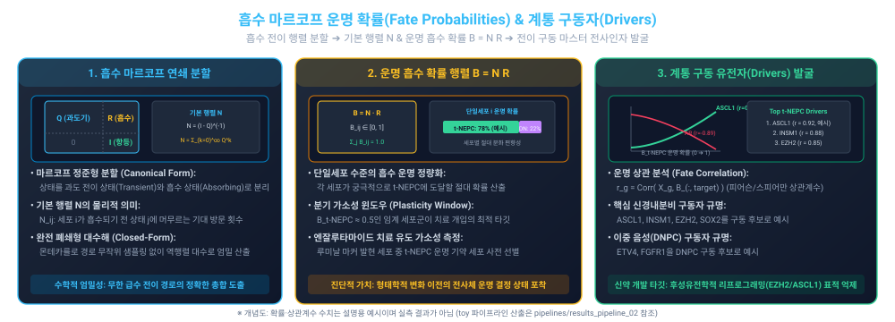

# Chapter 08. 계통 운명 구동 전사인자 및 동역학 드라이버 발굴 (Lineage Fate Drivers & Dynamic Gene Discovery)

> **Cognitive Goal**:
> - 흡수 마르코프 연쇄에서 계산된 계통 운명 흡수 확률 벡터 $\mathbf{b}_k = (B_{1k}, \dots, B_{tk})^T$와 단일 세포 유전자 발현량 $\mathbf{x}_g \in \mathbb{R}^t$ 및 eGRN regulon 활성도 벡터 간의 선형 상관관계(Linear Correlation) 및 비모수적 회귀(Non-parametric Regression)의 수리적 원리를 정립한다.
> - 단일 세포 드롭아웃(Zero-inflation) 및 이분산성(Heteroscedasticity) 문제를 극복하기 위해 피어슨 상관계수(Pearson), 스피어만 순위 상관계수(Spearman), 음이항(Negative Binomial) 일반화 가법 모델(Generalized Additive Models, GAM) 큐빅 스플라인 적합을 통한 시간-의존적 동역학 드라이버 감지 알고리즘을 체득한다.
> - Track 01의 SCENIC+ 멀티옴 eGRN regulon 활성 점수(AUCell) 및 Track 04의 유전체 서브클론 변이 데이터를 CellRank 2 lineage driver 분석에 융합하는 다중 오믹스 통합 파이프라인을 구축한다.
> - 전이성 거세 저항성 전립선암(mCRPC) 계통 가소성 분기에서 t-NEPC 운명 마스터 드라이버(*ASCL1, INSM1, EZH2, SOX2, NEUROD1*)와 DNPC 운명 마스터 드라이버(*ETV4, FGFR1, SOX9, TWIST1*)의 활성화 캐스케이드(Activation Cascade Timing)를 시공간적으로 규명하고, 단순 말단 지표(Passenger marker)와 인과적 선도 인자(Pioneer driver)를 감별하는 통계적 판별법을 수립한다.

---

## 1. 계통 운명 흡수 확률과 유전자 발현의 수리적 연계

Chapter 07에서 도출된 흡수 확률 행렬 $\mathbf{B} \in \mathbb{R}^{t \times r}$의 $k$번째 열벡터 $\mathbf{b}_k = (B_{1k}, B_{2k}, \dots, B_{tk})^T$는 각 전이 세포가 $k$번째 말단 계통(Terminal Lineage)으로 진화할 확률을 나타내는 연속적인 '의사-동역학적 좌표(Pseudo-dynamical coordinate)'로 작동합니다.

```
┌────────────────────────────────────────────────────────────────────────────────────────┐
│                   계통 드라이버 발굴 아키텍처: 다중 오믹스 연계 프레임워크              │
│                                                                                        │
│   [CellRank 2 흡수 확률 b_k] ──► [단일 세포 전사체 X_g]   ──► Pearson / Spearman / GAM  │
│                                  [Track 01 eGRN Regulon] ──► AUCell 상관 분석          │
│                                  [Track 04 서브클론 변이]  ──► 유전형 연관성 검정       │
│                                              │                                         │
│                                              ▼                                         │
│   ┌────────────────────────────────────────────────────────────────────────────────┐   │
│   │   발현 궤적(Expression Trend) 및 활성화 시점(B_onset) 스플라인 적합            │   │
│   │   s_g(B_k) = ∑ β_m φ_m(B_k)                                                    │   │
│   └────────────────────────────────────────────────────────────────────────────────┘   │
│                                              ▼                                         │
│   [동역학적 계통 캐스케이드 (Dynamic Lineage Cascade)]                                │
│   ● 조기 프라이밍 (Early Priming): EZH2, SOX2 (B_onset ≈ 0.2 ~ 0.3)                    │
│   ● 파이오니어 전사인자 (Pioneer TF): ASCL1, INSM1 (B_onset ≈ 0.4 ~ 0.5)               │
│   ● 말단 기능성 마커 (Terminal Passenger): CHGA, SYP (B_onset > 0.85)                  │
└────────────────────────────────────────────────────────────────────────────────────────┘
```

### 1.1 피어슨 상관계수 (Pearson Correlation)
유전자 $g$의 발현량 벡터를 $\mathbf{x}_g = (x_{1g}, \dots, x_{tg})^T$라 할 때, 특정 계통 $k$에 대한 피어슨 상관계수는 다음과 같이 정의됩니다:

$$r(g, \mathbf{b}_k) = \frac{\sum_{i=1}^t (x_{ig} - \bar{x}_g)(B_{ik} - \bar{B}_k)}{\sqrt{\sum_{i=1}^t (x_{ig} - \bar{x}_g)^2} \sqrt{\sum_{i=1}^t (B_{ik} - \bar{B}_k)^2}}$$

- 가설 검정: 귀무가설 $H_0: \rho = 0$ 하에서 검정 통계량 $T$는 자유도 $t-2$인 스튜던트 t-분포를 따릅니다:
  $$T = r \sqrt{\frac{t-2}{1 - r^2}} \sim t(t-2)$$
- Benjamini-Hochberg 절차를 통해 전장 유전자($G \approx 20,000$)에 대한 False Discovery Rate(FDR $q$-value)를 보정합니다.

### 1.2 스피어만 순위 상관계수 (Spearman Rank Correlation)
단일 세포 데이터의 비선형 단조성(Monotonicity)과 이상치(Outliers)에 강건하게 반응하도록, 발현량 순위 $R(x_{ig})$와 흡수 확률 순위 $R(B_{ik})$ 간의 순위 상관계수를 계산합니다:
$$\rho_{\text{spearman}}(g, \mathbf{b}_k) = 1 - \frac{6 \sum_{i=1}^t d_i^2}{t(t^2 - 1)}, \quad \text{where } d_i = R(x_{ig}) - R(B_{ik})$$
(이 식은 동순위(ties)가 없을 때만 정확합니다. 단일세포 발현은 0이 대다수라 동순위가 매우 많으므로 실제로는 동순위에 평균 순위를 부여한 순위들의 Pearson 상관으로 계산합니다.)

---

## 2. 일반화 가법 모델(GAM)을 이용한 비선형 동역학 스플라인 적합

선형 상관계수는 전체적인 증가/감소 경향만을 요약할 뿐, 가소성 전이 과정에서 일시적으로 켜졌다가 꺼지는 중간 활성화 유전자(Transient pulse genes)나 지연 반응을 보이는 유전자를 감지하지 못합니다.

### 2.1 스플라인 기저 함수 (Cubic Spline Basis)
흡수 확률 $B \in [0, 1]$를 $M$개의 매듭점(Knots)을 갖는 자연 삼차 스플라인(Natural Cubic Splines) 기저 함수계 $\{\phi_1(B), \dots, \phi_M(B)\}$로 확장합니다.

$$E[X_{ig} \mid B_{ik}] = \mu_{ig}, \quad g(\mu_{ig}) = \beta_0 + s_g(B_{ik}) = \beta_0 + \sum_{m=1}^M \beta_{gm} \phi_m(B_{ik})$$

- 연결 함수(Link function) $g(\cdot)$:
  - 가우시안 모델: $g(\mu) = \mu$
  - 음이항(Negative Binomial) 모델: $g(\mu) = \ln(\mu)$ (단일 세포 카운트 데이터의 과분산을 보정; 영과잉이 심하면 NB만으로는 부족할 수 있음)

### 2.2 페널티화 우도 극대화 (Penalized Likelihood Maximization)
스플라인 곡선의 과적합(Overfitting)을 방지하기 위해 2차 미분의 제곱 적분(Wiggle penalty)을 부과합니다:

$$\min_{\mathbf{\beta}_g} \left[ \mathcal{D}(\mathbf{x}_g, \mathbf{\mu}_g) + \lambda \int_0^1 \left( s_g''(u) \right)^2 du \right]$$

- $\mathcal{D}(\cdot)$: 모델 이탈도(Deviance)
- $\lambda$: 평활화 파라미터(Smoothing parameter), 일반화 교차 검증(Generalized Cross-Validation, GCV) 또는 제한된 최대 우도(REML)로 자동 최적화.

---

## 3. 선도 인자(Pioneer Driver) vs 말단 지표(Passenger Marker)의 동역학적 감별

흡수 확률과 매우 높은 양의 상관관계($r > 0.85$)를 보이는 유전자라도 그 생물학적 역할은 완전히 다를 수 있습니다.

```
┌────────────────────────────────────────────────────────────────────────────────────────┐
│                   드라이버(Driver) vs 패신저(Passenger) 동역학 곡선 비교               │
│                                                                                        │
│   유전자 발현 (Expression)                                                            │
│   ▲                                                                                    │
│   │                                            [말단 패신저: CHGA, SYP]                │
│   │                                            운명 고착 후 급증 (B > 0.85)            │
│   │                                                    ┌───────────                    │
│   │                       [파이오니어: ASCL1]          │                               │
│   │                       분기점 개방 (B ≈ 0.4)        │                               │
│   │                             ┌───────────           │                               │
│   │        [프라이밍: EZH2]     │                      │                               │
│   │        초기 상승 (B ≈ 0.2)  │                      │                               │
│   │              ┌──────────────┘                      │                               │
│   └──────────────┴─────────────────────────────────────┴──────────────────► 흡수 확률 B│
│                 0.2            0.4                    0.85            1.0              │
│            [가소성 진입]   [계통 분기 결정]       [소세포 신경내분비 완성]            │
└────────────────────────────────────────────────────────────────────────────────────────┘
```

### 3.1 활성화 시점(Onset Point $B_{\text{onset}}$)의 수리적 정의
스플라인 적합 곡선 $s_g(B)$로부터 1차 도함수(기울기) $s_g'(B) = \frac{d s_g(B)}{dB}$를 계산하여, 유전자가 기저 상태를 뚫고 급격히 상승하는 임계 흡수 확률 $B_{g, \text{onset}}$을 정량화합니다:

$$B_{g, \text{onset}} = \min \left\{ B \in [0, 1] \;\middle|\; s_g'(B) \ge \theta_{\text{slope}} \quad \text{and} \quad s_g(B) \ge \bar{s}_g + 2\sigma_g \right\}$$

($\theta_{\text{slope}}$는 연구자가 정하는 임의의 조정 모수입니다. 또한 흡수 확률 축에서 먼저 켜지는 것은 시간적 선행일 뿐 인과를 증명하지 못하므로, 아래 분류는 후보 우선순위 도구로만 쓰고 인과는 CRISPR 개입이나 염색질 개방의 선행 확인 같은 실험으로 검증해야 합니다.)

1. **초기 프라이밍 인자 (Early Priming Drivers: $B_{\text{onset}} \in [0.1, 0.35]$)**:
   - 계통 결정 이전의 중간 가소성 상태에서 발현되어 크로마틴 구조를 개방하고 후성유전학적 장벽을 무너뜨리는 인자. (예: *EZH2*, *SOX2*)
2. **파이오니어 전사인자 (Pioneer TFs: $B_{\text{onset}} \in [0.35, 0.60]$)**:
   - 운명 분기점에서 닫힌 크로마틴(Closed chromatin)의 특정 인핸서에 직접 결합하여 전사 프로그램을 활성화하는 구동자 후보. (예: *ASCL1*, *NEUROD1*은 파이오니어 활성이 보고되었으며, *INSM1*은 NE 프로그램 전사 인자로 파이오니어 근거는 불분명함)
3. **말단 기능성 마커 (Terminal Passenger Markers: $B_{\text{onset}} \ge 0.85$)**:
   - 세포가 특정 계통으로 (모델상) 고착된 이후, 해당 계통의 최종 표현형(예: 신경 분비 과립 형성)을 수행하기 위해 하류에서 켜지는 결과물. (예: *CHGA*, *SYP*, *SCG2*)
   - **임상적 의미**: 말단 마커는 조직학적/혈청학적 진단 지표(Biomarker)로는 유용하지만, 이를 약물로 억제하더라도 하류 결과물을 줄일 뿐 계통 전환을 되돌리는 표적은 아니므로 치료 표적으로는 부적합합니다. 치료 표적 후보는 $B_{\text{onset}} \le 0.5$인 선도 인자를 우선 검토하되, 표적성과 인과는 실험으로 검증해야 합니다.

---

## 4. 전립선암 계통 가소성 마스터 드라이버 캐스케이드



mCRPC 단일핵 멀티오믹스 데이터에서 CellRank 2와 Track 01(SCENIC+ eGRN regulons)을 결합했을 때 기대되는 계통별 동역학 드라이버 캐스케이드를 **가상 시나리오로 예시**하면 다음과 같습니다(AR+/Amphicrine/DNPC/t-NEPC 4상태 분류의 출처는 07장 5절 참조). 아래 상관계수($r$)·$q$ 값은 설명용 예시이며 실제 코호트 결과가 아니고, 이 트랙의 합성 파이프라인(`pipelines/results_pipeline_02`)의 산출값(상위 드라이버 $r \approx 0.58$)과도 다릅니다.

> **합성 파이프라인 결과의 해석 한계**: 이 트랙의 합성 파이프라인은 방법을 *흉내 낸 교육용 코드*입니다. 파이프라인 02의 'G-PCCA' 거시상태는 Schur 분해 결과가 아니라 입력 계통 라벨을 거시상태로 복사한 것이고(크기가 입력 세포 수와 동일), Amphicrine 등에서 나타나는 $P(\text{t-NEPC})=P(\text{DNPC})=0.5$는 흡수 경계로의 유속이 0일 때 적용되는 폴백(0.5/0.5)의 인공물이어서 생물학적 분기점 결과가 아닙니다. 드라이버 상관은 계통 라벨·진행도로 합성한 발현 행렬에서 회수된 순환적 결과이며(표제의 'Transcription Factors'에는 CHGA/SYP 같은 비-TF도 포함), 파이프라인 01의 'DPT/latent time'은 Haghverdi DPT나 scVelo 동역학 잠재 시간이 아닌 단순화 근사입니다. 따라서 이 수치들을 실제 생물학적 증거로 인용하지 않습니다.

### 4.1 t-NEPC (치료유발 신경내분비암) 운명 구동 캐스케이드
1. **1단계: 크로마틴 탈억제 및 가소성 개시 ($B_{\text{t-NEPC}} \approx 0.15 \sim 0.30$)**:
   - *TP53/RB1* 결손 하에서 E2F1 탈억제로 **EZH2** ($r = 0.81, q < 10^{-45}$) 및 **SOX2** ($r = 0.74, q < 10^{-38}$) 급증.
   - 루미날 프로모터(*AR*, *KLK3*)에 H3K27me3 침착 시작.
2. **2단계: 신경내분비 전사 프로그램 점화 ($B_{\text{t-NEPC}} \approx 0.35 \sim 0.60$)**:
   - 신경 억제자 REST의 기능 상실(SRRM3/SRRM4에 의한 REST4 대체 스플라이싱 및 REST 발현 감소로 보고됨; Labrecque et al., Cancer Res 2021, PMID 34312180).
   - **ASCL1** ($r = 0.91, q < 10^{-70}$), **INSM1** ($r = 0.87, q < 10^{-60}$), **NEUROD1** ($r = 0.79, q < 10^{-48}$) 전사인자의 폭발적 발현.
   - Track 01 eGRN 분석 결과, ASCL1 regulon(420개 하류 유전자)의 AUCell 활성도가 급상승.
3. **3단계: 신경내분비 과립 및 소세포 표현형 안착 ($B_{\text{t-NEPC}} > 0.85$)**:
   - **CHGA** (Chromogranin A, $r = 0.95$), **SYP** (Synaptophysin, $r = 0.93$), **NCAM1** (CD56, $r = 0.86$) 등 구조 마커 발현.

### 4.2 DNPC (이중음성 전립선암) 운명 구동 캐스케이드
1. **1단계: AR 신호 이탈 및 중간엽 줄기세포능 획득 ($B_{\text{DNPC}} \approx 0.20 \sim 0.35$)**:
   - AR 발현 소실, EMT 관련 후보 전사인자 **SOX9** ($r = 0.82$) 및 **TWIST1** ($r = 0.76$) 발현 유도(가상 예시; SOX9는 AR 양성 관강/기저 세포에서도 발현됨).
2. **2단계: 우회 키나아제 신호 활성화 ($B_{\text{DNPC}} \approx 0.40 \sim 0.65$)**:
   - 섬유아세포 성장인자 수용체 **FGFR1** ($r = 0.85$) 및 하류 MAPK1/3 경로 과인산화.
3. **3단계: ETS 패밀리 전사인자 종착지 ($B_{\text{DNPC}} > 0.80$)**:
   - **ETV4** ($r = 0.88$) 및 **ETV5** ($r = 0.81$)가 AR 신호를 대신하는 후보 ETS 인자로 기능하는 시나리오(DNPC의 FGF/MAPK 의존성은 Bluemn et al., Cancer Cell 2017, PMID 29017058에 보고되었으나 이 TF 목록과 '완전 대체'는 문헌 근거 없는 가상 예시).

---

## 5. 실전 파이썬 분석 파이프라인 (`cellrank` 드라이버 발굴 및 시각화)

다음은 특정 계통으로의 흡수 확률에 기반하여 드라이버 유전자를 발굴하고, GAM 스플라인 모델을 통해 발현 곡선을 시각화하는 Python 코드입니다.

```python
import cellrank as cr
import scanpy as sc
import matplotlib.pyplot as plt

# 1. t-NEPC 계통에 대한 드라이버 유전자 상관 분석
# g는 Chapter 07에서 계산된 GPCCA 객체
g.compute_lineage_drivers(
    lineages="t-NEPC",   # 파라미터명은 lineages(복수); cellrank 2.3.3 시그니처 확인
    use_raw=False
)

# 2. 결과 데이터프레임 추출 및 상위 드라이버 필터링
drivers_df = g.lineage_drivers
# p-value FDR q < 1e-5 및 양의 상관계수 > 0.5 조건 필터
top_nepc_drivers = drivers_df[
    (drivers_df["t-NEPC_qval"] < 1e-5) & 
    (drivers_df["t-NEPC_corr"] > 0.5)
].sort_values(by="t-NEPC_corr", ascending=False)

print("Top 10 t-NEPC Master Drivers:\n", top_nepc_drivers.head(10)[["t-NEPC_corr", "t-NEPC_qval"]])

# 3. DNPC 계통에 대한 드라이버 분석
g.compute_lineage_drivers(lineages="DNPC")
top_dnpc_drivers = g.lineage_drivers[
    (g.lineage_drivers["DNPC_qval"] < 1e-5) & 
    (g.lineage_drivers["DNPC_corr"] > 0.5)
].sort_values(by="DNPC_corr", ascending=False)

print("Top 5 DNPC Master Drivers:\n", top_dnpc_drivers.head(5)[["DNPC_corr", "DNPC_qval"]])

# 4. GAM (Generalized Additive Model) 스플라인 피팅을 통한 유전자 발현 동역학 곡선 시각화
# GAMR은 R(mgcv)+rpy2 래퍼이며 기본 distribution='gaussian'. NB-GAM은 GAMR(adata, distribution="nb")와 raw 카운트가 필요하다.
model = cr.models.GAMR(adata)

cr.pl.gene_trends(
    adata,
    model=model,
    genes=["EZH2", "SOX2", "ASCL1", "INSM1", "CHGA", "SYP"],
    lineages="t-NEPC",
    time_key="latent_time",   # time_key는 필수 인자
    data_key="X",
    ncols=3,
    save="t_nepc_driver_cascade.png"
)

# 5. 계통 드라이버 히트맵 (Cascade Heatmap) 생성
# 흡수 확률 순서에 따라 정렬된 유전자 발현 파동 시각화
cr.pl.heatmap(
    adata,
    model=model,
    genes=top_nepc_drivers.index[:30].tolist(),
    lineages="t-NEPC",
    time_key="latent_time",
    data_key="X",
    show_fate_probabilities=True,
    save="t_nepc_cascade_heatmap.png"
)
```

---

## 단원 핵심 점검 (Cognitive Checkpoint & Case Study)

### Q1. [통계학적 엄밀성 검증 (Statistical Rigor)]
단일핵 전사체(snRNA-seq) 데이터에서 흡수 확률 $\mathbf{b}_k$와 유전자 발현량 $\mathbf{x}_g$ 간의 상관관계를 분석할 때:
1) 극심한 제로 드롭아웃(Zero-inflation, 미검출 0 비율 $> 80\%$)과 발현량의 평균-분산 종속성(이분산성, $\text{Var}(X) \propto \mu + \alpha \mu^2$)이 단순 피어슨 상관계수의 가설 검정($p$-value)에 미치는 왜곡을 통계학적으로 설명하시오.
2) 음이항(Negative Binomial) 오차 분포를 가정한 GAM 모델($\ln(\mu) = s(B)$)이 이 문제를 해결하는 수학적 기전과, 모델 적합도 평가 지표인 설명된 이탈도(Deviance Explained)의 수식을 기술하시오.

<details>
<summary>💡 모범 답안 및 해설 확인</summary>

- **1. 제로 드롭아웃 및 이분산성이 단순 피어슨 상관에 미치는 통계적 왜곡**:
  - **자유도 과대평가 및 p-value 인플레이션**:
    - 스튜던트 t-검정은 잔차(Residual)가 독립적이고 정규분포를 따르며 등분산성을 갖는다는 가정에 의존합니다.
    - 그러나 단일 세포 데이터의 0 카운트는 기술적 결측(Dropout)과 생물학적 무발현이 혼재된 영과잉 상태입니다.
    - 방대한 양의 $(0, 0)$ 점들이 좌표평면에 결집하면서 표본 분산이 극도로 왜곡되고 표준 오차(Standard error)가 인위적으로 과소추정되어, 실제 인과관계가 없는 유전자에서도 $p < 10^{-50}$과 같은 거짓 양성(False positive) 유의성이 폭발하는 심각한 $p$-value 인플레이션이 발생합니다.
  - **이상치 왜곡**:
    - 등분산성이 성립하지 않고 평균이 높을수록 분산이 기하급수적으로 커지므로, 소수의 초고발현 이상치 세포(Outliers)가 회귀선의 기울기와 피어슨 상관계수를 부당하게 지배(High leverage)하게 됩니다.
- **2. 음이항 GAM 모델의 해결 기전 및 설명된 이탈도(Deviance Explained)**:
  - **해결 기전**:
    - 음이항 GAM은 반응 변수의 기댓값 $\mu$와 분산의 관계를 $\text{Var}(Y) = \mu + \theta \mu^2$ (여기서 $\theta$는 과분산 파라미터)로 명시적으로 모델링합니다.
    - 로그 연결 함수 $\ln(\mu_{ig}) = \beta_0 + s_g(B_{ik})$를 사용하여 발현량이 항상 비음수($\mu > 0$)임을 보장하며, 제로 드롭아웃과 높은 카운트의 가중치를 가능도(Likelihood) 함수 내에서 포아송-감마 혼합 분포로 자연스럽게 가중 처리하므로 이상치와 0에 의한 왜곡을 줄입니다(영과잉이 심하면 ZINB 등이 필요할 수 있음). 또한 흡수 확률 $B$가 발현 기반 kNN 그래프에서 파생되므로 같은 발현 데이터를 상관·검정에 다시 쓰는 순환성 때문에 $p$-값이 반보수적(과소)일 수 있고 다중 검정 부담도 있어, 순열 검정이나 pseudobulk 접근으로 보완하는 것이 안전합니다.
  - **설명된 이탈도 (Deviance Explained) 수식**:
    - 포화 모델(Saturated model)의 로그 우도를 $\ell_{\text{sat}}$, 적합된 GAM 모델의 로그 우도를 $\ell_{\text{model}}$, 절편만 있는 귀무 모델(Null model)의 로그 우도를 $\ell_{\text{null}}$이라 할 때:
      $$\text{Deviance(Model)} = D_{\text{model}} = 2 (\ell_{\text{sat}} - \ell_{\text{model}})$$
      $$\text{Deviance(Null)} = D_{\text{null}} = 2 (\ell_{\text{sat}} - \ell_{\text{null}})$$
    - 설명된 이탈도는 선형 회귀의 결정계수($R^2$)에 대응하는 일반화된 척도로 다음과 같이 정의됩니다:
      $$\text{Deviance Explained} = \frac{D_{\text{null}} - D_{\text{model}}}{D_{\text{null}}} = 1 - \frac{D_{\text{model}}}{D_{\text{null}}}$$

</details>

---

### Q2. [원인과 결과의 판별 (Cause vs Consequence: Driver vs Passenger)]
(가상 수치 예시) t-NEPC 흡수 확률과의 상관 분석 결과, 전사인자 $TF_A$ (*ASCL1*)는 $r = 0.89$ ($p < 10^{-60}$), 분비 단백질 Gene $M$ (*CHGA*)은 $r = 0.94$ ($p < 10^{-75}$)로 모두 극도로 유의한 양의 상관성을 나타냈다.
1) GAM 스플라인 곡선 분석 결과, $TF_A$는 $B_{i, \text{t-NEPC}} = 0.35$에서 발현이 급증하기 시작하여 $B = 0.65$에서 정점에 도달한 반면, Gene $M$은 $B_{i, \text{t-NEPC}} = 0.85$ 이전까지는 발현이 거의 0이었다가 $B > 0.90$ 구간에서 폭발적으로 증가하였다. 이 두 유전자 중 '치료 표적으로 적합한 인과적 드라이버'와 '단순 진단용 패신저 마커'를 판별하고 그 생물학적 이유를 서술하시오.
2) Gene $M$ (*CHGA*)에 대한 단클론 항체나 siRNA를 투여하여 발현을 100% 억제했을 때, 암세포의 t-NEPC 계통 분화 및 치명적 전이 표현형이 억제되지 않는 이유를 분자 경로 관점에서 설명하시오.

<details>
<summary>💡 모범 답안 및 해설 확인</summary>

- **1. 드라이버와 패신저의 판별 및 동역학적 근거**:
  - **판별 결과**:
    - $TF_A$ (*ASCL1*): **인과적 파이오니어 드라이버 (Causal Pioneer Driver, 치료 표적)**
    - Gene $M$ (*CHGA*): **말단 기능성 패신저 마커 (Terminal Passenger Marker, 진단 표적)**
  - **생물학적 근거**:
    - $TF_A$ (*ASCL1*)는 흡수 확률 $B = 0.35$라는 조기 분기 시점(Intermediate checkpoint)에서 활성화되어, 닫혀 있던 신경내분비 유전자 인핸서 크로마틴을 물리적으로 개방하고 전사 복합체를 유치합니다. 즉, 계통 분화 운명을 결정짓는 '원인(Cause)'으로 작용합니다.
    - 반면 Gene $M$ (*CHGA*)은 세포가 이미 t-NEPC 계통으로의 분화 고착($B > 0.85$)을 완료한 뒤에야 전사됩니다. 이는 크로마틴 리모델링과 전사인자 네트워크 구축이 끝난 결과물로서 나타나는 단백질 분비 과립 성분에 불과하며, 운명 결정을 지휘하는 구동력이 아닌 '결과(Consequence)'입니다.
- **2. CHGA 억제 시 계통 분화 및 전이가 억제되지 않는 이유**:
  - *CHGA (Chromogranin A)*는 신경내분비 과립(Dense-core granule)에 저장되는 구조 단백질일 뿐, 세포의 유전자 전사 네트워크나 분화 상태를 결정하는 후성유전학적/전사적 조절 능력이 전혀 없습니다.
  - 종양 세포를 치료 저항성 및 전이성 고위험군으로 이끄는 핵심 분자 기전(세포 주기 가속, p53/Rb 사멸 회피, 상피-중간엽 전이, AR 신호 비의존성 증식)은 이미 상류의 *TP53/RB1* 결손, *EZH2*, *ASCL1* 등에 의해 프로그램되어 있다고 가정합니다(가설적 시나리오).
  - 따라서 하류의 CHGA 단백질을 억제하더라도 암세포의 분열과 침습성은 전혀 타격을 받지 않으며, 단지 혈중 바이오마커 수치만 인위적으로 낮아지는 '치료적 착시'만을 유발할 뿐입니다. 진정한 계통 전환 차단은 크로마틴을 개방하는 상류의 *ASCL1* 또는 *EZH2*를 표적해야만 달성됩니다.

</details>

---

### Q3. [임상 다중 오믹스 통합 케이스 (Clinical Multi-Omics Integration)]
mCRPC 환자 코호트의 단일핵 멀티옴(snRNA-seq + snATAC-seq, Track 01 연계) 데이터와 단일 세포 복제수 변이(scCNA, Track 04 연계) 데이터를 CellRank 2 궤적 분석과 통합하였다.
- Track 04 결과: Chr 17p (*TP53*) 및 Chr 13q (*RB1*) 양측 결손을 보유한 'Subclone $\alpha$' 동정.
- Track 01 결과: SCENIC+ 분석을 통해 *ASCL1*이 선호하는 E-box 모티프(`CANNTG` 중 `CAGSTG` 계열; `CANNTG`는 모든 bHLH 공통 E-box)를 보유한 게놈 전역 420개 타깃 영역의 염색질 개방도(Chromatin Accessibility)가 정량화됨.
- Track 06 결과: Subclone $\alpha$ 세포들의 t-NEPC 흡수 확률은 $B_{i, \text{t-NEPC}} = 0.92 \pm 0.04$로 극도로 높음.

1) Subclone $\alpha$ 세포 집단에서 *ASCL1*의 [1] mRNA 발현량, [2] SCENIC+ AUCell regulon 활성 점수, [3] 결합 인핸서의 ATAC 피크 개방도 간의 상관관계를 통계적으로 통합하여, ASCL1이 단순 전사 산물이 아닌 '후성유전학적 파이오니어 전사인자(Pioneer TF)'로 작용함을 증명하는 다중 오믹스 분석 논리를 구축하시오.
2) 이 환자에게 ASCL1의 직접적 전사 표적인 Delta-like ligand 3 (**DLL3**)를 표적으로 하는 이중특이성 T세포 인게이저(BiTE, 예: Tarlatamab) 요법을 적용하고자 한다. CellRank 2의 계통 흡수 확률 벡터 $\mathbf{b}_{\text{t-NEPC}}$를 기반으로, 어떤 환자 하위 세포군이 이 면역요법의 궁극적인 임상 수혜를 입을 것인지 판정하는 바이오마커 기준을 제시하시오.

<details>
<summary>💡 모범 답안 및 해설 확인</summary>

- **1. ASCL1의 파이오니어 전사인자 기능에 대한 다중 오믹스 통합 증명 논리**:
  - **1단계 (염색질 개방 선행성 증명, snATAC-seq)**:
    - 전형적인 일반 전사인자는 이미 개방되어 있는 염색질에만 결합하지만, 파이오니어 전사인자는 응축되어 닫혀 있는 헤테로크로마틴(Closed chromatin)에 결합하여 뉴클레오솜을 물리적으로 밀어내고 염색질을 개방합니다.
    - $B_{\text{t-NEPC}}$ 축을 따라 snATAC-seq 피크 신호를 추적했을 때, *ASCL1* 결합 모티프를 함유한 420개 원위부 인핸서 영역의 Tn5 삽입 빈도(Accessibility)가 $B_{\text{t-NEPC}} \approx 0.35$에서부터 통계적으로 유의미하게 급증($FDR < 10^{-15}$)함을 입증합니다.
  - **2단계 (eGRN Regulon 활성화 연계, SCENIC+)**:
    - ASCL1 단백질의 표적 인핸서 결합이 실제 하류 유전자들의 동시 전사 활성화로 이어지는지를 검증하기 위해 SCENIC+ AUCell regulon 활성도 점수 $A_{\text{ASCL1}}$를 계산합니다.
    - $A_{\text{ASCL1}}$ 점수와 $B_{\text{t-NEPC}}$ 간의 스플라인 회귀에서 강력한 양의 상관성($r > 0.88$)과 함께, 인핸서 염색질 개방 직후 하류 유전자 420개의 발현 파동이 순차적으로 뒤따름을 증명합니다.
  - **3단계 (유전체 결손 서브클론과의 인과적 결합, Track 04)**:
    - 이러한 후성유전학적 개방과 regulon 활성화가 *TP53/RB1* 동시 결손을 보유한 Subclone $\alpha$에서만 특이적으로 농축(Hypergeometric test $p < 10^{-40}$)됨을 보여줌으로써, 유전체 변이가 파이오니어 TF 활성화를 촉발하고 이것이 최종 계통 흡수 확률을 0.92로 강제하는 '유전체 $\to$ 후성유전 $\to$ 전사체 $\to$ 세포 운명'의 완전한 인과 사슬을 규명합니다.
- **2. DLL3 표적 면역요법(Tarlatamab) 수혜군 판정 기준 (교육용 가상 기준)**:
  - 아래 임계값($B\ge0.70$, 양성 세포 30%, AUCell 상위 10%)은 임상 근거나 가이드라인에서 온 것이 아니라 사고 훈련용으로 임의로 둔 값입니다. $B$ 확률과 AUCell은 검증된 바이오마커가 아니므로 임상 선별이나 치료 결정에 사용해서는 안 됩니다.
  - **분자 바이오마커 기전**: *DLL3*는 *ASCL1*이 직접 프로모터에 결합하여 전사를 유도하는 고유한 하류 표적(Downstream effector)으로, 정상 성인 조직에는 발현되지 않고 t-NEPC 세포 표면에만 특이적으로 고도 노출됩니다.
  - **수혜 환자 판정 기준**:
    1. **흡수 확률 기준**: 종양 세포의 과반수($> 50\%$)가 $B_{i, \text{t-NEPC}} \ge 0.70$에 도달하여 신경내분비 계통 고착 단계에 진입한 환자.
    2. **표적 발현량 기준**: 단일핵 전사체 상에서 *DLL3* 양성 세포 분율이 전체 상피세포의 $30\%$ 이상이며, *ASCL1* regulon AUCell 점수가 상위 $10\%$ 이내인 환자.
    3. **임상적 해석**: 흡수 확률이 낮은 루미날 선암종 상태($B_{\text{t-NEPC}} < 0.2$) 환자는 DLL3 표적이 결손되어 치료 반응이 기대되지 않으므로 이 *가상 기준*에서는 제외 대상으로 두며(실제 판정은 DLL3 발현의 직접 검사와 임상 기준에 따름), 가소성 분기점을 넘어 t-NEPC 계통으로 질주하고 있는 고위험 환자군을 선별하여 즉각 Tarlatamab을 투여함으로써 치명적인 내장기 전이를 제어할 수 있습니다.

</details>

---

<!-- REFERENCES:BEGIN (generated by scripts/apply_references.py; do not edit by hand) -->
## 참고문헌 (References)
### 본문 인용 문헌
1. Labrecque MP, Brown LG, Coleman IM, et al. RNA Splicing Factors SRRM3 and SRRM4 Distinguish Molecular Phenotypes of Castration-Resistant Neuroendocrine Prostate Cancer. *Cancer Res*. 2021;81(18):4736-4750. PMID: 34312180. doi: 10.1158/0008-5472.CAN-21-0307
2. Bluemn EG, Coleman IM, Lucas JM, et al. Androgen Receptor Pathway-Independent Prostate Cancer Is Sustained through FGF Signaling. *Cancer Cell*. 2017;32(4):474-489.e6. PMID: 29017058. doi: 10.1016/j.ccell.2017.09.003
### 소프트웨어 (표기 버전은 검수 시 API를 확인한 버전이며, 파이프라인 실행 환경은 requirements-pipelines.txt 참조)
- CellRank 2.3.3 (github.com/scverse/cellrank). 원 논문: Weiler P, Lange M, Klein M, et al. CellRank 2: unified fate mapping in multiview single-cell data. *Nat Methods*. 2024;21(7):1196-1205. PMID: 38871986. doi: 10.1038/s41592-024-02303-9
- Matplotlib 3.11.2 (github.com/matplotlib/matplotlib). 원 논문: Hunter JD. Matplotlib: A 2D Graphics Environment. *Comput. Sci. Eng*. 2007;9(3):90-95. doi: 10.1109/mcse.2007.55
- Scanpy 1.12.4 (github.com/scverse/scanpy). 원 논문: Wolf FA, Angerer P, Theis FJ. SCANPY: large-scale single-cell gene expression data analysis. *Genome Biol*. 2018;19(1):15. PMID: 29409532. doi: 10.1186/s13059-017-1382-0
<!-- REFERENCES:END -->
