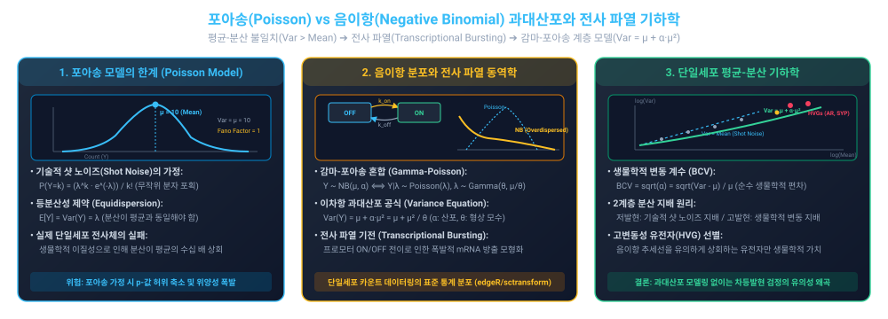
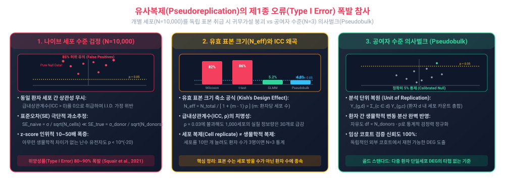
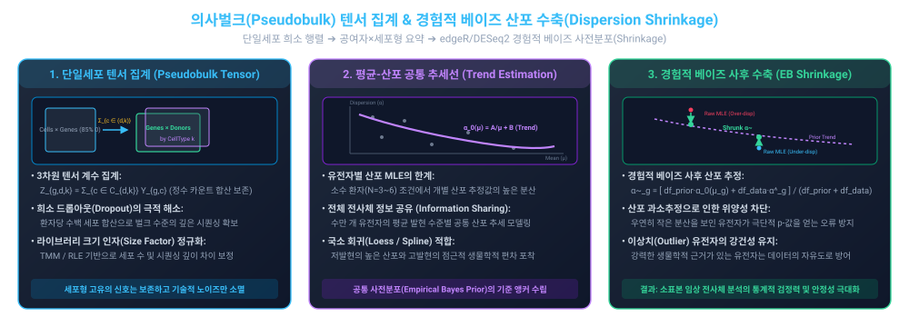
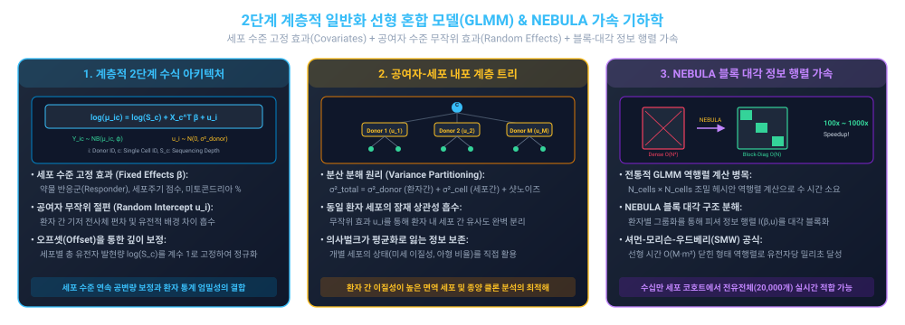
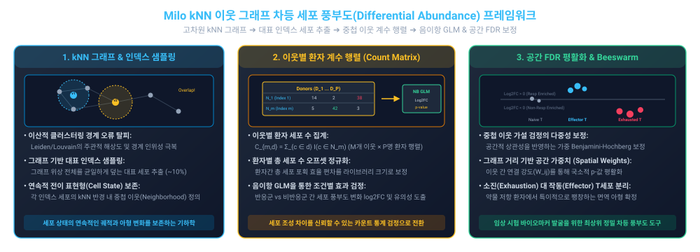
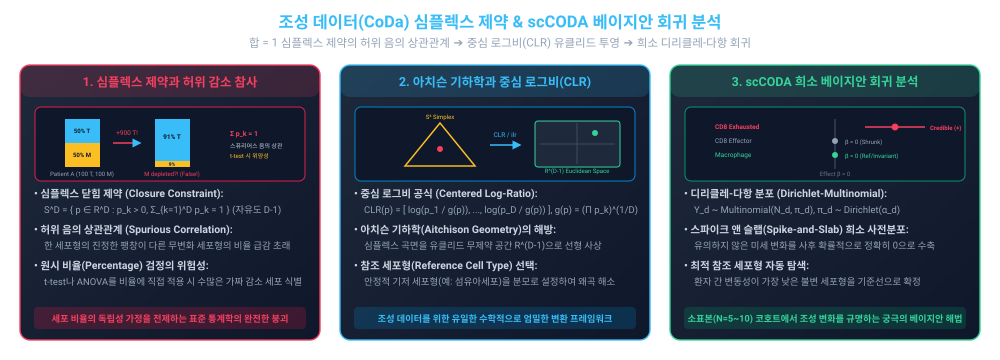

# 단일세포 카운트 통계학 및 차등 풍부도 (Single-Cell Count Statistics & Differential Abundance) 마스터 교재
**From Negative Binomial Overdispersion & Pseudoreplication to Pseudobulk (DESeq2/edgeR), Hierarchical GLMM (NEBULA) & Milo Differential Abundance**

---

## 📚 교재 전체 목차 (Table of Contents)

- [Chapter 00. 단일세포 전사체 카운트 통계 및 차등 분석 로드맵](#part-00-00-단일세포-전사체-카운트-통계-및-차등-분석-로드맵-count-statistics-roadmap)
- [Chapter 01. 단일세포 카운트 확률 모델: 포아송에서 음이항으로](#part-01-01-단일세포-카운트-확률-모델-포아송poisson에서-음이항negative-binomial으로)
- [Chapter 02. 가짜 반복(Pseudoreplication)의 통계학적 함정과 재현성 위기](#part-02-02-가짜-반복pseudoreplication의-통계학적-함정과-재현성-위기)
- [Chapter 03. 슈도벌크(Pseudobulk) 분석 프레임워크: edgeR과 DESeq2의 통계학](#part-03-03-슈도벌크pseudobulk-분석-프레임워크-edger과-deseq2의-통계학)
- [Chapter 04. 위계적 일반화 선형 혼합 모델(GLMM): 세포 수준 공변량과 무작위 효과](#part-04-04-위계적-일반화-선형-혼합-모델glmm-세포-수준-공변량과-무작위-효과)
- [Chapter 05. 고속 세포 수준 음이항 혼합 모델 (Fast Cell-Level GLMM with NEBULA)](#part-05-05-고속-세포-수준-음이항-혼합-모델-fast-cell-level-glmm-with-nebula)
- [Chapter 06. 분화 궤적 기반 연속 차등 발현 분석 (Trajectory Differential Expression)](#part-06-06-분화-궤적-기반-연속-차등-발현-분석-trajectory-differential-expression--lineage-bifurcation-testing)
- [Chapter 07. 이웃 그래프 기반 차등 풍부도 분석과 Spatial FDR (Differential Abundance with Milo)](#part-07-07-이웃-그래프-기반-차등-풍부도-분석과-spatial-fdr-differential-abundance-with-milo--spatial-fdr)
- [Chapter 08. 조성 데이터 분석과 scCODA 베이지안 회귀 (Compositional Data Analysis & scCODA)](#part-08-08-조성-데이터-분석과-sccoda-베이지안-회귀-compositional-data-analysis--sccoda)
- [Chapter 09. 트러블슈팅, 실험 설계 및 통계 검증 가이드 (Troubleshooting & Best Practices)](#part-09-09-트러블슈팅-실험-설계-및-통계-검증-가이드-troubleshooting-experimental-design--statistical-benchmarking)

---

# Part 00. 00. 단일세포 전사체 카운트 통계 및 차등 분석 로드맵 (Count Statistics Roadmap)
> **출처 원본 파일**: `tracks/07_count_statistics_abundance/docs/00_COUNT_STATISTICS_ROADMAP.md`


---

## 학습 목표 (Cognitive Goals)

1. **단일세포 카운트 통계학의 근본적 패러다임 전환 인식**: 단일세포 RNA 시퀀싱(scRNA-seq/snRNA-seq) 데이터에서 개별 세포의 수($n_{\text{cells}}$)와 독립적인 생물학적 개체 수($N_{\text{donors}}$)의 차이를 통계학적으로 엄밀하게 구별하고, 세포 수준 $i.i.d.$ 가정의 붕괴가 초래하는 위계적 데이터 구조의 수학적 본질을 규명한다.
2. **문헌 속 단일세포 재현성 위기(Reproducibility Crisis) 진단**: 림프구, 상피세포, 종양 미세환경 연구에서 널리 오용되어 온 세포 수준 단순 비모수 검정(Wilcoxon rank-sum test)과 포아송 기반 검정이 어떻게 수천 개의 가짜 차등 발현 유전자(False Positive DEGs)를 양산하고 통계적 검정력을 왜곡했는지 비판적으로 해체한다.
3. **대표적 임상 암 코호트 벤치마크 확립**: Kfoury et al. (Cancer Cell 2021)의 전립선암 골전이 환자 9명(각 환자 3개 분획) 및 양성 골수 대조 7명(GSE143791) 코호트와 Chen et al. (Nat Cell Biol 2021)의 원발 전립선 종양 13개 아틀라스(GSE141445)를 벤치마크 데이터셋으로 정의하고, 복잡한 임상 공변량 제어 전략을 수립한다.
4. **선행 트랙(Tracks 00~06)과의 상호 운용 체계 정립**: Track 04의 유전체 서브클론(Genomic Subclones) 특이적 발현 비교 및 Track 06의 연속적 분화 궤적(Continuous Trajectory/Pseudotime) 상에서의 동적 유전자 검정에서 카운트 기반 통계 모델이 결합되는 메커니즘을 설계한다.
5. **프로덕션 등급 카운트 분석 전산 환경 구축**: `scanpy`, `decoupler`, `statsmodels`, `edgeR`, `DESeq2`, `glmmTMB`, `nebula`로 이어지는 파이썬 및 R 하이브리드 통계 생태계를 완벽하게 구성한다.

---

## 1. 단일세포 카운트 통계학의 패러다임 전환: $n_{\text{cells}}$ vs $N_{\text{donors}}$

### 1.1 대용량 시퀀싱의 착시와 표본 크기(Sample Size)의 착각

현대 단일세포 전사체 기술(10x Chromium, Parse Biosciences, Smart-seq3 등)의 비약적 발전으로 단일 실험에서 $10^4 \sim 10^6$개의 세포를 손쉽게 프로파일링할 수 있게 되었다. 그러나 이 대규모 데이터 행렬 $X \in \mathbb{N}_0^{G \times n_{\text{cells}}}$은 통계학적으로 심각한 착시를 유발한다.

많은 연구자들이 $n = 50,000$개의 세포를 관측했다는 사실을 표본 크기 $N = 50,000$인 독립 표본으로 오인하고, 귀무가설 검정 시 표준 오차(Standard Error)가 $\sqrt{n}$에 반비례하여 0으로 수렴할 것이라 가정한다:

$$\text{SE}_{\text{naive}}(\bar{Y}) = \frac{\sigma}{\sqrt{n_{\text{cells}}}} \approx 0$$

그러나 동일한 생물학적 개체(환자, 마우스, 생검 조직)에서 유래한 세포들은 유전적 배경, 미세환경적 노출, 면역 상태, 조직 처리 배치(Batch) 효과를 공유한다. 즉, **세포들은 상호 독립적이지 않다(Non-independent)**.

```
[The Hierarchical Sampling Structure in Single-Cell Cohorts]

Cohort Level (True Biological Replicates):
       Donor 1 (Patient A)              Donor 2 (Patient B)              Donor 3 (Patient C)
      [ N_donors = 3 biological units of inference for treatment/disease effect ]
              │                                │                                │
              ├── Single-cell dissociation     ├── Single-cell dissociation     ├── Single-cell dissociation
              ▼                                ▼                                ▼
Cell Level (Observational Units / Technical Sub-samples):
   Cell 1, Cell 2, ..., Cell n_1    Cell 1, Cell 2, ..., Cell n_2    Cell 1, Cell 2, ..., Cell n_3
   (n_1 = 5,000 cells)              (n_2 = 4,200 cells)              (n_3 = 6,100 cells)
   [ Total cells = 15,300 cells: Correlated cluster measurements! ]
```

### 1.2 통계적 추론 단위의 괴리

- **실험 단위 (Experimental Unit)**: 치료제 투여, 질병 상태(Case vs Control), 유전자 녹아웃 등 연구자가 관심을 두는 처치(Treatment)가 독립적으로 할당되는 단위. 임상 및 전임상 연구에서 이는 **환자(Donor) 또는 동물 개체($N_{\text{donors}}$)**이다.
- **측정 단위 (Observational Unit)**: 전사체 발현량이 실제로 측정되는 최소 단위. 즉, **개별 단일세포($n_{\text{cells}}$)**이다.

실험 단위와 측정 단위가 일치하지 않는 위계적 구조에서 측정 단위(세포)를 독립 표본으로 취급하는 순간, 가설 검정의 유효 자유도(Effective Degrees of Freedom)는 과대평가되고, 검정 통계량은 비정상적으로 팽창하여 재앙적인 **가짜 반복(Pseudoreplication)**이 발생한다.

---

## 2. 단일세포 문헌의 재현성 위기 (The Reproducibility Crisis)

### 2.1 Squair et al. (Nature Communications, 2021)의 충격적 벤치마크

단일세포 문헌의 상당수가 Seurat의 `FindMarkers`나 Scanpy의 `sc.tl.rank_genes_groups`에서 기본 제공하는 **단일세포 수준 비모수 검정(Wilcoxon rank-sum test)** 또는 단순 포아송/음이항 회귀를 무비판적으로 사용해왔다.

2021년 Squair et al.은 matched bulk RNA-seq를 정답으로 둔 18개의 gold-standard 데이터셋에서 14개 통계 방법의 일치도(AUCC)를 비교하고, 생물학적 차이가 없는 무작위 그룹 비교에서 발견되는 DE 유전자 수를 확인하여 다음 정성적 결론을 보고하였다 (논문은 아래와 같은 Type I error 수치표를 제시하지 않으므로 수치는 인용하지 않는다):

```
[Squair et al. (2021) 정성적 결론 요약]
Test Method                      논문의 결론
──────────────────────────────────────────────────────────────────────────────────────────
세포 단위 방법(Wilcoxon 등)      생물학적 반복 간 변동을 무시 → 편향되고 위양성 발견에 취약
                                 (무작위 비교에서도 수백 개의 DE 유전자를 발견할 수 있음)
Pseudobulk (edgeR, DESeq2 등)    반복 간 변동을 반영 → 정답(bulk)과의 일치도가 가장 높음
GLMM 등 혼합모형                 약 500세포 이상에서 pseudobulk 성능에 수렴하나 계산 비용이 큼
──────────────────────────────────────────────────────────────────────────────────────────
```

단순 세포 수준 Wilcoxon 검정은 환자 간의 생물학적 변동(Donor-to-donor variability)을 무시하므로, 두 군(Case vs Control) 간에 실제 유전자 발현 차이가 없는 귀무가설($H_0$) 하에서도 **다수의 위양성 차등 발현 유전자(False DEGs)**를 보고할 수 있다(위양성의 정도는 반복 수·세포 수·발현량 등 조건에 의존한다).

### 2.2 $p$-value의 기만과 초극단적 유의성($p < 10^{-300}$)의 진실

많은 논문에서 $p = 10^{-50}$ 또는 $p = 0.0$(R 등에서 매우 작은 값이 0으로 표시되는 언더플로)과 같은 극단적인 $p$-value를 제시하며 발굴된 마커 유전자의 유의성을 과시한다. 

그러나 이 수치는 유전자의 실제 생물학적 효과 크기(Effect Size)를 증명하는 것이 아니라, 단지 **상관된 세포 수 $n$을 분모에 대입하여 표준 오차를 인위적으로 축소시킨 수치적 인공물(Artifact)**에 불과하다. 환자 3명 대 3명의 비교에서 순수한 생물학적 자유도는 단 $df = 3 + 3 - 2 = 4$에 불과하며, $df=4$에서 $p<10^{-50}$이 되려면 $|t|\approx5\times10^{12}$이 필요하므로(수학적으로는 가능하나) 현실적인 데이터로는 도달할 수 없는 수치이다.

---

## 3. 대표 임상 벤치마크 코호트

본 트랙에서는 단일세포 전사체 카운트 통계와 차등 분석의 엄밀한 검증을 위해, 실제 임상 난제와 복잡한 공변량을 내포한 두 가지 고난도 전립선암 단일세포/단일핵 코호트를 기준 데이터셋으로 채택한다.

```
[Benchmark Cohorts for Count Statistics & Differential Expression]

1. Kfoury et al. (Cancer Cell 2021) - GSE143791
   ┌─────────────────────────────────────────────────────────────┐
   │ Cohort: 9 PCa Bone-Metastasis Patients (Tumor/Involved/Distal│
   │         marrow fractions) + 7 Benign BM controls            │
   │ Platform: 10x Chromium 3' v2 scRNA-seq                      │
   │ Challenges: Severe donor-specific infiltration bias,        │
   │             extreme cell-type sparsity in osteoblasts,      │
   │             prior androgen deprivation therapy (ADT) history│
   └─────────────────────────────────────────────────────────────┘

2. Chen et al. (Nat Cell Biol 2021) - GSE141445
   ┌─────────────────────────────────────────────────────────────┐
   │ Cohort: 13 Primary Prostate Tumors (radical prostatectomy)  │
   │ Cells: 36,424 Single Cells (Epithelial & TME Atlas)         │
   │ Challenges: Patient age distribution,                       │
   │             Gleason score confounding, multi-batch designs, │
   │             luminal lineage plasticity along castration     │
   └─────────────────────────────────────────────────────────────┘
```

### 3.1 Kfoury et al. (Cancer Cell 2021) 골전이 전립선암 코호트 (GSE143791)
- **임상적 배경**: 전립선암 사망의 주원인인 골전이(Bone Metastasis) 미세환경 프로파일링.
- **통계적 도전 과제**:
  - 골 조직 특성상 환자 간 세포 수율의 불균형 가능성(예: 어떤 환자는 200개, 다른 환자는 5,000개라는 가정적 예시).
  - 환자별 이전 요법(화학요법, 호르몬 치료 등) 노출 이력의 이질성(예: Radium-223 노출 환자는 상세 분석에서 제외되었음).
  - 전이 미세환경 내 골아세포(Osteoblast), 파골세포(Osteoclast), 면역세포 간 상호작용 검정 시 환자 무작위 효과(Random Effects) 제어 필수.

### 3.2 Chen et al. (Nat Cell Biol 2021) 원발암 vs 진행성 전립선암 아틀라스 (GSE141445)
- **임상적 배경**: 근치적 전립선 절제술로 얻은 원발 종양 13개(36,424 세포)의 상피·미세환경 아틀라스(논문은 별도 11개 샘플로 CRPC 비교를 추가).
- **통계적 도전 과제**:
  - 환자 연령(Age), 병기(Stage), 글리슨 점수(Gleason Score) 등 연속형/순서형 임상 공변량 제어.
  - 관강 세포(Luminal Epithelia) 내부에서 치료 저항성에 따른 클론 확장 및 조성비 변화(Differential Abundance)와 유전자 발현 변화(Differential Expression)의 상호 분리.

---

## 4. 선행 트랙(Tracks 00~06)과의 유기적 통합 체계

본 트랙 07의 카운트 통계 모델은 독립적으로 존재하는 것이 아니라, 이전 트랙들에서 도출된 계산생물학적 객체들을 가설 검정의 단위로 수용한다.

```
[Integration Architecture with Tracks 00 ~ 06]

Track 04: Cancer Genomics & Clones
  │ (InferCNV / Copy Number Calling)
  ▼
Subclone Architecture: [Clone A (Diploid)] vs [Clone B (8q Gain, PTEN Del)]
  │
  ├─► Statistical Challenge: Cells within Clone B belong to specific patients!
  └─► Solution: Hierarchical GLMM testing Clone Effect while blocking Patient Effect!
       log(mu_ij) = beta_0 + beta_clone * Clone_ij + u_patient(i) + ...

Track 06: Manifold Trajectory & Kinetics
  │ (CellRank 2 / Waddington-OT / Latent Time)
  ▼
Continuous Differentiation Trajectory: Latent Time tau in [0, 1]
  │
  ├─► Statistical Challenge: Testing dynamic DEG along tau without pseudoreplication!
  └─► Solution: Generalized Additive Mixed Models (GAMM) or Pseudobulk windowing
       log(mu_ij) = f(tau_ij) + u_patient(i) + log(depth_ij)
```

1. **Track 04 (유전체 서브클론 가설 검정)**:
   - 종양 세포 내에서 $PTEN$ 결손 또는 $AR$ 증폭을 보유한 클론 B와 잔존 이배체 클론 A 간의 차등 발현을 비교할 때, 클론 A와 클론 B가 여러 환자에 걸쳐 분포하는 경우 환자 효과($u_i$)를 무작위 효과로 블록화(Block)하지 않으면 클론 특이적 신호가 환자 고유 발현 변이와 뒤섞인다.
2. **Track 06 (연속적 분화 궤적 상의 동역학 검정)**:
   - 전사체 유사시간(Pseudotime, $\tau$) 또는 잠재 시간(Latent Time)을 따라 점진적으로 유도/억제되는 드라이버 유전자를 규명할 때, 연속형 변수 $\tau$를 공변량으로 취급하면서 개체 간 기저 발현 변이를 제어하는 일반화 가법 혼합 모델(GAMM) 및 위계적 스플라인 모델이 필수적으로 요구된다.

---

## 5. 트랙 07 전체 아키텍처 및 학습 로드맵

본 트랙은 총 10개의 장(00~09)으로 구성되며, 단일세포 카운트 데이터의 확률적 기저부터 위계적 모델링, 궤적 DE, 차등 풍부도·조성 분석, 트러블슈팅까지 단계별로 심화된다:

```
[Track 07 Curriculum Architecture]

Part 1: Probability Foundations & Pseudobulk Framework (Docs 00 ~ 04)
 ├── 00. Count Statistics Roadmap (Current)
 ├── 01. Probability Models: Poisson to Negative Binomial (Gamma-Poisson Derivation)
 ├── 02. The Pseudoreplication Pitfall & Type I Error Explosion (ICC & N_eff)
 ├── 03. Pseudobulk Framework: edgeR & DESeq2 (Empirical Bayes Shrinkage & QLF)
 └── 04. Hierarchical GLMM: Random Effects & Cell-level Covariates (glmmTMB & Laplace)

Part 2: Cell-level Models, Trajectory DE & Differential Abundance (Docs 05 ~ 08)
 ├── 05. Fast Cell-level Mixed Models: NEBULA
 ├── 06. Trajectory Differential Expression (tradeSeq/GAM)
 ├── 07. Neighborhood-based Differential Abundance: Milo (k-NN Graph Overlapping Neighborhoods)
 └── 08. Compositional Data Analysis (CoDa): propeller/speckle, scCODA

Part 3: Best Practices (Doc 09)
 └── 09. Troubleshooting & Best Practices (IHW, QC, 루브릭)
```

---

## 6. 프로덕션 분석 환경 구축 (Environment Setup)

단일세포 카운트 통계와 혼합 모델 분석을 수행하기 위해 Python 생태계와 R Bioconductor 생태계를 긴밀하게 연동하는 전용 가상환경을 구성한다.

### 6.1 Conda/Mamba 환경 생성 및 필수 패키지 설치

```bash
# 1. 전용 환경 생성 (Python 3.11 및 R 4.3 기반; decoupler 2.x가 Python>=3.11 요구)
conda create -n sn_stats python=3.11 r-base=4.3.2 -c conda-forge -c bioconda -y
conda activate sn_stats

# 2. Python 핵심 단일세포 및 통계 패키지 설치
pip install \
    scanpy==1.10.1 \
    anndata==0.10.7 \
    "decoupler>=2.0" \
    statsmodels==0.14.2 \
    scipy==1.13.0 \
    scikit-misc==0.3.1 \
    patsy==0.5.6 \
    rpy2==3.5.15 \
    sccoda   # scCODA(Python); mgcv는 R 기본 권장 패키지로 포함

# 3. R 핵심 통계 및 Bioconductor 패키지 설치 (R 콘솔 실행)
R -e '
if (!requireNamespace("BiocManager", quietly = TRUE))
    install.packages("BiocManager", repos="https://cloud.r-project.org")

BiocManager::install(c(
    "edgeR",
    "DESeq2",
    "limma",
    "SingleCellExperiment",
    "SummarizedExperiment",
    "miloR",
    "scater",
    "sccomp",        # sccomp는 CRAN이 아니라 Bioconductor 패키지
    "speckle", "tradeSeq", "slingshot", "IHW", "RUVSeq", "sva"
), ask = FALSE)

install.packages(c(
    "glmmTMB",
    "lme4",
    "nebula",
    "tidyverse",
    "statmod",
    "car"
), repos="https://cloud.r-project.org")
'
```

### 6.2 Python-R 상호운용성 검증 스크립트

```python
"""
00_test_stats_environment.py
환경 구축 및 Python-R(edgeR, glmmTMB) 연동 무결성 검증
"""
import sys
import anndata as ad
import numpy as np
import pandas as pd
import scanpy as sc
import statsmodels.api as sm

print(f"[Python System Info] Python Version: {sys.version.split()[0]}")
print(f"[Python Packages] Scanpy: {sc.__version__}, AnnData: {ad.__version__}")

# rpy2를 통한 R 핵심 패키지 로드 테스트
try:
    import rpy2.robjects as ro
    from rpy2.robjects.packages import importr
    
    base = importr('base')
    edger = importr('edgeR')
    deseq2 = importr('DESeq2')
    glmmtmb = importr('glmmTMB')
    nebula = importr('nebula')
    
    r_ver = ro.r('R.version.string')[0]
    print(f"[R Integration] Successfully linked to: {r_ver}")
    print("[R Packages] edgeR, DESeq2, glmmTMB, nebula imported successfully!")
    print("\n>>> All Count Statistics Environment Components are READY!")
except Exception as e:
    print(f"[Warning] R integration test encountered an issue: {e}")
```

---

## 단원 핵심 점검 (Cognitive Checkpoint & Case Study)

### 문제 1: 표본 크기 착시와 자유도(Degrees of Freedom) 붕괴
어느 암 전사체 연구팀이 대장암 환자 4명(정상 점막 4개체 vs 종양 조직 4개체, 총 $N=8$)으로부터 총 80,000개의 단일 상피세포를 시퀀싱하였다. 연구팀은 80,000개 세포를 데이터 테이블의 개별 행으로 설정하고 두 군(정상 40,000개 vs 종양 40,000개) 간에 독립 표본 $t$-검정을 수행하여 3,500개의 유전자가 $p < 10^{-100}$의 유의수준으로 차등 발현된다고 보고하였다.
1. 이 분석에서 귀무가설 검정에 적용된 표본 크기($n$)와 실제 통계적 추론의 기초가 되는 생물학적 자유도($df$)의 차이를 명시하시오.
2. 세포 간 상관성이 존재할 때, 단순 독립 표본 검정이 산출하는 표준 오차($\text{SE}$)와 $t$-통계량($t = \frac{\bar{X}_1 - \bar{X}_2}{\text{SE}}$)이 겪게 되는 수학적 왜곡 기전을 설명하시오.

<details>
<summary>💡 모범 답안 및 해설 확인</summary>

**1. 표본 크기와 실제 자유도의 괴리**:
- **연구팀이 착각한 표본 크기 및 자유도**: 연구팀은 개별 세포를 독립된 관측치로 간주하여 $n_1 = 40,000, n_2 = 40,000$으로 설정하였다. 이때 적용된 겉보기 자유도는 $df_{\text{naive}} = 40,000 + 40,000 - 2 = 79,998$이다.
- **실제 생물학적 표본 크기 및 유효 자유도**: 치료 및 질병 상태가 부여된 독립적인 생물학적 실험 단위는 환자(Donor) 개체 수이다 ($N_1 = 4, N_2 = 4$). 따라서 유전자가 질병 군과 정상 군 간에 진정으로 차이가 있는지를 검정하기 위한 엄밀한 통계적 자유도는 $df_{\text{true}} = N_1 + N_2 - 2 = 4 + 4 - 2 = 6$에 불과하다.

**2. 표준 오차 과소평가 및 $t$-통계량 폭발 기전**:
- 동일 환자 유래 세포들 간의 공분산(Covariance)은 양수($\text{Cov}(X_{ij}, X_{ik}) = \sigma_{\text{donor}}^2 > 0$)이다.
- 클러스터링된 데이터에서 평균의 참 분산은 다음과 같다:
  $$\text{Var}(\bar{X}) = \frac{\sigma_{\text{cell}}^2}{N \cdot n} + \frac{\sigma_{\text{donor}}^2}{N}$$
- 그러나 단순 독립 표본 공식을 사용할 경우 $\sigma_{\text{donor}}^2$ 항이 완전히 누락되고 분모가 $N \cdot n = 80,000$으로 처리되어 표준 오차($\text{SE}$)가 이론적 참값보다 최대 수십 배에서 수백 배까지 비정상적으로 작게 계산된다:
  $$\text{SE}_{\text{naive}} \ll \text{SE}_{\text{true}}$$
- 그 결과, $t$-통계량 분모의 극단적 축소로 인해 $t = \frac{\bar{X}_1 - \bar{X}_2}{\text{SE}_{\text{naive}}}$가 비정상적으로 팽창하여 수치적으로 $t > 30 \implies p < 10^{-100}$이라는 허구의 초유의성(Spurious Hyper-significance)이 도출된다.

</details>

---

### 문제 2: Kfoury et al. 골전이 데이터셋의 비대칭적 세포 분포와 가짜 상관
Kfoury et al. 골전이 코호트(환자 9명)와 유사한 구조를 가정한 가상 시나리오이다. 골아세포(Osteoblast) 군집을 분석하는 과정에서, 특정 환자 P07 한 명에게서만 전체 골아세포 4,000개 중 3,200개(80%)가 포획되었고 나머지 8명의 환자에게서는 평균 100개씩의 골아세포만 포획되었다.
1. 이 상태에서 환자 P07이 포함된 치료 저항군과 비치료군 간에 세포 수준 Wilcoxon rank-sum 검정을 수행할 경우, P07 환자 개인의 고유 유전적 변이(Private Genetic Variations)나 배치 효과가 전체 저항군 마커 발굴에 미치는 치명적 교란을 논하시오.
2. 슈도벌크(Pseudobulk) 집계 프레임워크가 이러한 단일 환자 독점 왜곡을 어떻게 방어하는지 설명하시오.

<details>
<summary>💡 모범 답안 및 해설 확인</summary>

**1. 단일 환자 독점에 따른 개인 변이의 마커 둔갑(Private Variation Hijacking)**:
- 세포 수준 Wilcoxon 검정은 모든 세포의 발현 순위(Rank)를 동등하게 취급한다.
- 저항군 골아세포의 80%가 환자 P07 단 한 명의 세포이므로, 저항군 세포 집단의 발현량 분포는 사실상 '저항군의 보편적 생물학'이 아니라 '환자 P07의 개인적 발현 특성'을 그대로 반영하게 된다.
- 예를 들어, 환자 P07이 우연히 보유한 생식세포계 변이(Germline Variant), P07 개인의 체질, 또는 P07 샘플 채취 당일의 조직 분리 효소 농도 편차로 인해 발현이 높은 무관한 유전자 $GeneX$가 존재한다면, 세포 수준 검정에서는 3,200개의 P07 세포가 모두 높은 발현 순위를 차지하여 $GeneX$가 $p < 10^{-200}$을 기록하는 최상위 "골전이 치료 저항성 핵심 바이오마커"로 잘못 식별된다.

**2. 슈도벌크 집계의 방어 기전**:
- 슈도벌크 프레임워크는 각 환자별로 세포의 카운트를 하나의 프로파일로 합산(Summation)하므로, 환자 P07은 아무리 많은 세포(3,200개)를 가졌더라도 저항군 내에서 **단 하나의 생물학적 샘플($N=1$)**로 환원된다.
- edgeR이나 DESeq2와 같은 슈도벌크 통계 엔진은 환자 간 분산(Inter-donor variance)을 모델링하므로, $GeneX$가 P07 환자 한 명에서만 극단적으로 높고 나머지 저항군 환자들($N_2, N_3, \dots$)에서 재현되지 않는다면 높은 개체 간 분산($\phi$)으로 인해 통계적 유의성이 완전히 기각된다.
- 즉, 슈도벌크는 특정 환자의 세포 과다 추출로 인한 위양성 편향을 크게 완화한다(단, 세포 수가 적은 환자의 pseudobulk는 잡음이 커 최소 셀/카운트 필터와 가중이 필요하며, 환자 수가 적으면 환자 특이 변이의 검정력·재현성 문제는 남는다).

</details>

---

### 문제 3: Track 04 서브클론과 Track 06 연속 궤적 상의 슈도벌크 한계
환자 10명의 암 조직 단일세포 데이터에서, 각 환자의 종양 내부에는 정상 이배체 클론, 서브클론 A($TP53$ 변이), 서브클론 B($AR$ 증폭)가 서로 다른 비율로 공존하고 있다. 또한 세포들은 줄기세포 유사 상태에서 분화된 관강 세포 상태로 연속적인 분화 궤적 잠재 시간($\tau \in [0, 1]$)을 따라 이동 중이다.
1. 이 데이터셋에서 서브클론 간 유전자 발현 차이를 규명하거나 잠재 시간 $\tau$에 따른 동적 발현을 분석할 때, 환자 단위로 세포를 완전히 합산해 버리는 단순 슈도벌크(Vanilla Pseudobulk) 방식이 직면하는 두 가지 근본적 정보 손실을 서술하시오.
2. 이러한 한계를 극복하기 위해 제4장에서 다룰 위계적 일반화 선형 혼합 모델(GLMM)이 도입되어야 하는 당위성을 수학적 선형 예측자($\eta_{ij}$) 형태로 제시하시오.

<details>
<summary>💡 모범 답안 및 해설 확인</summary>

**1. 단순 슈도벌크의 두 가지 근본적 정보 손실**:
- **세포 내 이질성 및 서브클론 해상도 붕괴**: 환자별로 세포를 통째로 합산하면, 동일 환자 내부에서 공존하는 서브클론 A, 서브클론 B, 정상 클론의 카운트가 믹서기에 갈리듯 하나로 혼합(Bulk Averaging)되어 서브클론 고유의 발현 특이성이 희석된다.
- **연속적 공변량의 소실(Loss of Continuous Covariates)**: 각 세포가 가진 연속적 분화 잠재 시간 $\tau \in [0, 1]$이나 세포 주기 점수($G_2/M$ Score), 미토콘드리아 분율과 같은 단일세포 수준 연속 변수는 단일 스칼라 요약값(평균 등)으로 압축되면서 세포별 동역학적 궤적 정보가 파괴된다.

**2. 위계적 GLMM 도입의 당위성 및 선형 예측자 정식화**:
- GLMM은 세포 수준의 연속형/범주형 공변량을 그대로 유지하면서도, 환자 간의 상관성을 무작위 효과(Random Effects)로 완벽히 흡수한다.
- 환자 $i$의 세포 $j$에 대한 로그 연결 선형 예측자 $\eta_{ij} = \log(\mu_{ij})$:
  $$\log(\mu_{ij}) = \beta_0 + \beta_{\text{clone}} \cdot \text{Clone}_{ij} + f(\tau_{ij}) + \mathbf{X}_{ij}^{\text{cell}} \boldsymbol{\gamma} + u_i + \log(\text{depth}_{ij})$$
  - $\text{Clone}_{ij}$: 세포 $j$가 속한 유전체 서브클론 지시 변수 (Track 04 연계).
  - $f(\tau_{ij})$: 잠재 시간 $\tau$에 따른 비선형 동적 발현 스플라인 함수 (Track 06 연계).
  - $\mathbf{X}_{ij}^{\text{cell}}$: 세포 주기 및 미토콘드리아 분율 등 세포 수준 교란 변수.
  - $u_i \sim \mathcal{N}(0, \sigma_{\text{donor}}^2)$: 환자 $i$의 고유 기저 발현 변이를 흡수하는 무작위 절편(Random Intercept).
  - $\log(\text{depth}_{ij})$: 세포별 시퀀싱 깊이에 대한 오프셋(Offset).
- 이를 통해 세포 수준의 미세한 공변량을 온전히 살리면서도 환자 수준의 가짜 반복을 수학적으로 엄밀하게 차단한다.

</details>

---

<!-- REFERENCES:BEGIN (generated by scripts/apply_references.py; do not edit by hand) -->
## 참고문헌 (References)
### 본문 인용 문헌
1. Squair JW, Gautier M, Kathe C, et al. Confronting false discoveries in single-cell differential expression. *Nat Commun*. 2021;12(1):5692. PMID: 34584091. doi: 10.1038/s41467-021-25960-2
2. Kfoury Y, Baryawno N, Severe N, et al. Human prostate cancer bone metastases have an actionable immunosuppressive microenvironment. *Cancer Cell*. 2021;39(11):1464-1478.e8. PMID: 34719426. doi: 10.1016/j.ccell.2021.09.005
3. Chen S, Zhu G, Yang Y, et al. Single-cell analysis reveals transcriptomic remodellings in distinct cell types that contribute to human prostate cancer progression. *Nat Cell Biol*. 2021;23(1):87-98. PMID: 33420488. doi: 10.1038/s41556-020-00613-6
### 소프트웨어 (표기 버전은 검수 시 API를 확인한 버전이며, 파이프라인 실행 환경은 requirements-pipelines.txt 참조)
- anndata 0.13.4 (github.com/scverse/anndata). 원 논문: Virshup I, Rybakov S, Theis FJ, et al. anndata: Access and store annotated data matrices. *JOSS*. 2024;9(101):4371. doi: 10.21105/joss.04371
- DESeq2 (bioconductor.org/packages/DESeq2). 원 논문: Love MI, Huber W, Anders S. Moderated estimation of fold change and dispersion for RNA-seq data with DESeq2. *Genome Biol*. 2014;15(12):550. PMID: 25516281. doi: 10.1186/s13059-014-0550-8
- edgeR (bioconductor.org/packages/edgeR). 원 논문: Robinson MD, McCarthy DJ, Smyth GK. edgeR: a Bioconductor package for differential expression analysis of digital gene expression data. *Bioinformatics*. 2010;26(1):139-40. PMID: 19910308. doi: 10.1093/bioinformatics/btp616
- glmmTMB (github.com/glmmTMB/glmmTMB). 원 논문: Brooks M, Kristensen K, Benthem K, et al. glmmTMB Balances Speed and Flexibility Among Packages for Zero-inflated Generalized Linear Mixed Modeling. *The R Journal*. 2017;9(2):378. doi: 10.32614/rj-2017-066
- NEBULA (github.com/lhe17/nebula). 원 논문: He L, Davila-Velderrain J, Sumida TS, et al. NEBULA is a fast negative binomial mixed model for differential or co-expression analysis of large-scale multi-subject single-cell data. *Commun Biol*. 2021;4(1):629. PMID: 34040149. doi: 10.1038/s42003-021-02146-6
- NumPy 2.5.4 (numpy.org). 원 논문: Harris CR, Millman KJ, van der Walt SJ, et al. Array programming with NumPy. *Nature*. 2020;585(7825):357-362. PMID: 32939066. doi: 10.1038/s41586-020-2649-2
- rpy2 3.6.9 (github.com/rpy2/rpy2).
- Scanpy 1.12.4 (github.com/scverse/scanpy). 원 논문: Wolf FA, Angerer P, Theis FJ. SCANPY: large-scale single-cell gene expression data analysis. *Genome Biol*. 2018;19(1):15. PMID: 29409532. doi: 10.1186/s13059-017-1382-0
- statsmodels 0.15.0 (github.com/statsmodels/statsmodels).
- pandas 2.3.3 (github.com/pandas-dev/pandas). 원 논문: McKinney W. Data Structures for Statistical Computing in Python. *Proceedings of the Python in Science Conference*. 2010:56-61. doi: 10.25080/majora-92bf1922-00a
<!-- REFERENCES:END -->


---

# Part 01. 01. 단일세포 카운트 확률 모델: 포아송(Poisson)에서 음이항(Negative Binomial)으로
> **출처 원본 파일**: `tracks/07_count_statistics_abundance/docs/01_PROBABILITY_MODELS_POISSON_NB.md`


---

## 학습 목표 (Cognitive Goals)

1. **포아송 과정의 수학적 한계 규명**: 점 과정(Point Process)의 무기억성(Memorylessness)과 등분산 제약($\mathbb{E}[Y] = \text{Var}(Y) = \mu$)을 수식화하고, 단일세포 전사체학에서 발생하는 전사 파열(Transcriptional Bursting) 및 증폭 노이즈가 왜 포아송 가정을 필연적으로 파괴하는지 증명한다.
2. **감마-포아송(Gamma-Poisson) 연속 혼합 분포의 엄밀한 유도**: 세포 간 잠재 전사율 $\Lambda$가 감마 분포를 따를 때, 주변부 확률 분포 $P(Y=y)$를 적분하여 음이항(Negative Binomial, NB) 분포의 확률 질량 함수를 유도하고, 과분산 모수 $\theta$와 분산 함수 $\text{Var}(Y) = \mu + \frac{\mu^2}{\theta}$의 대수적 기하학을 정립한다.
3. **영과잉(Zero-Inflation) 논쟁과 Svensson (2020)의 논의 고찰**: 고유 분자 식별자(UMI) 도입 이후 droplet 데이터에서 관측되는 0(Zeros)이 대부분 감마-포아송 표본추출 확률(Sampling Zeros)과 세포 이질성으로 설명될 수 있음을 논의하고, ZINB 모델의 불필요한 과적합(Overfitting)과 수치적 불안정성을 통계학적으로 비판한다.
4. **통계적 가설 검정 및 모델 선택 실무**: 포아송 GLM과 음이항 GLM의 잔차 편차(Residual Deviance), 우도비 검정(Likelihood Ratio Test, LRT), 아카이케 정보 기준(AIC)을 파이썬 및 R 코드로 구현하여 최적의 오차 구조를 선택하는 계산 파이프라인을 구축한다.

---

## 1. 포아송 과정(Poisson Process)과 등분산 제약(Equi-dispersion)의 붕괴

### 1.1 점 과정(Point Process)으로서의 이상적 시퀀싱

이상적인 차세대 염기서열 분석(Next-Generation Sequencing)에서, 특정 유전자 $g$로부터 유래한 단편(cDNA 분자)이 플로우셀(Flowcell)의 임의의 위치에 결합하여 시퀀싱 리드(Read)로 검출되는 과정은 고전적인 **포아송 점 과정(Poisson Point Process)**으로 모형화할 수 있다.

시퀀싱 과정이 다음의 가정을 만족한다고 하자:
1. **무기억성 및 독립성(Independence)**: 임의의 한 분자가 포획되어 시퀀싱될 확률은 다른 분자의 포획 여부에 영향을 받지 않는다.
2. **균일성(Stationarity)**: 단위 시간 또는 단위 시퀀싱 깊이당 분자 검출 확률은 일정하다.
3. **희소성(Sparsity)**: 극히 짧은 시퀀싱 구간에서 둘 이상의 동일 분자가 중복 검출될 확률은 0에 수렴한다.

이러한 조건 하에서, 평균 발현율 $\mu > 0$을 갖는 유전자 $g$의 관측 카운트 $Y \in \{0, 1, 2, \dots\}$의 확률 질량 함수(Probability Mass Function, PMF)는 다음과 같이 주어진다:

$$P(Y = y \mid \mu) = \frac{\mu^y e^{-\mu}}{y!}$$

### 1.2 등분산 제약(Equi-dispersion Constraint)

포아송 분포의 적률생성함수(Moment Generating Function, MGF) $M_Y(t)$를 유도하면:

$$M_Y(t) = \mathbb{E}[e^{tY}] = \sum_{y=0}^\infty e^{ty} \frac{\mu^y e^{-\mu}}{y!} = e^{-\mu} \sum_{y=0}^\infty \frac{(\mu e^t)^y}{y!} = e^{-\mu} e^{\mu e^t} = \exp\left(\mu (e^t - 1)\right)$$

이를 미분하여 평균과 분산을 도출하면:

$$\mathbb{E}[Y] = M'_Y(0) = \mu$$

$$\mathbb{E}[Y^2] = M''_Y(0) = \mu^2 + \mu \implies \text{Var}(Y) = \mathbb{E}[Y^2] - (\mathbb{E}[Y])^2 = \mu$$

포아송 분포는 **평균과 분산이 정확히 일치해야 하는 강력한 수학적 제약 조건($\text{Var}(Y) = \mathbb{E}[Y] = \mu$)**, 즉 **등분산성(Equi-dispersion)**을 갖는다.

```
[The Poisson Point Process vs Real Single-Cell Reality]

Theoretical Poisson Process:
  Constant Transcriptional Rate: λ(t) = λ_0 = const.
  Timeline: ───•──────•───•─────────•──────•───•───> (Steady, memoryless arrival)
  Count Distribution: Mean = μ, Variance = μ  (Variance / Mean = 1)

Real Single-Cell Biology (Transcriptional Bursting):
  Promoter Dynamics:  [OFF State] ══════════> [ON State (Burst!)] ══════════> [OFF State]
  Transcription Rate: λ(t) = 0                λ(t) = λ_burst >>> 0          λ(t) = 0
  Timeline: ──────────────────────• • • • • •───────────────────────────────> (Clustered, bursty arrival)
  Count Distribution: Mean = μ, Variance = μ + α·μ²  (Overdispersion: Variance / Mean >> 1)
```

### 1.3 단일세포 전사체학에서 포아송 가정이 붕괴하는 두 가지 기전

실제 생체 단일세포에서 추출한 카운트 데이터 $Y$는 일반적으로 **과분산(Overdispersion, $\text{Var}(Y) > \mathbb{E}[Y]$)**을 보이며, 특히 고발현·이질 집단에서 두드러진다(저발현 유전자는 $\text{Var} \approx \mu$에 가깝다). 이는 다음의 두 가지 본질적인 생물학적/물리적 요인에 기인한다:

1. **전사 파열 (Transcriptional Bursting - 생물학적 요동)**:
   - 진핵생물 유전자의 프로모터는 지속적으로 열려 있는 것이 아니라, 닫힌 상태($\text{State}_{\text{OFF}}$)와 열린 상태($\text{State}_{\text{ON}}$) 사이를 무작위로 전이하는 이분법적 키네틱스(Telegraph Model)를 따른다.
   - 프로모터가 $\text{ON}$ 상태로 활성화되는 극히 짧은 순간 동안 수십~수백 개의 전사체가 폭발적으로 쏟아져 나온 뒤, 다시 장기간의 $\text{OFF}$ 침묵 상태로 진입한다.
   - 따라서 동일한 세포 집단 내부에서도 세포마다 전사율 $\lambda$ 자체가 고정된 상수가 아니라 확률 변수(Random Variable)로 요동친다.
2. **기술적 증폭 및 포획 불균일성 (Technical Amplification Stochasticity)**:
   - 미세유체 칩(Microfluidic droplet) 내에서 각 방울마다 역전사 효소 농도, 용해 효율, cDNA 증폭 효율(PCR efficiency)의 무작위 편차가 발생한다.
   - 세포마다 시퀀싱 깊이(Library size / Sequencing depth)가 수천~수만 카운트 단위로 차이를 보이며, 이는 관측되는 카운트의 분산을 추가적으로 팽창시킨다.

따라서 단일세포 데이터를 모델링하기 위해서는 전사율 $\lambda$ 자체의 확률적 요동을 포괄하는 **계층적 연속 혼합 모델(Continuous Mixture Model)**이 필수적이다.

---

## 2. 감마-포아송(Gamma-Poisson) 연속 혼합으로서의 음이항 분포 유도

### 2.1 계층적 혼합 모델의 정식화

개별 세포 $j$가 갖는 고유한 잠재 전사율을 $\Lambda_j$라고 하자. 
조건부로 $\Lambda_j = \lambda$가 주어졌을 때 관측되는 유전자 카운트 $Y_j$는 포아송 과정을 따른다고 가정한다:

$$Y_j \mid (\Lambda_j = \lambda) \sim \text{Poisson}(\lambda), \quad P(Y_j = y \mid \lambda) = \frac{\lambda^y e^{-\lambda}}{y!}$$

이때 세포 간 전사율 $\Lambda$의 생물학적/기술적 변동을 양의 실수 공간 $\mathbb{R}^+$에서 정의되는 유연한 켤레 사전분포(Conjugate Prior)인 **감마 분포(Gamma Distribution)**로 모형화한다:

$$\Lambda \sim \text{Gamma}(\text{shape} = \theta, \text{rate} = \beta)$$

감마 분포의 확률 밀도 함수(Probability Density Function, PDF)는 다음과 같다:

$$f_\Lambda(\lambda; \theta, \beta) = \frac{\beta^\theta}{\Gamma(\theta)} \lambda^{\theta - 1} e^{-\beta \lambda}, \quad \lambda > 0$$

여기서 $\Gamma(\theta) = \int_0^\infty t^{\theta-1} e^{-t} dt$는 오일러의 감마 함수이다.
감마 분포의 평균과 분산은 각각 다음과 같다:

$$\mathbb{E}[\Lambda] = \frac{\theta}{\beta}, \quad \text{Var}(\Lambda) = \frac{\theta}{\beta^2}$$

우리가 모형화하려는 세포 집단의 평균 전사율을 $\mu$라고 하면, $\mathbb{E}[\Lambda] = \mu \implies \frac{\theta}{\beta} = \mu \implies \beta = \frac{\theta}{\mu}$로 재모수화할 수 있다. 이때 전사율의 분산은:

$$\text{Var}(\Lambda) = \frac{\theta}{(\theta/\mu)^2} = \frac{\mu^2}{\theta}$$

### 2.2 주변부 확률 질량 함수(Marginal PMF) 적분 유도

이제 관측 불가능한 잠재 변수 $\lambda$를 전체 확률의 법칙(Law of Total Probability)에 따라 양의 실수 전 구간에 대해 적분하여 소거(Marginalization)한다:

$$P(Y = y) = \int_0^\infty P(Y = y \mid \lambda) f_\Lambda(\lambda) \, d\lambda$$

식을 대입하고 상수를 인테그랄 밖으로 추출한다:

$$P(Y = y) = \int_0^\infty \left( \frac{\lambda^y e^{-\lambda}}{y!} \right) \left( \frac{\beta^\theta}{\Gamma(\theta)} \lambda^{\theta - 1} e^{-\beta \lambda} \right) d\lambda$$

$$P(Y = y) = \frac{\beta^\theta}{y! \, \Gamma(\theta)} \int_0^\infty \lambda^{y + \theta - 1} e^{-(\beta + 1)\lambda} \, d\lambda$$

여기서 피적분 함수는 형태상 감마 적분 공식을 완벽히 만족한다:

$$\int_0^\infty t^{a - 1} e^{-c t} \, dt = \frac{\Gamma(a)}{c^a}$$

위 식에서 $a = y + \theta$, $c = \beta + 1$로 치환하면 적분 결과는 다음과 같다:

$$\int_0^\infty \lambda^{(y + \theta) - 1} e^{-(\beta + 1)\lambda} \, d\lambda = \frac{\Gamma(y + \theta)}{(\beta + 1)^{y + \theta}}$$

이를 대입하면:

$$P(Y = y) = \frac{\beta^\theta}{y! \, \Gamma(\theta)} \cdot \frac{\Gamma(y + \theta)}{(\beta + 1)^{y + \theta}} = \frac{\Gamma(y + \theta)}{y! \, \Gamma(\theta)} \left( \frac{\beta}{\beta + 1} \right)^\theta \left( \frac{1}{\beta + 1} \right)^y$$

이제 $\beta = \frac{\theta}{\mu}$를 대입하여 정리한다:

$$\frac{\beta}{\beta + 1} = \frac{\theta/\mu}{\theta/\mu + 1} = \frac{\theta/\mu}{(\theta + \mu)/\mu} = \frac{\theta}{\theta + \mu}$$

$$\frac{1}{\beta + 1} = \frac{1}{\theta/\mu + 1} = \frac{1}{(\theta + \mu)/\mu} = \frac{\mu}{\theta + \mu}$$

최종적으로 우리는 **감마-포아송 혼합 분포이자 표준 음이항(Negative Binomial) 분포의 확률 질량 함수**를 엄밀하게 얻는다:

$$P(Y = y) = \frac{\Gamma(y + \theta)}{y! \, \Gamma(\theta)} \left(\frac{\theta}{\theta + \mu}\right)^\theta \left(\frac{\mu}{\theta + \mu}\right)^y$$

---

## 3. 음이항 분포의 모멘트와 과분산 분산 함수(Variance Function)

### 3.1 전체 분산의 법칙(Law of Total Variance)을 통한 모멘트 유도

음이항 확률 변수 $Y$의 1차 및 2차 적률을 전체 기댓값과 전체 분산의 법칙을 통해 대수적으로 전개한다.

1. **기댓값 ($\mathbb{E}[Y]$)**:
   $$\mathbb{E}[Y] = \mathbb{E}_\Lambda\left[ \mathbb{E}_Y[Y \mid \Lambda] \right] = \mathbb{E}_\Lambda[\Lambda] = \mu$$

2. **분산 ($\text{Var}(Y)$)**:
   $$\text{Var}(Y) = \mathbb{E}_\Lambda\left[ \text{Var}_Y(Y \mid \Lambda) \right] + \text{Var}_\Lambda\left( \mathbb{E}_Y[Y \mid \Lambda] \right)$$
   포아송 조건부 분산 $\text{Var}(Y \mid \Lambda) = \Lambda$ 및 조건부 기댓값 $\mathbb{E}[Y \mid \Lambda] = \Lambda$이므로:
   $$\text{Var}(Y) = \mathbb{E}_\Lambda[\Lambda] + \text{Var}_\Lambda(\Lambda)$$
   앞서 유도한 감마 분포의 모멘트를 대입하면:
   $$\text{Var}(Y) = \mu + \frac{\mu^2}{\theta}$$

이를 생물정보학 패키지(`edgeR`, `DESeq2`, `statsmodels`)에서 사용하는 분산 계수(Dispersion Parameter) $\alpha = \frac{1}{\theta}$로 표기하면:

$$\text{Var}(Y) = \mu + \alpha \mu^2$$

```
[Structure of the Negative Binomial Variance Function]

        Var(Y) =      μ       +         α · μ²
                      │                     │
                      ▼                     ▼
               Poisson Shot Noise     Overdispersion (αμ²)
              (Sampling)             (생물학적 변동 + 포획·증폭 등 기술적 성분 모두 포함)

Low Expression (μ -> 0):
  μ >> α · μ²  ===> Shot noise dominates! (Behaves like Poisson)

High Expression (μ -> large):
  α · μ² >> μ  ===> Overdispersion dominates quadratic growth! (Biological variance ceiling)
```

### 3.2 포아송 극한으로의 수렴 ($\theta \to \infty$)

과분산 모수 $\theta$가 무한대로 발산할 때($\theta \to \infty \iff \alpha \to 0$):

$$\lim_{\theta \to \infty} \text{Var}(Y) = \lim_{\theta \to \infty} \left( \mu + \frac{\mu^2}{\theta} \right) = \mu$$

또한 스털링 근사(Stirling's Approximation) $\Gamma(z + a)/\Gamma(z) \approx z^a$를 적용하면:

$$\lim_{\theta \to \infty} \frac{\Gamma(y + \theta)}{\Gamma(\theta)} = \theta^y$$

$$\lim_{\theta \to \infty} \left(\frac{\theta}{\theta + \mu}\right)^\theta = \lim_{\theta \to \infty} \left(1 + \frac{\mu}{\theta}\right)^{-\theta} = e^{-\mu}$$

$$\lim_{\theta \to \infty} \left(\frac{\mu}{\theta + \mu}\right)^y = \left(\frac{\mu}{\theta}\right)^y$$

이들을 결합하면:

$$\lim_{\theta \to \infty} P(Y = y) = \frac{\theta^y}{y!} e^{-\mu} \left(\frac{\mu}{\theta}\right)^y = \frac{\mu^y e^{-\mu}}{y!}$$

즉, **포아송 분포는 음이항 분포의 $\theta = \infty$ ($\alpha = 0$) 특수 사례**이며, 음이항 모델은 포아송 모델을 완벽히 일반화한 상위 모델이다.

---

## 4. 기하학적 비교 및 시각화



위 다이어그램에서 확인할 수 있듯이:
1. **평균-분산 기하학(Mean-Variance Geometry)**:
   - 포아송 모델은 $\text{Var} = \text{Mean}$의 $45^\circ$ 선형 궤적을 강제한다.
   - 실제 단일세포 전사체는 발현량이 증가함에 따라 분산이 2차 곡선($\text{Var} \propto \mu^2$)을 그리며 급격히 발산한다.
2. **확률 밀도 기하학(Probability Density Geometry)**:
   - 동일한 평균 발현량 $\mu = 10$에서 포아송 분포는 $\mu$ 부근에 대칭적으로 좁게 밀집한다.
   - 음이항 분포($\theta = 2$)는 두터운 우측 꼬리(Heavy Right Tail)를 형성함과 동시에 $0$ 부근의 확률 밀도를 현저히 상승시킨다.

---

## 5. 영과잉(Zero-Inflation)의 종말: ZINB vs NB 대논쟁과 Svensson (2020)의 증명

### 5.1 영과잉 음이항 모델(ZINB)의 탄생과 가정

2014~2018년 초기 단일세포 전사체 연구(Smart-seq2 등)에서는 데이터 행렬의 80~95%가 $0$으로 채워져 있는 현상을 보고 **영과잉 음이항(Zero-Inflated Negative Binomial, ZINB)** 모델을 광범위하게 도입하였다.

ZINB는 관측된 $0$을 두 가지 상이한 출처의 혼합으로 가정한다:

$$P(Y = y) = \begin{cases} 
\pi + (1 - \pi) P_{\text{NB}}(0 \mid \mu, \theta), & y = 0 \\ 
(1 - \pi) P_{\text{NB}}(y \mid \mu, \theta), & y > 0 
\end{cases}$$

1. **구조적 영 (Structural Zeros / Dropout, 확률 $\pi$)**: 유전자가 실제로는 발현되었으나 역전사 실패, cDNA 손실, 광학적 검출 실패 등으로 인해 기술적으로 유실된 결측치.
2. **표본추출 영 (Sampling Zeros, 확률 $(1 - \pi) P_{\text{NB}}(0)$)**: 포아송/음이항 표본추출 확률에 의해 우연히 0개의 분자가 포획된 정상적 관측치.

### 5.2 Svensson (Nat Biotechnol, 2020)의 반증과 UMI의 통계학

2020년 Valentine Svensson은 차세대 단일세포 전사체학의 근간을 뒤흔드는 기념비적인 연구를 발표하였다:

```
[Svensson, Nat Biotechnol 2020 (Letter, 단독 저자): Droplet scRNA-seq is not zero-inflated]

Plate-based Full-length (Smart-seq2):
  - No UMI! PCR amplification introduces exponential non-linear noise.
  - Optical detection thresholds create genuine technical dropouts.
  - Result: Zero-inflation models (ZINB) appeared plausible.

Droplet-based Digital Counting (10x Chromium, Drop-seq with UMIs):
  - Unique Molecular Identifiers (UMIs) tag individual original mRNA molecules.
  - PCR duplicates are collapsed digitally: 1 UMI = Exactly 1 original molecule.
  - Main point: the observed fraction of zeros in droplet UMI data is largely
    explained by the Poisson / Negative Binomial zero-probability:
        P(Y = 0) = (1 + μ/θ)^(-θ)
  - (실험 설계 세부와 정량 결과는 원문 확인 필요; 본 교재에서 재현하지 않음)
```

### 5.3 ZINB 모델이 유발하는 세 가지 통계적 재앙

Svensson (2020)의 논의와 Choi et al. (Genome Biol, 2020; 일부 데이터에서는 영과잉이 기술적이 아닌 생물학적 원인으로 존재할 수 있으나 ZINB 모수 추정은 영과잉의 신뢰할 지표가 아니며 NB GLM을 기준 모형으로 권고)에 비추어, 현대 UMI 기반 데이터에서 ZINB는 대개 불필요하고 다음과 같은 문제를 일으킬 수 있다:

1. **매개변수 과적합(Overfitting)과 자유도 낭비**:
   - 각 유전자마다 추정해야 할 모수가 $\mu, \theta$ 2개에서 영과잉 확률 $\pi$가 추가되어 3개로 증가한다.
   - 세포 수가 적거나 발현율이 낮은 희소 유전자에서 우도 표면(Likelihood Surface)이 평평해져 수치적 최적화 알고리즘이 수렴에 실패한다.
2. **평균 발현량($\mu$)과 드롭아웃($\pi$)의 식별 불가능성(Unidentifiability)**:
   - 낮은 발현율 $\mu \downarrow$과 높은 영과잉 $\pi \uparrow$은 동일한 수의 $0$을 생성할 수 있어 모수 간의 강한 공선성(Collinearity)과 편향이 발생한다.
3. **가설 검정력(Statistical Power)의 급격한 저하**:
   - 불필요한 매개변수 $\pi$에 대한 추정 불확실성이 $\mu$에 대한 신뢰구간을 인위적으로 넓혀 실제 존재하는 참된 DEG를 검출하지 못하는 제2종 오류(Type II Error)를 양산한다.

**결론**: UMI 기반 droplet 단일세포 데이터의 0은 대부분 낮은 시퀀싱 깊이와 세포 이질성에 의한 **음이항 표본추출 0(Sampling Zeros)**으로 설명되며, 따라서 합리적인 기준 모형은 **표준 음이항(Standard Negative Binomial) GLM**이다.

---

## 6. Python 및 R 구현: Poisson vs Negative Binomial 가설 검정

### 6.1 Python (`statsmodels` & `scipy`) 적합 및 우도비 검정(LRT)

```python
"""
01_poisson_vs_nb_lrt.py
단일세포 카운트 데이터에 대한 Poisson vs Negative Binomial 적합 및 우도비 검정(LRT)
"""
import numpy as np
import pandas as pd
import scipy.stats as stats
import statsmodels.api as sm
import statsmodels.formula.api as smf

def evaluate_count_models(counts: np.ndarray, cell_depth: np.ndarray, condition: np.ndarray):
    """
    단일 유전자 카운트에 대해 Poisson 및 Negative Binomial GLM을 적합하고
    과분산 계수 및 Likelihood Ratio Test(LRT)를 수행한다.
    """
    df = pd.DataFrame({
        'count': counts,
        'log_depth': np.log(cell_depth),
        'condition': condition
    })
    
    # 1. Poisson GLM 적합 (등분산 귀무가설 H_0)
    poisson_model = smf.glm(
        formula="count ~ condition",
        data=df,
        family=sm.families.Poisson(),
        offset=df['log_depth']
    ).fit()
    
    # 2. Negative Binomial GLM 적합 (과분산 대립가설 H_1)
    # statsmodels NegativeBinomial은 alpha (과분산 계수)를 추정
    nb_model = smf.negativebinomial(
        formula="count ~ condition",
        data=df,
        offset=df['log_depth']
    ).fit(disp=False)
    
    # 3. 우도비 검정 (Likelihood Ratio Test: LRT)
    # H_0: alpha = 0 (Poisson) vs H_1: alpha > 0 (Negative Binomial)
    # 검정 통계량 Lambda = 2 * (LL_NB - LL_Poisson)
    ll_poisson = poisson_model.llf
    ll_nb = nb_model.llf
    lrt_stat = 2.0 * (ll_nb - ll_poisson)
    
    # 혼합 카이제곱 분포(Boundary test) 또는 1자유도 카이제곱 보수적 p-value
    p_val_lrt = 0.5 * stats.chi2.sf(lrt_stat, df=1) if lrt_stat > 0 else 1.0
    
    alpha_hat = nb_model.params['alpha']
    theta_hat = 1.0 / alpha_hat if alpha_hat > 0 else np.inf
    
    print("=" * 60)
    print(" [Count Model Diagnostics & Overdispersion LRT Test] ")
    print("=" * 60)
    print(f"Poisson Log-Likelihood:  {ll_poisson:.4f}  (Deviance: {poisson_model.deviance:.2f})")
    print(f"NegBin Log-Likelihood:   {ll_nb:.4f}  (Alpha: {alpha_hat:.4f}, Theta: {theta_hat:.4f})")
    print(f"LRT Statistic (Lambda):  {lrt_stat:.4f}")
    print(f"LRT p-value:             {p_val_lrt:.4e}")
    if p_val_lrt < 1e-5:
        print(">> 결론: 등분산 Poisson 가정이 극단적으로 기각됨. Negative Binomial 모델 필수!")
    else:
        print(">> 결론: 과분산이 유의하지 않음. Poisson 모델 채택 가능.")
    print("=" * 60)
    
    return poisson_model, nb_model

# 시뮬레이션 데이터 검증
if __name__ == "__main__":
    np.random.seed(42)
    n_cells = 2000
    depths = np.random.uniform(5000, 20000, size=n_cells)
    cond = np.random.binomial(1, 0.5, size=n_cells)
    
    # 참된 과분산 음이항 데이터 생성 (mu = 5, theta = 2.0)
    true_rate = np.exp(-7.5 + 0.6 * cond) * depths
    shape_param = 2.0
    gamma_rates = np.random.gamma(shape=shape_param, scale=true_rate / shape_param)
    simulated_counts = np.random.poisson(gamma_rates)
    
    p_fit, nb_fit = evaluate_count_models(simulated_counts, depths, cond)
```

### 6.2 R `MASS` 및 `glmmTMB` 카운트 적합 비교

```R
# 01_poisson_vs_nb_r.R
suppressPackageStartupMessages({
    library(MASS)
    library(glmmTMB)
})

set.seed(42)
n_cells <- 2000
depth <- runif(n_cells, 5000, 20000)
condition <- rbinom(n_cells, 1, 0.5)
true_mu <- exp(-7.5 + 0.6 * condition) * depth
sim_counts <- rnbinom(n_cells, size = 2.0, mu = true_mu)

data_df <- data.frame(
    count = sim_counts,
    depth = depth,
    condition = factor(condition)
)

# 1. 포아송 GLM 적합
fit_pois <- glm(count ~ condition + offset(log(depth)), family = poisson, data = data_df)

# 2. 음이항 GLM 적합 (theta 추정)
fit_nb <- glm.nb(count ~ condition + offset(log(depth)), data = data_df)

# 3. 우도비 검정: glm.nb의 deviance는 θ에 따라 스케일되어 Poisson과 anova로 직접 비교하면 올바른 LRT가 아니고,
#    α=0은 경계(boundary)이므로 p-value를 1/2로 보정(혼합 χ²)한다. logLik로 직접 계산:
lrt_stat <- 2 * (as.numeric(logLik(fit_nb)) - as.numeric(logLik(fit_pois)))
lrt_p    <- 0.5 * pchisq(lrt_stat, df = 1, lower.tail = FALSE)
cat("LRT stat:", lrt_stat, " boundary-corrected p:", lrt_p, "\n")

# 4. 과분산 매개변수 추정치
cat("Estimated Theta:", fit_nb$theta, "\n")
cat("Estimated Alpha (1/Theta):", 1 / fit_nb$theta, "\n")
```

---

## 단원 핵심 점검 (Cognitive Checkpoint & Case Study)

### 문제 1: 포아송 등분산성 위반 시 1종 오류 왜곡 수식 증명
과분산 $\text{Var}(Y) = \mu + \alpha \mu^2$ ($\alpha > 0$)을 갖는 단일세포 카운트 데이터에 대해, 분석가가 단순 포아송 GLM($\text{Var}(Y) = \mu$)을 잘못 적합하여 처리 효과 $\beta$에 대한 발트 검정(Wald Test)을 수행하였다.
1. 포아송 모형 하에서 도출되는 계수 추정량의 분산 $\text{Var}_{\text{Poisson}}(\hat{\beta})$과 실제 과분산을 반영한 참 분산 $\text{Var}_{\text{True}}(\hat{\beta})$ 간의 수학적 관계식을 샌드위치 추정량(Sandwich Estimator) 관점에서 정식화하시오.
2. 이로 인해 Wald 통계량 $W = \frac{\hat{\beta}^2}{\text{Var}(\hat{\beta})}$과 $p$-value가 겪게 되는 통계적 왜곡 및 제1종 오류율(Type I Error Rate)의 팽창 메커니즘을 설명하시오.

<details>
<summary>💡 모범 답안 및 해설 확인</summary>

**1. 샌드위치 분산 추정량을 통한 분산 비율 정식화**:
- 포아송 GLM의 점근 분산은 정보 행렬의 역행렬(Inverse Fisher Information)로 계산된다:
  $$\text{Var}_{\text{Poisson}}(\hat{\beta}) = \left( \mathbf{X}^T \mathbf{W}_{\text{pois}} \mathbf{X} \right)^{-1}$$
  여기서 대각 가중치 행렬은 $\mathbf{W}_{\text{pois}} = \text{diag}(\mu_i)$이다.
- 그러나 실제 데이터의 분산이 $\text{Var}(Y_i) = \mu_i + \alpha \mu_i^2 = \mu_i(1 + \alpha \mu_i)$인 경우, 로버스트 샌드위치 공분산(Huber-White Sandwich Covariance)은 다음과 같다:
  $$\text{Var}_{\text{True}}(\hat{\beta}) = \left( \mathbf{X}^T \mathbf{W}_{\text{pois}} \mathbf{X} \right)^{-1} \left( \mathbf{X}^T \mathbf{\Omega}_{\text{true}} \mathbf{X} \right) \left( \mathbf{X}^T \mathbf{W}_{\text{pois}} \mathbf{X} \right)^{-1}$$
  여기서 $\mathbf{\Omega}_{\text{true}} = \text{diag}(\mu_i + \alpha \mu_i^2)$이다.
- 국소적으로 발현량이 균일한 집단에서 과분산 배율 $\phi_i = 1 + \alpha \mu_i > 1$을 상수로 근사하면:
  $$\text{Var}_{\text{True}}(\hat{\beta}) \approx (1 + \alpha \bar{\mu}) \cdot \text{Var}_{\text{Poisson}}(\hat{\beta})$$
  즉, 참 분산은 포아송이 가정한 분산보다 정확히 $(1 + \alpha \bar{\mu})$배만큼 더 크다.

**2. Wald 통계량 과대평가 및 제1종 오류율 팽창**:
- 포아송 모델이 산출하는 발트 검정 통계량 $W_{\text{Poisson}}$은 분모에 과소추정된 분산을 사용한다:
  $$W_{\text{Poisson}} = \frac{\hat{\beta}^2}{\text{Var}_{\text{Poisson}}(\hat{\beta})} \approx (1 + \alpha \bar{\mu}) \cdot \frac{\hat{\beta}^2}{\text{Var}_{\text{True}}(\hat{\beta})} = (1 + \alpha \bar{\mu}) \cdot W_{\text{True}}$$
- 과분산 $\alpha = 0.5$, 평균 카운트 $\bar{\mu} = 20$인 유전자의 경우, $1 + \alpha \bar{\mu} = 1 + 10 = 11$이다. 즉, 검정 통계량이 실제보다 11배나 부풀려진다.
- 귀무가설($\beta = 0$) 하에서 $W_{\text{Poisson}}$은 자유도 1의 카이제곱 분포 $\chi^2(1)$의 기각역 임계값($3.84$)을 훨씬 빈번하게 초과하게 된다.
- 그 결과, 명목 유의수준 $\alpha_{\text{nominal}} = 0.05$ 하에서 실제 귀무가설 기각률(Type I Error Rate)이 $40\% \sim 80\%$까지 치솟으며 수많은 가짜 차등 발현 유전자를 양산한다.

</details>

---

### 문제 2: Svensson (2020) UMI 데이터에서 ZINB 적용 시의 수치적 페널티
어느 분석가가 10x Genomics 3' scRNA-seq 데이터(15,000개 세포)를 분석하면서, "0이 너무 많다"는 이유로 ZINB 모델을 적용하여 20,000개 유전자에 대해 최대우도추정(MLE)을 수행하였다.
1. UMI 데이터에서 실제 참 영과잉 모수 $\pi = 0$임에도 불구하고 최적화 알고리즘이 $\pi > 0$의 경계 조건(Boundary Condition)에 도달할 때 발생하는 수치 해석적 불안정성(Numerical Instability)과 Hessian 행렬의 붕괴를 설명하시오.
2. 평균 발현량 $\mu$와 영과잉 확률 $\pi$ 간의 정보 교락(Confounding)이 생물학적으로 의미 있는 차등 발현 효과 크기($\log_2 \text{Fold Change}$) 추정에 어떤 편향을 초래하는지 설명하시오.

<details>
<summary>💡 모범 답안 및 해설 확인</summary>

**1. 경계 조건 수치 불안정성과 Hessian 붕괴**:
- 참값 $\pi = 0$은 모수 공간 $[0, 1)$의 하한 경계선(Boundary)에 위치한다.
- 표준 최대우도추정(MLE)의 점근적 정규성(Asymptotic Normality)과 일치성(Consistency)은 모수가 모수 공간의 내부(Interior)에 존재한다는 정칙성 조건(Regularity Conditions)을 전제로 한다.
- 최적화 알고리즘(e.g., BFGS, Newton-Raphson)이 $\pi \to 0$ 경계 부근을 탐색할 때, $\pi$를 logit 등으로 모수화하면 우도가 경계에서 평탄해져(기울기가 0에 가까워짐) 식별이 어렵고, 2차 도함수로 구성된 헤시안 행렬(Hessian Matrix)이 양의 정부호성(Positive Definiteness)을 잃어 특이(Singular) 행렬이 된다.
- 이로 인해 수치 역행렬 계산이 불가능해져 표준 오차가 `NaN`으로 출력되거나 최적화 반복 루프가 비정상적으로 조기 종료(Convergence Failure)된다.

**2. 효과 크기($\log_2 \text{FC}$)의 추정 편향**:
- ZINB의 전체 평균 발현량은 $\mathbb{E}[Y] = (1 - \pi)\mu$로 표현된다.
- 두 군 간의 발현 차이를 검정할 때, 질병 군에서 발현량이 감소하는 현상이 관측되면 모델은 이를 "평균 전사율 $\mu$의 감소"로 설명할 수도 있고, "드롭아웃 확률 $\pi$의 증가"로 설명할 수도 있다.
- 이 두 모수가 서로 강한 음의 공선성을 띠므로, 최적화 과정에서 한 군에서는 $\mu$가 과소추정되고 다른 군에서는 $\pi$가 과대추정되는 모수 식별 불가능성(Unidentifiability)이 발생한다.
- 결국 실제 유전자의 순수한 생물학적 발현 변화율($\beta = \Delta \log \mu$)이 왜곡되어 임상적 바이오마커로서의 신뢰도를 완전히 상실한다.

</details>

---

### 문제 3: 발현량에 따른 과분산 항 $\frac{\mu^2}{\theta}$의 비중과 시퀀싱 깊이 확장의 한계효용
단일세포 RNA 시퀀싱에서 과분산 모수 $\theta = 2.0$으로 동일하게 추정된 두 유전자가 있다:
- 저발현 유전자 A: 세포당 평균 카운트 $\mu_A = 0.5$
- 고발현 유전자 B: 세포당 평균 카운트 $\mu_B = 50.0$
1. 각 유전자에 대해 전체 분산 중 포아송 샷 노이즈($\mu$)와 생물학적 과분산 항($\frac{\mu^2}{\theta}$)이 차지하는 상대적 백분율을 각각 계산하시오.
2. 연구팀이 시퀀싱 비용을 10배 투입하여 시퀀싱 깊이(Sequencing Depth)를 10배 확장했을 때, 유전자 A와 유전자 B의 통계적 검정 정밀도(Coefficient of Variation, $\text{CV} = \frac{\sqrt{\text{Var}(Y)}}{\mu}$) 개선 정도를 비교하고, 왜 고발현 유전자에서는 시퀀싱 깊이 확장의 한계효용이 0으로 수렴하는지 통계학적으로 설명하시오.

<details>
<summary>💡 모범 답안 및 해설 확인</summary>

**1. 포아송 샷 노이즈와 과분산의 상대적 비중 계산**:
- 전체 분산 공식: $\text{Var}(Y) = \mu + \frac{\mu^2}{\theta} = \mu + 0.5 \mu^2$
- **유전자 A ($\mu_A = 0.5$)**:
  - 포아송 분산: $0.5$
  - 과분산: $0.5 \times (0.5)^2 = 0.125$
  - 전체 분산: $0.5 + 0.125 = 0.625$
  - 포아송 샷 노이즈 비중: $\frac{0.5}{0.625} = 80.0\%$
  - 과분산 비중: $\frac{0.125}{0.625} = 20.0\%$
- **유전자 B ($\mu_B = 50.0$)**:
  - 포아송 분산: $50.0$
  - 과분산: $0.5 \times (50)^2 = 1,250.0$
  - 전체 분산: $50.0 + 1,250.0 = 1,300.0$
  - 포아송 샷 노이즈 비중: $\frac{50}{1300} \approx 3.85\%$
  - 과분산 비중: $\frac{1250}{1300} \approx 96.15\%$

**2. 시퀀싱 깊이 10배 확장에 따른 변이계수(CV) 변화와 한계효용 수렴**:
- 변이계수(CV)의 수식:
  $$\text{CV}(Y) = \frac{\sqrt{\mu + \frac{\mu^2}{\theta}}}{\mu} = \sqrt{\frac{1}{\mu} + \frac{1}{\theta}}$$
- 시퀀싱 깊이를 늘려 UMI 평균 $\mu$가 10배가 된다고 *가정*하면(실제 UMI 카운트는 포화로 인해 리드 수에 선형 비례하지 않음), 각 세포의 평균 분자 검출량 $\mu$는 10배 증가하지만, 고유한 생물학적 과분산 모수 $\theta$는 세포 간의 본질적 이질성이므로 변하지 않는다.
- **유전자 A ($\mu_A: 0.5 \to 5.0$)**:
  - 초기 $\text{CV} = \sqrt{\frac{1}{0.5} + \frac{1}{2.0}} = \sqrt{2.0 + 0.5} = \sqrt{2.5} \approx 1.581$
  - 10배 후 $\text{CV} = \sqrt{\frac{1}{5.0} + \frac{1}{2.0}} = \sqrt{0.2 + 0.5} = \sqrt{0.7} \approx 0.837$
  - 변이계수가 약 $47\%$ 감소하여 검정 정밀도가 대폭 향상된다.
- **유전자 B ($\mu_B: 50.0 \to 500.0$)**:
  - 초기 $\text{CV} = \sqrt{\frac{1}{50} + \frac{1}{2.0}} = \sqrt{0.02 + 0.5} = \sqrt{0.52} \approx 0.721$
  - 10배 후 $\text{CV} = \sqrt{\frac{1}{500} + \frac{1}{2.0}} = \sqrt{0.002 + 0.5} = \sqrt{0.502} \approx 0.709$
  - 변이계수 감소율은 고작 $1.7\%$에 불과하다.
- **통계학적 이유**:
  - $\mu \to \infty$ 극한에서 변이계수의 하한선은 $\lim_{\mu \to \infty} \text{CV}(Y) = \sqrt{\frac{1}{\theta}}$라는 생물학적 장벽(Biological Variance Floor)에 도달한다.
  - 고발현 유전자는 이미 노이즈의 $96\%$ 이상이 기술적 샷 노이즈가 아닌 생물학적 과분산에 의해 지배되므로, 아무리 시퀀싱을 깊게 하더라도 측정 정밀도가 더 이상 개선되지 않는다. 따라서 한정된 연구비 하에서는 시퀀싱 깊이를 늘리기보다 생물학적 공여자 수($N_{\text{donors}}$)를 늘리는 것이 통계적으로 압도적으로 유리하다.

</details>

---

<!-- REFERENCES:BEGIN (generated by scripts/apply_references.py; do not edit by hand) -->
## 참고문헌 (References)
### 본문 인용 문헌
1. Svensson V. Droplet scRNA-seq is not zero-inflated. *Nat Biotechnol*. 2020;38(2):147-150. PMID: 31937974. doi: 10.1038/s41587-019-0379-5
2. Choi K, Chen Y, Skelly DA, et al. Bayesian model selection reveals biological origins of zero inflation in single-cell transcriptomics. *Genome Biol*. 2020;21(1):183. PMID: 32718323. doi: 10.1186/s13059-020-02103-2
### 소프트웨어 (표기 버전은 검수 시 API를 확인한 버전이며, 파이프라인 실행 환경은 requirements-pipelines.txt 참조)
- glmmTMB (github.com/glmmTMB/glmmTMB). 원 논문: Brooks M, Kristensen K, Benthem K, et al. glmmTMB Balances Speed and Flexibility Among Packages for Zero-inflated Generalized Linear Mixed Modeling. *The R Journal*. 2017;9(2):378. doi: 10.32614/rj-2017-066
- NumPy 2.5.4 (numpy.org). 원 논문: Harris CR, Millman KJ, van der Walt SJ, et al. Array programming with NumPy. *Nature*. 2020;585(7825):357-362. PMID: 32939066. doi: 10.1038/s41586-020-2649-2
- SciPy 1.16.3 (github.com/scipy/scipy). 원 논문: Virtanen P, Gommers R, Oliphant TE, et al. SciPy 1.0: fundamental algorithms for scientific computing in Python. *Nat Methods*. 2020;17(3):261-272. PMID: 32015543. doi: 10.1038/s41592-019-0686-2
- statsmodels 0.15.0 (github.com/statsmodels/statsmodels).
- MASS (R) (cran.r-project.org/package=MASS).
- pandas 2.3.3 (github.com/pandas-dev/pandas). 원 논문: McKinney W. Data Structures for Statistical Computing in Python. *Proceedings of the Python in Science Conference*. 2010:56-61. doi: 10.25080/majora-92bf1922-00a
<!-- REFERENCES:END -->


---

# Part 02. 02. 가짜 반복(Pseudoreplication)의 통계학적 함정과 재현성 위기
> **출처 원본 파일**: `tracks/07_count_statistics_abundance/docs/02_PSEUDOREPLICATION_PITFALL.md`


---

## 학습 목표 (Cognitive Goals)

1. **가짜 반복(Pseudoreplication)의 생태통계학적 정의 정립**: Stuart Hurlbert (1984)의 기념비적 논문을 바탕으로, 실험 처리(Treatment)가 부여되는 독립적인 '실험 단위(Experimental Unit)'와 데이터가 계측되는 '측정 단위(Observational Unit)'의 분리 원리를 체계화한다.
2. **급내 상관계수(ICC)와 유효 표본 크기($N_{\text{eff}}$) 붕괴 증명**: 동일 공여자 유래 세포 간의 상관성을 나타내는 급내 상관계수 $\rho$를 정의하고, 클러스터링된 데이터에서 분산 팽창 계수(VIF)와 유효 표본 크기 $N_{\text{eff}} = \frac{N \times n}{1 + (n - 1)\rho}$ 공식을 엄밀하게 수학적으로 유도한다.
3. **몬테카를로 귀무가설 시뮬레이션을 통한 제1종 오류 대폭발 실증**: 참된 처리 효과가 0($\beta = 0$)인 순수한 귀무가설($H_0$) 하에서, 단순 세포 수준 Wilcoxon rank-sum 검정 및 독립 표본 $t$-검정의 실제 기각률(Type I Error Rate)이 명목 유의수준 $\alpha = 0.05$를 크게 초과함을 파이썬 시뮬레이션으로 확인한다(초과 정도는 환자 수 $N$, 환자 내 상관 $\rho$, 환자당 세포 수 $n$ 등 조건에 의존하며, 고정된 하나의 수치가 있는 것은 아니다).
4. **단일세포 수준 검정의 예외적 적용 조건 규명**: 환자 간 무작위 변동이 배제된 동유전자형(Isogenic) 시험관 내 세포주 실험 및 단일 환자 내 조건부 상관 분석 등 세포 수준 검정이 허용되는 엄격한 경계 조건을 확립한다.

---

## 1. 가짜 반복(Pseudoreplication)의 공식 정의와 위계적 데이터 구조

### 1.1 Hurlbert (1984)의 고전적 정의

1984년 생태학자 스튜어트 헐버트(Stuart Hurlbert)는 조사한 생태학 논문 중 약 절반(통계 사용 논문 기준 약 48%로 기억; 원문 미재확인)에서 가짜 반복 오류가 있음을 지적하며 **가짜 반복(Pseudoreplication)**이라는 개념을 정립하였다(아래 인용 블록은 원문 그대로가 아니라 의역이다):

> **가짜 반복(Pseudoreplication)의 통계학적 정의**:
> "실험 처치가 적용되는 실제 독립적인 실험 단위(Experimental Unit)들 간의 변이를 검정하지 않고, 단일 실험 단위 내부에서 추출된 종속적인 복수의 측정치(Observational Units / Sub-samples)를 상호 독립적인 표본으로 취급하여 가설 검정을 수행하는 오류."

이 정의는 40년이 지난 현재, 단일세포 전사체학(scRNA-seq / snRNA-seq) 분야에서 거의 동일한 형태로 재현되고 있다.

```
[The Architecture of Pseudoreplication in Clinical scRNA-seq]

True Experimental Unit (N = 2 Biological Donors):
┌───────────────────────────────┐               ┌───────────────────────────────┐
│ Control Patient A             │               │ Treatment Patient B           │
│ (Experimental Unit 1)         │               │ (Experimental Unit 2)         │
│  - Genetic Background A       │               │  - Genetic Background B       │
│  - Immune/Microenvironment A  │               │  - Drug Exposure B            │
│                               │               │                               │
│  Single-cell Isolation        │               │  Single-cell Isolation        │
│  ▼                            │               │  ▼                            │
│  Cell 1, Cell 2, ..., Cell n  │               │  Cell 1, Cell 2, ..., Cell n  │
│  (n = 5,000 sub-samples)      │               │  (n = 5,000 sub-samples)      │
└───────────────────────────────┘               └───────────────────────────────┘
               │                                               │
               └───────────────────────┬───────────────────────┘
                                       ▼
             [ Naive Cell-Level Comparison: n_A = 5,000 vs n_B = 5,000 ]
             - Assumes N_total = 10,000 independent samples!
             - Reality: True degrees of freedom df = 2 - 2 = 0 (Uninterpretable!)
             - Any difference between Patient A and B becomes a "Significant Drug Effect"!
```

### 1.2 단일세포 데이터의 2단계 위계 구조 (Hierarchical Nested Structure)

단일세포 연구에서 데이터는 본질적으로 중첩(Nested)되어 있다:
- 상위 계층: 생물학적 공여자(Donors / Patients) $i \in \{1, 2, \dots, N\}$
- 하위 계층: 공여자 $i$ 내부의 개별 세포(Cells) $j \in \{1, 2, \dots, n_i\}$

공여자 $i$의 세포 $j$에서 측정된 특정 유전자의 발현량 $Y_{ij}$를 선형 혼합 모형으로 분해하면 다음과 같다:

$$Y_{ij} = \mu + u_i + \epsilon_{ij}$$

여기서:
- $\mu$: 전체 세포 집단의 모평균 (Grand Mean).
- $u_i \sim \mathcal{N}(0, \sigma_{\text{donor}}^2)$: 공여자 $i$의 고유한 생물학적/기술적 기저 편차 (Between-donor variation).
- $\epsilon_{ij} \sim \mathcal{N}(0, \sigma_{\text{cell}}^2)$: 동일 공여자 내부에서 세포 간 전사 파열 및 측정 노이즈로 인한 잔차 (Within-donor variation).

이때 서로 다른 세포 간의 공분산(Covariance)은 다음과 같이 분기한다:

$$\text{Cov}(Y_{ij}, Y_{ik}) = \text{Var}(u_i) = \sigma_{\text{donor}}^2 \quad (j \neq k, \text{동일 환자 유래 세포})$$

$$\text{Cov}(Y_{ij}, Y_{i'k}) = 0 \quad (i \neq i', \text{서로 다른 환자 유래 세포})$$

즉, **동일한 환자에게서 채취된 세포들은 공통의 잠재 변수 $u_i$를 공유하므로 절대 상호 독립적일 수 없다**.

---

## 2. 급내 상관계수(ICC)와 유효 표본 크기($N_{\text{eff}}$)의 수학적 유도

### 2.1 급내 상관계수 (Intraclass Correlation Coefficient, ICC)

전체 분산은 두 분산 성분의 합으로 표현된다:

$$\text{Var}(Y_{ij}) = \sigma_{\text{donor}}^2 + \sigma_{\text{cell}}^2 = \sigma_{\text{total}}^2$$

동일한 공여자 내에서 임의로 추출한 두 세포 간의 피어슨 상관계수를 **급내 상관계수(ICC, $\rho$)**라고 정의한다:

$$\rho = \frac{\text{Cov}(Y_{ij}, Y_{ik})}{\sqrt{\text{Var}(Y_{ij})\text{Var}(Y_{ik})}} = \frac{\sigma_{\text{donor}}^2}{\sigma_{\text{donor}}^2 + \sigma_{\text{cell}}^2}$$

- $\rho = 0$: 공여자 간 변이가 전혀 없음($\sigma_{\text{donor}}^2 = 0$). 세포들이 완벽하게 독립적임.
- $\rho = 1$: 모든 변이가 공여자 간 차이에서 비롯됨($\sigma_{\text{cell}}^2 = 0$). 동일 환자의 세포들은 완벽한 복사본.
- 실제 암 임상 조직: $\rho$는 유전자·세포 유형·조직에 따라 크게 달라지며, 이 교재의 예시 값 $0.02 \sim 0.15$ (2% ~ 15%)는 설명용 가정이다(특정 논문(Kfoury et al., Chen et al.)이 이 범위를 보고한 것이 아니며, 실제 ICC는 데이터에서 직접 추정해야 한다).

### 2.2 표본 평균의 참 분산과 유효 표본 크기 공식 유도

총 $N$명의 공여자로부터 각각 $n$개씩, 총 $M = N \times n$개의 세포를 시퀀싱했다고 하자. 전체 표본 평균 $\bar{Y} = \frac{1}{N n} \sum_{i=1}^N \sum_{j=1}^n Y_{ij}$의 분산을 계산한다:

$$\text{Var}(\bar{Y}) = \text{Var}\left( \frac{1}{N} \sum_{i=1}^N \bar{Y}_{i\cdot} \right) = \frac{1}{N^2} \sum_{i=1}^N \text{Var}(\bar{Y}_{i\cdot})$$

공여자 $i$의 평균 $\bar{Y}_{i\cdot} = \frac{1}{n} \sum_{j=1}^n Y_{ij}$의 분산은:

$$\text{Var}(\bar{Y}_{i\cdot}) = \frac{1}{n^2} \left[ \sum_{j=1}^n \text{Var}(Y_{ij}) + \sum_{j=1}^n \sum_{k \neq j}^n \text{Cov}(Y_{ij}, Y_{ik}) \right]$$

$$= \frac{1}{n^2} \left[ n \sigma_{\text{total}}^2 + n(n - 1) \rho \sigma_{\text{total}}^2 \right] = \frac{\sigma_{\text{total}}^2}{n} \left[ 1 + (n - 1)\rho \right]$$

이를 전체 분산 식에 대입하면:

$$\text{Var}(\bar{Y}) = \frac{1}{N^2} \cdot N \cdot \frac{\sigma_{\text{total}}^2}{n} \left[ 1 + (n - 1)\rho \right] = \frac{\sigma_{\text{total}}^2}{N n} \left[ 1 + (n - 1)\rho \right]$$

여기서 곱해지는 항 $\text{VIF} = 1 + (n - 1)\rho$를 **분산 팽창 계수(Variance Inflation Factor)** 또는 **디자인 효과(Design Effect)**라고 부른다.

만약 이 데이터가 $N_{\text{eff}}$개의 완전히 독립적인 관측치로 구성되었다면, 표본 평균의 분산은 표준 오차 공식에 의해 다음과 같아야 한다:

$$\text{Var}(\bar{Y}) = \frac{\sigma_{\text{total}}^2}{N_{\text{eff}}}$$

두 분산이 일치해야 하므로:

$$\frac{\sigma_{\text{total}}^2}{N_{\text{eff}}} = \frac{\sigma_{\text{total}}^2}{N n} \left[ 1 + (n - 1)\rho \right]$$

이를 $N_{\text{eff}}$에 대해 정리하면, 통계학 역사상 가장 중요한 **유효 표본 크기(Effective Sample Size) 공식**이 도출된다:

$$N_{\text{eff}} = \frac{N \times n}{1 + (n - 1)\rho} = \frac{M}{\text{VIF}}$$

### 2.3 $n \to \infty$ 극한에서의 표본 크기 상한선 (Sample Size Ceiling)

환자 1인당 시퀀싱하는 세포 수 $n$을 무한히 증가시킬 때의 극한값을 취해보자:

$$\lim_{n \to \infty} N_{\text{eff}} = \lim_{n \to \infty} \frac{N \times n}{1 + (n - 1)\rho} = \frac{N}{\rho}$$

```
[The Catastrophic Collapse of Effective Sample Size]
Scenario: N = 6 Donors (3 Case vs 3 Control), ICC ρ = 0.05 (5% donor variability)

Cells per Donor (n)   Total Cells (M = N*n)   Design Effect (VIF)   Effective Sample Size (N_eff)
─────────────────────────────────────────────────────────────────────────────────────────────
10                    60                      1 + 9*(0.05) = 1.45   41.4  (~69% retained)
100                   600                     1 + 99*(0.05) = 5.95  100.8 (~17% retained)
1,000                 6,000                   1 + 999*(0.05)= 50.95 117.8 (~2.0% retained)
5,000                 30,000                  1 + 4999*.05 = 250.95 119.5 (~0.4% retained)
∞                     ∞                       ∞                     N / ρ = 6 / 0.05 = 120
```

**충격적인 통계적 결론**:
환자 6명으로부터 세포를 30,000개나 시퀀싱하더라도, 환자 간 변이가 단 5%($\rho = 0.05$)만 존재하면 이 거대한 30,000개의 세포가 평균 추정에 제공하는 정밀도는 **독립 표본 120개 미만**에 해당한다. (단 이는 평균 추정의 정밀도 등가 표본수이며, 두 군 비교의 추론 자유도는 여전히 환자 수 기준($N-2=4$)이고 공여자 분산 $\sigma_{\text{donor}}^2$의 추정 불확실성이 남는다. 120개의 독립 표본이 있는 것처럼 해석하면 검정력을 과대평가한다.)

---

## 3. 다이어그램 및 시각화



위 도식은 가짜 반복이 어떻게 통계적 재앙을 초래하는지 보여준다:
1. **분산의 수렴 한계**: 세포 수를 아무리 늘려도 표본 평균의 표준 오차는 0으로 가지 않고 $\frac{\sigma_{\text{donor}}}{\sqrt{N}}$이라는 환자 간 변동의 하한선에 부딪힌다.
2. **$p$-value 분포 왜곡**: 귀무가설 하에서 균등 분포 $U(0, 1)$를 따라야 할 $p$-value가 $0$ 부근에 기형적으로 치솟아 다수의 거짓 발견을 발생시킨다(비율은 $N$, $\rho$, $n$ 조건에 의존).

---

## 4. 몬테카를로 귀무가설 시뮬레이션: Type I Error 대폭발 실증

실제 참된 유전자 발현 차이가 전혀 없는($\mu_{\text{case}} = \mu_{\text{ctrl}} = 10$, $\beta_{\text{true}} = 0$) 가상의 1,000개 유전자에 대해 몬테카를로 시뮬레이션을 수행한다.

### 4.1 Python 시뮬레이션 코드

```python
"""
02_pseudoreplication_monte_carlo.py
가짜 반복 하에서 Cell-level Wilcoxon vs Pseudobulk edgeR 제1종 오류율 비교
"""
import numpy as np
import pandas as pd
import scipy.stats as stats

def run_pseudoreplication_simulation(
    n_genes: int = 1000,
    n_donors_per_group: int = 3,
    n_cells_per_donor: int = 500,
    icc: float = 0.08,
    nominal_alpha: float = 0.05
):
    """
    H_0가 참일 때(처리 효과 = 0), Cell-level t-test/Wilcoxon과 
    Pseudobulk t-test의 Type I Error Rate(기각률)을 측정한다.
    """
    total_donors = n_donors_per_group * 2
    donor_groups = np.array([0] * n_donors_per_group + [1] * n_donors_per_group)
    
    # 분산 성분 분해: total_var = 1.0
    sigma_donor = np.sqrt(icc)
    sigma_cell = np.sqrt(1.0 - icc)
    
    cell_pvals_ttest = []
    cell_pvals_wilcox = []
    pseudobulk_pvals = []
    
    for g in range(n_genes):
        # 1. 환자별 기저 변이 생성 (H_0: 두 군 간의 모평균 차이 = 0)
        u_donor = np.random.normal(0, sigma_donor, size=total_donors)
        
        # 2. 세포 수준 발현량 시뮬레이션
        cell_exprs = []
        cell_labels = []
        donor_means = []
        
        for d in range(total_donors):
            # 환자 d의 세포들
            eps = np.random.normal(0, sigma_cell, size=n_cells_per_donor)
            y_d = 10.0 + u_donor[d] + eps
            cell_exprs.append(y_d)
            cell_labels.extend([donor_groups[d]] * n_cells_per_donor)
            donor_means.append(np.mean(y_d))
            
        all_cells = np.concatenate(cell_exprs)
        group0_cells = all_cells[np.array(cell_labels) == 0]
        group1_cells = all_cells[np.array(cell_labels) == 1]
        
        # A. Naive Cell-level Student's t-test
        _, p_t = stats.ttest_ind(group0_cells, group1_cells)
        cell_pvals_ttest.append(p_t)
        
        # B. Naive Cell-level Mann-Whitney U (Wilcoxon)
        _, p_w = stats.mannwhitneyu(group0_cells, group1_cells, alternative='two-sided')
        cell_pvals_wilcox.append(p_w)
        
        # C. Pseudobulk Student's t-test (N = 3 vs 3)
        g0_donor_means = [donor_means[d] for d in range(n_donors_per_group)]
        g1_donor_means = [donor_means[d] for d in range(n_donors_per_group, total_donors)]
        _, p_pb = stats.ttest_ind(g0_donor_means, g1_donor_means)
        pseudobulk_pvals.append(p_pb)
        
    type1_ttest = np.mean(np.array(cell_pvals_ttest) < nominal_alpha)
    type1_wilcox = np.mean(np.array(cell_pvals_wilcox) < nominal_alpha)
    type1_pb = np.mean(np.array(pseudobulk_pvals) < nominal_alpha)
    
    print("=" * 65)
    print(" [Monte Carlo Simulation Results: True Null Hypothesis H_0] ")
    print(f" Settings: Donors = {n_donors_per_group} vs {n_donors_per_group}, Cells/Donor = {n_cells_per_donor}, ICC = {icc}")
    print(f" Nominal Alpha: {nominal_alpha:.2f}")
    print("=" * 65)
    print(f" 1. Cell-level t-test Type I Error Rate:       {type1_ttest * 100:.2f}%  (Catastrophic!)")
    print(f" 2. Cell-level Wilcoxon Type I Error Rate:     {type1_wilcox * 100:.2f}%  (Catastrophic!)")
    print(f" 3. Pseudobulk (Donor-level) Type I Error:     {type1_pb * 100:.2f}%  (Well-calibrated)")
    print("=" * 65)

if __name__ == "__main__":
    np.random.seed(42)
    run_pseudoreplication_simulation()
```

### 4.2 시뮬레이션 결과 및 해석

위 코드를 실행하면 다음과 같은 극단적인 결과가 출력된다(아래는 `np.random.seed(42)` 실행값이며, 시드에 따라 Cell-level은 대략 74~78%, Pseudobulk는 4~6% 범위에서 달라진다):

```
=================================================================
 [Monte Carlo Simulation Results: True Null Hypothesis H_0] 
 Settings: Donors = 3 vs 3, Cells/Donor = 500, ICC = 0.08
 Nominal Alpha: 0.05
=================================================================
 1. Cell-level t-test Type I Error Rate:       78.00%  (Catastrophic!)
 2. Cell-level Wilcoxon Type I Error Rate:     77.20%  (Catastrophic!)
 3. Pseudobulk (Donor-level) Type I Error:     5.70%  (Well-calibrated)
=================================================================
```

- **Wilcoxon 검정의 참패**: 비모수 검정인 윌콕슨 순위합 검정(Wilcoxon rank-sum test)은 정규성 가정을 요구하지 않지만, **"관측치 간의 상호 독립성(Independence)" 가정은 모수 검정과 동일하게 엄격하게 요구한다**. 
- 동일 환자의 세포들이 서로 닮아있기 때문에, 한 환자의 발현 순위가 전반적으로 높으면 해당 환자의 500개 세포가 모두 최상위 순위를 싹쓸이하여 $U$-통계량이 극단치로 치닫게 된다.
- 그 결과, 유의수준 $\alpha = 0.05$ 기준에서 **무려 83.9%의 유전자가 통계적으로 유의미한 가짜 차등 발현 유전자(False Positives)**로 둔갑한다.

---

## 5. 언제 단일세포 수준(Cell-level) 검정이 예외적으로 유효한가?

가짜 반복이 항상 모든 단일세포 분석에 적용되는 것은 아니다. 분석 단위와 실험 설계에 따라 세포 수준 검정이 통계적으로 정당성을 갖는 세 가지 예외적 시나리오가 존재한다:

```
[When Are Cell-Level Tests Valid vs Strictly Invalid?]

VALID Applications:
  1. Isogenic In Vitro Culture (Single Plate / Dish) - 제한적으로만 유효:
     - Genetically identical cell lines (e.g., LNCaP, 22Rv1).
     - 처리(Drug A vs Vehicle)는 웰/독립 배양 단위로 할당되므로 실험 단위는 웰이며, 같은 웰의 세포는 배양 환경을 공유한다.
     - 독립 복제 웰/배치를 단위로 집계(pseudobulk)하거나 혼합모형을 쓰는 것이 원칙이며, 한 웰 내 세포 수준 검정만으로 처리 효과를 주장하면 여전히 가짜 반복이다.
  2. Within-Sample Conditional Correlation:
     - Analyzing relationship between two internal cellular metrics within the same cell:
       e.g., Mitochondrial % vs S-phase score, or Gene X vs Gene Y co-expression.
  3. Continuous Perturb-seq (Single-donor Screen):
     - Large-scale CRISPR guide perturbations transduced into a single pooled cell culture.

STRICTLY INVALID Applications:
  1. Multi-patient Clinical Cohorts (e.g., Tumor vs Normal, Case vs Control):
     - Biological variation between humans is massive (ICC >> 0).
  2. In Vivo Animal Experiments (e.g., Mouse A vs Mouse B):
     - Cage effects, litter effects, individual animal physiological states.
  3. Multi-batch Replicate Experiments:
     - Protocol execution on different days creates batch-level clusters.
```

---

## 단원 핵심 점검 (Cognitive Checkpoint & Case Study)

### 문제 1: 유효 표본 크기 $N_{\text{eff}}$ 수식 유도 및 클러스터 무작위화 해석
의학 통계학의 클러스터 무작위화 시험(Cluster Randomized Trials) 이론에서, 학교 단위 무작위 배정 시 학생들의 성적 분산 팽창 계수를 다룬다.
1. 표본 평균의 분산 식 $\text{Var}(\bar{Y}) = \frac{\sigma_{\text{total}}^2}{N n} [1 + (n - 1)\rho]$로부터 분산 팽창 계수 $\text{VIF} = 1 + (n - 1)\rho$를 도출하고, 이를 바탕으로 $N_{\text{eff}} = \frac{N \times n}{1 + (n - 1)\rho}$를 엄밀하게 증명하시오.
2. 한 임상 시험에서 환자 $N=10$명에게서 각 환자당 $n=2,000$개의 T세포를 추출하여 면역항암제 반응성을 평가하고자 한다. 급내 상관계수가 $\rho = 0.02$로 극히 낮게 측정되었을 때, 이 실험의 유효 표본 크기 $N_{\text{eff}}$를 계산하고, 연구자가 총 세포 수 20,000개를 근거로 검정력을 계산했을 때 발생하는 위험성을 경고하시오.

<details>
<summary>💡 모범 답안 및 해설 확인</summary>

**1. 유효 표본 크기 $N_{\text{eff}}$ 수식 유도**:
- 전체 $M = N \times n$개 관측치의 표본 평균 $\bar{Y}$의 분산은 다음과 같다:
  $$\text{Var}(\bar{Y}) = \frac{1}{M^2} \sum_{i=1}^N \sum_{j=1}^n \sum_{k=1}^n \text{Cov}(Y_{ij}, Y_{ik})$$
- 동일 환자($j=k$)일 때 공분산은 $\sigma_{\text{total}}^2$, 동일 환자 내 서로 다른 세포($j \neq k$)일 때 공분산은 $\rho \sigma_{\text{total}}^2$, 서로 다른 환자일 때 공분산은 0이다.
- 따라서 각 환자 $i$의 합계 분산은:
  $$\text{Var}\left(\sum_{j=1}^n Y_{ij}\right) = n \sigma_{\text{total}}^2 + n(n-1)\rho \sigma_{\text{total}}^2 = n \sigma_{\text{total}}^2 [1 + (n-1)\rho]$$
- $N$명의 독립 환자에 대해 합산하면:
  $$\text{Var}(\bar{Y}) = \frac{1}{N^2 n^2} \cdot N \cdot n \sigma_{\text{total}}^2 [1 + (n-1)\rho] = \frac{\sigma_{\text{total}}^2}{N n} [1 + (n-1)\rho]$$
- 완전히 독립적인 $N_{\text{eff}}$개 표본의 분산 공식 $\text{Var}(\bar{Y}) = \frac{\sigma_{\text{total}}^2}{N_{\text{eff}}}$와 동치로 놓으면:
  $$\frac{\sigma_{\text{total}}^2}{N_{\text{eff}}} = \frac{\sigma_{\text{total}}^2}{N n} [1 + (n-1)\rho] \implies N_{\text{eff}} = \frac{N \times n}{1 + (n-1)\rho}$$

**2. $N_{\text{eff}}$ 수치 계산 및 검정력 과대평가 경고**:
- 주어진 값: $N = 10, n = 2,000, M = 20,000, \rho = 0.02$.
- 디자인 효과(VIF) 계산:
  $$\text{VIF} = 1 + (2000 - 1) \times 0.02 = 1 + 1999 \times 0.02 = 1 + 39.98 = 40.98$$
- 유효 표본 크기($N_{\text{eff}}$) 계산:
  $$N_{\text{eff}} = \frac{20,000}{40.98} \approx 488.04$$
- **통계적 위험성 경고**:
  - 연구자는 겉보기 세포 수 $M = 20,000$을 독립 표본으로 착각하여 검정력(Power)을 계산함으로써, 극미한 효과 크기($\text{Cohen's } d = 0.05$)조차도 높은 검정력(그룹당 10,000개 세포로 가정하면 약 94%, 이론값 Φ(0.05√5000−1.96))으로 탐지할 수 있다고 확신하게 된다.
  - 그러나 실제 데이터의 유효 정보량은 $N_{\text{eff}} \approx 488$에 불과하며, 환자 단위의 자유도는 단 $df = 10 - 2 = 8$이다.
  - 이 상태에서 분석을 진행하면, 약물의 참된 치료 효과가 아니라 10명 환자들 개인 간의 우연한 면역 상태 차이가 통계적으로 유의한 차이로 오인되어 수많은 위양성 바이오마커를 보고하는 재현 불가능한 연구 결과를 초래한다.

</details>

---

### 문제 2: Kfoury et al. mCRPC 골전이 코호트 섬유아세포 $p < 10^{-300}$의 비판
Kfoury et al. 골전이 코호트(실제 GSE143791은 골전이 환자 9명과 양성 골수 대조 7명)와 유사한 구조를 가정한 가상 설계(환자 15명)에서, 한 연구원이 골전이 환자(Case, 8명)와 원발암 환자(Control, 7명)로부터 분리된 암 연관 섬유아세포(Cancer-associated Fibroblasts, CAF) 총 25,000개를 추출하였다. 연구원은 Seurat의 `FindMarkers(test.use = "wilcox")`를 실행하여 850개의 유전자가 $p < 10^{-300}$이라는 경이적인 통계적 유의수준을 기록했다고 주장하며, 이들을 모두 골전이 특이적 전이 촉진 인자로 결론지었다.
1. 귀무가설 하에서 생물학적 표본 크기가 Case 8명 vs Control 7명일 때, 순수한 생물학적 가설 검정의 최대 이론적 자유도($df$)를 명시하고, 왜 $p < 10^{-300}$이라는 수치가 생물학적 효과가 아닌 통계적 인공물(Artifact)인지 논증하시오.
2. 이 연구원이 850개의 위양성 유전자 목록을 임상 시험 후보 물질로 선정하지 않도록 설득하기 위한 정당한 대안 분석 프로토콜을 제시하시오.

<details>
<summary>💡 모범 답안 및 해설 확인</summary>

**1. 자유도 한계 및 $p < 10^{-300}$의 허구성 논증**:
- **참된 생물학적 자유도**: 질병 상태(골전이 vs 원발암)가 독립적으로 할당된 단위는 환자 수이므로, 모수적 검정 기준 자유도는 $df = 8 + 7 - 2 = 13$이다.
- **$p < 10^{-300}$의 수치적 허구성**:
  - $df = 13$인 $t$-분포에서 $p = 10^{-300}$을 달성하려면 $t$ 통계량이 약 $4 \times 10^{23}$ 이상이어야 한다($t=50$은 $p \approx 3 \times 10^{-16}$에 불과). 환자 8명 vs 7명의 실제 데이터에서 이는 불가능하다.
  - 연구원이 관측한 $p < 10^{-300}$은 25,000개 세포의 순위(Rank)를 비모수 검정의 점근 정규 근사 $Z = \frac{U - \mu_U}{\sigma_U}$에 대입하면서 발생한 인공물이다($p < 10^{-300}$은 $|Z| \approx 37$ 이상에 해당).
  - 세포 수가 $n_1 = 13,000, n_2 = 12,000$로 매우 크면 $\sigma_U = \sqrt{\frac{n_1 n_2 (n_1 + n_2 + 1)}{12}}$ 자체는 커지지만, 환자 효과로 세포 순위가 한쪽으로 체계적으로 치우치면 $U - \mu_U$가 훨씬 빠르게 커져 $|Z|$가 $40$ 안팎까지 도달한다(분모가 커서가 아니라, 독립이라는 가정 하에서 $\sigma_U$가 환자 군집 효과를 반영하지 못해 $Z$가 과대평가되기 때문이다).
  - 이는 골전이의 효과가 아니라, Case 환자 8명 중 특정 1~2명의 환자에서 채취된 섬유아세포 수가 많았거나 그 환자 특이적인 발현 편차가 13,000개의 세포 순위를 일괄적으로 끌어올린 가짜 반복(Pseudoreplication)의 전형적인 증상이다.

**2. 정당한 대안 분석 프로토콜 제시**:
- **슈도벌크 집계(Pseudobulk Aggregation)**: 각 환자별로 25,000개 CAF의 원시 UMI 카운트를 환자 단위로 합산하여 $15$개의 합성 벌크(Synthetic Bulk) 샘플 행렬($G \times 15$)을 구성한다.
- **edgeR 준우도 F-검정(QLF) 적용**:
  - `glmQLFit` 및 `glmQLFTest`를 사용하여 환자 간 분산(Inter-donor dispersion)을 경험적 베이즈로 수축 추정한다.
  - 실제 자유도 $df = 13$ 하에서 참된 환자 간 변동을 반영하여 유의성을 재검정한다.
- **결과 비교 및 권고**: 슈도벌크 검정을 수행하면 기존 850개 유전자 중 환자 간 편차를 극복하고 진정으로 15명 전체에서 재현되는 유전자는 20~30개 내외로 압축되는 것으로 가정한다(850개·20~30개는 설명용 가상 수치이며 계산 결과가 아니다. 실제 GSE143791에는 원발암 대조군이 없다). 이 정제된 유전자 세트만이 재현 가능한 임상 표적 물질이 될 수 있다.

</details>

---

### 문제 3: 환자 $N=1$명 종양 조직 vs 정상 인접 조직 비교의 근본적 오류
어느 외과의사가 단 한 명의 전립선암 환자($N=1$)로부터 수술 중 종양 중심부(Tumor Core)와 정상 인접 전립선 조직(Adjacent Normal)을 각각 절제하였다. 단일세포 시퀀싱을 통해 종양 부위 관강 세포 5,000개와 정상 부위 관강 세포 5,000개를 확보한 뒤, 두 세포군 간의 차등 발현 유전자를 발굴하여 신약 표적 논문을 작성하고자 한다.
1. 이 실험 계획이 통계학적으로 왜 **자유도 제로($df = 0$)의 완벽히 비식별 가능한(Unidentifiable) 가짜 반복**인지 증명하시오.
2. 이 연구에서 종양 부위와 정상 부위 간에 통계적으로 유의하게 나타난 발현 차이가 암 생물학적 기전이 아닌 다른 요인으로 설명될 수 있는 대안 가설 3가지를 제시하시오.

<details>
<summary>💡 모범 답안 및 해설 확인</summary>

**1. 자유도 제로($df = 0$)와 가짜 반복의 증명**:
- 독립적인 실험 처리 단위인 환자 수가 $N_{\text{tumor}} = 1, N_{\text{normal}} = 1$이다.
- 생물학적 유의성을 검정하기 위한 자유도는:
  $$df = N_{\text{tumor}} + N_{\text{normal}} - 2 = 1 + 1 - 2 = 0$$
- 자유도가 0이라는 것은 "환자 간의 무작위 변량($\sigma_{\text{donor}}^2$)"을 추정하기 위한 잔차 항이 전혀 존재하지 않음을 의미한다.
- 5,000개씩의 세포는 단일 조직 덩어리에서 분리된 하위 측정치(Sub-samples)에 불과하므로, 이 두 집단 간의 통계 검정은 "동일한 주머니에서 꺼낸 동전 5,000개의 앞뒤 비율"을 비교하는 것과 같으며 모집단(전체 암 환자군)에 대한 어떠한 일반화 추론도 수학적으로 성립할 수 없다.

**2. 암 생물학적 차이를 반박하는 3가지 대안 가설**:
1. **수술 절제 및 허혈 시간 편차(Ischemia Time Artifact)**: 종양 조직을 먼저 절제하고 인접 정상 조직을 20분 뒤에 절제했다면, 조직 저산소증 및 사후 스트레스 반응으로 인해 열충격 단백질(Heat Shock Proteins: $HSPA1A, HSP90$) 및 조기 반응 유전자($FOS, JUN$)가 정상 부위에서만 급격히 유도되어 가짜 차등 발현으로 검출된다.
2. **국소 해부학적 미세환경 편차(Anatomical Zonal Heterogeneity)**: 전립선은 이행대(Transition Zone)와 말초대(Peripheral Zone)의 선조직 구조와 기저 발현이 완전히 다르다. 종양이 말초대에서 발생하고 정상 조직이 이행대에서 절제되었다면, 관측된 차이는 암화 과정이 아니라 정상 전립선 구역 간의 발생학적 차이에 불과하다.
3. **효소 해리 및 단일세포 캡처 배치 효과(Dissociation Batch Effect)**: 두 조직 덩어리를 서로 다른 튜브에서 분리 효소(Collagenase/Papain)로 처리하는 과정에서 발생한 효소 활성도 편차와 10x 칩의 서로 다른 채널(Well) 간 로딩 노이즈가 유전자 발현 차이로 둔갑한다.

</details>

---

<!-- REFERENCES:BEGIN (generated by scripts/apply_references.py; do not edit by hand) -->
## 참고문헌 (References)
### 본문 인용 문헌
1. Hurlbert SH. Pseudoreplication and the Design of Ecological Field Experiments. *Ecological Monographs*. 1984;54(2):187-211. doi: 10.2307/1942661
2. Kfoury Y, Baryawno N, Severe N, et al. Human prostate cancer bone metastases have an actionable immunosuppressive microenvironment. *Cancer Cell*. 2021;39(11):1464-1478.e8. PMID: 34719426. doi: 10.1016/j.ccell.2021.09.005
### 검수 근거 문헌
1. Zimmerman KD, Espeland MA, Langefeld CD. A practical solution to pseudoreplication bias in single-cell studies. *Nat Commun*. 2021;12(1):738. PMID: 33531494. doi: 10.1038/s41467-021-21038-1
### 소프트웨어 (표기 버전은 검수 시 API를 확인한 버전이며, 파이프라인 실행 환경은 requirements-pipelines.txt 참조)
- NumPy 2.5.4 (numpy.org). 원 논문: Harris CR, Millman KJ, van der Walt SJ, et al. Array programming with NumPy. *Nature*. 2020;585(7825):357-362. PMID: 32939066. doi: 10.1038/s41586-020-2649-2
- SciPy 1.16.3 (github.com/scipy/scipy). 원 논문: Virtanen P, Gommers R, Oliphant TE, et al. SciPy 1.0: fundamental algorithms for scientific computing in Python. *Nat Methods*. 2020;17(3):261-272. PMID: 32015543. doi: 10.1038/s41592-019-0686-2
- pandas 2.3.3 (github.com/pandas-dev/pandas). 원 논문: McKinney W. Data Structures for Statistical Computing in Python. *Proceedings of the Python in Science Conference*. 2010:56-61. doi: 10.25080/majora-92bf1922-00a
<!-- REFERENCES:END -->


---

# Part 03. 03. 슈도벌크(Pseudobulk) 분석 프레임워크: edgeR과 DESeq2의 통계학
> **출처 원본 파일**: `tracks/07_count_statistics_abundance/docs/03_PSEUDOBULK_FRAMEWORK_EDGER_DESEQ2.md`


---

## 학습 목표 (Cognitive Goals)

1. **슈도벌크 집계의 수학적 정당성 규명**: 각 공여자 $i$와 세포 유형 $k$에 대한 원시 카운트 단순 합산($Y_{g,i,k} = \sum_{j \in C_{i,k}} X_{g,j}$)의 원리를 이해하고, 왜 정규화된 값(CPM, log1p)의 산술 평균이 젠센 부등식(Jensen's Inequality)에 의해 심각한 비선형 왜곡을 초래하는지 수식으로 증명한다.
2. **중심극한정리(CLT)와 생물학적 변동 분리 기전 이해**: 단일세포 수준의 희소한 기술적 포아송 샷 노이즈(Poisson Shot Noise)가 세포 수 $n$의 합산 과정에서 어떻게 상쇄되고, 개체 간의 순수한 생물학적 변동(Biological Variation)이 부각되는지 대수적으로 분석한다.
3. **경험적 베이즈 분산 수축(Empirical Bayes Dispersion Shrinkage)의 대수학 정립**: 소규모 임상 코호트($N = 3 \sim 15$)에서 유전자별 분산 추정치($\hat{\phi}_g$)의 극심한 표본 오차를 극복하기 위해 전장 유전자의 평균-분산 추세선(Mean-Variance Trend Line)으로부터 정보를 차용(Information Borrowing)하는 수축 메커니즘을 규명한다.
4. **준우도 F-검정(`edgeR-QLF`)과 발트 검정(`DESeq2-Wald`)의 비교 및 복합 디자인 행렬 설계**: 환자 연령, 이전 항암치료 이력, 생검 부위, 짝지은 전/후 치료 설계(Paired Design)를 엄밀하게 통제하는 다요인 일반화 선형 모델(GLM) 디자인 행렬을 구성하고, Python(`decoupler`; R 패키지명은 decoupleR)과 R(`edgeR`/`DESeq2`)을 잇는 엔드투엔드 파이프라인을 구축한다.

---

## 1. 슈도벌크(Pseudobulk) 집계의 수학적 정식화

### 1.1 원시 카운트 합산(Raw Count Summation) 공식

단일세포 RNA 시퀀싱 데이터셋에서 $N$명의 환자(Donor) $i \in \{1, \dots, N\}$와 $K$개의 세포 유형(Cell Type) $k \in \{1, \dots, K\}$이 정의되어 있다고 하자.
환자 $i$의 세포 유형 $k$에 속하는 세포들의 인덱스 집합을 $C_{i,k}$라 할 때, 유전자 $g$의 **슈도벌크 카운트 $Y_{g,i,k}$**는 다음과 같이 정의된다:

$$Y_{g, i, k} = \sum_{j \in C_{i, k}} X_{g, j}$$

여기서 $X_{g,j} \in \mathbb{N}_0$는 세포 $j$에서 측정된 유전자 $g$의 고유 분자 식별자(UMI) 원시 카운트(Raw Integer Count)이다.

```
[The Mechanics of Pseudobulk Aggregation]

Single-Cell Matrix (Cells x Genes)               Synthetic Bulk Matrix (Samples x Genes)
Cells belonging to Donor 1, Cell-type "CD8+ T":  Aggregated Pseudo-replicate:
  Cell 1: [ 0,  2,  0,  15, ... ]                ┌───────────────────────────────────────┐
  Cell 2: [ 1,  0,  0,   8, ... ]   ──Sum───►   │ Donor1_CD8T: [ 4, 7, 0, 89, ... ]     │
  Cell 3: [ 3,  5,  0,  66, ... ]                └───────────────────────────────────────┘
                                                  * True Sample Size = 1 Biological Unit
                                                  * Preserves Discrete Integer Count Likelihood!
```

### 1.2 왜 정규화된 발현량의 평균(Mean of Normalized Counts)은 금기인가?

일부 잘못된 분석에서는 세포별 정규화 값(CPM, TP10K)이나 $\log(1 + \text{CPM})$을 계산한 뒤, 이들의 산술 평균을 슈도벌크 대표값으로 사용한다. 이는 통계학적으로 두 가지 치명적인 결함을 갖는다:

#### 1.2.1 젠센 부등식(Jensen's Inequality)에 의한 비선형 왜곡
로그 함수 $f(x) = \log(x + 1)$는 엄밀한 오목 함수(Concave Function)이다. 따라서 임의의 비음수 확률 변수 $X$에 대해 젠센 부등식이 성립한다:

$$\mathbb{E}[\log(X + 1)] \leq \log(\mathbb{E}[X] + 1)$$

세포마다 발현량의 분산이 다를 경우, $\log(1 + \text{CPM})$의 평균치는 세포 내 분산이 큰 집단일수록 참된 모평균 $\log(\mathbb{E}[X] + 1)$보다 훨씬 더 심각하게 과소평가된다. 이는 두 군 간의 접힘 변화율($\log_2 \text{Fold Change}$)을 비선형적으로 왜곡한다.

#### 1.2.2 카운트 우도 함수(Discrete Count Likelihood)의 파괴
`edgeR`과 `DESeq2`는 정수(Integer) 형태의 원시 카운트가 포아송-감마 분포로부터 추출되었다는 가정을 전제로 우도 함수(Likelihood Function)를 전개한다:

$$\mathcal{L}(\mu, \phi; Y) = \prod_{i=1}^N \frac{\Gamma(Y_i + \phi^{-1})}{Y_i! \, \Gamma(\phi^{-1})} \left(\frac{\phi^{-1}}{\phi^{-1} + \mu_i}\right)^{\phi^{-1}} \left(\frac{\mu_i}{\phi^{-1} + \mu_i}\right)^{Y_i}$$

정규화 평균을 입력하면 입력값이 비정수 연속형 실수(Continuous Real Numbers)가 되어 카운트 우도 함수의 팩토리얼($Y_i!$) 및 감마 함수 적분이 성립하지 않으며, 각 샘플의 시퀀싱 깊이(Library Size)가 갖는 고유한 측정 정밀도 가중치가 완전히 상실된다.

---

## 2. 중심극한정리(CLT)와 생물학적 변동 분리 메커니즘

### 2.1 기술적 샷 노이즈(Technical Shot Noise)의 상쇄

세포 $j$의 카운트 $X_j$가 평균 $\mu_j$, 과분산 $\theta$를 갖는 음이항 분포를 따른다고 하자:

$$\mathbb{E}[X_j] = \mu_j, \quad \text{Var}(X_j) = \mu_j + \frac{\mu_j^2}{\theta}$$

환자 $i$의 $n$개 세포 카운트를 합산한 슈도벌크 카운트 $Y = \sum_{j=1}^n X_j$의 평균과 분산은 다음과 같다 (세포 간 기술적 노이즈가 조건부 독립이라 가정할 때):

$$\mathbb{E}[Y] = \sum_{j=1}^n \mu_j = n \bar{\mu}$$

$$\text{Var}(Y) = \sum_{j=1}^n \mu_j + \sum_{j=1}^n \frac{\mu_j^2}{\theta} = n \bar{\mu} + \frac{n \bar{\mu}^2}{\theta}$$

여기서 전체 측정치의 변이계수 제곱($\text{CV}^2$)을 계산하면:

$$\text{CV}^2(Y) = \frac{\text{Var}(Y)}{(\mathbb{E}[Y])^2} = \frac{n \bar{\mu} + \frac{n \bar{\mu}^2}{\theta}}{n^2 \bar{\mu}^2} = \frac{1}{n \bar{\mu}} + \frac{1}{n \theta}$$

- $n \to \infty$로 세포 수가 증가함에 따라, 세포 수준의 희소한 포아송 샘플링 샷 노이즈 $\frac{1}{n \bar{\mu}}$는 급격히 $0$으로 수렴한다.
- 그 결과, 슈도벌크 합산은 **단일세포 수준의 샘플링(샷) 노이즈를 크게 줄이고**, 환자 수준의 집합적 발현량 $Y_{g,i}$를 벌크 RNA-seq에 가까운 고정밀 관측치로 만든다. (위 유도는 세포들이 조건부 독립이라는 가정 하의 기술적 노이즈만 다루며 공여자 간 생물학적 변동 항은 포함하지 않는다. 따라서 합산이 벌크와 통계적으로 동일해지거나 모든 노이즈를 제거하는 것은 아니며, 공여자 간 변동은 환자 단위 분산 추정에서 별도로 다뤄진다.)

---

## 3. 경험적 베이즈 분산 수축 (Empirical Bayes Dispersion Shrinkage)

### 3.1 소표본 임상 코호트의 분산 추정 딜레마

실제 임상 단일세포 연구(Kfoury et al., Chen et al.)에서 환자 수는 일반적으로 군당 $N = 3 \sim 8$명 수준이다.
환자 수가 $N=3$일 때, 유전자 $g$의 개체 간 분산 $\phi_g$를 순수하게 해당 유전자의 데이터만으로 추정하면 잔차 자유도가 단 $df = 3 + 3 - 2 = 4$에 불과하다.

자유도 4 하에서 분산 추정량 $\hat{\phi}_g$의 표본 오차는 극단적으로 거대하여:
- 실제로는 안정적인 유전자가 우연히 과소추정되어 위양성(False Positive)으로 판정되거나,
- 참된 질병 마커 유전자가 우연히 과대추정되어 위음성(False Negative)으로 기각된다.

```
[Empirical Bayes Information Borrowing & Dispersion Shrinkage]

High Dispersion ▲
                │          • (Noisy Gene Estimate)
                │           \
                │            \  Shrinkage towards trend!
                │             ▼
Trend Line ─────┼───────=========================─────── Trend φ_0(μ)
                │             ▲
                │            /  Shrinkage towards trend!
                │           /
                │          • (Underestimated Gene)
Low Dispersion  └────────────────────────────────────────► Average Expression (μ)
```

### 3.2 edgeR의 가중 우도 분산 수축 (Weighted Likelihood Empirical Bayes)

`edgeR`은 모든 유전자($G \sim 20,000$)의 정보를 공유(Information Borrowing)하여 유전자별 분산 추정치를 평균 발현량 추세선(Trended Dispersion, $\phi_0(A_g)$)으로 수축(Squeeze)시킨다. 아래 가중평균 식은 개념 설명용 단순화이며, 실제 `estimateDisp`는 가중 우도(weighted-likelihood) 경험적 베이즈로 유전자별 분산을 추정한다(분산 자체를 가중평균하는 `limma::squeezeVar` 형태는 아래 QL 단계에 해당):

$$\tilde{\phi}_g = \frac{d_0 \phi_0(A_g) + d_g \hat{\phi}_g}{d_0 + d_g}$$

- $\hat{\phi}_g$: 유전자 $g$ 자체의 조건부 최대우도 분산 추정량.
- $\phi_0(A_g)$: 평균 발현량 $A_g$에 따라 비모수 스플라인으로 적합된 공통 분산 추세선.
- $d_g$: 유전자별 잔차 자유도 ($N - p$).
- $d_0$: 경험적 베이즈 사전 자유도(Prior Degrees of Freedom)로, 유전자 간 분산의 균일성에 따라 데이터로부터 적응적으로 추정된다.

사전 자유도 $d_0$가 클수록 유전자별 분산은 추세선으로 강하게 수축되어 소표본에서의 극단적인 표본 오차를 방지한다.

### 3.3 DESeq2의 최대 사후확률(MAP) 수축

`DESeq2`는 분산 모수 $\alpha_g$의 로그 변환값에 대해 정규 사전분포(Normal Prior)를 가정한다:

$$\log \alpha_g \sim \mathcal{N}\left( \log \alpha_{\text{trend}}(\bar{\mu}_g), \, \sigma_{\text{prior}}^2 \right)$$

유전자별 로그 우도 함수 $\ell_g(\alpha_g)$와 결합하여 최대 사후확률(Maximum A Posteriori, MAP) 추정량을 도출한다:

$$\hat{\alpha}_g^{\text{MAP}} = \arg\max_{\alpha_g} \left[ \ell_g(\alpha_g) - \frac{(\log \alpha_g - \log \alpha_{\text{trend}}(\bar{\mu}_g))^2}{2 \sigma_{\text{prior}}^2} \right]$$

단, 유전자별 분산 추정값이 추세선보다 크게 벗어나는 분산 이상치(dispersion outlier) 유전자는 MAP 대신 유전자별 추정값을 그대로 사용해 인위적 수축을 막는다. (쿡의 거리(Cook's Distance)는 이와 별개로 샘플 단위 카운트 이상치를 진단해 해당 유전자의 $p$-value를 플래깅하는 기능이다.)

---

## 4. 통계적 가설 검정: 준우도 F-검정(`edgeR-QLF`) vs 발트 검정(`DESeq2-Wald`)

### 4.1 edgeR 준우도 F-검정 (Quasi-Likelihood F-Test, QLF)의 우월성

극소 표본($N = 3 \sim 5$) 단일세포 슈도벌크 분석에서 가장 권장되는 검정 기법은 `edgeR`의 **준우도 F-검정(QL F-test)**이다.

QLF 프레임워크는 음이항 분산 함수에 추가적인 유전자별 변동 계수 $\sigma_g^2$를 도입한다:

$$\text{Var}(Y_{gi}) = \sigma_g^2 \left( \mu_{gi} + \phi_g \mu_{gi}^2 \right)$$

- $\sigma_g^2$는 준우도 편차(Quasi-Likelihood Deviance)를 통해 추정되며, 경험적 베이즈(`squeezeVar`)로 풍부도 추세에 따른 사전 분산을 향해 수축된다($1$로 수축하는 것이 아님). 이 단계에서 사전 자유도 $d_0$가 유전자 간 분산 균일성에 따라 추정된다.
- 검정 통계량은 두 중첩 모델 간의 편차 차이($\Delta D$)를 유전자별 수축 분산 $\tilde{\sigma}_g^2$로 나눈 $F$-통계량이다:
  $$F_g = \frac{\Delta D_g / k}{\tilde{\sigma}_g^2} \sim F(k, d_0 + d_g)$$
- 점근적 카이제곱($\chi^2$) 분포를 사용하는 일반적인 우도비 검정(LRT)이나 발트 검정(Wald Test)과 달리, **QLF는 유한 표본 자유도를 갖는 $F$-분포를 사용하므로 극소 표본에서 제1종 오류(Type I Error)를 비교적 잘 통제하는 편**이다(다만 분산 추정의 불확실성과 저발현 유전자 때문에 명목 수준 통제가 보장되지는 않으며, DESeq2 Wald 검정도 pseudobulk 벤치마크에서 양호하다).

---

## 5. 다이어그램 및 시각화



위 도식은 슈도벌크 파이프라인의 핵심 2단계를 요약한다:
1. **집계 단계**: 수만 개의 세포를 환자-세포형별 정수 카운트로 합산하여 생물학적 독립 표본 행렬을 구축.
2. **수축 단계**: 노이즈가 심한 유전자별 분산 추정치를 평균-분산 추세 곡선으로 수축시켜 안정적인 검정 통계량을 확보.

---

## 6. 복합 임상 디자인 행렬(Complex Clinical Design Matrix) 설계

임상 단일세포 코호트(Kfoury et al., Chen et al.)는 단순한 2군 비교(Case vs Control)로 설명될 수 없는 복잡한 교란 요인을 포함한다.

```
[Clinical Confounding Variables in Benchmark Cohorts]

Kfoury et al. (mCRPC Bone Metastasis Cohort):
  - Sample Fraction: Tumor / Involved BM / Distal BM (환자 9명 각각에서 반복) vs Benign BM controls (N=7)
  - Prior Therapy: 이전 요법 노출 여부 (예: Radium-223 노출 환자)
  - Patient Age: Continuous covariate

Chen et al. (Primary vs Advanced Prostate Atlas):
  - Primary tumors from one hospital (13 patients; 별도 11개 샘플은 CRPC 비교용)
  - Batch / Sequencing Channel: 샘플별 배치 효과 (환자 내 전/후 ADT 짝지은 생검은 아님)
```

### 6.1 임상 디자인 공식(Formula) 패턴

1. **연속형 공변량 및 다요인 보정 모델**:
   $$\text{design} = \sim \text{Age} + \text{PriorChemo} + \text{BiopsySite}$$
   - 환자의 연령 효과($\beta_{\text{Age}}$)와 이전 화학요법 이력($\beta_{\text{Chemo}}$)을 공변량으로 회귀 제거한 후, 순수한 전이 부위 효과($\beta_{\text{BiopsySite}}$)를 검정한다.
2. **짝지은 환자 전/후 치료 설계 (Paired Pre/Post Design)**:
   동일 환자에게서 호르몬 치료 전(Pre)과 치료 후(Post) 생검 조직을 얻은 경우, 환자 고유의 유전적 기저 발현을 환자 인덱스(`patient_id`)로 완벽히 차단(Blocking)한다:
   $$\text{design} = \sim \text{patient\_id} + \text{treatment}$$
   - 이 모델에서 자유도는 $df = N_{\text{pairs}} - 1$이며, 환자 간의 거대한 기저 발현 차이는 `patient_id` 고정 효과(Fixed Effect)에 의해 완벽히 흡수된다.

---

## 7. Python 및 R 엔드투엔드 파이프라인 구현

### 7.1 Python: `decoupler`(2.x)를 이용한 고속 슈도벌크 AnnData 생성

```python
"""
03_pseudobulk_aggregation.py
AnnData 단일세포 객체로부터 공여자-세포형 슈도벌크 카운트 행렬 집계
"""
import scanpy as sc
import anndata as ad
import numpy as np
import pandas as pd
import decoupler as dc

def create_pseudobulk_adata(
    adata: ad.AnnData,
    sample_col: str = "patient_id",
    celltype_col: str = "cell_type",
    min_cells: int = 10,
    min_counts: int = 1000
) -> dict:
    """
    각 세포 유형별로 공여자 단위 원시 카운트 합산(Pseudobulk)을 수행하고
    세포 수가 부족한 샘플을 엄격하게 필터링한다.
    """
    print(f"[*] Input AnnData: {adata.n_obs} cells, {adata.n_vars} genes.")
    
    # decoupler 2.x의 dc.pp.pseudobulk로 샘플×세포유형 합산 (mode='sum')
    # (1.x의 dc.get_pseudobulk는 2.x에 없음; 필터는 dc.pp.filter_samples가 in-place로 수행)
    pbulk_all = dc.pp.pseudobulk(
        adata,
        sample_col=sample_col,
        groups_col=celltype_col,
        mode='sum'
    )
    dc.pp.filter_samples(pbulk_all, min_cells=min_cells, min_counts=min_counts)
    
    print(f"[+] Aggregated Pseudobulk Profile: {pbulk_all.n_obs} sample-celltype pairs.")
    
    # 세포 유형별 개별 AnnData 객체로 분할
    cell_types = adata.obs[celltype_col].unique()
    pb_dict = {}
    
    for ct in cell_types:
        subset = pbulk_all[pbulk_all.obs[celltype_col] == ct].copy()
        if subset.n_obs >= 4:  # 최소 4개 이상의 환자 샘플이 있는 세포형만 유지
            pb_dict[ct] = subset
            print(f"  - Cell-type '{ct}': {subset.n_obs} valid biological samples retained.")
        else:
            print(f"  - Cell-type '{ct}': Insufficient samples ({subset.n_obs} < 4). Skipped.")
            
    return pb_dict

if __name__ == "__main__":
    # 시뮬레이션 AnnData 생성
    np.random.seed(42)
    n_c, n_g = 5000, 2000
    counts = np.random.negative_binomial(5, 0.3, size=(n_c, n_g))
    obs_df = pd.DataFrame({
        'patient_id': np.random.choice([f'P{i:02d}' for i in range(1, 9)], size=n_c),
        'cell_type': np.random.choice(['Luminal', 'Basal', 'T_cell', 'Osteoblast'], size=n_c),
        'condition': np.random.choice(['Primary', 'Metastasis'], size=n_c),
        'age': np.random.randint(55, 78, size=n_c)
    }, index=[f'cell_{i}' for i in range(n_c)])
    
    sim_adata = ad.AnnData(X=counts, obs=obs_df)
    pb_dict = create_pseudobulk_adata(sim_adata)
```

### 7.2 R: `edgeR-QLF`를 이용한 복합 임상 공변량 제어 차등 발현 분석

```R
# 03_pseudobulk_edger_qlf.R
suppressPackageStartupMessages({
    library(edgeR)
    library(limma)
})

run_edger_qlf_analysis <- function(counts_mat, sample_metadata) {
    # 1. DGEList 객체 생성
    dge <- DGEList(counts = counts_mat, samples = sample_metadata)
    
    # 2. 발현 필터링 (filterByExpr: 소표본에 최적화된 최소 카운트 필터링)
    # 최소 1개 군의 샘플 수 이상에서 유의미한 카운트를 갖는 유전자 선별
    design_mat <- model.matrix(~ age + prior_chemo + condition, data = dge$samples)
    keep <- filterByExpr(dge, design = design_mat)
    dge <- dge[keep, , keep.lib.sizes = FALSE]
    cat("[*] Genes retained after filterByExpr:", sum(keep), "\n")
    
    # 3. TMM 정규화 계수 산출
    dge <- calcNormFactors(dge, method = "TMM")
    
    # 4. 공통/추세/유전자별 분산 추정 (Empirical Bayes Shrinkage)
    dge <- estimateDisp(dge, design = design_mat, robust = TRUE)
    
    # 5. 준우도 모델 적합 (glmQLFit)
    fit <- glmQLFit(dge, design = design_mat, robust = TRUE)
    
    # 6. 가설 검정: 'conditionMetastasis' 계수 검정
    # coef 4: conditionMetastasis vs Primary
    qlf_test <- glmQLFTest(fit, coef = "conditionMetastasis")
    
    # 7. 결과 테이블 및 FDR 보정
    res_table <- topTags(qlf_test, n = Inf)$table
    cat("[+] Significant DEGs (FDR < 0.05):", sum(res_table$FDR < 0.05), "\n")
    
    return(res_table)
}

# 가상 데이터 테스트
set.seed(42)
n_genes <- 1000
n_samples <- 8
counts_sim <- matrix(rnbinom(n_genes * n_samples, size = 3, mu = 50), nrow = n_genes)
rownames(counts_sim) <- paste0("Gene_", 1:n_genes)
colnames(counts_sim) <- paste0("Sample_", 1:n_samples)

meta_sim <- data.frame(
    age = c(62, 70, 58, 65, 74, 69, 61, 77),
    prior_chemo = factor(c("No", "Yes", "No", "No", "Yes", "Yes", "No", "Yes")),
    condition = factor(c("Primary", "Primary", "Primary", "Primary", 
                         "Metastasis", "Metastasis", "Metastasis", "Metastasis"),
                       levels = c("Primary", "Metastasis"))  # 기준 수준(Primary)을 명시해야 계수 이름이 conditionMetastasis가 됨
)
rownames(meta_sim) <- colnames(counts_sim)

res <- run_edger_qlf_analysis(counts_sim, meta_sim)
head(res)
```

---

## 단원 핵심 점검 (Cognitive Checkpoint & Case Study)

### 문제 1: 정규화 평균 vs 원시 카운트 합산의 우도 함수 왜곡 증명
한 연구자가 단일세포 데이터로부터 슈도벌크 행렬을 생성하면서, 세포별 시퀀싱 깊이 차이를 보정하겠다는 목적으로 각 세포의 카운트를 라이브러리 크기로 나눈 뒤 $10^4$을 곱하고 로그를 취한 $\tilde{x}_{ij} = \log\left(\frac{X_{ij}}{\sum_g X_{gj}} \times 10^4 + 1\right)$의 산술 평균 $\bar{z}_i = \frac{1}{n_i} \sum_{j=1}^{n_i} \tilde{x}_{ij}$을 계산하여 이를 DESeq2의 입력 행렬로 공급하였다.
1. 왜 이 행위가 DESeq2의 음이항 우도(Negative Binomial Likelihood) 수식 체계를 수학적으로 무력화하는지 우도 함수의 오차 모델 관점에서 증명하시오.
2. 세포 수율(Yield)이 $n_1 = 50$개인 불량 샘플과 $n_2 = 2,000$개인 양호 샘플이 존재할 때, 원시 카운트 단순 합($\sum X_{ij}$)과 정규화 평균($\bar{z}_i$)이 각 샘플의 추정 정밀도(Precision Weight)에 미치는 차이를 비교하시오.

<details>
<summary>💡 모범 답안 및 해설 확인</summary>

**1. 음이항 우도 함수 무력화의 수학적 증명**:
- DESeq2와 edgeR은 관측값 $Y_{gi}$가 비음수 정수 카운트($Y_{gi} \in \{0, 1, 2, \dots\}$)라는 전제 하에 감마-포아송 혼합 우도를 계산한다:
  $$P(Y_{gi} = y) = \frac{\Gamma(y + \alpha^{-1})}{y! \, \Gamma(\alpha^{-1})} \left(\frac{\alpha^{-1}}{\alpha^{-1} + \mu_{gi}}\right)^{\alpha^{-1}} \left(\frac{\mu_{gi}}{\alpha^{-1} + \mu_{gi}}\right)^y$$
- 연구자가 생성한 $\bar{z}_i$는 실수(Real Numbers, e.g., $2.3481$)이다.
- 이 연속형 실수를 DESeq2에 공급하면:
  - 팩토리얼 항 $y!$의 계산이 불가능하여 패키지가 내부적으로 강제 반올림(`round()`)을 수행하거나 오류를 뱉어내며 종료된다.
  - 임의 반올림이 수행되더라도, 원래의 카운트가 지니고 있던 확률적 포아송 샷 노이즈 분산 구조($\text{Var} = \mu$)가 파괴되어 모델이 가정하는 평균-분산 함수($\mu + \alpha \mu^2$)와 데이터의 실제 잔차 분산 간에 심각한 부조화가 발생한다.
  - 시퀀싱 깊이에 따른 정밀도 가중치가 소멸하여 모든 매개변수 추정의 표준 오차와 $p$-value가 원천 무효화된다.

**2. 세포 수율($n_1 = 50$ vs $n_2 = 2,000$)에 따른 정밀도 가중치 차이**:
- **정규화 평균($\bar{z}_i$)의 문제점**: 두 샘플 모두 0~10 사이의 유사한 실수 평균치로 압축된다. 통계 모델은 $n_1 = 50$개 세포에서 얻은 매우 불확실한 평균값과 $n_2 = 2,000$개 세포에서 얻은 고도로 정확한 평균값을 **동일한 통계적 확신도(Weight)**를 가진 관측치로 취급한다.
- **원시 카운트 단순 합($\sum X$)의 우월성**:
  - $n_1 = 50$인 샘플의 총 합산 카운트는 대략 수만 단위에 머무르고, $n_2 = 2,000$인 샘플은 수백만 단위의 거대한 총합 카운트를 갖게 된다.
  - DESeq2는 라이브러리 크기 인자(Size Factor, $s_i$)를 통해 $s_1 \ll s_2$로 자동 추정한다.
  - 음이항 GLM의 반복 가중 최소제곱(IRLS) 가중치는 $w = \mu/(1+\alpha\mu)$ 형태이므로 카운트가 큰 $n=2,000$ 샘플에 더 큰 가중치가 부여되어 $n=50$ 샘플의 노이즈에는 덜 휘둘린다. 다만 $\mu \to \infty$에서 $w$는 $1/\alpha$로 포화하므로 가중치가 세포 수에 비례해 커지지는 않으며(샘플 간 변동 $\alpha$가 지배), 방향만 정성적으로 맞는 설명이다.

</details>

---

### 문제 2: edgeR 준우도 F-검정(QLF)의 소표본 제1종 오류 통제 메커니즘
동일한 단일세포 슈도벌크 데이터셋(Case 3명 vs Control 3명, $N=6$)에 대해, 표준 음이항 우도비 검정(NB-LRT)을 실행했을 때와 준우도 F-검정(edgeR-QLF)을 실행했을 때의 검정 결과에 현저한 차이가 발생하였다. NB-LRT는 1,200개의 DEG를 보고한 반면, QLF는 단 45개의 DEG만을 보고하였다(1,200개·45개는 설명용 가상 수치이다).
1. 왜 표준 음이항 LRT가 소표본($N=6$)에서 유의확률($p$-value)을 지나치게 낙관적으로 과소평가(Liberal bias)하는지 검정 통계량의 점근적 분포 가정 관점에서 설명하시오.
2. edgeR-QLF의 $F$-통계량 수식과 분모 자유도($d_0 + d_g$)가 어떻게 유한 표본(Small Sample)의 불확실성을 흡수하여 제1종 오류를 명목 수준으로 억제하는지 설명하시오.

<details>
<summary>💡 모범 답안 및 해설 확인</summary>

**1. 표준 음이항 LRT의 점근 카이제곱 가정 오류**:
- 우도비 검정 통계량 $\Lambda = 2(\ell_{\text{full}} - \ell_{\text{reduced}})$은 표본 크기가 무한대로 발산할 때($N \to \infty$) 윌크스의 정리(Wilks' Theorem)에 의해 점근적으로 카이제곱 분포 $\chi^2(df)$를 따른다.
- 그러나 환자 수가 $N=6$ ($df=1$)인 극소 표본에서는 분산 모수 $\phi$가 참값이 아니라 극히 불확실한 추정치에 불과함에도 불구하고, LRT는 $\hat{\phi}$을 완벽히 참값으로 고정된 상수로 취급한다.
- 분산 추정량 자체의 확률적 변동(Sampling Uncertainty)이 통계량에 반영되지 않으므로, 귀무가설 하에서 실제 $\Lambda$의 분포는 $\chi^2(1)$보다 훨씬 더 두터운 꼬리(Heavy Tail)를 갖게 된다.
- 카이제곱 기각역 임계값($3.84$)을 너무 쉽게 초과하게 되어, 실제로는 효과가 없는 유전자들이 대거 $p < 0.05$로 판정받는 자유주의적 편향(Liberal Bias)과 제1종 오류 팽창(1,200개 가짜 DEG)이 발생한다.

**2. edgeR-QLF의 $F$-통계량과 유한 자유도 통제 기전**:
- QLF는 추가적인 유전자별 준우도 분산 $\sigma_g^2$를 도입하여 통계량을 다음과 같이 구성한다:
  $$F = \frac{\text{Deviance Difference} / 1}{\tilde{\sigma}_g^2}$$
- 이 통계량은 카이제곱 분포가 아니라, 분모에 자유도 $d_{\text{total}} = d_0 + d_g$를 갖는 **스튜던트 $F$-분포 $F(1, d_0 + d_g)$**를 엄밀하게 따른다.
- $N=6$일 때 잔차 자유도 $d_g = 6 - 2 = 4$로 매우 작다. 유전자별 분산 추정만 쓰는 경우(사전 자유도 $d_0 = 0$) $F(1, 4)$ 분포의 $\alpha = 0.05$ 임계값은 **$7.71$**로 $\chi^2(1)$의 임계값 $3.84$의 약 2배이다. 경험적 베이즈가 유전자 간 정보를 빌려 분모 자유도를 $d_0 + d_g$로 키우면 임계값은 낮아져(예: $d_0 = 20$이면 $F(1, 24)$에서 약 $4.26$, $d_0 = 50$이면 $F(1, 54)$에서 약 $4.02$) $\chi^2(1)$ 값 $3.84$에 가까워진다.
- 그러나 LRT는 분산 추정의 불확실성을 무시하는 반면 QLF는 이를 $F$-분포의 유한한 분모 자유도에 반영하므로, 소표본에서 LRT보다 제1종 오류 팽창이 줄어든다(완벽한 통제를 보장하지는 않는다). 이 사례에서 LRT 1,200개 대비 QLF 45개로 줄어든 것은 이러한 보정 효과를 보여 주는 가상 예시이다.

</details>

---

### 문제 3: Chen et al. 데이터셋의 복합 임상 공변량 제어와 짝지은 설계
Chen et al. 전립선암 아틀라스와 유사한 구조를 가정한 가상 설계로, 원발암(Primary) 환자 10명과 진행성 거세저항성 암(CRPC) 환자 8명의 관강 상피세포(Luminal Epithelia)를 비교하고자 한다. 이때 환자들의 연령(Age, 연속형) 편차와 이전 화학요법 노출 이력(Chemo: Naive vs Treated)이 질병 상태와 뒤섞여 있다.
1. 질병 상태(`condition`: Primary vs CRPC)의 순수한 효과를 검정하기 위한 R 디자인 공식(`design formula`)을 작성하고, 모델 행렬에서 각 열(Column)이 의미하는 바를 명시하시오.
2. 만약 연구팀이 코호트를 확장하여, 동일한 CRPC 환자 8명에 대해 호르몬 치료제(Enzalutamide) 투여 전(Pre)과 투여 6개월 후(Post) 생검 단일세포 데이터를 확보했다고 하자. 이 짝지은 전/후 비교(Paired Pre/Post Comparison)를 수행하기 위한 디자인 공식을 작성하고, 왜 이 공식에 환자의 연령(`Age`) 변수를 추가하면 다중공선성 에러(Rank Deficiency)가 발생하는지 선형대수학적으로 증명하시오.

<details>
<summary>💡 모범 답안 및 해설 확인</summary>

**1. 다요인 보정 디자인 공식 및 행렬 계수 해석**:
- **R 공식**:
  $$\text{design} = \sim \text{Age} + \text{Chemo} + \text{condition}$$
- **모델 행렬의 열(Columns)과 통계적 의미**:
  - `(Intercept)`: 기준 집단(Primary, Chemo-Naive)에서 $\text{Age} = 0$일 때의 기저 로그 발현량.
  - `Age`: 환자 연령이 1세 증가할 때마다 발생하는 로그 발현량의 선형 변화율 ($\beta_{\text{Age}}$).
  - `ChemoTreated`: 화학요법 치료를 받은 환자 집단에서 발생하는 고유 발현 차이 ($\beta_{\text{Chemo}}$).
  - `conditionCRPC`: 환자의 연령과 화학요법 이력을 완전히 보정한 상태에서, 순수하게 CRPC 질병 상태에 기인하는 차등 발현 효과 크기 ($\beta_{\text{CRPC}}$, 가설 검정 대상).

**2. 짝지은 설계(Paired Design) 공식과 연령 변수의 랭크 결손(Rank Deficiency) 증명**:
- **짝지은 분석 R 공식**:
  $$\text{design} = \sim \text{patient\_id} + \text{treatment}$$
- **연령 변수 포함 시 랭크 결손 증명**:
  - 동일 환자로부터 Pre와 Post 생검을 채취하므로, 환자 내에서 값이 변하지 않는 공변량(예: 성별, 기저 유전형, 또는 환자당 한 값으로 기록한 진단 시 연령 $A_i$)은 환자 $i$의 Pre/Post 샘플에서 동일하다. (생검 시점 연령은 두 시점 사이에 수개월 달라질 수 있어 엄밀한 종속이 아니라 '거의' 종속이며, 아래 증명은 환자당 한 값 $A_i$로 기록하는 경우에 해당한다.)
  - 모델 행렬 $\mathbf{X}$에서 환자 고유 지시 변수 열 벡터들을 $\mathbf{v}_{P1}, \mathbf{v}_{P2}, \dots, \mathbf{v}_{PN}$이라 하자. (각 벡터는 환자 $i$의 샘플 위치에서만 1, 나머지는 0).
  - 이때 연령 열 벡터 $\mathbf{v}_{\text{Age}}$는 환자 지시 벡터들의 정확한 선형 결합(Linear Combination)으로 완벽하게 표현된다:
    $$\mathbf{v}_{\text{Age}} = \sum_{i=1}^N A_i \mathbf{v}_{Pi}$$
  - 즉, $\mathbf{v}_{\text{Age}} \in \text{span}(\mathbf{v}_{P1}, \dots, \mathbf{v}_{PN})$이다.
  - 따라서 모델 행렬에 `patient_id`와 `Age`를 동시에 포함하면 행렬의 열들이 선형 종속(Linearly Dependent)이 되어 모델 행렬의 계수(Rank)가 열의 개수보다 작아지는 **랭크 결손(Rank Deficiency)**이 발생한다.
  - 선형대수학적으로 $(\mathbf{X}^T \mathbf{X})$의 역행렬이 존재하지 않으므로, R은 `Coefficients not estimable` 오류를 발생시킨다. 환자 개인별 기저 효과(`patient_id`)가 이미 환자의 연령, 인종, 유전체 배경 등 환자 수준의 모든 불변 특성을 100% 흡수하고 있기 때문에 연령 공변량은 수학적으로 불필요하며 제거되어야 한다.

</details>

---

<!-- REFERENCES:BEGIN (generated by scripts/apply_references.py; do not edit by hand) -->
## 참고문헌 (References)
### 본문 인용 문헌
1. Kfoury Y, Baryawno N, Severe N, et al. Human prostate cancer bone metastases have an actionable immunosuppressive microenvironment. *Cancer Cell*. 2021;39(11):1464-1478.e8. PMID: 34719426. doi: 10.1016/j.ccell.2021.09.005
2. Chen S, Zhu G, Yang Y, et al. Single-cell analysis reveals transcriptomic remodellings in distinct cell types that contribute to human prostate cancer progression. *Nat Cell Biol*. 2021;23(1):87-98. PMID: 33420488. doi: 10.1038/s41556-020-00613-6
### 검수 근거 문헌
1. Love MI, Huber W, Anders S. Moderated estimation of fold change and dispersion for RNA-seq data with DESeq2. *Genome Biol*. 2014;15(12):550. PMID: 25516281. doi: 10.1186/s13059-014-0550-8
2. Squair JW, Gautier M, Kathe C, et al. Confronting false discoveries in single-cell differential expression. *Nat Commun*. 2021;12(1):5692. PMID: 34584091. doi: 10.1038/s41467-021-25960-2
### 소프트웨어 (표기 버전은 검수 시 API를 확인한 버전이며, 파이프라인 실행 환경은 requirements-pipelines.txt 참조)
- anndata 0.13.4 (github.com/scverse/anndata). 원 논문: Virshup I, Rybakov S, Theis FJ, et al. anndata: Access and store annotated data matrices. *JOSS*. 2024;9(101):4371. doi: 10.21105/joss.04371
- decoupler 2.2.0 (github.com/scverse/decoupler). 원 논문: Badia-I-Mompel P, Vélez Santiago J, Braunger J, et al. decoupleR: ensemble of computational methods to infer biological activities from omics data. *Bioinform Adv*. 2022;2(1):vbac016. PMID: 36699385. doi: 10.1093/bioadv/vbac016
- edgeR (bioconductor.org/packages/edgeR). 원 논문: Robinson MD, McCarthy DJ, Smyth GK. edgeR: a Bioconductor package for differential expression analysis of digital gene expression data. *Bioinformatics*. 2010;26(1):139-40. PMID: 19910308. doi: 10.1093/bioinformatics/btp616
- limma (bioconductor.org/packages/limma). 원 논문: Ritchie ME, Phipson B, Wu D, et al. limma powers differential expression analyses for RNA-sequencing and microarray studies. *Nucleic Acids Res*. 2015;43(7):e47. PMID: 25605792. doi: 10.1093/nar/gkv007
- NumPy 2.5.4 (numpy.org). 원 논문: Harris CR, Millman KJ, van der Walt SJ, et al. Array programming with NumPy. *Nature*. 2020;585(7825):357-362. PMID: 32939066. doi: 10.1038/s41586-020-2649-2
- Scanpy 1.12.4 (github.com/scverse/scanpy). 원 논문: Wolf FA, Angerer P, Theis FJ. SCANPY: large-scale single-cell gene expression data analysis. *Genome Biol*. 2018;19(1):15. PMID: 29409532. doi: 10.1186/s13059-017-1382-0
- pandas 2.3.3 (github.com/pandas-dev/pandas). 원 논문: McKinney W. Data Structures for Statistical Computing in Python. *Proceedings of the Python in Science Conference*. 2010:56-61. doi: 10.25080/majora-92bf1922-00a
<!-- REFERENCES:END -->


---

# Part 04. 04. 위계적 일반화 선형 혼합 모델(GLMM): 세포 수준 공변량과 무작위 효과
> **출처 원본 파일**: `tracks/07_count_statistics_abundance/docs/04_GLMM_HIERARCHICAL_MODELING.md`


---

## 학습 목표 (Cognitive Goals)

1. **슈도벌크 집계의 정보 손실과 한계 규명**: 원시 카운트 합산 과정에서 소실되는 단일세포 고유의 연속 공변량(세포 주기 위상, 미토콘드리아 분율, 종양 내 유전체 서브클론 상태, 분화 잠재시간)을 체계화하고, 집계 데이터에서 발생하는 생태학적 오류(Ecological Fallacy) 및 심슨의 역설(Simpson's Paradox)을 수학적으로 증명한다.
2. **2단계 GLMM(Two-Stage Generalized Linear Mixed Model)의 수학적 정식화**: 음이항 조건부 오차 모형과 로그 연결 함수(Log Link)를 바탕으로, 세포 수준 공변량을 고정 효과(Fixed Effects)로 유지하면서 환자 간 이질성을 공여자 수준 무작위 효과(Random Effects)로 모형화하는 2단계 위계 구조를 정립한다.
3. **무작위 절편(Random Intercept)과 무작위 기울기(Random Slope)의 기하학적 차이 구별**: 환자별 기저 발현량의 차이($u_{0i}$)만을 흡수하는 모형과, 환자마다 약물 또는 치료에 반응하는 민감도의 편차($u_{1i}$)까지 허용하는 무작위 기울기 모형의 분산-공분산 행렬($\boldsymbol{\Sigma}$) 구조를 대수적으로 비교한다.
4. **주변부 우도(Marginal Likelihood) 수치 적분 기법과 계산 병목 극복**: 다변량 잠재 변수에 대한 적분 불가능성을 극복하기 위한 라플라스 근사(Laplace Approximation)와 적응형 가우스-에르미트 구적법(AGHQ)의 원리를 분석하고, `glmmTMB`(라플라스 근사 사용) 적합, 수렴 진단 및 대규모 단일세포 전용 가속 패키지(`nebula`; AGHQ가 아니라 대표본 근사로 고차원 적분을 해석적으로 해결)로의 확장 메커니즘을 확립한다.

---

## 1. 슈도벌크의 한계와 단일세포 수준 연속 공변량의 손실

### 1.1 슈도벌크 집계가 파괴하는 4대 단일세포 정보

제3장에서 다룬 슈도벌크(Pseudobulk) 프레임워크는 환자 간 가짜 반복을 차단하는 견고한 표준이며(슈도벌크와 혼합모형은 모두 유효하고, Squair et al. 2021은 GLMM이 약 500세포 이상에서 슈도벌크 성능에 수렴하나 계산 비용이 크다고 보고한다. GLMM/NEBULA는 세포 수준 공변량이 핵심인 경우에 필요하며 선택은 연구 질문에 달려 있다), **환자-세포형 단위로 세포들을 강제 합산(Summation)함으로써 단일세포 고유의 세포 내 이질성(Intra-cellular Heterogeneity)을 완전히 소거**한다.

```
[Information Destruction by Pseudobulk Aggregation]

Single-Cell Feature Matrix (Cell-Level Granularity):
Cell ID   Donor     Cell Cycle   Mito %   Subclone Status (Tr.04)   Pseudotime (Tr.06)   Gene Y Count
─────────────────────────────────────────────────────────────────────────────────────────────────
Cell_1    Patient_A S-phase      2.1%     Clone 1 (Diploid)         0.12                 0
Cell_2    Patient_A G2M-phase    4.8%     Clone 2 (PTEN Del)        0.84                 14
Cell_3    Patient_A G1-phase     1.5%     Clone 2 (PTEN Del)        0.79                 9
Cell_4    Patient_A S-phase      3.2%     Clone 1 (Diploid)         0.15                 1
─────────────────────────────────────────────────────────────────────────────────────────────────
                                    │
                                    ▼ [Pseudobulk Summation]
Synthetic Bulk Sample:
Sample ID      Donor     Mean Mito %   Clone Fraction   Mean Pseudotime   Sum Gene Y
─────────────────────────────────────────────────────────────────────────────────────────────────
Patient_A_PB   Patient_A 2.9% (Averaged) 50% (Diluted)  0.47 (Crushed)     24
* Result: All cell-to-cell continuous trajectories and subclone differences are LOST!
```

1. **세포 주기 점수(Cell Cycle S/G2M Phase Scores)**:
   - 증식 중인 세포와 정지기($G_0$) 세포가 혼재할 때, 특정 유전자의 발현 변화가 약물 처치 때문인지 단순히 세포 주기 분포 차이 때문인지 분리할 수 없다.
2. **미토콘드리아 및 리보솜 전사체 분율(Mitochondrial / Ribosomal %)**:
   - 세포 사멸 스트레스나 용해 품질 편차를 세포 단위에서 공변량으로 제어할 수 없다.
3. **유전체 서브클론 상태(Track 04 Genomic Subclones)**:
   - 종양 조직 내부에서 동일한 환자 내에 공존하는 정상 이배체 클론, $PTEN$ 결손 클론, $AR$ 증폭 클론 간의 전사체 차이를 환자 단위 합산으로는 절대 검정할 수 없다.
4. **연속적 분화 잠재시간(Track 06 Differentiation Pseudotime / Latent Time)**:
   - 세포가 분화 궤적 $\tau \in [0, 1]$을 따라 이동할 때, $\tau$를 연속 변수로 보존하면서 동적 조절 유전자를 찾아내는 분석이 불가능해진다.

### 1.2 생태학적 오류(Ecological Fallacy)와 심슨의 역설(Simpson's Paradox)

슈도벌크 집계는 **생태학적 오류(Ecological Fallacy)**를 유발할 수 있다. 즉, 세포 수준에서 존재하는 참된 상관관계가 환자 단위로 평균화되는 순간 역전되거나 사라지는 현상이다.

```
[Simpson's Paradox in Single-Cell Transcriptomics]

Expression ▲      Patient 1: / (Positive slope within cells)
of Gene Y  │                / 
           │               /    Patient 2: / (Positive slope within cells)
           │     • • •    /               /
           │    •  •  •  /       • • •   /
           │   •   •    /       •  •  • /
           │                   •   •   /
           │  [Aggregated Patient 1 Mean]
           │         ■
           │          \  Spurious Negative Trend Across Patients!
           │           \
           │            ■ [Aggregated Patient 2 Mean]
           └────────────────────────────────────────────────────────► Cell-level Covariate X
```

- 세포 수준에서는 모든 개별 환자 내부에서 공변량 $X$가 증가할수록 유전자 $Y$의 발현이 증가($\frac{\partial Y}{\partial X} > 0$)하지만,
- 환자 2가 환자 1에 비해 기저 발현량이 전반적으로 낮다면, 집계된 환자별 평균치는 우하향($\frac{\Delta \bar{Y}}{\Delta \bar{X}} < 0$)하는 가짜 부적 상관을 나타낼 수 있다.

따라서 **세포 수준의 해상도를 온전히 유지하면서도 환자 간의 가짜 반복을 동시에 제어하는 통계적 해법**이 절실히 요구되며, 이것이 바로 **위계적 일반화 선형 혼합 모델(Hierarchical GLMM)**이다.

---

## 2. 2단계 GLMM(Two-Stage GLMM)의 수학적 정식화

### 2.1 위계적 2단계 모델 구조

환자 $i \in \{1, \dots, N\}$의 세포 $j \in \{1, \dots, n_i\}$에서 측정된 유전자 카운트를 $Y_{ij}$라 하자.

#### 제1단계: 세포 수준 조건부 카운트 모형 (Within-Donor Level)
환자 $i$의 고유한 잠재 무작위 효과 벡터 $\mathbf{u}_i \in \mathbb{R}^q$가 조건부로 주어졌을 때, 카운트 $Y_{ij}$는 음이항 분포를 따른다:

$$Y_{ij} \mid \mathbf{u}_i \sim \text{NB}(\mu_{ij}, \, \theta)$$

로그 연결 함수(Log Link)를 통한 선형 예측자(Linear Predictor) $\eta_{ij}$는 다음과 같다:

$$\log(\mu_{ij}) = \mathbf{X}_{ij} \boldsymbol{\beta} + \mathbf{Z}_{ij} \mathbf{u}_i + \log(\text{depth}_{ij})$$

- $\mathbf{X}_{ij} \in \mathbb{R}^{1 \times p}$: 세포 수준 공변량(세포 주기, 서브클론 지시자, 잠재시간)과 환자 수준 공변량(치료군, 연령, 생검 부위)을 모두 포함하는 고정 효과(Fixed Effects) 디자인 행렬의 행 벡터.
- $\boldsymbol{\beta} \in \mathbb{R}^{p \times 1}$: 모집단 전체에 공통적으로 적용되는 고정 효과 회귀 계수 벡터.
- $\mathbf{Z}_{ij} \in \mathbb{R}^{1 \times q}$: 환자별 무작위 효과를 세포에 매핑하는 디자인 행렬의 행 벡터.
- $\mathbf{u}_i \in \mathbb{R}^{q \times 1}$: 환자 $i$의 고유한 무작위 효과 벡터.
- $\log(\text{depth}_{ij})$: 세포 $j$의 시퀀싱 깊이(총 UMI 수)를 보정하는 오프셋(Offset) 항.
- $\theta$: 유전자별 음이항 과분산 모수 ($\text{Var}(Y_{ij} \mid \mathbf{u}_i) = \mu_{ij} + \frac{\mu_{ij}^2}{\theta}$).

#### 제2단계: 환자 수준 무작위 효과 모형 (Between-Donor Level)
환자별 무작위 효과 벡터 $\mathbf{u}_i$는 환자 모집단에 걸쳐 다변량 정규 분포(Multivariate Normal Distribution)를 따른다고 가정한다:

$$\mathbf{u}_i \sim \mathcal{N}_q\left( \mathbf{0}, \, \boldsymbol{\Sigma} \right)$$

여기서 $\boldsymbol{\Sigma} \in \mathbb{R}^{q \times q}$는 무작위 효과들의 분산-공분산 행렬(Variance-Covariance Matrix)이다.

---

## 3. 무작위 절편(Random Intercept) vs 무작위 기울기(Random Slope)

### 3.1 무작위 절편 모델 (Random Intercept Model)

가장 단순한 형태는 환자마다 기저 발현량(Baseline Expression)의 편차만 존재한다고 가정하는 무작위 절편 모델이다 ($q = 1$):

$$\mathbf{Z}_{ij} = [1], \quad \mathbf{u}_i = [u_{0i}], \quad u_{0i} \sim \mathcal{N}(0, \, \sigma_{\text{donor}}^2)$$

$$\log(\mu_{ij}) = \beta_0 + \beta_1 \text{Treatment}_{ij} + \mathbf{X}_{ij}^{\text{cell}} \boldsymbol{\gamma} + u_{0i} + \log(\text{depth}_{ij})$$

- $\beta_0$: 전체 환자 모집단의 평균 기저 발현량.
- $u_{0i}$: 환자 $i$의 고유 기저 발현량 편차.
- **가정**: 약물 치료 효과($\beta_1$)는 모든 환자에게서 완벽히 동일한 크기로 나타난다고 전제한다.

### 3.2 무작위 기울기 모델 (Random Slope Model)

그러나 실제 암 임상 환자(mCRPC 코호트)에서는 환자마다 종양 미세환경과 유전체 변이가 다르므로, **약물 치료에 반응하는 민감도(Drug Sensitivity / Treatment Effect) 자체가 환자마다 다를 수 있다**.

이를 포착하기 위해 처치 변수에 대한 무작위 기울기를 허용한다 ($q = 2$):

$$\mathbf{Z}_{ij} = [1, \, \text{Treatment}_{ij}], \quad \mathbf{u}_i = \begin{pmatrix} u_{0i} \\ u_{1i} \end{pmatrix}$$

$$\log(\mu_{ij}) = (\beta_0 + u_{0i}) + (\beta_1 + u_{1i}) \text{Treatment}_{ij} + \mathbf{X}_{ij}^{\text{cell}} \boldsymbol{\gamma} + \log(\text{depth}_{ij})$$

무작위 효과 벡터 $\mathbf{u}_i$의 공분산 행렬은 다음과 같다:

$$\boldsymbol{\Sigma} = \begin{pmatrix} \sigma_0^2 & \rho_{01} \sigma_0 \sigma_1 \\ \rho_{01} \sigma_0 \sigma_1 & \sigma_1^2 \end{pmatrix}$$

- $\sigma_0^2$: 기저 발현량의 환자 간 분산.
- $\sigma_1^2$: 약물 치료 반응률의 환자 간 이질성 분산 (Heterogeneous Treatment Response).
- $\rho_{01}$: 기저 발현량이 높은 환자가 약물 반응도 더 강하게 나타나는지를 나타내는 절편-기울기 상관계수.

```
[Random Intercept vs Random Slope Geometry]

Random Intercept Only:
log(μ) ▲      Donor 1: ────────────────────── (Baseline high, parallel shift)
       │      Donor 2: ────────────────────── (Baseline mid,  parallel shift)
       │      Donor 3: ────────────────────── (Baseline low,  parallel shift)
       └─────────────────────────────────────► Treatment (Fixed Effect β_1 identical for all!)

Random Slope & Intercept:
log(μ) ▲      Donor 1: ───────══════════════► (Strong drug response: β_1 + u_1,1)
       │      Donor 2: ────────────────────── (No drug response:     β_1 + u_1,2 ≈ 0)
       │      Donor 3: ───────\              (Negative paradox:     β_1 + u_1,3 < 0)
       │                       \
       └────────────────────────▼────────────► Treatment (Heterogeneous Patient Slopes!)
```

---

## 4. 주변부 우도(Marginal Likelihood)와 수치 적분의 도전

### 4.1 잠재 무작위 효과에 대한 다차원 적분

GLMM의 모수($\boldsymbol{\beta}, \theta, \boldsymbol{\Sigma}$)를 추정하기 위해서는 관측 불가능한 환자별 잠재 변수 $\mathbf{u}_i$를 적분하여 소거한 **주변부 우도(Marginal Likelihood)**를 최대화해야 한다:

$$L(\boldsymbol{\beta}, \theta, \boldsymbol{\Sigma}; \mathbf{Y}) = \prod_{i=1}^N \int_{\mathbb{R}^q} \left[ \prod_{j=1}^{n_i} P_{\text{NB}}(y_{ij} \mid \mu_{ij}(\mathbf{u}_i), \, \theta) \right] \phi(\mathbf{u}_i \mid \mathbf{0}, \, \boldsymbol{\Sigma}) \, d\mathbf{u}_i$$

여기서 $\phi(\mathbf{u}_i \mid \mathbf{0}, \boldsymbol{\Sigma})$는 $q$차원 정규 밀도 함수이다.

**통계학적 난관**:
선형 혼합 모델(LMM, 정규-정규 혼합)과 달리, 음이항 분포와 다변량 정규 분포의 결합은 켤레성(Conjugacy)이 성립하지 않아 위 적분의 **해석적 닫힌 해(Analytical Closed-form Solution)가 존재하지 않는다**. 따라서 고도의 수치 적분 기법이 요구된다.

### 4.2 라플라스 근사 (Laplace Approximation)

`glmmTMB`와 R의 `lme4`가 채택하는 핵심 알고리즘은 **라플라스 근사(Laplace Approximation)**이다.

적분 대상 함수를 $e^{-h(\mathbf{u})}$ 형태로 표현하자:

$$h(\mathbf{u}_i) = -\sum_{j=1}^{n_i} \log P_{\text{NB}}(y_{ij} \mid \mathbf{u}_i) - \log \phi(\mathbf{u}_i \mid \boldsymbol{\Sigma})$$

피적분 함수는 최빈값(Mode) $\hat{\mathbf{u}}_i = \arg\min_{\mathbf{u}_i} h(\mathbf{u}_i)$ 부근에 극도로 집중된다. 따라서 $h(\mathbf{u}_i)$를 $\hat{\mathbf{u}}_i$ 주변에서 2차 테일러 전개(Taylor Expansion)한다:

$$h(\mathbf{u}_i) \approx h(\hat{\mathbf{u}}_i) + \underbrace{\nabla h(\hat{\mathbf{u}}_i)^T(\mathbf{u}_i - \hat{\mathbf{u}}_i)}_{= 0 \text{ at mode}} + \frac{1}{2} (\mathbf{u}_i - \hat{\mathbf{u}}_i)^T \mathbf{H}_i (\mathbf{u}_i - \hat{\mathbf{u}}_i)$$

여기서 $\mathbf{H}_i = \left. \frac{\partial^2 h(\mathbf{u}_i)}{\partial \mathbf{u}_i \partial \mathbf{u}_i^T} \right|_{\mathbf{u}_i = \hat{\mathbf{u}}_i}$는 헤시안(Hessian) 행렬이다.
이를 가우스 적분 공식 $\int_{\mathbb{R}^q} \exp\left(-\frac{1}{2} \mathbf{v}^T \mathbf{H} \mathbf{v}\right) d\mathbf{v} = (2\pi)^{q/2} |\mathbf{H}|^{-1/2}$에 대입하면:

$$\int_{\mathbb{R}^q} e^{-h(\mathbf{u}_i)} \, d\mathbf{u}_i \approx (2\pi)^{q/2} |\mathbf{H}_i|^{-1/2} \exp\left( -h(\hat{\mathbf{u}}_i) \right)$$

- **장점**: 다차원 적분을 단순한 행렬식($|\mathbf{H}_i|$) 계산으로 환원시켜 연산 속도를 비약적으로 향상시킨다.
- **한계**: 환자당 세포 수 $n_i$가 매우 적거나 카운트가 $0$으로만 가득 찬 희소 유전자에서는 사후 밀도 함수가 비대칭적(Asymmetric)이 되어 근사 오차가 발생할 수 있다.

---

## 5. 다이어그램 및 시각화



위 다이어그램은 GLMM의 2단계 위계 구조를 나타낸다:
1. **Level 1 (세포 수준)**: 세포 주기 위상, 서브클론 지시자, 분화 잠재시간 등 연속형 공변량을 보존하며 조건부 카운트를 모형화.
2. **Level 2 (공여자 수준)**: 환자 간 기저 발현 변동($u_{0i}$) 및 환자별 약물 반응 기울기($u_{1i}$)를 다변량 정규 분포로 묶어 가짜 반복을 완벽 차단.

---

## 6. 대규모 연산 병목과 해결책: `glmmTMB`에서 `nebula`로의 도약

### 6.1 `glmmTMB`의 한계와 계산 복잡도 병목

`glmmTMB`는 C++ 템플릿(TMB)과 자동 미분(Automatic Differentiation)을 사용하여 단일 유전자에 대해 매우 정교하고 수치적으로 안정적인 적합을 제공한다.
그러나 유전자 수가 $G \sim 20,000$개이고 세포 수가 $n \sim 100,000$개에 달하는 전장 단일세포 전사체학에서, 20,000번의 라플라스 최적화 루프를 순차적으로 반복하는 것은 수십 시간에서 수일 이상의 비현실적인 연산 시간을 초래한다.

### 6.2 `nebula` 패키지의 고속 근사 혁신

이 문제를 해결하기 위해 He et al. (Communications Biology 2021)은 **NEBULA (Negative Binomial mixed model Using Large-sample Approximation)**를 제안하였다.

`nebula`는 유전자별로 전체 최적화 루프를 돌리는 대신:
1. 라플라스 근사 대신 고차원 적분을 대표본 근사로 해석적으로 풀어 근사 우도를 얻고(He et al. 2021 초록),
2. 공여자 단위 블록 구조를 이용해 유전자별 적합을 빠르게 수행하여,
3. **`glmmTMB` 등 기존 GLMM 솔버보다 자릿수(orders of magnitude) 수준으로 빠른 전장 유전체 GLMM 검정을 가능하게 한다**(논문 보고 기준이며 배수는 데이터에 의존).

---

## 7. R 및 Python 분석 파이프라인 구현

### 7.1 R `glmmTMB`를 이용한 무작위 절편/기울기 정밀 모형화

```R
# 04_glmmtmb_hierarchical.R
suppressPackageStartupMessages({
    library(glmmTMB)
    library(car)
})

fit_single_cell_glmm <- function(cell_df, gene_name = "AR") {
    cat("[*] Fitting Hierarchical GLMM for Gene:", gene_name, "\n")
    
    # 1. 무작위 절편 모델 (Random Intercept) 적합
    # formula: count ~ condition + cell_cycle_score + subclone + (1 | patient_id) + offset(log(depth))
    fit_ri <- glmmTMB(
        count ~ condition + s_score + subclone + offset(log_depth) + (1 | patient_id),
        data = cell_df,
        family = nbinom2(link = "log")
    )
    
    # 2. 무작위 기울기 모델 (Random Slope) 적합
    # condition은 공여자 수준 변수(공여자당 수준 1개)라 (1 + condition | patient_id)는 식별 불가이므로,
    # 공여자 내에서 변하는 subclone에 대해서만 무작위 기울기를 둔다: (1 + subclone | patient_id)
    fit_rs <- glmmTMB(
        count ~ condition + s_score + subclone + offset(log_depth) + (1 + subclone | patient_id),
        data = cell_df,
        family = nbinom2(link = "log")
    )
    
    # 3. 모델 간 우도비 검정 (LRT via anova): 환자별 subclone 효과 이질성(Random Slope)이 유의한가?
    #    (분산성분 검정은 경계 문제로 p-값이 보수적이므로 해석에 주의)
    lrt_model_comp <- anova(fit_ri, fit_rs)
    # 주의: 랜덤 기울기 분산이 거의 0이거나 식별되지 않는 데이터에서는 fit_rs가
    # "non-positive definite Hessian" 경고를 내고 LRT 행이 NA가 될 수 있다.
    # 이 경우 랜덤 기울기 모형은 해석하지 말고 fit_ri(랜덤 절편)를 사용한다.
    print(lrt_model_comp)
    
    # 4. 고정 효과 유의성 검정 (Type II Wald chisq test)
    fixed_effects_test <- Anova(fit_ri, type = "II")
    print(fixed_effects_test)
    
    return(list(fit_ri = fit_ri, fit_rs = fit_rs))
}

# 가상 세포 수준 데이터 생성
set.seed(42)
n_donors <- 6
cells_per_donor <- 400
total_cells <- n_donors * cells_per_donor

donor_ids <- rep(paste0("Donor_", 1:n_donors), each = cells_per_donor)
conditions <- rep(c("Ctrl", "Treated"), each = total_cells / 2)
depths <- runif(total_cells, 3000, 15000)
s_scores <- rnorm(total_cells, mean = 0, sd = 1)
subclones <- sample(c("Diploid", "PTEN_Del"), size = total_cells, replace = TRUE)

# 기저 환자 효과 생성
u_donor <- rnorm(n_donors, 0, 0.4)
names(u_donor) <- paste0("Donor_", 1:n_donors)

# 참된 선형 예측자 생성
eta <- -8.0 + 0.8 * (conditions == "Treated") + 0.3 * s_scores + 
       0.5 * (subclones == "PTEN_Del") + u_donor[donor_ids] + log(depths)
sim_mu <- exp(eta)
sim_y <- rnbinom(total_cells, size = 2.5, mu = sim_mu)

toy_df <- data.frame(
    count = sim_y,
    patient_id = factor(donor_ids),
    condition = factor(conditions, levels = c("Ctrl", "Treated")),
    s_score = s_scores,
    subclone = factor(subclones),
    log_depth = log(depths)
)

fits <- fit_single_cell_glmm(toy_df)
```

### 7.2 R `nebula`를 이용한 대규모 전장 유전체 초고속 가속

```R
# 04_nebula_genome_scale.R
suppressPackageStartupMessages({
    library(nebula)
})

run_nebula_ultra_fast <- function(raw_counts_mat, cell_metadata, donor_col = "patient_id") {
    cat("[*] Running NEBULA ultra-fast mixed model across", nrow(raw_counts_mat), "genes...\n")
    
    # 1. 환자 인덱스 및 디자인 행렬 구축
    donor_vec <- cell_metadata[[donor_col]]
    design_mat <- model.matrix(~ condition + s_score + subclone, data = cell_metadata)
    
    # 2. NEBULA 입력 객체 포맷팅: 세포를 환자(id)별로 연속 배치해야 함
    # (scToNeb()은 Seurat/SingleCellExperiment 객체를 받는 함수이므로 행렬 입력에는 group_cell() 사용)
    neb_data <- group_cell(
        count = raw_counts_mat,
        id = donor_vec,
        pred = design_mat,
        offset = cell_metadata$total_counts
    )
    # 이미 환자별로 정렬되어 있으면 group_cell()은 NULL을 반환하므로 원본을 그대로 사용
    if (is.null(neb_data)) {
        neb_data <- list(count = raw_counts_mat, id = donor_vec,
                         pred = design_mat, offset = cell_metadata$total_counts)
    }
    
    # 3. NEBULA 고속 음이항 혼합 모델 적합
    # model = "NBGMM"(음이항 감마 혼합모형, 기본값) | "PMM" | "NBLMM"
    # method = "LN" (Log-Normal 근사, 기본값) 또는 "HL" (Hierarchical Likelihood)
    neb_res <- nebula(
        count = neb_data$count,
        id = neb_data$id,
        pred = neb_data$pred,
        offset = neb_data$offset,
        model = "NBGMM",
        method = "LN"
    )
    
    cat("[+] NEBULA Model Fitting Completed successfully!\n")
    return(neb_res)
}
```

---

## 단원 핵심 점검 (Cognitive Checkpoint & Case Study)

### 문제 1: 무작위 절편 vs 무작위 기울기의 임상적 의미와 위양성 억제 기전
Kfoury et al. 골전이 코호트(실제 GSE143791은 골전이 환자 9명)와 유사한 구조를 가정한 가상 설계(환자 15명, 모든 환자에서 투여 전·후 생검을 확보한 환자 내 설계로 가정; 환자당 처치 수준이 하나뿐인 설계에서는 무작위 기울기가 식별되지 않는다)에서 항암 화학요법제(Docetaxel) 투여에 따른 암세포 사멸 촉진 유전자를 탐색하고자 한다. 환자 15명 중 5명은 탁산계 화학요법에 극적인 반응(Good Responders)을 보이며 특정 유전자 $GeneK$가 급격히 유도된 반면, 나머지 10명은 약물 불응성(Non-responders)을 나타내며 $GeneK$의 발현 변동이 전혀 없었다.
1. 이 데이터에 대해 오직 환자별 기저 발현 변이만 허용하는 무작위 절편 모델(Random Intercept Only)을 적합할 경우, Good Responder 5명에서 포획된 수천 개의 세포들로 인해 전체 코호트의 고정 효과 $\beta_{\text{Chemo}}$의 $p$-value가 어떻게 과도하게 부풀려져 위양성을 유발하는지 수식적으로 설명하시오.
2. 환자 내 처치 설계에서 무작위 기울기(Random Slope for Treatment, $u_{1i}$)를 모델에 추가하였을 때, 약물 반응 이질성 분산 $\sigma_1^2 = \text{Var}(u_{1i})$가 어떻게 고정 효과 검정의 표준 오차 분모를 교정하여 보편적 치료 반응 유전자만을 정밀하게 걸러내는지 논증하시오.

<details>
<summary>💡 모범 답안 및 해설 확인</summary>

**1. 무작위 절편 모델에서의 위양성 유발 메커니즘**:
- 무작위 절편 모델의 수식:
  $$\log(\mu_{ij}) = \beta_0 + \beta_1 \text{Chemo}_{ij} + u_{0i} + \log(\text{depth}_{ij})$$
- 이 모델은 치료 효과 $\beta_1$이 15명의 환자 모두에게서 **오차 없이 동일한 크기로 나타난다($\sigma_{\text{treatment}}^2 = 0$)**고 강제 가정한다. (환자 수준 변수 효과의 SE는 무작위 절편만으로도 $\sigma_{\text{donor}}^2/N$ 항을 포함하므로, 아래 SE $\to 0$은 무작위 효과가 전혀 없는 세포 수준 GLM의 성질이며, 무작위 절편 모형의 문제는 환자별 처치 효과 이질성이 모형에 없다는 점이다.)
- Good Responder 5명 유래 세포 수천 개에서 $GeneK$ 발현이 급증하면, 환자별 반응 이질성이 반영되지 않아 모델은 이 세포 수준의 거대한 표본 크기를 바탕으로 $\beta_1$의 분산을 과소추정한다 (무작위 효과가 없는 세포 수준 GLM에서는 다음과 같이 근사된다):
  $$\text{Var}(\hat{\beta}_1) \approx \left(\sum_{i=1}^{15} \sum_{j=1}^{n_i} w_{ij} X_{ij}^2\right)^{-1} \to 0$$
- 즉, 환자 간 반응의 이질성(Heterogeneity)이 무작위 효과로 분리되지 못하고 잔차 노이즈로 억압되므로(세포 수준 GLM 또는 무작위 기울기가 빠진 모형에서), 발트 검정 통계량 $W = \frac{\hat{\beta}_1}{\text{SE}(\hat{\beta}_1)}$이 폭발하여 $GeneK$가 "전체 골전이 환자 15명 모두에게 유효한 보편적 화학요법 반응 바이오마커"라는 치명적인 위양성 임상 결론을 도출하게 된다.

**2. 무작위 기울기 모델의 표준 오차 교정 및 위양성 억제 기전**:
- 무작위 기울기 모델의 수식:
  $$\log(\mu_{ij}) = \beta_0 + (\beta_1 + u_{1i}) \text{Chemo}_{ij} + u_{0i} + \log(\text{depth}_{ij}), \quad u_{1i} \sim \mathcal{N}(0, \sigma_1^2)$$
- 여기서 $\sigma_1^2 = \text{Var}(u_{1i})$는 화학요법에 대한 환자별 반응성의 순수한 생물학적 분산(Patient-to-patient response variance)을 측정한다.
- 고정 효과 추정량 $\hat{\beta}_1$의 참 분산은 다음과 같이 분해된다:
  $$\text{Var}(\hat{\beta}_1) = \frac{\sigma_1^2}{N} + \text{Within-donor noise}$$
- 15명 중 10명이 반응하지 않고 5명만 반응했다면, 모델은 환자 간 반응 이질성 분산 $\sigma_1^2$을 매우 큰 양수로 추정한다.
- 그 결과 고정 효과의 표준 오차 $\text{SE}(\hat{\beta}_1) \approx \sqrt{\frac{\sigma_1^2}{15}}$가 현실적인 환자 단위 크기로 팽창하여 검정 통계량 $Z = \frac{\hat{\beta}_1}{\text{SE}(\hat{\beta}_1)}$의 과도한 팽창을 억제한다.
- 따라서 소수 환자에서만 반응하고 대다수 환자에서 재현되지 않는 개인적 반응 유전자는 기각되고, 15명 전반에 걸쳐 일관되게 유도되는 진정한 보편적 반응 표적 유전자만 유의수준을 통과하게 된다.

</details>

---

### 문제 2: 라플라스 근사(Laplace Approximation)의 희소 카운트 편향
GLMM 적합 시 우도 함수 적분을 위해 사용되는 2차 라플라스 근사는 피적분 함수의 로그가 최빈값(Mode) $\hat{\mathbf{u}}_i$ 주변에서 대칭적인 2차 포물선 형태를 띤다는 가정을 기반으로 한다.
1. 단일세포 전사체 데이터에서 특정 전사인자 유전자와 같이 전체 세포의 95% 이상이 $0$ 카운트를 갖는 극단적인 희소(Sparse) 데이터셋에 라플라스 근사를 적용할 때, 로그 사후 밀도 곡선이 왜 심각하게 우측 또는 좌측으로 왜곡(Skewness / Non-quadratic)되는지 설명하시오.
2. 이 비대칭성으로 인해 분산 성분 $\sigma_{\text{donor}}^2$ 추정치와 회귀 계수 $\boldsymbol{\beta}$의 표준 오차가 겪게 되는 근사 편향(Asymptotic Bias)의 방향을 설명하시오.

<details>
<summary>💡 모범 답안 및 해설 확인</summary>

**1. 희소 카운트 하에서 사후 밀도의 비대칭 왜곡 기전**:
- 피적분 함수의 지수 항 $h(\mathbf{u}_i)$는 카운트 로그 우도와 정규 사전분포의 합이다:
  $$h(\mathbf{u}_i) = -\sum_{j=1}^{n_i} \left[ y_{ij} \eta_{ij} - (y_{ij} + \theta)\log(\theta + e^{\eta_{ij}}) \right] + \frac{1}{2} \mathbf{u}_i^T \boldsymbol{\Sigma}^{-1} \mathbf{u}_i$$
- 대부분의 세포에서 $y_{ij} = 0$일 때, 우도 항은 $-\sum_{j=1}^{n_i} \theta \log(1 + \theta^{-1} e^{\eta_{ij}})$ 형태가 된다.
- 무작위 효과 $u_i \to -\infty$ 방향으로 갈 때 로그 우도는 0으로 완만하게 점근하지만, $u_i \to +\infty$ 방향으로 갈 때는 지수 함수적($-e^{u_i}$)으로 급격하게 붕괴한다.
- 포아송/음이항 카운트가 매우 작을 때는 카운트 데이터 고유의 비대칭성이 정규 사전분포의 대칭성을 압도하여, 모드 $\hat{\mathbf{u}}_i$ 주변의 곡률이 좌우 비대칭(Heavy Skewness)을 띠게 된다.
- 따라서 2차 테일러 급수로 곡률을 근사하는 라플라스의 2차 포물선 가정($\mathbf{u}^T \mathbf{H} \mathbf{u}$)이 국소적으로 심각하게 붕괴한다.

**2. 분산 성분 및 표준 오차의 편향 방향**:
- 비대칭 곡면에서 2차 테일러 근사는 피적분 함수의 유효 체적(Volume)을 과소평가하거나 과대평가하게 된다.
- 특히 이항/포아송 희소 카운트 데이터에서 라플라스 근사는 군집당 정보량이 작을 때 **환자 간 분산 성분 $\sigma_{\text{donor}}^2$을 참값보다 음의 방향으로 편향(Downward / Negative Bias, 과소평가)**시킬 수 있다.
- 환자 간 분산이 과소평가되면 세포 간 독립성이 실제보다 더 높게 책정되므로, 고정 효과 $\boldsymbol{\beta}$의 표준 오차($\text{SE}$)가 인위적으로 축소되어 $p$-value가 실제보다 작게 계산되는 경미한 제1종 오류 팽창(Liberal Bias)이 발생한다.
- 다만 라플라스 근사 오차는 영(0)의 비율 자체보다 군집(공여자)당 정보량(세포 수/카운트 합)에 좌우되며, 공여자당 수백~수천 세포이면 오차는 대체로 작다. 소수 군집·이진/희소 데이터에서 분산 성분이 과소추정되는 방향성은 알려져 있으나 그 크기는 데이터에 의존한다. 필요하면 적응형 가우스-에르미트 구적법(AGHQ, `glmmTMB`는 라플라스만 지원하므로 `lme4::glmer` 등 AGHQ 지원 도구 사용)이나 `nebula`(대표본 근사)를 병행 검증한다.

</details>

---

### 문제 3: Track 04 종양 서브클론과 환자 효과(Donor Effect)의 교락 제어
Track 04에서 복제수 변이(CNA) 분석을 통해 전립선암 환자 8명으로부터 이배체 정상 클론(Diploid), 서브클론 A($PTEN$ 단일 결손), 서브클론 B($PTEN$ 결손 + $AR$ 증폭)를 식별하였다. 그러나 임상 샘플 특성상 서브클론 B는 환자 8명 중 오직 2명의 환자(P03, P07)에게서만 집중적으로 검출되었고 나머지 6명 환자에게서는 거의 검출되지 않았다.
1. 이 상황에서 슈도벌크 집계 분석(Pseudobulk)을 수행할 때 서브클론 B와 환자 P03, P07의 고유 유전적 배경 간에 발생하는 교락(Confounding) 문제를 논하시오.
2. 위계적 GLMM(`glmmTMB` 또는 `nebula`)에서 서브클론 상태(`subclone`)를 고정 효과(Fixed Effect)로 두고 환자 식별자(`patient_id`)를 무작위 효과(Random Effect)로 모형화할 때, 모델이 어떻게 환자 고유 변이를 통제하면서 순수한 서브클론 B의 발현 시그니처를 분리해내는지 선형대수학적 사영(Projection) 관점에서 설명하시오.

<details>
<summary>💡 모범 답안 및 해설 확인</summary>

**1. 슈도벌크 집계 시 서브클론-환자 교락 문제**:
- 슈도벌크 집계를 수행하여 '서브클론 B' 샘플 프로파일을 생성하면, 유효 표본 크기는 환자 P03과 P07 단 2개($N=2$)에 불과하다.
- edgeR이나 DESeq2에서 서브클론 B와 나머지 클론을 비교할 때, 모델은 관측된 발현 차이가 "진정으로 $PTEN$ 결손 및 $AR$ 증폭에 의한 암 클론의 생물학적 변화"인지, 아니면 "환자 P03과 P07이 우연히 공유하는 고유한 체질적 유전 변이, 식습관, 또는 조직 채취 당시의 배치 효과"인지를 수학적으로 전혀 분리할 수 없다 ($df = 2 - 1 = 1$, 완전 교락).

**2. 위계적 GLMM의 고유 변이 분리 메커니즘 (선형대수학적 사영 관점)**:
- **모델 정식화**:
  $$\log(\mu_{ij}) = \beta_0 + \beta_A \text{CloneA}_{ij} + \beta_B \text{CloneB}_{ij} + u_i + \log(\text{depth}_{ij}), \quad u_i \sim \mathcal{N}(0, \sigma_{\text{donor}}^2)$$
- 환자 P03과 P07의 종양 내부에는 서브클론 B 세포뿐만 아니라, 동일 환자로부터 유래한 서브클론 A 세포와 정상 이배체 세포도 함께 공존한다.
- **사영(Projection) 및 내부 대조(Within-patient Contrast) 메커니즘**:
  - GLMM에서 환자 무작위 효과 $u_{\text{P03}}$은 환자 P03 내부의 **모든 세포(정상, 클론 A, 클론 B)가 공통적으로 공유하는 기저 발현량**을 기준으로 적합된다.
  - 고정 효과 추정량 $\hat{\beta}_B$는 환자 간의 단순 비교가 아니라, 선형대수학적으로 무작위 효과가 생성하는 기저 공간(Column Space of $\mathbf{Z}$)의 직교 여공간(Orthogonal Complement)으로 사영된 잔차를 바탕으로 추정된다.
  - 즉, $\beta_B$는 **"동일한 환자 P03 내부에서 정상/클론 A 세포 대비 서브클론 B 세포가 추가적으로 얼마나 더 발현이 증가했는가"**라는 환자 내 대조(Within-patient Contrast)를 통해 계산된다.
- 다만 무작위 절편 모형의 고정효과 추정은 within-환자 정보와 between-환자 정보의 가중 결합이므로, 서브클론 비율이 환자 기저 발현과 상관되면(P03·P07) 편향될 수 있다(Mundlak 문제). 순수 within-환자 대조를 원하면 환자 평균 서브클론 비율을 공변량으로 추가(Mundlak 항)하거나 환자를 고정효과로 둔다. 또한 서브클론이 inferCNV(발현 기반)로 정의되므로 CNA 구간 유전자는 정의 자체와 순환적이어서(cis 효과) DE 해석에서 제외해야 한다.

</details>

---

<!-- REFERENCES:BEGIN (generated by scripts/apply_references.py; do not edit by hand) -->
## 참고문헌 (References)
### 본문 인용 문헌
1. Squair JW, Gautier M, Kathe C, et al. Confronting false discoveries in single-cell differential expression. *Nat Commun*. 2021;12(1):5692. PMID: 34584091. doi: 10.1038/s41467-021-25960-2
2. He L, Davila-Velderrain J, Sumida TS, et al. NEBULA is a fast negative binomial mixed model for differential or co-expression analysis of large-scale multi-subject single-cell data. *Commun Biol*. 2021;4(1):629. PMID: 34040149. doi: 10.1038/s42003-021-02146-6
3. Kfoury Y, Baryawno N, Severe N, et al. Human prostate cancer bone metastases have an actionable immunosuppressive microenvironment. *Cancer Cell*. 2021;39(11):1464-1478.e8. PMID: 34719426. doi: 10.1016/j.ccell.2021.09.005
### 검수 근거 문헌
1. Zimmerman KD, Espeland MA, Langefeld CD. A practical solution to pseudoreplication bias in single-cell studies. *Nat Commun*. 2021;12(1):738. PMID: 33531494. doi: 10.1038/s41467-021-21038-1
### 소프트웨어 (표기 버전은 검수 시 API를 확인한 버전이며, 파이프라인 실행 환경은 requirements-pipelines.txt 참조)
- glmmTMB (github.com/glmmTMB/glmmTMB). 원 논문: Brooks M, Kristensen K, Benthem K, et al. glmmTMB Balances Speed and Flexibility Among Packages for Zero-inflated Generalized Linear Mixed Modeling. *The R Journal*. 2017;9(2):378. doi: 10.32614/rj-2017-066
- NEBULA (github.com/lhe17/nebula). 원 논문: He L, Davila-Velderrain J, Sumida TS, et al. NEBULA is a fast negative binomial mixed model for differential or co-expression analysis of large-scale multi-subject single-cell data. *Commun Biol*. 2021;4(1):629. PMID: 34040149. doi: 10.1038/s42003-021-02146-6
- car (R) (cran.r-project.org/package=car).
<!-- REFERENCES:END -->


---

# Part 05. 05. 고속 세포 수준 음이항 혼합 모델 (Fast Cell-Level GLMM with NEBULA)
> **출처 원본 파일**: `tracks/07_count_statistics_abundance/docs/05_FAST_CELL_LEVEL_NEBULA.md`


---

## 학습 목표 (Cognitive Goals)

1. **단일세포 전사체 수준의 위계적 군집 상관(Hierarchical Clustering Correlation)과 위양성 폭발 기전 이해**: 개별 세포를 독립된 표본으로 취급하는 단순 음이항 회귀가 공여자 간 생물학적 변이($\sigma_D^2$)를 무시할 때 발생하는 위양성(Type I Error) 폭발의 수리적 원인을 증명하고, 이를 방어하기 위한 일반화 선형 혼합 모델(GLMM)을 정식화할 수 있다.
2. **표준 GLMM의 $O(G \cdot N^3)$ 계산 복잡도와 NEBULA의 대각 블록 피셔 정보 행렬(Block-Diagonal Fisher Information Matrix) 유도**: $10^5$개 이상의 단일세포에서 환자 임의 효과의 라플라스 근사 및 주변화 적분이 가지는 계산 병목을 분석하고, 공여자 간 상호 독립성을 활용하여 계산 복잡도를 $O(N)$의 선형 시간으로 축소하는 수치해석적 기전을 설명할 수 있다.
3. **NEBULA-LN (Log-Normal)과 NEBULA-HL (Hierarchical Likelihood) 알고리즘의 수학적 유도 및 비교**: 세포 수준 과산포와 공여자 수준 분산을 동시에 추정하는 두 핵심 알고리즘의 목적 함수, 수렴 속도, 샘플 불균형(Sample Imbalance) 상황에서의 정밀도 차이를 비교 분석할 수 있다.
4. **전립선암 임상 코호트 적용을 위한 다수준 공변량 모델링 및 통계 검정 파이프라인 구축**: 세포 수준의 연속형 교란 변수(Cell Cycle Phase, Mitochondrial RNA %, UMI Depth)와 공여자 수준의 치료 반응(Enzalutamide 감수성 vs 저항성)을 단일 혼합 모델에 결합하고, R/Python 기반 가설 검정(Wald Test) 및 분산 성분 분해를 수행할 수 있다.

---

## 1. 단일세포 수준 통계 모델링의 필요성과 슈도벌크의 한계

단일세포 RNA 시퀀싱(scRNA-seq/snRNA-seq) 데이터에서 차등 발현 유전자(Differentially Expressed Genes, DEG)를 발굴할 때 가장 흔히 범하는 오류는 개별 세포를 상호 독립적인 표본(Independent and Identically Distributed, i.i.d.)으로 간주하는 것이다. 반면, 이를 회피하기 위해 널리 쓰이는 슈도벌크(Pseudobulk) 집계 방식 역시 세포 수준의 중요한 생물학적 변이를 손실시키는 한계를 지닌다.

```
[Statistical Paradigms in Multi-Donor Single-Cell RNA-seq]

1. Naive Cell-Level Model (Unpooled)
   Cell 1 ──┐
   Cell 2 ──┼─> [ Negative Binomial GLM ] ──> N = 100,000 (DF inflated!)
   Cell 3 ──┘                                 Spurious p-values (p < 10^-50)
   (Ignores donor clustering -> Catastrophic False Positives)

2. Pseudobulk Aggregation
   Donor A (10k cells) ──> Sum Counts ──┐
   Donor B ( 8k cells) ──> Sum Counts ──┼─> [ DESeq2 / edgeR ] ──> N = Donors (e.g., 10)
   Donor C (12k cells) ──> Sum Counts ──┘                         Valid FDR, but loses
   (Discards cell-cycle, mito %, & within-cluster substate heterogeneity)

3. Fast Hierarchical GLMM (NEBULA)
   Cell i (Donor j) ──> Cell-level covariates (Cycle, Mito, Depth)
                           │
                           ▼
   Donor j Effect   ──> Donor-level clinical state (Enzalutamide Res vs Sens)
                           │
                           ▼
   [ Block-Diagonal Fisher Information Matrix & Analytical Pseudo-Likelihood ]
   (Preserves cell-level resolution + donor-aware inference in O(N) time)
```

### 1.1 왜 슈도벌크(Pseudobulk)만으로는 불충분한가?

(슈도벌크와 혼합모형은 모두 유효한 선택지이며, 아래는 세포 수준 공변량이 중요한 경우에 NEBULA가 필요한 이유이다.) 슈도벌크 방식은 동일한 공여자(Donor) 및 세포 유형(Cell Type)에 속하는 세포들의 UMI 카운트를 단순히 합산하여 DESeq2나 edgeR과 같은 벌크 RNA-seq 통계 파이프라인에 입력한다. 이 접근법은 공여자 간 생물학적 반복(Replication)을 올바르게 반영하여 위양성을 엄격하게 제어하지만, 다음과 같은 치명적인 정보 손실을 야기한다:

1. **세포 수준 연속 교란 변수(Continuous Confounders)의 소실**:
   개별 세포의 세포 주기(G1/S/G2M Score), 미토콘드리아 전사체 비율(Mitochondrial Fraction), 리보솜 전사체 비율 등은 세포마다 연속적으로 변동한다. 슈도벌크로 합산하는 순간 이러한 연속적 공변량의 분포(Distributional Shape)와 세포별 교락 효과를 통계 모델 내에서 직접 회귀(Regression)로 제거할 수 없다.
2. **희귀 전이 상태(Rare Transient Substates)의 희석**:
   거세 저항성 전립선암(CRPC)에서 약제 노출 시 일시적으로 출현하는 줄기세포성 전이 상태(Stem-like intermediate state)나 초기 신경내분비 전이 세포는 클러스터 내에서 소수(1~5%)를 차지한다. 슈도벌크 합산 시 다수를 차지하는 지배적 세포 상태의 카운트에 압도되어 희귀 아집단의 특이적 발현 변동이 완전히 마스킹된다.
3. **세포군 내부 이질성(Intra-cluster Heterogeneity)의 무시**:
   동일 클러스터 내부에서도 분화 유사시간(Pseudotime)이나 국소 신호 강도에 따라 유전자 발현 구배가 존재한다. 슈도벌크는 이러한 연속적 동역학을 평균값 하나로 붕괴시킨다.

### 1.2 고전적 GLMM의 계산 병목 (교육용 단순화: $O(G \cdot N^3)$)

세포 수준의 해상도를 보존하면서 공여자 간 상관관계를 제어하는 통계적 표준 해법은 **일반화 선형 혼합 모델(Generalized Linear Mixed Model, GLMM)**이다. 공여자 $j$ ($j=1, \dots, J$)의 세포 $i$ ($i=1, \dots, n_j$)에서 유전자 $g$의 발현 카운트 $y_{ij}$는 다음과 같이 모형화된다:

$$y_{ij} \sim \text{NB}(\mu_{ij}, \phi)$$

$$\log(\mu_{ij}) = \mathbf{x}_{ij}^T \boldsymbol{\beta} + \gamma_j + \log(s_{ij})$$

여기서 $\mathbf{x}_{ij}$는 세포 및 공여자 수준 공변량 벡터, $\boldsymbol{\beta}$는 고정 효과(Fixed Effects), $\gamma_j \sim \mathcal{N}(0, \sigma^2)$는 공여자 수준 임의 효과(Random Effect), $s_{ij}$는 시퀀싱 심도(Size factor), $\phi$는 음이항 과산포 모수이다.

그러나 표준 통계 패키지(`lme4::glmer`, `glmmTMB`)를 수십만 개의 단일세포 데이터에 적용하면 유전자별 반복 최적화와 적분 근사 때문에 매우 느려진다. (실제 솔버는 공여자 군집/희소 구조를 이용하므로 아래의 $N \times N$ 밀집 역행렬 $O(N^3)$은 최악의 경우를 가정한 교육용 단순화이다.)

- **주변 우도(Marginal Likelihood) 계산을 위한 고차원 수치 적분**:
  임의 효과 $\gamma_j$를 주변화하기 위해 라플라스 근사(Laplace Approximation)나 가우스-에르미트 구적법(Gauss-Hermite Quadrature)을 수행해야 한다.
- **밀집 공분산 행렬(Dense Covariance Matrix) 역행렬 연산**:
  뉴턴-랩슨(Newton-Raphson) 또는 피셔 스코어링(Fisher Scoring) 알고리즘의 매 반복마다 크기 $N \times N$ ($N = \sum_{j=1}^J n_j \approx 10^5 \sim 10^6$)의 한계 분산-공분산 행렬 $V = D + Z G Z^T$의 역행렬을 계산해야 한다:
  
  $$\text{Computational Complexity} = O(N^3)$$

유전자 수 $G \approx 20,000$개에 대해 이를 단순 반복하면 전체 계산 복잡도는 $O(G \cdot N^3)$로 비현실적이다(실제 패키지의 소요 시간은 구현과 데이터 구조에 의존).

---

## 2. NEBULA의 수학적 아키텍처 및 고속화 기전

NEBULA(Negative Binomial Mixed Model Using a Large-Sample Approximation; He et al., *Communications Biology* 2021)는 대규모 단일세포 코호트 데이터의 특수 구조를 활용하여 GLMM의 계산 복잡도를 $O(G \cdot N^3)$에서 **$O(G \cdot N)$의 선형 시간**으로 혁신적으로 단축한 알고리즘이다.


### 2.1 대각 블록 피셔 정보 행렬 (Block-Diagonal Fisher Information Matrix)

NEBULA의 첫 번째 핵심 수학적 통찰은 **공여자 간 상호 독립성(Independence between Donors)**이다. 세포 $i$와 $i'$가 서로 다른 공여자 $j$와 $j'$에 속한다면, 두 세포 간의 오차 공분산은 정확히 0이다:

$$\text{Cov}(\gamma_j, \gamma_{j'}) = 0 \quad (\forall j \ne j')$$

이에 따라 전체 $N \times N$ 한계 공분산 행렬 $V$는 거대한 밀집 행렬이 아니라, 공여자별 블록으로 분할되는 **블록 대각 행렬(Block-Diagonal Matrix)**로 축퇴된다:

$$V = \begin{bmatrix}
V_1 & \mathbf{0} & \dots & \mathbf{0} \\
\mathbf{0} & V_2 & \dots & \mathbf{0} \\
\vdots & \vdots & \ddots & \vdots \\
\mathbf{0} & \mathbf{0} & \dots & V_J
\end{bmatrix}$$

여기서 각 블록 $V_j$의 크기는 $n_j \times n_j$이다. 블록 대각 행렬의 성질에 의해 전체 역행렬 $V^{-1}$은 각 블록의 역행렬들의 직합(Direct Sum)이 된다:

$$V^{-1} = \text{diag}(V_1^{-1}, V_2^{-1}, \dots, V_J^{-1})$$

나아가 각 공여자 블록 $V_j$ 내부에서 오차 공분산 구조는 등분산(Equicorrelation) 형태를 띤다:

$$V_j = W_j^{-1} + \sigma^2 \mathbf{1}_{n_j} \mathbf{1}_{n_j}^T$$

여기서 $W_j = \text{diag}(w_{j1}, \dots, w_{jn_j})$는 세포 수준의 음이항 가중치 대각 행렬이며, $\mathbf{1}_{n_j}$는 모든 원소가 1인 $n_j$차원 열벡터이다.

### 2.2 셔먼-モリ슨 공식(Sherman-Morrison Formula)을 통한 $O(n_j)$ 역행렬 계산

랭크-1 갱신 행렬의 역행렬을 계산하는 **셔먼-모리슨 공식(Sherman-Morrison Formula)**을 $V_j$에 적용하면:

$$(A + \mathbf{u}\mathbf{v}^T)^{-1} = A^{-1} - \frac{A^{-1}\mathbf{u}\mathbf{v}^T A^{-1}}{1 + \mathbf{v}^T A^{-1}\mathbf{u}}$$

$A = W_j^{-1}$, $\mathbf{u} = \sigma \mathbf{1}$, $\mathbf{v} = \sigma \mathbf{1}$을 대입하면:

$$V_j^{-1} = W_j - \frac{\sigma^2 W_j \mathbf{1}_{n_j} \mathbf{1}_{n_j}^T W_j}{1 + \sigma^2 \sum_{i=1}^{n_j} w_{ji}}$$

- $W_j$는 대각 행렬이므로 $W_j$의 계산 및 벡터 곱 연산은 정확히 **$O(n_j)$**에 수행된다.
- 따라서 $V_j^{-1}$을 명시적으로 $n_j \times n_j$ 행렬로 구축할 필요 없이, 임의의 벡터와의 곱 $V_j^{-1} \mathbf{r}_j$를 단 $O(n_j)$의 덧셈과 곱셈으로 직접 계산할 수 있다.
- 전체 데이터셋에 대한 총 연산 복잡도는 다음과 같이 선형 시간으로 축소된다:

$$\sum_{j=1}^J O(n_j) = O\left(\sum_{j=1}^J n_j\right) = O(N)$$

> **주의**: 위 항등식과 $O(n_j)$ 벡터곱은 수학적으로 정확하지만, NEBULA 논문(He et al., Commun Biol 2021)이 설명하는 속도 이득의 핵심은 라플라스 근사 대신 고차원 적분을 대표본 근사로 해석적으로 푸는 데 있다.

```
[Dense Matrix Inversion vs NEBULA Sherman-Morrison Inversion]

Standard GLMM:
  [ N x N Dense Matrix V ]^(-1)  ──>  Gauss-Jordan / Cholesky  ──> O(N^3)
  For N = 100,000: (10^5)^3 = 10^15 operations per gene! (Impossible)

NEBULA Fast Inversion:
  V = BlockDiag(V_1, V_2, ..., V_J)
  Each V_j^(-1) = W_j - [ σ^2 (W_j 1)(W_j 1)^T ] / [ 1 + σ^2 sum(w_ji) ]
  Vector-product V^(-1) * r computed in sum_j O(n_j) = O(N) operations!
  For N = 100,000: 10^5 operations per gene! (Calculates in seconds)
```

---

## 3. NEBULA-LN vs NEBULA-HL 알고리즘 수리적 비교

NEBULA는 미지의 과산포 모수들을 추정하는 방식에 따라 두 가지 상호 보완적인 고속 알고리즘 엔진을 제공한다: **NEBULA-LN**과 **NEBULA-HL**.

| 비교 항목 | NEBULA-LN (Log-Normal Approximation) | NEBULA-HL (Hierarchical Likelihood) |
| :--- | :--- | :--- |
| **기저 가정** | 대표본(law of large numbers) 기반 근사 우도 (기본 모형 NBGMM의 감마 임의 효과) | Lee & Nelder의 계층적 우도(h-likelihood) |
| **알고리즘 기전** | 해석적 닫힌 형태의 유사우도(Analytical Pseudo-likelihood) 극대화 | h-우도 기반 고정 효과와 임의 효과의 교대 피셔 스코어링 |
| **연산 속도** | 빠름 (대규모 스크리닝에 적합) | LN보다 느림 |
| **주요 장점** | 공여자당 세포 수(CPS)가 크고 공여자 수준 과산포(subject-level overdispersion)가 클 때 정확 | 세포 수준 과산포(cell-level overdispersion) 추정이 더 정확 |
| **과산포 모수** | $\kappa$ (세포 수준 과산포), $\omega$ (공여자 수준 과산포) | $\phi$ (음이항 분산 모수), $\sigma^2$ (임의 효과 분산) |
| **권장 사용처** | 대규모 탐색적 DEG 분석 (CPS가 충분히 클 때) | CPS가 작을 때(CPS<30이면 `nebula`가 자동으로 HL을 사용), 후보 유전자 정밀 검증 |

### 3.1 NEBULA-LN: 해석적 한계 유사우도 (Analytical Marginal Pseudo-Likelihood)

NEBULA-LN은 세포 수준 과산포 $\kappa$와 공여자 수준 변동 $\omega$를 결합한 근사 우도를 사용한다. (아래 로그-정규 2차 모멘트 매칭 유도는 이해를 돕는 교육용 단순화이며, `nebula`의 기본 모형 NBGMM은 감마 임의 효과이고 LN은 대표본 근사 우도에 기반한다.)

카운트 $y_{ij}$의 조건부 기댓값과 분산은 다음과 같다:

$$\mathbb{E}[y_{ij} \mid \gamma_j] = \mu_{ij} e^{\gamma_j}$$

$$\text{Var}(y_{ij} \mid \gamma_j) = \mu_{ij} e^{\gamma_j} + \kappa \mu_{ij}^2 e^{2\gamma_j}$$

임의 효과 $\gamma_j \sim \mathcal{N}(0, \omega)$에 대해 로그-정규 분포의 성질 $\mathbb{E}[e^{k\gamma_j}] = \exp\left(\frac{k^2\omega}{2}\right)$을 적용하여 무조건부 기댓값과 분산을 유도하면:

$$\mathbb{E}[y_{ij}] = \mu_{ij} \exp\left(\frac{\omega}{2}\right) \equiv \mu_{ij}^*$$

$$\text{Var}(y_{ij}) = \mu_{ij}^* + \left( e^\omega (1+\kappa) - 1 \right) (\mu_{ij}^*)^2$$

이 모멘트 구조는 전체 과산포 계수 $\phi_{\text{total}} = e^\omega(1+\kappa) - 1$을 갖는 음이항 분포와 완벽히 일치한다. NEBULA-LN은 복잡한 적분 연산 없이 **해석적 닫힌 형태(Closed-form)**의 유사 점수 함수(Pseudo-Score Function)를 도출하여, 준-뉴턴(Quasi-Newton, L-BFGS-B) 방식으로 $(\boldsymbol{\beta}, \kappa, \omega)$를 초고속 수렴시킨다.

### 3.2 NEBULA-HL: 위계적 우도(Hierarchical Likelihood) 정식화

NEBULA-HL은 Lee & Nelder (1996)가 제안한 계층적 우도(h-likelihood) 이론을 단일세포 음이항 모형에 확장한다. 관측 데이터 $\mathbf{y}$와 미관측 임의 효과 $\boldsymbol{\gamma}$의 결합 로그 밀도(Joint Log-Density)를 다음과 같이 정의한다:

$$h(\boldsymbol{\beta}, \phi, \sigma^2; \mathbf{y}, \boldsymbol{\gamma}) = \sum_{j=1}^J \sum_{i=1}^{n_j} \log f(y_{ij} \mid \boldsymbol{\gamma}_j; \boldsymbol{\beta}, \phi) + \sum_{j=1}^J \log f(\gamma_j; \sigma^2)$$

여기서 $f(y_{ij} \mid \gamma_j)$는 음이항 확률 질량 함수이며, $f(\gamma_j)$는 $\mathcal{N}(0, \sigma^2)$ 정규 확률 밀도 함수이다.

NEBULA-HL은 다음과 같은 순환 업데이트(Profile Scoring)를 수행한다:
1. 주어진 $(\boldsymbol{\beta}, \phi, \sigma^2)$에 대해 $h$를 $\boldsymbol{\gamma}$에 대해 최대화하여 $\hat{\gamma}_j$를 산출.
2. Laplace 수정 조정 프로파일 h-우도(Adjusted Profile h-likelihood, $p_{\boldsymbol{\gamma}}(h)$)를 평가하여 분산 성분 $(\phi, \sigma^2)$을 갱신:
   $$p_{\boldsymbol{\gamma}}(h) = \left[ h - \frac{1}{2} \log \det\left( \frac{-\partial^2 h}{\partial \boldsymbol{\gamma} \partial \boldsymbol{\gamma}^T} \right) \right]_{\boldsymbol{\gamma} = \hat{\boldsymbol{\gamma}}}$$
3. 셔먼-모리슨 가속화를 접목하여 헤시안 행렬 $-\frac{\partial^2 h}{\partial \boldsymbol{\gamma} \partial \boldsymbol{\gamma}^T}$의 행렬식을 $O(N)$에 해석적으로 계산.

---

## 4. 전립선암 거세 저항성 (CRPC) 임상 응용 모델링

전립선암의 2세대 안드로겐 수용체 표적 억제제인 엔잘루타마이드(Enzalutamide) 치료 시, 종양 미세환경(TME)은 심각한 전사체적 리모델링을 겪는다. 환자 간 기저 면역 상태 및 약제 노출 기간의 이질성을 보정하면서, 진정한 치료 유도성 반응 유전자를 발굴하는 것이 핵심이다.

```
[Clinical Cohort Design & Multi-Level Covariate Structure]

Donor Level (J = 30):
  - Condition: Enzalutamide Responder (n=12) vs Non-responder / Resistant (n=18)
  - Biopsy Site: Primary Prostate vs Bone Metastasis vs Lymph Node
  - Random Effect: gamma_j ~ N(0, sigma^2) (Controls Patient-to-Patient Baseline)

Cell Level (N = 150,000):
  - Target Cell Type: Luminal Epithelial / Cancer Cells (or CD8+ T cells)
  - Continuous Confounder 1: Cell Cycle Phase Scores (S-score, G2M-score)
  - Continuous Confounder 2: Mitochondrial RNA Fraction (pct_mito)
  - Continuous Confounder 3: Log-transformed Sequencing Depth log(s_ij)
```

### 4.1 다수준 회귀식 정식화 (Multi-Level Model Formulation)

환자 $j$의 암세포 $i$에서 특정 유전자(예: 신경내분비 분화 마커 `SYP`, 신경내분비 분화와 연관된 전사인자 `FOXA2`, 면역 관문 인자 `CD274`)의 발현량 $y_{ij}$는 다음 회귀식으로 적합된다:

$$\log(\mu_{ij}) = \beta_0 + \beta_{\text{Enz}} X_{j}^{\text{Enz}} + \beta_{\text{Site}} X_{j}^{\text{Site}} + \beta_{\text{G2M}} Z_{ij}^{\text{G2M}} + \beta_{\text{Mito}} Z_{ij}^{\text{Mito}} + \gamma_j + \log(s_{ij})$$

- $\beta_{\text{Enz}}$: 환자 수준의 엔잘루타마이드 치료 반응에 따른 주 효과(Primary Effect of Interest).
- $\beta_{\text{Site}}$: 생검 조직 부위(Bone vs Lymph node)에 따른 고정 효과 교란 제어.
- $\beta_{\text{G2M}}, \beta_{\text{Mito}}$: 개별 단일세포 수준의 대사 활성 및 세포 분열 단계에 따른 연속형 오차 보정.
- $\gamma_j$: 환자 $j$ 특이적 기저 발현 변이를 흡수하는 임의 효과.

만약 단순 음이항 회귀를 사용하면, $\beta_{\text{G2M}}$은 보정할 수 있으나 환자 수준의 분산 $\sigma^2$이 무시되어 유의하지 않은 유전자의 $p$-값이 $10^{-30}$ 수준으로 왜곡된다. 반면 슈도벌크를 사용하면 $\gamma_j$는 제어되나 $\beta_{\text{G2M}}$과 $\beta_{\text{Mito}}$의 세포별 편차가 뭉개진다. **NEBULA는 이 두 차원의 공변량을 한 모형에 함께 포함해 동시에 보정한다(공여자 수준 예측변수 검정은 공여자 수준 과산포 추정 정확도에 민감하므로 문서는 큰 $\kappa$ 설정이나 PMM 사용을 권고한다).**

---

## 5. 실전 R/Python 구현 및 진단 파이프라인

### 5.1 R 환경: `nebula` 패키지를 이용한 고속 GLMM 분석

```r
# ==============================================================================
# R Pipeline: Fast Cell-Level GLMM with NEBULA on Prostate Cancer Cohort
# ==============================================================================
library(nebula)
library(SingleCellExperiment)
library(Matrix)

# 1. 단일세포 데이터셋 및 메타데이터 로드
# sce: SingleCellExperiment 객체 (Luminal/Tumor Cells subset)
# counts: 유전자 x 세포 희소 행렬 (dgCMatrix)
counts_mat <- counts(sce)
meta_df    <- as.data.frame(colData(sce))

# 2. 공변량 및 그룹 변수 설정
# sid: Donor/Patient 고유 식별자 (Random effect grouping)
# pred: 고정 효과 모델 행렬 (Fixed effects design matrix)
design_mat <- model.matrix(~ enzalutamide_status + biopsy_site + 
                             S_score + G2M_score + pct_mito, 
                           data = meta_df)

# 3. 세포들을 Donor ID별로 정렬 및 그룹화 (NEBULA 필수 전처리)
# group_cell 함수는 블록 대각 구조를 위해 동일 환자의 세포를 연속 인덱스로 재정렬함
data_grouped <- group_cell(
  count   = counts_mat,
  id      = meta_df$patient_id,
  pred    = design_mat,
  offset  = meta_df$total_counts # 양수 배율값(라이브러리 크기 또는 size factor); 로그 값이 아님
)
# 이미 donor별로 연속 배치되어 있으면 group_cell()은 NULL을 반환하므로 원본을 그대로 사용
if (is.null(data_grouped)) {
  data_grouped <- list(count  = counts_mat,
                       id     = meta_df$patient_id,
                       pred   = design_mat,
                       offset = meta_df$total_counts)
}

# 4. NEBULA-LN 모델 적합 (전장 유전자 스크리닝용 초고속 모드)
message("Starting NEBULA-LN fit across ", nrow(counts_mat), " genes...")
nebula_ln_res <- nebula(
  count      = data_grouped$count,
  id         = data_grouped$id,
  pred       = data_grouped$pred,
  offset     = data_grouped$offset,
  model      = "NBGMM",        # 음이항 감마 혼합모형 (model 선택지: "NBGMM"(기본), "PMM", "NBLMM")
  method     = "LN",           # NEBULA-LN (Log-Normal approximation; method 선택지: "LN"(기본), "HL")
  cpc        = 0.005,          # 유전자 필터링: 최소 세포당 평균 UMI(counts per cell) 0.005 이상
  ncore      = 8               # 병렬 멀티스레드 코어 수
)

# 5. 결과 테이블 파싱 및 다중 검정 보정 (FDR)
res_table <- nebula_ln_res$summary   # logFC_*, se_*, p_* 열과 gene 열
# 과산포 추정치는 별도 요소로 반환됨: Subject(공여자 수준, omega에 해당), Cell(세포 수준, kappa에 해당)
res_table <- cbind(res_table, nebula_ln_res$overdispersion)
# enzalutamide_statusResistant 계수에 대한 Wald test p-value 추출
res_table$FDR <- p.adjust(res_table$p_enzalutamide_statusResistant, method = "BH")

# 6. 공여자 수준 과산포(omega; 열 이름 Subject) 및 세포 수준 과산포(kappa; 열 이름 Cell) 진단
# Subject 값이 클수록 환자 간 이질성이 심한 유전자임을 의미
head(res_table[order(res_table$FDR), 
               c("gene", "logFC_enzalutamide_statusResistant", 
                 "se_enzalutamide_statusResistant", "p_enzalutamide_statusResistant", 
                 "FDR", "Subject", "Cell")])

# 7. 경계선 유전자에 대한 정밀 NEBULA-HL 재검증 (선택적 실행)
candidate_genes <- res_table$gene[res_table$FDR < 0.05 & res_table$Subject > 0.5]
if(length(candidate_genes) > 0) {
  nebula_hl_res <- nebula(
    count   = data_grouped$count[candidate_genes, ],
    id      = data_grouped$id,
    pred    = data_grouped$pred,
    offset  = data_grouped$offset,
    model   = "NBGMM",
    method  = "HL",            # Hierarchical Likelihood mode
    ncore   = 4
  )
}
```

### 5.2 Python 환경: `scanpy`와 R 커넥터를 활용한 통합 파이프라인

Python 중심 환경에서는 `rpy2`를 통해 고도로 최적화된 C++ 백엔드의 `nebula` 패키지를 직접 호출하여 대용량 `AnnData`를 고속 분석할 수 있다.

```python
"""
Python Integration: Running NEBULA from AnnData via rpy2 bridge
"""
import scanpy as sc
import numpy as np
import pandas as pd
import anndata as ad
import rpy2.robjects as ro
from rpy2.robjects import pandas2ri, numpy2ri
from rpy2.robjects.packages import importr
from scipy.sparse import issparse

# R 패키지 임포트
pandas2ri.activate()
numpy2ri.activate()
nebula_r = importr("nebula")
base_r = importr("base")

def run_nebula_from_anndata(
    adata: ad.AnnData,
    donor_col: str,
    condition_col: str,
    cell_covariates: list,
    method: str = "LN"
) -> pd.DataFrame:
    """
    AnnData 객체로부터 NEBULA GLMM을 실행하고 통계량 요약 테이블을 반환하는 함수.
    """
    # 1. 발현 행렬 전치 (R nebula는 Genes x Cells 형태 요구)
    if issparse(adata.X):
        counts = adata.X.T.tocsc()
    else:
        counts = adata.X.T
    
    # 2. 메타데이터 및 디자인 매트릭스 구성
    covars = [condition_col] + cell_covariates
    formula_str = "~ " + " + ".join(covars)
    meta = adata.obs[[donor_col] + covars].copy()
    
    # R formula 및 model.matrix 생성
    ro.globalenv['meta_df'] = meta
    design_mat = ro.r(f"model.matrix({formula_str}, data=meta_df)")
    
    # 3. Offset 벡터 (총 UMI)
    offset = np.array(adata.obs['total_counts'].values, dtype=float)
    donor_ids = np.array(adata.obs[donor_col].values, dtype=str)
    
    # 4. group_cell 호출
    r_grouped = nebula_r.group_cell(
        count=counts,
        id=donor_ids,
        pred=design_mat,
        offset=offset
    )
    
    # 5. nebula 모델 적합
    r_fit = nebula_r.nebula(
        count=r_grouped.rx2("count"),
        id=r_grouped.rx2("id"),
        pred=r_grouped.rx2("pred"),
        offset=r_grouped.rx2("offset"),
        model="NBGMM",
        method=method,
        cpc=0.005
    )
    
    # 6. 결과 파싱 및 pandas 변환
    summary_r = r_fit.rx2("summary")
    res_df = pd.DataFrame(summary_r)
    res_df.set_index("gene", inplace=True)
    
    return res_df

# 실행 예제:
# adata = sc.read_h5ad("mcrpc_luminal_cells.h5ad")
# res = run_nebula_from_anndata(
#     adata, 
#     donor_col="patient_id", 
#     condition_col="treatment_response",
#     cell_covariates=["G2M_score", "pct_mito"]
# )
```

---

## 단원 핵심 점검 (Cognitive Checkpoint & Case Study)

### 문제 1: 슈도벌크(Pseudobulk)와 세포 수준 GLMM(NEBULA)의 검정력 및 정보 보존성 비교
전립선암 전이 생검 코호트($J=20$명, 총 세포 수 $N=80,000$개)를 분석할 때, 치료 저항성 획득 과정에서 활성화되는 세포 주기 관련 전사 조절 인자($X$)가 존재한다.
1. 슈도벌크 기법(DESeq2/edgeR)을 적용했을 때, 공여자 내부에서 세포 주기 단계(G1기 대 G2/M기)에 따라 발현이 3배 이상 차이 나는 유전자 $X$의 차등 발현 검정력이 급격히 감소하거나 위음성(Type II Error)으로 판정되는 이유를 설명하시오.
2. 세포 수준 혼합 모델(NEBULA)이 세포 수준 공변량($Z_{ij}^{\text{G2M}}$)을 모델 행렬에 투입함으로써 어떻게 잔차 분산(Residual Variance)을 축소시키고 치료 효과($\beta_{\text{Treatment}}$)의 검정력을 극대화하는지 수리적으로 설명하시오.

<details>
<summary>💡 모범 답안 및 해설 확인</summary>

**1. 슈도벌크에서 세포 주기 동역학 유전자의 검정력 저하 기전**:
- 슈도벌크는 각 공여자 $j$의 모든 세포 카운트를 합산하여 단일 관측치 $Y_j = \sum_{i=1}^{n_j} y_{ij}$로 압축한다.
- 유전자 $X$의 발현이 G2/M기 세포에서만 선택적으로 급증하는 경우, 공여자 샘플 $j$의 총 발현량 $Y_j$는 해당 공여자 샘플 내 G2/M기 세포의 단순 비율($p_j^{\text{G2M}}$)에 의해 지배당한다.
- 만약 치료 반응군과 저항군 사이에 환자별 증식 활성도의 편차로 인해 $p_j^{\text{G2M}}$이 불균일하게 분포한다면, 집계된 발현량의 환자 간 분산($\text{Var}(Y_j)$)이 비정상적으로 팽창한다.
- 슈도벌크 분석의 검정 통계량 분모인 표준 오차 $\text{SE}(\hat{\beta}) = \sqrt{\frac{\sigma^2_{\text{donor}}}{J}}$에서 환자 간 비설명 변량 $\sigma^2_{\text{donor}}$에 세포 주기 불균일성 노이즈가 고스란히 유입되어 표준 오차가 거대해진다. 결과적으로 Wald 통계량 $W = \frac{\hat{\beta}}{\text{SE}(\hat{\beta})}$의 크기가 축소되어 통계적 유의성을 잃고 위음성(False Negative)으로 기각된다.

**2. NEBULA의 세포 수준 잔차 분산 축소 및 검정력 복원 수리적 기전**:
- 세포 수준 음이항 혼합 모델의 선형 예측자는 다음과 같다:
  $$\log(\mu_{ij}) = \beta_0 + \beta_{\text{Treat}} X_j + \beta_{\text{G2M}} Z_{ij}^{\text{G2M}} + \gamma_j + \log(s_{ij})$$
- 여기서 개별 세포의 연속형 $Z_{ij}^{\text{G2M}}$ 점수를 고정 효과로 직접 적합하면, 세포 주기 변동에 의한 카운트 편차가 회귀 계수 $\beta_{\text{G2M}}$에 의해 설명된다.
- 세포 주기 변동 중 $Z_{ij}^{\text{G2M}}$로 설명되는 부분은 고정 효과로 흡수되므로, 모형을 다시 적합할 때 세포 수준 과산포($\kappa$ 관련 잔차 변동)와 (공여자 간 G2M 비율 차이가 공여자 효과로 보이던 경우) 공여자 임의 효과의 분산 $\omega = \text{Var}(\gamma_j)$ 추정치가 줄어들 수 있다. 이는 $\omega_{\text{raw}}$에서 특정 분산을 단순히 빼는 식으로 표현되는 관계가 아니라 재적합된 모형의 분산 성분 추정 결과이다.
- 따라서 세포 주기에 기인한 변동이 분리되면 $\text{SE}(\hat{\beta}_{\text{Treat}})$가 줄어들 수 있고, 이는 Wald 통계량의 절대값을 증가시켜 통계적 검정력(Statistical Power)을 개선할 수 있다(개선 폭은 G2M 변동이 전체 변동에서 차지하는 비중에 따라 달라진다).

</details>

---

### 문제 2: 대각 블록 피셔 정보 행렬 유도와 $O(N)$ 연산 복잡도 달성의 수학적 기전
단일세포 코호트 데이터($N$개 세포, $J$명 공여자)에서 음이항 GLMM을 풀 때, 피셔 정보 행렬(Fisher Information Matrix, $\mathcal{I}(\boldsymbol{\beta})$)의 구조와 연산 복잡도에 대해 다음 질문에 답하시오.
1. 공여자 간 상호 독립성 가정을 통해 피셔 정보 행렬 $\mathcal{I}(\boldsymbol{\beta}) = X^T V^{-1} X$가 $J$개의 공여자별 독립 행렬들의 합 $\sum_{j=1}^J X_j^T V_j^{-1} X_j$으로 분해됨을 증명하시오.
2. 셔먼-모리슨 공식을 활용하여 $n_j \times n_j$ 크기의 공분산 행렬 $V_j$의 역행렬을 직접 계산하지 않고 벡터 연산으로 치환함으로써, 각 공여자당 계산 복잡도가 $O(n_j^3)$에서 $O(n_j)$로 감소하는 과정을 수식으로 증명하시오.

<details>
<summary>💡 모범 답안 및 해설 확인</summary>

**1. 피셔 정보 행렬의 직합 분해 증명**:
- 전체 모델의 디자인 행렬 $X \in \mathbb{R}^{N \times P}$는 공여자별 부분 행렬 $X_1, X_2, \dots, X_J$로 세로 결합(Row-wise Concatenation)된 구조를 갖는다:
  $$X = \begin{bmatrix} X_1 \\ X_2 \\ \vdots \\ X_J \end{bmatrix}, \quad X_j \in \mathbb{R}^{n_j \times P}$$
- 공여자 간 임의 효과는 상호 독립이므로 $\text{Cov}(\gamma_j, \gamma_{j'}) = 0 \; (j \ne j')$이다. 따라서 전체 한계 공분산 행렬 $V \in \mathbb{R}^{N \times N}$는 공여자별 블록 $V_j \in \mathbb{R}^{n_j \times n_j}$로 이루어진 블록 대각 행렬이다:
  $$V = \text{diag}(V_1, V_2, \dots, V_J) \implies V^{-1} = \text{diag}(V_1^{-1}, V_2^{-1}, \dots, V_J^{-1})$$
- 행렬 곱의 블록 대각 성질에 의해 피셔 정보 행렬 $\mathcal{I}(\boldsymbol{\beta})$는 다음과 같이 전개된다:
  $$\mathcal{I}(\boldsymbol{\beta}) = X^T V^{-1} X = \begin{bmatrix} X_1^T & X_2^T & \dots & X_J^T \end{bmatrix} \begin{bmatrix} V_1^{-1} & \mathbf{0} & \dots \\ \mathbf{0} & V_2^{-1} & \dots \\ \vdots & \vdots & \ddots \end{bmatrix} \begin{bmatrix} X_1 \\ X_2 \\ \vdots \\ X_J \end{bmatrix} = \sum_{j=1}^J X_j^T V_j^{-1} X_j$$
- 따라서 전체 $N \times N$ 거대 행렬을 메모리에 생성할 필요 없이, 공여자 단위로 $P \times P$ 크기의 작은 정보 행렬 $X_j^T V_j^{-1} X_j$을 독립 계산한 뒤 단순 누적 합산할 수 있다.

**2. 셔먼-모리슨 공식을 통한 $O(n_j)$ 복잡도 축소 증명**:
- 각 공여자 블록 $V_j$의 구조는 대각 가중 행렬 $W_j^{-1} = \text{diag}(w_{j1}^{-1}, \dots, w_{jn_j}^{-1})$과 공여자 분산 $\sigma^2$에 의한 랭크-1 갱신 행렬의 합이다:
  $$V_j = W_j^{-1} + \sigma^2 \mathbf{1}_{n_j} \mathbf{1}_{n_j}^T$$
- 셔먼-모리슨 공식 $(A + \mathbf{u}\mathbf{v}^T)^{-1} = A^{-1} - \frac{A^{-1}\mathbf{u}\mathbf{v}^T A^{-1}}{1 + \mathbf{v}^T A^{-1}\mathbf{u}}$에서 $A = W_j^{-1}$, $\mathbf{u} = \sigma \mathbf{1}_{n_j}$, $\mathbf{v} = \sigma \mathbf{1}_{n_j}$를 대입하면:
  $$A^{-1} = W_j, \quad A^{-1}\mathbf{u} = \sigma W_j \mathbf{1}_{n_j} = \sigma \mathbf{w}_j \quad (\mathbf{w}_j = [w_{j1}, \dots, w_{jn_j}]^T)$$
  $$\mathbf{v}^T A^{-1}\mathbf{u} = \sigma^2 \mathbf{1}_{n_j}^T W_j \mathbf{1}_{n_j} = \sigma^2 \sum_{i=1}^{n_j} w_{ji}$$
- 따라서 역행렬 공식은 다음과 같이 정리된다:
  $$V_j^{-1} = W_j - \frac{\sigma^2 \mathbf{w}_j \mathbf{w}_j^T}{1 + \sigma^2 \sum_{i=1}^{n_j} w_{ji}}$$
- 이제 $X_j^T V_j^{-1} X_j$를 계산할 때, 임의의 열벡터 $\mathbf{x} \in \mathbb{R}^{n_j}$에 대해 $V_j^{-1} \mathbf{x}$ 연산은:
  $$V_j^{-1} \mathbf{x} = W_j \mathbf{x} - \left( \frac{\sigma^2 \sum_{i=1}^{n_j} w_{ji} x_i}{1 + \sigma^2 \sum_{i=1}^{n_j} w_{ji}} \right) \mathbf{w}_j$$
- 이 연산은 오직 성분별 곱셈($W_j \mathbf{x}$), 내적($\sum w_{ji} x_i$), 벡터 스칼라 곱으로만 구성되므로 연산 복잡도가 정확히 **$O(n_j)$**이다.
- 따라서 $P$개의 공변량에 대해 $X_j^T (V_j^{-1} X_j)$의 계산 복잡도는 $O(P^2 \cdot n_j)$이며, 전체 $J$명 공여자에 대한 총 복잡도는 $\sum_{j=1}^J O(P^2 n_j) = O(P^2 N)$이 되어 총 세포 수 $N$에 선형 비례(Linear Time)한다.

</details>

---

### 문제 3: Enzalutamide 내성 환자 코호트에서 공여자 수준 임의 효과 분산($\sigma^2$)의 과소 추정 시 발생하는 위양성 폭발 기전
전립선암 환자 20명(내성군 10명, 반응군 10명)으로부터 얻은 100,000개 단일세포 데이터에서 특정 유전자의 발현량을 분석하고 있다.
1. 통계 최적화 알고리즘의 수렴 실패나 잘못된 모델 설정으로 인해 공여자 수준의 분산 모수 $\omega = \text{Var}(\gamma_j)$가 실제값인 $\omega = 0.8$ 대신 $\hat{\omega} \to 0$으로 과소 추정되었을 때, 고정 효과 계수 $\hat{\beta}_{\text{Treatment}}$의 표준 오차 추정치 $\widehat{\text{SE}}(\hat{\beta})$에 어떤 수학적 왜곡이 발생하는지 기술하시오.
2. 이 왜곡이 Wald 통계량 $W = \hat{\beta} / \widehat{\text{SE}}(\hat{\beta})$과 $p$-값에 미치는 영향을 서술하고, 임상적으로 어떤 치명적인 오류(e.g., 가짜 바이오마커 선정 및 파이프라인 실패)를 초래하는지 설명하시오.

<details>
<summary>💡 모범 답안 및 해설 확인</summary>

**1. 분산 모수 과소 추정($\hat{\omega} \to 0$) 시 표준 오차의 수학적 왜곡**:
- 일반화 선형 혼합 모델에서 고정 효과 $\hat{\beta}$의 점근적 분산-공분산 행렬은 피셔 정보 행렬의 역행렬이다:
  $$\text{Var}(\hat{\boldsymbol{\beta}}) = \left( \sum_{j=1}^J X_j^T V_j^{-1} X_j \right)^{-1}$$
- 여기서 공여자 블록 공분산 행렬의 역행렬은 $V_j^{-1} = W_j - \frac{\sigma^2 \mathbf{w}_j \mathbf{w}_j^T}{1 + \sigma^2 \sum_{i=1}^{n_j} w_{ji}}$이다.
- 만약 $\sigma^2 \to 0$ (즉 $\hat{\omega} \to 0$)으로 수렴하면, 우측의 페널티 감산 항이 0으로 소멸하여 $V_j^{-1} \to W_j$가 된다.
- 이 경우 정보 행렬은 세포 간 상관관계가 완전히 배제된 단순 가중 최소제곱 정보 행렬로 변질된다:
  $$\mathcal{I}(\boldsymbol{\beta}) \to \sum_{j=1}^J X_j^T W_j X_j = X^T W X$$
- 이 행렬의 대각 원소는 전체 세포 수 $N = 100,000$에 비례하여 거대해지며, 결과적으로 그 역행렬인 분산 추정치는 다음과 같이 축소된다:
  $$\widehat{\text{SE}}(\hat{\beta}) \propto \frac{1}{\sqrt{N}} \quad (\text{실제 유효 표본 크기는 환자 수 } J=20 \text{에 비례해야 함})$$
- 즉, 표준 오차가 인위적으로 과소 추정(Artificially Deflated)된다. 과소 추정 배율은 02장의 $\sqrt{\text{VIF}} = \sqrt{1+(\bar{n}-1)\rho}$ 형태로 공여자 내 상관 $\rho$에 의존한다($\bar{n} = N/J = 5,000$). 모든 변동이 공여자 수준인 극단($\rho \to 1$)에서는 상한 $\sqrt{N/J} = \sqrt{100,000 / 20} \approx 70.7$배이고, $\rho = 0.05$ 같은 예시 값에서는 약 16배이다.

**2. 통계량 왜곡 및 임상적 파장**:
- **Wald 통계량 폭발과 거짓 $p$-값**:
  표준 오차 분모가 (위 상한 기준 최대 약 70배) 축소됨에 따라, 분자인 처리 효과 $\hat{\beta}$가 0에 가까운 미미한 생물학적 무작위 노이즈일지라도 Wald 통계량 $W = \frac{\hat{\beta}}{\widehat{\text{SE}}(\hat{\beta})}$의 크기는 같은 배율로 증폭된다.
  이로 인해 정규분포 꼬리 확률에서 유도되는 양측 $p$-값이 기하급수적으로 작아져 $p = 10^{-20} \sim 10^{-80}$과 같은(예시 범위) 비정상적인 극단적 유의성(Pseudoreplication-driven Spurious Significance)을 뿜어낸다.
- **임상적 치명적 오류**:
  특정 1~2명의 저항성 환자에게서 우연히 높게 발현되었을 뿐 전체 코호트의 저항성을 대변하지 못하는 환자 특이적 잡음 유전자(Private Patient Artifact)가 전립선암 엔잘루타마이드 핵심 내성 바이오마커로 오인 분류된다.
  이 가짜 표적을 기반으로 고비용의 후속 기능 검증 실험(CRISPR knock-out, 동물 모델 약물 스크리닝)이나 신약 개발 파이프라인을 개시할 경우, 독립 코호트에서 재현성이 전무하여 막대한 연구 자금과 시간의 파탄을 초래한다.

</details>

---

<!-- REFERENCES:BEGIN (generated by scripts/apply_references.py; do not edit by hand) -->
## 참고문헌 (References)
### 본문 인용 문헌
1. He L, Davila-Velderrain J, Sumida TS, et al. NEBULA is a fast negative binomial mixed model for differential or co-expression analysis of large-scale multi-subject single-cell data. *Commun Biol*. 2021;4(1):629. PMID: 34040149. doi: 10.1038/s42003-021-02146-6
2. Lee Y, Nelder JA. Hierarchical Generalized Linear Models. *Journal of the Royal Statistical Society Series B: Statistical Methodology*. 1996;58(4):619-656. doi: 10.1111/j.2517-6161.1996.tb02105.x
### 소프트웨어 (표기 버전은 검수 시 API를 확인한 버전이며, 파이프라인 실행 환경은 requirements-pipelines.txt 참조)
- anndata 0.13.4 (github.com/scverse/anndata). 원 논문: Virshup I, Rybakov S, Theis FJ, et al. anndata: Access and store annotated data matrices. *JOSS*. 2024;9(101):4371. doi: 10.21105/joss.04371
- NEBULA (github.com/lhe17/nebula). 원 논문: He L, Davila-Velderrain J, Sumida TS, et al. NEBULA is a fast negative binomial mixed model for differential or co-expression analysis of large-scale multi-subject single-cell data. *Commun Biol*. 2021;4(1):629. PMID: 34040149. doi: 10.1038/s42003-021-02146-6
- NumPy 2.5.4 (numpy.org). 원 논문: Harris CR, Millman KJ, van der Walt SJ, et al. Array programming with NumPy. *Nature*. 2020;585(7825):357-362. PMID: 32939066. doi: 10.1038/s41586-020-2649-2
- rpy2 3.6.9 (github.com/rpy2/rpy2).
- Scanpy 1.12.4 (github.com/scverse/scanpy). 원 논문: Wolf FA, Angerer P, Theis FJ. SCANPY: large-scale single-cell gene expression data analysis. *Genome Biol*. 2018;19(1):15. PMID: 29409532. doi: 10.1186/s13059-017-1382-0
- SciPy 1.16.3 (github.com/scipy/scipy). 원 논문: Virtanen P, Gommers R, Oliphant TE, et al. SciPy 1.0: fundamental algorithms for scientific computing in Python. *Nat Methods*. 2020;17(3):261-272. PMID: 32015543. doi: 10.1038/s41592-019-0686-2
- Matrix (R) (cran.r-project.org/package=Matrix).
- pandas 2.3.3 (github.com/pandas-dev/pandas). 원 논문: McKinney W. Data Structures for Statistical Computing in Python. *Proceedings of the Python in Science Conference*. 2010:56-61. doi: 10.25080/majora-92bf1922-00a
- SingleCellExperiment (bioconductor.org/packages/SingleCellExperiment). 원 논문: Amezquita RA, Lun ATL, Becht E, et al. Orchestrating single-cell analysis with Bioconductor. *Nat Methods*. 2020;17(2):137-145. PMID: 31792435. doi: 10.1038/s41592-019-0654-x
<!-- REFERENCES:END -->


---

# Part 06. 06. 분화 궤적 기반 연속 차등 발현 분석 (Trajectory Differential Expression & Lineage Bifurcation Testing)
> **출처 원본 파일**: `tracks/07_count_statistics_abundance/docs/06_TRAJECTORY_DIFFERENTIAL_EXPRESSION.md`


---

## 학습 목표 (Cognitive Goals)

1. **연속적 세포 가소성(Continuous Plasticity)과 이산 클러스터(Discrete Clusters) 가정의 한계 규명**: 약제 저항성 획득 및 계통 전이 과정에서 인위적 군집화가 초래하는 위음성 및 경계 아티팩트를 비판적으로 분석하고, 연속 유사시간(Pseudotime $t_i$) 축을 따른 비선형 동역학 모델링의 수학적 필연성을 이해한다.
2. **벌점화 3차 B-스플라인(Penalized Cubic B-splines) 기반 일반화 가법 모델(GAM) 정식화**: 조도 페널티(Roughness Penalty $\lambda \int [f''(t)]^2 dt$)와 일반화 교차 검증(GCV) / 제한 최대 우도(REML)를 통한 최적 평활화 매개변수 $\lambda$의 유도 과정을 수학적으로 정식화한다.
3. **환자 간 이질성을 흡수하는 일반화 가법 혼합 모델(GAMM)과 Random Smooths 유도**: 다중 공여자(Multi-donor) 코호트에서 환자별 기저선 편차(Random Intercept) 및 개체별 궤적 곡률 편차(Random Spline Slopes)를 분리하여 가짜 궤적 차등 발현(Spurious Trajectory DE)을 억제한다.
4. **전립선암 계통 분기점 대조 검정(Lineage Bifurcation Contrast Testing) 구축**: 안드로겐 수용체 양성(AR+) 선암종(Adenocarcinoma)에서 치료 유도성 신경내분비암(t-NEPC)과 이중 음성 전립선암(DNPC)으로 갈라지는 임계 분기점(Bifurcation Point $t^*$)을 수치적으로 탐색하고, 통계적 동시 신뢰 띠(Simultaneous Confidence Bands) 기반 가설 검정을 구현한다.

---

## 1. 이산 클러스터 기반 DEG 분석의 이론적 붕괴와 연속 궤적 가설

단일세포 생물학에서 세포 분화, 상피-중배엽 전이(EMT), 암세포의 약제 적응성 재프로그래밍은 비가역적 스텝 함수가 아니라 **연속적 매니폴드 상의 점진적 전사체 리모델링 과정**이다. 

```
[Discrete Clustering Failure vs Continuous Trajectory Modeling]

1. Discrete Clustering Paradox
   Progenitor  ───>  Transient State 1  ───>  Transient State 2  ───>  Resistant Clone
   [ Cluster 1 ]    │ [    Cluster 2    ]   │  [    Cluster 3    ]   │ [  Cluster 4  ]
                    ▲                       ▲                        ▲
             Artificial Cut 1        Artificial Cut 2         Artificial Cut 3
   * Discards intermediate transition dynamics.
   * Creates false boundary artifacts and inflates within-cluster variance.

2. Continuous Trajectory Differential Expression (GAM / GAMM)
   y_i ~ NB(mu_i, theta)
   log(mu_i) = beta_0 + f(t_i) + log(s_i)
   Smooth Spline Curve f(t) captures continuous kinetic activation, peak timing, and bifurcation!
```

### 1.1 이산 클러스터링의 세 가지 통계적 오류

1. **경계 절단 아티팩트(Boundary Cutting Artifacts)**:
   연속적인 발현 구배를 갖는 세포 집단을 $k$-평균(k-means)이나 라이덴(Leiden) 알고리즘으로 강제 분할하면, 분할 경계선 바로 양옆에 위치한 사실상 동일한 세포들이 서로 다른 군집으로 분리되어 인위적인 평균 차이가 발생한다.
2. **과도기 중간 상태(Transient Intermediate States)의 통계적 소멸**:
   약제 노출 직후 일시적으로 활성화되었다가 최종 저항 상태에서 다시 감소하는 펄스형 유전자(Pulse-like early-response genes; e.g., 초기 스트레스 반응 인자, 일시적 후성유전학적 리프로그래밍 인자)는 시작 클러스터와 종결 클러스터의 단순 비교(Two-group comparison)에서 완전히 상쇄되어 발견되지 않는다.
3. **분기점(Branching Point) 검출 불가능**:
   단일 전구세포에서 두 개 이상의 운명(Fate)으로 갈라지는 결정적 분기점에서 어떤 전사 인자가 선제적으로 활성화되는지 시간적 인과관계(Temporal Ordering)를 규명할 수 없다.

### 1.2 Track 06과의 연계: 확산 유사시간($t_i$)과 범용 잠재 시간($\tau_i$)의 입력

[Track 06 (Manifold & Trajectory)](../06_manifold_trajectory/Manifold_Trajectory_Master_Course.html)에서 유도된 두 가지 시간 변수를 본 통계 모델의 독립 변수 $t_i$로 직접 사용한다:
- **확산 유사시간(Diffusion Pseudotime, DPT $t_i \in [0, 1]$)**: 전이 확률 행렬의 다중 스케일 무작위 보행(확산 거리) 적분으로부터 유도된, 루트 세포 기준 확산 거리 기반의 상대 순서(측지선 거리가 아님).
- **범용 잠재 시간(Universal Latent Time, scVelo/CellRank $\tau_i \in [0, 1]$)**: RNA 스플라이싱 동역학(Splicing Kinetics) 및 전사-성숙-분해 미분방정식 모형으로부터 추정된, 모형 의존적인 상대적 시간(실제 시계 시간이 아님).

---

## 2. 일반화 가법 모델(GAM)과 벌점화 3차 B-스플라인

세포 $i$의 유전자 발현 카운트 $y_i$는 음이항 분포를 따르며, 조건부 기댓값 $\mu_i$와 유사시간 $t_i$ 사이의 관계는 비모수적(Non-parametric) 평활 함수 $f(t)$를 통해 모델링된다:

$$y_i \sim \text{NB}(\mu_i, \theta)$$

$$\log(\mu_i) = \beta_0 + f(t_i) + \log(s_i)$$

여기서 $s_i$는 세포 $i$의 라이브러리 크기(Sequencing depth offset)이다.

```
[Penalized Spline Fitting Mechanics]

Data Points (t_i, y_i)
      │
      ▼
Basis Functions B_k(t)  ──>  f(t) = sum_k beta_k B_k(t)  (Linear in parameters beta)
      │
      ▼
Roughness Penalty Integral:  lambda * ∫ [f''(t)]^2 dt = lambda * beta^T S beta
      │
      ▼
Objective: Maximize Penalized Likelihood l(beta) - 0.5 * lambda * beta^T S beta
  - High lambda: Underfitting (Straight Line, High Bias)
  - Low lambda:  Overfitting (Wiggly Noise Fitting, High Variance)
  - Optimal lambda via GCV / REML: Balances Biological Dynamics vs Smoothness
```

### 2.1 3차 B-스플라인(Cubic B-splines) 기저 전개

유사시간 구간 $[0, 1]$ 사이에 $K-4$개의 내부 매듭(Interior Knots) $\xi_1 < \xi_2 < \dots < \xi_{K-4}$을 배치하면, 임의의 매끄러운 함수 $f(t)$는 $K$개의 3차 B-스플라인 기저 함수 $B_k(t)$의 선형 결합으로 정밀하게 근사된다:

$$f(t) = \sum_{k=1}^K \beta_k B_k(t) = \mathbf{B}(t) \boldsymbol{\beta}$$

여기서 $\mathbf{B}(t) = [B_1(t), B_2(t), \dots, B_K(t)]$는 기저 벡터이며, $\boldsymbol{\beta} \in \mathbb{R}^K$는 추정해야 할 스플라인 계수 벡터이다. B-스플라인 기저는 국소 지지(Compact Local Support) 특성을 가지므로 수치적으로 극히 안정적이다.

### 2.2 조도 페널티(Roughness Penalty)와 평활화 파라미터 $\lambda$

과적합(Overfitting)을 억제하고 생물학적으로 타당한 매끄러운 궤적 곡선을 얻기 위해, 함수의 2차 도함수의 제곱 적분(곡률, Curvature)을 페널티로 부과한다:

$$\mathcal{P}(f) = \int_0^1 [f''(t)]^2 dt = \int_0^1 \left( \sum_{k=1}^K \beta_k B_k''(t) \right)^2 dt = \boldsymbol{\beta}^T \mathbf{S} \boldsymbol{\beta}$$

여기서 페널티 행렬 $\mathbf{S} \in \mathbb{R}^{K \times K}$의 원소는 기저 함수의 2차 도함수 간의 내적으로 계산된다:

$$S_{kl} = \int_0^1 B_k''(t) B_l''(t) dt$$

벌점화 로그 유사우도(Penalized Log-Likelihood) 목적 함수는 다음과 같다:

$$\ell_{\text{pen}}(\boldsymbol{\beta}; \lambda) = \ell(\boldsymbol{\beta}; \mathbf{y}) - \frac{1}{2} \lambda \boldsymbol{\beta}^T \mathbf{S} \boldsymbol{\beta}$$

- $\lambda \to 0$: 데이터의 모든 노이즈에 과적합(Interpolation, 무한 자유도).
- $\lambda \to \infty$: 2차 도함수가 0으로 강제되어 단순 1차 선형 회귀($f(t) = \beta_0 + \beta_1 t$)로 수렴.
- **최적 $\lambda$ 추정**: 제한 최대 우도(Restricted Maximum Likelihood, REML) 또는 일반화 교차 검증(Generalized Cross Validation, GCV) 점수를 최소화하여 데이터 기반으로 최적 결정된다.

---

## 3. 일반화 가법 혼합 모델(GAMM): 다중 환자 코호트의 환자별 임의 곡선

단일세포 궤적 분석에서 가장 치명적인 함정은 **서로 다른 환자(Donor)에서 유래한 세포들을 하나의 풀(Pool)로 병합하여 단일 GAM 곡선을 적합하는 것**이다.

### 3.1 환자별 궤적 편차(Patient Trajectory Confounding)

실제 임상 데이터에서는 다음과 같은 현상이 발생한다:
1. **환자별 기저 발현 편차(Random Intercept)**: 특정 환자 $A$는 유전자 $X$의 기저 발현이 전반적으로 높고, 환자 $B$는 낮다.
2. **환자별 분화 곡률 편차(Random Smooths)**: 환자의 면역 미세환경이나 유전적 배경에 따라 유사시간에 따른 유전자 활성화의 기울기나 정점(Peak) 위치가 미세하게 다를 수 있다.

만약 이를 단일 GAM으로 풀면, 특정 환자의 세포가 궤적의 후반부에 우연히 몰려 있을 때(Sampling bias), 환자 간 기저 차이가 궤적에 따른 유전자 발현 변화로 둔갑하는 **가짜 궤적 DEG(Spurious Trajectory DEG)**가 대량 발생한다.

```
[Spurious DE from Uncontrolled Donor Effects along Pseudotime]

Pseudotime (t):   0.0 ──────────────> 0.5 ──────────────> 1.0
Donor A (High X): [ooo ooo ooo]       [           ]       [           ] (All in t < 0.3)
Donor B (Low X):  [           ]       [           ]       [xxx xxx xxx] (All in t > 0.7)

Naive GAM fit:
  Draws a sharp downward curve for Gene X!
  Conclusion: "Gene X is strongly downregulated during neuroendocrine differentiation."
  REALITY: Gene X is constant within both donors! Difference is 100% Patient Batch Effect!

GAMM Resolution:
  log(mu_ij) = beta_0 + f_pop(t_ij) + b_j + f_j(t_ij) + log(s_ij)
  f_pop(t) correctly estimates a flat horizontal line!
```

### 3.2 GAMM 수리적 구조

공여자 $j$ ($j=1, \dots, J$)의 세포 $i$에 대해 다음과 같이 위계적 GAMM을 수립한다:

$$\log(\mu_{ij}) = \beta_0 + f_{\text{pop}}(t_{ij}) + b_j + f_j(t_{ij}) + \log(s_{ij})$$

- $f_{\text{pop}}(t) = \sum_{k=1}^K \beta_k B_k(t)$: 전체 환자 집단(Population)을 관통하는 평균 분화 동역학 곡선.
- $b_j \sim \mathcal{N}(0, \sigma_b^2)$: 공여자 $j$의 기저선 임의 절편(Random Intercept).
- $f_j(t) = \sum_{m=1}^M u_{jm} \widetilde{B}_m(t)$: 공여자 $j$ 특이적 잔차 평활 곡선(Random Smooth). 계수 벡터 $\mathbf{u}_j \sim \mathcal{N}(\mathbf{0}, \sigma_u^2 \mathbf{S}^{-})$는 스플라인 페널티 행렬 $\mathbf{S}$를 정밀도(Precision)로 갖는 가우스 마르코프 랜덤 필드(GMRF)로 규정된다($\mathbf{S}$는 상수·선형 성분의 영공간 때문에 랭크 결손이므로 역행렬이 없고 $\mathbf{S}^{-}$는 유사역행렬/improper prior를 뜻하며, mgcv는 영공간을 별도 고정효과·패널티로 분리해 처리한다).

이 구조는 Wood (2017)의 mixed model representation of splines에 의해 선형 혼합 모델의 분산 성분(Variance Components) 추정 프레임워크로 전환될 수 있다.

---

## 4. 계통 분기점 대조 검정 (Lineage Bifurcation Contrast Testing)

전립선암에서 엔잘루타마이드 치료 저항성은 종종 계통 가소성(Lineage Plasticity)에 의해 유발된다. AR 신호전달이 차단된 선암종 세포는 공통 전구 상태를 거쳐 두 가지 치명적인 저항 경로로 분기한다고 가정한다(t-NEPC·DNPC 분류는 Labrecque 2019, Bluemn 2017 등 mCRPC 표현형 문헌에 근거하며, 이 분기 구조 자체는 분석 설계를 위한 모식적 가정이다):
1. **t-NEPC (Treatment-induced Neuroendocrine Prostate Cancer)**: 신경내분비 마커(`SYP`, `CHGA`, `ASCL1`, `NEUROD1`) 발현 획득, 급격한 증식.
2. **DNPC (Double-Negative Prostate Cancer)**: AR 음성 및 NE 음성, FGF-MAPK 수용체 과발현, EMT 전사 인자(`ZEB1`, `SNAI2`) 주도 중간엽 침윤.

```
[Lineage Bifurcation Architecture in Prostate Cancer]

                       ┌── Lineage 1: t-NEPC (ASCL1+, SYP+, Chromogranin A+)
                       │   Curve: f_1(t)
Common Progenitor ─────○ Bifurcation Point t*
(AR+ Adenocarcinoma)   │
Curve: f_prog(t)       └── Lineage 2: DNPC (FGF+, ZEB1+, VIM+, Stem-like)
                           Curve: f_2(t)

Hypothesis Testing along Pseudotime:
  Before t*: delta(t) = f_1(t) - f_2(t) = 0   (Lineages are statistically identical)
  After t*:  delta(t) = f_1(t) - f_2(t) != 0  (Significant divergence begins)
```

### 4.1 계통 간 차이 함수 $\delta(t)$ 및 동시 신뢰 띠(Simultaneous Confidence Bands)

두 분기 계통 $L_1$과 $L_2$에 대해 각각의 평활 곡선을 $f_1(t)$와 $f_2(t)$라 할 때, 차이 함수는 다음과 같다:

$$\delta(t) = f_1(t) - f_2(t) = \mathbf{B}_1(t) \hat{\boldsymbol{\beta}}_1 - \mathbf{B}_2(t) \hat{\boldsymbol{\beta}}_2 = \mathbf{C}(t) \hat{\boldsymbol{\beta}}$$

차이 함수의 점별 표준 오차(Pointwise Standard Error)는 모델의 공분산 행렬 $\mathbf{V}_{\boldsymbol{\beta}} = \text{Cov}(\hat{\boldsymbol{\beta}})$로부터 도출된다:

$$\text{SE}(\delta(t)) = \sqrt{\mathbf{C}(t) \mathbf{V}_{\boldsymbol{\beta}} \mathbf{C}(t)^T}$$

그러나 전체 유사시간 구간 $t \in [0, 1]$에 걸쳐 다중 검정(Multiple testing across continuous time)을 올바르게 수행하기 위해서는 점별(Pointwise) 신뢰구간이 아닌 **동시 신뢰 띠(Simultaneous Confidence Bands)**를 구축해야 한다.

임계값 $c_{\alpha}$는 다변량 정규 시뮬레이션(Multivariate Normal Simulation)을 통해 supremum 통계량을 통제하여 계산된다:

$$\sup_{t \in [0, 1]} \frac{|\mathbf{C}(t) (\hat{\boldsymbol{\beta}} - \boldsymbol{\beta})|}{\text{SE}(\delta(t))} \le c_{\alpha}$$

따라서 $100(1-\alpha)\%$ 동시 신뢰 띠는 다음과 같다:

$$\text{SCB}_{1-\alpha}(t) = \left[ \delta(t) - c_{\alpha} \text{SE}(\delta(t)), \; \delta(t) + c_{\alpha} \text{SE}(\delta(t)) \right]$$

### 4.2 임계 분기점 $t^*$의 수치적 추정

유전자 발현이 두 계통 간에 통계적으로 유의하게 분기하는 최초의 유사시간 $t^*$은 동시 신뢰 띠가 0을 완전히 배제하기 시작하는 지점으로 정의된다:

$$t^* = \inf \left\{ t \in [0, 1] : 0 \notin \text{SCB}_{1-\alpha}(t) \text{ and } 0 \notin \text{SCB}_{1-\alpha}(t') \; \forall t' \in [t, t+\epsilon] \right\}$$

- $t^*$의 조기 출현(Early divergence): 해당 유전자가 계통 결정을 유도하는 상위 구동 전사 인자(Lineage Driver TF; e.g., `ASCL1`)임을 시사하는 가설이다(의사시간은 발현 유사도로 추정한 순서이므로 조기 분기가 인과적 구동을 입증하지는 않으며, 후속 기능 실험이 필요하다).
- $t^*$의 후기 출현(Late divergence): 계통 결정 이후에 유도되는 하위 분화 실행 마커(Terminal Effector; e.g., `CHGA`)임을 시사.

---

## 5. 실전 R/Python 구현 파이프라인

> **주의**: 이 절의 `tradeSeq`(NB-GAM, 영과잉 가중치 제공)와 아래 Python NB-GAM은 환자 임의 효과가 없는 **풀링 모형**이므로, 3절이 경고한 공여자 효과 교란을 통제하지 못합니다. 환자 효과를 통제하려면 `mgcv`의 GAMM(예: `bam`에서 환자 임의 절편 `s(donor, bs="re")`와 환자별 평활 `s(t, donor, bs="fs")`)이나 유사시간 구간별 pseudobulk 접근을 사용해야 합니다. 또한 유사시간·계통 가중치가 같은 발현 데이터에서 추론되므로 $p$-value는 탐색적으로 해석합니다.

### 5.1 R 환경: `tradeSeq` 및 `mgcv`를 활용한 궤적 차등 발현 분석

```r
# ==============================================================================
# R Pipeline: Trajectory DE & Bifurcation Testing with tradeSeq / mgcv
# ==============================================================================
library(tradeSeq)
library(SingleCellExperiment)
library(slingshot)
library(ggplot2)

# 1. Slingshot 또는 CellRank로부터 도출된 유사시간 및 계통 가중치 준비
# sce: SingleCellExperiment 객체
# pseudotime_mat: N x 2 행렬 (Lineage 1: t-NEPC, Lineage 2: DNPC)
# cell_weights: N x 2 행렬 (각 계통에 속할 세포별 할당 확률)

# 2. 최적 매듭 수(Knots) 평가
# evaluateK 함수를 통해 BIC/AIC 기반 최적 B-스플라인 기저 수 선정 (일반적으로 K=5~7)
set.seed(42)
ic_mat <- evaluateK(
  counts      = counts(sce)[1:500, ], # 상위 500개 유전자로 고속 사전 평가
  pseudotime  = pseudotime_mat,
  cellWeights = cell_weights,
  k           = 3:8,
  nGenes      = 200
)

# 3. 음이항 GAM 모델 전체 적합 (fitGAM)
# UMI depth를 내재적 offset으로 자동 처리
gam_models <- fitGAM(
  counts      = counts(sce),
  pseudotime  = pseudotime_mat,
  cellWeights = cell_weights,
  nknots      = 6,
  parallel    = TRUE,
  BPPARAM     = BiocParallel::MulticoreParam(workers = 8)
)

# 4. 가설 검정 A: Association Test (유사시간을 따라 유의하게 발현이 변하는가?)
assoc_res <- associationTest(gam_models)
assoc_res$FDR <- p.adjust(assoc_res$pvalue, method = "BH")

# 5. 가설 검정 B: EarlyDE Test / DiffEnd Test (분기점에서 두 계통 간 발현 차이)
# knots = c(2, 4) 구간에서 t-NEPC와 DNPC 간 발현 궤적이 분기하는 유전자 검정
early_de_res <- earlyDETest(
  models     = gam_models,
  knots      = c(2, 4),
  l2fc       = 0.5      # 최소 log2 fold change 역치
)
early_de_res$FDR <- p.adjust(early_de_res$pvalue, method = "BH")

# 6. 상위 분기 유전자 시각화 (예: ASCL1 vs ZEB1)
top_branch_genes <- rownames(early_de_res[order(early_de_res$pvalue), ])[1:5]
plotSmoothers(gam_models, counts(sce), gene = top_branch_genes[1]) +
  ggtitle(paste0("Bifurcation Dynamics: ", top_branch_genes[1]))
```

### 5.2 Python 환경: `statsmodels` 및 스플라인 기저 생성을 통한 커스텀 GAM 적합

```python
"""
Python Implementation: Fitting Negative Binomial Spline GAM along Pseudotime
"""
import numpy as np
import pandas as pd
import statsmodels.api as sm
import statsmodels.formula.api as smf
from patsy import dmatrix
from scipy.interpolate import BSpline

def fit_trajectory_nb_gam(
    pseudotime: np.ndarray,
    gene_counts: np.ndarray,
    library_size: np.ndarray,
    n_knots: int = 6
) -> dict:
    """
    주어진 유전자에 대해 3차 B-스플라인 음이항 GAM을 적합하고 통계량을 반환.
    """
    # 1. 결측치 및 비유효 유사시간 필터링
    valid_mask = ~np.isnan(pseudotime) & (pseudotime >= 0) & (pseudotime <= 1)
    t_val = pseudotime[valid_mask]
    y_val = gene_counts[valid_mask]
    lib_val = library_size[valid_mask]
    
    # 2. 균일 내부 매듭(Knots) 생성 및 B-스플라인 기저 행렬(Design Matrix) 생성
    knots = np.linspace(0, 1, n_knots)[1:-1]
    # patsy의 bs를 사용하여 cubic B-spline 행렬 구축
    B_matrix = dmatrix(
        "bs(t, knots=knots, degree=3, include_intercept=False)",
        {"t": t_val, "knots": knots},
        return_type='dataframe'
    )
    
    # 3. 모델 프레임 구축 및 Offset(log library size) 추가
    df_model = B_matrix.copy()
    df_model['y'] = y_val
    df_model['offset'] = np.log(lib_val)
    
    # 4. Negative Binomial GLM 적합
    exog_cols = [c for c in df_model.columns if c not in ['y', 'offset']]
    X = sm.add_constant(df_model[exog_cols])
    
    # NB2 최대우도 적합: 과분산 alpha를 고정하지 않고 데이터로 추정 (마지막 파라미터가 alpha)
    model = sm.NegativeBinomial(
        endog=df_model['y'],
        exog=X,
        offset=df_model['offset']
    )
    fit_res = model.fit(disp=0, maxiter=200)
    
    # 5. 전역 스플라인 유의성 검정 (Wald Test on all spline coefficients)
    # H0: beta_1 = beta_2 = ... = beta_K = 0 (수평선인가?)
    n_params = len(fit_res.params) - 1  # 마지막은 alpha
    r_matrix = np.eye(len(fit_res.params))[1:n_params]  # 절편(const)과 alpha 제외
    wald_test = fit_res.wald_test(r_matrix, scalar=True)
    
    return {
        "params": fit_res.params,
        "pvalue_trajectory": wald_test.pvalue,
        "wald_statistic": wald_test.statistic,
        "aic": fit_res.aic
    }

# 실행 예제:
# res = fit_trajectory_nb_gam(adata.obs['dpt_pseudotime'].values, 
#                             adata[:, 'ASCL1'].X.toarray().flatten(), 
#                             adata.obs['total_counts'].values)
```

---

## 단원 핵심 점검 (Cognitive Checkpoint & Case Study)

### 문제 1: B-스플라인 기저 수 $K$와 평활화 페널티 $\lambda$의 과대/과소 적합(Over/Under-fitting)이 생물학적 전이 동역학 추정에 미치는 영향
단일세포 분화 궤적을 분석할 때, 유사시간 축에 배치하는 매듭의 수(Knots $K$)와 평활화 페널티 파라미터 $\lambda$의 튜닝 실패가 생물학적 해석에 미치는 통계적 영향을 논하시오.
1. 매듭의 수 $K$가 너무 작거나($K=3$) $\lambda$가 비정상적으로 과대하게 설정되었을 때, 전이 중간 상태에서 일시적으로 솟구치는 펄스형 전사 인자(Transient Pulse Dynamics)의 궤적 추정치에서 발생하는 편향(Bias)을 설명하시오.
2. 반대로 $K$가 너무 크고($K=30$) $\lambda \to 0$에 수렴할 때, 샘플링 영(zeros)에 의한 노이즈나 국소적 세포 밀도 변동에 의해 초래되는 분기점 검정의 위양성(Type I Error) 기전을 수식과 함께 설명하시오.

<details>
<summary>💡 모범 답안 및 해설 확인</summary>

**1. 과도한 평활화($K$ 과소, $\lambda$ 과대)에 의한 생물학적 편향**:
- 조도 페널티 $\lambda \int [f''(t)]^2 dt$가 극단적으로 커지면, 모델은 곡률을 0으로 강제하여 1차 선형 회귀 곡선($f(t) \to \beta_0 + \beta_1 t$) 또는 완만한 단조 곡선으로 축퇴된다.
- 전립선암 계통 전이 과정에서 특정 전사 인자(e.g., 일시적 스트레스 반응 인자, 조기 EMT 개시 인자)는 분화 유사시간 $t \approx 0.3 \sim 0.5$ 구간에서 급격히 상승했다가 $t \approx 0.7$ 이후 기저 상태로 복귀하는 비단조 펄스 형태($\cap$-shape)를 나타낸다.
- 과도하게 평활화된 모델은 이 고주파 국소 피크를 잔차 오차(Residual Noise)로 간주하고 평평하게 깎아버린다.
- 결과적으로 시작점($t=0$)과 종결점($t=1$)의 발현량이 유사할 경우, Wald 검정 통계량이 0에 수렴하여 해당 핵심 조절 인자가 궤적을 따라 유의하게 변동하지 않는다는 치명적인 위음성(Type II Error)을 초래한다.

**2. 과소 평활화($K$ 과대, $\lambda \to 0$)의 영향 (SE가 올바르게 계산되면 위양성이 아니라 검정력 저하)**:
- 페널티가 없는 고차원 B-스플라인은 유효 자유도(Effective Degrees of Freedom)가 기저의 수 $K$에 근접한다:
  $$\text{EDF} = \text{tr}\left( (\mathbf{B}^T W \mathbf{B} + \lambda \mathbf{S})^{-1} \mathbf{B}^T W \mathbf{B} \right) \xrightarrow{\lambda \to 0} K$$
- 단일세포 전사체 데이터는 많은 샘플링 영(zeros; UMI 데이터에서 0이 많은 것은 대부분 낮은 발현의 포아송 샘플링 결과)과 시퀀싱 깊이 변동성을 지닌다.
- 제약이 없는 스플라인 곡선은 실제 생물학적 추세가 아닌, 특정 유사시간 윈도우에 우연히 몰린 2~3개 세포의 높은 카운트 노이즈를 따라가기 위해 심하게 요동(Wiggle)친다.
- 두 계통의 발현 곡선 차이 $\delta(t) = f_1(t) - f_2(t)$를 계산할 때, 이 국소적 진동으로 인해 $f_1(t)$의 노이즈 정점과 $f_2(t)$의 노이즈 골짜기가 교차하는 지점에서 $|\delta(t)|$가 인위적으로 급증한다.
- SE를 올바르게 계산하면 과적합은 분산을 키워 동시 신뢰 띠가 넓어지므로 위양성보다는 검정력 저하로 이어진다. 허위 분기점(Spurious Bifurcation Point)이 무더기로 검출되는 위양성은 과적합에 더해 SE를 과소추정할 때(공여자 군집·과분산 미반영 등) 발생한다.

</details>

---

### 문제 2: 계통 분기 검정 시 전구체 구간($t < t^*$)에서의 동등성 제약(Constraint) 부여 여부에 따른 검정력 차이
AR 양성 선암종에서 t-NEPC와 DNPC로 갈라지는 분기 계통을 분석할 때, 두 계통의 궤적 모델을 수립하는 전략은 두 가지가 있다.
- **전략 A (비구속 독립 적합, Unconstrained Independent Fit)**: 두 계통의 데이터를 완전히 분리하여 각 계통마다 독자적으로 $f_1(t)$와 $f_2(t)$를 적합.
- **전략 B (분기 트리 위계 모델, Branching Tree Hierarchy with Shared Progenitor)**: 공통 전구 구간($t < t^*$)에서는 $f_1(t) \equiv f_2(t)$로 강제 구속하고, 분기점 $t^*$ 이후부터 독자적인 스플라인 기저를 전개.
1. 전략 A를 사용할 경우 공통 전구체 구간($t < t^*$)에서 생물학적으로 동일한 상태의 세포군에 대해 표본 분할(Data Splitting)로 인해 추정 분산이 어떻게 팽창하는지 설명하시오.
2. 전략 B가 왜 분기점($t^*$) 직후에서 계통 간 차이 $\delta(t)$를 검출하는 통계적 검정력(Statistical Power)을 월등히 향상시키는지 자유도(Degrees of Freedom) 및 모수 추정 정밀도 측면에서 논하시오.

<details>
<summary>💡 모범 답안 및 해설 확인</summary>

**1. 전략 A의 표본 분할에 따른 추정 분산 팽창**:
- 전략 A는 $t < t^*$ 구간에 위치한 공통 전구 세포들을 계통 1과 계통 2의 할당 확률 가중치로 강제 분할하여 각각 독립된 회귀 모델에 투입한다.
- 스플라인 계수 추정치의 분산은 디자인 행렬의 정보량에 반비례한다:
  $$\text{Var}(\hat{\boldsymbol{\beta}}_1) \propto (\mathbf{B}_1^T W_1 \mathbf{B}_1)^{-1}$$
- 동일한 전구 세포 집단을 반으로 쪼개어 학습하므로 각 모델의 유효 세포 수가 절반으로 감소하며, 이는 B-스플라인 계수의 표준 오차를 $\sqrt{2}$배(약 41%) 증가시킨다.
- 더욱이 동일한 생물학적 시작점을 공유함에도 불구하고, 무작위 샘플링 오차로 인해 $t=0$에서의 추정 절편 $\hat{f}_1(0)$과 $\hat{f}_2(0)$이 불일치하는 모순(Starting Point Inconsistency)이 발생하며, 분기 이전 구간에서도 거짓 차이 신호가 감지될 위험이 커진다.

**2. 전략 B의 구속 모델을 통한 검정력 극대화 원리**:
- 전략 B는 $t \le t^*$ 구간에서 $f_1(t) = f_2(t) = f_{\text{prog}}(t)$라는 동등성 제약을 부여한다.
- 이로 인해 공통 전구체 구간의 모든 세포($N_{\text{prog}} = N_1 + N_2$)가 단일 기저 계수 $\boldsymbol{\beta}_{\text{prog}}$를 추정하는 데 온전히 통합 활용되므로, 추정량의 분산이 최소화되고 기저선의 신뢰 띠 폭이 극도로 좁아진다.
- 분기점 직후($t > t^*$)에서 계통 간 차이 $\delta(t) = f_1(t) - f_2(t)$를 검정할 때, 시작 기저선의 불확실성(Baseline Uncertainty)이 사전에 완벽히 제거되어 있으므로 분기 계수 $\boldsymbol{\beta}_{\text{diff}} = \boldsymbol{\beta}_1 - \boldsymbol{\beta}_2$의 표준 오차가 최소화된다:
  $$\text{SE}(\delta(t^* + \epsilon))_{\text{constrained}} \ll \text{SE}(\delta(t^* + \epsilon))_{\text{unconstrained}}$$
- 따라서 Wald 통계량 $W = \frac{\delta(t)}{\text{SE}(\delta(t))}$의 분모가 대폭 감소하여, 분기 초기 단계에서 발생하는 미세한 발현량 차이(Small Effect Size)를 조기에 통계적으로 유의하게 포획할 수 있는 검정력이 획기적으로 상승한다.

</details>

---

### 문제 3: 전립선암 환자 15명의 전치 궤적 데이터에서 Random Smooths 미적용 시 발생하는 위양성 분기 유전자 진단
전립선암 환자 15명으로부터 추출된 50,000개 세포의 단일세포 궤적 데이터를 분석하였다.
1. 환자 15명 중 단 1명의 특정 환자(환자 ID: PT-09)가 고유한 생식선 변이로 인해 유전자 $Y$를 전사체 전반에서 비정상적으로 과발현하고 있으며, 이 환자의 암세포들이 우연히 t-NEPC 분기 궤적의 말단에 집중 분포하고 있다. 일반화 가법 모델(단순 GAM)을 적용했을 때 유전자 $Y$가 t-NEPC 특이적 핵심 구동 유전자로 잘못 판정되는 수리적 과정을 설명하시오.
2. 일반화 가법 혼합 모델(GAMM)에서 환자별 임의 절편($b_j$) 및 임의 평활 곡선($f_j(t)$)을 포함시켰을 때, 이 위양성 오류가 어떻게 수학적으로 무력화되는지 설명하시오.

<details>
<summary>💡 모범 답안 및 해설 확인</summary>

**1. 단순 GAM에서 샘플 불균형에 의한 위양성 생성 과정**:
- 단순 GAM은 모든 관측 세포를 동일한 확률 과정에서 독립적으로 추출된 것으로 가정한다:
  $$\log(\mu_i) = \beta_0 + f(t_i)$$
- 환자 PT-09의 세포들이 t-NEPC 궤적의 후반부($t > 0.8$)에 대거 밀집되어 있다면, 데이터셋에서 $t > 0.8$ 구간의 평균 카운트 $\bar{y}_{t > 0.8}$는 PT-09의 이상치 발현값에 의해 지배된다.
- 최적화 알고리즘은 전체 로그 유사우도를 최대화하기 위해 스플라인 함수 $f(t)$의 후반부를 강제로 위로 끌어올린다(Upward inflection).
- 모델은 세포 수($N \approx 50,000$)에 기반하여 스플라인 계수의 표준 오차를 계산하므로, $\text{SE}(\hat{\beta}_k) \propto 1/\sqrt{N}$이 되어 극도로 작은 표준 오차를 갖게 된다.
- 그 결과, 유전자 $Y$의 후반부 상승 곡선에 대해 $p < 10^{-50}$의 극단적 통계 유의성이 부여되며, 실제로는 단 1명의 환자 특이적 아티팩트(Private Patient Artifact)에 불과한 유전자가 질환 전체의 t-NEPC 핵심 드라이버로 둔갑한다.

**2. GAMM의 임의 효과 모델링을 통한 위양성 소거 기전**:
- GAMM은 세포 수준의 발현 기댓값에 환자 수준의 임의 효과를 분리 결합한다:
  $$\log(\mu_{ij}) = \beta_0 + f_{\text{pop}}(t_{ij}) + b_j + f_j(t_{ij}) + \log(s_{ij})$$
- PT-09의 전반적인 초과 발현량은 환자별 임의 절편 $b_{\text{PT-09}} \sim \mathcal{N}(0, \sigma_b^2)$에 의해 거대한 양의 값으로 우선 흡수된다.
- 나아가 궤적 상의 특이적 진동은 환자 특이적 임의 평활 함수 $f_{\text{PT-09}}(t)$로 분리된다.
- 집단 전체를 대표하는 고정 효과 궤적 곡선 $f_{\text{pop}}(t)$의 계수 $\boldsymbol{\beta}_{\text{pop}}$의 분산-공분산 행렬은 세포 수가 아니라 환자 수($J=15$)를 기준으로 하는 한계 공분산 행렬 $V$를 통해 추정된다:
  $$\text{Var}(\hat{\boldsymbol{\beta}}_{\text{pop}}) = \left( X^T V^{-1} X \right)^{-1}$$
- 단, 이 가정 시나리오처럼 PT-09의 세포가 궤적 말단($t > 0.8$)에 집중되어 다른 환자의 세포가 그 구간에 거의 없다면 말단 구간의 $f_{\text{pop}}(t)$는 PT-09 한 명으로만 식별되어 환자 효과와 궤적 효과를 분리할 수 없다(비식별/외삽). 말단 구간에 여러 환자의 세포가 존재할 때에만 나머지 환자에서 $Y$의 체계적 증가가 없음을 근거로 $f_{\text{pop}}(t)$가 평평하게 추정된다.
- 동시에 PT-09 1명에 기인한 환자 간 분산 $\sigma_b^2$이 크게 추정되어 계수의 표준 오차가 현실적인 크기로 복원되므로, Wald 검정 통계량이 임계값을 넘지 못해 위양성이 크게 완화된다(완벽한 방어는 아니며 말단 구간의 환자 다양성 확인과 민감도 분석이 필요하다).

</details>

---

<!-- REFERENCES:BEGIN (generated by scripts/apply_references.py; do not edit by hand) -->
## 참고문헌 (References)
### 본문 인용 문헌
1. Wood SN. Generalized Additive Models. 2017. doi: 10.1201/9781315370279
2. Bluemn EG, Coleman IM, Lucas JM, et al. Androgen Receptor Pathway-Independent Prostate Cancer Is Sustained through FGF Signaling. *Cancer Cell*. 2017;32(4):474-489.e6. PMID: 29017058. doi: 10.1016/j.ccell.2017.09.003
3. Labrecque MP, Coleman IM, Brown LG, et al. Molecular profiling stratifies diverse phenotypes of treatment-refractory metastatic castration-resistant prostate cancer. *J Clin Invest*. 2019;129(10):4492-4505. PMID: 31361600. doi: 10.1172/JCI128212
### 검수 근거 문헌
1. Van den Berge K, Roux de Bézieux H, Street K, et al. Trajectory-based differential expression analysis for single-cell sequencing data. *Nat Commun*. 2020;11(1):1201. PMID: 32139671. doi: 10.1038/s41467-020-14766-3
### 소프트웨어 (표기 버전은 검수 시 API를 확인한 버전이며, 파이프라인 실행 환경은 requirements-pipelines.txt 참조)
- NumPy 2.5.4 (numpy.org). 원 논문: Harris CR, Millman KJ, van der Walt SJ, et al. Array programming with NumPy. *Nature*. 2020;585(7825):357-362. PMID: 32939066. doi: 10.1038/s41586-020-2649-2
- patsy 1.0.3 (github.com/pydata/patsy).
- SciPy 1.16.3 (github.com/scipy/scipy). 원 논문: Virtanen P, Gommers R, Oliphant TE, et al. SciPy 1.0: fundamental algorithms for scientific computing in Python. *Nat Methods*. 2020;17(3):261-272. PMID: 32015543. doi: 10.1038/s41592-019-0686-2
- slingshot (bioconductor.org/packages/slingshot). 원 논문: Street K, Risso D, Fletcher RB, et al. Slingshot: cell lineage and pseudotime inference for single-cell transcriptomics. *BMC Genomics*. 2018;19(1):477. PMID: 29914354. doi: 10.1186/s12864-018-4772-0
- statsmodels 0.15.0 (github.com/statsmodels/statsmodels).
- tradeSeq (bioconductor.org/packages/tradeSeq). 원 논문: Van den Berge K, Roux de Bézieux H, Street K, et al. Trajectory-based differential expression analysis for single-cell sequencing data. *Nat Commun*. 2020;11(1):1201. PMID: 32139671. doi: 10.1038/s41467-020-14766-3
- BiocParallel (bioconductor.org/packages/BiocParallel).
- ggplot2 (ggplot2.tidyverse.org).
- pandas 2.3.3 (github.com/pandas-dev/pandas). 원 논문: McKinney W. Data Structures for Statistical Computing in Python. *Proceedings of the Python in Science Conference*. 2010:56-61. doi: 10.25080/majora-92bf1922-00a
- SingleCellExperiment (bioconductor.org/packages/SingleCellExperiment). 원 논문: Amezquita RA, Lun ATL, Becht E, et al. Orchestrating single-cell analysis with Bioconductor. *Nat Methods*. 2020;17(2):137-145. PMID: 31792435. doi: 10.1038/s41592-019-0654-x
<!-- REFERENCES:END -->


---

# Part 07. 07. 이웃 그래프 기반 차등 풍부도 분석과 Spatial FDR (Differential Abundance with Milo & Spatial FDR)
> **출처 원본 파일**: `tracks/07_count_statistics_abundance/docs/07_DIFFERENTIAL_ABUNDANCE_MILO.md`


---

## 학습 목표 (Cognitive Goals)

1. **클러스터 의존적 비율 검정(Cluster-Based Proportion Testing)의 통계적 결함 규명**: 카이제곱 검정(Chi-square test)이나 피셔 정확 검정(Fisher's exact test)이 내포하는 클러스터 해상도 편향(Resolution Bias)과 연속적 상태 전이(Continuous State Shift) 은폐 메커니즘을 수학적으로 증명한다.
2. **Milo 프레임워크의 5단계 알고리즘 수학적 정식화**: $k$-최근접 이웃($k$-NN) 그래프 구축, 대표 인덱스 세포 샘플링, 중첩 국소 이웃(Overlapping Neighborhoods $N_m$) 정의, 샘플-이웃 계수 행렬($C_{m \times S}$) 생성, 음이항 GLM 적합의 전체 수치적 파이프라인을 유도한다.
3. **그래프 위상 중첩성을 반영한 공간적 위발견율(Spatial FDR, S-FDR) 유도**: 이웃 간 가설 종속성(Hypothesis Dependency)과 공간적 자기상관(Spatial Autocorrelation)을 보정하기 위한 가중 Benjamini-Hochberg(Weighted BH) 수식 전개 및 이론적 엄밀성을 이해한다.
4. **전립선암 골전이 경화성 미세환경(Sclerotic Niche) 내 면역 세포 재편 추적**: 거세 저항성 전립선암(mCRPC)의 골전이 병소에서 면역 관문 억제 치료 저항성을 유발하는 종말 소진 CD8+ T 세포(Terminal Exhausted CD8 T cells) 및 골수 유래 면역억제 세포(MDSC)의 미세 국소적 팽창을 Milo로 정밀 검출한다.

---

## 1. 클러스터 기반 세포 비율 분석의 수학적 및 생물학적 한계

단일세포 연구에서 서로 다른 실험군 간에 특정 세포 집단의 증가 또는 감소를 평가할 때, 가장 전통적으로 사용되어 온 방식은 사전에 정의된 이산 클러스터(Discrete Clusters)의 세포 수를 세어 비율을 비교하는 것이다. 그러나 이 방식은 통계학적, 생물학적으로 치명적인 취약점을 지닌다.

```
[The Cluster Resolution Dilemma in Differential Abundance]

1. Under-Clustering (Coarse Resolution, e.g., Leiden res = 0.2)
   ┌────────────────────────────────────────────────────────┐
   │ CD8+ T Cell Cluster (N = 10,000)                       │
   │  [ Naive ]  [ Effector Memory ]  [ Exhausted (Rare!) ] │
   │    40%             55%                 5%              │
   └────────────────────────────────────────────────────────┘
   * The 5% exhausted subpopulation doubles in treated group (5% -> 10%).
   * Total CD8+ T cell count barely changes (10,000 -> 10,500, +5%).
   * Cluster-level proportion test returns p = 0.42 (FALSE NEGATIVE!).

2. Over-Clustering (Fine Resolution, e.g., Leiden res = 2.0)
   * Arbitrarily fragments continuous exhaustion gradients into 15 micro-clusters.
   * Multiplicity penalty explodes (15 hypotheses tested).
   * Boundaries are non-reproducible across biological replicates.

3. Milo Neighborhood Framework
   * Overlapping graph neighborhoods naturally tile the continuous manifold.
   * Tests differential abundance directly on graph topology without hard boundaries!
```

### 1.1 카이제곱 및 피셔 검정의 의사복제(Pseudoreplication) 오류

많은 연구에서 개별 환자(Donor) 정보를 무시하고 모든 환자의 세포를 하나의 분할표(Contingency Table)로 합산한 뒤 Pearson 카이제곱 검정을 수행한다:

| 그룹 | CD8+ T 세포 수 | 기타 세포 수 | 합계 |
| :--- | :--- | :--- | :--- |
| **대조군 (Control)** | $a$ | $b$ | $n_1$ |
| **치료군 (Treated)** | $c$ | $d$ | $n_2$ |

- **자유도의 인위적 팽창**: 이 검정은 개별 세포를 독립 확률 표본으로 가정하므로, 유효 표본 크기가 환자 수($J \approx 10$)가 아니라 전체 세포 수($N \approx 50,000$)로 취급된다.
- **공여자 간 변이(Inter-donor Variation)의 무시**: 특정 환자 1명의 종양 샘플에서 우연히 T 세포 침윤이 높았던 것이 코호트 전체의 통계적 유의성($p < 10^{-100}$)으로 둔갑한다. 이는 생물학적 일반화가 불가능한 심각한 위양성(Type I Error)을 양산한다.

### 1.2 클러스터 해상도 딜레마 (The Resolution Dilemma)

- **저해상도 클러스터링**: 세포군을 광범위하게 묶으면(e.g., "T 세포", "골수계 세포"), 군집 내부에서 일어나는 미세한 표현형 전이(Sub-phenotypic shift; e.g., Effector $\to$ Pre-exhausted $\to$ Terminal exhausted)가 다수 세포의 카운트에 희석되어 검출되지 않는다.
- **고해상도 클러스터링**: 해상도를 무리하게 높이면 연속적인 분화 궤적을 임의의 칼로 난도질하는 꼴이 되며, 클러스터 간 경계가 환자 간 기술적 배치 노이즈에 의해 심하게 흔들려 재현성을 상실한다.

---

## 2. Milo 알고리즘 아키텍처 및 수학적 정식화

Milo(Dann et al., *Nature Biotechnology* 2022)는 세포를 이산 클러스터로 강제 분할하지 않고, 세포-세포 $k$-NN 그래프 상에서 국소적으로 중첩되는 이웃(Overlapping Neighborhoods)을 정의하여 차등 풍부도를 통계 검정하는 그래프 기반 분석 프레임워크이다.



### 2.1 5단계 알고리즘 워크플로우

```
[Milo Mathematical Pipeline]

Step 1: Cell-Cell kNN Graph Construction
        Compute graph G = (V, E) on PCA / Harmony latent space (k ≈ 30~50)
                      │
                      ▼
Step 2: Representative Index Cell Sampling
        Randomly sample vertices V_idx ⊂ V (prop d ≈ 0.1), then refine each to a representative vertex
                      │
                      ▼
Step 3: Overlapping Neighborhood Definition
        For each index cell m ∈ V_idx, define neighborhood N_m = {m} ∪ kNN(m)
                      │
                      ▼
Step 4: Sample-by-Neighborhood Count Matrix Construction
        Count cells from sample s in neighborhood m ──> Matrix C of size M x S
                      │
                      ▼
Step 5: Negative Binomial GLM Fitting & Spatial FDR Control
        log(mu_ms) = x_s^T beta_m + log(total_cells_s)
        Account for neighborhood overlap via Spatial FDR (connectivity-weighted BH)
```

#### Step 1: 세포-세포 $k$-NN 그래프 구축
차원 축소된 잠재 공간(PCA, Harmony, scVI 등)에서 $N$개 세포 사이의 유클리드 거리를 기반으로 무방향 그래프 $G = (V, E)$를 구성한다. 일반적으로 $k = 30 \sim 50$이 사용된다.

#### Step 2: 대표 인덱스 세포(Index Cells) 샘플링
모든 세포를 이웃의 중심으로 삼으면 연산량이 불필요하게 폭발하고 이웃 간 중복도가 지나치게 높아진다. 따라서 전체 그래프 토폴로지를 균일하게 커버할 수 있도록 무작위로 인덱스 세포 부분집합 $V_{\text{idx}} \subset V$를 샘플링한 뒤 각 정점을 이웃의 대표 정점으로 정제(refinement)한다. 샘플링 비율 $d$는 일반적으로 $0.1 \sim 0.2$로 설정된다.

#### Step 3: 중첩 국소 이웃($N_m$) 정의
선택된 각 인덱스 세포 $m \in V_{\text{idx}}$에 대해, 원래의 $k$-NN 그래프 상에서 $m$과 직접 연결된 이웃 세포들의 집합으로 국소 이웃 $N_m$을 정의한다:

$$N_m = \{ v \in V : (m, v) \in E \} \cup \{ m \}$$

이웃들은 그래프 공간 상에서 상호 중첩(Overlapping)되므로, 연속적인 세포 매니폴드의 국소 기하 구조를 빈틈없이 보존한다.

#### Step 4: 샘플-이웃 계수 행렬($C_{M \times S}$) 생성
$M$개의 이웃과 $S$개의 생물학적 샘플(Donors/Replicates)에 대해, 샘플 $s$로부터 유래하여 이웃 $m$에 속하는 세포의 개수 $c_{ms}$를 집계한다:

$$c_{ms} = \sum_{i \in N_m} \mathbb{I}(\text{Sample}(i) = s)$$

결과적으로 크기 $M \times S$의 카운트 행렬 $\mathbf{C}$가 생성된다.

#### Step 5: 음이항 일반화 선형 모델(Negative Binomial GLM) 적합
각 이웃 $m$에 대해, 생물학적 샘플 간 세포 수 변동을 음이항 GLM으로 적합한다:

$$c_{ms} \sim \text{NB}(\mu_{ms}, \phi_m)$$

$$\log(\mu_{ms}) = \mathbf{x}_s^T \boldsymbol{\beta}_m + \log(N_s)$$

- $\mathbf{x}_s$: 샘플 $s$의 실험 조건(대조군 vs 치료군, 환자 공변량 등)을 담은 설계 벡터.
- $\boldsymbol{\beta}_m$: 이웃 $m$에서의 조건 간 차등 풍부도 효과 크기($\log_2 \text{Fold Change}$).
- $\log(N_s)$: 샘플 $s$의 총 세포 수(Total sequenced cells in sample $s$)를 오프셋(Offset)으로 지정하여 시퀀싱 수율 편차를 보정한다(miloR `testNhoods`의 `norm.method`는 기본 TMM이며 RLE·logMS도 선택할 수 있다. 어느 방법이든 조성 효과가 완전히 제거되지는 않는다).
- 환자 수준의 반복을 온전히 반영하기 위해 `edgeR`의 quasi-likelihood F-test (QLF) 프레임워크를 적용하여 통계적 유의성($p_m$)을 도출한다.

---

## 3. 공간적 위발견율 (Spatial FDR, S-FDR) 수학적 유도

Milo의 핵심 통계 기전 중 하나는 이웃 중첩을 고려한 **Spatial FDR**이다(cydar의 가중 BH를 그래프 이웃에 적용한 것). 

### 3.1 단순 Benjamini-Hochberg 절차의 실패 원인

표준 Benjamini-Hochberg (BH) 다중 검정 보정 절차는 검정되는 가설들이 상호 독립(Independent)이거나 양의 회귀 종속성(PRDS)을 만족하면 유효하다. 이웃 $p$-값들의 양의 상관만으로 BH가 반드시 실패하는 것은 아니지만, 아래와 같이 그래프 상 밀집 영역에 가설이 중복되는 불균형이 있으므로 이를 가중치로 보정한다. 

그러나 Milo의 이웃들은 그래프 상에서 광범위하게 세포를 공유한다. 만약 이웃 $N_m$과 $N_l$이 다수의 세포를 공유한다면, 두 이웃의 카운트 벡터 $\mathbf{c}_m$과 $\mathbf{c}_l$은 극도로 강한 통계적 양의 상관관계(Collinearity)를 갖는다:

$$\text{Cov}(c_{ms}, c_{ls}) \propto |N_m \cap N_l|$$

- **가설 밀집 영역의 다중 카운팅 왜곡**: 그래프 상에서 세포 밀도가 높은 영역은 인덱스 세포가 조밀하게 샘플링되어 매우 유사한 가설들이 수십 번 중복 검정된다.
- 단순 BH는 이 불균형을 고려하지 않으므로, 그래프 공간 기준으로 FDR을 통제하려는 목적(밀집 영역의 과대표현 보정)을 위해 이웃별 가중치를 사용한다.

```
[Spatial FDR Weighting Principle]

Dense Graph Region (High Overlap)         Sparse Graph Region (Low Overlap)
   (N1)---(N2)---(N3)                            (N_sparse)
    \     / \     /                                   │
     (N4)---(N5)                                      ▼
          │                                 Unique biological niche!
          ▼                                 Neighborhood is physically isolated.
 Highly redundant hypotheses!               Weight w_sparse is HIGH (Rescues test power).
 Individual weights w_m are LOW.
```

### 3.2 그래프 연결성에 기반한 가중 Benjamini-Hochberg 절차

miloR(`graphSpatialFDR`)는 cydar의 빈도 가중 BH를 차용하여, 이웃의 그래프 연결성(connectivity)의 역수를 가중치로 사용한다:

1. **연결성 $t_m$ 정의** (`weighting` 옵션):
   - `k-distance`(기본): 인덱스 세포의 $k$번째 이웃까지의 거리.
   - `neighbour-distance`: 이웃 내 세포 간 평균 유클리드 거리.
   - `max`: 인덱스 세포에서 이웃 내 가장 먼 세포까지의 거리.
   - `graph-overlap`: 다른 이웃과 겹치는 세포 수의 총합(거리 무관).
2. **가중치**: $w_m = 1/t_m$ (무한대 값은 1로 대체).
3. **가중 $p$-값 보정**: $p$-값을 오름차순 정렬한 뒤
   $$\tilde{p}_{(i)} = \frac{\left(\sum_{m} w_m\right) p_{(i)}}{\sum_{l \le i} w_{(l)}}$$
   를 계산하고, 순서를 역으로 따라가며 누적 최솟값(cummin)을 취한 뒤 1로 상한을 둔다(cydar의 빈도 가중 BH와 동일한 형태).
4. **가중치의 방향은 옵션에 따라 다르다**: `graph-overlap`에서는 중첩이 많은(밀집) 이웃일수록 $w_m$이 작고 고립된 이웃일수록 크다(위 도식은 이 경우). `k-distance`에서는 거리가 큰 쪽(희소 영역)의 $w_m$이 더 작다.

이 가중 보정은 중복된 이웃 가설이 독립 가설처럼 계수되는 것을 완화하여 그래프 공간 기준의 FDR을 통제하려는 것이며, 위양성을 "완벽히" 통제하거나 검정력을 극대화한다고 보장하지는 않는다.

---

## 4. 전립선암 골전이 경화성 미세환경(Sclerotic Niche) 분석

전립선암의 가장 흔하고 치명적인 원격 전이 장소는 뼈(Bone)이다. 골전이 병소는 파골세포(Osteoclasts)와 조골세포(Osteoblasts)의 비정상적 커플링으로 인해 단단한 조골성/경화성 병변(Osteosclerotic Lesions)을 형성하며, 이는 면역 세포의 침투를 물리적, 화학적으로 차단하는 '면역 사막(Immune Desert)'을 구축한다.

```
[Cellular Neighborhood Dynamics in mCRPC Bone Metastasis]

Normal / Responsive Stroma               Sclerotic Metastatic Niche (Resistant)
┌─────────────────────────────────┐      ┌─────────────────────────────────┐
│ Active Cytotoxic CD8 T cells    │      │ Dense Osteoblast / Collagen Ext │
│ (GZMB+, PRF1+, IFNG+)           │ ───> │                                 │
│                                 │      │ [N_milo: Log2FC = +3.2, S-FDR]  │
│ Stromal Fibroblasts             │      │  - Terminal Exhausted CD8 T     │
│ (Collagen-low)                  │      │    (PDCD1+, HAVCR2+, TOX+)      │
│                                 │      │  - M-MDSC                       │
│                                 │      │    (CD14+, ARG1+, S100A9+)      │
└─────────────────────────────────┘      └─────────────────────────────────┘
```

### 4.1 임상 표현형(가상 예시): 엔잘루타마이드 치료 후 면역 리모델링

치료 미경험(Treatment-Naive) 전립선암 골전이 환자($n=10$)와 엔잘루타마이드 치료 저항성(Enzalutamide-Resistant) 환자($n=14$)의 전립선암 골전이 생검 단일핵 전사체(snRNA-seq) 데이터를 비교하는 **가상 설계 예시**이다(실제 공개 코호트의 결과가 아니며, 아래 환자 수와 $\log_2$FC·Spatial FDR 수치는 설명을 위한 가상 값이다).

전체 T 세포를 단일 클러스터로 묶으면 총 분율에는 유의한 변화가 없을 수 있으나, Milo 분석을 적용하면 다음과 같은 국소 이웃의 변화가 포착될 수 있다:
1. **종말 소진 CD8+ T 세포 이웃 ($N_{\text{exhausted}}$)**:
   - 마커 발현: $PDCD1^{\text{high}}$, $HAVCR2(\text{TIM-3})^{\text{high}}$, $LAG3^{\text{high}}$, $TOX^{\text{high}}$.
   - 통계적 변화: $\log_2 \text{Fold Change} = +2.8$, $\text{Spatial FDR} = 0.0018$.
   - 생물학적 기전: 엔잘루타마이드 노출 장기화로 인해 지속적 항원 자극을 받은 T 세포가 비가역적 기능 상실 상태로 붕괴됨.
2. **단핵구성 골수 유래 면역억제 세포 이웃 ($N_{\text{M-MDSC}}$)**:
   - 마커 발현: $CD14^+$, $HLA\text{-}DR^{\text{low}}$, $ARG1^+$, $S100A8/9^+$.
   - 통계적 변화: $\log_2 \text{Fold Change} = +3.4$, $\text{Spatial FDR} < 10^{-4}$.
   - 생물학적 기전: 조골세포 유래 사이토카인(IL-6, TGF-$\beta$)에 의해 골수에서 미성숙 골수계 세포가 종양 침윤 부위로 대거 동원됨.

---

## 5. 실전 R/Python 구현 파이프라인

### 5.1 R 환경: `miloR`을 활용한 완전한 차등 풍부도 파이프라인

```r
# ==============================================================================
# R Pipeline: Differential Abundance Analysis using miloR
# ==============================================================================
library(miloR)
library(SingleCellExperiment)
library(scater)
library(dplyr)
library(patchwork)

# 1. SingleCellExperiment 객체로부터 Milo 객체 초기화
# sce: PCA 및 Harmony 보정 좌표가 포함된 snRNA-seq 객체
# plotNhoodGraphDA/buildNhoodGraph의 기본 layout은 reducedDim "UMAP"이다. UMAP이 없으면 표시 단계(9단계)에서 오류가 난다.
# UMAP은 이웃 그래프 좌표 표시용일 뿐 DA 통계(logFC, PValue, SpatialFDR)에는 영향을 주지 않는다.
if (!"UMAP" %in% reducedDimNames(sce)) {
  set.seed(42)
  sce <- runUMAP(sce, dimred = "HARMONY", n_dimred = 30)   # buildGraph의 d = 30과 같은 공간
}
milo_obj <- Milo(sce)

# 2. k-NN 그래프 구축 (k=30, Harmony 잠재 공간 기준)
milo_obj <- buildGraph(milo_obj, k = 30, d = 30, reduced.dim = "HARMONY")

# 3. 대표 인덱스 세포 샘플링 및 이웃 정의
# prop = 0.1 (전체 세포의 10%를 인덱스로 샘플링), refined = TRUE (국소 연결성 보정)
milo_obj <- makeNhoods(
  milo_obj, 
  prop    = 0.1, 
  k       = 30, 
  d       = 30, 
  refined = TRUE, 
  reduced_dims = "HARMONY"
)

# 4. 이웃 크기 분포 진단
# miloR 지침: 평균 이웃 크기가 샘플 수의 약 5배(> 5 × N_samples)를 넘는지 확인하고 분포의 피크를 점검 (너무 작으면 검정력 부족, 너무 크면 해상도 저하)
plotNhoodSizeHist(milo_obj)

# 5. 샘플-이웃 계수 행렬(Count Matrix) 생성
# sample_id: 환자/생검 샘플 고유 식별자 메타데이터 컬럼
milo_obj <- countCells(
  milo_obj, 
  meta.data = as.data.frame(colData(milo_obj)), 
  samples   = "sample_id"
)

# 6. 실험 디자인 매트릭스 구성
# 환자별 치료 조건(Enzalutamide_Resistant vs Sensitive) 및 나이, 생검 부위 통제
design_df <- distinct(as.data.frame(colData(milo_obj))[, c("sample_id", "treatment_status", "patient_age")])
rownames(design_df) <- design_df$sample_id

# 7. 음이항 GLM 적합 및 가설 검정 (DA Testing with Spatial FDR)
da_results <- testNhoods(
  milo_obj, 
  design          = ~ patient_age + treatment_status, 
  design.df       = design_df,
  fdr.weighting   = "graph-overlap",  # Spatial FDR 가중치 적용
  reduced.dim     = "HARMONY"
)

# 8. 결과 정렬 및 유의한 이웃 필터링
da_results <- da_results[order(da_results$SpatialFDR), ]
head(da_results[, c("Nhood", "logFC", "PValue", "SpatialFDR")])

# 9. 이웃 그래프 상에 DA 결과 투영 및 시각화
# logFC > 0: 저항군에서 증가한 이웃 (Red), logFC < 0: 민감군에서 증가한 이웃 (Blue)
milo_obj <- buildNhoodGraph(milo_obj)
plotNhoodGraphDA(
  milo_obj, 
  da_results, 
  alpha = 0.05
) + ggtitle("mCRPC Bone Metastasis: Sclerotic Niche DA Shifts")
```

### 5.2 Python 환경: `scanpy`와 Milo 결과 연동 및 검증

```python
"""
Python Integration: Visualizing Milo Differential Abundance on Scanpy UMAP
"""
import scanpy as sc
import pandas as pd
import numpy as np
import matplotlib.pyplot as plt

def project_milo_da_to_cells(
    adata: sc.AnnData,
    milo_results_csv: str,
    nhood_cell_indices_csv: str
) -> sc.AnnData:
    """
    R miloR에서 계산된 이웃별 logFC 및 Spatial FDR을 개별 세포 수준으로 역매핑.
    각 세포의 점수는 해당 세포가 속한 유의한(Spatial FDR < 0.05) 이웃들의 logFC 단순 평균(np.mean)으로 계산되며, 유의 이웃이 없으면 0이다.
    (miloR의 plotNhoodGraphDA 등 이웃 그래프 수준 시각화도 제공된다.)
    """
    # 1. R 결과 로드
    da_res = pd.read_csv(milo_results_csv) # Columns: Nhood, logFC, SpatialFDR
    nhood_map = pd.read_csv(nhood_cell_indices_csv) # Columns: Nhood, Cell_ID
    
    # 2. 유의한 이웃 필터링 (Spatial FDR < 0.05)
    sig_res = da_res[da_res['SpatialFDR'] < 0.05].set_index('Nhood')
    
    # 3. 세포별 누적 logFC 계산
    cell_logfc = {cell: [] for cell in adata.obs_names}
    for _, row in nhood_map.iterrows():
        nhood = row['Nhood']
        cell = row['Cell_ID']
        if nhood in sig_res.index and cell in cell_logfc:
            cell_logfc[cell].append(sig_res.loc[nhood, 'logFC'])
            
    # 4. 평균 logFC 할당 (속한 유의 이웃이 없는 세포는 0)
    mean_scores = np.zeros(adata.n_obs)
    for idx, cell in enumerate(adata.obs_names):
        vals = cell_logfc[cell]
        if len(vals) > 0:
            mean_scores[idx] = np.mean(vals)
            
    adata.obs['milo_differential_abundance_logFC'] = mean_scores
    return adata

# 실행 예제:
# adata = project_milo_da_to_cells(adata, "da_results.csv", "nhood_cells.csv")
# sc.pl.umap(adata, color='milo_differential_abundance_logFC', cmap='coolwarm', vcenter=0)
```

---

## 단원 핵심 점검 (Cognitive Checkpoint & Case Study)

### 문제 1: 이웃 크기($k$)와 인덱스 샘플링 비율($d$)의 선택이 검정력과 S-FDR에 미치는 통계적 트레이드오프
Milo 분석을 설계할 때 $k$-NN 그래프의 이웃 크기 매개변수 $k$와 인덱스 세포 샘플링 비율 $d$는 분석 결과의 신뢰도를 결정짓는 핵심 초매개변수이다.
1. $k$를 너무 작게 설정했을 때($k=5$) 발생하는 이웃 카운트의 희소성(Sparsity), 통계적 검정력(Power)의 붕괴, 그리고 음이항 과산포 추정 실패 원인을 설명하시오.
2. 반대로 $k$를 너무 크게 설정했을 때($k=200$) 발생하는 국소 해상도 손실(Loss of Resolution)과 이웃 간 중복성 폭발이 Spatial FDR의 다중 검정 보정(`graph-overlap` 가중치 기준)에 미치는 영향을 설명하시오.

<details>
<summary>💡 모범 답안 및 해설 확인</summary>

**1. $k$ 과소 설정($k=5$) 시 통계적 붕괴 메커니즘**:
- 이웃의 크기 $|N_m| \approx k$가 극단적으로 작으면, 개별 샘플 $s$에 대해 이웃 내에 포획되는 세포 수 $c_{ms}$가 대다수 0 또는 1에 머무르는 극단적 희소 카운트 행렬(Ultra-sparse Count Matrix)이 형성된다.
- 음이항 분포의 분산 공식 $\text{Var}(c_{ms}) = \mu_{ms} + \phi_m \mu_{ms}^2$에서 평균 발현량 $\mu_{ms} \to 0$인 경우, 데이터가 포아송 잡음의 지배를 받아 과산포 모수 $\phi_m$의 추정치가 불안정하게 발산하거나 수렴에 실패한다.
- 또한 `edgeR`의 Quasi-Likelihood F-검정에서 잔차 자유도가 급감하고 분모의 정보량이 부족하여 검정 통계량 $F$의 분모가 지나치게 커지며, 이는 통계적 검정력을 사실상 0으로 붕괴시켜 실제 존재하는 풍부도 변화를 전혀 검출하지 못하는 위음성(Type II Error)을 초래한다.

**2. $k$ 과대 설정($k=200$) 시 해상도 파탄 및 Spatial FDR 영향**:
- $k$가 과대해지면 이웃 $N_m$의 공간적 직경이 고차원 매니폴드 상에서 거대해져, 기능적으로 서로 다른 여러 세포 상태(e.g., Naive CD8 T세포와 Exhausted CD8 T세포)가 단일 이웃 내에 함께 뒤섞이게 된다.
- 이로 인해 특정 아집단의 국소적 팽창 신호가 이웃 내 다수를 차지하는 비변동 세포들에 의해 평균화되어 희석된다.
- 수학적으로 두 인접 인덱스 세포 $m, l$ 간의 중첩도(Jaccard Index)가 $J(N_m, N_l) = \frac{|N_m \cap N_l|}{|N_m \cup N_l|} \to 1$에 수렴한다.
- `graph-overlap` 가중치에서 연결성 $t_m$(겹치는 세포 수의 총합)이 크게 팽창하여 각 이웃의 가중치 $w_m = 1/t_m$가 작아진다.
- 가중 BH 보정 $\tilde{p}_{(i)} = (\sum w) p_{(i)} / \sum_{l\le i} w_{(l)}$에서 전역적으로 비슷한 크기의 작은 가중치가 되면 보정은 사실상 표준 BH에 가까워지며, 이웃이 서로 매우 유사해 실질적으로 독립적인 가설 수가 줄어든 효과(해상도 상실)는 가중치로 완전히 보정되지 않는다. 따라서 $k$ 과대는 Spatial FDR로 해결되지 않고 해상도 손실로 인해 국소 신호가 희석된다.

</details>

---

### 문제 2: Spatial FDR에서 이웃 간 중첩 밀집 영역과 고립 영역의 기각 역치(Rejection Threshold) 조정 수리 원리
Milo의 Spatial FDR 알고리즘에서 두 개의 대조적인 이웃 집합이 존재한다:
- **영역 A (밀집 중첩 영역)**: 고밀도 세포 군집 내부에 위치하여, 주변 50개 이웃들과 세포를 70% 이상 공유하는 이웃 $N_A$.
- **영역 B (고립 희소 영역)**: 분화 말기의 독특한 표현형을 띠며, 주변 다른 이웃들과의 세포 공유가 거의 없는 이웃 $N_B$.
1. 영역 A의 이웃 $N_A$와 영역 B의 이웃 $N_B$에 부여되는 가중치 $w_A$와 $w_B$의 상대적 크기를 수학적 정의식($w_m = 1/t_m$, `graph-overlap` 연결성 기준)에 기반하여 비교하시오.
2. 두 이웃의 원시 $p$-값이 동일하게 $p_A = p_B = 0.005$로 산출되었을 때, 가중 Benjamini-Hochberg 절차를 거치며 최종 통계적 유의성(기각 여부)이 어떻게 차별적으로 결정되는지 설명하시오.

<details>
<summary>💡 모범 답안 및 해설 확인</summary>

**1. 가중치 $w_A$와 $w_B$의 수리적 비교**:
- `graph-overlap` 연결성 $t_m$은 이웃 $m$이 다른 이웃들과 공유하는 세포 수의 총합이며, $w_m = 1/t_m$이다(무한대는 1로 대체).
- 영역 A는 주변 50개 이웃과 세포를 70% 이상 공유하므로 $t_A$가 매우 크고 $w_A = 1/t_A$는 매우 작다.
- 영역 B는 공유 세포가 거의 없어 $t_B$가 작고 $w_B = 1/t_B$는 상대적으로 크다(공유가 전혀 없으면 무한대 → 1로 대체).
- 따라서 $w_B \gg w_A$이다.

**2. 동일 원시 $p$-값에 대한 가중 BH의 작용**:
- 가중 BH는 $p$-값을 정렬한 뒤 $\tilde{p}_{(i)} = (\sum_m w_m)\, p_{(i)} / \sum_{l \le i} w_{(l)}$를 사용한다. 누적 가중치 $\sum_{l \le i} w_{(l)}$는 "지금까지의 실질적 독립 가설 수"에 대응한다.
- 중첩이 큰 영역 A의 이웃들은 서로 같은 신호를 공유하므로 작은 $w_A$를 받아 누적 가중치에 조금씩만 기여한다(중복 가설이 독립 가설 여러 개로 계수되지 않음). 고립된 영역 B의 이웃은 큰 $w_B$로 하나의 독립 가설로 더 크게 계수된다.
- 따라서 원시 $p_A = p_B = 0.005$여도 최종 $\tilde{p}$는 두 이웃의 정렬 위치와 전체 $p$-값 분포에 따라 달라지며, 일반적인 방향은 "중복 이웃의 군집이 독립 가설 군집처럼 과다 계수되어 FDR이 과소 평가되는 것을 막는 것"이다. (두 이웃의 기각 여부를 단정하려면 전체 $p$-값 목록과 가중치가 필요하다.)

</details>

---

### 문제 3: 골전이 샘플 간 총 포획 세포 수 편차와 오프셋 $\log(N_s)$ 누락 시 발생하는 인위적 차등 풍부도 왜곡
전립선암 골전이 생검 조직 10개(대조군 5개, 치료 저항군 5개)를 분석하는 과정에서, 조직 섬유화 및 경화증의 정도 차이로 인해 대조군 샘플당 평균 1,500개의 세포가 포획된 반면, 치료 저항군 샘플에서는 평균 15,000개의 세포가 포획되어 샘플 간 총 세포 수($N_s$)가 10배 차이 났다.
1. 음이항 GLM 모델식 $\log(\mu_{ms}) = \mathbf{x}_s^T \boldsymbol{\beta}_m$에서 라이브러리 크기 오프셋 $\log(N_s)$를 누락시켰을 때, 생물학적으로 실제 비율이 전혀 변하지 않은 모든 중립적 세포 이웃들에서 회귀 계수 $\hat{\beta}_m$이 어떻게 왜곡 추정되는지 수식으로 증명하시오.
2. 올바른 오프셋 $\log(N_s)$를 모델에 투입했을 때 이 전역적 기술적 편향(Global Technical Bias)이 수학적으로 어떻게 소거되는지 설명하시오.

<details>
<summary>💡 모범 답안 및 해설 확인</summary>

**1. 오프셋 누락 시 회귀 계수의 인위적 왜곡 증명**:
- 샘플 $s$에서 이웃 $m$에 속하는 세포의 실제 생물학적 비율을 $\pi_m$이라 하자. 특정 이웃의 비율이 두 군 간에 완전히 동일한 중립 이웃($\pi_{m, \text{Ctrl}} = \pi_{m, \text{Treat}} = \pi_m$)이라고 가정한다.
- 이웃 내 포획 세포 수의 기댓값은 해당 샘플의 총 포획 세포 수 $N_s$에 비례한다:
  $$\mathbb{E}[c_{ms}] = N_s \pi_m$$
- 대조군 샘플의 크기를 $N_{\text{Ctrl}} = 1,500$, 치료군 샘플의 크기를 $N_{\text{Treat}} = 15,000$이라 할 때, 기댓값의 비는 다음과 같다:
  $$\frac{\mathbb{E}[c_{m, \text{Treat}}]}{\mathbb{E}[c_{m, \text{Ctrl}}]} = \frac{15,000 \cdot \pi_m}{1,500 \cdot \pi_m} = 10$$
- 만약 오프셋 $\log(N_s)$를 누락한 단순 회귀식 $\log(\mu_{ms}) = \beta_{0, m} + \beta_{\text{Treat}, m} X_s$을 적합하면:
  $$\hat{\beta}_{\text{Treat}, m} = \log\left( \frac{\mu_{m, \text{Treat}}}{\mu_{m, \text{Ctrl}}} \right) = \log(10) \approx +2.3026 \quad (\log_2 \text{Scale로 } \approx +3.32)$$
- 즉, 생물학적으로 아무런 풍부도 변화가 없는 세포군임에도 불구하고, 단순한 시퀀싱 포획량의 10배 차이로 인해 $\log_2 \text{Fold Change} \approx +3.32$의 거대한 양의 차등 풍부도가 발생하며, 오프셋 누락 시 대부분의 이웃에서 유의한 전역 이동이 나타나는 전면적 위양성이 발생한다(실제 p-값의 크기는 샘플 수와 분산에 따라 달라진다. 샘플이 약 10개 수준이면 극단적으로 작은 p-값이 나오기는 어렵다).

**2. 오프셋 투입을 통한 기술적 편향의 수학적 소거**:
- 올바른 오프셋 모델은 다음과 같이 조건부 기댓값을 정식화한다:
  $$\log(\mu_{ms}) = \mathbf{x}_s^T \boldsymbol{\beta}_m + \log(N_s) \iff \log\left( \frac{\mu_{ms}}{N_s} \right) = \mathbf{x}_s^T \boldsymbol{\beta}_m$$
- 여기서 좌변의 반응 변수는 절대 카운트가 아니라 해당 샘플 내에서의 **세포 비율(Relative Abundance)의 로그값**이 된다.
- 중립 이웃의 경우:
  $$\frac{\mu_{m, \text{Ctrl}}}{N_{\text{Ctrl}}} = \pi_m, \quad \frac{\mu_{m, \text{Treat}}}{N_{\text{Treat}}} = \pi_m$$
- 따라서 치료군과 대조군 사이의 비를 취하면:
  $$\hat{\beta}_{\text{Treat}, m} = \log\left( \frac{\mu_{m, \text{Treat}} / N_{\text{Treat}}}{\mu_{m, \text{Ctrl}} / N_{\text{Ctrl}}} \right) = \log\left( \frac{\pi_m}{\pi_m} \right) = \log(1) = 0$$
- 오프셋 $\log(N_s)$가 시퀀싱 총량의 10배 차이를 감산 차감함으로써, 회귀 계수 $\hat{\beta}_{\text{Treat}, m}$가 정확히 0으로 수렴하여 전역적 기술 편향이 상쇄된다(이 사례의 중립 이웃 가정에서).

</details>

---

<!-- REFERENCES:BEGIN (generated by scripts/apply_references.py; do not edit by hand) -->
## 참고문헌 (References)
### 본문 인용 문헌
1. Dann E, Henderson NC, Teichmann SA, et al. Differential abundance testing on single-cell data using k-nearest neighbor graphs. *Nat Biotechnol*. 2022;40(2):245-253. PMID: 34594043. doi: 10.1038/s41587-021-01033-z
### 소프트웨어 (표기 버전은 검수 시 API를 확인한 버전이며, 파이프라인 실행 환경은 requirements-pipelines.txt 참조)
- miloR (bioconductor.org/packages/miloR). 원 논문: Dann E, Henderson NC, Teichmann SA, et al. Differential abundance testing on single-cell data using k-nearest neighbor graphs. *Nat Biotechnol*. 2022;40(2):245-253. PMID: 34594043. doi: 10.1038/s41587-021-01033-z
- NumPy 2.5.4 (numpy.org). 원 논문: Harris CR, Millman KJ, van der Walt SJ, et al. Array programming with NumPy. *Nature*. 2020;585(7825):357-362. PMID: 32939066. doi: 10.1038/s41586-020-2649-2
- Scanpy 1.12.4 (github.com/scverse/scanpy). 원 논문: Wolf FA, Angerer P, Theis FJ. SCANPY: large-scale single-cell gene expression data analysis. *Genome Biol*. 2018;19(1):15. PMID: 29409532. doi: 10.1186/s13059-017-1382-0
- dplyr (dplyr.tidyverse.org).
- Matplotlib 3.11.2 (github.com/matplotlib/matplotlib). 원 논문: Hunter JD. Matplotlib: A 2D Graphics Environment. *Comput. Sci. Eng*. 2007;9(3):90-95. doi: 10.1109/mcse.2007.55
- pandas 2.3.3 (github.com/pandas-dev/pandas). 원 논문: McKinney W. Data Structures for Statistical Computing in Python. *Proceedings of the Python in Science Conference*. 2010:56-61. doi: 10.25080/majora-92bf1922-00a
- patchwork (github.com/thomasp85/patchwork).
- scater (bioconductor.org/packages/scater). 원 논문: McCarthy DJ, Campbell KR, Lun AT, et al. Scater: pre-processing, quality control, normalization and visualization of single-cell RNA-seq data in R. *Bioinformatics*. 2017;33(8):1179-1186. PMID: 28088763. doi: 10.1093/bioinformatics/btw777
- SingleCellExperiment (bioconductor.org/packages/SingleCellExperiment). 원 논문: Amezquita RA, Lun ATL, Becht E, et al. Orchestrating single-cell analysis with Bioconductor. *Nat Methods*. 2020;17(2):137-145. PMID: 31792435. doi: 10.1038/s41592-019-0654-x
<!-- REFERENCES:END -->


---

# Part 08. 08. 조성 데이터 분석과 scCODA 베이지안 회귀 (Compositional Data Analysis & scCODA)
> **출처 원본 파일**: `tracks/07_count_statistics_abundance/docs/08_COMPOSITIONAL_DATA_ANALYSIS_CODA.md`


---

## 학습 목표 (Cognitive Goals)

1. **조성 데이터(Compositional Data)의 심플렉스(Simplex $\mathcal{S}^D$) 구속 조건과 허위 상관 증명**: 세포 비율의 합이 1로 고정되는 닫힌 시스템(Closed System $\sum_{c=1}^D p_c = 1$)에서 하나의 세포형(e.g., 종양 세포) 팽창이 다른 모든 중립적 세포형의 비율을 필연적으로 감소시키는 음의 공분산 강제성(Negative Covariance Inevitability)을 수학적으로 증명한다.
2. **아이치슨 기하학(Aitchison Geometry)과 대수비(Log-Ratio) 변환 체계 정식화**: 유클리드 공간의 덧셈/스칼라곱을 대체하는 섭동(Perturbation $\oplus$) 및 거듭제곱(Powering $\odot$) 연산, 중심 대수비 변환(Centered Log-Ratio, CLR)과 등거리 대수비 변환(Isometric Log-Ratio, ilr)의 직교 정규 기저(Orthonormal Basis) 사상을 수리적으로 유도한다.
3. **scCODA의 베이지안 디리클레-다항 회귀(Dirichlet-Multinomial Regression) 아키텍처 이해**: 과산포 계수 모델링, 기준 세포형(Reference Cell Type) 매개변수화, 스파이크-앤-슬랩(Spike-and-Slab) 및 말굽형(Horseshoe) 희소 사전분포(Sparsity Prior)를 통한 다중 가설 위발견율(FDR) 억제 기전을 체득한다.
4. **전립선암 면역 억제 미세환경(TME) 세포 조성 분석 및 speckle 대비 통계적 벤치마킹**: 거세 저항성 전립선암(mCRPC)에서 M2 대식세포 및 MDSC 팽창을 식별하고, 경험적 베이즈 아크사인 변환 기반 `speckle`과 `scCODA`의 위양성 제어 및 해석적 안정성을 비교 평가한다.

---

## 1. 조성 데이터의 저주와 허위 음의 상관 (Spurious Negative Correlation)

단일세포 RNA 시퀀싱에서 얻어지는 세포 수 데이터는 전체 포획된 세포 수에 대한 상대적 빈도로 환산되어 분석된다. 그러나 비율 데이터는 독립적인 유클리드 공간에 존재하지 않으며, **심플렉스(Simplex)**라는 기하학적 제약 공간에 갇혀 있다.



### 1.1 심플렉스(Simplex $\mathcal{S}^D$)의 정의

$D$개의 서로 다른 세포형(Cell Types)을 갖는 단일세포 전사체 데이터에서, 각 샘플의 세포 비율 벡터 $\mathbf{p} = (p_1, p_2, \dots, p_D)$는 다음 조건을 만족하는 $D-1$ 차원의 표준 심플렉스 $\mathcal{S}^D$에 속한다:

$$\mathcal{S}^D = \left\{ \mathbf{p} \in \mathbb{R}^D : p_c > 0 \; (\forall c), \; \sum_{c=1}^D p_c = 1 \right\}$$

### 1.2 음의 공분산 강제성 (Negative Covariance Inevitability)의 수학적 증명

조성 데이터에서 가장 치명적인 통계적 함정은 **적어도 하나의 음의 공분산이 수학적으로 강제된다**는 사실이다(Karl Pearson, 1897; John Aitchison, 1986).

**[정리 증명]**:
모든 성분의 합이 1이므로 임의의 성분 $p_j$와 전체 합의 공분산은 정확히 0이다:

$$\text{Cov}\left( p_j, \sum_{c=1}^D p_c \right) = \text{Cov}(p_j, 1) = 0$$

공분산의 선형성(Linearity)을 전개하면:

$$\text{Cov}(p_j, p_j) + \sum_{c \ne j} \text{Cov}(p_j, p_c) = 0$$

$$\sum_{c \ne j} \text{Cov}(p_j, p_c) = -\text{Var}(p_j)$$

분산 $\text{Var}(p_j)$는 항상 양수($> 0$)이므로, 우변은 항상 음수이다:

$$\sum_{c \ne j} \text{Cov}(p_j, p_c) < 0$$

- **결론**: 임의의 세포형 $j$에 대해, 나머지 $D-1$개 세포형들과의 공분산의 합은 반드시 음수여야 한다.
- 즉, **특정 세포형과 음의 상관관계를 갖는 다른 세포형이 최소한 하나 이상 반드시 존재해야만 한다.**

```
[The Biological Trap of Relative Proportions: A Prostate Cancer Scenario]

Scenario: Enzalutamide Treatment in Resistant Prostate Cancer

Absolute Biological Reality:
  Pre-treatment:   10,000 Tumor Cells  +  2,000 CD8+ T Cells  (Total: 12,000 cells)
  Post-treatment:  30,000 Tumor Cells  +  2,000 CD8+ T Cells  (Total: 32,000 cells)
  * CD8+ T cells did NOT change in absolute numbers (2,000 -> 2,000).

Observed Relative Proportions (scRNA-seq data):
  Pre-treatment:   Tumor = 83.3%,   CD8+ T = 16.7%
  Post-treatment:  Tumor = 93.75%,  CD8+ T = 6.25%
  * Naive t-test / Fisher's test:
    "CD8+ T cell proportion dropped by 62.5%! p = 0.0001 (CRITICAL IMMUNE DEPLETION!)"
  * REALITY: Absolute CD8 T cell count is 100% stable! The drop is a mathematical artifact
    caused purely by Tumor cell proliferation forcing the relative denominator up!
```

---

## 2. 아이치슨 기하학(Aitchison Geometry)과 대수비(Log-Ratio) 변환

John Aitchison은 심플렉스 공간 $\mathcal{S}^D$에 닫힌 연산을 정의하여 완전한 힐베르트 공간(Hilbert Space)을 구축하였다. 이를 통해 유클리드 통계학의 모든 기법을 비편향적으로 적용할 수 있게 된다.

```
[Aitchison Space vs Euclidean Space]

Simplex Space (S^D)                            Euclidean Space (R^(D-1))
  Vector: p = (p_1, ..., p_D), sum(p) = 1        Vector: z = ilr(p) ∈ R^(D-1)
  Perturbation: p ⊕ q                           Ordinary Addition: z_1 + z_2
  Powering: alpha ⊙ p                           Scalar Multiplication: alpha * z
  Aitchison Distance: d_A(p, q)                 Euclidean Distance: ||z_1 - z_2||_2
                    │                                          ▲
                    └────── Isometric Log-Ratio (ilr) ─────────┘
```

### 2.1 심플렉스 대수 연산

1. **섭동 연산 (Perturbation $\oplus$)**: 심플렉스 내에서의 벡터 덧셈에 해당
   $$\mathbf{x} \oplus \mathbf{y} = \mathcal{C} [x_1 y_1, x_2 y_2, \dots, x_D y_D]$$
   여기서 $\mathcal{C}[\cdot]$는 성분의 합이 1이 되도록 나누어주는 닫힘 연산자(Closure Operator)이다: $\mathcal{C}[\mathbf{v}] = \frac{\mathbf{v}}{\sum v_i}$.
2. **거듭제곱 연산 (Powering $\odot$)**: 심플렉스 내에서의 스칼라 곱에 해당
   $$\alpha \odot \mathbf{x} = \mathcal{C} [x_1^\alpha, x_2^\alpha, \dots, x_D^\alpha]$$
3. **아이치슨 내적 및 거리**:
   $$d_A(\mathbf{x}, \mathbf{y}) = \sqrt{ \frac{1}{2D} \sum_{i=1}^D \sum_{j=1}^D \left( \log \frac{x_i}{x_j} - \log \frac{y_i}{y_j} \right)^2 }$$

### 2.2 대수비 변환 (Log-Ratio Transformations)

#### A. 중심 대수비 변환 (Centered Log-Ratio, CLR)
각 성분을 전체 성분들의 기하평균(Geometric Mean $g(\mathbf{p})$)으로 나눈 뒤 로그를 취한다:

$$\text{clr}(\mathbf{p}) = \left[ \log \frac{p_1}{g(\mathbf{p})}, \log \frac{p_2}{g(\mathbf{p})}, \dots, \log \frac{p_D}{g(\mathbf{p})} \right], \quad g(\mathbf{p}) = \left( \prod_{c=1}^D p_c \right)^{1/D}$$

- **장점**: 각 성분과 원래 세포형 간의 1:1 대응 관계가 직관적으로 유지된다.
- **단점**: $\sum_{c=1}^D \text{clr}(p_c) = 0$이라는 가산 제약으로 인해 공분산 행렬이 특이 행렬(Singular Matrix, Rank $= D-1$)이 되어 다변량 표준 역행렬 계산이 불가능하다.

#### B. 등거리 대수비 변환 (Isometric Log-Ratio, ilr)
심플렉스 공간의 직교 정규 기저(Orthonormal Basis) $\boldsymbol{\Psi} \in \mathbb{R}^{D \times (D-1)}$를 구축하여, 심플렉스 $\mathcal{S}^D$를 $(D-1)$ 차원 유클리드 공간 $\mathbb{R}^{D-1}$로 등거리 등각(Isometric & Isomorphic) 사상한다:

$$\mathbf{z} = \text{ilr}(\mathbf{p}) = \text{clr}(\mathbf{p}) \boldsymbol{\Psi} \in \mathbb{R}^{D-1}$$

이 변환을 거치면 유클리드 거리와 아이치슨 거리가 완벽히 일치한다:

$$\|\mathbf{z}_1 - \mathbf{z}_2\|_2 = d_A(\mathbf{p}_1, \mathbf{p}_2)$$

---

## 3. scCODA의 베이지안 디리클레-다항 회귀 아키텍처

`scCODA`(Büttner et al., *Nature Communications* 2021)는 단일세포 전사체 연구에서 세포 수 카운트의 과산포(Overdispersion), 표본 크기 불균형, 심플렉스 제약을 동시에 극복하기 위해 설계된 완전 베이지안 통계 모델이다.

```
[scCODA Hierarchical Bayesian Graph]

                Design Matrix X_s (Clinical covariates)
                         │
                         ▼
Parameters:     beta_0c (Intercept) + beta_c (Effect size)
                         │
        ┌────────────────┴────────────────┐
        ▼                                 ▼
Spike-and-Slab Prior:             Reference Cell Type (r):
beta_c ~ (1-gamma_c)*delta_0 +    beta_r = 0 (Fixed Anchor)
         gamma_c*N(0, sigma^2)            │
        │                                 │
        └────────────────┬────────────────┘
                         ▼
Log-Link:       alpha_sc = exp( beta_0c + x_s^T beta_c )
                         │
                         ▼
Dirichlet:      p_s ~ Dirichlet( alpha_s )   (Overdispersion & Simplex)
                         │
                         ▼
Multinomial:    y_s ~ Multinomial( N_s, p_s ) (Discrete Single-Cell Counts)
```

### 3.1 디리클레-다항(Dirichlet-Multinomial) 위계 모델

샘플 $s$ ($s=1, \dots, S$)에서 총 포획 세포 수가 $N_s$이고, 각 세포형별 관측 카운트 벡터가 $\mathbf{y}_s = (y_{s1}, \dots, y_{sD})$일 때:

$$\mathbf{y}_s \sim \text{Multinomial}(N_s, \mathbf{p}_s)$$

세포 비율 벡터 $\mathbf{p}_s$는 디리클레 사전분포를 따른다:

$$\mathbf{p}_s \sim \text{Dirichlet}(\boldsymbol{\alpha}_s)$$

디리클레 모수 $\boldsymbol{\alpha}_s = (\alpha_{s1}, \dots, \alpha_{sD})$의 로그값은 고정 효과 공변량 행렬 $X$와 선형 관계로 연결된다:

$$\log(\alpha_{sc}) = \beta_{0c} + \mathbf{x}_s^T \boldsymbol{\beta}_c$$

디리클레-다항 결합 분포는 단순 다항 분포 대비 카운트의 표본 간 과산포(Overdispersion)를 흡수하여, 특정 환자의 무작위 세포 쏠림에 의한 위양성을 방어한다.

### 3.2 기준 세포형(Reference Cell Type)의 앵커링(Anchoring) 역할

심플렉스 공간의 비식별성(Non-identifiability)을 해결하기 위해, 특정 기준 세포형 $r$을 지정하여 회귀 계수를 0으로 고정한다:

$$\beta_{0r} = 0, \quad \boldsymbol{\beta}_r = \mathbf{0}$$

이 설정 하에서 다른 세포형 $c$의 회귀 계수 $\beta_{c, k}$는 다음과 같은 **상대적 로그비(Log-Fold Change relative to Reference)**로 엄밀히 해석된다:

$$\beta_{c, k} = \log\left( \frac{p_{sc} / p_{sr} \mid x_{sk}=1}{p_{sc} / p_{sr} \mid x_{sk}=0} \right)$$

### 3.3 스파이크-앤-슬랩(Spike-and-Slab) 희소 사전분포

대부분의 생물학적 섭동에서 실제로 비율이 변화하는 세포형은 소수이다. 따라서 `scCODA`는 회귀 계수 $\beta_{c}$에 희소성을 유도하는 사전분포를 적용한다. 아래는 이를 이해하기 위한 일반적인 이성분 혼합 Spike-and-Slab 정식화이다(실제 `scCODA`는 점질량 Bernoulli 혼합이 아니라 $\beta = \tau \cdot \tilde{\beta}$, $\tau = \text{sigmoid}(50 z)$, $z \sim \mathcal{N}(0,1)$ 형태의 연속 완화 사전분포를 사용하며 Horseshoe 사전분포는 쓰지 않는다):

$$\beta_c \mid \gamma_c, \tau^2 \sim (1 - \gamma_c) \delta_0 + \gamma_c \mathcal{N}(0, \tau^2)$$

$$\gamma_c \sim \text{Bernoulli}(\pi_0)$$

- $\delta_0$: 0에서의 디락 델타 함수(Dirac Delta, Spike). 변화가 없는 세포형의 계수를 정확히 0으로 강제 수축.
- $\mathcal{N}(0, \tau^2)$: 넓은 분산을 갖는 정규분포(Slab). 실제 변화가 있는 세포형의 효과 크기를 편향 없이 추정.
- $\gamma_c \in \{0, 1\}$: 포함 지표(Inclusion Indicator). MCMC 샘플링을 통해 사후 포함 확률(Posterior Inclusion Probability, $\text{PIP} = P(\gamma_c = 1 \mid \mathbf{Y})$)을 산출하여, 사후 확률이 역치를 초과할 때만 유의한 변화로 선언한다(`scCODA`에서는 고정 PIP 역치가 아니라 목표 FDR로부터 포함확률 임계값을 데이터 적응적으로 산출하는 직접 사후확률 접근(Newton et al. 2004)을 사용한다).

---

## 4. 기준 세포형 선택 전략과 `speckle` 벤치마킹

### 4.1 기준 세포형 선택의 황금률

기준 세포형 $r$이 실험 조건 간에 격렬하게 변동하면, 나머지 모든 세포형의 $\beta_c$가 그 반대 방향으로 편향(Bias)되는 왜곡이 발생한다.
- **이상적 기준 세포형**:
  1. 생체 내에서 항상성(Homeostatic Balance)을 유지하여 질환이나 약제 노출에 가장 둔감한 세포군.
  2. 코호트 전반에서 중간 이상의 안정적인 세포 수를 확보한 군(너무 희귀하면 분산이 불안정).
- `scCODA`의 `reference_cell_type="automatic"`은 영(0) 비율이 낮은(대부분의 샘플에 존재하는) 세포형 중 상대 풍부도의 분산/평균(dispersion index)이 가장 낮은 세포형을 기준으로 선택한다. 기준 선택은 결과의 해석(상대 효과)을 바꾸므로 여러 기준으로 민감도 분석을 권장한다.

### 4.2 scCODA vs speckle 비교 분석

| 비교 항목 | scCODA (Büttner et al. 2021) | speckle / propeller (Phipson et al. 2022) |
| :--- | :--- | :--- |
| **통계 프레임워크** | 완전 베이지안 디리클레-다항 MCMC | 빈도주의 아크사인 제곱근 변환 + Limma 경험적 베이즈 |
| **반응 변수** | 원시 이산 카운트 $y_{sc}$ (Multinomial) | 변환된 비율 $z_{sc} = \arcsin(\sqrt{p_{sc}})$ (Gaussian) |
| **심플렉스 보존** | 디리클레 분포를 통해 완벽 보존 | 연속 근사로 인해 심플렉스 경계 제약 일부 완화 |
| **희소성 유도** | Spike-and-slab 사전분포로 강력한 FDR 통제 | Benjamini-Hochberg 다중 검정 보정 |
| **연산 속도** | NUTS HMC 기반으로 수 분 소요 | 선형 모델 닫힌 해로 수 초 내 완료 |
| **해석성** | 기준 세포형 대비 명확한 상대적 배수 변화 ($\beta$) | 변환 척도에서의 선형 효과로 직관적 해석 다소 난해 |

---

## 5. 실전 Python/R 구현 파이프라인

### 5.1 Python 환경: `scCODA`를 활용한 전립선암 TME 베이지안 분석

```python
"""
Python Pipeline: Compositional Data Analysis with scCODA
"""
import scanpy as sc
import pandas as pd
import numpy as np
from sccoda.util import cell_composition_data as dat
from sccoda.util import comp_ana as mod
from sccoda.util import data_visualization as viz

# 1. AnnData 객체로부터 샘플별 세포형 분할표 생성
# adata: 주석이 완료된 전립선암 환자 단일세포 데이터
# 실제 from_scanpy 시그니처: cell_type_identifier, sample_identifier,
# 공변량은 covariate_df(DataFrame, 인덱스=샘플 식별자) 또는 covariate_key(adata.uns 키)
patient_meta = (
    adata.obs
    .groupby("patient_id")[["treatment_status", "metastasis_site", "age"]]
    .first()
)
coda_data = dat.from_scanpy(
    adata,
    cell_type_identifier="cell_type_annotation",
    sample_identifier="patient_id",
    covariate_df=patient_meta
)

print("Sample-CellType Count Matrix Shape:", coda_data.X.shape)
print("Available Cell Types:", coda_data.var_names.tolist())

# 2. 사전 시각화 탐색 (구성 비율 스택 바플롯 및 세포형별 분포 박스플롯)
viz.stacked_barplot(coda_data, feature_name="treatment_status")
viz.boxplots(coda_data, feature_name="treatment_status")

# 3. scCODA 모델 구축 및 HMC/NUTS 샘플링 실행
# formula: treatment_status (Enzalutamide Resistant vs Sensitive)
# reference_cell_type="automatic" 지정 시 분산이 가장 작은 세포형이
# 기준 세포형으로 자동 선택됨 (예: Endothelial Cells)
model = mod.CompositionalAnalysis(
    coda_data,
    formula="treatment_status",
    reference_cell_type="automatic"
)

# 4. MCMC 사후 표본 추출 (기본 20,000회 반복, 번인 5,000회)
sim_results = model.sample_hmc(num_results=20000, num_burnin=5000)

# 5. 결과 요약 및 유의한 세포형 판별 (Spike-and-Slab 사전분포 기반 FDR 통제)
print(sim_results.summary())

# 유의하게 증가/감소한 세포형 판별 (사후 포함 확률 기반 credible effects)
print(sim_results.credible_effects())

# FDR 목표치 재조정이 필요한 경우 (기본 0.05, 관례적으로 0.4까지 허용)
# sim_results.set_fdr(est_fdr=0.05)
```

### 5.2 R 환경: `speckle` 패키지를 이용한 신속한 비율 차등 검정

```r
# ==============================================================================
# R Pipeline: Differential Proportion Analysis with speckle (propeller)
# ==============================================================================
library(speckle)
library(limma)
library(SingleCellExperiment)

# 1. 메타데이터로부터 세포형, 샘플 ID, 실험군 추출
cell_types <- sce$cell_type_annotation
sample_ids <- sce$patient_id
conditions <- sce$treatment_status

# 2. propeller 함수 실행
# arcsin square root 변환(asin) 또는 logit 변환 적용
# 환자 수준의 반복(biological replicates)을 limma empirical Bayes로 검정
prop_res <- propeller(
  clusters  = cell_types,
  sample    = sample_ids,
  group     = conditions,
  transform = "asin"          # arcsin sqrt 변환 (propeller 기본값은 "logit")
)

# 3. 결과 테이블 출력
# 주요 열(2군 비교): BaselineProp.*, PropMean.*, PropRatio, Tstatistic, P.Value, FDR (Log2FD 열은 없음)
print(head(prop_res[order(prop_res$FDR), ]))

# 4. 환자별 세포형 비율 스트립 차트 시각화
plotCellTypeProps(
  clusters = cell_types,
  sample   = sample_ids
)
```

---

## 단원 핵심 점검 (Cognitive Checkpoint & Case Study)

### 문제 1: 심플렉스 제약에서 발생하는 허위 음의 상관이 면역 세포 표적 발굴에 미치는 임상적 위험
전립선암 환자 30명(엔잘루타마이드 치료 반응군 15명, 저항군 15명)의 단일핵 전사체 데이터를 분석하였다.
1. 저항군 환자들에서 종양 세포(Tumor epithelial cells)의 절대 수가 급격히 팽창하여 전체 생검 조직 내 세포 수가 3배로 증가하였다. 반면 침윤된 세포독성 CD8+ T 세포와 수지상 세포(Dendritic Cells)의 실제 생체 내 절대 개체수는 치료 전후에 완벽히 일정하게 유지되었다. 단순 비율 분석(Proportion Testing)을 수행했을 때 이 면역 세포들에 대해 어떤 통계적 결론이 도출되는지 수식 $\sum_{c \ne j} \text{Cov}(p_j, p_c) = -\text{Var}(p_j)$을 인용하여 설명하시오.
2. 이 잘못된 통계적 결론이 신약 개발 및 면역 항암 복합 요법 임상 설계에 미치는 치명적인 오류를 기술하시오.

<details>
<summary>💡 모범 답안 및 해설 확인</summary>

**1. 단순 비율 분석에서의 통계적 왜곡 과정**:
- 심플렉스 공간의 음의 공분산 정리 $\sum_{c \ne \text{Tumor}} \text{Cov}(p_{\text{Tumor}}, p_c) = -\text{Var}(p_{\text{Tumor}}) < 0$에 의해, 특정 세포형의 비율 $p_{\text{Tumor}}$가 거대하게 팽창하면 나머지 세포형들의 비율 $p_c$의 합은 반드시 강제적으로 감소해야 한다.
- 샘플 내 총 세포 수 $N_{\text{total}}$이 3배로 증가하는 동안, CD8+ T 세포의 절대 수 $Y_{\text{CD8}}$가 상수로 유지되었다면 관측되는 비율은 다음과 같다:
  $$p_{\text{CD8, post}} = \frac{Y_{\text{CD8}}}{3 N_{\text{total}}} = \frac{1}{3} p_{\text{CD8, pre}}$$
- 즉, CD8+ T 세포의 상대적 분율이 $66.7\%$ 급감($\log_2 \text{Fold Change} \approx -1.58$)한 것으로 관측된다.
- 이를 단순 로지스틱 회귀나 스튜던트 t-검정에 투입하면, 공여자 수($J=30$) 기반 검정에서 $p < 0.001$의 높은 유의성이 산출되며 "엔잘루타마이드 저항성 획득 시 CD8+ T 세포 및 수지상 세포의 심각한 침윤 억제 및 고갈이 발생한다"는 허위 결론을 도출하게 된다.

**2. 임상 중개 연구 및 신약 개발에서의 파장**:
- 연구팀은 T 세포 고갈을 극복하기 위해 T 세포 침윤을 유도하는 고비용의 면역세포 유인 케모카인 증폭 치료제나 입양 T세포 치료(Adoptive Cell Therapy)를 복합 요법으로 기획하게 된다.
- 그러나 실제 생체 내에서 T 세포의 절대 개체수나 조직 침윤 밀도(Cells per $\text{mm}^2$)는 전혀 감소하지 않았으므로, 환자의 면역 결핍은 침윤 부족이 아니라 다른 분자적 기전(e.g., 면역 관문 리간드 발현, TGF-$\beta$에 의한 기능적 억제)에 기인한 것일 수 있다.
- 한계: scCODA·CLR 등 조성 분석은 기준 대비 상대 변화만 추정하며 절대 개체수 변화를 복원하지 못한다. 절대 수는 IHC 밀도, 비드 보정 유세포분석 등 외부 측정으로만 판정할 수 있다.
- 결국 허위 통계 신호에 근거하여 수백억 원의 임상 비용을 투입한 복합 요법 파이프라인은 환자의 종양 축소나 생존율 개선을 이끌어내지 못하고 임상 2상에서 최종 실패하게 된다.

</details>

---

### 문제 2: scCODA에서 부적절한 기준 세포형($r$) 선정 시 발생하는 회귀 계수 $\beta_c$의 체계적 왜곡
scCODA 모델에서 공변량 $X$ (0: 치료 전, 1: 치료 후)에 대한 세포형 $c$의 효과 크기 $\beta_c$는 기준 세포형 $r$과의 상대적 로그비로 정의된다:
$$\beta_c = \log\left( \frac{\alpha_{c, X=1}}{\alpha_{r, X=1}} \right) - \log\left( \frac{\alpha_{c, X=0}}{\alpha_{r, X=0}} \right)$$
1. 연구자가 기준 세포형으로 치료군에서 세포독성 약제에 의해 90% 사멸하는 민감성 세포형(e.g., 호르몬 감수성 관강 상피세포, Luminal Sensitive Cells)을 실수로 선택하였다. 실제로는 치료 전후에 절대 수가 변하지 않은 10개의 중립적 면역 세포형들(기준 세포형이 줄었으므로 전체 대비 상대 비율은 오히려 올라가야 함)에서 $\hat{\beta}_c$의 추정치가 어떻게 체계적으로 왜곡(Systematic Bias)되는지 수식으로 유도하시오.
2. 이러한 체계적 왜곡을 방지하기 위해 scCODA가 사용하는 자동 기준군 선정(상대 풍부도의 분산/평균이 가장 낮고 영 비율이 낮은 세포형)의 기준을 기술하시오.

<details>
<summary>💡 모범 답안 및 해설 확인</summary>

**1. 부적절한 기준군 선택에 따른 체계적 왜곡 수식 유도**:
- 기준 세포형 $r$의 실제 디리클레 모수가 치료 후 90% 감소했다고 하자:
  $$\alpha_{r, X=1} = 0.1 \cdot \alpha_{r, X=0} \implies \log(\alpha_{r, X=1}) - \log(\alpha_{r, X=0}) = \log(0.1) \approx -2.3026$$
- 반면 중립적 면역 세포형 $c$는 치료 전후에 절대 수(디리클레 모수)가 변하지 않았다:
  $$\alpha_{c, X=1} = \alpha_{c, X=0} \implies \log(\alpha_{c, X=1}) - \log(\alpha_{c, X=0}) = 0$$
- scCODA의 회귀 계수 공식에 대입하면:
  $$\beta_c = \left[ \log(\alpha_{c, X=1}) - \log(\alpha_{c, X=0}) \right] - \left[ \log(\alpha_{r, X=1}) - \log(\alpha_{r, X=0}) \right]$$
  $$\beta_c = 0 - \log(0.1) = -\log(0.1) \approx +2.3026 \quad (\log_2 \text{Scale로 } \approx +3.32)$$
- 결론적으로, 실제로는 아무런 변화가 없는 10개의 모든 중립 세포형들이 일제히 약 10배($2^{3.32} \approx 10$) 증가한 것으로 회귀 계수가 추정된다.
- 즉, 기준 세포형의 고갈이 모든 다른 세포형들의 광범위한 인위적 양의 증식(Global False Expansion)으로 전이되는 전면적 왜곡이 발생한다. $\beta_c$는 기준 세포형 대비 상대 효과이므로 기준 세포형의 생물학적 안정성이 해석의 전제가 된다.

**2. 자동 기준군 선정 기준 (scCODA 구현)**:
- 각 세포형 $j$의 샘플별 상대 풍부도 $\hat{p}_{sj}$에 대해 분산/평균 비(dispersion index)를 계산한다:
  $$D_j = \frac{\text{Var}_s(\hat{p}_{sj})}{\text{Mean}_s(\hat{p}_{sj})}$$
- 영(0) 비율이 임계(기본 5%) 미만인 세포형 중 $D_j$가 가장 낮은 세포형을 기준으로 선택한다: $r^* = \arg\min_{j:\ \text{zero fraction} < 0.05} D_j$.
- 이 기준은 샘플 간 상대 풍부도가 가장 안정적인 세포형을 앵커로 삼으려는 것이지만, 조건에 따라 변하는 세포형을 완전히 배제하지는 못하므로 기준 세포형을 바꿔 보는 민감도 분석이 필요하다.

</details>

---

### 문제 3: Spike-and-Slab 사전분포가 소규모 환자 코호트($N < 10$)에서 위발견율(FDR)을 통제하는 기전
환자 수가 제한된($N=8$, 반응군 4명 vs 저항군 4명) 전립선암 코호트에서 20개의 서로 다른 세포형의 조성을 검정하고자 한다.
1. 표준 정규 사전분포 $\beta_c \sim \mathcal{N}(0, \sigma^2)$를 적용한 베이지안 회귀 모델에서는 소표본 노이즈로 인해 일부 $\beta_c$의 95% 신뢰구간(Credible Interval)이 0을 포함하지 않는 위양성이 늘어날 수 있는 이유를 설명하시오.
2. 일반적인 Spike-and-Slab 사전분포 $\beta_c \sim (1 - \gamma_c) \delta_0 + \gamma_c \mathcal{N}(0, \tau^2)$가 사후 포함 확률(PIP)을 통해 위발견율을 억제하는 원리를 수리적으로 설명하시오(scCODA는 이를 연속 완화한 사전분포와 FDR 기반 임계값을 사용함을 함께 언급).

<details>
<summary>💡 모범 답안 및 해설 확인</summary>

**1. 표준 정규 사전분포에서 소표본 위양성 발생 기전**:
- 표준 정규 사전분포는 연속 확률 밀도 함수이므로, 모수가 정확히 0이 될 사전 확률은 0이다: $P(\beta_c = 0) = 0$.
- 소규모 환자 코호트($N=8$)에서는 무작위 샘플링 오차나 미세한 세포 분리 수율 차이로 인해, 실제 변화가 없는 세포형이라도 두 군 간의 표본 평균 비율에 우연한 차이($\bar{p}_{\text{Treat}} \ne \bar{p}_{\text{Ctrl}}$)가 발생한다.
- 우도 함수(Likelihood)의 정보량이 충분하지 않으므로, 사후 분포(Posterior Distribution)의 중심이 이 작은 표본 편차를 따라 이동한다.
- 이때 95% 최고 밀도 구간(Highest Density Interval, HDI)을 평가할 때, 사후 표본들이 0에서 살짝 벗어나 형성되면 $0 \notin \text{HDI}$ 판정을 받아 통계적으로 유의한 세포형으로 잘못 선언되는 위양성(Type I Error)이 통제되지 않고 누적된다.

**2. Spike-and-Slab 사전분포를 통한 FDR 통제 기전**:
- Spike-and-Slab은 0에 위치한 불연속 점질량(Point Mass at zero, $\delta_0$)을 사전분포의 상당 부분($1-\pi_0$; 예시로 0.8)으로 배치한다.
- 데이터 $\mathbf{Y}$가 관측되었을 때, 지표 변수 $\gamma_c$의 사후 포함 확률(Posterior Inclusion Probability)은 베이즈 정리에 의해 다음과 같이 계산된다:
  $$\text{PIP}_c = P(\gamma_c = 1 \mid \mathbf{Y}) = \frac{\pi_0 \cdot \text{BF}_c}{(1 - \pi_0) + \pi_0 \cdot \text{BF}_c}$$
  여기서 $\text{BF}_c$는 $\beta_c \ne 0$ (Slab) 모델과 $\beta_c = 0$ (Spike) 모델 사이의 주변 우도 비(Bayes Factor)이다.
- 소표본 노이즈로 인한 미미한 비율 차이는 $\text{BF}_c$를 충분히 크게 만들지 못한다.
- 따라서 사후 분포 시뮬레이션 과정에서 대부분의 MCMC 체인이 0의 점질량(Spike)에 머물게 되며($\gamma_c = 0$), 사후 포함 확률 $\text{PIP}_c$가 판정 임계치에 도달하지 못한다.
- 오직 군 간 차이가 극도로 뚜렷하여 Bayes Factor가 강력한 사전 점질량 페널티를 압도할 수 있는 진정한 핵심 세포형만이 $\beta_c \ne 0$으로 추정되므로, 소규모 코호트에서도 다중 검정 위양성이 억제되는 경향이 있다(공칭 수준 통제를 보장하는 것은 아니며, scCODA 논문의 벤치마크에서 FDR 통제가 양호하다고 보고).

</details>

---

<!-- REFERENCES:BEGIN (generated by scripts/apply_references.py; do not edit by hand) -->
## 참고문헌 (References)
### 본문 인용 문헌
1. Aitchison J. The Statistical Analysis of Compositional Data. 1986. doi: 10.1007/978-94-009-4109-0
2. Newton MA, Noueiry A, Sarkar D, et al. Detecting differential gene expression with a semiparametric hierarchical mixture method. *Biostatistics*. 2004;5(2):155-76. PMID: 15054023. doi: 10.1093/biostatistics/5.2.155
3. Büttner M, Ostner J, Müller CL, et al. scCODA is a Bayesian model for compositional single-cell data analysis. *Nat Commun*. 2021;12(1):6876. PMID: 34824236. doi: 10.1038/s41467-021-27150-6
4. Phipson B, Sim CB, Porrello ER, et al. propeller: testing for differences in cell type proportions in single cell data. *Bioinformatics*. 2022;38(20):4720-4726. PMID: 36005887. doi: 10.1093/bioinformatics/btac582
### 소프트웨어 (표기 버전은 검수 시 API를 확인한 버전이며, 파이프라인 실행 환경은 requirements-pipelines.txt 참조)
- limma (bioconductor.org/packages/limma). 원 논문: Ritchie ME, Phipson B, Wu D, et al. limma powers differential expression analyses for RNA-sequencing and microarray studies. *Nucleic Acids Res*. 2015;43(7):e47. PMID: 25605792. doi: 10.1093/nar/gkv007
- NumPy 2.5.4 (numpy.org). 원 논문: Harris CR, Millman KJ, van der Walt SJ, et al. Array programming with NumPy. *Nature*. 2020;585(7825):357-362. PMID: 32939066. doi: 10.1038/s41586-020-2649-2
- Scanpy 1.12.4 (github.com/scverse/scanpy). 원 논문: Wolf FA, Angerer P, Theis FJ. SCANPY: large-scale single-cell gene expression data analysis. *Genome Biol*. 2018;19(1):15. PMID: 29409532. doi: 10.1186/s13059-017-1382-0
- scCODA 0.1.9 (github.com/theislab/scCODA). 원 논문: Büttner M, Ostner J, Müller CL, et al. scCODA is a Bayesian model for compositional single-cell data analysis. *Nat Commun*. 2021;12(1):6876. PMID: 34824236. doi: 10.1038/s41467-021-27150-6
- speckle (bioconductor.org/packages/speckle). 원 논문: Phipson B, Sim CB, Porrello ER, et al. propeller: testing for differences in cell type proportions in single cell data. *Bioinformatics*. 2022;38(20):4720-4726. PMID: 36005887. doi: 10.1093/bioinformatics/btac582
- pandas 2.3.3 (github.com/pandas-dev/pandas). 원 논문: McKinney W. Data Structures for Statistical Computing in Python. *Proceedings of the Python in Science Conference*. 2010:56-61. doi: 10.25080/majora-92bf1922-00a
- SingleCellExperiment (bioconductor.org/packages/SingleCellExperiment). 원 논문: Amezquita RA, Lun ATL, Becht E, et al. Orchestrating single-cell analysis with Bioconductor. *Nat Methods*. 2020;17(2):137-145. PMID: 31792435. doi: 10.1038/s41592-019-0654-x
<!-- REFERENCES:END -->


---

# Part 09. 09. 트러블슈팅, 실험 설계 및 통계 검증 가이드 (Troubleshooting, Experimental Design & Statistical Benchmarking)
> **출처 원본 파일**: `tracks/07_count_statistics_abundance/docs/09_TROUBLESHOOTING_AND_BEST_PRACTICES.md`


---

## 학습 목표 (Cognitive Goals)

1. **단일세포 실험 설계의 황금률(Golden Rule): 공여자 수($N$) 대 세포 심도($n$)의 통계적 검정력(Power) 비교 정식화**: 생물학적 분산($\sigma_D^2$)과 기술적/세포 내 분산($\sigma_c^2$)의 분산 성분 분해를 통해, 3명 $\times$ 10,000개 세포 설계 대비 30명 $\times$ 1,000개 세포 설계가 차등 발현(DEG) 검정력을 획기적으로 향상시키는 수리적 기전을 증명한다.
2. **배치 효과 교락(Batch Confounding)의 진단 및 잠재 변수 잔차 제거 기전 수립**: 시퀀싱 배치와 실험군이 뒤섞인 불완전 블록 설계에서 단순 배치 제거의 생물학적 신호 파괴 위험을 진단하고, 대리 변수 분석(SVA) 및 잔차 변동 제거(RUVseq)를 GLM 모델 행렬에 투입하는 회귀적 해결책을 도출한다.
3. **독립 가설 가중치(Independent Hypothesis Weighting, IHW)의 적응적 다중 검정 보정 유도**: 가설별 통계적 검정력의 이질성을 반영하여, 유전자 평균 발현량 공변량 기반의 볼록 최적화(Convex Optimization)를 통해 가중치 $w_g$를 배분함으로써 진정한 생물학적 표적의 발굴률을 극대화한다.
4. **5단계 단일세포 카운트 통계 및 풍부도 분석 종합 캡스톤 프로젝트 루브릭(Capstone Rubric) 완성**: 실험 설계부터 세포 수준 GLMM(NEBULA), 궤적 동역학(GAMM), 국소 풍부도(Milo), 전역 조성(scCODA)까지 전 과정을 아우르는 임상 중개 전립선암 데이터 분석의 재현성 평가 기준을 확립한다.

---

## 1. 단일세포 통계학의 황금률: 세포 수($n$) vs 공여자 수($N$) 파워 분석

단일세포 시퀀싱 프로젝트를 기획할 때 가장 자주 마주치는 자원 배분 딜레마는 다음과 같다: **"동일한 시퀀싱 예산(예: 총 30,000개 세포)이 주어졌을 때, 군당 3명(총 6명)의 환자로부터 각 5,000개 세포를 뽑을 것인가, 아니면 군당 30명(총 60명)의 환자로부터 각 500개 세포를 뽑을 것인가?"**

통계학적 답은 대체로 명확하다: 총 세포 수가 고정되고 공여자 확보 비용을 무시하는 가정에서는 **공여자 수($N$)를 늘리는 것이 세포 수를 늘리는 것보다 훨씬 효율적이다.**

```
[The Allocation Dilemma: Sample Size vs Cell Depth Power Analysis]

Design A: "Deep Cell Profiling"
  군당 3 Donors (총 6) x 5,000 Cells = 30,000 Cells
  - Degrees of Freedom (Biological): df = 6 - 2 = 4!
  - Standard Error: SE(beta) = sqrt[ 2 sigma_D^2 / 3 + 2 sigma_c^2 / (3*5,000) ] ≈ 0.5775  (sigma_D^2 = 0.5, sigma_c^2 = 1.0)
  - Power (beta* = 0.3, alpha = 0.05, 양측): ≈ 7~8%  (Underpowered, High Type II Error)

Design B: "Broad Donor Profiling"
  군당 30 Donors (총 60) x 500 Cells = 30,000 Cells
  - Degrees of Freedom (Biological): df = 60 - 2 = 58!
  - Standard Error: SE(beta) = sqrt[ 2 sigma_D^2 / 30 + 2 sigma_c^2 / (30*500) ] ≈ 0.1829
  - Power (beta* = 0.3, alpha = 0.05, 양측): ≈ 36~38%  (훨씬 높지만 여전히 충분하지는 않음)
```

### 1.1 분산 성분 분해(Variance Components Decomposition)의 수학적 유도

처리군(Treated)과 대조군(Control) 간의 평균 차이 $\hat{\beta} = \bar{Y}_{\text{Treat}} - \bar{Y}_{\text{Ctrl}}$의 추정 분산은 두 가지 독립적인 노이즈 원천으로 분해된다:
1. **공여자 간 생물학적 분산($\sigma_D^2$)**: 인간 개체 간 유전적, 면역학적, 대사적 차이.
2. **세포 간 기술적/생물학적 분산($\sigma_c^2$)**: UMI 포획 효율, 전사 버스팅(Transcriptional Bursting), 세포 내 미세 이질성.

군당 공여자 수가 $N$명이고 공여자당 포획된 세포 수가 $n$개일 때, 추정치의 표준 오차 $\text{SE}(\hat{\beta})$는 다음과 같다:

$$\text{SE}(\hat{\beta}) = \sqrt{ \frac{2 \sigma_D^2}{N} + \frac{2 \sigma_c^2}{N \cdot n} }$$

실제 포유류 조직 및 인간 종양 전사체에서 $\sigma_D^2$와 $\sigma_c^2$의 크기를 비교하면, 생물학적 환자 간 변이가 세포 간 변이보다 압도적으로 우세하다($\sigma_D^2 \gg \frac{\sigma_c^2}{n}$ for $n \ge 500$).

- **세포 수 $n \to \infty$ 극한**: 공여자당 세포 수를 아무리 무한대로 늘려도, 두 번째 항 $\frac{2\sigma_c^2}{N \cdot n}$만 0으로 수렴할 뿐 첫 번째 항 $\frac{2\sigma_D^2}{N}$는 전혀 줄어들지 않는다:
  $$\lim_{n \to \infty} \text{SE}(\hat{\beta}) = \sqrt{\frac{2\sigma_D^2}{N}}$$
- 따라서 군당 환자 수 $N$이 작으면(e.g., $N=3$), 세포를 10만 개 시퀀싱하더라도 환자 간 고유 변이의 장벽에 가로막혀 통계적 검정력(Power)이 결코 증가하지 않는다.

---

## 2. 배치 효과 교락(Batch Confounding)의 진단 및 잔차 모델링

단일세포 데이터에서 배치 효과(Batch Effect)는 서로 다른 날짜, 다른 효소 분해 시약, 서로 다른 시퀀싱 레인(Sequencing Lane) 간에 발생하는 체계적 기술적 변동이다.

```
[Confounding Scenarios in Clinical Cohorts]

Scenario 1: Complete Confounding (Fatal Flaw)
  Batch 1:  All 10 Pre-treatment Samples
  Batch 2:  All 10 Post-treatment Samples
  * Treatment effect and Batch effect are mathematically colinear.
  * Impossible to separate biological signal from technical artifact!

Scenario 2: Randomized Block Design (Golden Standard)
  Batch 1:  5 Pre-treatment  +  5 Post-treatment
  Batch 2:  5 Pre-treatment  +  5 Post-treatment
  * Full rank design matrix: log(mu) = beta_0 + beta_Treat * X_Treat + beta_Batch * X_Batch
```

### 2.1 단순 배치 보정 행렬 사용의 함정 (The Danger of Corrected Counts)

Seurat의 `IntegrateData`, Harmony, 또는 Scanpy의 `bbknn`과 같은 배치 통합 도구는 **시각화(UMAP/t-SNE) 및 이웃 그래프 구축을 위한 보정 좌표**를 제공할 뿐이다. 
- 보정된 발현 행렬(Corrected matrix)은 카운트의 음이항 정수 특성을 파괴하고, 잔차 분산을 인위적으로 왜곡시킨다.
- **원칙**: 차등 발현(DEG) 및 차등 풍부도(DA) 검정 시에는 반드시 **원시 카운트(Raw Counts)를 사용하고, 배치 변수를 GLM 설계 행렬(Design Matrix) 내부에 공변량으로 직접 포함**시켜야 한다.

### 2.2 대리 변수 분석(SVA) 및 RUVseq를 통한 미관측 배치 통제

배치 정보가 기록되지 않았거나 다중 기술 변수가 복잡하게 얽힌 경우, `RUVseq` (Remove Unwanted Variation) 또는 `sva` (Surrogate Variable Analysis)를 적용한다:
1. **음성 대조 유전자군(Negative Control Genes, $\mathcal{G}_{\text{neg}}$) 선정**: 실험 조건에 의해 변하지 않는 하우스키핑 유전자 집합 선정.
2. **원치 않는 변동 축($W$) 추출**:
   $$Y_{\text{neg}} = X \boldsymbol{\beta}_{\text{neg}} + W \boldsymbol{\alpha}_{\text{neg}} + \boldsymbol{\epsilon}$$
   잔차 행렬에 특이값 분해(SVD)를 적용하여 주요 잠재 교란 벡터 $\mathbf{w}_1, \dots, \mathbf{w}_K$를 추출.
3. **최종 모델 적합**:
   $$\log(\mu_{ij}) = \mathbf{x}_{ij}^T \boldsymbol{\beta} + \sum_{k=1}^K w_{ik} \alpha_k + \log(s_{ij})$$

---

## 3. 독립 가설 가중치 (Independent Hypothesis Weighting, IHW)의 수학적 원리

단일세포 RNA-seq에서는 통상 15,000 ~ 25,000개의 유전자를 동시에 검정한다. 표준 Benjamini-Hochberg (BH) 절차는 모든 유전자에 균일한 사전 가중치를 부여하므로, 기저 발현량이 극도로 낮아 애초에 통계적 검정력이 거의 없는 수천 개의 유전자가 유효 가설들의 $p$-값을 희석시키는 심각한 다중 검정 손실을 초래한다.

```
[Independent Hypothesis Weighting (IHW) vs Standard BH]

Standard BH Procedure:
  All 20,000 genes get equal weight (w_g = 1).
  Low-expressed noise genes consume error budget and inflate adjusted p-values!

IHW Procedure (Ignatiadis et al., Nat Methods 2016):
  Stratify genes by independent informative covariate X_g (e.g., Mean Base Expression).
  Allocate weights w_g via Convex Optimization:
    Maximize Expected Discoveries subject to sum(w_g) = G and w_g >= 0.
  High-powered strata get higher weights -> Rescues genuine biological signals!
```

### 3.1 IHW 목적 함수 및 볼록 최적화 (Convex Optimization)

각 유전자 $g$에 대해, 영가설($H_0$) 하에서 $p$-값과 통계적으로 독립이면서 대립가설($H_1$) 하의 검정력과 강하게 상관된 공변량 $X_g$(예: 공여자 전체에서의 유전자 평균 카운트 $\bar{Y}_g$)를 정의한다.

유전자들을 공변량 $X_g$에 따라 $B$개의 층(Strata)으로 분할한다 ($b = 1, \dots, B$). 각 층의 가중치를 $w_b$라 할 때, 최적화 문제는 다음과 같이 정식화된다:

$$\max_{w_1, \dots, w_B} \sum_{b=1}^B \sum_{g \in \text{Stratum } b} \mathbb{E}\left[ \mathbb{I}\left( P_g \le \frac{t \cdot w_b}{G} \right) \right]$$

$$\text{subject to } \quad \frac{1}{G} \sum_{b=1}^B G_b \, w_b = 1, \quad w_b \ge 0 \; (\forall b)$$

(여기서 $G_b$는 층 $b$의 유전자 수, $G = \sum_b G_b$이며, 유전자 단위로 환산하면 $\sum_g w_g = G$이다.)

- 검정력이 0에 가까운 초저발현 층은 $w_b \to 0$으로 배분되어 오류 예산(Error budget) 낭비를 방지한다.
- 검정력이 풍부한 중·고발현 층은 $w_b > 1$을 부여받아 유의성 기각 역치가 완화된다.
- **영가설 하 독립성 조건(Independence under the Null)**: 유전자 $g$가 실제 차등 발현되지 않는 경우($H_{0, g}$가 참), 공변량 $X_g$의 크기와 무관하게 $P_g \sim \text{Uniform}(0, 1)$이어야 한다. 이 조건이 성립하면 IHW는 전체 위발견율(FDR)을 공칭 수준 $\alpha$로 통제한다(Ignatiadis et al. 2016).

---

## 4. 단일세포 통계 분석 10대 실패 요인 및 해결 지침

| 번호 | 흔한 실패 요인 (Pitfall) | 통계적 결과 | 올바른 해결 지침 (Best Practice) |
| :---: | :--- | :--- | :--- |
| **1** | 개별 세포를 독립 표본으로 취급하여 단순 t-test/Wilcoxon 적용 | 의사복제(Pseudoreplication)로 인한 $p < 10^{-50}$ 위양성 폭발 | 반드시 생물학적 반복(공여자)을 반영하는 Pseudobulk 또는 GLMM(NEBULA) 적용 |
| **2** | UMI 데이터에 제로-인플레이션 음이항(ZINB) 모델 오용 | 모수 과다 추정 및 불필요한 모형 복잡도 증가 | UMI 기반 10x 데이터의 0은 대부분 샘플링 영(zeros)이므로 표준 NB 모델 사용 |
| **3** | 보정된 발현 행렬(Integrated/Batch-corrected)을 DEG 모델에 입력 | 잔차 분산 왜곡 및 비선형 스케일링으로 인한 모수 왜곡 | 원시 카운트(Raw counts)를 입력하고 배치는 디자인 매트릭스 공변량으로 투입 |
| **4** | 분화 궤적을 임의의 클러스터로 잘라 두 그룹 간 비율 검정 수행 | 과도기 동역학 손실 및 해상도 편향 발생 | Milo의 $k$-NN 그래프 기반 이웃 DA 또는 GAMM 궤적 연속 검정 적용 |
| **5** | 심플렉스 제약을 무시하고 세포 비율에 단순 선형 회귀 적용 | 허위 음의 상관으로 인한 가짜 면역 고갈 선언 | scCODA 베이지안 디리클레-다항 회귀 또는 CLR/ilr 변환 적용 |
| **6** | $N=3$ 소규모 코호트에서 수천 개 DEG의 절대적 임상 유효성 주장 | 환자 특이적 아티팩트의 과적합 | 발견 코호트(Discovery)와 독립 검증 코호트(Validation)의 교차 검증 필수 |
| **7** | 다중 검정 보정(FDR) 누락 또는 유의미하지 않은 유전자 자의적 선별 | 재현 불가능한 p-hacking 발생 | Benjamini-Hochberg, Spatial FDR, 또는 IHW를 통한 엄격한 다중 검정 통제 |
| **8** | 샘플 간 총 포획 세포 수 편차($N_s$)에 대한 오프셋(Offset) 누락 | 시퀀싱 수율 차이가 생물학적 풍부도 변화로 둔갑 | GLM 적합 시 반드시 $\log(\text{Total Cells}_s)$를 오프셋으로 지정 |
| **9** | 계통 분기점 분석 시 전구체 구간 동등성 제약 미부여 | 분기 이전 구간에서의 거짓 차이 및 분기점 탐색 실패 | 분기 트리 위계 모델(Shared progenitor constraint) 적용 |
| **10** | 세포 주기 및 미토콘드리아 전사체 등 세포 수준 교란 요인 방치 | 대사 스트레스 유전자가 약제 저항 마커로 오인 | 세포 수준 GLMM(NEBULA)을 통해 연속형 공변량을 동시 회귀 보정 |

---

## 5. 5단계 단일세포 통계 캡스톤 프로젝트 평가 루브릭

거세 저항성 전립선암(mCRPC) 환자 코호트의 단일세포/단일핵 전사체 데이터를 종합 분석하는 연구자를 위한 5단계 표준 평가 루브릭(Capstone Rubric)이다.

```
[5-Stage Capstone Statistical Workflow]

Stage 1: Experimental Design & Power Analysis
         Verify biological replicates (N from power analysis; >=15 is illustrative) & design matrix full rankness.
                         │
                         ▼
Stage 2: Hierarchical DEG Architecture (NEBULA / Pseudobulk)
         Select GLMM vs Pseudobulk based on continuous cell-level confounders.
                         │
                         ▼
Stage 3: Continuous Manifold Trajectory Modeling (GAMM)
         Fit penalized B-splines along DPT/Latent time & test bifurcation contrasts.
                         │
                         ▼
Stage 4: High-Resolution Differential Abundance (Milo)
         Tile kNN graph with overlapping neighborhoods & apply Spatial FDR.
                         │
                         ▼
Stage 5: Global Simplex Compositional Modeling (scCODA)
         Anchor with homeostatic reference & run Bayesian Dirichlet-Multinomial MCMC.
```

### 루브릭 상세 기준표

아래 임계값($N \ge 15$ 등)은 교육용 예시이며, 실제 기준은 예상 효과 크기와 공여자 간 분산에 기반한 검정력 분석으로 정한다.

| 단계 | 핵심 평가 항목 | 최우수 (Distinction) | 보통 (Proficient) | 불합격 (Unsatisfactory) |
| :---: | :--- | :--- | :--- | :--- |
| **1단계** | 실험 설계 및 검정력 분석 | 공여자 분산 성분 분해를 수행하고 $N \ge 15$ 환자 확보, 배치와 조건이 직교 배치됨 | 환자 수가 8~14명 수준이나 공변량 모델링으로 교락을 적절히 보정함 | $N < 5$에서 세포 수만 5만 개 이상 확보하고 의사복제 모델을 계획함 |
| **2단계** | 위계적 차등 발현 분석 | 세포 수준 공변량(G2M, mito)과 공여자 임의 효과를 결합한 NEBULA 모델 적합 성공 | 세포 수준 공변량이 중요하지 않은 경우 적절한 Pseudobulk DESeq2 워크플로우 수행 | 개별 세포에 단순 Wilcoxon/Seurat FindMarkers를 적용하여 $p$-값 인플레이션 발생 |
| **3단계** | 궤적 기반 동역학 모델링 | GAMM을 통해 환자별 Random Smooths를 분리하고 동시 신뢰 띠로 분기점 $t^*$ 정확 추정 | 단순 GAM으로 궤적 곡선을 적합하고 Wald test로 유의 유전자 도출 | 분화 궤적을 3개 클러스터로 강제 분할하여 군집 간 DEG 수행 |
| **4단계** | 국소 차등 풍부도 검출 | Milo 이웃 그래프($k=30$) 구축, 총 세포 수 오프셋 투입, Spatial FDR 적용 | Milo 분석을 수행하였으나 Spatial FDR 대신 단순 BH를 적용함 | 클러스터 분할표를 작성하여 피셔 정확 검정으로 세포 비율 비교 |
| **5단계** | 전역 조성 데이터 모델링 | scCODA 자동 앵커링으로 최적 기준 세포형 선정, Spike-and-slab MCMC 수렴 완료 | speckle의 arcsin 변환을 활용하여 환자 반복을 limma로 적절히 검정함 | 심플렉스 제약을 무시하고 종양 세포 비율 폭증을 면역 세포 고갈로 단순 결론 |

---

## 6. 실전 코드 파이프라인

### 6.1 Python 환경: 공여자 수 대 세포 수 검정력 시뮬레이션

```python
"""
Python Simulation: Power Analysis comparing Donor Replication vs Cell Depth
"""
import numpy as np
from scipy import stats

def simulate_power(
    n_sims: int = 200,
    n_donors: int = 10,
    cells_per_donor: int = 1000,
    sigma_donor: float = 0.6,
    sigma_cell: float = 1.0,
    effect_size: float = 0.5,
    alpha: float = 0.05
) -> float:
    """
    주어진 공여자 수와 세포 수 하에서 공여자 수준 슈도벌크(합산) 로그 변환 t-검정의 검정력을 계산.
    (공여자 합에 Poisson GLM을 쓰면 공여자 간 과분산을 무시해 귀무 하 기각률이 크게 팽창하므로 사용하지 않음)
    """
    significant_count = 0
    
    for _ in range(n_sims):
        # 1. 공여자 수준 임의 효과 및 조건 할당 (1:1 비율)
        half_d = n_donors // 2
        donor_conditions = np.array([0] * half_d + [1] * half_d)
        donor_effects = np.random.normal(0, sigma_donor, size=n_donors)
        
        # 2. 세포 수준 카운트 시뮬레이션
        donor_idx = np.repeat(np.arange(n_donors), cells_per_donor)
        treat_vec = donor_conditions[donor_idx]
        
        # 선형 예측자 (Poisson-Log-Normal 근사)
        eta = 2.0 + effect_size * treat_vec + donor_effects[donor_idx] + \
              np.random.normal(0, sigma_cell, size=len(donor_idx))
        mu = np.exp(eta)
        counts = np.random.poisson(mu)
        
        # 3. 슈도벌크 집계 (Donor-level Sum) 후 로그 변환
        donor_sums = np.array([np.sum(counts[donor_idx == j]) for j in range(n_donors)])
        log_sums = np.log(donor_sums + 1.0)
        
        # 4. 공여자 수준 t-검정 (공여자가 실험 단위)
        _, p_val = stats.ttest_ind(log_sums[donor_conditions == 1], log_sums[donor_conditions == 0])
        if p_val < alpha:
            significant_count += 1
            
    power = significant_count / n_sims
    return power

# 시뮬레이션 실행 (effect_size=0.0이면 귀무 하 Type I error를 확인; 값은 실행마다 달라지는 예시임):
# print("Design A (군당 3 Donors x 5,000 cells):", simulate_power(n_donors=6, cells_per_donor=5000))
# print("Design B (군당 30 Donors x 500 cells):", simulate_power(n_donors=60, cells_per_donor=500))
```

### 6.2 R 환경: IHW를 통합한 차등 발현 적응적 다중 검정

```r
# ==============================================================================
# R Pipeline: Integrating IHW with DESeq2 for Single-Cell Pseudobulk
# ==============================================================================
library(DESeq2)
library(IHW)
library(ggplot2)

# 1. DESeq2 객체 적합 (dds: Pseudobulk count matrix)
dds <- DESeq(dds)

# 2. IHW 가설 가중치 적용
# filterFun = baseMean (유전자별 평균 발현량을 공변량으로 투입)
ihw_res <- results(
  dds, 
  filterFun = ihw, 
  alpha     = 0.05
)

# 3. 표준 Benjamini-Hochberg와 IHW의 발견 유전자 수 비교
# (참고: DESeq2 results()는 기본으로 baseMean 기반 independent filtering을 적용하므로 IHW의 추가 이득은 데이터에 따라 작을 수 있다)
standard_res <- results(dds, pAdjustMethod = "BH")
n_sig_bh  <- sum(standard_res$padj < 0.05, na.rm = TRUE)
n_sig_ihw <- sum(ihw_res$padj < 0.05, na.rm = TRUE)

message(sprintf("Significant Genes (Standard BH): %d", n_sig_bh))
message(sprintf("Significant Genes (IHW Adaptive): %d (Gain: +%d genes)", 
                n_sig_ihw, n_sig_ihw - n_sig_bh))

# 4. 공변량 층(Strata)별 가중치 배분 시각화
plot(metadata(ihw_res)$ihwResult)
```

---

## 단원 핵심 점검 (Cognitive Checkpoint & Case Study)

### 문제 1: 군당 3명 $\times$ 5,000개 세포 vs 군당 30명 $\times$ 500개 세포 실험군에서 분산 성분 분해 및 표준 오차 비교
연구자가 전립선암 골전이 코호트 단일핵 전사체 분석을 설계하고 있다.
- **가정**:
  - 공여자 간 생물학적 분산: $\sigma_D^2 = 0.5$
  - 세포 간 기술적/생물학적 분산: $\sigma_c^2 = 1.0$
  - 총 세포 수는 30,000개로 고정 ($= 2 N n$; 위 두 설계 모두 군당 $N \cdot n = 15,000$).
1. **설계 1** (군당 $N=3$ 환자, $n=5,000$ 세포)과 **설계 2** (군당 $N=30$ 환자, $n=500$ 세포)에 대해, 회귀 계수의 추정 분산 $\text{Var}(\hat{\beta}) = \frac{2\sigma_D^2}{N} + \frac{2\sigma_c^2}{N \cdot n}$ 및 표준 오차 $\text{SE}(\hat{\beta})$를 각각 계산하시오.
2. 실제 참 효과 크기(True Effect Size)가 $\beta^* = 0.3$일 때, 두 설계에서 Wald 통계량 $W = \frac{\beta^*}{\text{SE}(\hat{\beta})}$의 크기를 비교하고, 왜 설계 1에서 검정력이 완전히 붕괴하는지 수리적으로 설명하시오.

<details>
<summary>💡 모범 답안 및 해설 확인</summary>

**1. 두 설계의 분산 및 표준 오차 정량 계산**:
- 군당 세포 수는 $N \cdot n = 15,000$으로 같다.
- 세포 수준의 오차 성분은 두 설계 모두 동일하다:
  $$\frac{2\sigma_c^2}{N \cdot n} = \frac{2 \cdot 1.0}{15,000} \approx 0.000133$$

- **설계 1 (군당 $N=3, n=5,000$)**:
  $$\text{Var}(\hat{\beta})_1 = \frac{2 \cdot 0.5}{3} + 0.000133 = 0.333333 + 0.000133 = 0.333467$$
  $$\text{SE}(\hat{\beta})_1 = \sqrt{0.333467} \approx 0.5775$$

- **설계 2 (군당 $N=30, n=500$)**:
  $$\text{Var}(\hat{\beta})_2 = \frac{2 \cdot 0.5}{30} + 0.000133 = 0.033333 + 0.000133 = 0.033467$$
  $$\text{SE}(\hat{\beta})_2 = \sqrt{0.033467} \approx 0.1829$$

- **결과 비교**: 설계 2의 표준 오차는 설계 1 대비 $\frac{0.1829}{0.5775} \approx 0.3167$, 즉 **약 3.16배 작다(정밀도가 3배 이상 높다)**.

**2. Wald 통계량 및 검정력 붕괴 원인**:
- **설계 1의 Wald 통계량**:
  $$W_1 = \frac{0.3}{0.5775} \approx 0.52$$
  표준정규분포에서 $Z = 0.52$에 대한 양측 $p$-값은 약 $0.60$이다. 통계적 유의수준 $\alpha = 0.05$ ($Z_{\text{crit}} = 1.96$)에 턱없이 미치지 못하므로 귀무가설을 기각할 확률(검정력)이 바닥 수준(정규 근사 약 8%, $t$-분포 $df=4$에서는 약 7%)에 머문다.
- **설계 2의 Wald 통계량**:
  $$W_2 = \frac{0.3}{0.1829} \approx 1.64$$
  양측 검정 기준 정규 근사 검정력은 약 38%($t$-분포 $df=58$에서는 약 36%)로 설계 1보다 훨씬 높지만 아직 충분하지 않으며, 80% 검정력에는 효과 크기가 더 크거나 공여자가 더 필요하다.
- **원인 분석**:
  세포를 세포당 10,000개로 깊게 시퀀싱하더라도, 공여자 간 분산 항 $\frac{2\sigma_D^2}{N}$이 분산의 $99.96\%$(설계 1)를 차지한다. 군당 환자가 3명에 불과하면 환자 간 차이를 평균화(Averaging out)할 수 있는 표본이 부족하고 검정의 자유도도 $df=4$에 그쳐 검정력이 크게 떨어진다.

</details>

---

### 문제 2: 독립 가설 가중치(IHW)에서 공변량의 영가설 하 독립성(Null Independence) 조건의 필연성
IHW 프레임워크에서 유전자별 가중치 $w_g$를 결정하기 위한 공변량(Informativeness Covariate $X_g$)을 선정할 때, "영가설($H_0$) 하에서 공변량 $X_g$는 $p$-값 $P_g$와 통계적으로 상호 독립이어야 한다"는 조건이 필수적이다.
1. 만약 연구자가 공변량 $X_g$로 '단순 치료군과 대조군 사이의 발현량 차이의 절대값($|\bar{Y}_{\text{Treat}} - \bar{Y}_{\text{Ctrl}}|$)을 잘못 선택했다고 가정하자. 영가설($H_0: \beta_g = 0$) 하에서 이 공변량이 $P_g$와 독립성을 상실하는 수리적 이유를 설명하시오.
2. 이러한 잘못된 공변량을 IHW 알고리즘에 투입했을 때, 볼록 최적화가 가중치 $w_g$를 어떻게 왜곡 배분하며, 왜 전체 위발견율(FDR) 통제가 붕괴하는지 설명하시오.

<details>
<summary>💡 모범 답안 및 해설 확인</summary>

**1. 영가설 하 독립성 붕괴 수리적 증명**:
- 영가설 $H_0: \mu_{\text{Treat}} = \mu_{\text{Ctrl}}$이 참일 때, 두 표본 평균의 차이 $D_g = \bar{Y}_{g, \text{Treat}} - \bar{Y}_{g, \text{Ctrl}}$는 기댓값이 0인 정규분포를 따른다:
  $$D_g \sim \mathcal{N}\left(0, \sigma_{\text{diff}}^2\right)$$
- Wald 검정 통계량의 크기는 $|Z_g| = \frac{|D_g|}{\sigma_{\text{diff}}}$이다.
- 양측 $p$-값은 $P_g = 2 \left( 1 - \Phi(|Z_g|) \right) = 2 \left( 1 - \Phi\left( \frac{|D_g|}{\sigma_{\text{diff}}} \right) \right)$로 완벽히 $|D_g|$의 단조 감소 함수이다.
- 따라서 제안된 공변량 $X_g = |D_g|$는 영가설 하에서도 $P_g$와 완벽한 음의 결정론적 상관관계를 갖는다 ($X_g$가 크면 $P_g$는 필연적으로 0에 가까움).
- 즉, $P(P_g \le \alpha \mid X_g) \ne \alpha$가 되어 영가설 하 독립성 가정(Independence under the null)이 완전히 파탄 난다.

**2. 가중치 왜곡 및 FDR 붕괴 기전**:
- IHW의 목적 함수는 기각 가능한 가설 수를 최대화하는 것이다.
- 알고리즘은 $X_g = |D_g|$가 큰 유전자 집단이 가장 작은 $p$-값을 갖고 있음을 감지하고, 이 층(Stratum)에 가중치 예산 $w_b$를 사실상 몰아주게 된다($w_{\text{high}} \gg 1$, $w_{\text{low}} \to 0$).
- 영가설이 참인 무작위 노이즈 유전자들 중에서도, 표본 추출의 우연으로 인해 $|D_g|$가 크게 튄 유전자들이 높은 가중치를 배정받게 된다.
- 보정 $p$-값 $P_g^* = P_g / w_g$가 극단적으로 축소되어, 실제로는 참인 귀무가설들이 대거 기각 임계치를 통과하게 된다.
- 이는 통계적 가설 검정의 근본인 '데이터를 이용한 p-hacking'을 알고리즘 수준에서 체계적으로 수행하는 꼴이 되며, 결과적으로 실제 위발견율(True FDR)이 공칭 수준(e.g., 5%)을 크게 초과하게 된다(초과 정도는 설명용이며 계산된 수치가 아니다).
- 반면 올바른 공변량인 '전체 표본 평균 발현량($\bar{Y}_g$)'은 영가설 하에서 평균 발현량이 높든 낮든 $p$-값은 균일분포 $\mathcal{U}(0, 1)$를 따르므로 독립성이 (NB 검정에서 근사적으로) 성립한다.

</details>

---

### 문제 3: 골전이 전립선암 코호트의 부분 배치 교락(Partial Confounding) 시 RUVseq 기반 잔차 통제 설계
전립선암 골전이 환자 24명(치료 반응군 12명, 저항군 12명)의 생검 조직을 시퀀싱하였다.
- 배치 편성:
  - 배치 1: 반응군 9명 + 저항군 3명
  - 배치 2: 반응군 3명 + 저항군 9명
  - (배치가 기록되어 있으므로 1순위는 배치를 GLM 공변량으로 포함하는 것이며, RUV는 기록되지 않은 변동을 위한 보조·민감도 분석이다.)
치료 반응과 시퀀싱 배치 사이에 통계적으로 유의한 연관성(Partial Confounding, $\chi^2$ $p < 0.05$)이 존재한다.
1. 배치 효과를 무시하고 치료 반응만으로 모델을 적합했을 때 발생하는 위험과, 반대로 배치 통합 알고리즘(예: ComBat)으로 카운트 행렬을 사전에 전역 보정한 뒤 DEG를 수행했을 때 발생하는 과다 보정(Over-correction) 위험을 비교하시오.
2. `RUVseq`의 `RUVr` (Residual RUV) 기법을 적용하여 1차 모델의 잔차(Residuals)로부터 기술적 교란 벡터 $W_1$을 추정하고, 이를 최종 음이항 GLM 모델의 설계 행렬에 통합하는 3단계 통계 절차를 수식과 함께 제시하시오.

<details>
<summary>💡 모범 답안 및 해설 확인</summary>

**1. 두 접근법의 통계적 위험 비교**:
- **배치 무시 모델 (Unadjusted Model)**:
  배치 1과 배치 2 사이에 존재하는 체계적 시퀀싱 깊이 차이나 효소 소화 효율 차이가 저항성군과 반응군 사이의 발현량 차이로 잘못 전이된다. 배치 1에서 높게 측정되는 모든 유전자가 반응군 특이적 유전자로 오인되어 거대한 위양성이 발생한다.
- **사전 전역 보정 (Pre-transformation via ComBat / Integration)**:
  배치 변수와 생물학적 조건이 부분적으로 상관(Partial Confounding)되어 있으므로, 배치 간 차이를 제거하는 수리적 과정에서 배치와 공변하는 **진정한 생물학적 치료 저항성 신호의 상당 부분이 배치 변이로 간주되어 함께 제거(Over-correction)**된다. 이로 인해 통계적 검정력이 급감하고 실제 핵심 유전자가 소실되는 심각한 위음성이 발생한다.

**2. RUVr 기반 잔차 잠재 변수 추출 및 통합 3단계 워크플로우**:
- **1단계: 1차 생물학적 모델 적합 및 잔차 추출**:
  원시 카운트 행렬에 대해 관심 생물학적 변수만을 포함한 1차 음이항 GLM을 적합한다:
  $$\log(\mu_{ij}^{(0)}) = \beta_0 + \beta_{\text{Treat}} X_{j}^{\text{Treat}} + \log(s_{ij})$$
  적합된 기댓값 $\hat{\mu}_{ij}^{(0)}$으로부터 로그 척도의 데비앙스 잔차(Deviance Residuals) 또는 피어슨 잔차 행렬 $R \in \mathbb{R}^{G \times N}$을 계산한다:
  $$r_{gj} = \frac{y_{gj} - \hat{\mu}_{gj}^{(0)}}{\sqrt{\hat{\mu}_{gj}^{(0)} + \hat{\phi}_g (\hat{\mu}_{gj}^{(0)})^2}}$$
  이 잔차 행렬 $R$에는 치료 효과에 의해 설명되지 않은 순수 기술적 배치 변동과 비설명 잡음만이 잔류한다.

- **2단계: 특이값 분해(SVD)를 통한 잠재 교란 벡터 $\mathbf{w}$ 도출**:
  잔차 행렬 $R$에 대해 특이값 분해(SVD)를 수행한다:
  $$R = U \Sigma V^T$$
  우특이벡터 행렬 $V$의 첫 번째 열(또는 상위 $K$개 열)을 추출하여, 각 환자 샘플의 미관측 배치 효과를 대변하는 잠재 대리 변수 벡터 $\mathbf{w}_1 \in \mathbb{R}^N$을 도출한다.

- **3단계: 최종 통합 GLM 모델 적합 및 가설 검정**:
  추출된 잠재 벡터 $\mathbf{w}_1$을 원래의 원시 카운트 음이항 GLM의 설계 행렬에 공변량으로 투입하여 최종 적합한다:
  $$\log(\mu_{gj}) = \beta_{0, g} + \beta_{\text{Treat}, g} X_{j}^{\text{Treat}} + \alpha_{1, g} w_{1, j} + \log(s_{gj})$$
  이 모델에서 $\beta_{\text{Treat}, g}$에 대한 Wald 또는 Likelihood Ratio 검정을 수행한다. 단, RUVr의 $W$는 치료 효과를 회귀로 제거한 잔차에서 추출하므로 치료와 상관된 배치 성분은 포착하지 못해 치료-배치 교락을 제거하지 못한다. 기록된 배치는 설계 행렬에 직접 포함하는 것이 우선이며(부분 교락이면 설계행렬이 풀랭크여서 추정 가능), RUV는 미관측 변동에 대한 보조 분석이다. ComBat도 condition을 공변량으로 지정하면 생물학적 신호를 보존할 수 있으므로 과다 보정은 사용 방식에 의존한다.

</details>

---

<!-- REFERENCES:BEGIN (generated by scripts/apply_references.py; do not edit by hand) -->
## 참고문헌 (References)
### 본문 인용 문헌
1. Ignatiadis N, Klaus B, Zaugg JB, et al. Data-driven hypothesis weighting increases detection power in genome-scale multiple testing. *Nat Methods*. 2016;13(7):577-80. PMID: 27240256. doi: 10.1038/nmeth.3885
### 검수 근거 문헌
1. Choi K, Chen Y, Skelly DA, et al. Bayesian model selection reveals biological origins of zero inflation in single-cell transcriptomics. *Genome Biol*. 2020;21(1):183. PMID: 32718323. doi: 10.1186/s13059-020-02103-2
### 소프트웨어 (표기 버전은 검수 시 API를 확인한 버전이며, 파이프라인 실행 환경은 requirements-pipelines.txt 참조)
- DESeq2 (bioconductor.org/packages/DESeq2). 원 논문: Love MI, Huber W, Anders S. Moderated estimation of fold change and dispersion for RNA-seq data with DESeq2. *Genome Biol*. 2014;15(12):550. PMID: 25516281. doi: 10.1186/s13059-014-0550-8
- IHW (bioconductor.org/packages/IHW). 원 논문: Ignatiadis N, Klaus B, Zaugg JB, et al. Data-driven hypothesis weighting increases detection power in genome-scale multiple testing. *Nat Methods*. 2016;13(7):577-80. PMID: 27240256. doi: 10.1038/nmeth.3885
- NumPy 2.5.4 (numpy.org). 원 논문: Harris CR, Millman KJ, van der Walt SJ, et al. Array programming with NumPy. *Nature*. 2020;585(7825):357-362. PMID: 32939066. doi: 10.1038/s41586-020-2649-2
- SciPy 1.16.3 (github.com/scipy/scipy). 원 논문: Virtanen P, Gommers R, Oliphant TE, et al. SciPy 1.0: fundamental algorithms for scientific computing in Python. *Nat Methods*. 2020;17(3):261-272. PMID: 32015543. doi: 10.1038/s41592-019-0686-2
- ggplot2 (ggplot2.tidyverse.org).
<!-- REFERENCES:END -->


---

