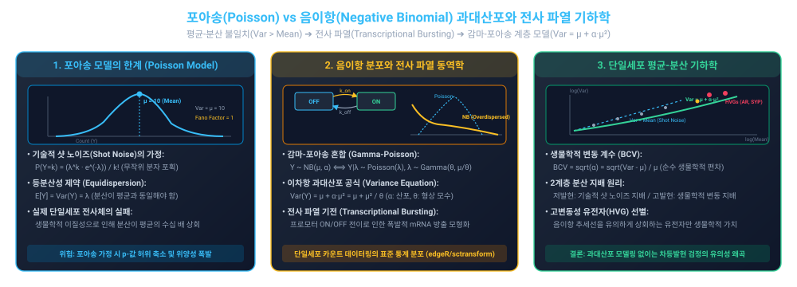

# 01. 단일세포 카운트 확률 모델: 포아송(Poisson)에서 음이항(Negative Binomial)으로

---

## 학습 목표 (Cognitive Goals)

1. **포아송 과정의 수학적 한계 규명**: 점 과정(Point Process)의 무기억성(Memorylessness)과 등분산 제약($\mathbb{E}[Y] = \text{Var}(Y) = \mu$)을 수식화하고, 단일세포 전사체학에서 발생하는 전사 파열(Transcriptional Bursting) 및 증폭 노이즈가 왜 포아송 가정을 필연적으로 파괴하는지 증명한다.
2. **감마-포아송(Gamma-Poisson) 연속 혼합 분포의 엄밀한 유도**: 세포 간 잠재 전사율 $\Lambda$가 감마 분포를 따를 때, 주변부 확률 분포 $P(Y=y)$를 적분하여 음이항(Negative Binomial, NB) 분포의 확률 질량 함수를 유도하고, 과분산 모수 $\theta$와 분산 함수 $\text{Var}(Y) = \mu + \frac{\mu^2}{\theta}$의 대수적 기하학을 정립한다.
3. **영과잉(Zero-Inflation) 논쟁과 Svensson (2020)의 논의 고찰**: 고유 분자 식별자(UMI) 도입 이후 droplet 데이터에서 관측되는 0(Zeros)이 대부분 감마-포아송 표본추출 확률(Sampling Zeros)과 세포 이질성으로 설명될 수 있음을 논의하고, ZINB 모델의 불필요한 과적합(Overfitting)과 수치적 불안정성을 통계학적으로 비판한다.
4. **통계적 가설 검정 및 모델 선택 실무**: 포아송 GLM과 음이항 GLM의 잔차 편차(Residual Deviance), 우도비 검정(Likelihood Ratio Test, LRT), 아카이케 정보 기준(AIC)을 파이썬 및 R 코드로 구현하여 최적의 오차 구조를 선택하는 계산 파이프라인을 구축한다.

---

## 1. 포아송 과정(Poisson Process)과 등분산 제약(Equi-dispersion)의 붕괴

### 1.1 점 과정(Point Process)으로서의 이상적 시퀀싱

이상적인 차세대 염기서열 분석(Next-Generation Sequencing)에서, 특정 유전자 $g$로부터 유래한 단편(cDNA 분자)이 플로우셀(Flowcell)의 임의의 위치에 결합하여 시퀀싱 리드(Read)로 검출되는 과정은 고전적인 **포아송 점 과정(Poisson Point Process)**으로 모형화할 수 있다.

시퀀싱 과정이 다음의 가정을 만족한다고 하자:
1. **무기억성 및 독립성(Independence)**: 임의의 한 분자가 포획되어 시퀀싱될 확률은 다른 분자의 포획 여부에 영향을 받지 않는다.
2. **균일성(Stationarity)**: 단위 시간 또는 단위 시퀀싱 깊이당 분자 검출 확률은 일정하다.
3. **희소성(Sparsity)**: 극히 짧은 시퀀싱 구간에서 둘 이상의 동일 분자가 중복 검출될 확률은 0에 수렴한다.

이러한 조건 하에서, 평균 발현율 $\mu > 0$을 갖는 유전자 $g$의 관측 카운트 $Y \in \{0, 1, 2, \dots\}$의 확률 질량 함수(Probability Mass Function, PMF)는 다음과 같이 주어진다:

$$P(Y = y \mid \mu) = \frac{\mu^y e^{-\mu}}{y!}$$

### 1.2 등분산 제약(Equi-dispersion Constraint)

포아송 분포의 적률생성함수(Moment Generating Function, MGF) $M_Y(t)$를 유도하면:

$$M_Y(t) = \mathbb{E}[e^{tY}] = \sum_{y=0}^\infty e^{ty} \frac{\mu^y e^{-\mu}}{y!} = e^{-\mu} \sum_{y=0}^\infty \frac{(\mu e^t)^y}{y!} = e^{-\mu} e^{\mu e^t} = \exp\left(\mu (e^t - 1)\right)$$

이를 미분하여 평균과 분산을 도출하면:

$$\mathbb{E}[Y] = M'_Y(0) = \mu$$

$$\mathbb{E}[Y^2] = M''_Y(0) = \mu^2 + \mu \implies \text{Var}(Y) = \mathbb{E}[Y^2] - (\mathbb{E}[Y])^2 = \mu$$

포아송 분포는 **평균과 분산이 정확히 일치해야 하는 강력한 수학적 제약 조건($\text{Var}(Y) = \mathbb{E}[Y] = \mu$)**, 즉 **등분산성(Equi-dispersion)**을 갖는다.

```
[The Poisson Point Process vs Real Single-Cell Reality]

Theoretical Poisson Process:
  Constant Transcriptional Rate: λ(t) = λ_0 = const.
  Timeline: ───•──────•───•─────────•──────•───•───> (Steady, memoryless arrival)
  Count Distribution: Mean = μ, Variance = μ  (Variance / Mean = 1)

Real Single-Cell Biology (Transcriptional Bursting):
  Promoter Dynamics:  [OFF State] ══════════> [ON State (Burst!)] ══════════> [OFF State]
  Transcription Rate: λ(t) = 0                λ(t) = λ_burst >>> 0          λ(t) = 0
  Timeline: ──────────────────────• • • • • •───────────────────────────────> (Clustered, bursty arrival)
  Count Distribution: Mean = μ, Variance = μ + α·μ²  (Overdispersion: Variance / Mean >> 1)
```

### 1.3 단일세포 전사체학에서 포아송 가정이 붕괴하는 두 가지 기전

실제 생체 단일세포에서 추출한 카운트 데이터 $Y$는 일반적으로 **과분산(Overdispersion, $\text{Var}(Y) > \mathbb{E}[Y]$)**을 보이며, 특히 고발현·이질 집단에서 두드러진다(저발현 유전자는 $\text{Var} \approx \mu$에 가깝다). 이는 다음의 두 가지 본질적인 생물학적/물리적 요인에 기인한다:

1. **전사 파열 (Transcriptional Bursting - 생물학적 요동)**:
   - 진핵생물 유전자의 프로모터는 지속적으로 열려 있는 것이 아니라, 닫힌 상태($\text{State}_{\text{OFF}}$)와 열린 상태($\text{State}_{\text{ON}}$) 사이를 무작위로 전이하는 이분법적 키네틱스(Telegraph Model)를 따른다.
   - 프로모터가 $\text{ON}$ 상태로 활성화되는 극히 짧은 순간 동안 수십~수백 개의 전사체가 폭발적으로 쏟아져 나온 뒤, 다시 장기간의 $\text{OFF}$ 침묵 상태로 진입한다.
   - 따라서 동일한 세포 집단 내부에서도 세포마다 전사율 $\lambda$ 자체가 고정된 상수가 아니라 확률 변수(Random Variable)로 요동친다.
2. **기술적 증폭 및 포획 불균일성 (Technical Amplification Stochasticity)**:
   - 미세유체 칩(Microfluidic droplet) 내에서 각 방울마다 역전사 효소 농도, 용해 효율, cDNA 증폭 효율(PCR efficiency)의 무작위 편차가 발생한다.
   - 세포마다 시퀀싱 깊이(Library size / Sequencing depth)가 수천~수만 카운트 단위로 차이를 보이며, 이는 관측되는 카운트의 분산을 추가적으로 팽창시킨다.

따라서 단일세포 데이터를 모델링하기 위해서는 전사율 $\lambda$ 자체의 확률적 요동을 포괄하는 **계층적 연속 혼합 모델(Continuous Mixture Model)**이 필수적이다.

---

## 2. 감마-포아송(Gamma-Poisson) 연속 혼합으로서의 음이항 분포 유도

### 2.1 계층적 혼합 모델의 정식화

개별 세포 $j$가 갖는 고유한 잠재 전사율을 $\Lambda_j$라고 하자. 
조건부로 $\Lambda_j = \lambda$가 주어졌을 때 관측되는 유전자 카운트 $Y_j$는 포아송 과정을 따른다고 가정한다:

$$Y_j \mid (\Lambda_j = \lambda) \sim \text{Poisson}(\lambda), \quad P(Y_j = y \mid \lambda) = \frac{\lambda^y e^{-\lambda}}{y!}$$

이때 세포 간 전사율 $\Lambda$의 생물학적/기술적 변동을 양의 실수 공간 $\mathbb{R}^+$에서 정의되는 유연한 켤레 사전분포(Conjugate Prior)인 **감마 분포(Gamma Distribution)**로 모형화한다:

$$\Lambda \sim \text{Gamma}(\text{shape} = \theta, \text{rate} = \beta)$$

감마 분포의 확률 밀도 함수(Probability Density Function, PDF)는 다음과 같다:

$$f_\Lambda(\lambda; \theta, \beta) = \frac{\beta^\theta}{\Gamma(\theta)} \lambda^{\theta - 1} e^{-\beta \lambda}, \quad \lambda > 0$$

여기서 $\Gamma(\theta) = \int_0^\infty t^{\theta-1} e^{-t} dt$는 오일러의 감마 함수이다.
감마 분포의 평균과 분산은 각각 다음과 같다:

$$\mathbb{E}[\Lambda] = \frac{\theta}{\beta}, \quad \text{Var}(\Lambda) = \frac{\theta}{\beta^2}$$

우리가 모형화하려는 세포 집단의 평균 전사율을 $\mu$라고 하면, $\mathbb{E}[\Lambda] = \mu \implies \frac{\theta}{\beta} = \mu \implies \beta = \frac{\theta}{\mu}$로 재모수화할 수 있다. 이때 전사율의 분산은:

$$\text{Var}(\Lambda) = \frac{\theta}{(\theta/\mu)^2} = \frac{\mu^2}{\theta}$$

### 2.2 주변부 확률 질량 함수(Marginal PMF) 적분 유도

이제 관측 불가능한 잠재 변수 $\lambda$를 전체 확률의 법칙(Law of Total Probability)에 따라 양의 실수 전 구간에 대해 적분하여 소거(Marginalization)한다:

$$P(Y = y) = \int_0^\infty P(Y = y \mid \lambda) f_\Lambda(\lambda) \, d\lambda$$

식을 대입하고 상수를 인테그랄 밖으로 추출한다:

$$P(Y = y) = \int_0^\infty \left( \frac{\lambda^y e^{-\lambda}}{y!} \right) \left( \frac{\beta^\theta}{\Gamma(\theta)} \lambda^{\theta - 1} e^{-\beta \lambda} \right) d\lambda$$

$$P(Y = y) = \frac{\beta^\theta}{y! \, \Gamma(\theta)} \int_0^\infty \lambda^{y + \theta - 1} e^{-(\beta + 1)\lambda} \, d\lambda$$

여기서 피적분 함수는 형태상 감마 적분 공식을 완벽히 만족한다:

$$\int_0^\infty t^{a - 1} e^{-c t} \, dt = \frac{\Gamma(a)}{c^a}$$

위 식에서 $a = y + \theta$, $c = \beta + 1$로 치환하면 적분 결과는 다음과 같다:

$$\int_0^\infty \lambda^{(y + \theta) - 1} e^{-(\beta + 1)\lambda} \, d\lambda = \frac{\Gamma(y + \theta)}{(\beta + 1)^{y + \theta}}$$

이를 대입하면:

$$P(Y = y) = \frac{\beta^\theta}{y! \, \Gamma(\theta)} \cdot \frac{\Gamma(y + \theta)}{(\beta + 1)^{y + \theta}} = \frac{\Gamma(y + \theta)}{y! \, \Gamma(\theta)} \left( \frac{\beta}{\beta + 1} \right)^\theta \left( \frac{1}{\beta + 1} \right)^y$$

이제 $\beta = \frac{\theta}{\mu}$를 대입하여 정리한다:

$$\frac{\beta}{\beta + 1} = \frac{\theta/\mu}{\theta/\mu + 1} = \frac{\theta/\mu}{(\theta + \mu)/\mu} = \frac{\theta}{\theta + \mu}$$

$$\frac{1}{\beta + 1} = \frac{1}{\theta/\mu + 1} = \frac{1}{(\theta + \mu)/\mu} = \frac{\mu}{\theta + \mu}$$

최종적으로 우리는 **감마-포아송 혼합 분포이자 표준 음이항(Negative Binomial) 분포의 확률 질량 함수**를 엄밀하게 얻는다:

$$P(Y = y) = \frac{\Gamma(y + \theta)}{y! \, \Gamma(\theta)} \left(\frac{\theta}{\theta + \mu}\right)^\theta \left(\frac{\mu}{\theta + \mu}\right)^y$$

---

## 3. 음이항 분포의 모멘트와 과분산 분산 함수(Variance Function)

### 3.1 전체 분산의 법칙(Law of Total Variance)을 통한 모멘트 유도

음이항 확률 변수 $Y$의 1차 및 2차 적률을 전체 기댓값과 전체 분산의 법칙을 통해 대수적으로 전개한다.

1. **기댓값 ($\mathbb{E}[Y]$)**:
   $$\mathbb{E}[Y] = \mathbb{E}_\Lambda\left[ \mathbb{E}_Y[Y \mid \Lambda] \right] = \mathbb{E}_\Lambda[\Lambda] = \mu$$

2. **분산 ($\text{Var}(Y)$)**:
   $$\text{Var}(Y) = \mathbb{E}_\Lambda\left[ \text{Var}_Y(Y \mid \Lambda) \right] + \text{Var}_\Lambda\left( \mathbb{E}_Y[Y \mid \Lambda] \right)$$
   포아송 조건부 분산 $\text{Var}(Y \mid \Lambda) = \Lambda$ 및 조건부 기댓값 $\mathbb{E}[Y \mid \Lambda] = \Lambda$이므로:
   $$\text{Var}(Y) = \mathbb{E}_\Lambda[\Lambda] + \text{Var}_\Lambda(\Lambda)$$
   앞서 유도한 감마 분포의 모멘트를 대입하면:
   $$\text{Var}(Y) = \mu + \frac{\mu^2}{\theta}$$

이를 생물정보학 패키지(`edgeR`, `DESeq2`, `statsmodels`)에서 사용하는 분산 계수(Dispersion Parameter) $\alpha = \frac{1}{\theta}$로 표기하면:

$$\text{Var}(Y) = \mu + \alpha \mu^2$$

```
[Structure of the Negative Binomial Variance Function]

        Var(Y) =      μ       +         α · μ²
                      │                     │
                      ▼                     ▼
               Poisson Shot Noise     Overdispersion (αμ²)
              (Sampling)             (생물학적 변동 + 포획·증폭 등 기술적 성분 모두 포함)

Low Expression (μ -> 0):
  μ >> α · μ²  ===> Shot noise dominates! (Behaves like Poisson)

High Expression (μ -> large):
  α · μ² >> μ  ===> Overdispersion dominates quadratic growth! (Biological variance ceiling)
```

### 3.2 포아송 극한으로의 수렴 ($\theta \to \infty$)

과분산 모수 $\theta$가 무한대로 발산할 때($\theta \to \infty \iff \alpha \to 0$):

$$\lim_{\theta \to \infty} \text{Var}(Y) = \lim_{\theta \to \infty} \left( \mu + \frac{\mu^2}{\theta} \right) = \mu$$

또한 스털링 근사(Stirling's Approximation) $\Gamma(z + a)/\Gamma(z) \approx z^a$를 적용하면:

$$\lim_{\theta \to \infty} \frac{\Gamma(y + \theta)}{\Gamma(\theta)} = \theta^y$$

$$\lim_{\theta \to \infty} \left(\frac{\theta}{\theta + \mu}\right)^\theta = \lim_{\theta \to \infty} \left(1 + \frac{\mu}{\theta}\right)^{-\theta} = e^{-\mu}$$

$$\lim_{\theta \to \infty} \left(\frac{\mu}{\theta + \mu}\right)^y = \left(\frac{\mu}{\theta}\right)^y$$

이들을 결합하면:

$$\lim_{\theta \to \infty} P(Y = y) = \frac{\theta^y}{y!} e^{-\mu} \left(\frac{\mu}{\theta}\right)^y = \frac{\mu^y e^{-\mu}}{y!}$$

즉, **포아송 분포는 음이항 분포의 $\theta = \infty$ ($\alpha = 0$) 특수 사례**이며, 음이항 모델은 포아송 모델을 완벽히 일반화한 상위 모델이다.

---

## 4. 기하학적 비교 및 시각화



위 다이어그램에서 확인할 수 있듯이:
1. **평균-분산 기하학(Mean-Variance Geometry)**:
   - 포아송 모델은 $\text{Var} = \text{Mean}$의 $45^\circ$ 선형 궤적을 강제한다.
   - 실제 단일세포 전사체는 발현량이 증가함에 따라 분산이 2차 곡선($\text{Var} \propto \mu^2$)을 그리며 급격히 발산한다.
2. **확률 밀도 기하학(Probability Density Geometry)**:
   - 동일한 평균 발현량 $\mu = 10$에서 포아송 분포는 $\mu$ 부근에 대칭적으로 좁게 밀집한다.
   - 음이항 분포($\theta = 2$)는 두터운 우측 꼬리(Heavy Right Tail)를 형성함과 동시에 $0$ 부근의 확률 밀도를 현저히 상승시킨다.

---

## 5. 영과잉(Zero-Inflation)의 종말: ZINB vs NB 대논쟁과 Svensson (2020)의 증명

### 5.1 영과잉 음이항 모델(ZINB)의 탄생과 가정

2014~2018년 초기 단일세포 전사체 연구(Smart-seq2 등)에서는 데이터 행렬의 80~95%가 $0$으로 채워져 있는 현상을 보고 **영과잉 음이항(Zero-Inflated Negative Binomial, ZINB)** 모델을 광범위하게 도입하였다.

ZINB는 관측된 $0$을 두 가지 상이한 출처의 혼합으로 가정한다:

$$P(Y = y) = \begin{cases} 
\pi + (1 - \pi) P_{\text{NB}}(0 \mid \mu, \theta), & y = 0 \\ 
(1 - \pi) P_{\text{NB}}(y \mid \mu, \theta), & y > 0 
\end{cases}$$

1. **구조적 영 (Structural Zeros / Dropout, 확률 $\pi$)**: 유전자가 실제로는 발현되었으나 역전사 실패, cDNA 손실, 광학적 검출 실패 등으로 인해 기술적으로 유실된 결측치.
2. **표본추출 영 (Sampling Zeros, 확률 $(1 - \pi) P_{\text{NB}}(0)$)**: 포아송/음이항 표본추출 확률에 의해 우연히 0개의 분자가 포획된 정상적 관측치.

### 5.2 Svensson (Nat Biotechnol, 2020)의 반증과 UMI의 통계학

2020년 Valentine Svensson은 차세대 단일세포 전사체학의 근간을 뒤흔드는 기념비적인 연구를 발표하였다:

```
[Svensson, Nat Biotechnol 2020 (Letter, 단독 저자): Droplet scRNA-seq is not zero-inflated]

Plate-based Full-length (Smart-seq2):
  - No UMI! PCR amplification introduces exponential non-linear noise.
  - Optical detection thresholds create genuine technical dropouts.
  - Result: Zero-inflation models (ZINB) appeared plausible.

Droplet-based Digital Counting (10x Chromium, Drop-seq with UMIs):
  - Unique Molecular Identifiers (UMIs) tag individual original mRNA molecules.
  - PCR duplicates are collapsed digitally: 1 UMI = Exactly 1 original molecule.
  - Main point: the observed fraction of zeros in droplet UMI data is largely
    explained by the Poisson / Negative Binomial zero-probability:
        P(Y = 0) = (1 + μ/θ)^(-θ)
  - (실험 설계 세부와 정량 결과는 원문 확인 필요; 본 교재에서 재현하지 않음)
```

### 5.3 ZINB 모델이 유발하는 세 가지 통계적 재앙

Svensson (2020)의 논의와 Choi et al. (Genome Biol, 2020; 일부 데이터에서는 영과잉이 기술적이 아닌 생물학적 원인으로 존재할 수 있으나 ZINB 모수 추정은 영과잉의 신뢰할 지표가 아니며 NB GLM을 기준 모형으로 권고)에 비추어, 현대 UMI 기반 데이터에서 ZINB는 대개 불필요하고 다음과 같은 문제를 일으킬 수 있다:

1. **매개변수 과적합(Overfitting)과 자유도 낭비**:
   - 각 유전자마다 추정해야 할 모수가 $\mu, \theta$ 2개에서 영과잉 확률 $\pi$가 추가되어 3개로 증가한다.
   - 세포 수가 적거나 발현율이 낮은 희소 유전자에서 우도 표면(Likelihood Surface)이 평평해져 수치적 최적화 알고리즘이 수렴에 실패한다.
2. **평균 발현량($\mu$)과 드롭아웃($\pi$)의 식별 불가능성(Unidentifiability)**:
   - 낮은 발현율 $\mu \downarrow$과 높은 영과잉 $\pi \uparrow$은 동일한 수의 $0$을 생성할 수 있어 모수 간의 강한 공선성(Collinearity)과 편향이 발생한다.
3. **가설 검정력(Statistical Power)의 급격한 저하**:
   - 불필요한 매개변수 $\pi$에 대한 추정 불확실성이 $\mu$에 대한 신뢰구간을 인위적으로 넓혀 실제 존재하는 참된 DEG를 검출하지 못하는 제2종 오류(Type II Error)를 양산한다.

**결론**: UMI 기반 droplet 단일세포 데이터의 0은 대부분 낮은 시퀀싱 깊이와 세포 이질성에 의한 **음이항 표본추출 0(Sampling Zeros)**으로 설명되며, 따라서 합리적인 기준 모형은 **표준 음이항(Standard Negative Binomial) GLM**이다.

---

## 6. Python 및 R 구현: Poisson vs Negative Binomial 가설 검정

### 6.1 Python (`statsmodels` & `scipy`) 적합 및 우도비 검정(LRT)

```python
"""
01_poisson_vs_nb_lrt.py
단일세포 카운트 데이터에 대한 Poisson vs Negative Binomial 적합 및 우도비 검정(LRT)
"""
import numpy as np
import pandas as pd
import scipy.stats as stats
import statsmodels.api as sm
import statsmodels.formula.api as smf

def evaluate_count_models(counts: np.ndarray, cell_depth: np.ndarray, condition: np.ndarray):
    """
    단일 유전자 카운트에 대해 Poisson 및 Negative Binomial GLM을 적합하고
    과분산 계수 및 Likelihood Ratio Test(LRT)를 수행한다.
    """
    df = pd.DataFrame({
        'count': counts,
        'log_depth': np.log(cell_depth),
        'condition': condition
    })
    
    # 1. Poisson GLM 적합 (등분산 귀무가설 H_0)
    poisson_model = smf.glm(
        formula="count ~ condition",
        data=df,
        family=sm.families.Poisson(),
        offset=df['log_depth']
    ).fit()
    
    # 2. Negative Binomial GLM 적합 (과분산 대립가설 H_1)
    # statsmodels NegativeBinomial은 alpha (과분산 계수)를 추정
    nb_model = smf.negativebinomial(
        formula="count ~ condition",
        data=df,
        offset=df['log_depth']
    ).fit(disp=False)
    
    # 3. 우도비 검정 (Likelihood Ratio Test: LRT)
    # H_0: alpha = 0 (Poisson) vs H_1: alpha > 0 (Negative Binomial)
    # 검정 통계량 Lambda = 2 * (LL_NB - LL_Poisson)
    ll_poisson = poisson_model.llf
    ll_nb = nb_model.llf
    lrt_stat = 2.0 * (ll_nb - ll_poisson)
    
    # 혼합 카이제곱 분포(Boundary test) 또는 1자유도 카이제곱 보수적 p-value
    p_val_lrt = 0.5 * stats.chi2.sf(lrt_stat, df=1) if lrt_stat > 0 else 1.0
    
    alpha_hat = nb_model.params['alpha']
    theta_hat = 1.0 / alpha_hat if alpha_hat > 0 else np.inf
    
    print("=" * 60)
    print(" [Count Model Diagnostics & Overdispersion LRT Test] ")
    print("=" * 60)
    print(f"Poisson Log-Likelihood:  {ll_poisson:.4f}  (Deviance: {poisson_model.deviance:.2f})")
    print(f"NegBin Log-Likelihood:   {ll_nb:.4f}  (Alpha: {alpha_hat:.4f}, Theta: {theta_hat:.4f})")
    print(f"LRT Statistic (Lambda):  {lrt_stat:.4f}")
    print(f"LRT p-value:             {p_val_lrt:.4e}")
    if p_val_lrt < 1e-5:
        print(">> 결론: 등분산 Poisson 가정이 극단적으로 기각됨. Negative Binomial 모델 필수!")
    else:
        print(">> 결론: 과분산이 유의하지 않음. Poisson 모델 채택 가능.")
    print("=" * 60)
    
    return poisson_model, nb_model

# 시뮬레이션 데이터 검증
if __name__ == "__main__":
    np.random.seed(42)
    n_cells = 2000
    depths = np.random.uniform(5000, 20000, size=n_cells)
    cond = np.random.binomial(1, 0.5, size=n_cells)
    
    # 참된 과분산 음이항 데이터 생성 (mu = 5, theta = 2.0)
    true_rate = np.exp(-7.5 + 0.6 * cond) * depths
    shape_param = 2.0
    gamma_rates = np.random.gamma(shape=shape_param, scale=true_rate / shape_param)
    simulated_counts = np.random.poisson(gamma_rates)
    
    p_fit, nb_fit = evaluate_count_models(simulated_counts, depths, cond)
```

### 6.2 R `MASS` 및 `glmmTMB` 카운트 적합 비교

```R
# 01_poisson_vs_nb_r.R
suppressPackageStartupMessages({
    library(MASS)
    library(glmmTMB)
})

set.seed(42)
n_cells <- 2000
depth <- runif(n_cells, 5000, 20000)
condition <- rbinom(n_cells, 1, 0.5)
true_mu <- exp(-7.5 + 0.6 * condition) * depth
sim_counts <- rnbinom(n_cells, size = 2.0, mu = true_mu)

data_df <- data.frame(
    count = sim_counts,
    depth = depth,
    condition = factor(condition)
)

# 1. 포아송 GLM 적합
fit_pois <- glm(count ~ condition + offset(log(depth)), family = poisson, data = data_df)

# 2. 음이항 GLM 적합 (theta 추정)
fit_nb <- glm.nb(count ~ condition + offset(log(depth)), data = data_df)

# 3. 우도비 검정: glm.nb의 deviance는 θ에 따라 스케일되어 Poisson과 anova로 직접 비교하면 올바른 LRT가 아니고,
#    α=0은 경계(boundary)이므로 p-value를 1/2로 보정(혼합 χ²)한다. logLik로 직접 계산:
lrt_stat <- 2 * (as.numeric(logLik(fit_nb)) - as.numeric(logLik(fit_pois)))
lrt_p    <- 0.5 * pchisq(lrt_stat, df = 1, lower.tail = FALSE)
cat("LRT stat:", lrt_stat, " boundary-corrected p:", lrt_p, "\n")

# 4. 과분산 매개변수 추정치
cat("Estimated Theta:", fit_nb$theta, "\n")
cat("Estimated Alpha (1/Theta):", 1 / fit_nb$theta, "\n")
```

---

## 단원 핵심 점검 (Cognitive Checkpoint & Case Study)

### 문제 1: 포아송 등분산성 위반 시 1종 오류 왜곡 수식 증명
과분산 $\text{Var}(Y) = \mu + \alpha \mu^2$ ($\alpha > 0$)을 갖는 단일세포 카운트 데이터에 대해, 분석가가 단순 포아송 GLM($\text{Var}(Y) = \mu$)을 잘못 적합하여 처리 효과 $\beta$에 대한 발트 검정(Wald Test)을 수행하였다.
1. 포아송 모형 하에서 도출되는 계수 추정량의 분산 $\text{Var}_{\text{Poisson}}(\hat{\beta})$과 실제 과분산을 반영한 참 분산 $\text{Var}_{\text{True}}(\hat{\beta})$ 간의 수학적 관계식을 샌드위치 추정량(Sandwich Estimator) 관점에서 정식화하시오.
2. 이로 인해 Wald 통계량 $W = \frac{\hat{\beta}^2}{\text{Var}(\hat{\beta})}$과 $p$-value가 겪게 되는 통계적 왜곡 및 제1종 오류율(Type I Error Rate)의 팽창 메커니즘을 설명하시오.

<details>
<summary>💡 모범 답안 및 해설 확인</summary>

**1. 샌드위치 분산 추정량을 통한 분산 비율 정식화**:
- 포아송 GLM의 점근 분산은 정보 행렬의 역행렬(Inverse Fisher Information)로 계산된다:
  $$\text{Var}_{\text{Poisson}}(\hat{\beta}) = \left( \mathbf{X}^T \mathbf{W}_{\text{pois}} \mathbf{X} \right)^{-1}$$
  여기서 대각 가중치 행렬은 $\mathbf{W}_{\text{pois}} = \text{diag}(\mu_i)$이다.
- 그러나 실제 데이터의 분산이 $\text{Var}(Y_i) = \mu_i + \alpha \mu_i^2 = \mu_i(1 + \alpha \mu_i)$인 경우, 로버스트 샌드위치 공분산(Huber-White Sandwich Covariance)은 다음과 같다:
  $$\text{Var}_{\text{True}}(\hat{\beta}) = \left( \mathbf{X}^T \mathbf{W}_{\text{pois}} \mathbf{X} \right)^{-1} \left( \mathbf{X}^T \mathbf{\Omega}_{\text{true}} \mathbf{X} \right) \left( \mathbf{X}^T \mathbf{W}_{\text{pois}} \mathbf{X} \right)^{-1}$$
  여기서 $\mathbf{\Omega}_{\text{true}} = \text{diag}(\mu_i + \alpha \mu_i^2)$이다.
- 국소적으로 발현량이 균일한 집단에서 과분산 배율 $\phi_i = 1 + \alpha \mu_i > 1$을 상수로 근사하면:
  $$\text{Var}_{\text{True}}(\hat{\beta}) \approx (1 + \alpha \bar{\mu}) \cdot \text{Var}_{\text{Poisson}}(\hat{\beta})$$
  즉, 참 분산은 포아송이 가정한 분산보다 정확히 $(1 + \alpha \bar{\mu})$배만큼 더 크다.

**2. Wald 통계량 과대평가 및 제1종 오류율 팽창**:
- 포아송 모델이 산출하는 발트 검정 통계량 $W_{\text{Poisson}}$은 분모에 과소추정된 분산을 사용한다:
  $$W_{\text{Poisson}} = \frac{\hat{\beta}^2}{\text{Var}_{\text{Poisson}}(\hat{\beta})} \approx (1 + \alpha \bar{\mu}) \cdot \frac{\hat{\beta}^2}{\text{Var}_{\text{True}}(\hat{\beta})} = (1 + \alpha \bar{\mu}) \cdot W_{\text{True}}$$
- 과분산 $\alpha = 0.5$, 평균 카운트 $\bar{\mu} = 20$인 유전자의 경우, $1 + \alpha \bar{\mu} = 1 + 10 = 11$이다. 즉, 검정 통계량이 실제보다 11배나 부풀려진다.
- 귀무가설($\beta = 0$) 하에서 $W_{\text{Poisson}}$은 자유도 1의 카이제곱 분포 $\chi^2(1)$의 기각역 임계값($3.84$)을 훨씬 빈번하게 초과하게 된다.
- 그 결과, 명목 유의수준 $\alpha_{\text{nominal}} = 0.05$ 하에서 실제 귀무가설 기각률(Type I Error Rate)이 $40\% \sim 80\%$까지 치솟으며 수많은 가짜 차등 발현 유전자를 양산한다.

</details>

---

### 문제 2: Svensson (2020) UMI 데이터에서 ZINB 적용 시의 수치적 페널티
어느 분석가가 10x Genomics 3' scRNA-seq 데이터(15,000개 세포)를 분석하면서, "0이 너무 많다"는 이유로 ZINB 모델을 적용하여 20,000개 유전자에 대해 최대우도추정(MLE)을 수행하였다.
1. UMI 데이터에서 실제 참 영과잉 모수 $\pi = 0$임에도 불구하고 최적화 알고리즘이 $\pi > 0$의 경계 조건(Boundary Condition)에 도달할 때 발생하는 수치 해석적 불안정성(Numerical Instability)과 Hessian 행렬의 붕괴를 설명하시오.
2. 평균 발현량 $\mu$와 영과잉 확률 $\pi$ 간의 정보 교락(Confounding)이 생물학적으로 의미 있는 차등 발현 효과 크기($\log_2 \text{Fold Change}$) 추정에 어떤 편향을 초래하는지 설명하시오.

<details>
<summary>💡 모범 답안 및 해설 확인</summary>

**1. 경계 조건 수치 불안정성과 Hessian 붕괴**:
- 참값 $\pi = 0$은 모수 공간 $[0, 1)$의 하한 경계선(Boundary)에 위치한다.
- 표준 최대우도추정(MLE)의 점근적 정규성(Asymptotic Normality)과 일치성(Consistency)은 모수가 모수 공간의 내부(Interior)에 존재한다는 정칙성 조건(Regularity Conditions)을 전제로 한다.
- 최적화 알고리즘(e.g., BFGS, Newton-Raphson)이 $\pi \to 0$ 경계 부근을 탐색할 때, $\pi$를 logit 등으로 모수화하면 우도가 경계에서 평탄해져(기울기가 0에 가까워짐) 식별이 어렵고, 2차 도함수로 구성된 헤시안 행렬(Hessian Matrix)이 양의 정부호성(Positive Definiteness)을 잃어 특이(Singular) 행렬이 된다.
- 이로 인해 수치 역행렬 계산이 불가능해져 표준 오차가 `NaN`으로 출력되거나 최적화 반복 루프가 비정상적으로 조기 종료(Convergence Failure)된다.

**2. 효과 크기($\log_2 \text{FC}$)의 추정 편향**:
- ZINB의 전체 평균 발현량은 $\mathbb{E}[Y] = (1 - \pi)\mu$로 표현된다.
- 두 군 간의 발현 차이를 검정할 때, 질병 군에서 발현량이 감소하는 현상이 관측되면 모델은 이를 "평균 전사율 $\mu$의 감소"로 설명할 수도 있고, "드롭아웃 확률 $\pi$의 증가"로 설명할 수도 있다.
- 이 두 모수가 서로 강한 음의 공선성을 띠므로, 최적화 과정에서 한 군에서는 $\mu$가 과소추정되고 다른 군에서는 $\pi$가 과대추정되는 모수 식별 불가능성(Unidentifiability)이 발생한다.
- 결국 실제 유전자의 순수한 생물학적 발현 변화율($\beta = \Delta \log \mu$)이 왜곡되어 임상적 바이오마커로서의 신뢰도를 완전히 상실한다.

</details>

---

### 문제 3: 발현량에 따른 과분산 항 $\frac{\mu^2}{\theta}$의 비중과 시퀀싱 깊이 확장의 한계효용
단일세포 RNA 시퀀싱에서 과분산 모수 $\theta = 2.0$으로 동일하게 추정된 두 유전자가 있다:
- 저발현 유전자 A: 세포당 평균 카운트 $\mu_A = 0.5$
- 고발현 유전자 B: 세포당 평균 카운트 $\mu_B = 50.0$
1. 각 유전자에 대해 전체 분산 중 포아송 샷 노이즈($\mu$)와 생물학적 과분산 항($\frac{\mu^2}{\theta}$)이 차지하는 상대적 백분율을 각각 계산하시오.
2. 연구팀이 시퀀싱 비용을 10배 투입하여 시퀀싱 깊이(Sequencing Depth)를 10배 확장했을 때, 유전자 A와 유전자 B의 통계적 검정 정밀도(Coefficient of Variation, $\text{CV} = \frac{\sqrt{\text{Var}(Y)}}{\mu}$) 개선 정도를 비교하고, 왜 고발현 유전자에서는 시퀀싱 깊이 확장의 한계효용이 0으로 수렴하는지 통계학적으로 설명하시오.

<details>
<summary>💡 모범 답안 및 해설 확인</summary>

**1. 포아송 샷 노이즈와 과분산의 상대적 비중 계산**:
- 전체 분산 공식: $\text{Var}(Y) = \mu + \frac{\mu^2}{\theta} = \mu + 0.5 \mu^2$
- **유전자 A ($\mu_A = 0.5$)**:
  - 포아송 분산: $0.5$
  - 과분산: $0.5 \times (0.5)^2 = 0.125$
  - 전체 분산: $0.5 + 0.125 = 0.625$
  - 포아송 샷 노이즈 비중: $\frac{0.5}{0.625} = 80.0\%$
  - 과분산 비중: $\frac{0.125}{0.625} = 20.0\%$
- **유전자 B ($\mu_B = 50.0$)**:
  - 포아송 분산: $50.0$
  - 과분산: $0.5 \times (50)^2 = 1,250.0$
  - 전체 분산: $50.0 + 1,250.0 = 1,300.0$
  - 포아송 샷 노이즈 비중: $\frac{50}{1300} \approx 3.85\%$
  - 과분산 비중: $\frac{1250}{1300} \approx 96.15\%$

**2. 시퀀싱 깊이 10배 확장에 따른 변이계수(CV) 변화와 한계효용 수렴**:
- 변이계수(CV)의 수식:
  $$\text{CV}(Y) = \frac{\sqrt{\mu + \frac{\mu^2}{\theta}}}{\mu} = \sqrt{\frac{1}{\mu} + \frac{1}{\theta}}$$
- 시퀀싱 깊이를 늘려 UMI 평균 $\mu$가 10배가 된다고 *가정*하면(실제 UMI 카운트는 포화로 인해 리드 수에 선형 비례하지 않음), 각 세포의 평균 분자 검출량 $\mu$는 10배 증가하지만, 고유한 생물학적 과분산 모수 $\theta$는 세포 간의 본질적 이질성이므로 변하지 않는다.
- **유전자 A ($\mu_A: 0.5 \to 5.0$)**:
  - 초기 $\text{CV} = \sqrt{\frac{1}{0.5} + \frac{1}{2.0}} = \sqrt{2.0 + 0.5} = \sqrt{2.5} \approx 1.581$
  - 10배 후 $\text{CV} = \sqrt{\frac{1}{5.0} + \frac{1}{2.0}} = \sqrt{0.2 + 0.5} = \sqrt{0.7} \approx 0.837$
  - 변이계수가 약 $47\%$ 감소하여 검정 정밀도가 대폭 향상된다.
- **유전자 B ($\mu_B: 50.0 \to 500.0$)**:
  - 초기 $\text{CV} = \sqrt{\frac{1}{50} + \frac{1}{2.0}} = \sqrt{0.02 + 0.5} = \sqrt{0.52} \approx 0.721$
  - 10배 후 $\text{CV} = \sqrt{\frac{1}{500} + \frac{1}{2.0}} = \sqrt{0.002 + 0.5} = \sqrt{0.502} \approx 0.709$
  - 변이계수 감소율은 고작 $1.7\%$에 불과하다.
- **통계학적 이유**:
  - $\mu \to \infty$ 극한에서 변이계수의 하한선은 $\lim_{\mu \to \infty} \text{CV}(Y) = \sqrt{\frac{1}{\theta}}$라는 생물학적 장벽(Biological Variance Floor)에 도달한다.
  - 고발현 유전자는 이미 노이즈의 $96\%$ 이상이 기술적 샷 노이즈가 아닌 생물학적 과분산에 의해 지배되므로, 아무리 시퀀싱을 깊게 하더라도 측정 정밀도가 더 이상 개선되지 않는다. 따라서 한정된 연구비 하에서는 시퀀싱 깊이를 늘리기보다 생물학적 공여자 수($N_{\text{donors}}$)를 늘리는 것이 통계적으로 압도적으로 유리하다.

</details>

---

<!-- REFERENCES:BEGIN (generated by scripts/apply_references.py; do not edit by hand) -->
## 참고문헌 (References)
### 본문 인용 문헌
1. Svensson V. Droplet scRNA-seq is not zero-inflated. *Nat Biotechnol*. 2020;38(2):147-150. PMID: 31937974. doi: 10.1038/s41587-019-0379-5
2. Choi K, Chen Y, Skelly DA, et al. Bayesian model selection reveals biological origins of zero inflation in single-cell transcriptomics. *Genome Biol*. 2020;21(1):183. PMID: 32718323. doi: 10.1186/s13059-020-02103-2
### 소프트웨어 (표기 버전은 검수 시 API를 확인한 버전이며, 파이프라인 실행 환경은 requirements-pipelines.txt 참조)
- glmmTMB (github.com/glmmTMB/glmmTMB). 원 논문: Brooks M, Kristensen K, Benthem K, et al. glmmTMB Balances Speed and Flexibility Among Packages for Zero-inflated Generalized Linear Mixed Modeling. *The R Journal*. 2017;9(2):378. doi: 10.32614/rj-2017-066
- NumPy 2.5.4 (numpy.org). 원 논문: Harris CR, Millman KJ, van der Walt SJ, et al. Array programming with NumPy. *Nature*. 2020;585(7825):357-362. PMID: 32939066. doi: 10.1038/s41586-020-2649-2
- SciPy 1.16.3 (github.com/scipy/scipy). 원 논문: Virtanen P, Gommers R, Oliphant TE, et al. SciPy 1.0: fundamental algorithms for scientific computing in Python. *Nat Methods*. 2020;17(3):261-272. PMID: 32015543. doi: 10.1038/s41592-019-0686-2
- statsmodels 0.15.0 (github.com/statsmodels/statsmodels).
- MASS (R) (cran.r-project.org/package=MASS).
- pandas 2.3.3 (github.com/pandas-dev/pandas). 원 논문: McKinney W. Data Structures for Statistical Computing in Python. *Proceedings of the Python in Science Conference*. 2010:56-61. doi: 10.25080/majora-92bf1922-00a
<!-- REFERENCES:END -->
