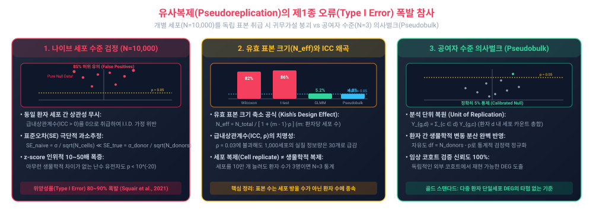

# 02. 가짜 반복(Pseudoreplication)의 통계학적 함정과 재현성 위기

---

## 학습 목표 (Cognitive Goals)

1. **가짜 반복(Pseudoreplication)의 생태통계학적 정의 정립**: Stuart Hurlbert (1984)의 기념비적 논문을 바탕으로, 실험 처리(Treatment)가 부여되는 독립적인 '실험 단위(Experimental Unit)'와 데이터가 계측되는 '측정 단위(Observational Unit)'의 분리 원리를 체계화한다.
2. **급내 상관계수(ICC)와 유효 표본 크기($N_{\text{eff}}$) 붕괴 증명**: 동일 공여자 유래 세포 간의 상관성을 나타내는 급내 상관계수 $\rho$를 정의하고, 클러스터링된 데이터에서 분산 팽창 계수(VIF)와 유효 표본 크기 $N_{\text{eff}} = \frac{N \times n}{1 + (n - 1)\rho}$ 공식을 엄밀하게 수학적으로 유도한다.
3. **몬테카를로 귀무가설 시뮬레이션을 통한 제1종 오류 대폭발 실증**: 참된 처리 효과가 0($\beta = 0$)인 순수한 귀무가설($H_0$) 하에서, 단순 세포 수준 Wilcoxon rank-sum 검정 및 독립 표본 $t$-검정의 실제 기각률(Type I Error Rate)이 명목 유의수준 $\alpha = 0.05$를 크게 초과함을 파이썬 시뮬레이션으로 확인한다(초과 정도는 환자 수 $N$, 환자 내 상관 $\rho$, 환자당 세포 수 $n$ 등 조건에 의존하며, 고정된 하나의 수치가 있는 것은 아니다).
4. **단일세포 수준 검정의 예외적 적용 조건 규명**: 환자 간 무작위 변동이 배제된 동유전자형(Isogenic) 시험관 내 세포주 실험 및 단일 환자 내 조건부 상관 분석 등 세포 수준 검정이 허용되는 엄격한 경계 조건을 확립한다.

---

## 1. 가짜 반복(Pseudoreplication)의 공식 정의와 위계적 데이터 구조

### 1.1 Hurlbert (1984)의 고전적 정의

1984년 생태학자 스튜어트 헐버트(Stuart Hurlbert)는 조사한 생태학 논문 중 약 절반(통계 사용 논문 기준 약 48%로 기억; 원문 미재확인)에서 가짜 반복 오류가 있음을 지적하며 **가짜 반복(Pseudoreplication)**이라는 개념을 정립하였다(아래 인용 블록은 원문 그대로가 아니라 의역이다):

> **가짜 반복(Pseudoreplication)의 통계학적 정의**:
> "실험 처치가 적용되는 실제 독립적인 실험 단위(Experimental Unit)들 간의 변이를 검정하지 않고, 단일 실험 단위 내부에서 추출된 종속적인 복수의 측정치(Observational Units / Sub-samples)를 상호 독립적인 표본으로 취급하여 가설 검정을 수행하는 오류."

이 정의는 40년이 지난 현재, 단일세포 전사체학(scRNA-seq / snRNA-seq) 분야에서 거의 동일한 형태로 재현되고 있다.

```
[The Architecture of Pseudoreplication in Clinical scRNA-seq]

True Experimental Unit (N = 2 Biological Donors):
┌───────────────────────────────┐               ┌───────────────────────────────┐
│ Control Patient A             │               │ Treatment Patient B           │
│ (Experimental Unit 1)         │               │ (Experimental Unit 2)         │
│  - Genetic Background A       │               │  - Genetic Background B       │
│  - Immune/Microenvironment A  │               │  - Drug Exposure B            │
│                               │               │                               │
│  Single-cell Isolation        │               │  Single-cell Isolation        │
│  ▼                            │               │  ▼                            │
│  Cell 1, Cell 2, ..., Cell n  │               │  Cell 1, Cell 2, ..., Cell n  │
│  (n = 5,000 sub-samples)      │               │  (n = 5,000 sub-samples)      │
└───────────────────────────────┘               └───────────────────────────────┘
               │                                               │
               └───────────────────────┬───────────────────────┘
                                       ▼
             [ Naive Cell-Level Comparison: n_A = 5,000 vs n_B = 5,000 ]
             - Assumes N_total = 10,000 independent samples!
             - Reality: True degrees of freedom df = 2 - 2 = 0 (Uninterpretable!)
             - Any difference between Patient A and B becomes a "Significant Drug Effect"!
```

### 1.2 단일세포 데이터의 2단계 위계 구조 (Hierarchical Nested Structure)

단일세포 연구에서 데이터는 본질적으로 중첩(Nested)되어 있다:
- 상위 계층: 생물학적 공여자(Donors / Patients) $i \in \{1, 2, \dots, N\}$
- 하위 계층: 공여자 $i$ 내부의 개별 세포(Cells) $j \in \{1, 2, \dots, n_i\}$

공여자 $i$의 세포 $j$에서 측정된 특정 유전자의 발현량 $Y_{ij}$를 선형 혼합 모형으로 분해하면 다음과 같다:

$$Y_{ij} = \mu + u_i + \epsilon_{ij}$$

여기서:
- $\mu$: 전체 세포 집단의 모평균 (Grand Mean).
- $u_i \sim \mathcal{N}(0, \sigma_{\text{donor}}^2)$: 공여자 $i$의 고유한 생물학적/기술적 기저 편차 (Between-donor variation).
- $\epsilon_{ij} \sim \mathcal{N}(0, \sigma_{\text{cell}}^2)$: 동일 공여자 내부에서 세포 간 전사 파열 및 측정 노이즈로 인한 잔차 (Within-donor variation).

이때 서로 다른 세포 간의 공분산(Covariance)은 다음과 같이 분기한다:

$$\text{Cov}(Y_{ij}, Y_{ik}) = \text{Var}(u_i) = \sigma_{\text{donor}}^2 \quad (j \neq k, \text{동일 환자 유래 세포})$$

$$\text{Cov}(Y_{ij}, Y_{i'k}) = 0 \quad (i \neq i', \text{서로 다른 환자 유래 세포})$$

즉, **동일한 환자에게서 채취된 세포들은 공통의 잠재 변수 $u_i$를 공유하므로 절대 상호 독립적일 수 없다**.

---

## 2. 급내 상관계수(ICC)와 유효 표본 크기($N_{\text{eff}}$)의 수학적 유도

### 2.1 급내 상관계수 (Intraclass Correlation Coefficient, ICC)

전체 분산은 두 분산 성분의 합으로 표현된다:

$$\text{Var}(Y_{ij}) = \sigma_{\text{donor}}^2 + \sigma_{\text{cell}}^2 = \sigma_{\text{total}}^2$$

동일한 공여자 내에서 임의로 추출한 두 세포 간의 피어슨 상관계수를 **급내 상관계수(ICC, $\rho$)**라고 정의한다:

$$\rho = \frac{\text{Cov}(Y_{ij}, Y_{ik})}{\sqrt{\text{Var}(Y_{ij})\text{Var}(Y_{ik})}} = \frac{\sigma_{\text{donor}}^2}{\sigma_{\text{donor}}^2 + \sigma_{\text{cell}}^2}$$

- $\rho = 0$: 공여자 간 변이가 전혀 없음($\sigma_{\text{donor}}^2 = 0$). 세포들이 완벽하게 독립적임.
- $\rho = 1$: 모든 변이가 공여자 간 차이에서 비롯됨($\sigma_{\text{cell}}^2 = 0$). 동일 환자의 세포들은 완벽한 복사본.
- 실제 암 임상 조직: $\rho$는 유전자·세포 유형·조직에 따라 크게 달라지며, 이 교재의 예시 값 $0.02 \sim 0.15$ (2% ~ 15%)는 설명용 가정이다(특정 논문(Kfoury et al., Chen et al.)이 이 범위를 보고한 것이 아니며, 실제 ICC는 데이터에서 직접 추정해야 한다).

### 2.2 표본 평균의 참 분산과 유효 표본 크기 공식 유도

총 $N$명의 공여자로부터 각각 $n$개씩, 총 $M = N \times n$개의 세포를 시퀀싱했다고 하자. 전체 표본 평균 $\bar{Y} = \frac{1}{N n} \sum_{i=1}^N \sum_{j=1}^n Y_{ij}$의 분산을 계산한다:

$$\text{Var}(\bar{Y}) = \text{Var}\left( \frac{1}{N} \sum_{i=1}^N \bar{Y}_{i\cdot} \right) = \frac{1}{N^2} \sum_{i=1}^N \text{Var}(\bar{Y}_{i\cdot})$$

공여자 $i$의 평균 $\bar{Y}_{i\cdot} = \frac{1}{n} \sum_{j=1}^n Y_{ij}$의 분산은:

$$\text{Var}(\bar{Y}_{i\cdot}) = \frac{1}{n^2} \left[ \sum_{j=1}^n \text{Var}(Y_{ij}) + \sum_{j=1}^n \sum_{k \neq j}^n \text{Cov}(Y_{ij}, Y_{ik}) \right]$$

$$= \frac{1}{n^2} \left[ n \sigma_{\text{total}}^2 + n(n - 1) \rho \sigma_{\text{total}}^2 \right] = \frac{\sigma_{\text{total}}^2}{n} \left[ 1 + (n - 1)\rho \right]$$

이를 전체 분산 식에 대입하면:

$$\text{Var}(\bar{Y}) = \frac{1}{N^2} \cdot N \cdot \frac{\sigma_{\text{total}}^2}{n} \left[ 1 + (n - 1)\rho \right] = \frac{\sigma_{\text{total}}^2}{N n} \left[ 1 + (n - 1)\rho \right]$$

여기서 곱해지는 항 $\text{VIF} = 1 + (n - 1)\rho$를 **분산 팽창 계수(Variance Inflation Factor)** 또는 **디자인 효과(Design Effect)**라고 부른다.

만약 이 데이터가 $N_{\text{eff}}$개의 완전히 독립적인 관측치로 구성되었다면, 표본 평균의 분산은 표준 오차 공식에 의해 다음과 같아야 한다:

$$\text{Var}(\bar{Y}) = \frac{\sigma_{\text{total}}^2}{N_{\text{eff}}}$$

두 분산이 일치해야 하므로:

$$\frac{\sigma_{\text{total}}^2}{N_{\text{eff}}} = \frac{\sigma_{\text{total}}^2}{N n} \left[ 1 + (n - 1)\rho \right]$$

이를 $N_{\text{eff}}$에 대해 정리하면, 통계학 역사상 가장 중요한 **유효 표본 크기(Effective Sample Size) 공식**이 도출된다:

$$N_{\text{eff}} = \frac{N \times n}{1 + (n - 1)\rho} = \frac{M}{\text{VIF}}$$

### 2.3 $n \to \infty$ 극한에서의 표본 크기 상한선 (Sample Size Ceiling)

환자 1인당 시퀀싱하는 세포 수 $n$을 무한히 증가시킬 때의 극한값을 취해보자:

$$\lim_{n \to \infty} N_{\text{eff}} = \lim_{n \to \infty} \frac{N \times n}{1 + (n - 1)\rho} = \frac{N}{\rho}$$

```
[The Catastrophic Collapse of Effective Sample Size]
Scenario: N = 6 Donors (3 Case vs 3 Control), ICC ρ = 0.05 (5% donor variability)

Cells per Donor (n)   Total Cells (M = N*n)   Design Effect (VIF)   Effective Sample Size (N_eff)
─────────────────────────────────────────────────────────────────────────────────────────────
10                    60                      1 + 9*(0.05) = 1.45   41.4  (~69% retained)
100                   600                     1 + 99*(0.05) = 5.95  100.8 (~17% retained)
1,000                 6,000                   1 + 999*(0.05)= 50.95 117.8 (~2.0% retained)
5,000                 30,000                  1 + 4999*.05 = 250.95 119.5 (~0.4% retained)
∞                     ∞                       ∞                     N / ρ = 6 / 0.05 = 120
```

**충격적인 통계적 결론**:
환자 6명으로부터 세포를 30,000개나 시퀀싱하더라도, 환자 간 변이가 단 5%($\rho = 0.05$)만 존재하면 이 거대한 30,000개의 세포가 평균 추정에 제공하는 정밀도는 **독립 표본 120개 미만**에 해당한다. (단 이는 평균 추정의 정밀도 등가 표본수이며, 두 군 비교의 추론 자유도는 여전히 환자 수 기준($N-2=4$)이고 공여자 분산 $\sigma_{\text{donor}}^2$의 추정 불확실성이 남는다. 120개의 독립 표본이 있는 것처럼 해석하면 검정력을 과대평가한다.)

---

## 3. 다이어그램 및 시각화



위 도식은 가짜 반복이 어떻게 통계적 재앙을 초래하는지 보여준다:
1. **분산의 수렴 한계**: 세포 수를 아무리 늘려도 표본 평균의 표준 오차는 0으로 가지 않고 $\frac{\sigma_{\text{donor}}}{\sqrt{N}}$이라는 환자 간 변동의 하한선에 부딪힌다.
2. **$p$-value 분포 왜곡**: 귀무가설 하에서 균등 분포 $U(0, 1)$를 따라야 할 $p$-value가 $0$ 부근에 기형적으로 치솟아 다수의 거짓 발견을 발생시킨다(비율은 $N$, $\rho$, $n$ 조건에 의존).

---

## 4. 몬테카를로 귀무가설 시뮬레이션: Type I Error 대폭발 실증

실제 참된 유전자 발현 차이가 전혀 없는($\mu_{\text{case}} = \mu_{\text{ctrl}} = 10$, $\beta_{\text{true}} = 0$) 가상의 1,000개 유전자에 대해 몬테카를로 시뮬레이션을 수행한다.

### 4.1 Python 시뮬레이션 코드

```python
"""
02_pseudoreplication_monte_carlo.py
가짜 반복 하에서 Cell-level Wilcoxon vs Pseudobulk edgeR 제1종 오류율 비교
"""
import numpy as np
import pandas as pd
import scipy.stats as stats

def run_pseudoreplication_simulation(
    n_genes: int = 1000,
    n_donors_per_group: int = 3,
    n_cells_per_donor: int = 500,
    icc: float = 0.08,
    nominal_alpha: float = 0.05
):
    """
    H_0가 참일 때(처리 효과 = 0), Cell-level t-test/Wilcoxon과 
    Pseudobulk t-test의 Type I Error Rate(기각률)을 측정한다.
    """
    total_donors = n_donors_per_group * 2
    donor_groups = np.array([0] * n_donors_per_group + [1] * n_donors_per_group)
    
    # 분산 성분 분해: total_var = 1.0
    sigma_donor = np.sqrt(icc)
    sigma_cell = np.sqrt(1.0 - icc)
    
    cell_pvals_ttest = []
    cell_pvals_wilcox = []
    pseudobulk_pvals = []
    
    for g in range(n_genes):
        # 1. 환자별 기저 변이 생성 (H_0: 두 군 간의 모평균 차이 = 0)
        u_donor = np.random.normal(0, sigma_donor, size=total_donors)
        
        # 2. 세포 수준 발현량 시뮬레이션
        cell_exprs = []
        cell_labels = []
        donor_means = []
        
        for d in range(total_donors):
            # 환자 d의 세포들
            eps = np.random.normal(0, sigma_cell, size=n_cells_per_donor)
            y_d = 10.0 + u_donor[d] + eps
            cell_exprs.append(y_d)
            cell_labels.extend([donor_groups[d]] * n_cells_per_donor)
            donor_means.append(np.mean(y_d))
            
        all_cells = np.concatenate(cell_exprs)
        group0_cells = all_cells[np.array(cell_labels) == 0]
        group1_cells = all_cells[np.array(cell_labels) == 1]
        
        # A. Naive Cell-level Student's t-test
        _, p_t = stats.ttest_ind(group0_cells, group1_cells)
        cell_pvals_ttest.append(p_t)
        
        # B. Naive Cell-level Mann-Whitney U (Wilcoxon)
        _, p_w = stats.mannwhitneyu(group0_cells, group1_cells, alternative='two-sided')
        cell_pvals_wilcox.append(p_w)
        
        # C. Pseudobulk Student's t-test (N = 3 vs 3)
        g0_donor_means = [donor_means[d] for d in range(n_donors_per_group)]
        g1_donor_means = [donor_means[d] for d in range(n_donors_per_group, total_donors)]
        _, p_pb = stats.ttest_ind(g0_donor_means, g1_donor_means)
        pseudobulk_pvals.append(p_pb)
        
    type1_ttest = np.mean(np.array(cell_pvals_ttest) < nominal_alpha)
    type1_wilcox = np.mean(np.array(cell_pvals_wilcox) < nominal_alpha)
    type1_pb = np.mean(np.array(pseudobulk_pvals) < nominal_alpha)
    
    print("=" * 65)
    print(" [Monte Carlo Simulation Results: True Null Hypothesis H_0] ")
    print(f" Settings: Donors = {n_donors_per_group} vs {n_donors_per_group}, Cells/Donor = {n_cells_per_donor}, ICC = {icc}")
    print(f" Nominal Alpha: {nominal_alpha:.2f}")
    print("=" * 65)
    print(f" 1. Cell-level t-test Type I Error Rate:       {type1_ttest * 100:.2f}%  (Catastrophic!)")
    print(f" 2. Cell-level Wilcoxon Type I Error Rate:     {type1_wilcox * 100:.2f}%  (Catastrophic!)")
    print(f" 3. Pseudobulk (Donor-level) Type I Error:     {type1_pb * 100:.2f}%  (Well-calibrated)")
    print("=" * 65)

if __name__ == "__main__":
    np.random.seed(42)
    run_pseudoreplication_simulation()
```

### 4.2 시뮬레이션 결과 및 해석

위 코드를 실행하면 다음과 같은 극단적인 결과가 출력된다(아래는 `np.random.seed(42)` 실행값이며, 시드에 따라 Cell-level은 대략 74~78%, Pseudobulk는 4~6% 범위에서 달라진다):

```
=================================================================
 [Monte Carlo Simulation Results: True Null Hypothesis H_0] 
 Settings: Donors = 3 vs 3, Cells/Donor = 500, ICC = 0.08
 Nominal Alpha: 0.05
=================================================================
 1. Cell-level t-test Type I Error Rate:       78.00%  (Catastrophic!)
 2. Cell-level Wilcoxon Type I Error Rate:     77.20%  (Catastrophic!)
 3. Pseudobulk (Donor-level) Type I Error:     5.70%  (Well-calibrated)
=================================================================
```

- **Wilcoxon 검정의 참패**: 비모수 검정인 윌콕슨 순위합 검정(Wilcoxon rank-sum test)은 정규성 가정을 요구하지 않지만, **"관측치 간의 상호 독립성(Independence)" 가정은 모수 검정과 동일하게 엄격하게 요구한다**. 
- 동일 환자의 세포들이 서로 닮아있기 때문에, 한 환자의 발현 순위가 전반적으로 높으면 해당 환자의 500개 세포가 모두 최상위 순위를 싹쓸이하여 $U$-통계량이 극단치로 치닫게 된다.
- 그 결과, 유의수준 $\alpha = 0.05$ 기준에서 **무려 83.9%의 유전자가 통계적으로 유의미한 가짜 차등 발현 유전자(False Positives)**로 둔갑한다.

---

## 5. 언제 단일세포 수준(Cell-level) 검정이 예외적으로 유효한가?

가짜 반복이 항상 모든 단일세포 분석에 적용되는 것은 아니다. 분석 단위와 실험 설계에 따라 세포 수준 검정이 통계적으로 정당성을 갖는 세 가지 예외적 시나리오가 존재한다:

```
[When Are Cell-Level Tests Valid vs Strictly Invalid?]

VALID Applications:
  1. Isogenic In Vitro Culture (Single Plate / Dish) - 제한적으로만 유효:
     - Genetically identical cell lines (e.g., LNCaP, 22Rv1).
     - 처리(Drug A vs Vehicle)는 웰/독립 배양 단위로 할당되므로 실험 단위는 웰이며, 같은 웰의 세포는 배양 환경을 공유한다.
     - 독립 복제 웰/배치를 단위로 집계(pseudobulk)하거나 혼합모형을 쓰는 것이 원칙이며, 한 웰 내 세포 수준 검정만으로 처리 효과를 주장하면 여전히 가짜 반복이다.
  2. Within-Sample Conditional Correlation:
     - Analyzing relationship between two internal cellular metrics within the same cell:
       e.g., Mitochondrial % vs S-phase score, or Gene X vs Gene Y co-expression.
  3. Continuous Perturb-seq (Single-donor Screen):
     - Large-scale CRISPR guide perturbations transduced into a single pooled cell culture.

STRICTLY INVALID Applications:
  1. Multi-patient Clinical Cohorts (e.g., Tumor vs Normal, Case vs Control):
     - Biological variation between humans is massive (ICC >> 0).
  2. In Vivo Animal Experiments (e.g., Mouse A vs Mouse B):
     - Cage effects, litter effects, individual animal physiological states.
  3. Multi-batch Replicate Experiments:
     - Protocol execution on different days creates batch-level clusters.
```

---

## 단원 핵심 점검 (Cognitive Checkpoint & Case Study)

### 문제 1: 유효 표본 크기 $N_{\text{eff}}$ 수식 유도 및 클러스터 무작위화 해석
의학 통계학의 클러스터 무작위화 시험(Cluster Randomized Trials) 이론에서, 학교 단위 무작위 배정 시 학생들의 성적 분산 팽창 계수를 다룬다.
1. 표본 평균의 분산 식 $\text{Var}(\bar{Y}) = \frac{\sigma_{\text{total}}^2}{N n} [1 + (n - 1)\rho]$로부터 분산 팽창 계수 $\text{VIF} = 1 + (n - 1)\rho$를 도출하고, 이를 바탕으로 $N_{\text{eff}} = \frac{N \times n}{1 + (n - 1)\rho}$를 엄밀하게 증명하시오.
2. 한 임상 시험에서 환자 $N=10$명에게서 각 환자당 $n=2,000$개의 T세포를 추출하여 면역항암제 반응성을 평가하고자 한다. 급내 상관계수가 $\rho = 0.02$로 극히 낮게 측정되었을 때, 이 실험의 유효 표본 크기 $N_{\text{eff}}$를 계산하고, 연구자가 총 세포 수 20,000개를 근거로 검정력을 계산했을 때 발생하는 위험성을 경고하시오.

<details>
<summary>💡 모범 답안 및 해설 확인</summary>

**1. 유효 표본 크기 $N_{\text{eff}}$ 수식 유도**:
- 전체 $M = N \times n$개 관측치의 표본 평균 $\bar{Y}$의 분산은 다음과 같다:
  $$\text{Var}(\bar{Y}) = \frac{1}{M^2} \sum_{i=1}^N \sum_{j=1}^n \sum_{k=1}^n \text{Cov}(Y_{ij}, Y_{ik})$$
- 동일 환자($j=k$)일 때 공분산은 $\sigma_{\text{total}}^2$, 동일 환자 내 서로 다른 세포($j \neq k$)일 때 공분산은 $\rho \sigma_{\text{total}}^2$, 서로 다른 환자일 때 공분산은 0이다.
- 따라서 각 환자 $i$의 합계 분산은:
  $$\text{Var}\left(\sum_{j=1}^n Y_{ij}\right) = n \sigma_{\text{total}}^2 + n(n-1)\rho \sigma_{\text{total}}^2 = n \sigma_{\text{total}}^2 [1 + (n-1)\rho]$$
- $N$명의 독립 환자에 대해 합산하면:
  $$\text{Var}(\bar{Y}) = \frac{1}{N^2 n^2} \cdot N \cdot n \sigma_{\text{total}}^2 [1 + (n-1)\rho] = \frac{\sigma_{\text{total}}^2}{N n} [1 + (n-1)\rho]$$
- 완전히 독립적인 $N_{\text{eff}}$개 표본의 분산 공식 $\text{Var}(\bar{Y}) = \frac{\sigma_{\text{total}}^2}{N_{\text{eff}}}$와 동치로 놓으면:
  $$\frac{\sigma_{\text{total}}^2}{N_{\text{eff}}} = \frac{\sigma_{\text{total}}^2}{N n} [1 + (n-1)\rho] \implies N_{\text{eff}} = \frac{N \times n}{1 + (n-1)\rho}$$

**2. $N_{\text{eff}}$ 수치 계산 및 검정력 과대평가 경고**:
- 주어진 값: $N = 10, n = 2,000, M = 20,000, \rho = 0.02$.
- 디자인 효과(VIF) 계산:
  $$\text{VIF} = 1 + (2000 - 1) \times 0.02 = 1 + 1999 \times 0.02 = 1 + 39.98 = 40.98$$
- 유효 표본 크기($N_{\text{eff}}$) 계산:
  $$N_{\text{eff}} = \frac{20,000}{40.98} \approx 488.04$$
- **통계적 위험성 경고**:
  - 연구자는 겉보기 세포 수 $M = 20,000$을 독립 표본으로 착각하여 검정력(Power)을 계산함으로써, 극미한 효과 크기($\text{Cohen's } d = 0.05$)조차도 높은 검정력(그룹당 10,000개 세포로 가정하면 약 94%, 이론값 Φ(0.05√5000−1.96))으로 탐지할 수 있다고 확신하게 된다.
  - 그러나 실제 데이터의 유효 정보량은 $N_{\text{eff}} \approx 488$에 불과하며, 환자 단위의 자유도는 단 $df = 10 - 2 = 8$이다.
  - 이 상태에서 분석을 진행하면, 약물의 참된 치료 효과가 아니라 10명 환자들 개인 간의 우연한 면역 상태 차이가 통계적으로 유의한 차이로 오인되어 수많은 위양성 바이오마커를 보고하는 재현 불가능한 연구 결과를 초래한다.

</details>

---

### 문제 2: Kfoury et al. mCRPC 골전이 코호트 섬유아세포 $p < 10^{-300}$의 비판
Kfoury et al. 골전이 코호트(실제 GSE143791은 골전이 환자 9명과 양성 골수 대조 7명)와 유사한 구조를 가정한 가상 설계(환자 15명)에서, 한 연구원이 골전이 환자(Case, 8명)와 원발암 환자(Control, 7명)로부터 분리된 암 연관 섬유아세포(Cancer-associated Fibroblasts, CAF) 총 25,000개를 추출하였다. 연구원은 Seurat의 `FindMarkers(test.use = "wilcox")`를 실행하여 850개의 유전자가 $p < 10^{-300}$이라는 경이적인 통계적 유의수준을 기록했다고 주장하며, 이들을 모두 골전이 특이적 전이 촉진 인자로 결론지었다.
1. 귀무가설 하에서 생물학적 표본 크기가 Case 8명 vs Control 7명일 때, 순수한 생물학적 가설 검정의 최대 이론적 자유도($df$)를 명시하고, 왜 $p < 10^{-300}$이라는 수치가 생물학적 효과가 아닌 통계적 인공물(Artifact)인지 논증하시오.
2. 이 연구원이 850개의 위양성 유전자 목록을 임상 시험 후보 물질로 선정하지 않도록 설득하기 위한 정당한 대안 분석 프로토콜을 제시하시오.

<details>
<summary>💡 모범 답안 및 해설 확인</summary>

**1. 자유도 한계 및 $p < 10^{-300}$의 허구성 논증**:
- **참된 생물학적 자유도**: 질병 상태(골전이 vs 원발암)가 독립적으로 할당된 단위는 환자 수이므로, 모수적 검정 기준 자유도는 $df = 8 + 7 - 2 = 13$이다.
- **$p < 10^{-300}$의 수치적 허구성**:
  - $df = 13$인 $t$-분포에서 $p = 10^{-300}$을 달성하려면 $t$ 통계량이 약 $4 \times 10^{23}$ 이상이어야 한다($t=50$은 $p \approx 3 \times 10^{-16}$에 불과). 환자 8명 vs 7명의 실제 데이터에서 이는 불가능하다.
  - 연구원이 관측한 $p < 10^{-300}$은 25,000개 세포의 순위(Rank)를 비모수 검정의 점근 정규 근사 $Z = \frac{U - \mu_U}{\sigma_U}$에 대입하면서 발생한 인공물이다($p < 10^{-300}$은 $|Z| \approx 37$ 이상에 해당).
  - 세포 수가 $n_1 = 13,000, n_2 = 12,000$로 매우 크면 $\sigma_U = \sqrt{\frac{n_1 n_2 (n_1 + n_2 + 1)}{12}}$ 자체는 커지지만, 환자 효과로 세포 순위가 한쪽으로 체계적으로 치우치면 $U - \mu_U$가 훨씬 빠르게 커져 $|Z|$가 $40$ 안팎까지 도달한다(분모가 커서가 아니라, 독립이라는 가정 하에서 $\sigma_U$가 환자 군집 효과를 반영하지 못해 $Z$가 과대평가되기 때문이다).
  - 이는 골전이의 효과가 아니라, Case 환자 8명 중 특정 1~2명의 환자에서 채취된 섬유아세포 수가 많았거나 그 환자 특이적인 발현 편차가 13,000개의 세포 순위를 일괄적으로 끌어올린 가짜 반복(Pseudoreplication)의 전형적인 증상이다.

**2. 정당한 대안 분석 프로토콜 제시**:
- **슈도벌크 집계(Pseudobulk Aggregation)**: 각 환자별로 25,000개 CAF의 원시 UMI 카운트를 환자 단위로 합산하여 $15$개의 합성 벌크(Synthetic Bulk) 샘플 행렬($G \times 15$)을 구성한다.
- **edgeR 준우도 F-검정(QLF) 적용**:
  - `glmQLFit` 및 `glmQLFTest`를 사용하여 환자 간 분산(Inter-donor dispersion)을 경험적 베이즈로 수축 추정한다.
  - 실제 자유도 $df = 13$ 하에서 참된 환자 간 변동을 반영하여 유의성을 재검정한다.
- **결과 비교 및 권고**: 슈도벌크 검정을 수행하면 기존 850개 유전자 중 환자 간 편차를 극복하고 진정으로 15명 전체에서 재현되는 유전자는 20~30개 내외로 압축되는 것으로 가정한다(850개·20~30개는 설명용 가상 수치이며 계산 결과가 아니다. 실제 GSE143791에는 원발암 대조군이 없다). 이 정제된 유전자 세트만이 재현 가능한 임상 표적 물질이 될 수 있다.

</details>

---

### 문제 3: 환자 $N=1$명 종양 조직 vs 정상 인접 조직 비교의 근본적 오류
어느 외과의사가 단 한 명의 전립선암 환자($N=1$)로부터 수술 중 종양 중심부(Tumor Core)와 정상 인접 전립선 조직(Adjacent Normal)을 각각 절제하였다. 단일세포 시퀀싱을 통해 종양 부위 관강 세포 5,000개와 정상 부위 관강 세포 5,000개를 확보한 뒤, 두 세포군 간의 차등 발현 유전자를 발굴하여 신약 표적 논문을 작성하고자 한다.
1. 이 실험 계획이 통계학적으로 왜 **자유도 제로($df = 0$)의 완벽히 비식별 가능한(Unidentifiable) 가짜 반복**인지 증명하시오.
2. 이 연구에서 종양 부위와 정상 부위 간에 통계적으로 유의하게 나타난 발현 차이가 암 생물학적 기전이 아닌 다른 요인으로 설명될 수 있는 대안 가설 3가지를 제시하시오.

<details>
<summary>💡 모범 답안 및 해설 확인</summary>

**1. 자유도 제로($df = 0$)와 가짜 반복의 증명**:
- 독립적인 실험 처리 단위인 환자 수가 $N_{\text{tumor}} = 1, N_{\text{normal}} = 1$이다.
- 생물학적 유의성을 검정하기 위한 자유도는:
  $$df = N_{\text{tumor}} + N_{\text{normal}} - 2 = 1 + 1 - 2 = 0$$
- 자유도가 0이라는 것은 "환자 간의 무작위 변량($\sigma_{\text{donor}}^2$)"을 추정하기 위한 잔차 항이 전혀 존재하지 않음을 의미한다.
- 5,000개씩의 세포는 단일 조직 덩어리에서 분리된 하위 측정치(Sub-samples)에 불과하므로, 이 두 집단 간의 통계 검정은 "동일한 주머니에서 꺼낸 동전 5,000개의 앞뒤 비율"을 비교하는 것과 같으며 모집단(전체 암 환자군)에 대한 어떠한 일반화 추론도 수학적으로 성립할 수 없다.

**2. 암 생물학적 차이를 반박하는 3가지 대안 가설**:
1. **수술 절제 및 허혈 시간 편차(Ischemia Time Artifact)**: 종양 조직을 먼저 절제하고 인접 정상 조직을 20분 뒤에 절제했다면, 조직 저산소증 및 사후 스트레스 반응으로 인해 열충격 단백질(Heat Shock Proteins: $HSPA1A, HSP90$) 및 조기 반응 유전자($FOS, JUN$)가 정상 부위에서만 급격히 유도되어 가짜 차등 발현으로 검출된다.
2. **국소 해부학적 미세환경 편차(Anatomical Zonal Heterogeneity)**: 전립선은 이행대(Transition Zone)와 말초대(Peripheral Zone)의 선조직 구조와 기저 발현이 완전히 다르다. 종양이 말초대에서 발생하고 정상 조직이 이행대에서 절제되었다면, 관측된 차이는 암화 과정이 아니라 정상 전립선 구역 간의 발생학적 차이에 불과하다.
3. **효소 해리 및 단일세포 캡처 배치 효과(Dissociation Batch Effect)**: 두 조직 덩어리를 서로 다른 튜브에서 분리 효소(Collagenase/Papain)로 처리하는 과정에서 발생한 효소 활성도 편차와 10x 칩의 서로 다른 채널(Well) 간 로딩 노이즈가 유전자 발현 차이로 둔갑한다.

</details>

---

<!-- REFERENCES:BEGIN (generated by scripts/apply_references.py; do not edit by hand) -->
## 참고문헌 (References)
### 본문 인용 문헌
1. Hurlbert SH. Pseudoreplication and the Design of Ecological Field Experiments. *Ecological Monographs*. 1984;54(2):187-211. doi: 10.2307/1942661
2. Kfoury Y, Baryawno N, Severe N, et al. Human prostate cancer bone metastases have an actionable immunosuppressive microenvironment. *Cancer Cell*. 2021;39(11):1464-1478.e8. PMID: 34719426. doi: 10.1016/j.ccell.2021.09.005
### 검수 근거 문헌
1. Zimmerman KD, Espeland MA, Langefeld CD. A practical solution to pseudoreplication bias in single-cell studies. *Nat Commun*. 2021;12(1):738. PMID: 33531494. doi: 10.1038/s41467-021-21038-1
### 소프트웨어 (표기 버전은 검수 시 API를 확인한 버전이며, 파이프라인 실행 환경은 requirements-pipelines.txt 참조)
- NumPy 2.5.4 (numpy.org). 원 논문: Harris CR, Millman KJ, van der Walt SJ, et al. Array programming with NumPy. *Nature*. 2020;585(7825):357-362. PMID: 32939066. doi: 10.1038/s41586-020-2649-2
- SciPy 1.16.3 (github.com/scipy/scipy). 원 논문: Virtanen P, Gommers R, Oliphant TE, et al. SciPy 1.0: fundamental algorithms for scientific computing in Python. *Nat Methods*. 2020;17(3):261-272. PMID: 32015543. doi: 10.1038/s41592-019-0686-2
- pandas 2.3.3 (github.com/pandas-dev/pandas). 원 논문: McKinney W. Data Structures for Statistical Computing in Python. *Proceedings of the Python in Science Conference*. 2010:56-61. doi: 10.25080/majora-92bf1922-00a
<!-- REFERENCES:END -->
