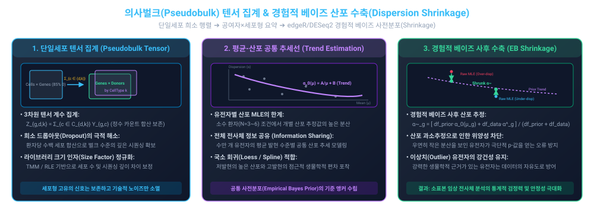

# 03. 슈도벌크(Pseudobulk) 분석 프레임워크: edgeR과 DESeq2의 통계학

---

## 학습 목표 (Cognitive Goals)

1. **슈도벌크 집계의 수학적 정당성 규명**: 각 공여자 $i$와 세포 유형 $k$에 대한 원시 카운트 단순 합산($Y_{g,i,k} = \sum_{j \in C_{i,k}} X_{g,j}$)의 원리를 이해하고, 왜 정규화된 값(CPM, log1p)의 산술 평균이 젠센 부등식(Jensen's Inequality)에 의해 심각한 비선형 왜곡을 초래하는지 수식으로 증명한다.
2. **중심극한정리(CLT)와 생물학적 변동 분리 기전 이해**: 단일세포 수준의 희소한 기술적 포아송 샷 노이즈(Poisson Shot Noise)가 세포 수 $n$의 합산 과정에서 어떻게 상쇄되고, 개체 간의 순수한 생물학적 변동(Biological Variation)이 부각되는지 대수적으로 분석한다.
3. **경험적 베이즈 분산 수축(Empirical Bayes Dispersion Shrinkage)의 대수학 정립**: 소규모 임상 코호트($N = 3 \sim 15$)에서 유전자별 분산 추정치($\hat{\phi}_g$)의 극심한 표본 오차를 극복하기 위해 전장 유전자의 평균-분산 추세선(Mean-Variance Trend Line)으로부터 정보를 차용(Information Borrowing)하는 수축 메커니즘을 규명한다.
4. **준우도 F-검정(`edgeR-QLF`)과 발트 검정(`DESeq2-Wald`)의 비교 및 복합 디자인 행렬 설계**: 환자 연령, 이전 항암치료 이력, 생검 부위, 짝지은 전/후 치료 설계(Paired Design)를 엄밀하게 통제하는 다요인 일반화 선형 모델(GLM) 디자인 행렬을 구성하고, Python(`decoupler`; R 패키지명은 decoupleR)과 R(`edgeR`/`DESeq2`)을 잇는 엔드투엔드 파이프라인을 구축한다.

---

## 1. 슈도벌크(Pseudobulk) 집계의 수학적 정식화

### 1.1 원시 카운트 합산(Raw Count Summation) 공식

단일세포 RNA 시퀀싱 데이터셋에서 $N$명의 환자(Donor) $i \in \{1, \dots, N\}$와 $K$개의 세포 유형(Cell Type) $k \in \{1, \dots, K\}$이 정의되어 있다고 하자.
환자 $i$의 세포 유형 $k$에 속하는 세포들의 인덱스 집합을 $C_{i,k}$라 할 때, 유전자 $g$의 **슈도벌크 카운트 $Y_{g,i,k}$**는 다음과 같이 정의된다:

$$Y_{g, i, k} = \sum_{j \in C_{i, k}} X_{g, j}$$

여기서 $X_{g,j} \in \mathbb{N}_0$는 세포 $j$에서 측정된 유전자 $g$의 고유 분자 식별자(UMI) 원시 카운트(Raw Integer Count)이다.

```
[The Mechanics of Pseudobulk Aggregation]

Single-Cell Matrix (Cells x Genes)               Synthetic Bulk Matrix (Samples x Genes)
Cells belonging to Donor 1, Cell-type "CD8+ T":  Aggregated Pseudo-replicate:
  Cell 1: [ 0,  2,  0,  15, ... ]                ┌───────────────────────────────────────┐
  Cell 2: [ 1,  0,  0,   8, ... ]   ──Sum───►   │ Donor1_CD8T: [ 4, 7, 0, 89, ... ]     │
  Cell 3: [ 3,  5,  0,  66, ... ]                └───────────────────────────────────────┘
                                                  * True Sample Size = 1 Biological Unit
                                                  * Preserves Discrete Integer Count Likelihood!
```

### 1.2 왜 정규화된 발현량의 평균(Mean of Normalized Counts)은 금기인가?

일부 잘못된 분석에서는 세포별 정규화 값(CPM, TP10K)이나 $\log(1 + \text{CPM})$을 계산한 뒤, 이들의 산술 평균을 슈도벌크 대표값으로 사용한다. 이는 통계학적으로 두 가지 치명적인 결함을 갖는다:

#### 1.2.1 젠센 부등식(Jensen's Inequality)에 의한 비선형 왜곡
로그 함수 $f(x) = \log(x + 1)$는 엄밀한 오목 함수(Concave Function)이다. 따라서 임의의 비음수 확률 변수 $X$에 대해 젠센 부등식이 성립한다:

$$\mathbb{E}[\log(X + 1)] \leq \log(\mathbb{E}[X] + 1)$$

세포마다 발현량의 분산이 다를 경우, $\log(1 + \text{CPM})$의 평균치는 세포 내 분산이 큰 집단일수록 참된 모평균 $\log(\mathbb{E}[X] + 1)$보다 훨씬 더 심각하게 과소평가된다. 이는 두 군 간의 접힘 변화율($\log_2 \text{Fold Change}$)을 비선형적으로 왜곡한다.

#### 1.2.2 카운트 우도 함수(Discrete Count Likelihood)의 파괴
`edgeR`과 `DESeq2`는 정수(Integer) 형태의 원시 카운트가 포아송-감마 분포로부터 추출되었다는 가정을 전제로 우도 함수(Likelihood Function)를 전개한다:

$$\mathcal{L}(\mu, \phi; Y) = \prod_{i=1}^N \frac{\Gamma(Y_i + \phi^{-1})}{Y_i! \, \Gamma(\phi^{-1})} \left(\frac{\phi^{-1}}{\phi^{-1} + \mu_i}\right)^{\phi^{-1}} \left(\frac{\mu_i}{\phi^{-1} + \mu_i}\right)^{Y_i}$$

정규화 평균을 입력하면 입력값이 비정수 연속형 실수(Continuous Real Numbers)가 되어 카운트 우도 함수의 팩토리얼($Y_i!$) 및 감마 함수 적분이 성립하지 않으며, 각 샘플의 시퀀싱 깊이(Library Size)가 갖는 고유한 측정 정밀도 가중치가 완전히 상실된다.

---

## 2. 중심극한정리(CLT)와 생물학적 변동 분리 메커니즘

### 2.1 기술적 샷 노이즈(Technical Shot Noise)의 상쇄

세포 $j$의 카운트 $X_j$가 평균 $\mu_j$, 과분산 $\theta$를 갖는 음이항 분포를 따른다고 하자:

$$\mathbb{E}[X_j] = \mu_j, \quad \text{Var}(X_j) = \mu_j + \frac{\mu_j^2}{\theta}$$

환자 $i$의 $n$개 세포 카운트를 합산한 슈도벌크 카운트 $Y = \sum_{j=1}^n X_j$의 평균과 분산은 다음과 같다 (세포 간 기술적 노이즈가 조건부 독립이라 가정할 때):

$$\mathbb{E}[Y] = \sum_{j=1}^n \mu_j = n \bar{\mu}$$

$$\text{Var}(Y) = \sum_{j=1}^n \mu_j + \sum_{j=1}^n \frac{\mu_j^2}{\theta} = n \bar{\mu} + \frac{n \bar{\mu}^2}{\theta}$$

여기서 전체 측정치의 변이계수 제곱($\text{CV}^2$)을 계산하면:

$$\text{CV}^2(Y) = \frac{\text{Var}(Y)}{(\mathbb{E}[Y])^2} = \frac{n \bar{\mu} + \frac{n \bar{\mu}^2}{\theta}}{n^2 \bar{\mu}^2} = \frac{1}{n \bar{\mu}} + \frac{1}{n \theta}$$

- $n \to \infty$로 세포 수가 증가함에 따라, 세포 수준의 희소한 포아송 샘플링 샷 노이즈 $\frac{1}{n \bar{\mu}}$는 급격히 $0$으로 수렴한다.
- 그 결과, 슈도벌크 합산은 **단일세포 수준의 샘플링(샷) 노이즈를 크게 줄이고**, 환자 수준의 집합적 발현량 $Y_{g,i}$를 벌크 RNA-seq에 가까운 고정밀 관측치로 만든다. (위 유도는 세포들이 조건부 독립이라는 가정 하의 기술적 노이즈만 다루며 공여자 간 생물학적 변동 항은 포함하지 않는다. 따라서 합산이 벌크와 통계적으로 동일해지거나 모든 노이즈를 제거하는 것은 아니며, 공여자 간 변동은 환자 단위 분산 추정에서 별도로 다뤄진다.)

---

## 3. 경험적 베이즈 분산 수축 (Empirical Bayes Dispersion Shrinkage)

### 3.1 소표본 임상 코호트의 분산 추정 딜레마

실제 임상 단일세포 연구(Kfoury et al., Chen et al.)에서 환자 수는 일반적으로 군당 $N = 3 \sim 8$명 수준이다.
환자 수가 $N=3$일 때, 유전자 $g$의 개체 간 분산 $\phi_g$를 순수하게 해당 유전자의 데이터만으로 추정하면 잔차 자유도가 단 $df = 3 + 3 - 2 = 4$에 불과하다.

자유도 4 하에서 분산 추정량 $\hat{\phi}_g$의 표본 오차는 극단적으로 거대하여:
- 실제로는 안정적인 유전자가 우연히 과소추정되어 위양성(False Positive)으로 판정되거나,
- 참된 질병 마커 유전자가 우연히 과대추정되어 위음성(False Negative)으로 기각된다.

```
[Empirical Bayes Information Borrowing & Dispersion Shrinkage]

High Dispersion ▲
                │          • (Noisy Gene Estimate)
                │           \
                │            \  Shrinkage towards trend!
                │             ▼
Trend Line ─────┼───────=========================─────── Trend φ_0(μ)
                │             ▲
                │            /  Shrinkage towards trend!
                │           /
                │          • (Underestimated Gene)
Low Dispersion  └────────────────────────────────────────► Average Expression (μ)
```

### 3.2 edgeR의 가중 우도 분산 수축 (Weighted Likelihood Empirical Bayes)

`edgeR`은 모든 유전자($G \sim 20,000$)의 정보를 공유(Information Borrowing)하여 유전자별 분산 추정치를 평균 발현량 추세선(Trended Dispersion, $\phi_0(A_g)$)으로 수축(Squeeze)시킨다. 아래 가중평균 식은 개념 설명용 단순화이며, 실제 `estimateDisp`는 가중 우도(weighted-likelihood) 경험적 베이즈로 유전자별 분산을 추정한다(분산 자체를 가중평균하는 `limma::squeezeVar` 형태는 아래 QL 단계에 해당):

$$\tilde{\phi}_g = \frac{d_0 \phi_0(A_g) + d_g \hat{\phi}_g}{d_0 + d_g}$$

- $\hat{\phi}_g$: 유전자 $g$ 자체의 조건부 최대우도 분산 추정량.
- $\phi_0(A_g)$: 평균 발현량 $A_g$에 따라 비모수 스플라인으로 적합된 공통 분산 추세선.
- $d_g$: 유전자별 잔차 자유도 ($N - p$).
- $d_0$: 경험적 베이즈 사전 자유도(Prior Degrees of Freedom)로, 유전자 간 분산의 균일성에 따라 데이터로부터 적응적으로 추정된다.

사전 자유도 $d_0$가 클수록 유전자별 분산은 추세선으로 강하게 수축되어 소표본에서의 극단적인 표본 오차를 방지한다.

### 3.3 DESeq2의 최대 사후확률(MAP) 수축

`DESeq2`는 분산 모수 $\alpha_g$의 로그 변환값에 대해 정규 사전분포(Normal Prior)를 가정한다:

$$\log \alpha_g \sim \mathcal{N}\left( \log \alpha_{\text{trend}}(\bar{\mu}_g), \, \sigma_{\text{prior}}^2 \right)$$

유전자별 로그 우도 함수 $\ell_g(\alpha_g)$와 결합하여 최대 사후확률(Maximum A Posteriori, MAP) 추정량을 도출한다:

$$\hat{\alpha}_g^{\text{MAP}} = \arg\max_{\alpha_g} \left[ \ell_g(\alpha_g) - \frac{(\log \alpha_g - \log \alpha_{\text{trend}}(\bar{\mu}_g))^2}{2 \sigma_{\text{prior}}^2} \right]$$

단, 유전자별 분산 추정값이 추세선보다 크게 벗어나는 분산 이상치(dispersion outlier) 유전자는 MAP 대신 유전자별 추정값을 그대로 사용해 인위적 수축을 막는다. (쿡의 거리(Cook's Distance)는 이와 별개로 샘플 단위 카운트 이상치를 진단해 해당 유전자의 $p$-value를 플래깅하는 기능이다.)

---

## 4. 통계적 가설 검정: 준우도 F-검정(`edgeR-QLF`) vs 발트 검정(`DESeq2-Wald`)

### 4.1 edgeR 준우도 F-검정 (Quasi-Likelihood F-Test, QLF)의 우월성

극소 표본($N = 3 \sim 5$) 단일세포 슈도벌크 분석에서 가장 권장되는 검정 기법은 `edgeR`의 **준우도 F-검정(QL F-test)**이다.

QLF 프레임워크는 음이항 분산 함수에 추가적인 유전자별 변동 계수 $\sigma_g^2$를 도입한다:

$$\text{Var}(Y_{gi}) = \sigma_g^2 \left( \mu_{gi} + \phi_g \mu_{gi}^2 \right)$$

- $\sigma_g^2$는 준우도 편차(Quasi-Likelihood Deviance)를 통해 추정되며, 경험적 베이즈(`squeezeVar`)로 풍부도 추세에 따른 사전 분산을 향해 수축된다($1$로 수축하는 것이 아님). 이 단계에서 사전 자유도 $d_0$가 유전자 간 분산 균일성에 따라 추정된다.
- 검정 통계량은 두 중첩 모델 간의 편차 차이($\Delta D$)를 유전자별 수축 분산 $\tilde{\sigma}_g^2$로 나눈 $F$-통계량이다:
  $$F_g = \frac{\Delta D_g / k}{\tilde{\sigma}_g^2} \sim F(k, d_0 + d_g)$$
- 점근적 카이제곱($\chi^2$) 분포를 사용하는 일반적인 우도비 검정(LRT)이나 발트 검정(Wald Test)과 달리, **QLF는 유한 표본 자유도를 갖는 $F$-분포를 사용하므로 극소 표본에서 제1종 오류(Type I Error)를 비교적 잘 통제하는 편**이다(다만 분산 추정의 불확실성과 저발현 유전자 때문에 명목 수준 통제가 보장되지는 않으며, DESeq2 Wald 검정도 pseudobulk 벤치마크에서 양호하다).

---

## 5. 다이어그램 및 시각화



위 도식은 슈도벌크 파이프라인의 핵심 2단계를 요약한다:
1. **집계 단계**: 수만 개의 세포를 환자-세포형별 정수 카운트로 합산하여 생물학적 독립 표본 행렬을 구축.
2. **수축 단계**: 노이즈가 심한 유전자별 분산 추정치를 평균-분산 추세 곡선으로 수축시켜 안정적인 검정 통계량을 확보.

---

## 6. 복합 임상 디자인 행렬(Complex Clinical Design Matrix) 설계

임상 단일세포 코호트(Kfoury et al., Chen et al.)는 단순한 2군 비교(Case vs Control)로 설명될 수 없는 복잡한 교란 요인을 포함한다.

```
[Clinical Confounding Variables in Benchmark Cohorts]

Kfoury et al. (mCRPC Bone Metastasis Cohort):
  - Sample Fraction: Tumor / Involved BM / Distal BM (환자 9명 각각에서 반복) vs Benign BM controls (N=7)
  - Prior Therapy: 이전 요법 노출 여부 (예: Radium-223 노출 환자)
  - Patient Age: Continuous covariate

Chen et al. (Primary vs Advanced Prostate Atlas):
  - Primary tumors from one hospital (13 patients; 별도 11개 샘플은 CRPC 비교용)
  - Batch / Sequencing Channel: 샘플별 배치 효과 (환자 내 전/후 ADT 짝지은 생검은 아님)
```

### 6.1 임상 디자인 공식(Formula) 패턴

1. **연속형 공변량 및 다요인 보정 모델**:
   $$\text{design} = \sim \text{Age} + \text{PriorChemo} + \text{BiopsySite}$$
   - 환자의 연령 효과($\beta_{\text{Age}}$)와 이전 화학요법 이력($\beta_{\text{Chemo}}$)을 공변량으로 회귀 제거한 후, 순수한 전이 부위 효과($\beta_{\text{BiopsySite}}$)를 검정한다.
2. **짝지은 환자 전/후 치료 설계 (Paired Pre/Post Design)**:
   동일 환자에게서 호르몬 치료 전(Pre)과 치료 후(Post) 생검 조직을 얻은 경우, 환자 고유의 유전적 기저 발현을 환자 인덱스(`patient_id`)로 완벽히 차단(Blocking)한다:
   $$\text{design} = \sim \text{patient\_id} + \text{treatment}$$
   - 이 모델에서 자유도는 $df = N_{\text{pairs}} - 1$이며, 환자 간의 거대한 기저 발현 차이는 `patient_id` 고정 효과(Fixed Effect)에 의해 완벽히 흡수된다.

---

## 7. Python 및 R 엔드투엔드 파이프라인 구현

### 7.1 Python: `decoupler`(2.x)를 이용한 고속 슈도벌크 AnnData 생성

```python
"""
03_pseudobulk_aggregation.py
AnnData 단일세포 객체로부터 공여자-세포형 슈도벌크 카운트 행렬 집계
"""
import scanpy as sc
import anndata as ad
import numpy as np
import pandas as pd
import decoupler as dc

def create_pseudobulk_adata(
    adata: ad.AnnData,
    sample_col: str = "patient_id",
    celltype_col: str = "cell_type",
    min_cells: int = 10,
    min_counts: int = 1000
) -> dict:
    """
    각 세포 유형별로 공여자 단위 원시 카운트 합산(Pseudobulk)을 수행하고
    세포 수가 부족한 샘플을 엄격하게 필터링한다.
    """
    print(f"[*] Input AnnData: {adata.n_obs} cells, {adata.n_vars} genes.")
    
    # decoupler 2.x의 dc.pp.pseudobulk로 샘플×세포유형 합산 (mode='sum')
    # (1.x의 dc.get_pseudobulk는 2.x에 없음; 필터는 dc.pp.filter_samples가 in-place로 수행)
    pbulk_all = dc.pp.pseudobulk(
        adata,
        sample_col=sample_col,
        groups_col=celltype_col,
        mode='sum'
    )
    dc.pp.filter_samples(pbulk_all, min_cells=min_cells, min_counts=min_counts)
    
    print(f"[+] Aggregated Pseudobulk Profile: {pbulk_all.n_obs} sample-celltype pairs.")
    
    # 세포 유형별 개별 AnnData 객체로 분할
    cell_types = adata.obs[celltype_col].unique()
    pb_dict = {}
    
    for ct in cell_types:
        subset = pbulk_all[pbulk_all.obs[celltype_col] == ct].copy()
        if subset.n_obs >= 4:  # 최소 4개 이상의 환자 샘플이 있는 세포형만 유지
            pb_dict[ct] = subset
            print(f"  - Cell-type '{ct}': {subset.n_obs} valid biological samples retained.")
        else:
            print(f"  - Cell-type '{ct}': Insufficient samples ({subset.n_obs} < 4). Skipped.")
            
    return pb_dict

if __name__ == "__main__":
    # 시뮬레이션 AnnData 생성
    np.random.seed(42)
    n_c, n_g = 5000, 2000
    counts = np.random.negative_binomial(5, 0.3, size=(n_c, n_g))
    obs_df = pd.DataFrame({
        'patient_id': np.random.choice([f'P{i:02d}' for i in range(1, 9)], size=n_c),
        'cell_type': np.random.choice(['Luminal', 'Basal', 'T_cell', 'Osteoblast'], size=n_c),
        'condition': np.random.choice(['Primary', 'Metastasis'], size=n_c),
        'age': np.random.randint(55, 78, size=n_c)
    }, index=[f'cell_{i}' for i in range(n_c)])
    
    sim_adata = ad.AnnData(X=counts, obs=obs_df)
    pb_dict = create_pseudobulk_adata(sim_adata)
```

### 7.2 R: `edgeR-QLF`를 이용한 복합 임상 공변량 제어 차등 발현 분석

```R
# 03_pseudobulk_edger_qlf.R
suppressPackageStartupMessages({
    library(edgeR)
    library(limma)
})

run_edger_qlf_analysis <- function(counts_mat, sample_metadata) {
    # 1. DGEList 객체 생성
    dge <- DGEList(counts = counts_mat, samples = sample_metadata)
    
    # 2. 발현 필터링 (filterByExpr: 소표본에 최적화된 최소 카운트 필터링)
    # 최소 1개 군의 샘플 수 이상에서 유의미한 카운트를 갖는 유전자 선별
    design_mat <- model.matrix(~ age + prior_chemo + condition, data = dge$samples)
    keep <- filterByExpr(dge, design = design_mat)
    dge <- dge[keep, , keep.lib.sizes = FALSE]
    cat("[*] Genes retained after filterByExpr:", sum(keep), "\n")
    
    # 3. TMM 정규화 계수 산출
    dge <- calcNormFactors(dge, method = "TMM")
    
    # 4. 공통/추세/유전자별 분산 추정 (Empirical Bayes Shrinkage)
    dge <- estimateDisp(dge, design = design_mat, robust = TRUE)
    
    # 5. 준우도 모델 적합 (glmQLFit)
    fit <- glmQLFit(dge, design = design_mat, robust = TRUE)
    
    # 6. 가설 검정: 'conditionMetastasis' 계수 검정
    # coef 4: conditionMetastasis vs Primary
    qlf_test <- glmQLFTest(fit, coef = "conditionMetastasis")
    
    # 7. 결과 테이블 및 FDR 보정
    res_table <- topTags(qlf_test, n = Inf)$table
    cat("[+] Significant DEGs (FDR < 0.05):", sum(res_table$FDR < 0.05), "\n")
    
    return(res_table)
}

# 가상 데이터 테스트
set.seed(42)
n_genes <- 1000
n_samples <- 8
counts_sim <- matrix(rnbinom(n_genes * n_samples, size = 3, mu = 50), nrow = n_genes)
rownames(counts_sim) <- paste0("Gene_", 1:n_genes)
colnames(counts_sim) <- paste0("Sample_", 1:n_samples)

meta_sim <- data.frame(
    age = c(62, 70, 58, 65, 74, 69, 61, 77),
    prior_chemo = factor(c("No", "Yes", "No", "No", "Yes", "Yes", "No", "Yes")),
    condition = factor(c("Primary", "Primary", "Primary", "Primary", 
                         "Metastasis", "Metastasis", "Metastasis", "Metastasis"),
                       levels = c("Primary", "Metastasis"))  # 기준 수준(Primary)을 명시해야 계수 이름이 conditionMetastasis가 됨
)
rownames(meta_sim) <- colnames(counts_sim)

res <- run_edger_qlf_analysis(counts_sim, meta_sim)
head(res)
```

---

## 단원 핵심 점검 (Cognitive Checkpoint & Case Study)

### 문제 1: 정규화 평균 vs 원시 카운트 합산의 우도 함수 왜곡 증명
한 연구자가 단일세포 데이터로부터 슈도벌크 행렬을 생성하면서, 세포별 시퀀싱 깊이 차이를 보정하겠다는 목적으로 각 세포의 카운트를 라이브러리 크기로 나눈 뒤 $10^4$을 곱하고 로그를 취한 $\tilde{x}_{ij} = \log\left(\frac{X_{ij}}{\sum_g X_{gj}} \times 10^4 + 1\right)$의 산술 평균 $\bar{z}_i = \frac{1}{n_i} \sum_{j=1}^{n_i} \tilde{x}_{ij}$을 계산하여 이를 DESeq2의 입력 행렬로 공급하였다.
1. 왜 이 행위가 DESeq2의 음이항 우도(Negative Binomial Likelihood) 수식 체계를 수학적으로 무력화하는지 우도 함수의 오차 모델 관점에서 증명하시오.
2. 세포 수율(Yield)이 $n_1 = 50$개인 불량 샘플과 $n_2 = 2,000$개인 양호 샘플이 존재할 때, 원시 카운트 단순 합($\sum X_{ij}$)과 정규화 평균($\bar{z}_i$)이 각 샘플의 추정 정밀도(Precision Weight)에 미치는 차이를 비교하시오.

<details>
<summary>💡 모범 답안 및 해설 확인</summary>

**1. 음이항 우도 함수 무력화의 수학적 증명**:
- DESeq2와 edgeR은 관측값 $Y_{gi}$가 비음수 정수 카운트($Y_{gi} \in \{0, 1, 2, \dots\}$)라는 전제 하에 감마-포아송 혼합 우도를 계산한다:
  $$P(Y_{gi} = y) = \frac{\Gamma(y + \alpha^{-1})}{y! \, \Gamma(\alpha^{-1})} \left(\frac{\alpha^{-1}}{\alpha^{-1} + \mu_{gi}}\right)^{\alpha^{-1}} \left(\frac{\mu_{gi}}{\alpha^{-1} + \mu_{gi}}\right)^y$$
- 연구자가 생성한 $\bar{z}_i$는 실수(Real Numbers, e.g., $2.3481$)이다.
- 이 연속형 실수를 DESeq2에 공급하면:
  - 팩토리얼 항 $y!$의 계산이 불가능하여 패키지가 내부적으로 강제 반올림(`round()`)을 수행하거나 오류를 뱉어내며 종료된다.
  - 임의 반올림이 수행되더라도, 원래의 카운트가 지니고 있던 확률적 포아송 샷 노이즈 분산 구조($\text{Var} = \mu$)가 파괴되어 모델이 가정하는 평균-분산 함수($\mu + \alpha \mu^2$)와 데이터의 실제 잔차 분산 간에 심각한 부조화가 발생한다.
  - 시퀀싱 깊이에 따른 정밀도 가중치가 소멸하여 모든 매개변수 추정의 표준 오차와 $p$-value가 원천 무효화된다.

**2. 세포 수율($n_1 = 50$ vs $n_2 = 2,000$)에 따른 정밀도 가중치 차이**:
- **정규화 평균($\bar{z}_i$)의 문제점**: 두 샘플 모두 0~10 사이의 유사한 실수 평균치로 압축된다. 통계 모델은 $n_1 = 50$개 세포에서 얻은 매우 불확실한 평균값과 $n_2 = 2,000$개 세포에서 얻은 고도로 정확한 평균값을 **동일한 통계적 확신도(Weight)**를 가진 관측치로 취급한다.
- **원시 카운트 단순 합($\sum X$)의 우월성**:
  - $n_1 = 50$인 샘플의 총 합산 카운트는 대략 수만 단위에 머무르고, $n_2 = 2,000$인 샘플은 수백만 단위의 거대한 총합 카운트를 갖게 된다.
  - DESeq2는 라이브러리 크기 인자(Size Factor, $s_i$)를 통해 $s_1 \ll s_2$로 자동 추정한다.
  - 음이항 GLM의 반복 가중 최소제곱(IRLS) 가중치는 $w = \mu/(1+\alpha\mu)$ 형태이므로 카운트가 큰 $n=2,000$ 샘플에 더 큰 가중치가 부여되어 $n=50$ 샘플의 노이즈에는 덜 휘둘린다. 다만 $\mu \to \infty$에서 $w$는 $1/\alpha$로 포화하므로 가중치가 세포 수에 비례해 커지지는 않으며(샘플 간 변동 $\alpha$가 지배), 방향만 정성적으로 맞는 설명이다.

</details>

---

### 문제 2: edgeR 준우도 F-검정(QLF)의 소표본 제1종 오류 통제 메커니즘
동일한 단일세포 슈도벌크 데이터셋(Case 3명 vs Control 3명, $N=6$)에 대해, 표준 음이항 우도비 검정(NB-LRT)을 실행했을 때와 준우도 F-검정(edgeR-QLF)을 실행했을 때의 검정 결과에 현저한 차이가 발생하였다. NB-LRT는 1,200개의 DEG를 보고한 반면, QLF는 단 45개의 DEG만을 보고하였다(1,200개·45개는 설명용 가상 수치이다).
1. 왜 표준 음이항 LRT가 소표본($N=6$)에서 유의확률($p$-value)을 지나치게 낙관적으로 과소평가(Liberal bias)하는지 검정 통계량의 점근적 분포 가정 관점에서 설명하시오.
2. edgeR-QLF의 $F$-통계량 수식과 분모 자유도($d_0 + d_g$)가 어떻게 유한 표본(Small Sample)의 불확실성을 흡수하여 제1종 오류를 명목 수준으로 억제하는지 설명하시오.

<details>
<summary>💡 모범 답안 및 해설 확인</summary>

**1. 표준 음이항 LRT의 점근 카이제곱 가정 오류**:
- 우도비 검정 통계량 $\Lambda = 2(\ell_{\text{full}} - \ell_{\text{reduced}})$은 표본 크기가 무한대로 발산할 때($N \to \infty$) 윌크스의 정리(Wilks' Theorem)에 의해 점근적으로 카이제곱 분포 $\chi^2(df)$를 따른다.
- 그러나 환자 수가 $N=6$ ($df=1$)인 극소 표본에서는 분산 모수 $\phi$가 참값이 아니라 극히 불확실한 추정치에 불과함에도 불구하고, LRT는 $\hat{\phi}$을 완벽히 참값으로 고정된 상수로 취급한다.
- 분산 추정량 자체의 확률적 변동(Sampling Uncertainty)이 통계량에 반영되지 않으므로, 귀무가설 하에서 실제 $\Lambda$의 분포는 $\chi^2(1)$보다 훨씬 더 두터운 꼬리(Heavy Tail)를 갖게 된다.
- 카이제곱 기각역 임계값($3.84$)을 너무 쉽게 초과하게 되어, 실제로는 효과가 없는 유전자들이 대거 $p < 0.05$로 판정받는 자유주의적 편향(Liberal Bias)과 제1종 오류 팽창(1,200개 가짜 DEG)이 발생한다.

**2. edgeR-QLF의 $F$-통계량과 유한 자유도 통제 기전**:
- QLF는 추가적인 유전자별 준우도 분산 $\sigma_g^2$를 도입하여 통계량을 다음과 같이 구성한다:
  $$F = \frac{\text{Deviance Difference} / 1}{\tilde{\sigma}_g^2}$$
- 이 통계량은 카이제곱 분포가 아니라, 분모에 자유도 $d_{\text{total}} = d_0 + d_g$를 갖는 **스튜던트 $F$-분포 $F(1, d_0 + d_g)$**를 엄밀하게 따른다.
- $N=6$일 때 잔차 자유도 $d_g = 6 - 2 = 4$로 매우 작다. 유전자별 분산 추정만 쓰는 경우(사전 자유도 $d_0 = 0$) $F(1, 4)$ 분포의 $\alpha = 0.05$ 임계값은 **$7.71$**로 $\chi^2(1)$의 임계값 $3.84$의 약 2배이다. 경험적 베이즈가 유전자 간 정보를 빌려 분모 자유도를 $d_0 + d_g$로 키우면 임계값은 낮아져(예: $d_0 = 20$이면 $F(1, 24)$에서 약 $4.26$, $d_0 = 50$이면 $F(1, 54)$에서 약 $4.02$) $\chi^2(1)$ 값 $3.84$에 가까워진다.
- 그러나 LRT는 분산 추정의 불확실성을 무시하는 반면 QLF는 이를 $F$-분포의 유한한 분모 자유도에 반영하므로, 소표본에서 LRT보다 제1종 오류 팽창이 줄어든다(완벽한 통제를 보장하지는 않는다). 이 사례에서 LRT 1,200개 대비 QLF 45개로 줄어든 것은 이러한 보정 효과를 보여 주는 가상 예시이다.

</details>

---

### 문제 3: Chen et al. 데이터셋의 복합 임상 공변량 제어와 짝지은 설계
Chen et al. 전립선암 아틀라스와 유사한 구조를 가정한 가상 설계로, 원발암(Primary) 환자 10명과 진행성 거세저항성 암(CRPC) 환자 8명의 관강 상피세포(Luminal Epithelia)를 비교하고자 한다. 이때 환자들의 연령(Age, 연속형) 편차와 이전 화학요법 노출 이력(Chemo: Naive vs Treated)이 질병 상태와 뒤섞여 있다.
1. 질병 상태(`condition`: Primary vs CRPC)의 순수한 효과를 검정하기 위한 R 디자인 공식(`design formula`)을 작성하고, 모델 행렬에서 각 열(Column)이 의미하는 바를 명시하시오.
2. 만약 연구팀이 코호트를 확장하여, 동일한 CRPC 환자 8명에 대해 호르몬 치료제(Enzalutamide) 투여 전(Pre)과 투여 6개월 후(Post) 생검 단일세포 데이터를 확보했다고 하자. 이 짝지은 전/후 비교(Paired Pre/Post Comparison)를 수행하기 위한 디자인 공식을 작성하고, 왜 이 공식에 환자의 연령(`Age`) 변수를 추가하면 다중공선성 에러(Rank Deficiency)가 발생하는지 선형대수학적으로 증명하시오.

<details>
<summary>💡 모범 답안 및 해설 확인</summary>

**1. 다요인 보정 디자인 공식 및 행렬 계수 해석**:
- **R 공식**:
  $$\text{design} = \sim \text{Age} + \text{Chemo} + \text{condition}$$
- **모델 행렬의 열(Columns)과 통계적 의미**:
  - `(Intercept)`: 기준 집단(Primary, Chemo-Naive)에서 $\text{Age} = 0$일 때의 기저 로그 발현량.
  - `Age`: 환자 연령이 1세 증가할 때마다 발생하는 로그 발현량의 선형 변화율 ($\beta_{\text{Age}}$).
  - `ChemoTreated`: 화학요법 치료를 받은 환자 집단에서 발생하는 고유 발현 차이 ($\beta_{\text{Chemo}}$).
  - `conditionCRPC`: 환자의 연령과 화학요법 이력을 완전히 보정한 상태에서, 순수하게 CRPC 질병 상태에 기인하는 차등 발현 효과 크기 ($\beta_{\text{CRPC}}$, 가설 검정 대상).

**2. 짝지은 설계(Paired Design) 공식과 연령 변수의 랭크 결손(Rank Deficiency) 증명**:
- **짝지은 분석 R 공식**:
  $$\text{design} = \sim \text{patient\_id} + \text{treatment}$$
- **연령 변수 포함 시 랭크 결손 증명**:
  - 동일 환자로부터 Pre와 Post 생검을 채취하므로, 환자 내에서 값이 변하지 않는 공변량(예: 성별, 기저 유전형, 또는 환자당 한 값으로 기록한 진단 시 연령 $A_i$)은 환자 $i$의 Pre/Post 샘플에서 동일하다. (생검 시점 연령은 두 시점 사이에 수개월 달라질 수 있어 엄밀한 종속이 아니라 '거의' 종속이며, 아래 증명은 환자당 한 값 $A_i$로 기록하는 경우에 해당한다.)
  - 모델 행렬 $\mathbf{X}$에서 환자 고유 지시 변수 열 벡터들을 $\mathbf{v}_{P1}, \mathbf{v}_{P2}, \dots, \mathbf{v}_{PN}$이라 하자. (각 벡터는 환자 $i$의 샘플 위치에서만 1, 나머지는 0).
  - 이때 연령 열 벡터 $\mathbf{v}_{\text{Age}}$는 환자 지시 벡터들의 정확한 선형 결합(Linear Combination)으로 완벽하게 표현된다:
    $$\mathbf{v}_{\text{Age}} = \sum_{i=1}^N A_i \mathbf{v}_{Pi}$$
  - 즉, $\mathbf{v}_{\text{Age}} \in \text{span}(\mathbf{v}_{P1}, \dots, \mathbf{v}_{PN})$이다.
  - 따라서 모델 행렬에 `patient_id`와 `Age`를 동시에 포함하면 행렬의 열들이 선형 종속(Linearly Dependent)이 되어 모델 행렬의 계수(Rank)가 열의 개수보다 작아지는 **랭크 결손(Rank Deficiency)**이 발생한다.
  - 선형대수학적으로 $(\mathbf{X}^T \mathbf{X})$의 역행렬이 존재하지 않으므로, R은 `Coefficients not estimable` 오류를 발생시킨다. 환자 개인별 기저 효과(`patient_id`)가 이미 환자의 연령, 인종, 유전체 배경 등 환자 수준의 모든 불변 특성을 100% 흡수하고 있기 때문에 연령 공변량은 수학적으로 불필요하며 제거되어야 한다.

</details>

---

<!-- REFERENCES:BEGIN (generated by scripts/apply_references.py; do not edit by hand) -->
## 참고문헌 (References)
### 본문 인용 문헌
1. Kfoury Y, Baryawno N, Severe N, et al. Human prostate cancer bone metastases have an actionable immunosuppressive microenvironment. *Cancer Cell*. 2021;39(11):1464-1478.e8. PMID: 34719426. doi: 10.1016/j.ccell.2021.09.005
2. Chen S, Zhu G, Yang Y, et al. Single-cell analysis reveals transcriptomic remodellings in distinct cell types that contribute to human prostate cancer progression. *Nat Cell Biol*. 2021;23(1):87-98. PMID: 33420488. doi: 10.1038/s41556-020-00613-6
### 검수 근거 문헌
1. Love MI, Huber W, Anders S. Moderated estimation of fold change and dispersion for RNA-seq data with DESeq2. *Genome Biol*. 2014;15(12):550. PMID: 25516281. doi: 10.1186/s13059-014-0550-8
2. Squair JW, Gautier M, Kathe C, et al. Confronting false discoveries in single-cell differential expression. *Nat Commun*. 2021;12(1):5692. PMID: 34584091. doi: 10.1038/s41467-021-25960-2
### 소프트웨어 (표기 버전은 검수 시 API를 확인한 버전이며, 파이프라인 실행 환경은 requirements-pipelines.txt 참조)
- anndata 0.13.4 (github.com/scverse/anndata). 원 논문: Virshup I, Rybakov S, Theis FJ, et al. anndata: Access and store annotated data matrices. *JOSS*. 2024;9(101):4371. doi: 10.21105/joss.04371
- decoupler 2.2.0 (github.com/scverse/decoupler). 원 논문: Badia-I-Mompel P, Vélez Santiago J, Braunger J, et al. decoupleR: ensemble of computational methods to infer biological activities from omics data. *Bioinform Adv*. 2022;2(1):vbac016. PMID: 36699385. doi: 10.1093/bioadv/vbac016
- edgeR (bioconductor.org/packages/edgeR). 원 논문: Robinson MD, McCarthy DJ, Smyth GK. edgeR: a Bioconductor package for differential expression analysis of digital gene expression data. *Bioinformatics*. 2010;26(1):139-40. PMID: 19910308. doi: 10.1093/bioinformatics/btp616
- limma (bioconductor.org/packages/limma). 원 논문: Ritchie ME, Phipson B, Wu D, et al. limma powers differential expression analyses for RNA-sequencing and microarray studies. *Nucleic Acids Res*. 2015;43(7):e47. PMID: 25605792. doi: 10.1093/nar/gkv007
- NumPy 2.5.4 (numpy.org). 원 논문: Harris CR, Millman KJ, van der Walt SJ, et al. Array programming with NumPy. *Nature*. 2020;585(7825):357-362. PMID: 32939066. doi: 10.1038/s41586-020-2649-2
- Scanpy 1.12.4 (github.com/scverse/scanpy). 원 논문: Wolf FA, Angerer P, Theis FJ. SCANPY: large-scale single-cell gene expression data analysis. *Genome Biol*. 2018;19(1):15. PMID: 29409532. doi: 10.1186/s13059-017-1382-0
- pandas 2.3.3 (github.com/pandas-dev/pandas). 원 논문: McKinney W. Data Structures for Statistical Computing in Python. *Proceedings of the Python in Science Conference*. 2010:56-61. doi: 10.25080/majora-92bf1922-00a
<!-- REFERENCES:END -->
