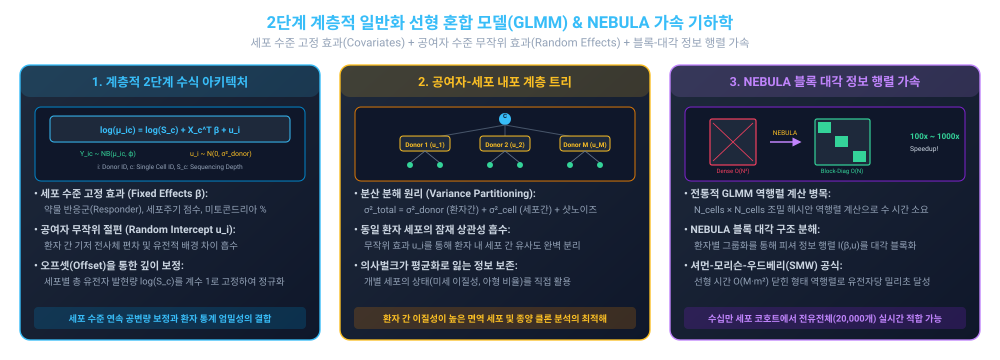

# 04. 위계적 일반화 선형 혼합 모델(GLMM): 세포 수준 공변량과 무작위 효과

---

## 학습 목표 (Cognitive Goals)

1. **슈도벌크 집계의 정보 손실과 한계 규명**: 원시 카운트 합산 과정에서 소실되는 단일세포 고유의 연속 공변량(세포 주기 위상, 미토콘드리아 분율, 종양 내 유전체 서브클론 상태, 분화 잠재시간)을 체계화하고, 집계 데이터에서 발생하는 생태학적 오류(Ecological Fallacy) 및 심슨의 역설(Simpson's Paradox)을 수학적으로 증명한다.
2. **2단계 GLMM(Two-Stage Generalized Linear Mixed Model)의 수학적 정식화**: 음이항 조건부 오차 모형과 로그 연결 함수(Log Link)를 바탕으로, 세포 수준 공변량을 고정 효과(Fixed Effects)로 유지하면서 환자 간 이질성을 공여자 수준 무작위 효과(Random Effects)로 모형화하는 2단계 위계 구조를 정립한다.
3. **무작위 절편(Random Intercept)과 무작위 기울기(Random Slope)의 기하학적 차이 구별**: 환자별 기저 발현량의 차이($u_{0i}$)만을 흡수하는 모형과, 환자마다 약물 또는 치료에 반응하는 민감도의 편차($u_{1i}$)까지 허용하는 무작위 기울기 모형의 분산-공분산 행렬($\boldsymbol{\Sigma}$) 구조를 대수적으로 비교한다.
4. **주변부 우도(Marginal Likelihood) 수치 적분 기법과 계산 병목 극복**: 다변량 잠재 변수에 대한 적분 불가능성을 극복하기 위한 라플라스 근사(Laplace Approximation)와 적응형 가우스-에르미트 구적법(AGHQ)의 원리를 분석하고, `glmmTMB`(라플라스 근사 사용) 적합, 수렴 진단 및 대규모 단일세포 전용 가속 패키지(`nebula`; AGHQ가 아니라 대표본 근사로 고차원 적분을 해석적으로 해결)로의 확장 메커니즘을 확립한다.

---

## 1. 슈도벌크의 한계와 단일세포 수준 연속 공변량의 손실

### 1.1 슈도벌크 집계가 파괴하는 4대 단일세포 정보

제3장에서 다룬 슈도벌크(Pseudobulk) 프레임워크는 환자 간 가짜 반복을 차단하는 견고한 표준이며(슈도벌크와 혼합모형은 모두 유효하고, Squair et al. 2021은 GLMM이 약 500세포 이상에서 슈도벌크 성능에 수렴하나 계산 비용이 크다고 보고한다. GLMM/NEBULA는 세포 수준 공변량이 핵심인 경우에 필요하며 선택은 연구 질문에 달려 있다), **환자-세포형 단위로 세포들을 강제 합산(Summation)함으로써 단일세포 고유의 세포 내 이질성(Intra-cellular Heterogeneity)을 완전히 소거**한다.

```
[Information Destruction by Pseudobulk Aggregation]

Single-Cell Feature Matrix (Cell-Level Granularity):
Cell ID   Donor     Cell Cycle   Mito %   Subclone Status (Tr.04)   Pseudotime (Tr.06)   Gene Y Count
─────────────────────────────────────────────────────────────────────────────────────────────────
Cell_1    Patient_A S-phase      2.1%     Clone 1 (Diploid)         0.12                 0
Cell_2    Patient_A G2M-phase    4.8%     Clone 2 (PTEN Del)        0.84                 14
Cell_3    Patient_A G1-phase     1.5%     Clone 2 (PTEN Del)        0.79                 9
Cell_4    Patient_A S-phase      3.2%     Clone 1 (Diploid)         0.15                 1
─────────────────────────────────────────────────────────────────────────────────────────────────
                                    │
                                    ▼ [Pseudobulk Summation]
Synthetic Bulk Sample:
Sample ID      Donor     Mean Mito %   Clone Fraction   Mean Pseudotime   Sum Gene Y
─────────────────────────────────────────────────────────────────────────────────────────────────
Patient_A_PB   Patient_A 2.9% (Averaged) 50% (Diluted)  0.47 (Crushed)     24
* Result: All cell-to-cell continuous trajectories and subclone differences are LOST!
```

1. **세포 주기 점수(Cell Cycle S/G2M Phase Scores)**:
   - 증식 중인 세포와 정지기($G_0$) 세포가 혼재할 때, 특정 유전자의 발현 변화가 약물 처치 때문인지 단순히 세포 주기 분포 차이 때문인지 분리할 수 없다.
2. **미토콘드리아 및 리보솜 전사체 분율(Mitochondrial / Ribosomal %)**:
   - 세포 사멸 스트레스나 용해 품질 편차를 세포 단위에서 공변량으로 제어할 수 없다.
3. **유전체 서브클론 상태(Track 04 Genomic Subclones)**:
   - 종양 조직 내부에서 동일한 환자 내에 공존하는 정상 이배체 클론, $PTEN$ 결손 클론, $AR$ 증폭 클론 간의 전사체 차이를 환자 단위 합산으로는 절대 검정할 수 없다.
4. **연속적 분화 잠재시간(Track 06 Differentiation Pseudotime / Latent Time)**:
   - 세포가 분화 궤적 $\tau \in [0, 1]$을 따라 이동할 때, $\tau$를 연속 변수로 보존하면서 동적 조절 유전자를 찾아내는 분석이 불가능해진다.

### 1.2 생태학적 오류(Ecological Fallacy)와 심슨의 역설(Simpson's Paradox)

슈도벌크 집계는 **생태학적 오류(Ecological Fallacy)**를 유발할 수 있다. 즉, 세포 수준에서 존재하는 참된 상관관계가 환자 단위로 평균화되는 순간 역전되거나 사라지는 현상이다.

```
[Simpson's Paradox in Single-Cell Transcriptomics]

Expression ▲      Patient 1: / (Positive slope within cells)
of Gene Y  │                / 
           │               /    Patient 2: / (Positive slope within cells)
           │     • • •    /               /
           │    •  •  •  /       • • •   /
           │   •   •    /       •  •  • /
           │                   •   •   /
           │  [Aggregated Patient 1 Mean]
           │         ■
           │          \  Spurious Negative Trend Across Patients!
           │           \
           │            ■ [Aggregated Patient 2 Mean]
           └────────────────────────────────────────────────────────► Cell-level Covariate X
```

- 세포 수준에서는 모든 개별 환자 내부에서 공변량 $X$가 증가할수록 유전자 $Y$의 발현이 증가($\frac{\partial Y}{\partial X} > 0$)하지만,
- 환자 2가 환자 1에 비해 기저 발현량이 전반적으로 낮다면, 집계된 환자별 평균치는 우하향($\frac{\Delta \bar{Y}}{\Delta \bar{X}} < 0$)하는 가짜 부적 상관을 나타낼 수 있다.

따라서 **세포 수준의 해상도를 온전히 유지하면서도 환자 간의 가짜 반복을 동시에 제어하는 통계적 해법**이 절실히 요구되며, 이것이 바로 **위계적 일반화 선형 혼합 모델(Hierarchical GLMM)**이다.

---

## 2. 2단계 GLMM(Two-Stage GLMM)의 수학적 정식화

### 2.1 위계적 2단계 모델 구조

환자 $i \in \{1, \dots, N\}$의 세포 $j \in \{1, \dots, n_i\}$에서 측정된 유전자 카운트를 $Y_{ij}$라 하자.

#### 제1단계: 세포 수준 조건부 카운트 모형 (Within-Donor Level)
환자 $i$의 고유한 잠재 무작위 효과 벡터 $\mathbf{u}_i \in \mathbb{R}^q$가 조건부로 주어졌을 때, 카운트 $Y_{ij}$는 음이항 분포를 따른다:

$$Y_{ij} \mid \mathbf{u}_i \sim \text{NB}(\mu_{ij}, \, \theta)$$

로그 연결 함수(Log Link)를 통한 선형 예측자(Linear Predictor) $\eta_{ij}$는 다음과 같다:

$$\log(\mu_{ij}) = \mathbf{X}_{ij} \boldsymbol{\beta} + \mathbf{Z}_{ij} \mathbf{u}_i + \log(\text{depth}_{ij})$$

- $\mathbf{X}_{ij} \in \mathbb{R}^{1 \times p}$: 세포 수준 공변량(세포 주기, 서브클론 지시자, 잠재시간)과 환자 수준 공변량(치료군, 연령, 생검 부위)을 모두 포함하는 고정 효과(Fixed Effects) 디자인 행렬의 행 벡터.
- $\boldsymbol{\beta} \in \mathbb{R}^{p \times 1}$: 모집단 전체에 공통적으로 적용되는 고정 효과 회귀 계수 벡터.
- $\mathbf{Z}_{ij} \in \mathbb{R}^{1 \times q}$: 환자별 무작위 효과를 세포에 매핑하는 디자인 행렬의 행 벡터.
- $\mathbf{u}_i \in \mathbb{R}^{q \times 1}$: 환자 $i$의 고유한 무작위 효과 벡터.
- $\log(\text{depth}_{ij})$: 세포 $j$의 시퀀싱 깊이(총 UMI 수)를 보정하는 오프셋(Offset) 항.
- $\theta$: 유전자별 음이항 과분산 모수 ($\text{Var}(Y_{ij} \mid \mathbf{u}_i) = \mu_{ij} + \frac{\mu_{ij}^2}{\theta}$).

#### 제2단계: 환자 수준 무작위 효과 모형 (Between-Donor Level)
환자별 무작위 효과 벡터 $\mathbf{u}_i$는 환자 모집단에 걸쳐 다변량 정규 분포(Multivariate Normal Distribution)를 따른다고 가정한다:

$$\mathbf{u}_i \sim \mathcal{N}_q\left( \mathbf{0}, \, \boldsymbol{\Sigma} \right)$$

여기서 $\boldsymbol{\Sigma} \in \mathbb{R}^{q \times q}$는 무작위 효과들의 분산-공분산 행렬(Variance-Covariance Matrix)이다.

---

## 3. 무작위 절편(Random Intercept) vs 무작위 기울기(Random Slope)

### 3.1 무작위 절편 모델 (Random Intercept Model)

가장 단순한 형태는 환자마다 기저 발현량(Baseline Expression)의 편차만 존재한다고 가정하는 무작위 절편 모델이다 ($q = 1$):

$$\mathbf{Z}_{ij} = [1], \quad \mathbf{u}_i = [u_{0i}], \quad u_{0i} \sim \mathcal{N}(0, \, \sigma_{\text{donor}}^2)$$

$$\log(\mu_{ij}) = \beta_0 + \beta_1 \text{Treatment}_{ij} + \mathbf{X}_{ij}^{\text{cell}} \boldsymbol{\gamma} + u_{0i} + \log(\text{depth}_{ij})$$

- $\beta_0$: 전체 환자 모집단의 평균 기저 발현량.
- $u_{0i}$: 환자 $i$의 고유 기저 발현량 편차.
- **가정**: 약물 치료 효과($\beta_1$)는 모든 환자에게서 완벽히 동일한 크기로 나타난다고 전제한다.

### 3.2 무작위 기울기 모델 (Random Slope Model)

그러나 실제 암 임상 환자(mCRPC 코호트)에서는 환자마다 종양 미세환경과 유전체 변이가 다르므로, **약물 치료에 반응하는 민감도(Drug Sensitivity / Treatment Effect) 자체가 환자마다 다를 수 있다**.

이를 포착하기 위해 처치 변수에 대한 무작위 기울기를 허용한다 ($q = 2$):

$$\mathbf{Z}_{ij} = [1, \, \text{Treatment}_{ij}], \quad \mathbf{u}_i = \begin{pmatrix} u_{0i} \\ u_{1i} \end{pmatrix}$$

$$\log(\mu_{ij}) = (\beta_0 + u_{0i}) + (\beta_1 + u_{1i}) \text{Treatment}_{ij} + \mathbf{X}_{ij}^{\text{cell}} \boldsymbol{\gamma} + \log(\text{depth}_{ij})$$

무작위 효과 벡터 $\mathbf{u}_i$의 공분산 행렬은 다음과 같다:

$$\boldsymbol{\Sigma} = \begin{pmatrix} \sigma_0^2 & \rho_{01} \sigma_0 \sigma_1 \\ \rho_{01} \sigma_0 \sigma_1 & \sigma_1^2 \end{pmatrix}$$

- $\sigma_0^2$: 기저 발현량의 환자 간 분산.
- $\sigma_1^2$: 약물 치료 반응률의 환자 간 이질성 분산 (Heterogeneous Treatment Response).
- $\rho_{01}$: 기저 발현량이 높은 환자가 약물 반응도 더 강하게 나타나는지를 나타내는 절편-기울기 상관계수.

```
[Random Intercept vs Random Slope Geometry]

Random Intercept Only:
log(μ) ▲      Donor 1: ────────────────────── (Baseline high, parallel shift)
       │      Donor 2: ────────────────────── (Baseline mid,  parallel shift)
       │      Donor 3: ────────────────────── (Baseline low,  parallel shift)
       └─────────────────────────────────────► Treatment (Fixed Effect β_1 identical for all!)

Random Slope & Intercept:
log(μ) ▲      Donor 1: ───────══════════════► (Strong drug response: β_1 + u_1,1)
       │      Donor 2: ────────────────────── (No drug response:     β_1 + u_1,2 ≈ 0)
       │      Donor 3: ───────\              (Negative paradox:     β_1 + u_1,3 < 0)
       │                       \
       └────────────────────────▼────────────► Treatment (Heterogeneous Patient Slopes!)
```

---

## 4. 주변부 우도(Marginal Likelihood)와 수치 적분의 도전

### 4.1 잠재 무작위 효과에 대한 다차원 적분

GLMM의 모수($\boldsymbol{\beta}, \theta, \boldsymbol{\Sigma}$)를 추정하기 위해서는 관측 불가능한 환자별 잠재 변수 $\mathbf{u}_i$를 적분하여 소거한 **주변부 우도(Marginal Likelihood)**를 최대화해야 한다:

$$L(\boldsymbol{\beta}, \theta, \boldsymbol{\Sigma}; \mathbf{Y}) = \prod_{i=1}^N \int_{\mathbb{R}^q} \left[ \prod_{j=1}^{n_i} P_{\text{NB}}(y_{ij} \mid \mu_{ij}(\mathbf{u}_i), \, \theta) \right] \phi(\mathbf{u}_i \mid \mathbf{0}, \, \boldsymbol{\Sigma}) \, d\mathbf{u}_i$$

여기서 $\phi(\mathbf{u}_i \mid \mathbf{0}, \boldsymbol{\Sigma})$는 $q$차원 정규 밀도 함수이다.

**통계학적 난관**:
선형 혼합 모델(LMM, 정규-정규 혼합)과 달리, 음이항 분포와 다변량 정규 분포의 결합은 켤레성(Conjugacy)이 성립하지 않아 위 적분의 **해석적 닫힌 해(Analytical Closed-form Solution)가 존재하지 않는다**. 따라서 고도의 수치 적분 기법이 요구된다.

### 4.2 라플라스 근사 (Laplace Approximation)

`glmmTMB`와 R의 `lme4`가 채택하는 핵심 알고리즘은 **라플라스 근사(Laplace Approximation)**이다.

적분 대상 함수를 $e^{-h(\mathbf{u})}$ 형태로 표현하자:

$$h(\mathbf{u}_i) = -\sum_{j=1}^{n_i} \log P_{\text{NB}}(y_{ij} \mid \mathbf{u}_i) - \log \phi(\mathbf{u}_i \mid \boldsymbol{\Sigma})$$

피적분 함수는 최빈값(Mode) $\hat{\mathbf{u}}_i = \arg\min_{\mathbf{u}_i} h(\mathbf{u}_i)$ 부근에 극도로 집중된다. 따라서 $h(\mathbf{u}_i)$를 $\hat{\mathbf{u}}_i$ 주변에서 2차 테일러 전개(Taylor Expansion)한다:

$$h(\mathbf{u}_i) \approx h(\hat{\mathbf{u}}_i) + \underbrace{\nabla h(\hat{\mathbf{u}}_i)^T(\mathbf{u}_i - \hat{\mathbf{u}}_i)}_{= 0 \text{ at mode}} + \frac{1}{2} (\mathbf{u}_i - \hat{\mathbf{u}}_i)^T \mathbf{H}_i (\mathbf{u}_i - \hat{\mathbf{u}}_i)$$

여기서 $\mathbf{H}_i = \left. \frac{\partial^2 h(\mathbf{u}_i)}{\partial \mathbf{u}_i \partial \mathbf{u}_i^T} \right|_{\mathbf{u}_i = \hat{\mathbf{u}}_i}$는 헤시안(Hessian) 행렬이다.
이를 가우스 적분 공식 $\int_{\mathbb{R}^q} \exp\left(-\frac{1}{2} \mathbf{v}^T \mathbf{H} \mathbf{v}\right) d\mathbf{v} = (2\pi)^{q/2} |\mathbf{H}|^{-1/2}$에 대입하면:

$$\int_{\mathbb{R}^q} e^{-h(\mathbf{u}_i)} \, d\mathbf{u}_i \approx (2\pi)^{q/2} |\mathbf{H}_i|^{-1/2} \exp\left( -h(\hat{\mathbf{u}}_i) \right)$$

- **장점**: 다차원 적분을 단순한 행렬식($|\mathbf{H}_i|$) 계산으로 환원시켜 연산 속도를 비약적으로 향상시킨다.
- **한계**: 환자당 세포 수 $n_i$가 매우 적거나 카운트가 $0$으로만 가득 찬 희소 유전자에서는 사후 밀도 함수가 비대칭적(Asymmetric)이 되어 근사 오차가 발생할 수 있다.

---

## 5. 다이어그램 및 시각화



위 다이어그램은 GLMM의 2단계 위계 구조를 나타낸다:
1. **Level 1 (세포 수준)**: 세포 주기 위상, 서브클론 지시자, 분화 잠재시간 등 연속형 공변량을 보존하며 조건부 카운트를 모형화.
2. **Level 2 (공여자 수준)**: 환자 간 기저 발현 변동($u_{0i}$) 및 환자별 약물 반응 기울기($u_{1i}$)를 다변량 정규 분포로 묶어 가짜 반복을 완벽 차단.

---

## 6. 대규모 연산 병목과 해결책: `glmmTMB`에서 `nebula`로의 도약

### 6.1 `glmmTMB`의 한계와 계산 복잡도 병목

`glmmTMB`는 C++ 템플릿(TMB)과 자동 미분(Automatic Differentiation)을 사용하여 단일 유전자에 대해 매우 정교하고 수치적으로 안정적인 적합을 제공한다.
그러나 유전자 수가 $G \sim 20,000$개이고 세포 수가 $n \sim 100,000$개에 달하는 전장 단일세포 전사체학에서, 20,000번의 라플라스 최적화 루프를 순차적으로 반복하는 것은 수십 시간에서 수일 이상의 비현실적인 연산 시간을 초래한다.

### 6.2 `nebula` 패키지의 고속 근사 혁신

이 문제를 해결하기 위해 He et al. (Communications Biology 2021)은 **NEBULA (Negative Binomial mixed model Using Large-sample Approximation)**를 제안하였다.

`nebula`는 유전자별로 전체 최적화 루프를 돌리는 대신:
1. 라플라스 근사 대신 고차원 적분을 대표본 근사로 해석적으로 풀어 근사 우도를 얻고(He et al. 2021 초록),
2. 공여자 단위 블록 구조를 이용해 유전자별 적합을 빠르게 수행하여,
3. **`glmmTMB` 등 기존 GLMM 솔버보다 자릿수(orders of magnitude) 수준으로 빠른 전장 유전체 GLMM 검정을 가능하게 한다**(논문 보고 기준이며 배수는 데이터에 의존).

---

## 7. R 및 Python 분석 파이프라인 구현

### 7.1 R `glmmTMB`를 이용한 무작위 절편/기울기 정밀 모형화

```R
# 04_glmmtmb_hierarchical.R
suppressPackageStartupMessages({
    library(glmmTMB)
    library(car)
})

fit_single_cell_glmm <- function(cell_df, gene_name = "AR") {
    cat("[*] Fitting Hierarchical GLMM for Gene:", gene_name, "\n")
    
    # 1. 무작위 절편 모델 (Random Intercept) 적합
    # formula: count ~ condition + cell_cycle_score + subclone + (1 | patient_id) + offset(log(depth))
    fit_ri <- glmmTMB(
        count ~ condition + s_score + subclone + offset(log_depth) + (1 | patient_id),
        data = cell_df,
        family = nbinom2(link = "log")
    )
    
    # 2. 무작위 기울기 모델 (Random Slope) 적합
    # condition은 공여자 수준 변수(공여자당 수준 1개)라 (1 + condition | patient_id)는 식별 불가이므로,
    # 공여자 내에서 변하는 subclone에 대해서만 무작위 기울기를 둔다: (1 + subclone | patient_id)
    fit_rs <- glmmTMB(
        count ~ condition + s_score + subclone + offset(log_depth) + (1 + subclone | patient_id),
        data = cell_df,
        family = nbinom2(link = "log")
    )
    
    # 3. 모델 간 우도비 검정 (LRT via anova): 환자별 subclone 효과 이질성(Random Slope)이 유의한가?
    #    (분산성분 검정은 경계 문제로 p-값이 보수적이므로 해석에 주의)
    lrt_model_comp <- anova(fit_ri, fit_rs)
    # 주의: 랜덤 기울기 분산이 거의 0이거나 식별되지 않는 데이터에서는 fit_rs가
    # "non-positive definite Hessian" 경고를 내고 LRT 행이 NA가 될 수 있다.
    # 이 경우 랜덤 기울기 모형은 해석하지 말고 fit_ri(랜덤 절편)를 사용한다.
    print(lrt_model_comp)
    
    # 4. 고정 효과 유의성 검정 (Type II Wald chisq test)
    fixed_effects_test <- Anova(fit_ri, type = "II")
    print(fixed_effects_test)
    
    return(list(fit_ri = fit_ri, fit_rs = fit_rs))
}

# 가상 세포 수준 데이터 생성
set.seed(42)
n_donors <- 6
cells_per_donor <- 400
total_cells <- n_donors * cells_per_donor

donor_ids <- rep(paste0("Donor_", 1:n_donors), each = cells_per_donor)
conditions <- rep(c("Ctrl", "Treated"), each = total_cells / 2)
depths <- runif(total_cells, 3000, 15000)
s_scores <- rnorm(total_cells, mean = 0, sd = 1)
subclones <- sample(c("Diploid", "PTEN_Del"), size = total_cells, replace = TRUE)

# 기저 환자 효과 생성
u_donor <- rnorm(n_donors, 0, 0.4)
names(u_donor) <- paste0("Donor_", 1:n_donors)

# 참된 선형 예측자 생성
eta <- -8.0 + 0.8 * (conditions == "Treated") + 0.3 * s_scores + 
       0.5 * (subclones == "PTEN_Del") + u_donor[donor_ids] + log(depths)
sim_mu <- exp(eta)
sim_y <- rnbinom(total_cells, size = 2.5, mu = sim_mu)

toy_df <- data.frame(
    count = sim_y,
    patient_id = factor(donor_ids),
    condition = factor(conditions, levels = c("Ctrl", "Treated")),
    s_score = s_scores,
    subclone = factor(subclones),
    log_depth = log(depths)
)

fits <- fit_single_cell_glmm(toy_df)
```

### 7.2 R `nebula`를 이용한 대규모 전장 유전체 초고속 가속

```R
# 04_nebula_genome_scale.R
suppressPackageStartupMessages({
    library(nebula)
})

run_nebula_ultra_fast <- function(raw_counts_mat, cell_metadata, donor_col = "patient_id") {
    cat("[*] Running NEBULA ultra-fast mixed model across", nrow(raw_counts_mat), "genes...\n")
    
    # 1. 환자 인덱스 및 디자인 행렬 구축
    donor_vec <- cell_metadata[[donor_col]]
    design_mat <- model.matrix(~ condition + s_score + subclone, data = cell_metadata)
    
    # 2. NEBULA 입력 객체 포맷팅: 세포를 환자(id)별로 연속 배치해야 함
    # (scToNeb()은 Seurat/SingleCellExperiment 객체를 받는 함수이므로 행렬 입력에는 group_cell() 사용)
    neb_data <- group_cell(
        count = raw_counts_mat,
        id = donor_vec,
        pred = design_mat,
        offset = cell_metadata$total_counts
    )
    # 이미 환자별로 정렬되어 있으면 group_cell()은 NULL을 반환하므로 원본을 그대로 사용
    if (is.null(neb_data)) {
        neb_data <- list(count = raw_counts_mat, id = donor_vec,
                         pred = design_mat, offset = cell_metadata$total_counts)
    }
    
    # 3. NEBULA 고속 음이항 혼합 모델 적합
    # model = "NBGMM"(음이항 감마 혼합모형, 기본값) | "PMM" | "NBLMM"
    # method = "LN" (Log-Normal 근사, 기본값) 또는 "HL" (Hierarchical Likelihood)
    neb_res <- nebula(
        count = neb_data$count,
        id = neb_data$id,
        pred = neb_data$pred,
        offset = neb_data$offset,
        model = "NBGMM",
        method = "LN"
    )
    
    cat("[+] NEBULA Model Fitting Completed successfully!\n")
    return(neb_res)
}
```

---

## 단원 핵심 점검 (Cognitive Checkpoint & Case Study)

### 문제 1: 무작위 절편 vs 무작위 기울기의 임상적 의미와 위양성 억제 기전
Kfoury et al. 골전이 코호트(실제 GSE143791은 골전이 환자 9명)와 유사한 구조를 가정한 가상 설계(환자 15명, 모든 환자에서 투여 전·후 생검을 확보한 환자 내 설계로 가정; 환자당 처치 수준이 하나뿐인 설계에서는 무작위 기울기가 식별되지 않는다)에서 항암 화학요법제(Docetaxel) 투여에 따른 암세포 사멸 촉진 유전자를 탐색하고자 한다. 환자 15명 중 5명은 탁산계 화학요법에 극적인 반응(Good Responders)을 보이며 특정 유전자 $GeneK$가 급격히 유도된 반면, 나머지 10명은 약물 불응성(Non-responders)을 나타내며 $GeneK$의 발현 변동이 전혀 없었다.
1. 이 데이터에 대해 오직 환자별 기저 발현 변이만 허용하는 무작위 절편 모델(Random Intercept Only)을 적합할 경우, Good Responder 5명에서 포획된 수천 개의 세포들로 인해 전체 코호트의 고정 효과 $\beta_{\text{Chemo}}$의 $p$-value가 어떻게 과도하게 부풀려져 위양성을 유발하는지 수식적으로 설명하시오.
2. 환자 내 처치 설계에서 무작위 기울기(Random Slope for Treatment, $u_{1i}$)를 모델에 추가하였을 때, 약물 반응 이질성 분산 $\sigma_1^2 = \text{Var}(u_{1i})$가 어떻게 고정 효과 검정의 표준 오차 분모를 교정하여 보편적 치료 반응 유전자만을 정밀하게 걸러내는지 논증하시오.

<details>
<summary>💡 모범 답안 및 해설 확인</summary>

**1. 무작위 절편 모델에서의 위양성 유발 메커니즘**:
- 무작위 절편 모델의 수식:
  $$\log(\mu_{ij}) = \beta_0 + \beta_1 \text{Chemo}_{ij} + u_{0i} + \log(\text{depth}_{ij})$$
- 이 모델은 치료 효과 $\beta_1$이 15명의 환자 모두에게서 **오차 없이 동일한 크기로 나타난다($\sigma_{\text{treatment}}^2 = 0$)**고 강제 가정한다. (환자 수준 변수 효과의 SE는 무작위 절편만으로도 $\sigma_{\text{donor}}^2/N$ 항을 포함하므로, 아래 SE $\to 0$은 무작위 효과가 전혀 없는 세포 수준 GLM의 성질이며, 무작위 절편 모형의 문제는 환자별 처치 효과 이질성이 모형에 없다는 점이다.)
- Good Responder 5명 유래 세포 수천 개에서 $GeneK$ 발현이 급증하면, 환자별 반응 이질성이 반영되지 않아 모델은 이 세포 수준의 거대한 표본 크기를 바탕으로 $\beta_1$의 분산을 과소추정한다 (무작위 효과가 없는 세포 수준 GLM에서는 다음과 같이 근사된다):
  $$\text{Var}(\hat{\beta}_1) \approx \left(\sum_{i=1}^{15} \sum_{j=1}^{n_i} w_{ij} X_{ij}^2\right)^{-1} \to 0$$
- 즉, 환자 간 반응의 이질성(Heterogeneity)이 무작위 효과로 분리되지 못하고 잔차 노이즈로 억압되므로(세포 수준 GLM 또는 무작위 기울기가 빠진 모형에서), 발트 검정 통계량 $W = \frac{\hat{\beta}_1}{\text{SE}(\hat{\beta}_1)}$이 폭발하여 $GeneK$가 "전체 골전이 환자 15명 모두에게 유효한 보편적 화학요법 반응 바이오마커"라는 치명적인 위양성 임상 결론을 도출하게 된다.

**2. 무작위 기울기 모델의 표준 오차 교정 및 위양성 억제 기전**:
- 무작위 기울기 모델의 수식:
  $$\log(\mu_{ij}) = \beta_0 + (\beta_1 + u_{1i}) \text{Chemo}_{ij} + u_{0i} + \log(\text{depth}_{ij}), \quad u_{1i} \sim \mathcal{N}(0, \sigma_1^2)$$
- 여기서 $\sigma_1^2 = \text{Var}(u_{1i})$는 화학요법에 대한 환자별 반응성의 순수한 생물학적 분산(Patient-to-patient response variance)을 측정한다.
- 고정 효과 추정량 $\hat{\beta}_1$의 참 분산은 다음과 같이 분해된다:
  $$\text{Var}(\hat{\beta}_1) = \frac{\sigma_1^2}{N} + \text{Within-donor noise}$$
- 15명 중 10명이 반응하지 않고 5명만 반응했다면, 모델은 환자 간 반응 이질성 분산 $\sigma_1^2$을 매우 큰 양수로 추정한다.
- 그 결과 고정 효과의 표준 오차 $\text{SE}(\hat{\beta}_1) \approx \sqrt{\frac{\sigma_1^2}{15}}$가 현실적인 환자 단위 크기로 팽창하여 검정 통계량 $Z = \frac{\hat{\beta}_1}{\text{SE}(\hat{\beta}_1)}$의 과도한 팽창을 억제한다.
- 따라서 소수 환자에서만 반응하고 대다수 환자에서 재현되지 않는 개인적 반응 유전자는 기각되고, 15명 전반에 걸쳐 일관되게 유도되는 진정한 보편적 반응 표적 유전자만 유의수준을 통과하게 된다.

</details>

---

### 문제 2: 라플라스 근사(Laplace Approximation)의 희소 카운트 편향
GLMM 적합 시 우도 함수 적분을 위해 사용되는 2차 라플라스 근사는 피적분 함수의 로그가 최빈값(Mode) $\hat{\mathbf{u}}_i$ 주변에서 대칭적인 2차 포물선 형태를 띤다는 가정을 기반으로 한다.
1. 단일세포 전사체 데이터에서 특정 전사인자 유전자와 같이 전체 세포의 95% 이상이 $0$ 카운트를 갖는 극단적인 희소(Sparse) 데이터셋에 라플라스 근사를 적용할 때, 로그 사후 밀도 곡선이 왜 심각하게 우측 또는 좌측으로 왜곡(Skewness / Non-quadratic)되는지 설명하시오.
2. 이 비대칭성으로 인해 분산 성분 $\sigma_{\text{donor}}^2$ 추정치와 회귀 계수 $\boldsymbol{\beta}$의 표준 오차가 겪게 되는 근사 편향(Asymptotic Bias)의 방향을 설명하시오.

<details>
<summary>💡 모범 답안 및 해설 확인</summary>

**1. 희소 카운트 하에서 사후 밀도의 비대칭 왜곡 기전**:
- 피적분 함수의 지수 항 $h(\mathbf{u}_i)$는 카운트 로그 우도와 정규 사전분포의 합이다:
  $$h(\mathbf{u}_i) = -\sum_{j=1}^{n_i} \left[ y_{ij} \eta_{ij} - (y_{ij} + \theta)\log(\theta + e^{\eta_{ij}}) \right] + \frac{1}{2} \mathbf{u}_i^T \boldsymbol{\Sigma}^{-1} \mathbf{u}_i$$
- 대부분의 세포에서 $y_{ij} = 0$일 때, 우도 항은 $-\sum_{j=1}^{n_i} \theta \log(1 + \theta^{-1} e^{\eta_{ij}})$ 형태가 된다.
- 무작위 효과 $u_i \to -\infty$ 방향으로 갈 때 로그 우도는 0으로 완만하게 점근하지만, $u_i \to +\infty$ 방향으로 갈 때는 지수 함수적($-e^{u_i}$)으로 급격하게 붕괴한다.
- 포아송/음이항 카운트가 매우 작을 때는 카운트 데이터 고유의 비대칭성이 정규 사전분포의 대칭성을 압도하여, 모드 $\hat{\mathbf{u}}_i$ 주변의 곡률이 좌우 비대칭(Heavy Skewness)을 띠게 된다.
- 따라서 2차 테일러 급수로 곡률을 근사하는 라플라스의 2차 포물선 가정($\mathbf{u}^T \mathbf{H} \mathbf{u}$)이 국소적으로 심각하게 붕괴한다.

**2. 분산 성분 및 표준 오차의 편향 방향**:
- 비대칭 곡면에서 2차 테일러 근사는 피적분 함수의 유효 체적(Volume)을 과소평가하거나 과대평가하게 된다.
- 특히 이항/포아송 희소 카운트 데이터에서 라플라스 근사는 군집당 정보량이 작을 때 **환자 간 분산 성분 $\sigma_{\text{donor}}^2$을 참값보다 음의 방향으로 편향(Downward / Negative Bias, 과소평가)**시킬 수 있다.
- 환자 간 분산이 과소평가되면 세포 간 독립성이 실제보다 더 높게 책정되므로, 고정 효과 $\boldsymbol{\beta}$의 표준 오차($\text{SE}$)가 인위적으로 축소되어 $p$-value가 실제보다 작게 계산되는 경미한 제1종 오류 팽창(Liberal Bias)이 발생한다.
- 다만 라플라스 근사 오차는 영(0)의 비율 자체보다 군집(공여자)당 정보량(세포 수/카운트 합)에 좌우되며, 공여자당 수백~수천 세포이면 오차는 대체로 작다. 소수 군집·이진/희소 데이터에서 분산 성분이 과소추정되는 방향성은 알려져 있으나 그 크기는 데이터에 의존한다. 필요하면 적응형 가우스-에르미트 구적법(AGHQ, `glmmTMB`는 라플라스만 지원하므로 `lme4::glmer` 등 AGHQ 지원 도구 사용)이나 `nebula`(대표본 근사)를 병행 검증한다.

</details>

---

### 문제 3: Track 04 종양 서브클론과 환자 효과(Donor Effect)의 교락 제어
Track 04에서 복제수 변이(CNA) 분석을 통해 전립선암 환자 8명으로부터 이배체 정상 클론(Diploid), 서브클론 A($PTEN$ 단일 결손), 서브클론 B($PTEN$ 결손 + $AR$ 증폭)를 식별하였다. 그러나 임상 샘플 특성상 서브클론 B는 환자 8명 중 오직 2명의 환자(P03, P07)에게서만 집중적으로 검출되었고 나머지 6명 환자에게서는 거의 검출되지 않았다.
1. 이 상황에서 슈도벌크 집계 분석(Pseudobulk)을 수행할 때 서브클론 B와 환자 P03, P07의 고유 유전적 배경 간에 발생하는 교락(Confounding) 문제를 논하시오.
2. 위계적 GLMM(`glmmTMB` 또는 `nebula`)에서 서브클론 상태(`subclone`)를 고정 효과(Fixed Effect)로 두고 환자 식별자(`patient_id`)를 무작위 효과(Random Effect)로 모형화할 때, 모델이 어떻게 환자 고유 변이를 통제하면서 순수한 서브클론 B의 발현 시그니처를 분리해내는지 선형대수학적 사영(Projection) 관점에서 설명하시오.

<details>
<summary>💡 모범 답안 및 해설 확인</summary>

**1. 슈도벌크 집계 시 서브클론-환자 교락 문제**:
- 슈도벌크 집계를 수행하여 '서브클론 B' 샘플 프로파일을 생성하면, 유효 표본 크기는 환자 P03과 P07 단 2개($N=2$)에 불과하다.
- edgeR이나 DESeq2에서 서브클론 B와 나머지 클론을 비교할 때, 모델은 관측된 발현 차이가 "진정으로 $PTEN$ 결손 및 $AR$ 증폭에 의한 암 클론의 생물학적 변화"인지, 아니면 "환자 P03과 P07이 우연히 공유하는 고유한 체질적 유전 변이, 식습관, 또는 조직 채취 당시의 배치 효과"인지를 수학적으로 전혀 분리할 수 없다 ($df = 2 - 1 = 1$, 완전 교락).

**2. 위계적 GLMM의 고유 변이 분리 메커니즘 (선형대수학적 사영 관점)**:
- **모델 정식화**:
  $$\log(\mu_{ij}) = \beta_0 + \beta_A \text{CloneA}_{ij} + \beta_B \text{CloneB}_{ij} + u_i + \log(\text{depth}_{ij}), \quad u_i \sim \mathcal{N}(0, \sigma_{\text{donor}}^2)$$
- 환자 P03과 P07의 종양 내부에는 서브클론 B 세포뿐만 아니라, 동일 환자로부터 유래한 서브클론 A 세포와 정상 이배체 세포도 함께 공존한다.
- **사영(Projection) 및 내부 대조(Within-patient Contrast) 메커니즘**:
  - GLMM에서 환자 무작위 효과 $u_{\text{P03}}$은 환자 P03 내부의 **모든 세포(정상, 클론 A, 클론 B)가 공통적으로 공유하는 기저 발현량**을 기준으로 적합된다.
  - 고정 효과 추정량 $\hat{\beta}_B$는 환자 간의 단순 비교가 아니라, 선형대수학적으로 무작위 효과가 생성하는 기저 공간(Column Space of $\mathbf{Z}$)의 직교 여공간(Orthogonal Complement)으로 사영된 잔차를 바탕으로 추정된다.
  - 즉, $\beta_B$는 **"동일한 환자 P03 내부에서 정상/클론 A 세포 대비 서브클론 B 세포가 추가적으로 얼마나 더 발현이 증가했는가"**라는 환자 내 대조(Within-patient Contrast)를 통해 계산된다.
- 다만 무작위 절편 모형의 고정효과 추정은 within-환자 정보와 between-환자 정보의 가중 결합이므로, 서브클론 비율이 환자 기저 발현과 상관되면(P03·P07) 편향될 수 있다(Mundlak 문제). 순수 within-환자 대조를 원하면 환자 평균 서브클론 비율을 공변량으로 추가(Mundlak 항)하거나 환자를 고정효과로 둔다. 또한 서브클론이 inferCNV(발현 기반)로 정의되므로 CNA 구간 유전자는 정의 자체와 순환적이어서(cis 효과) DE 해석에서 제외해야 한다.

</details>

---

<!-- REFERENCES:BEGIN (generated by scripts/apply_references.py; do not edit by hand) -->
## 참고문헌 (References)
### 본문 인용 문헌
1. Squair JW, Gautier M, Kathe C, et al. Confronting false discoveries in single-cell differential expression. *Nat Commun*. 2021;12(1):5692. PMID: 34584091. doi: 10.1038/s41467-021-25960-2
2. He L, Davila-Velderrain J, Sumida TS, et al. NEBULA is a fast negative binomial mixed model for differential or co-expression analysis of large-scale multi-subject single-cell data. *Commun Biol*. 2021;4(1):629. PMID: 34040149. doi: 10.1038/s42003-021-02146-6
3. Kfoury Y, Baryawno N, Severe N, et al. Human prostate cancer bone metastases have an actionable immunosuppressive microenvironment. *Cancer Cell*. 2021;39(11):1464-1478.e8. PMID: 34719426. doi: 10.1016/j.ccell.2021.09.005
### 검수 근거 문헌
1. Zimmerman KD, Espeland MA, Langefeld CD. A practical solution to pseudoreplication bias in single-cell studies. *Nat Commun*. 2021;12(1):738. PMID: 33531494. doi: 10.1038/s41467-021-21038-1
### 소프트웨어 (표기 버전은 검수 시 API를 확인한 버전이며, 파이프라인 실행 환경은 requirements-pipelines.txt 참조)
- glmmTMB (github.com/glmmTMB/glmmTMB). 원 논문: Brooks M, Kristensen K, Benthem K, et al. glmmTMB Balances Speed and Flexibility Among Packages for Zero-inflated Generalized Linear Mixed Modeling. *The R Journal*. 2017;9(2):378. doi: 10.32614/rj-2017-066
- NEBULA (github.com/lhe17/nebula). 원 논문: He L, Davila-Velderrain J, Sumida TS, et al. NEBULA is a fast negative binomial mixed model for differential or co-expression analysis of large-scale multi-subject single-cell data. *Commun Biol*. 2021;4(1):629. PMID: 34040149. doi: 10.1038/s42003-021-02146-6
- car (R) (cran.r-project.org/package=car).
<!-- REFERENCES:END -->
