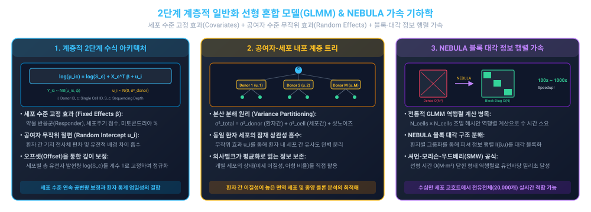

# 05. 고속 세포 수준 음이항 혼합 모델 (Fast Cell-Level GLMM with NEBULA)

---

## 학습 목표 (Cognitive Goals)

1. **단일세포 전사체 수준의 위계적 군집 상관(Hierarchical Clustering Correlation)과 위양성 폭발 기전 이해**: 개별 세포를 독립된 표본으로 취급하는 단순 음이항 회귀가 공여자 간 생물학적 변이($\sigma_D^2$)를 무시할 때 발생하는 위양성(Type I Error) 폭발의 수리적 원인을 증명하고, 이를 방어하기 위한 일반화 선형 혼합 모델(GLMM)을 정식화할 수 있다.
2. **표준 GLMM의 $O(G \cdot N^3)$ 계산 복잡도와 NEBULA의 대각 블록 피셔 정보 행렬(Block-Diagonal Fisher Information Matrix) 유도**: $10^5$개 이상의 단일세포에서 환자 임의 효과의 라플라스 근사 및 주변화 적분이 가지는 계산 병목을 분석하고, 공여자 간 상호 독립성을 활용하여 계산 복잡도를 $O(N)$의 선형 시간으로 축소하는 수치해석적 기전을 설명할 수 있다.
3. **NEBULA-LN (Log-Normal)과 NEBULA-HL (Hierarchical Likelihood) 알고리즘의 수학적 유도 및 비교**: 세포 수준 과산포와 공여자 수준 분산을 동시에 추정하는 두 핵심 알고리즘의 목적 함수, 수렴 속도, 샘플 불균형(Sample Imbalance) 상황에서의 정밀도 차이를 비교 분석할 수 있다.
4. **전립선암 임상 코호트 적용을 위한 다수준 공변량 모델링 및 통계 검정 파이프라인 구축**: 세포 수준의 연속형 교란 변수(Cell Cycle Phase, Mitochondrial RNA %, UMI Depth)와 공여자 수준의 치료 반응(Enzalutamide 감수성 vs 저항성)을 단일 혼합 모델에 결합하고, R/Python 기반 가설 검정(Wald Test) 및 분산 성분 분해를 수행할 수 있다.

---

## 1. 단일세포 수준 통계 모델링의 필요성과 슈도벌크의 한계

단일세포 RNA 시퀀싱(scRNA-seq/snRNA-seq) 데이터에서 차등 발현 유전자(Differentially Expressed Genes, DEG)를 발굴할 때 가장 흔히 범하는 오류는 개별 세포를 상호 독립적인 표본(Independent and Identically Distributed, i.i.d.)으로 간주하는 것이다. 반면, 이를 회피하기 위해 널리 쓰이는 슈도벌크(Pseudobulk) 집계 방식 역시 세포 수준의 중요한 생물학적 변이를 손실시키는 한계를 지닌다.

```
[Statistical Paradigms in Multi-Donor Single-Cell RNA-seq]

1. Naive Cell-Level Model (Unpooled)
   Cell 1 ──┐
   Cell 2 ──┼─> [ Negative Binomial GLM ] ──> N = 100,000 (DF inflated!)
   Cell 3 ──┘                                 Spurious p-values (p < 10^-50)
   (Ignores donor clustering -> Catastrophic False Positives)

2. Pseudobulk Aggregation
   Donor A (10k cells) ──> Sum Counts ──┐
   Donor B ( 8k cells) ──> Sum Counts ──┼─> [ DESeq2 / edgeR ] ──> N = Donors (e.g., 10)
   Donor C (12k cells) ──> Sum Counts ──┘                         Valid FDR, but loses
   (Discards cell-cycle, mito %, & within-cluster substate heterogeneity)

3. Fast Hierarchical GLMM (NEBULA)
   Cell i (Donor j) ──> Cell-level covariates (Cycle, Mito, Depth)
                           │
                           ▼
   Donor j Effect   ──> Donor-level clinical state (Enzalutamide Res vs Sens)
                           │
                           ▼
   [ Block-Diagonal Fisher Information Matrix & Analytical Pseudo-Likelihood ]
   (Preserves cell-level resolution + donor-aware inference in O(N) time)
```

### 1.1 왜 슈도벌크(Pseudobulk)만으로는 불충분한가?

(슈도벌크와 혼합모형은 모두 유효한 선택지이며, 아래는 세포 수준 공변량이 중요한 경우에 NEBULA가 필요한 이유이다.) 슈도벌크 방식은 동일한 공여자(Donor) 및 세포 유형(Cell Type)에 속하는 세포들의 UMI 카운트를 단순히 합산하여 DESeq2나 edgeR과 같은 벌크 RNA-seq 통계 파이프라인에 입력한다. 이 접근법은 공여자 간 생물학적 반복(Replication)을 올바르게 반영하여 위양성을 엄격하게 제어하지만, 다음과 같은 치명적인 정보 손실을 야기한다:

1. **세포 수준 연속 교란 변수(Continuous Confounders)의 소실**:
   개별 세포의 세포 주기(G1/S/G2M Score), 미토콘드리아 전사체 비율(Mitochondrial Fraction), 리보솜 전사체 비율 등은 세포마다 연속적으로 변동한다. 슈도벌크로 합산하는 순간 이러한 연속적 공변량의 분포(Distributional Shape)와 세포별 교락 효과를 통계 모델 내에서 직접 회귀(Regression)로 제거할 수 없다.
2. **희귀 전이 상태(Rare Transient Substates)의 희석**:
   거세 저항성 전립선암(CRPC)에서 약제 노출 시 일시적으로 출현하는 줄기세포성 전이 상태(Stem-like intermediate state)나 초기 신경내분비 전이 세포는 클러스터 내에서 소수(1~5%)를 차지한다. 슈도벌크 합산 시 다수를 차지하는 지배적 세포 상태의 카운트에 압도되어 희귀 아집단의 특이적 발현 변동이 완전히 마스킹된다.
3. **세포군 내부 이질성(Intra-cluster Heterogeneity)의 무시**:
   동일 클러스터 내부에서도 분화 유사시간(Pseudotime)이나 국소 신호 강도에 따라 유전자 발현 구배가 존재한다. 슈도벌크는 이러한 연속적 동역학을 평균값 하나로 붕괴시킨다.

### 1.2 고전적 GLMM의 계산 병목 (교육용 단순화: $O(G \cdot N^3)$)

세포 수준의 해상도를 보존하면서 공여자 간 상관관계를 제어하는 통계적 표준 해법은 **일반화 선형 혼합 모델(Generalized Linear Mixed Model, GLMM)**이다. 공여자 $j$ ($j=1, \dots, J$)의 세포 $i$ ($i=1, \dots, n_j$)에서 유전자 $g$의 발현 카운트 $y_{ij}$는 다음과 같이 모형화된다:

$$y_{ij} \sim \text{NB}(\mu_{ij}, \phi)$$

$$\log(\mu_{ij}) = \mathbf{x}_{ij}^T \boldsymbol{\beta} + \gamma_j + \log(s_{ij})$$

여기서 $\mathbf{x}_{ij}$는 세포 및 공여자 수준 공변량 벡터, $\boldsymbol{\beta}$는 고정 효과(Fixed Effects), $\gamma_j \sim \mathcal{N}(0, \sigma^2)$는 공여자 수준 임의 효과(Random Effect), $s_{ij}$는 시퀀싱 심도(Size factor), $\phi$는 음이항 과산포 모수이다.

그러나 표준 통계 패키지(`lme4::glmer`, `glmmTMB`)를 수십만 개의 단일세포 데이터에 적용하면 유전자별 반복 최적화와 적분 근사 때문에 매우 느려진다. (실제 솔버는 공여자 군집/희소 구조를 이용하므로 아래의 $N \times N$ 밀집 역행렬 $O(N^3)$은 최악의 경우를 가정한 교육용 단순화이다.)

- **주변 우도(Marginal Likelihood) 계산을 위한 고차원 수치 적분**:
  임의 효과 $\gamma_j$를 주변화하기 위해 라플라스 근사(Laplace Approximation)나 가우스-에르미트 구적법(Gauss-Hermite Quadrature)을 수행해야 한다.
- **밀집 공분산 행렬(Dense Covariance Matrix) 역행렬 연산**:
  뉴턴-랩슨(Newton-Raphson) 또는 피셔 스코어링(Fisher Scoring) 알고리즘의 매 반복마다 크기 $N \times N$ ($N = \sum_{j=1}^J n_j \approx 10^5 \sim 10^6$)의 한계 분산-공분산 행렬 $V = D + Z G Z^T$의 역행렬을 계산해야 한다:
  
  $$\text{Computational Complexity} = O(N^3)$$

유전자 수 $G \approx 20,000$개에 대해 이를 단순 반복하면 전체 계산 복잡도는 $O(G \cdot N^3)$로 비현실적이다(실제 패키지의 소요 시간은 구현과 데이터 구조에 의존).

---

## 2. NEBULA의 수학적 아키텍처 및 고속화 기전

NEBULA(Negative Binomial Mixed Model Using a Large-Sample Approximation; He et al., *Communications Biology* 2021)는 대규모 단일세포 코호트 데이터의 특수 구조를 활용하여 GLMM의 계산 복잡도를 $O(G \cdot N^3)$에서 **$O(G \cdot N)$의 선형 시간**으로 혁신적으로 단축한 알고리즘이다.



### 2.1 대각 블록 피셔 정보 행렬 (Block-Diagonal Fisher Information Matrix)

NEBULA의 첫 번째 핵심 수학적 통찰은 **공여자 간 상호 독립성(Independence between Donors)**이다. 세포 $i$와 $i'$가 서로 다른 공여자 $j$와 $j'$에 속한다면, 두 세포 간의 오차 공분산은 정확히 0이다:

$$\text{Cov}(\gamma_j, \gamma_{j'}) = 0 \quad (\forall j \ne j')$$

이에 따라 전체 $N \times N$ 한계 공분산 행렬 $V$는 거대한 밀집 행렬이 아니라, 공여자별 블록으로 분할되는 **블록 대각 행렬(Block-Diagonal Matrix)**로 축퇴된다:

$$V = \begin{bmatrix}
V_1 & \mathbf{0} & \dots & \mathbf{0} \\
\mathbf{0} & V_2 & \dots & \mathbf{0} \\
\vdots & \vdots & \ddots & \vdots \\
\mathbf{0} & \mathbf{0} & \dots & V_J
\end{bmatrix}$$

여기서 각 블록 $V_j$의 크기는 $n_j \times n_j$이다. 블록 대각 행렬의 성질에 의해 전체 역행렬 $V^{-1}$은 각 블록의 역행렬들의 직합(Direct Sum)이 된다:

$$V^{-1} = \text{diag}(V_1^{-1}, V_2^{-1}, \dots, V_J^{-1})$$

나아가 각 공여자 블록 $V_j$ 내부에서 오차 공분산 구조는 등분산(Equicorrelation) 형태를 띤다:

$$V_j = W_j^{-1} + \sigma^2 \mathbf{1}_{n_j} \mathbf{1}_{n_j}^T$$

여기서 $W_j = \text{diag}(w_{j1}, \dots, w_{jn_j})$는 세포 수준의 음이항 가중치 대각 행렬이며, $\mathbf{1}_{n_j}$는 모든 원소가 1인 $n_j$차원 열벡터이다.

### 2.2 셔먼-モリ슨 공식(Sherman-Morrison Formula)을 통한 $O(n_j)$ 역행렬 계산

랭크-1 갱신 행렬의 역행렬을 계산하는 **셔먼-모리슨 공식(Sherman-Morrison Formula)**을 $V_j$에 적용하면:

$$(A + \mathbf{u}\mathbf{v}^T)^{-1} = A^{-1} - \frac{A^{-1}\mathbf{u}\mathbf{v}^T A^{-1}}{1 + \mathbf{v}^T A^{-1}\mathbf{u}}$$

$A = W_j^{-1}$, $\mathbf{u} = \sigma \mathbf{1}$, $\mathbf{v} = \sigma \mathbf{1}$을 대입하면:

$$V_j^{-1} = W_j - \frac{\sigma^2 W_j \mathbf{1}_{n_j} \mathbf{1}_{n_j}^T W_j}{1 + \sigma^2 \sum_{i=1}^{n_j} w_{ji}}$$

- $W_j$는 대각 행렬이므로 $W_j$의 계산 및 벡터 곱 연산은 정확히 **$O(n_j)$**에 수행된다.
- 따라서 $V_j^{-1}$을 명시적으로 $n_j \times n_j$ 행렬로 구축할 필요 없이, 임의의 벡터와의 곱 $V_j^{-1} \mathbf{r}_j$를 단 $O(n_j)$의 덧셈과 곱셈으로 직접 계산할 수 있다.
- 전체 데이터셋에 대한 총 연산 복잡도는 다음과 같이 선형 시간으로 축소된다:

$$\sum_{j=1}^J O(n_j) = O\left(\sum_{j=1}^J n_j\right) = O(N)$$

> **주의**: 위 항등식과 $O(n_j)$ 벡터곱은 수학적으로 정확하지만, NEBULA 논문(He et al., Commun Biol 2021)이 설명하는 속도 이득의 핵심은 라플라스 근사 대신 고차원 적분을 대표본 근사로 해석적으로 푸는 데 있다.

```
[Dense Matrix Inversion vs NEBULA Sherman-Morrison Inversion]

Standard GLMM:
  [ N x N Dense Matrix V ]^(-1)  ──>  Gauss-Jordan / Cholesky  ──> O(N^3)
  For N = 100,000: (10^5)^3 = 10^15 operations per gene! (Impossible)

NEBULA Fast Inversion:
  V = BlockDiag(V_1, V_2, ..., V_J)
  Each V_j^(-1) = W_j - [ σ^2 (W_j 1)(W_j 1)^T ] / [ 1 + σ^2 sum(w_ji) ]
  Vector-product V^(-1) * r computed in sum_j O(n_j) = O(N) operations!
  For N = 100,000: 10^5 operations per gene! (Calculates in seconds)
```

---

## 3. NEBULA-LN vs NEBULA-HL 알고리즘 수리적 비교

NEBULA는 미지의 과산포 모수들을 추정하는 방식에 따라 두 가지 상호 보완적인 고속 알고리즘 엔진을 제공한다: **NEBULA-LN**과 **NEBULA-HL**.

| 비교 항목 | NEBULA-LN (Log-Normal Approximation) | NEBULA-HL (Hierarchical Likelihood) |
| :--- | :--- | :--- |
| **기저 가정** | 대표본(law of large numbers) 기반 근사 우도 (기본 모형 NBGMM의 감마 임의 효과) | Lee & Nelder의 계층적 우도(h-likelihood) |
| **알고리즘 기전** | 해석적 닫힌 형태의 유사우도(Analytical Pseudo-likelihood) 극대화 | h-우도 기반 고정 효과와 임의 효과의 교대 피셔 스코어링 |
| **연산 속도** | 빠름 (대규모 스크리닝에 적합) | LN보다 느림 |
| **주요 장점** | 공여자당 세포 수(CPS)가 크고 공여자 수준 과산포(subject-level overdispersion)가 클 때 정확 | 세포 수준 과산포(cell-level overdispersion) 추정이 더 정확 |
| **과산포 모수** | $\kappa$ (세포 수준 과산포), $\omega$ (공여자 수준 과산포) | $\phi$ (음이항 분산 모수), $\sigma^2$ (임의 효과 분산) |
| **권장 사용처** | 대규모 탐색적 DEG 분석 (CPS가 충분히 클 때) | CPS가 작을 때(CPS<30이면 `nebula`가 자동으로 HL을 사용), 후보 유전자 정밀 검증 |

### 3.1 NEBULA-LN: 해석적 한계 유사우도 (Analytical Marginal Pseudo-Likelihood)

NEBULA-LN은 세포 수준 과산포 $\kappa$와 공여자 수준 변동 $\omega$를 결합한 근사 우도를 사용한다. (아래 로그-정규 2차 모멘트 매칭 유도는 이해를 돕는 교육용 단순화이며, `nebula`의 기본 모형 NBGMM은 감마 임의 효과이고 LN은 대표본 근사 우도에 기반한다.)

카운트 $y_{ij}$의 조건부 기댓값과 분산은 다음과 같다:

$$\mathbb{E}[y_{ij} \mid \gamma_j] = \mu_{ij} e^{\gamma_j}$$

$$\text{Var}(y_{ij} \mid \gamma_j) = \mu_{ij} e^{\gamma_j} + \kappa \mu_{ij}^2 e^{2\gamma_j}$$

임의 효과 $\gamma_j \sim \mathcal{N}(0, \omega)$에 대해 로그-정규 분포의 성질 $\mathbb{E}[e^{k\gamma_j}] = \exp\left(\frac{k^2\omega}{2}\right)$을 적용하여 무조건부 기댓값과 분산을 유도하면:

$$\mathbb{E}[y_{ij}] = \mu_{ij} \exp\left(\frac{\omega}{2}\right) \equiv \mu_{ij}^*$$

$$\text{Var}(y_{ij}) = \mu_{ij}^* + \left( e^\omega (1+\kappa) - 1 \right) (\mu_{ij}^*)^2$$

이 모멘트 구조는 전체 과산포 계수 $\phi_{\text{total}} = e^\omega(1+\kappa) - 1$을 갖는 음이항 분포와 완벽히 일치한다. NEBULA-LN은 복잡한 적분 연산 없이 **해석적 닫힌 형태(Closed-form)**의 유사 점수 함수(Pseudo-Score Function)를 도출하여, 준-뉴턴(Quasi-Newton, L-BFGS-B) 방식으로 $(\boldsymbol{\beta}, \kappa, \omega)$를 초고속 수렴시킨다.

### 3.2 NEBULA-HL: 위계적 우도(Hierarchical Likelihood) 정식화

NEBULA-HL은 Lee & Nelder (1996)가 제안한 계층적 우도(h-likelihood) 이론을 단일세포 음이항 모형에 확장한다. 관측 데이터 $\mathbf{y}$와 미관측 임의 효과 $\boldsymbol{\gamma}$의 결합 로그 밀도(Joint Log-Density)를 다음과 같이 정의한다:

$$h(\boldsymbol{\beta}, \phi, \sigma^2; \mathbf{y}, \boldsymbol{\gamma}) = \sum_{j=1}^J \sum_{i=1}^{n_j} \log f(y_{ij} \mid \boldsymbol{\gamma}_j; \boldsymbol{\beta}, \phi) + \sum_{j=1}^J \log f(\gamma_j; \sigma^2)$$

여기서 $f(y_{ij} \mid \gamma_j)$는 음이항 확률 질량 함수이며, $f(\gamma_j)$는 $\mathcal{N}(0, \sigma^2)$ 정규 확률 밀도 함수이다.

NEBULA-HL은 다음과 같은 순환 업데이트(Profile Scoring)를 수행한다:
1. 주어진 $(\boldsymbol{\beta}, \phi, \sigma^2)$에 대해 $h$를 $\boldsymbol{\gamma}$에 대해 최대화하여 $\hat{\gamma}_j$를 산출.
2. Laplace 수정 조정 프로파일 h-우도(Adjusted Profile h-likelihood, $p_{\boldsymbol{\gamma}}(h)$)를 평가하여 분산 성분 $(\phi, \sigma^2)$을 갱신:
   $$p_{\boldsymbol{\gamma}}(h) = \left[ h - \frac{1}{2} \log \det\left( \frac{-\partial^2 h}{\partial \boldsymbol{\gamma} \partial \boldsymbol{\gamma}^T} \right) \right]_{\boldsymbol{\gamma} = \hat{\boldsymbol{\gamma}}}$$
3. 셔먼-모리슨 가속화를 접목하여 헤시안 행렬 $-\frac{\partial^2 h}{\partial \boldsymbol{\gamma} \partial \boldsymbol{\gamma}^T}$의 행렬식을 $O(N)$에 해석적으로 계산.

---

## 4. 전립선암 거세 저항성 (CRPC) 임상 응용 모델링

전립선암의 2세대 안드로겐 수용체 표적 억제제인 엔잘루타마이드(Enzalutamide) 치료 시, 종양 미세환경(TME)은 심각한 전사체적 리모델링을 겪는다. 환자 간 기저 면역 상태 및 약제 노출 기간의 이질성을 보정하면서, 진정한 치료 유도성 반응 유전자를 발굴하는 것이 핵심이다.

```
[Clinical Cohort Design & Multi-Level Covariate Structure]

Donor Level (J = 30):
  - Condition: Enzalutamide Responder (n=12) vs Non-responder / Resistant (n=18)
  - Biopsy Site: Primary Prostate vs Bone Metastasis vs Lymph Node
  - Random Effect: gamma_j ~ N(0, sigma^2) (Controls Patient-to-Patient Baseline)

Cell Level (N = 150,000):
  - Target Cell Type: Luminal Epithelial / Cancer Cells (or CD8+ T cells)
  - Continuous Confounder 1: Cell Cycle Phase Scores (S-score, G2M-score)
  - Continuous Confounder 2: Mitochondrial RNA Fraction (pct_mito)
  - Continuous Confounder 3: Log-transformed Sequencing Depth log(s_ij)
```

### 4.1 다수준 회귀식 정식화 (Multi-Level Model Formulation)

환자 $j$의 암세포 $i$에서 특정 유전자(예: 신경내분비 분화 마커 `SYP`, 신경내분비 분화와 연관된 전사인자 `FOXA2`, 면역 관문 인자 `CD274`)의 발현량 $y_{ij}$는 다음 회귀식으로 적합된다:

$$\log(\mu_{ij}) = \beta_0 + \beta_{\text{Enz}} X_{j}^{\text{Enz}} + \beta_{\text{Site}} X_{j}^{\text{Site}} + \beta_{\text{G2M}} Z_{ij}^{\text{G2M}} + \beta_{\text{Mito}} Z_{ij}^{\text{Mito}} + \gamma_j + \log(s_{ij})$$

- $\beta_{\text{Enz}}$: 환자 수준의 엔잘루타마이드 치료 반응에 따른 주 효과(Primary Effect of Interest).
- $\beta_{\text{Site}}$: 생검 조직 부위(Bone vs Lymph node)에 따른 고정 효과 교란 제어.
- $\beta_{\text{G2M}}, \beta_{\text{Mito}}$: 개별 단일세포 수준의 대사 활성 및 세포 분열 단계에 따른 연속형 오차 보정.
- $\gamma_j$: 환자 $j$ 특이적 기저 발현 변이를 흡수하는 임의 효과.

만약 단순 음이항 회귀를 사용하면, $\beta_{\text{G2M}}$은 보정할 수 있으나 환자 수준의 분산 $\sigma^2$이 무시되어 유의하지 않은 유전자의 $p$-값이 $10^{-30}$ 수준으로 왜곡된다. 반면 슈도벌크를 사용하면 $\gamma_j$는 제어되나 $\beta_{\text{G2M}}$과 $\beta_{\text{Mito}}$의 세포별 편차가 뭉개진다. **NEBULA는 이 두 차원의 공변량을 한 모형에 함께 포함해 동시에 보정한다(공여자 수준 예측변수 검정은 공여자 수준 과산포 추정 정확도에 민감하므로 문서는 큰 $\kappa$ 설정이나 PMM 사용을 권고한다).**

---

## 5. 실전 R/Python 구현 및 진단 파이프라인

### 5.1 R 환경: `nebula` 패키지를 이용한 고속 GLMM 분석

```r
# ==============================================================================
# R Pipeline: Fast Cell-Level GLMM with NEBULA on Prostate Cancer Cohort
# ==============================================================================
library(nebula)
library(SingleCellExperiment)
library(Matrix)

# 1. 단일세포 데이터셋 및 메타데이터 로드
# sce: SingleCellExperiment 객체 (Luminal/Tumor Cells subset)
# counts: 유전자 x 세포 희소 행렬 (dgCMatrix)
counts_mat <- counts(sce)
meta_df    <- as.data.frame(colData(sce))

# 2. 공변량 및 그룹 변수 설정
# sid: Donor/Patient 고유 식별자 (Random effect grouping)
# pred: 고정 효과 모델 행렬 (Fixed effects design matrix)
design_mat <- model.matrix(~ enzalutamide_status + biopsy_site + 
                             S_score + G2M_score + pct_mito, 
                           data = meta_df)

# 3. 세포들을 Donor ID별로 정렬 및 그룹화 (NEBULA 필수 전처리)
# group_cell 함수는 블록 대각 구조를 위해 동일 환자의 세포를 연속 인덱스로 재정렬함
data_grouped <- group_cell(
  count   = counts_mat,
  id      = meta_df$patient_id,
  pred    = design_mat,
  offset  = meta_df$total_counts # 양수 배율값(라이브러리 크기 또는 size factor); 로그 값이 아님
)
# 이미 donor별로 연속 배치되어 있으면 group_cell()은 NULL을 반환하므로 원본을 그대로 사용
if (is.null(data_grouped)) {
  data_grouped <- list(count  = counts_mat,
                       id     = meta_df$patient_id,
                       pred   = design_mat,
                       offset = meta_df$total_counts)
}

# 4. NEBULA-LN 모델 적합 (전장 유전자 스크리닝용 초고속 모드)
message("Starting NEBULA-LN fit across ", nrow(counts_mat), " genes...")
nebula_ln_res <- nebula(
  count      = data_grouped$count,
  id         = data_grouped$id,
  pred       = data_grouped$pred,
  offset     = data_grouped$offset,
  model      = "NBGMM",        # 음이항 감마 혼합모형 (model 선택지: "NBGMM"(기본), "PMM", "NBLMM")
  method     = "LN",           # NEBULA-LN (Log-Normal approximation; method 선택지: "LN"(기본), "HL")
  cpc        = 0.005,          # 유전자 필터링: 최소 세포당 평균 UMI(counts per cell) 0.005 이상
  ncore      = 8               # 병렬 멀티스레드 코어 수
)

# 5. 결과 테이블 파싱 및 다중 검정 보정 (FDR)
res_table <- nebula_ln_res$summary   # logFC_*, se_*, p_* 열과 gene 열
# 과산포 추정치는 별도 요소로 반환됨: Subject(공여자 수준, omega에 해당), Cell(세포 수준, kappa에 해당)
res_table <- cbind(res_table, nebula_ln_res$overdispersion)
# enzalutamide_statusResistant 계수에 대한 Wald test p-value 추출
res_table$FDR <- p.adjust(res_table$p_enzalutamide_statusResistant, method = "BH")

# 6. 공여자 수준 과산포(omega; 열 이름 Subject) 및 세포 수준 과산포(kappa; 열 이름 Cell) 진단
# Subject 값이 클수록 환자 간 이질성이 심한 유전자임을 의미
head(res_table[order(res_table$FDR), 
               c("gene", "logFC_enzalutamide_statusResistant", 
                 "se_enzalutamide_statusResistant", "p_enzalutamide_statusResistant", 
                 "FDR", "Subject", "Cell")])

# 7. 경계선 유전자에 대한 정밀 NEBULA-HL 재검증 (선택적 실행)
candidate_genes <- res_table$gene[res_table$FDR < 0.05 & res_table$Subject > 0.5]
if(length(candidate_genes) > 0) {
  nebula_hl_res <- nebula(
    count   = data_grouped$count[candidate_genes, ],
    id      = data_grouped$id,
    pred    = data_grouped$pred,
    offset  = data_grouped$offset,
    model   = "NBGMM",
    method  = "HL",            # Hierarchical Likelihood mode
    ncore   = 4
  )
}
```

### 5.2 Python 환경: `scanpy`와 R 커넥터를 활용한 통합 파이프라인

Python 중심 환경에서는 `rpy2`를 통해 고도로 최적화된 C++ 백엔드의 `nebula` 패키지를 직접 호출하여 대용량 `AnnData`를 고속 분석할 수 있다.

```python
"""
Python Integration: Running NEBULA from AnnData via rpy2 bridge
"""
import scanpy as sc
import numpy as np
import pandas as pd
import anndata as ad
import rpy2.robjects as ro
from rpy2.robjects import pandas2ri, numpy2ri
from rpy2.robjects.packages import importr
from scipy.sparse import issparse

# R 패키지 임포트
pandas2ri.activate()
numpy2ri.activate()
nebula_r = importr("nebula")
base_r = importr("base")

def run_nebula_from_anndata(
    adata: ad.AnnData,
    donor_col: str,
    condition_col: str,
    cell_covariates: list,
    method: str = "LN"
) -> pd.DataFrame:
    """
    AnnData 객체로부터 NEBULA GLMM을 실행하고 통계량 요약 테이블을 반환하는 함수.
    """
    # 1. 발현 행렬 전치 (R nebula는 Genes x Cells 형태 요구)
    if issparse(adata.X):
        counts = adata.X.T.tocsc()
    else:
        counts = adata.X.T
    
    # 2. 메타데이터 및 디자인 매트릭스 구성
    covars = [condition_col] + cell_covariates
    formula_str = "~ " + " + ".join(covars)
    meta = adata.obs[[donor_col] + covars].copy()
    
    # R formula 및 model.matrix 생성
    ro.globalenv['meta_df'] = meta
    design_mat = ro.r(f"model.matrix({formula_str}, data=meta_df)")
    
    # 3. Offset 벡터 (총 UMI)
    offset = np.array(adata.obs['total_counts'].values, dtype=float)
    donor_ids = np.array(adata.obs[donor_col].values, dtype=str)
    
    # 4. group_cell 호출
    r_grouped = nebula_r.group_cell(
        count=counts,
        id=donor_ids,
        pred=design_mat,
        offset=offset
    )
    
    # 5. nebula 모델 적합
    r_fit = nebula_r.nebula(
        count=r_grouped.rx2("count"),
        id=r_grouped.rx2("id"),
        pred=r_grouped.rx2("pred"),
        offset=r_grouped.rx2("offset"),
        model="NBGMM",
        method=method,
        cpc=0.005
    )
    
    # 6. 결과 파싱 및 pandas 변환
    summary_r = r_fit.rx2("summary")
    res_df = pd.DataFrame(summary_r)
    res_df.set_index("gene", inplace=True)
    
    return res_df

# 실행 예제:
# adata = sc.read_h5ad("mcrpc_luminal_cells.h5ad")
# res = run_nebula_from_anndata(
#     adata, 
#     donor_col="patient_id", 
#     condition_col="treatment_response",
#     cell_covariates=["G2M_score", "pct_mito"]
# )
```

---

## 단원 핵심 점검 (Cognitive Checkpoint & Case Study)

### 문제 1: 슈도벌크(Pseudobulk)와 세포 수준 GLMM(NEBULA)의 검정력 및 정보 보존성 비교
전립선암 전이 생검 코호트($J=20$명, 총 세포 수 $N=80,000$개)를 분석할 때, 치료 저항성 획득 과정에서 활성화되는 세포 주기 관련 전사 조절 인자($X$)가 존재한다.
1. 슈도벌크 기법(DESeq2/edgeR)을 적용했을 때, 공여자 내부에서 세포 주기 단계(G1기 대 G2/M기)에 따라 발현이 3배 이상 차이 나는 유전자 $X$의 차등 발현 검정력이 급격히 감소하거나 위음성(Type II Error)으로 판정되는 이유를 설명하시오.
2. 세포 수준 혼합 모델(NEBULA)이 세포 수준 공변량($Z_{ij}^{\text{G2M}}$)을 모델 행렬에 투입함으로써 어떻게 잔차 분산(Residual Variance)을 축소시키고 치료 효과($\beta_{\text{Treatment}}$)의 검정력을 극대화하는지 수리적으로 설명하시오.

<details>
<summary>💡 모범 답안 및 해설 확인</summary>

**1. 슈도벌크에서 세포 주기 동역학 유전자의 검정력 저하 기전**:
- 슈도벌크는 각 공여자 $j$의 모든 세포 카운트를 합산하여 단일 관측치 $Y_j = \sum_{i=1}^{n_j} y_{ij}$로 압축한다.
- 유전자 $X$의 발현이 G2/M기 세포에서만 선택적으로 급증하는 경우, 공여자 샘플 $j$의 총 발현량 $Y_j$는 해당 공여자 샘플 내 G2/M기 세포의 단순 비율($p_j^{\text{G2M}}$)에 의해 지배당한다.
- 만약 치료 반응군과 저항군 사이에 환자별 증식 활성도의 편차로 인해 $p_j^{\text{G2M}}$이 불균일하게 분포한다면, 집계된 발현량의 환자 간 분산($\text{Var}(Y_j)$)이 비정상적으로 팽창한다.
- 슈도벌크 분석의 검정 통계량 분모인 표준 오차 $\text{SE}(\hat{\beta}) = \sqrt{\frac{\sigma^2_{\text{donor}}}{J}}$에서 환자 간 비설명 변량 $\sigma^2_{\text{donor}}$에 세포 주기 불균일성 노이즈가 고스란히 유입되어 표준 오차가 거대해진다. 결과적으로 Wald 통계량 $W = \frac{\hat{\beta}}{\text{SE}(\hat{\beta})}$의 크기가 축소되어 통계적 유의성을 잃고 위음성(False Negative)으로 기각된다.

**2. NEBULA의 세포 수준 잔차 분산 축소 및 검정력 복원 수리적 기전**:
- 세포 수준 음이항 혼합 모델의 선형 예측자는 다음과 같다:
  $$\log(\mu_{ij}) = \beta_0 + \beta_{\text{Treat}} X_j + \beta_{\text{G2M}} Z_{ij}^{\text{G2M}} + \gamma_j + \log(s_{ij})$$
- 여기서 개별 세포의 연속형 $Z_{ij}^{\text{G2M}}$ 점수를 고정 효과로 직접 적합하면, 세포 주기 변동에 의한 카운트 편차가 회귀 계수 $\beta_{\text{G2M}}$에 의해 설명된다.
- 세포 주기 변동 중 $Z_{ij}^{\text{G2M}}$로 설명되는 부분은 고정 효과로 흡수되므로, 모형을 다시 적합할 때 세포 수준 과산포($\kappa$ 관련 잔차 변동)와 (공여자 간 G2M 비율 차이가 공여자 효과로 보이던 경우) 공여자 임의 효과의 분산 $\omega = \text{Var}(\gamma_j)$ 추정치가 줄어들 수 있다. 이는 $\omega_{\text{raw}}$에서 특정 분산을 단순히 빼는 식으로 표현되는 관계가 아니라 재적합된 모형의 분산 성분 추정 결과이다.
- 따라서 세포 주기에 기인한 변동이 분리되면 $\text{SE}(\hat{\beta}_{\text{Treat}})$가 줄어들 수 있고, 이는 Wald 통계량의 절대값을 증가시켜 통계적 검정력(Statistical Power)을 개선할 수 있다(개선 폭은 G2M 변동이 전체 변동에서 차지하는 비중에 따라 달라진다).

</details>

---

### 문제 2: 대각 블록 피셔 정보 행렬 유도와 $O(N)$ 연산 복잡도 달성의 수학적 기전
단일세포 코호트 데이터($N$개 세포, $J$명 공여자)에서 음이항 GLMM을 풀 때, 피셔 정보 행렬(Fisher Information Matrix, $\mathcal{I}(\boldsymbol{\beta})$)의 구조와 연산 복잡도에 대해 다음 질문에 답하시오.
1. 공여자 간 상호 독립성 가정을 통해 피셔 정보 행렬 $\mathcal{I}(\boldsymbol{\beta}) = X^T V^{-1} X$가 $J$개의 공여자별 독립 행렬들의 합 $\sum_{j=1}^J X_j^T V_j^{-1} X_j$으로 분해됨을 증명하시오.
2. 셔먼-모리슨 공식을 활용하여 $n_j \times n_j$ 크기의 공분산 행렬 $V_j$의 역행렬을 직접 계산하지 않고 벡터 연산으로 치환함으로써, 각 공여자당 계산 복잡도가 $O(n_j^3)$에서 $O(n_j)$로 감소하는 과정을 수식으로 증명하시오.

<details>
<summary>💡 모범 답안 및 해설 확인</summary>

**1. 피셔 정보 행렬의 직합 분해 증명**:
- 전체 모델의 디자인 행렬 $X \in \mathbb{R}^{N \times P}$는 공여자별 부분 행렬 $X_1, X_2, \dots, X_J$로 세로 결합(Row-wise Concatenation)된 구조를 갖는다:
  $$X = \begin{bmatrix} X_1 \\ X_2 \\ \vdots \\ X_J \end{bmatrix}, \quad X_j \in \mathbb{R}^{n_j \times P}$$
- 공여자 간 임의 효과는 상호 독립이므로 $\text{Cov}(\gamma_j, \gamma_{j'}) = 0 \; (j \ne j')$이다. 따라서 전체 한계 공분산 행렬 $V \in \mathbb{R}^{N \times N}$는 공여자별 블록 $V_j \in \mathbb{R}^{n_j \times n_j}$로 이루어진 블록 대각 행렬이다:
  $$V = \text{diag}(V_1, V_2, \dots, V_J) \implies V^{-1} = \text{diag}(V_1^{-1}, V_2^{-1}, \dots, V_J^{-1})$$
- 행렬 곱의 블록 대각 성질에 의해 피셔 정보 행렬 $\mathcal{I}(\boldsymbol{\beta})$는 다음과 같이 전개된다:
  $$\mathcal{I}(\boldsymbol{\beta}) = X^T V^{-1} X = \begin{bmatrix} X_1^T & X_2^T & \dots & X_J^T \end{bmatrix} \begin{bmatrix} V_1^{-1} & \mathbf{0} & \dots \\ \mathbf{0} & V_2^{-1} & \dots \\ \vdots & \vdots & \ddots \end{bmatrix} \begin{bmatrix} X_1 \\ X_2 \\ \vdots \\ X_J \end{bmatrix} = \sum_{j=1}^J X_j^T V_j^{-1} X_j$$
- 따라서 전체 $N \times N$ 거대 행렬을 메모리에 생성할 필요 없이, 공여자 단위로 $P \times P$ 크기의 작은 정보 행렬 $X_j^T V_j^{-1} X_j$을 독립 계산한 뒤 단순 누적 합산할 수 있다.

**2. 셔먼-모리슨 공식을 통한 $O(n_j)$ 복잡도 축소 증명**:
- 각 공여자 블록 $V_j$의 구조는 대각 가중 행렬 $W_j^{-1} = \text{diag}(w_{j1}^{-1}, \dots, w_{jn_j}^{-1})$과 공여자 분산 $\sigma^2$에 의한 랭크-1 갱신 행렬의 합이다:
  $$V_j = W_j^{-1} + \sigma^2 \mathbf{1}_{n_j} \mathbf{1}_{n_j}^T$$
- 셔먼-모리슨 공식 $(A + \mathbf{u}\mathbf{v}^T)^{-1} = A^{-1} - \frac{A^{-1}\mathbf{u}\mathbf{v}^T A^{-1}}{1 + \mathbf{v}^T A^{-1}\mathbf{u}}$에서 $A = W_j^{-1}$, $\mathbf{u} = \sigma \mathbf{1}_{n_j}$, $\mathbf{v} = \sigma \mathbf{1}_{n_j}$를 대입하면:
  $$A^{-1} = W_j, \quad A^{-1}\mathbf{u} = \sigma W_j \mathbf{1}_{n_j} = \sigma \mathbf{w}_j \quad (\mathbf{w}_j = [w_{j1}, \dots, w_{jn_j}]^T)$$
  $$\mathbf{v}^T A^{-1}\mathbf{u} = \sigma^2 \mathbf{1}_{n_j}^T W_j \mathbf{1}_{n_j} = \sigma^2 \sum_{i=1}^{n_j} w_{ji}$$
- 따라서 역행렬 공식은 다음과 같이 정리된다:
  $$V_j^{-1} = W_j - \frac{\sigma^2 \mathbf{w}_j \mathbf{w}_j^T}{1 + \sigma^2 \sum_{i=1}^{n_j} w_{ji}}$$
- 이제 $X_j^T V_j^{-1} X_j$를 계산할 때, 임의의 열벡터 $\mathbf{x} \in \mathbb{R}^{n_j}$에 대해 $V_j^{-1} \mathbf{x}$ 연산은:
  $$V_j^{-1} \mathbf{x} = W_j \mathbf{x} - \left( \frac{\sigma^2 \sum_{i=1}^{n_j} w_{ji} x_i}{1 + \sigma^2 \sum_{i=1}^{n_j} w_{ji}} \right) \mathbf{w}_j$$
- 이 연산은 오직 성분별 곱셈($W_j \mathbf{x}$), 내적($\sum w_{ji} x_i$), 벡터 스칼라 곱으로만 구성되므로 연산 복잡도가 정확히 **$O(n_j)$**이다.
- 따라서 $P$개의 공변량에 대해 $X_j^T (V_j^{-1} X_j)$의 계산 복잡도는 $O(P^2 \cdot n_j)$이며, 전체 $J$명 공여자에 대한 총 복잡도는 $\sum_{j=1}^J O(P^2 n_j) = O(P^2 N)$이 되어 총 세포 수 $N$에 선형 비례(Linear Time)한다.

</details>

---

### 문제 3: Enzalutamide 내성 환자 코호트에서 공여자 수준 임의 효과 분산($\sigma^2$)의 과소 추정 시 발생하는 위양성 폭발 기전
전립선암 환자 20명(내성군 10명, 반응군 10명)으로부터 얻은 100,000개 단일세포 데이터에서 특정 유전자의 발현량을 분석하고 있다.
1. 통계 최적화 알고리즘의 수렴 실패나 잘못된 모델 설정으로 인해 공여자 수준의 분산 모수 $\omega = \text{Var}(\gamma_j)$가 실제값인 $\omega = 0.8$ 대신 $\hat{\omega} \to 0$으로 과소 추정되었을 때, 고정 효과 계수 $\hat{\beta}_{\text{Treatment}}$의 표준 오차 추정치 $\widehat{\text{SE}}(\hat{\beta})$에 어떤 수학적 왜곡이 발생하는지 기술하시오.
2. 이 왜곡이 Wald 통계량 $W = \hat{\beta} / \widehat{\text{SE}}(\hat{\beta})$과 $p$-값에 미치는 영향을 서술하고, 임상적으로 어떤 치명적인 오류(e.g., 가짜 바이오마커 선정 및 파이프라인 실패)를 초래하는지 설명하시오.

<details>
<summary>💡 모범 답안 및 해설 확인</summary>

**1. 분산 모수 과소 추정($\hat{\omega} \to 0$) 시 표준 오차의 수학적 왜곡**:
- 일반화 선형 혼합 모델에서 고정 효과 $\hat{\beta}$의 점근적 분산-공분산 행렬은 피셔 정보 행렬의 역행렬이다:
  $$\text{Var}(\hat{\boldsymbol{\beta}}) = \left( \sum_{j=1}^J X_j^T V_j^{-1} X_j \right)^{-1}$$
- 여기서 공여자 블록 공분산 행렬의 역행렬은 $V_j^{-1} = W_j - \frac{\sigma^2 \mathbf{w}_j \mathbf{w}_j^T}{1 + \sigma^2 \sum_{i=1}^{n_j} w_{ji}}$이다.
- 만약 $\sigma^2 \to 0$ (즉 $\hat{\omega} \to 0$)으로 수렴하면, 우측의 페널티 감산 항이 0으로 소멸하여 $V_j^{-1} \to W_j$가 된다.
- 이 경우 정보 행렬은 세포 간 상관관계가 완전히 배제된 단순 가중 최소제곱 정보 행렬로 변질된다:
  $$\mathcal{I}(\boldsymbol{\beta}) \to \sum_{j=1}^J X_j^T W_j X_j = X^T W X$$
- 이 행렬의 대각 원소는 전체 세포 수 $N = 100,000$에 비례하여 거대해지며, 결과적으로 그 역행렬인 분산 추정치는 다음과 같이 축소된다:
  $$\widehat{\text{SE}}(\hat{\beta}) \propto \frac{1}{\sqrt{N}} \quad (\text{실제 유효 표본 크기는 환자 수 } J=20 \text{에 비례해야 함})$$
- 즉, 표준 오차가 인위적으로 과소 추정(Artificially Deflated)된다. 과소 추정 배율은 02장의 $\sqrt{\text{VIF}} = \sqrt{1+(\bar{n}-1)\rho}$ 형태로 공여자 내 상관 $\rho$에 의존한다($\bar{n} = N/J = 5,000$). 모든 변동이 공여자 수준인 극단($\rho \to 1$)에서는 상한 $\sqrt{N/J} = \sqrt{100,000 / 20} \approx 70.7$배이고, $\rho = 0.05$ 같은 예시 값에서는 약 16배이다.

**2. 통계량 왜곡 및 임상적 파장**:
- **Wald 통계량 폭발과 거짓 $p$-값**:
  표준 오차 분모가 (위 상한 기준 최대 약 70배) 축소됨에 따라, 분자인 처리 효과 $\hat{\beta}$가 0에 가까운 미미한 생물학적 무작위 노이즈일지라도 Wald 통계량 $W = \frac{\hat{\beta}}{\widehat{\text{SE}}(\hat{\beta})}$의 크기는 같은 배율로 증폭된다.
  이로 인해 정규분포 꼬리 확률에서 유도되는 양측 $p$-값이 기하급수적으로 작아져 $p = 10^{-20} \sim 10^{-80}$과 같은(예시 범위) 비정상적인 극단적 유의성(Pseudoreplication-driven Spurious Significance)을 뿜어낸다.
- **임상적 치명적 오류**:
  특정 1~2명의 저항성 환자에게서 우연히 높게 발현되었을 뿐 전체 코호트의 저항성을 대변하지 못하는 환자 특이적 잡음 유전자(Private Patient Artifact)가 전립선암 엔잘루타마이드 핵심 내성 바이오마커로 오인 분류된다.
  이 가짜 표적을 기반으로 고비용의 후속 기능 검증 실험(CRISPR knock-out, 동물 모델 약물 스크리닝)이나 신약 개발 파이프라인을 개시할 경우, 독립 코호트에서 재현성이 전무하여 막대한 연구 자금과 시간의 파탄을 초래한다.

</details>

---

<!-- REFERENCES:BEGIN (generated by scripts/apply_references.py; do not edit by hand) -->
## 참고문헌 (References)
### 본문 인용 문헌
1. He L, Davila-Velderrain J, Sumida TS, et al. NEBULA is a fast negative binomial mixed model for differential or co-expression analysis of large-scale multi-subject single-cell data. *Commun Biol*. 2021;4(1):629. PMID: 34040149. doi: 10.1038/s42003-021-02146-6
2. Lee Y, Nelder JA. Hierarchical Generalized Linear Models. *Journal of the Royal Statistical Society Series B: Statistical Methodology*. 1996;58(4):619-656. doi: 10.1111/j.2517-6161.1996.tb02105.x
### 소프트웨어 (표기 버전은 검수 시 API를 확인한 버전이며, 파이프라인 실행 환경은 requirements-pipelines.txt 참조)
- anndata 0.13.4 (github.com/scverse/anndata). 원 논문: Virshup I, Rybakov S, Theis FJ, et al. anndata: Access and store annotated data matrices. *JOSS*. 2024;9(101):4371. doi: 10.21105/joss.04371
- NEBULA (github.com/lhe17/nebula). 원 논문: He L, Davila-Velderrain J, Sumida TS, et al. NEBULA is a fast negative binomial mixed model for differential or co-expression analysis of large-scale multi-subject single-cell data. *Commun Biol*. 2021;4(1):629. PMID: 34040149. doi: 10.1038/s42003-021-02146-6
- NumPy 2.5.4 (numpy.org). 원 논문: Harris CR, Millman KJ, van der Walt SJ, et al. Array programming with NumPy. *Nature*. 2020;585(7825):357-362. PMID: 32939066. doi: 10.1038/s41586-020-2649-2
- rpy2 3.6.9 (github.com/rpy2/rpy2).
- Scanpy 1.12.4 (github.com/scverse/scanpy). 원 논문: Wolf FA, Angerer P, Theis FJ. SCANPY: large-scale single-cell gene expression data analysis. *Genome Biol*. 2018;19(1):15. PMID: 29409532. doi: 10.1186/s13059-017-1382-0
- SciPy 1.16.3 (github.com/scipy/scipy). 원 논문: Virtanen P, Gommers R, Oliphant TE, et al. SciPy 1.0: fundamental algorithms for scientific computing in Python. *Nat Methods*. 2020;17(3):261-272. PMID: 32015543. doi: 10.1038/s41592-019-0686-2
- Matrix (R) (cran.r-project.org/package=Matrix).
- pandas 2.3.3 (github.com/pandas-dev/pandas). 원 논문: McKinney W. Data Structures for Statistical Computing in Python. *Proceedings of the Python in Science Conference*. 2010:56-61. doi: 10.25080/majora-92bf1922-00a
- SingleCellExperiment (bioconductor.org/packages/SingleCellExperiment). 원 논문: Amezquita RA, Lun ATL, Becht E, et al. Orchestrating single-cell analysis with Bioconductor. *Nat Methods*. 2020;17(2):137-145. PMID: 31792435. doi: 10.1038/s41592-019-0654-x
<!-- REFERENCES:END -->
