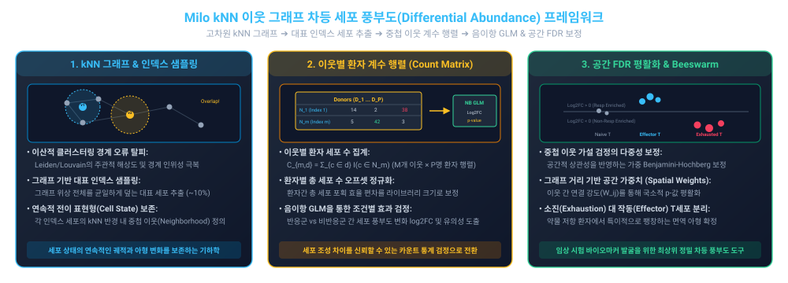

# 07. 이웃 그래프 기반 차등 풍부도 분석과 Spatial FDR (Differential Abundance with Milo & Spatial FDR)

---

## 학습 목표 (Cognitive Goals)

1. **클러스터 의존적 비율 검정(Cluster-Based Proportion Testing)의 통계적 결함 규명**: 카이제곱 검정(Chi-square test)이나 피셔 정확 검정(Fisher's exact test)이 내포하는 클러스터 해상도 편향(Resolution Bias)과 연속적 상태 전이(Continuous State Shift) 은폐 메커니즘을 수학적으로 증명한다.
2. **Milo 프레임워크의 5단계 알고리즘 수학적 정식화**: $k$-최근접 이웃($k$-NN) 그래프 구축, 대표 인덱스 세포 샘플링, 중첩 국소 이웃(Overlapping Neighborhoods $N_m$) 정의, 샘플-이웃 계수 행렬($C_{m \times S}$) 생성, 음이항 GLM 적합의 전체 수치적 파이프라인을 유도한다.
3. **그래프 위상 중첩성을 반영한 공간적 위발견율(Spatial FDR, S-FDR) 유도**: 이웃 간 가설 종속성(Hypothesis Dependency)과 공간적 자기상관(Spatial Autocorrelation)을 보정하기 위한 가중 Benjamini-Hochberg(Weighted BH) 수식 전개 및 이론적 엄밀성을 이해한다.
4. **전립선암 골전이 경화성 미세환경(Sclerotic Niche) 내 면역 세포 재편 추적**: 거세 저항성 전립선암(mCRPC)의 골전이 병소에서 면역 관문 억제 치료 저항성을 유발하는 종말 소진 CD8+ T 세포(Terminal Exhausted CD8 T cells) 및 골수 유래 면역억제 세포(MDSC)의 미세 국소적 팽창을 Milo로 정밀 검출한다.

---

## 1. 클러스터 기반 세포 비율 분석의 수학적 및 생물학적 한계

단일세포 연구에서 서로 다른 실험군 간에 특정 세포 집단의 증가 또는 감소를 평가할 때, 가장 전통적으로 사용되어 온 방식은 사전에 정의된 이산 클러스터(Discrete Clusters)의 세포 수를 세어 비율을 비교하는 것이다. 그러나 이 방식은 통계학적, 생물학적으로 치명적인 취약점을 지닌다.

```
[The Cluster Resolution Dilemma in Differential Abundance]

1. Under-Clustering (Coarse Resolution, e.g., Leiden res = 0.2)
   ┌────────────────────────────────────────────────────────┐
   │ CD8+ T Cell Cluster (N = 10,000)                       │
   │  [ Naive ]  [ Effector Memory ]  [ Exhausted (Rare!) ] │
   │    40%             55%                 5%              │
   └────────────────────────────────────────────────────────┘
   * The 5% exhausted subpopulation doubles in treated group (5% -> 10%).
   * Total CD8+ T cell count barely changes (10,000 -> 10,500, +5%).
   * Cluster-level proportion test returns p = 0.42 (FALSE NEGATIVE!).

2. Over-Clustering (Fine Resolution, e.g., Leiden res = 2.0)
   * Arbitrarily fragments continuous exhaustion gradients into 15 micro-clusters.
   * Multiplicity penalty explodes (15 hypotheses tested).
   * Boundaries are non-reproducible across biological replicates.

3. Milo Neighborhood Framework
   * Overlapping graph neighborhoods naturally tile the continuous manifold.
   * Tests differential abundance directly on graph topology without hard boundaries!
```

### 1.1 카이제곱 및 피셔 검정의 의사복제(Pseudoreplication) 오류

많은 연구에서 개별 환자(Donor) 정보를 무시하고 모든 환자의 세포를 하나의 분할표(Contingency Table)로 합산한 뒤 Pearson 카이제곱 검정을 수행한다:

| 그룹 | CD8+ T 세포 수 | 기타 세포 수 | 합계 |
| :--- | :--- | :--- | :--- |
| **대조군 (Control)** | $a$ | $b$ | $n_1$ |
| **치료군 (Treated)** | $c$ | $d$ | $n_2$ |

- **자유도의 인위적 팽창**: 이 검정은 개별 세포를 독립 확률 표본으로 가정하므로, 유효 표본 크기가 환자 수($J \approx 10$)가 아니라 전체 세포 수($N \approx 50,000$)로 취급된다.
- **공여자 간 변이(Inter-donor Variation)의 무시**: 특정 환자 1명의 종양 샘플에서 우연히 T 세포 침윤이 높았던 것이 코호트 전체의 통계적 유의성($p < 10^{-100}$)으로 둔갑한다. 이는 생물학적 일반화가 불가능한 심각한 위양성(Type I Error)을 양산한다.

### 1.2 클러스터 해상도 딜레마 (The Resolution Dilemma)

- **저해상도 클러스터링**: 세포군을 광범위하게 묶으면(e.g., "T 세포", "골수계 세포"), 군집 내부에서 일어나는 미세한 표현형 전이(Sub-phenotypic shift; e.g., Effector $\to$ Pre-exhausted $\to$ Terminal exhausted)가 다수 세포의 카운트에 희석되어 검출되지 않는다.
- **고해상도 클러스터링**: 해상도를 무리하게 높이면 연속적인 분화 궤적을 임의의 칼로 난도질하는 꼴이 되며, 클러스터 간 경계가 환자 간 기술적 배치 노이즈에 의해 심하게 흔들려 재현성을 상실한다.

---

## 2. Milo 알고리즘 아키텍처 및 수학적 정식화

Milo(Dann et al., *Nature Biotechnology* 2022)는 세포를 이산 클러스터로 강제 분할하지 않고, 세포-세포 $k$-NN 그래프 상에서 국소적으로 중첩되는 이웃(Overlapping Neighborhoods)을 정의하여 차등 풍부도를 통계 검정하는 그래프 기반 분석 프레임워크이다.



### 2.1 5단계 알고리즘 워크플로우

```
[Milo Mathematical Pipeline]

Step 1: Cell-Cell kNN Graph Construction
        Compute graph G = (V, E) on PCA / Harmony latent space (k ≈ 30~50)
                      │
                      ▼
Step 2: Representative Index Cell Sampling
        Randomly sample vertices V_idx ⊂ V (prop d ≈ 0.1), then refine each to a representative vertex
                      │
                      ▼
Step 3: Overlapping Neighborhood Definition
        For each index cell m ∈ V_idx, define neighborhood N_m = {m} ∪ kNN(m)
                      │
                      ▼
Step 4: Sample-by-Neighborhood Count Matrix Construction
        Count cells from sample s in neighborhood m ──> Matrix C of size M x S
                      │
                      ▼
Step 5: Negative Binomial GLM Fitting & Spatial FDR Control
        log(mu_ms) = x_s^T beta_m + log(total_cells_s)
        Account for neighborhood overlap via Spatial FDR (connectivity-weighted BH)
```

#### Step 1: 세포-세포 $k$-NN 그래프 구축
차원 축소된 잠재 공간(PCA, Harmony, scVI 등)에서 $N$개 세포 사이의 유클리드 거리를 기반으로 무방향 그래프 $G = (V, E)$를 구성한다. 일반적으로 $k = 30 \sim 50$이 사용된다.

#### Step 2: 대표 인덱스 세포(Index Cells) 샘플링
모든 세포를 이웃의 중심으로 삼으면 연산량이 불필요하게 폭발하고 이웃 간 중복도가 지나치게 높아진다. 따라서 전체 그래프 토폴로지를 균일하게 커버할 수 있도록 무작위로 인덱스 세포 부분집합 $V_{\text{idx}} \subset V$를 샘플링한 뒤 각 정점을 이웃의 대표 정점으로 정제(refinement)한다. 샘플링 비율 $d$는 일반적으로 $0.1 \sim 0.2$로 설정된다.

#### Step 3: 중첩 국소 이웃($N_m$) 정의
선택된 각 인덱스 세포 $m \in V_{\text{idx}}$에 대해, 원래의 $k$-NN 그래프 상에서 $m$과 직접 연결된 이웃 세포들의 집합으로 국소 이웃 $N_m$을 정의한다:

$$N_m = \{ v \in V : (m, v) \in E \} \cup \{ m \}$$

이웃들은 그래프 공간 상에서 상호 중첩(Overlapping)되므로, 연속적인 세포 매니폴드의 국소 기하 구조를 빈틈없이 보존한다.

#### Step 4: 샘플-이웃 계수 행렬($C_{M \times S}$) 생성
$M$개의 이웃과 $S$개의 생물학적 샘플(Donors/Replicates)에 대해, 샘플 $s$로부터 유래하여 이웃 $m$에 속하는 세포의 개수 $c_{ms}$를 집계한다:

$$c_{ms} = \sum_{i \in N_m} \mathbb{I}(\text{Sample}(i) = s)$$

결과적으로 크기 $M \times S$의 카운트 행렬 $\mathbf{C}$가 생성된다.

#### Step 5: 음이항 일반화 선형 모델(Negative Binomial GLM) 적합
각 이웃 $m$에 대해, 생물학적 샘플 간 세포 수 변동을 음이항 GLM으로 적합한다:

$$c_{ms} \sim \text{NB}(\mu_{ms}, \phi_m)$$

$$\log(\mu_{ms}) = \mathbf{x}_s^T \boldsymbol{\beta}_m + \log(N_s)$$

- $\mathbf{x}_s$: 샘플 $s$의 실험 조건(대조군 vs 치료군, 환자 공변량 등)을 담은 설계 벡터.
- $\boldsymbol{\beta}_m$: 이웃 $m$에서의 조건 간 차등 풍부도 효과 크기($\log_2 \text{Fold Change}$).
- $\log(N_s)$: 샘플 $s$의 총 세포 수(Total sequenced cells in sample $s$)를 오프셋(Offset)으로 지정하여 시퀀싱 수율 편차를 보정한다(miloR `testNhoods`의 `norm.method`는 기본 TMM이며 RLE·logMS도 선택할 수 있다. 어느 방법이든 조성 효과가 완전히 제거되지는 않는다).
- 환자 수준의 반복을 온전히 반영하기 위해 `edgeR`의 quasi-likelihood F-test (QLF) 프레임워크를 적용하여 통계적 유의성($p_m$)을 도출한다.

---

## 3. 공간적 위발견율 (Spatial FDR, S-FDR) 수학적 유도

Milo의 핵심 통계 기전 중 하나는 이웃 중첩을 고려한 **Spatial FDR**이다(cydar의 가중 BH를 그래프 이웃에 적용한 것). 

### 3.1 단순 Benjamini-Hochberg 절차의 실패 원인

표준 Benjamini-Hochberg (BH) 다중 검정 보정 절차는 검정되는 가설들이 상호 독립(Independent)이거나 양의 회귀 종속성(PRDS)을 만족하면 유효하다. 이웃 $p$-값들의 양의 상관만으로 BH가 반드시 실패하는 것은 아니지만, 아래와 같이 그래프 상 밀집 영역에 가설이 중복되는 불균형이 있으므로 이를 가중치로 보정한다. 

그러나 Milo의 이웃들은 그래프 상에서 광범위하게 세포를 공유한다. 만약 이웃 $N_m$과 $N_l$이 다수의 세포를 공유한다면, 두 이웃의 카운트 벡터 $\mathbf{c}_m$과 $\mathbf{c}_l$은 극도로 강한 통계적 양의 상관관계(Collinearity)를 갖는다:

$$\text{Cov}(c_{ms}, c_{ls}) \propto |N_m \cap N_l|$$

- **가설 밀집 영역의 다중 카운팅 왜곡**: 그래프 상에서 세포 밀도가 높은 영역은 인덱스 세포가 조밀하게 샘플링되어 매우 유사한 가설들이 수십 번 중복 검정된다.
- 단순 BH는 이 불균형을 고려하지 않으므로, 그래프 공간 기준으로 FDR을 통제하려는 목적(밀집 영역의 과대표현 보정)을 위해 이웃별 가중치를 사용한다.

```
[Spatial FDR Weighting Principle]

Dense Graph Region (High Overlap)         Sparse Graph Region (Low Overlap)
   (N1)---(N2)---(N3)                            (N_sparse)
    \     / \     /                                   │
     (N4)---(N5)                                      ▼
          │                                 Unique biological niche!
          ▼                                 Neighborhood is physically isolated.
 Highly redundant hypotheses!               Weight w_sparse is HIGH (Rescues test power).
 Individual weights w_m are LOW.
```

### 3.2 그래프 연결성에 기반한 가중 Benjamini-Hochberg 절차

miloR(`graphSpatialFDR`)는 cydar의 빈도 가중 BH를 차용하여, 이웃의 그래프 연결성(connectivity)의 역수를 가중치로 사용한다:

1. **연결성 $t_m$ 정의** (`weighting` 옵션):
   - `k-distance`(기본): 인덱스 세포의 $k$번째 이웃까지의 거리.
   - `neighbour-distance`: 이웃 내 세포 간 평균 유클리드 거리.
   - `max`: 인덱스 세포에서 이웃 내 가장 먼 세포까지의 거리.
   - `graph-overlap`: 다른 이웃과 겹치는 세포 수의 총합(거리 무관).
2. **가중치**: $w_m = 1/t_m$ (무한대 값은 1로 대체).
3. **가중 $p$-값 보정**: $p$-값을 오름차순 정렬한 뒤
   $$\tilde{p}_{(i)} = \frac{\left(\sum_{m} w_m\right) p_{(i)}}{\sum_{l \le i} w_{(l)}}$$
   를 계산하고, 순서를 역으로 따라가며 누적 최솟값(cummin)을 취한 뒤 1로 상한을 둔다(cydar의 빈도 가중 BH와 동일한 형태).
4. **가중치의 방향은 옵션에 따라 다르다**: `graph-overlap`에서는 중첩이 많은(밀집) 이웃일수록 $w_m$이 작고 고립된 이웃일수록 크다(위 도식은 이 경우). `k-distance`에서는 거리가 큰 쪽(희소 영역)의 $w_m$이 더 작다.

이 가중 보정은 중복된 이웃 가설이 독립 가설처럼 계수되는 것을 완화하여 그래프 공간 기준의 FDR을 통제하려는 것이며, 위양성을 "완벽히" 통제하거나 검정력을 극대화한다고 보장하지는 않는다.

---

## 4. 전립선암 골전이 경화성 미세환경(Sclerotic Niche) 분석

전립선암의 가장 흔하고 치명적인 원격 전이 장소는 뼈(Bone)이다. 골전이 병소는 파골세포(Osteoclasts)와 조골세포(Osteoblasts)의 비정상적 커플링으로 인해 단단한 조골성/경화성 병변(Osteosclerotic Lesions)을 형성하며, 이는 면역 세포의 침투를 물리적, 화학적으로 차단하는 '면역 사막(Immune Desert)'을 구축한다.

```
[Cellular Neighborhood Dynamics in mCRPC Bone Metastasis]

Normal / Responsive Stroma               Sclerotic Metastatic Niche (Resistant)
┌─────────────────────────────────┐      ┌─────────────────────────────────┐
│ Active Cytotoxic CD8 T cells    │      │ Dense Osteoblast / Collagen Ext │
│ (GZMB+, PRF1+, IFNG+)           │ ───> │                                 │
│                                 │      │ [N_milo: Log2FC = +3.2, S-FDR]  │
│ Stromal Fibroblasts             │      │  - Terminal Exhausted CD8 T     │
│ (Collagen-low)                  │      │    (PDCD1+, HAVCR2+, TOX+)      │
│                                 │      │  - M-MDSC                       │
│                                 │      │    (CD14+, ARG1+, S100A9+)      │
└─────────────────────────────────┘      └─────────────────────────────────┘
```

### 4.1 임상 표현형(가상 예시): 엔잘루타마이드 치료 후 면역 리모델링

치료 미경험(Treatment-Naive) 전립선암 골전이 환자($n=10$)와 엔잘루타마이드 치료 저항성(Enzalutamide-Resistant) 환자($n=14$)의 전립선암 골전이 생검 단일핵 전사체(snRNA-seq) 데이터를 비교하는 **가상 설계 예시**이다(실제 공개 코호트의 결과가 아니며, 아래 환자 수와 $\log_2$FC·Spatial FDR 수치는 설명을 위한 가상 값이다).

전체 T 세포를 단일 클러스터로 묶으면 총 분율에는 유의한 변화가 없을 수 있으나, Milo 분석을 적용하면 다음과 같은 국소 이웃의 변화가 포착될 수 있다:
1. **종말 소진 CD8+ T 세포 이웃 ($N_{\text{exhausted}}$)**:
   - 마커 발현: $PDCD1^{\text{high}}$, $HAVCR2(\text{TIM-3})^{\text{high}}$, $LAG3^{\text{high}}$, $TOX^{\text{high}}$.
   - 통계적 변화: $\log_2 \text{Fold Change} = +2.8$, $\text{Spatial FDR} = 0.0018$.
   - 생물학적 기전: 엔잘루타마이드 노출 장기화로 인해 지속적 항원 자극을 받은 T 세포가 비가역적 기능 상실 상태로 붕괴됨.
2. **단핵구성 골수 유래 면역억제 세포 이웃 ($N_{\text{M-MDSC}}$)**:
   - 마커 발현: $CD14^+$, $HLA\text{-}DR^{\text{low}}$, $ARG1^+$, $S100A8/9^+$.
   - 통계적 변화: $\log_2 \text{Fold Change} = +3.4$, $\text{Spatial FDR} < 10^{-4}$.
   - 생물학적 기전: 조골세포 유래 사이토카인(IL-6, TGF-$\beta$)에 의해 골수에서 미성숙 골수계 세포가 종양 침윤 부위로 대거 동원됨.

---

## 5. 실전 R/Python 구현 파이프라인

### 5.1 R 환경: `miloR`을 활용한 완전한 차등 풍부도 파이프라인

```r
# ==============================================================================
# R Pipeline: Differential Abundance Analysis using miloR
# ==============================================================================
library(miloR)
library(SingleCellExperiment)
library(scater)
library(dplyr)
library(patchwork)

# 1. SingleCellExperiment 객체로부터 Milo 객체 초기화
# sce: PCA 및 Harmony 보정 좌표가 포함된 snRNA-seq 객체
# plotNhoodGraphDA/buildNhoodGraph의 기본 layout은 reducedDim "UMAP"이다. UMAP이 없으면 표시 단계(9단계)에서 오류가 난다.
# UMAP은 이웃 그래프 좌표 표시용일 뿐 DA 통계(logFC, PValue, SpatialFDR)에는 영향을 주지 않는다.
if (!"UMAP" %in% reducedDimNames(sce)) {
  set.seed(42)
  sce <- runUMAP(sce, dimred = "HARMONY", n_dimred = 30)   # buildGraph의 d = 30과 같은 공간
}
milo_obj <- Milo(sce)

# 2. k-NN 그래프 구축 (k=30, Harmony 잠재 공간 기준)
milo_obj <- buildGraph(milo_obj, k = 30, d = 30, reduced.dim = "HARMONY")

# 3. 대표 인덱스 세포 샘플링 및 이웃 정의
# prop = 0.1 (전체 세포의 10%를 인덱스로 샘플링), refined = TRUE (국소 연결성 보정)
milo_obj <- makeNhoods(
  milo_obj, 
  prop    = 0.1, 
  k       = 30, 
  d       = 30, 
  refined = TRUE, 
  reduced_dims = "HARMONY"
)

# 4. 이웃 크기 분포 진단
# miloR 지침: 평균 이웃 크기가 샘플 수의 약 5배(> 5 × N_samples)를 넘는지 확인하고 분포의 피크를 점검 (너무 작으면 검정력 부족, 너무 크면 해상도 저하)
plotNhoodSizeHist(milo_obj)

# 5. 샘플-이웃 계수 행렬(Count Matrix) 생성
# sample_id: 환자/생검 샘플 고유 식별자 메타데이터 컬럼
milo_obj <- countCells(
  milo_obj, 
  meta.data = as.data.frame(colData(milo_obj)), 
  samples   = "sample_id"
)

# 6. 실험 디자인 매트릭스 구성
# 환자별 치료 조건(Enzalutamide_Resistant vs Sensitive) 및 나이, 생검 부위 통제
design_df <- distinct(as.data.frame(colData(milo_obj))[, c("sample_id", "treatment_status", "patient_age")])
rownames(design_df) <- design_df$sample_id

# 7. 음이항 GLM 적합 및 가설 검정 (DA Testing with Spatial FDR)
da_results <- testNhoods(
  milo_obj, 
  design          = ~ patient_age + treatment_status, 
  design.df       = design_df,
  fdr.weighting   = "graph-overlap",  # Spatial FDR 가중치 적용
  reduced.dim     = "HARMONY"
)

# 8. 결과 정렬 및 유의한 이웃 필터링
da_results <- da_results[order(da_results$SpatialFDR), ]
head(da_results[, c("Nhood", "logFC", "PValue", "SpatialFDR")])

# 9. 이웃 그래프 상에 DA 결과 투영 및 시각화
# logFC > 0: 저항군에서 증가한 이웃 (Red), logFC < 0: 민감군에서 증가한 이웃 (Blue)
milo_obj <- buildNhoodGraph(milo_obj)
plotNhoodGraphDA(
  milo_obj, 
  da_results, 
  alpha = 0.05
) + ggtitle("mCRPC Bone Metastasis: Sclerotic Niche DA Shifts")
```

### 5.2 Python 환경: `scanpy`와 Milo 결과 연동 및 검증

```python
"""
Python Integration: Visualizing Milo Differential Abundance on Scanpy UMAP
"""
import scanpy as sc
import pandas as pd
import numpy as np
import matplotlib.pyplot as plt

def project_milo_da_to_cells(
    adata: sc.AnnData,
    milo_results_csv: str,
    nhood_cell_indices_csv: str
) -> sc.AnnData:
    """
    R miloR에서 계산된 이웃별 logFC 및 Spatial FDR을 개별 세포 수준으로 역매핑.
    각 세포의 점수는 해당 세포가 속한 유의한(Spatial FDR < 0.05) 이웃들의 logFC 단순 평균(np.mean)으로 계산되며, 유의 이웃이 없으면 0이다.
    (miloR의 plotNhoodGraphDA 등 이웃 그래프 수준 시각화도 제공된다.)
    """
    # 1. R 결과 로드
    da_res = pd.read_csv(milo_results_csv) # Columns: Nhood, logFC, SpatialFDR
    nhood_map = pd.read_csv(nhood_cell_indices_csv) # Columns: Nhood, Cell_ID
    
    # 2. 유의한 이웃 필터링 (Spatial FDR < 0.05)
    sig_res = da_res[da_res['SpatialFDR'] < 0.05].set_index('Nhood')
    
    # 3. 세포별 누적 logFC 계산
    cell_logfc = {cell: [] for cell in adata.obs_names}
    for _, row in nhood_map.iterrows():
        nhood = row['Nhood']
        cell = row['Cell_ID']
        if nhood in sig_res.index and cell in cell_logfc:
            cell_logfc[cell].append(sig_res.loc[nhood, 'logFC'])
            
    # 4. 평균 logFC 할당 (속한 유의 이웃이 없는 세포는 0)
    mean_scores = np.zeros(adata.n_obs)
    for idx, cell in enumerate(adata.obs_names):
        vals = cell_logfc[cell]
        if len(vals) > 0:
            mean_scores[idx] = np.mean(vals)
            
    adata.obs['milo_differential_abundance_logFC'] = mean_scores
    return adata

# 실행 예제:
# adata = project_milo_da_to_cells(adata, "da_results.csv", "nhood_cells.csv")
# sc.pl.umap(adata, color='milo_differential_abundance_logFC', cmap='coolwarm', vcenter=0)
```

---

## 단원 핵심 점검 (Cognitive Checkpoint & Case Study)

### 문제 1: 이웃 크기($k$)와 인덱스 샘플링 비율($d$)의 선택이 검정력과 S-FDR에 미치는 통계적 트레이드오프
Milo 분석을 설계할 때 $k$-NN 그래프의 이웃 크기 매개변수 $k$와 인덱스 세포 샘플링 비율 $d$는 분석 결과의 신뢰도를 결정짓는 핵심 초매개변수이다.
1. $k$를 너무 작게 설정했을 때($k=5$) 발생하는 이웃 카운트의 희소성(Sparsity), 통계적 검정력(Power)의 붕괴, 그리고 음이항 과산포 추정 실패 원인을 설명하시오.
2. 반대로 $k$를 너무 크게 설정했을 때($k=200$) 발생하는 국소 해상도 손실(Loss of Resolution)과 이웃 간 중복성 폭발이 Spatial FDR의 다중 검정 보정(`graph-overlap` 가중치 기준)에 미치는 영향을 설명하시오.

<details>
<summary>💡 모범 답안 및 해설 확인</summary>

**1. $k$ 과소 설정($k=5$) 시 통계적 붕괴 메커니즘**:
- 이웃의 크기 $|N_m| \approx k$가 극단적으로 작으면, 개별 샘플 $s$에 대해 이웃 내에 포획되는 세포 수 $c_{ms}$가 대다수 0 또는 1에 머무르는 극단적 희소 카운트 행렬(Ultra-sparse Count Matrix)이 형성된다.
- 음이항 분포의 분산 공식 $\text{Var}(c_{ms}) = \mu_{ms} + \phi_m \mu_{ms}^2$에서 평균 발현량 $\mu_{ms} \to 0$인 경우, 데이터가 포아송 잡음의 지배를 받아 과산포 모수 $\phi_m$의 추정치가 불안정하게 발산하거나 수렴에 실패한다.
- 또한 `edgeR`의 Quasi-Likelihood F-검정에서 잔차 자유도가 급감하고 분모의 정보량이 부족하여 검정 통계량 $F$의 분모가 지나치게 커지며, 이는 통계적 검정력을 사실상 0으로 붕괴시켜 실제 존재하는 풍부도 변화를 전혀 검출하지 못하는 위음성(Type II Error)을 초래한다.

**2. $k$ 과대 설정($k=200$) 시 해상도 파탄 및 Spatial FDR 영향**:
- $k$가 과대해지면 이웃 $N_m$의 공간적 직경이 고차원 매니폴드 상에서 거대해져, 기능적으로 서로 다른 여러 세포 상태(e.g., Naive CD8 T세포와 Exhausted CD8 T세포)가 단일 이웃 내에 함께 뒤섞이게 된다.
- 이로 인해 특정 아집단의 국소적 팽창 신호가 이웃 내 다수를 차지하는 비변동 세포들에 의해 평균화되어 희석된다.
- 수학적으로 두 인접 인덱스 세포 $m, l$ 간의 중첩도(Jaccard Index)가 $J(N_m, N_l) = \frac{|N_m \cap N_l|}{|N_m \cup N_l|} \to 1$에 수렴한다.
- `graph-overlap` 가중치에서 연결성 $t_m$(겹치는 세포 수의 총합)이 크게 팽창하여 각 이웃의 가중치 $w_m = 1/t_m$가 작아진다.
- 가중 BH 보정 $\tilde{p}_{(i)} = (\sum w) p_{(i)} / \sum_{l\le i} w_{(l)}$에서 전역적으로 비슷한 크기의 작은 가중치가 되면 보정은 사실상 표준 BH에 가까워지며, 이웃이 서로 매우 유사해 실질적으로 독립적인 가설 수가 줄어든 효과(해상도 상실)는 가중치로 완전히 보정되지 않는다. 따라서 $k$ 과대는 Spatial FDR로 해결되지 않고 해상도 손실로 인해 국소 신호가 희석된다.

</details>

---

### 문제 2: Spatial FDR에서 이웃 간 중첩 밀집 영역과 고립 영역의 기각 역치(Rejection Threshold) 조정 수리 원리
Milo의 Spatial FDR 알고리즘에서 두 개의 대조적인 이웃 집합이 존재한다:
- **영역 A (밀집 중첩 영역)**: 고밀도 세포 군집 내부에 위치하여, 주변 50개 이웃들과 세포를 70% 이상 공유하는 이웃 $N_A$.
- **영역 B (고립 희소 영역)**: 분화 말기의 독특한 표현형을 띠며, 주변 다른 이웃들과의 세포 공유가 거의 없는 이웃 $N_B$.
1. 영역 A의 이웃 $N_A$와 영역 B의 이웃 $N_B$에 부여되는 가중치 $w_A$와 $w_B$의 상대적 크기를 수학적 정의식($w_m = 1/t_m$, `graph-overlap` 연결성 기준)에 기반하여 비교하시오.
2. 두 이웃의 원시 $p$-값이 동일하게 $p_A = p_B = 0.005$로 산출되었을 때, 가중 Benjamini-Hochberg 절차를 거치며 최종 통계적 유의성(기각 여부)이 어떻게 차별적으로 결정되는지 설명하시오.

<details>
<summary>💡 모범 답안 및 해설 확인</summary>

**1. 가중치 $w_A$와 $w_B$의 수리적 비교**:
- `graph-overlap` 연결성 $t_m$은 이웃 $m$이 다른 이웃들과 공유하는 세포 수의 총합이며, $w_m = 1/t_m$이다(무한대는 1로 대체).
- 영역 A는 주변 50개 이웃과 세포를 70% 이상 공유하므로 $t_A$가 매우 크고 $w_A = 1/t_A$는 매우 작다.
- 영역 B는 공유 세포가 거의 없어 $t_B$가 작고 $w_B = 1/t_B$는 상대적으로 크다(공유가 전혀 없으면 무한대 → 1로 대체).
- 따라서 $w_B \gg w_A$이다.

**2. 동일 원시 $p$-값에 대한 가중 BH의 작용**:
- 가중 BH는 $p$-값을 정렬한 뒤 $\tilde{p}_{(i)} = (\sum_m w_m)\, p_{(i)} / \sum_{l \le i} w_{(l)}$를 사용한다. 누적 가중치 $\sum_{l \le i} w_{(l)}$는 "지금까지의 실질적 독립 가설 수"에 대응한다.
- 중첩이 큰 영역 A의 이웃들은 서로 같은 신호를 공유하므로 작은 $w_A$를 받아 누적 가중치에 조금씩만 기여한다(중복 가설이 독립 가설 여러 개로 계수되지 않음). 고립된 영역 B의 이웃은 큰 $w_B$로 하나의 독립 가설로 더 크게 계수된다.
- 따라서 원시 $p_A = p_B = 0.005$여도 최종 $\tilde{p}$는 두 이웃의 정렬 위치와 전체 $p$-값 분포에 따라 달라지며, 일반적인 방향은 "중복 이웃의 군집이 독립 가설 군집처럼 과다 계수되어 FDR이 과소 평가되는 것을 막는 것"이다. (두 이웃의 기각 여부를 단정하려면 전체 $p$-값 목록과 가중치가 필요하다.)

</details>

---

### 문제 3: 골전이 샘플 간 총 포획 세포 수 편차와 오프셋 $\log(N_s)$ 누락 시 발생하는 인위적 차등 풍부도 왜곡
전립선암 골전이 생검 조직 10개(대조군 5개, 치료 저항군 5개)를 분석하는 과정에서, 조직 섬유화 및 경화증의 정도 차이로 인해 대조군 샘플당 평균 1,500개의 세포가 포획된 반면, 치료 저항군 샘플에서는 평균 15,000개의 세포가 포획되어 샘플 간 총 세포 수($N_s$)가 10배 차이 났다.
1. 음이항 GLM 모델식 $\log(\mu_{ms}) = \mathbf{x}_s^T \boldsymbol{\beta}_m$에서 라이브러리 크기 오프셋 $\log(N_s)$를 누락시켰을 때, 생물학적으로 실제 비율이 전혀 변하지 않은 모든 중립적 세포 이웃들에서 회귀 계수 $\hat{\beta}_m$이 어떻게 왜곡 추정되는지 수식으로 증명하시오.
2. 올바른 오프셋 $\log(N_s)$를 모델에 투입했을 때 이 전역적 기술적 편향(Global Technical Bias)이 수학적으로 어떻게 소거되는지 설명하시오.

<details>
<summary>💡 모범 답안 및 해설 확인</summary>

**1. 오프셋 누락 시 회귀 계수의 인위적 왜곡 증명**:
- 샘플 $s$에서 이웃 $m$에 속하는 세포의 실제 생물학적 비율을 $\pi_m$이라 하자. 특정 이웃의 비율이 두 군 간에 완전히 동일한 중립 이웃($\pi_{m, \text{Ctrl}} = \pi_{m, \text{Treat}} = \pi_m$)이라고 가정한다.
- 이웃 내 포획 세포 수의 기댓값은 해당 샘플의 총 포획 세포 수 $N_s$에 비례한다:
  $$\mathbb{E}[c_{ms}] = N_s \pi_m$$
- 대조군 샘플의 크기를 $N_{\text{Ctrl}} = 1,500$, 치료군 샘플의 크기를 $N_{\text{Treat}} = 15,000$이라 할 때, 기댓값의 비는 다음과 같다:
  $$\frac{\mathbb{E}[c_{m, \text{Treat}}]}{\mathbb{E}[c_{m, \text{Ctrl}}]} = \frac{15,000 \cdot \pi_m}{1,500 \cdot \pi_m} = 10$$
- 만약 오프셋 $\log(N_s)$를 누락한 단순 회귀식 $\log(\mu_{ms}) = \beta_{0, m} + \beta_{\text{Treat}, m} X_s$을 적합하면:
  $$\hat{\beta}_{\text{Treat}, m} = \log\left( \frac{\mu_{m, \text{Treat}}}{\mu_{m, \text{Ctrl}}} \right) = \log(10) \approx +2.3026 \quad (\log_2 \text{Scale로 } \approx +3.32)$$
- 즉, 생물학적으로 아무런 풍부도 변화가 없는 세포군임에도 불구하고, 단순한 시퀀싱 포획량의 10배 차이로 인해 $\log_2 \text{Fold Change} \approx +3.32$의 거대한 양의 차등 풍부도가 발생하며, 오프셋 누락 시 대부분의 이웃에서 유의한 전역 이동이 나타나는 전면적 위양성이 발생한다(실제 p-값의 크기는 샘플 수와 분산에 따라 달라진다. 샘플이 약 10개 수준이면 극단적으로 작은 p-값이 나오기는 어렵다).

**2. 오프셋 투입을 통한 기술적 편향의 수학적 소거**:
- 올바른 오프셋 모델은 다음과 같이 조건부 기댓값을 정식화한다:
  $$\log(\mu_{ms}) = \mathbf{x}_s^T \boldsymbol{\beta}_m + \log(N_s) \iff \log\left( \frac{\mu_{ms}}{N_s} \right) = \mathbf{x}_s^T \boldsymbol{\beta}_m$$
- 여기서 좌변의 반응 변수는 절대 카운트가 아니라 해당 샘플 내에서의 **세포 비율(Relative Abundance)의 로그값**이 된다.
- 중립 이웃의 경우:
  $$\frac{\mu_{m, \text{Ctrl}}}{N_{\text{Ctrl}}} = \pi_m, \quad \frac{\mu_{m, \text{Treat}}}{N_{\text{Treat}}} = \pi_m$$
- 따라서 치료군과 대조군 사이의 비를 취하면:
  $$\hat{\beta}_{\text{Treat}, m} = \log\left( \frac{\mu_{m, \text{Treat}} / N_{\text{Treat}}}{\mu_{m, \text{Ctrl}} / N_{\text{Ctrl}}} \right) = \log\left( \frac{\pi_m}{\pi_m} \right) = \log(1) = 0$$
- 오프셋 $\log(N_s)$가 시퀀싱 총량의 10배 차이를 감산 차감함으로써, 회귀 계수 $\hat{\beta}_{\text{Treat}, m}$가 정확히 0으로 수렴하여 전역적 기술 편향이 상쇄된다(이 사례의 중립 이웃 가정에서).

</details>

---

<!-- REFERENCES:BEGIN (generated by scripts/apply_references.py; do not edit by hand) -->
## 참고문헌 (References)
### 본문 인용 문헌
1. Dann E, Henderson NC, Teichmann SA, et al. Differential abundance testing on single-cell data using k-nearest neighbor graphs. *Nat Biotechnol*. 2022;40(2):245-253. PMID: 34594043. doi: 10.1038/s41587-021-01033-z
### 소프트웨어 (표기 버전은 검수 시 API를 확인한 버전이며, 파이프라인 실행 환경은 requirements-pipelines.txt 참조)
- miloR (bioconductor.org/packages/miloR). 원 논문: Dann E, Henderson NC, Teichmann SA, et al. Differential abundance testing on single-cell data using k-nearest neighbor graphs. *Nat Biotechnol*. 2022;40(2):245-253. PMID: 34594043. doi: 10.1038/s41587-021-01033-z
- NumPy 2.5.4 (numpy.org). 원 논문: Harris CR, Millman KJ, van der Walt SJ, et al. Array programming with NumPy. *Nature*. 2020;585(7825):357-362. PMID: 32939066. doi: 10.1038/s41586-020-2649-2
- Scanpy 1.12.4 (github.com/scverse/scanpy). 원 논문: Wolf FA, Angerer P, Theis FJ. SCANPY: large-scale single-cell gene expression data analysis. *Genome Biol*. 2018;19(1):15. PMID: 29409532. doi: 10.1186/s13059-017-1382-0
- dplyr (dplyr.tidyverse.org).
- Matplotlib 3.11.2 (github.com/matplotlib/matplotlib). 원 논문: Hunter JD. Matplotlib: A 2D Graphics Environment. *Comput. Sci. Eng*. 2007;9(3):90-95. doi: 10.1109/mcse.2007.55
- pandas 2.3.3 (github.com/pandas-dev/pandas). 원 논문: McKinney W. Data Structures for Statistical Computing in Python. *Proceedings of the Python in Science Conference*. 2010:56-61. doi: 10.25080/majora-92bf1922-00a
- patchwork (github.com/thomasp85/patchwork).
- scater (bioconductor.org/packages/scater). 원 논문: McCarthy DJ, Campbell KR, Lun AT, et al. Scater: pre-processing, quality control, normalization and visualization of single-cell RNA-seq data in R. *Bioinformatics*. 2017;33(8):1179-1186. PMID: 28088763. doi: 10.1093/bioinformatics/btw777
- SingleCellExperiment (bioconductor.org/packages/SingleCellExperiment). 원 논문: Amezquita RA, Lun ATL, Becht E, et al. Orchestrating single-cell analysis with Bioconductor. *Nat Methods*. 2020;17(2):137-145. PMID: 31792435. doi: 10.1038/s41592-019-0654-x
<!-- REFERENCES:END -->
