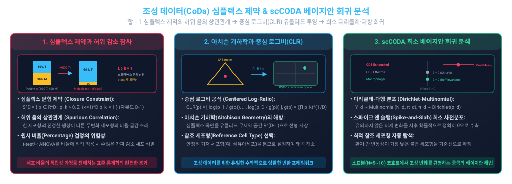

# 08. 조성 데이터 분석과 scCODA 베이지안 회귀 (Compositional Data Analysis & scCODA)

---

## 학습 목표 (Cognitive Goals)

1. **조성 데이터(Compositional Data)의 심플렉스(Simplex $\mathcal{S}^D$) 구속 조건과 허위 상관 증명**: 세포 비율의 합이 1로 고정되는 닫힌 시스템(Closed System $\sum_{c=1}^D p_c = 1$)에서 하나의 세포형(e.g., 종양 세포) 팽창이 다른 모든 중립적 세포형의 비율을 필연적으로 감소시키는 음의 공분산 강제성(Negative Covariance Inevitability)을 수학적으로 증명한다.
2. **아이치슨 기하학(Aitchison Geometry)과 대수비(Log-Ratio) 변환 체계 정식화**: 유클리드 공간의 덧셈/스칼라곱을 대체하는 섭동(Perturbation $\oplus$) 및 거듭제곱(Powering $\odot$) 연산, 중심 대수비 변환(Centered Log-Ratio, CLR)과 등거리 대수비 변환(Isometric Log-Ratio, ilr)의 직교 정규 기저(Orthonormal Basis) 사상을 수리적으로 유도한다.
3. **scCODA의 베이지안 디리클레-다항 회귀(Dirichlet-Multinomial Regression) 아키텍처 이해**: 과산포 계수 모델링, 기준 세포형(Reference Cell Type) 매개변수화, 스파이크-앤-슬랩(Spike-and-Slab) 및 말굽형(Horseshoe) 희소 사전분포(Sparsity Prior)를 통한 다중 가설 위발견율(FDR) 억제 기전을 체득한다.
4. **전립선암 면역 억제 미세환경(TME) 세포 조성 분석 및 speckle 대비 통계적 벤치마킹**: 거세 저항성 전립선암(mCRPC)에서 M2 대식세포 및 MDSC 팽창을 식별하고, 경험적 베이즈 아크사인 변환 기반 `speckle`과 `scCODA`의 위양성 제어 및 해석적 안정성을 비교 평가한다.

---

## 1. 조성 데이터의 저주와 허위 음의 상관 (Spurious Negative Correlation)

단일세포 RNA 시퀀싱에서 얻어지는 세포 수 데이터는 전체 포획된 세포 수에 대한 상대적 빈도로 환산되어 분석된다. 그러나 비율 데이터는 독립적인 유클리드 공간에 존재하지 않으며, **심플렉스(Simplex)**라는 기하학적 제약 공간에 갇혀 있다.



### 1.1 심플렉스(Simplex $\mathcal{S}^D$)의 정의

$D$개의 서로 다른 세포형(Cell Types)을 갖는 단일세포 전사체 데이터에서, 각 샘플의 세포 비율 벡터 $\mathbf{p} = (p_1, p_2, \dots, p_D)$는 다음 조건을 만족하는 $D-1$ 차원의 표준 심플렉스 $\mathcal{S}^D$에 속한다:

$$\mathcal{S}^D = \left\{ \mathbf{p} \in \mathbb{R}^D : p_c > 0 \; (\forall c), \; \sum_{c=1}^D p_c = 1 \right\}$$

### 1.2 음의 공분산 강제성 (Negative Covariance Inevitability)의 수학적 증명

조성 데이터에서 가장 치명적인 통계적 함정은 **적어도 하나의 음의 공분산이 수학적으로 강제된다**는 사실이다(Karl Pearson, 1897; John Aitchison, 1986).

**[정리 증명]**:
모든 성분의 합이 1이므로 임의의 성분 $p_j$와 전체 합의 공분산은 정확히 0이다:

$$\text{Cov}\left( p_j, \sum_{c=1}^D p_c \right) = \text{Cov}(p_j, 1) = 0$$

공분산의 선형성(Linearity)을 전개하면:

$$\text{Cov}(p_j, p_j) + \sum_{c \ne j} \text{Cov}(p_j, p_c) = 0$$

$$\sum_{c \ne j} \text{Cov}(p_j, p_c) = -\text{Var}(p_j)$$

분산 $\text{Var}(p_j)$는 항상 양수($> 0$)이므로, 우변은 항상 음수이다:

$$\sum_{c \ne j} \text{Cov}(p_j, p_c) < 0$$

- **결론**: 임의의 세포형 $j$에 대해, 나머지 $D-1$개 세포형들과의 공분산의 합은 반드시 음수여야 한다.
- 즉, **특정 세포형과 음의 상관관계를 갖는 다른 세포형이 최소한 하나 이상 반드시 존재해야만 한다.**

```
[The Biological Trap of Relative Proportions: A Prostate Cancer Scenario]

Scenario: Enzalutamide Treatment in Resistant Prostate Cancer

Absolute Biological Reality:
  Pre-treatment:   10,000 Tumor Cells  +  2,000 CD8+ T Cells  (Total: 12,000 cells)
  Post-treatment:  30,000 Tumor Cells  +  2,000 CD8+ T Cells  (Total: 32,000 cells)
  * CD8+ T cells did NOT change in absolute numbers (2,000 -> 2,000).

Observed Relative Proportions (scRNA-seq data):
  Pre-treatment:   Tumor = 83.3%,   CD8+ T = 16.7%
  Post-treatment:  Tumor = 93.75%,  CD8+ T = 6.25%
  * Naive t-test / Fisher's test:
    "CD8+ T cell proportion dropped by 62.5%! p = 0.0001 (CRITICAL IMMUNE DEPLETION!)"
  * REALITY: Absolute CD8 T cell count is 100% stable! The drop is a mathematical artifact
    caused purely by Tumor cell proliferation forcing the relative denominator up!
```

---

## 2. 아이치슨 기하학(Aitchison Geometry)과 대수비(Log-Ratio) 변환

John Aitchison은 심플렉스 공간 $\mathcal{S}^D$에 닫힌 연산을 정의하여 완전한 힐베르트 공간(Hilbert Space)을 구축하였다. 이를 통해 유클리드 통계학의 모든 기법을 비편향적으로 적용할 수 있게 된다.

```
[Aitchison Space vs Euclidean Space]

Simplex Space (S^D)                            Euclidean Space (R^(D-1))
  Vector: p = (p_1, ..., p_D), sum(p) = 1        Vector: z = ilr(p) ∈ R^(D-1)
  Perturbation: p ⊕ q                           Ordinary Addition: z_1 + z_2
  Powering: alpha ⊙ p                           Scalar Multiplication: alpha * z
  Aitchison Distance: d_A(p, q)                 Euclidean Distance: ||z_1 - z_2||_2
                    │                                          ▲
                    └────── Isometric Log-Ratio (ilr) ─────────┘
```

### 2.1 심플렉스 대수 연산

1. **섭동 연산 (Perturbation $\oplus$)**: 심플렉스 내에서의 벡터 덧셈에 해당
   $$\mathbf{x} \oplus \mathbf{y} = \mathcal{C} [x_1 y_1, x_2 y_2, \dots, x_D y_D]$$
   여기서 $\mathcal{C}[\cdot]$는 성분의 합이 1이 되도록 나누어주는 닫힘 연산자(Closure Operator)이다: $\mathcal{C}[\mathbf{v}] = \frac{\mathbf{v}}{\sum v_i}$.
2. **거듭제곱 연산 (Powering $\odot$)**: 심플렉스 내에서의 스칼라 곱에 해당
   $$\alpha \odot \mathbf{x} = \mathcal{C} [x_1^\alpha, x_2^\alpha, \dots, x_D^\alpha]$$
3. **아이치슨 내적 및 거리**:
   $$d_A(\mathbf{x}, \mathbf{y}) = \sqrt{ \frac{1}{2D} \sum_{i=1}^D \sum_{j=1}^D \left( \log \frac{x_i}{x_j} - \log \frac{y_i}{y_j} \right)^2 }$$

### 2.2 대수비 변환 (Log-Ratio Transformations)

#### A. 중심 대수비 변환 (Centered Log-Ratio, CLR)
각 성분을 전체 성분들의 기하평균(Geometric Mean $g(\mathbf{p})$)으로 나눈 뒤 로그를 취한다:

$$\text{clr}(\mathbf{p}) = \left[ \log \frac{p_1}{g(\mathbf{p})}, \log \frac{p_2}{g(\mathbf{p})}, \dots, \log \frac{p_D}{g(\mathbf{p})} \right], \quad g(\mathbf{p}) = \left( \prod_{c=1}^D p_c \right)^{1/D}$$

- **장점**: 각 성분과 원래 세포형 간의 1:1 대응 관계가 직관적으로 유지된다.
- **단점**: $\sum_{c=1}^D \text{clr}(p_c) = 0$이라는 가산 제약으로 인해 공분산 행렬이 특이 행렬(Singular Matrix, Rank $= D-1$)이 되어 다변량 표준 역행렬 계산이 불가능하다.

#### B. 등거리 대수비 변환 (Isometric Log-Ratio, ilr)
심플렉스 공간의 직교 정규 기저(Orthonormal Basis) $\boldsymbol{\Psi} \in \mathbb{R}^{D \times (D-1)}$를 구축하여, 심플렉스 $\mathcal{S}^D$를 $(D-1)$ 차원 유클리드 공간 $\mathbb{R}^{D-1}$로 등거리 등각(Isometric & Isomorphic) 사상한다:

$$\mathbf{z} = \text{ilr}(\mathbf{p}) = \text{clr}(\mathbf{p}) \boldsymbol{\Psi} \in \mathbb{R}^{D-1}$$

이 변환을 거치면 유클리드 거리와 아이치슨 거리가 완벽히 일치한다:

$$\|\mathbf{z}_1 - \mathbf{z}_2\|_2 = d_A(\mathbf{p}_1, \mathbf{p}_2)$$

---

## 3. scCODA의 베이지안 디리클레-다항 회귀 아키텍처

`scCODA`(Büttner et al., *Nature Communications* 2021)는 단일세포 전사체 연구에서 세포 수 카운트의 과산포(Overdispersion), 표본 크기 불균형, 심플렉스 제약을 동시에 극복하기 위해 설계된 완전 베이지안 통계 모델이다.

```
[scCODA Hierarchical Bayesian Graph]

                Design Matrix X_s (Clinical covariates)
                         │
                         ▼
Parameters:     beta_0c (Intercept) + beta_c (Effect size)
                         │
        ┌────────────────┴────────────────┐
        ▼                                 ▼
Spike-and-Slab Prior:             Reference Cell Type (r):
beta_c ~ (1-gamma_c)*delta_0 +    beta_r = 0 (Fixed Anchor)
         gamma_c*N(0, sigma^2)            │
        │                                 │
        └────────────────┬────────────────┘
                         ▼
Log-Link:       alpha_sc = exp( beta_0c + x_s^T beta_c )
                         │
                         ▼
Dirichlet:      p_s ~ Dirichlet( alpha_s )   (Overdispersion & Simplex)
                         │
                         ▼
Multinomial:    y_s ~ Multinomial( N_s, p_s ) (Discrete Single-Cell Counts)
```

### 3.1 디리클레-다항(Dirichlet-Multinomial) 위계 모델

샘플 $s$ ($s=1, \dots, S$)에서 총 포획 세포 수가 $N_s$이고, 각 세포형별 관측 카운트 벡터가 $\mathbf{y}_s = (y_{s1}, \dots, y_{sD})$일 때:

$$\mathbf{y}_s \sim \text{Multinomial}(N_s, \mathbf{p}_s)$$

세포 비율 벡터 $\mathbf{p}_s$는 디리클레 사전분포를 따른다:

$$\mathbf{p}_s \sim \text{Dirichlet}(\boldsymbol{\alpha}_s)$$

디리클레 모수 $\boldsymbol{\alpha}_s = (\alpha_{s1}, \dots, \alpha_{sD})$의 로그값은 고정 효과 공변량 행렬 $X$와 선형 관계로 연결된다:

$$\log(\alpha_{sc}) = \beta_{0c} + \mathbf{x}_s^T \boldsymbol{\beta}_c$$

디리클레-다항 결합 분포는 단순 다항 분포 대비 카운트의 표본 간 과산포(Overdispersion)를 흡수하여, 특정 환자의 무작위 세포 쏠림에 의한 위양성을 방어한다.

### 3.2 기준 세포형(Reference Cell Type)의 앵커링(Anchoring) 역할

심플렉스 공간의 비식별성(Non-identifiability)을 해결하기 위해, 특정 기준 세포형 $r$을 지정하여 회귀 계수를 0으로 고정한다:

$$\beta_{0r} = 0, \quad \boldsymbol{\beta}_r = \mathbf{0}$$

이 설정 하에서 다른 세포형 $c$의 회귀 계수 $\beta_{c, k}$는 다음과 같은 **상대적 로그비(Log-Fold Change relative to Reference)**로 엄밀히 해석된다:

$$\beta_{c, k} = \log\left( \frac{p_{sc} / p_{sr} \mid x_{sk}=1}{p_{sc} / p_{sr} \mid x_{sk}=0} \right)$$

### 3.3 스파이크-앤-슬랩(Spike-and-Slab) 희소 사전분포

대부분의 생물학적 섭동에서 실제로 비율이 변화하는 세포형은 소수이다. 따라서 `scCODA`는 회귀 계수 $\beta_{c}$에 희소성을 유도하는 사전분포를 적용한다. 아래는 이를 이해하기 위한 일반적인 이성분 혼합 Spike-and-Slab 정식화이다(실제 `scCODA`는 점질량 Bernoulli 혼합이 아니라 $\beta = \tau \cdot \tilde{\beta}$, $\tau = \text{sigmoid}(50 z)$, $z \sim \mathcal{N}(0,1)$ 형태의 연속 완화 사전분포를 사용하며 Horseshoe 사전분포는 쓰지 않는다):

$$\beta_c \mid \gamma_c, \tau^2 \sim (1 - \gamma_c) \delta_0 + \gamma_c \mathcal{N}(0, \tau^2)$$

$$\gamma_c \sim \text{Bernoulli}(\pi_0)$$

- $\delta_0$: 0에서의 디락 델타 함수(Dirac Delta, Spike). 변화가 없는 세포형의 계수를 정확히 0으로 강제 수축.
- $\mathcal{N}(0, \tau^2)$: 넓은 분산을 갖는 정규분포(Slab). 실제 변화가 있는 세포형의 효과 크기를 편향 없이 추정.
- $\gamma_c \in \{0, 1\}$: 포함 지표(Inclusion Indicator). MCMC 샘플링을 통해 사후 포함 확률(Posterior Inclusion Probability, $\text{PIP} = P(\gamma_c = 1 \mid \mathbf{Y})$)을 산출하여, 사후 확률이 역치를 초과할 때만 유의한 변화로 선언한다(`scCODA`에서는 고정 PIP 역치가 아니라 목표 FDR로부터 포함확률 임계값을 데이터 적응적으로 산출하는 직접 사후확률 접근(Newton et al. 2004)을 사용한다).

---

## 4. 기준 세포형 선택 전략과 `speckle` 벤치마킹

### 4.1 기준 세포형 선택의 황금률

기준 세포형 $r$이 실험 조건 간에 격렬하게 변동하면, 나머지 모든 세포형의 $\beta_c$가 그 반대 방향으로 편향(Bias)되는 왜곡이 발생한다.
- **이상적 기준 세포형**:
  1. 생체 내에서 항상성(Homeostatic Balance)을 유지하여 질환이나 약제 노출에 가장 둔감한 세포군.
  2. 코호트 전반에서 중간 이상의 안정적인 세포 수를 확보한 군(너무 희귀하면 분산이 불안정).
- `scCODA`의 `reference_cell_type="automatic"`은 영(0) 비율이 낮은(대부분의 샘플에 존재하는) 세포형 중 상대 풍부도의 분산/평균(dispersion index)이 가장 낮은 세포형을 기준으로 선택한다. 기준 선택은 결과의 해석(상대 효과)을 바꾸므로 여러 기준으로 민감도 분석을 권장한다.

### 4.2 scCODA vs speckle 비교 분석

| 비교 항목 | scCODA (Büttner et al. 2021) | speckle / propeller (Phipson et al. 2022) |
| :--- | :--- | :--- |
| **통계 프레임워크** | 완전 베이지안 디리클레-다항 MCMC | 빈도주의 아크사인 제곱근 변환 + Limma 경험적 베이즈 |
| **반응 변수** | 원시 이산 카운트 $y_{sc}$ (Multinomial) | 변환된 비율 $z_{sc} = \arcsin(\sqrt{p_{sc}})$ (Gaussian) |
| **심플렉스 보존** | 디리클레 분포를 통해 완벽 보존 | 연속 근사로 인해 심플렉스 경계 제약 일부 완화 |
| **희소성 유도** | Spike-and-slab 사전분포로 강력한 FDR 통제 | Benjamini-Hochberg 다중 검정 보정 |
| **연산 속도** | NUTS HMC 기반으로 수 분 소요 | 선형 모델 닫힌 해로 수 초 내 완료 |
| **해석성** | 기준 세포형 대비 명확한 상대적 배수 변화 ($\beta$) | 변환 척도에서의 선형 효과로 직관적 해석 다소 난해 |

---

## 5. 실전 Python/R 구현 파이프라인

### 5.1 Python 환경: `scCODA`를 활용한 전립선암 TME 베이지안 분석

```python
"""
Python Pipeline: Compositional Data Analysis with scCODA
"""
import scanpy as sc
import pandas as pd
import numpy as np
from sccoda.util import cell_composition_data as dat
from sccoda.util import comp_ana as mod
from sccoda.util import data_visualization as viz

# 1. AnnData 객체로부터 샘플별 세포형 분할표 생성
# adata: 주석이 완료된 전립선암 환자 단일세포 데이터
# 실제 from_scanpy 시그니처: cell_type_identifier, sample_identifier,
# 공변량은 covariate_df(DataFrame, 인덱스=샘플 식별자) 또는 covariate_key(adata.uns 키)
patient_meta = (
    adata.obs
    .groupby("patient_id")[["treatment_status", "metastasis_site", "age"]]
    .first()
)
coda_data = dat.from_scanpy(
    adata,
    cell_type_identifier="cell_type_annotation",
    sample_identifier="patient_id",
    covariate_df=patient_meta
)

print("Sample-CellType Count Matrix Shape:", coda_data.X.shape)
print("Available Cell Types:", coda_data.var_names.tolist())

# 2. 사전 시각화 탐색 (구성 비율 스택 바플롯 및 세포형별 분포 박스플롯)
viz.stacked_barplot(coda_data, feature_name="treatment_status")
viz.boxplots(coda_data, feature_name="treatment_status")

# 3. scCODA 모델 구축 및 HMC/NUTS 샘플링 실행
# formula: treatment_status (Enzalutamide Resistant vs Sensitive)
# reference_cell_type="automatic" 지정 시 분산이 가장 작은 세포형이
# 기준 세포형으로 자동 선택됨 (예: Endothelial Cells)
model = mod.CompositionalAnalysis(
    coda_data,
    formula="treatment_status",
    reference_cell_type="automatic"
)

# 4. MCMC 사후 표본 추출 (기본 20,000회 반복, 번인 5,000회)
sim_results = model.sample_hmc(num_results=20000, num_burnin=5000)

# 5. 결과 요약 및 유의한 세포형 판별 (Spike-and-Slab 사전분포 기반 FDR 통제)
print(sim_results.summary())

# 유의하게 증가/감소한 세포형 판별 (사후 포함 확률 기반 credible effects)
print(sim_results.credible_effects())

# FDR 목표치 재조정이 필요한 경우 (기본 0.05, 관례적으로 0.4까지 허용)
# sim_results.set_fdr(est_fdr=0.05)
```

### 5.2 R 환경: `speckle` 패키지를 이용한 신속한 비율 차등 검정

```r
# ==============================================================================
# R Pipeline: Differential Proportion Analysis with speckle (propeller)
# ==============================================================================
library(speckle)
library(limma)
library(SingleCellExperiment)

# 1. 메타데이터로부터 세포형, 샘플 ID, 실험군 추출
cell_types <- sce$cell_type_annotation
sample_ids <- sce$patient_id
conditions <- sce$treatment_status

# 2. propeller 함수 실행
# arcsin square root 변환(asin) 또는 logit 변환 적용
# 환자 수준의 반복(biological replicates)을 limma empirical Bayes로 검정
prop_res <- propeller(
  clusters  = cell_types,
  sample    = sample_ids,
  group     = conditions,
  transform = "asin"          # arcsin sqrt 변환 (propeller 기본값은 "logit")
)

# 3. 결과 테이블 출력
# 주요 열(2군 비교): BaselineProp.*, PropMean.*, PropRatio, Tstatistic, P.Value, FDR (Log2FD 열은 없음)
print(head(prop_res[order(prop_res$FDR), ]))

# 4. 환자별 세포형 비율 스트립 차트 시각화
plotCellTypeProps(
  clusters = cell_types,
  sample   = sample_ids
)
```

---

## 단원 핵심 점검 (Cognitive Checkpoint & Case Study)

### 문제 1: 심플렉스 제약에서 발생하는 허위 음의 상관이 면역 세포 표적 발굴에 미치는 임상적 위험
전립선암 환자 30명(엔잘루타마이드 치료 반응군 15명, 저항군 15명)의 단일핵 전사체 데이터를 분석하였다.
1. 저항군 환자들에서 종양 세포(Tumor epithelial cells)의 절대 수가 급격히 팽창하여 전체 생검 조직 내 세포 수가 3배로 증가하였다. 반면 침윤된 세포독성 CD8+ T 세포와 수지상 세포(Dendritic Cells)의 실제 생체 내 절대 개체수는 치료 전후에 완벽히 일정하게 유지되었다. 단순 비율 분석(Proportion Testing)을 수행했을 때 이 면역 세포들에 대해 어떤 통계적 결론이 도출되는지 수식 $\sum_{c \ne j} \text{Cov}(p_j, p_c) = -\text{Var}(p_j)$을 인용하여 설명하시오.
2. 이 잘못된 통계적 결론이 신약 개발 및 면역 항암 복합 요법 임상 설계에 미치는 치명적인 오류를 기술하시오.

<details>
<summary>💡 모범 답안 및 해설 확인</summary>

**1. 단순 비율 분석에서의 통계적 왜곡 과정**:
- 심플렉스 공간의 음의 공분산 정리 $\sum_{c \ne \text{Tumor}} \text{Cov}(p_{\text{Tumor}}, p_c) = -\text{Var}(p_{\text{Tumor}}) < 0$에 의해, 특정 세포형의 비율 $p_{\text{Tumor}}$가 거대하게 팽창하면 나머지 세포형들의 비율 $p_c$의 합은 반드시 강제적으로 감소해야 한다.
- 샘플 내 총 세포 수 $N_{\text{total}}$이 3배로 증가하는 동안, CD8+ T 세포의 절대 수 $Y_{\text{CD8}}$가 상수로 유지되었다면 관측되는 비율은 다음과 같다:
  $$p_{\text{CD8, post}} = \frac{Y_{\text{CD8}}}{3 N_{\text{total}}} = \frac{1}{3} p_{\text{CD8, pre}}$$
- 즉, CD8+ T 세포의 상대적 분율이 $66.7\%$ 급감($\log_2 \text{Fold Change} \approx -1.58$)한 것으로 관측된다.
- 이를 단순 로지스틱 회귀나 스튜던트 t-검정에 투입하면, 공여자 수($J=30$) 기반 검정에서 $p < 0.001$의 높은 유의성이 산출되며 "엔잘루타마이드 저항성 획득 시 CD8+ T 세포 및 수지상 세포의 심각한 침윤 억제 및 고갈이 발생한다"는 허위 결론을 도출하게 된다.

**2. 임상 중개 연구 및 신약 개발에서의 파장**:
- 연구팀은 T 세포 고갈을 극복하기 위해 T 세포 침윤을 유도하는 고비용의 면역세포 유인 케모카인 증폭 치료제나 입양 T세포 치료(Adoptive Cell Therapy)를 복합 요법으로 기획하게 된다.
- 그러나 실제 생체 내에서 T 세포의 절대 개체수나 조직 침윤 밀도(Cells per $\text{mm}^2$)는 전혀 감소하지 않았으므로, 환자의 면역 결핍은 침윤 부족이 아니라 다른 분자적 기전(e.g., 면역 관문 리간드 발현, TGF-$\beta$에 의한 기능적 억제)에 기인한 것일 수 있다.
- 한계: scCODA·CLR 등 조성 분석은 기준 대비 상대 변화만 추정하며 절대 개체수 변화를 복원하지 못한다. 절대 수는 IHC 밀도, 비드 보정 유세포분석 등 외부 측정으로만 판정할 수 있다.
- 결국 허위 통계 신호에 근거하여 수백억 원의 임상 비용을 투입한 복합 요법 파이프라인은 환자의 종양 축소나 생존율 개선을 이끌어내지 못하고 임상 2상에서 최종 실패하게 된다.

</details>

---

### 문제 2: scCODA에서 부적절한 기준 세포형($r$) 선정 시 발생하는 회귀 계수 $\beta_c$의 체계적 왜곡
scCODA 모델에서 공변량 $X$ (0: 치료 전, 1: 치료 후)에 대한 세포형 $c$의 효과 크기 $\beta_c$는 기준 세포형 $r$과의 상대적 로그비로 정의된다:
$$\beta_c = \log\left( \frac{\alpha_{c, X=1}}{\alpha_{r, X=1}} \right) - \log\left( \frac{\alpha_{c, X=0}}{\alpha_{r, X=0}} \right)$$
1. 연구자가 기준 세포형으로 치료군에서 세포독성 약제에 의해 90% 사멸하는 민감성 세포형(e.g., 호르몬 감수성 관강 상피세포, Luminal Sensitive Cells)을 실수로 선택하였다. 실제로는 치료 전후에 절대 수가 변하지 않은 10개의 중립적 면역 세포형들(기준 세포형이 줄었으므로 전체 대비 상대 비율은 오히려 올라가야 함)에서 $\hat{\beta}_c$의 추정치가 어떻게 체계적으로 왜곡(Systematic Bias)되는지 수식으로 유도하시오.
2. 이러한 체계적 왜곡을 방지하기 위해 scCODA가 사용하는 자동 기준군 선정(상대 풍부도의 분산/평균이 가장 낮고 영 비율이 낮은 세포형)의 기준을 기술하시오.

<details>
<summary>💡 모범 답안 및 해설 확인</summary>

**1. 부적절한 기준군 선택에 따른 체계적 왜곡 수식 유도**:
- 기준 세포형 $r$의 실제 디리클레 모수가 치료 후 90% 감소했다고 하자:
  $$\alpha_{r, X=1} = 0.1 \cdot \alpha_{r, X=0} \implies \log(\alpha_{r, X=1}) - \log(\alpha_{r, X=0}) = \log(0.1) \approx -2.3026$$
- 반면 중립적 면역 세포형 $c$는 치료 전후에 절대 수(디리클레 모수)가 변하지 않았다:
  $$\alpha_{c, X=1} = \alpha_{c, X=0} \implies \log(\alpha_{c, X=1}) - \log(\alpha_{c, X=0}) = 0$$
- scCODA의 회귀 계수 공식에 대입하면:
  $$\beta_c = \left[ \log(\alpha_{c, X=1}) - \log(\alpha_{c, X=0}) \right] - \left[ \log(\alpha_{r, X=1}) - \log(\alpha_{r, X=0}) \right]$$
  $$\beta_c = 0 - \log(0.1) = -\log(0.1) \approx +2.3026 \quad (\log_2 \text{Scale로 } \approx +3.32)$$
- 결론적으로, 실제로는 아무런 변화가 없는 10개의 모든 중립 세포형들이 일제히 약 10배($2^{3.32} \approx 10$) 증가한 것으로 회귀 계수가 추정된다.
- 즉, 기준 세포형의 고갈이 모든 다른 세포형들의 광범위한 인위적 양의 증식(Global False Expansion)으로 전이되는 전면적 왜곡이 발생한다. $\beta_c$는 기준 세포형 대비 상대 효과이므로 기준 세포형의 생물학적 안정성이 해석의 전제가 된다.

**2. 자동 기준군 선정 기준 (scCODA 구현)**:
- 각 세포형 $j$의 샘플별 상대 풍부도 $\hat{p}_{sj}$에 대해 분산/평균 비(dispersion index)를 계산한다:
  $$D_j = \frac{\text{Var}_s(\hat{p}_{sj})}{\text{Mean}_s(\hat{p}_{sj})}$$
- 영(0) 비율이 임계(기본 5%) 미만인 세포형 중 $D_j$가 가장 낮은 세포형을 기준으로 선택한다: $r^* = \arg\min_{j:\ \text{zero fraction} < 0.05} D_j$.
- 이 기준은 샘플 간 상대 풍부도가 가장 안정적인 세포형을 앵커로 삼으려는 것이지만, 조건에 따라 변하는 세포형을 완전히 배제하지는 못하므로 기준 세포형을 바꿔 보는 민감도 분석이 필요하다.

</details>

---

### 문제 3: Spike-and-Slab 사전분포가 소규모 환자 코호트($N < 10$)에서 위발견율(FDR)을 통제하는 기전
환자 수가 제한된($N=8$, 반응군 4명 vs 저항군 4명) 전립선암 코호트에서 20개의 서로 다른 세포형의 조성을 검정하고자 한다.
1. 표준 정규 사전분포 $\beta_c \sim \mathcal{N}(0, \sigma^2)$를 적용한 베이지안 회귀 모델에서는 소표본 노이즈로 인해 일부 $\beta_c$의 95% 신뢰구간(Credible Interval)이 0을 포함하지 않는 위양성이 늘어날 수 있는 이유를 설명하시오.
2. 일반적인 Spike-and-Slab 사전분포 $\beta_c \sim (1 - \gamma_c) \delta_0 + \gamma_c \mathcal{N}(0, \tau^2)$가 사후 포함 확률(PIP)을 통해 위발견율을 억제하는 원리를 수리적으로 설명하시오(scCODA는 이를 연속 완화한 사전분포와 FDR 기반 임계값을 사용함을 함께 언급).

<details>
<summary>💡 모범 답안 및 해설 확인</summary>

**1. 표준 정규 사전분포에서 소표본 위양성 발생 기전**:
- 표준 정규 사전분포는 연속 확률 밀도 함수이므로, 모수가 정확히 0이 될 사전 확률은 0이다: $P(\beta_c = 0) = 0$.
- 소규모 환자 코호트($N=8$)에서는 무작위 샘플링 오차나 미세한 세포 분리 수율 차이로 인해, 실제 변화가 없는 세포형이라도 두 군 간의 표본 평균 비율에 우연한 차이($\bar{p}_{\text{Treat}} \ne \bar{p}_{\text{Ctrl}}$)가 발생한다.
- 우도 함수(Likelihood)의 정보량이 충분하지 않으므로, 사후 분포(Posterior Distribution)의 중심이 이 작은 표본 편차를 따라 이동한다.
- 이때 95% 최고 밀도 구간(Highest Density Interval, HDI)을 평가할 때, 사후 표본들이 0에서 살짝 벗어나 형성되면 $0 \notin \text{HDI}$ 판정을 받아 통계적으로 유의한 세포형으로 잘못 선언되는 위양성(Type I Error)이 통제되지 않고 누적된다.

**2. Spike-and-Slab 사전분포를 통한 FDR 통제 기전**:
- Spike-and-Slab은 0에 위치한 불연속 점질량(Point Mass at zero, $\delta_0$)을 사전분포의 상당 부분($1-\pi_0$; 예시로 0.8)으로 배치한다.
- 데이터 $\mathbf{Y}$가 관측되었을 때, 지표 변수 $\gamma_c$의 사후 포함 확률(Posterior Inclusion Probability)은 베이즈 정리에 의해 다음과 같이 계산된다:
  $$\text{PIP}_c = P(\gamma_c = 1 \mid \mathbf{Y}) = \frac{\pi_0 \cdot \text{BF}_c}{(1 - \pi_0) + \pi_0 \cdot \text{BF}_c}$$
  여기서 $\text{BF}_c$는 $\beta_c \ne 0$ (Slab) 모델과 $\beta_c = 0$ (Spike) 모델 사이의 주변 우도 비(Bayes Factor)이다.
- 소표본 노이즈로 인한 미미한 비율 차이는 $\text{BF}_c$를 충분히 크게 만들지 못한다.
- 따라서 사후 분포 시뮬레이션 과정에서 대부분의 MCMC 체인이 0의 점질량(Spike)에 머물게 되며($\gamma_c = 0$), 사후 포함 확률 $\text{PIP}_c$가 판정 임계치에 도달하지 못한다.
- 오직 군 간 차이가 극도로 뚜렷하여 Bayes Factor가 강력한 사전 점질량 페널티를 압도할 수 있는 진정한 핵심 세포형만이 $\beta_c \ne 0$으로 추정되므로, 소규모 코호트에서도 다중 검정 위양성이 억제되는 경향이 있다(공칭 수준 통제를 보장하는 것은 아니며, scCODA 논문의 벤치마크에서 FDR 통제가 양호하다고 보고).

</details>

---

<!-- REFERENCES:BEGIN (generated by scripts/apply_references.py; do not edit by hand) -->
## 참고문헌 (References)
### 본문 인용 문헌
1. Aitchison J. The Statistical Analysis of Compositional Data. 1986. doi: 10.1007/978-94-009-4109-0
2. Newton MA, Noueiry A, Sarkar D, et al. Detecting differential gene expression with a semiparametric hierarchical mixture method. *Biostatistics*. 2004;5(2):155-76. PMID: 15054023. doi: 10.1093/biostatistics/5.2.155
3. Büttner M, Ostner J, Müller CL, et al. scCODA is a Bayesian model for compositional single-cell data analysis. *Nat Commun*. 2021;12(1):6876. PMID: 34824236. doi: 10.1038/s41467-021-27150-6
4. Phipson B, Sim CB, Porrello ER, et al. propeller: testing for differences in cell type proportions in single cell data. *Bioinformatics*. 2022;38(20):4720-4726. PMID: 36005887. doi: 10.1093/bioinformatics/btac582
### 소프트웨어 (표기 버전은 검수 시 API를 확인한 버전이며, 파이프라인 실행 환경은 requirements-pipelines.txt 참조)
- limma (bioconductor.org/packages/limma). 원 논문: Ritchie ME, Phipson B, Wu D, et al. limma powers differential expression analyses for RNA-sequencing and microarray studies. *Nucleic Acids Res*. 2015;43(7):e47. PMID: 25605792. doi: 10.1093/nar/gkv007
- NumPy 2.5.4 (numpy.org). 원 논문: Harris CR, Millman KJ, van der Walt SJ, et al. Array programming with NumPy. *Nature*. 2020;585(7825):357-362. PMID: 32939066. doi: 10.1038/s41586-020-2649-2
- Scanpy 1.12.4 (github.com/scverse/scanpy). 원 논문: Wolf FA, Angerer P, Theis FJ. SCANPY: large-scale single-cell gene expression data analysis. *Genome Biol*. 2018;19(1):15. PMID: 29409532. doi: 10.1186/s13059-017-1382-0
- scCODA 0.1.9 (github.com/theislab/scCODA). 원 논문: Büttner M, Ostner J, Müller CL, et al. scCODA is a Bayesian model for compositional single-cell data analysis. *Nat Commun*. 2021;12(1):6876. PMID: 34824236. doi: 10.1038/s41467-021-27150-6
- speckle (bioconductor.org/packages/speckle). 원 논문: Phipson B, Sim CB, Porrello ER, et al. propeller: testing for differences in cell type proportions in single cell data. *Bioinformatics*. 2022;38(20):4720-4726. PMID: 36005887. doi: 10.1093/bioinformatics/btac582
- pandas 2.3.3 (github.com/pandas-dev/pandas). 원 논문: McKinney W. Data Structures for Statistical Computing in Python. *Proceedings of the Python in Science Conference*. 2010:56-61. doi: 10.25080/majora-92bf1922-00a
- SingleCellExperiment (bioconductor.org/packages/SingleCellExperiment). 원 논문: Amezquita RA, Lun ATL, Becht E, et al. Orchestrating single-cell analysis with Bioconductor. *Nat Methods*. 2020;17(2):137-145. PMID: 31792435. doi: 10.1038/s41592-019-0654-x
<!-- REFERENCES:END -->
