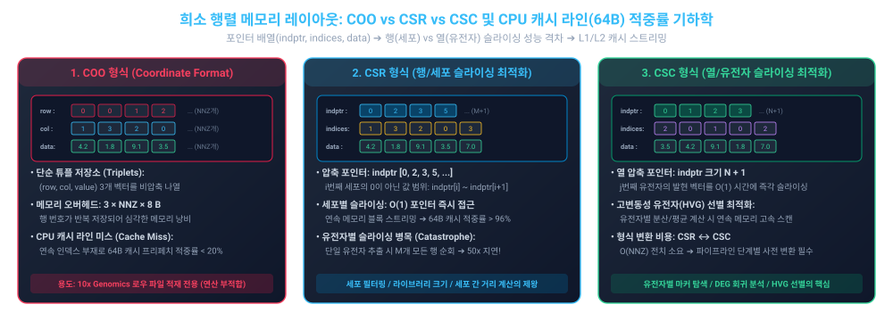
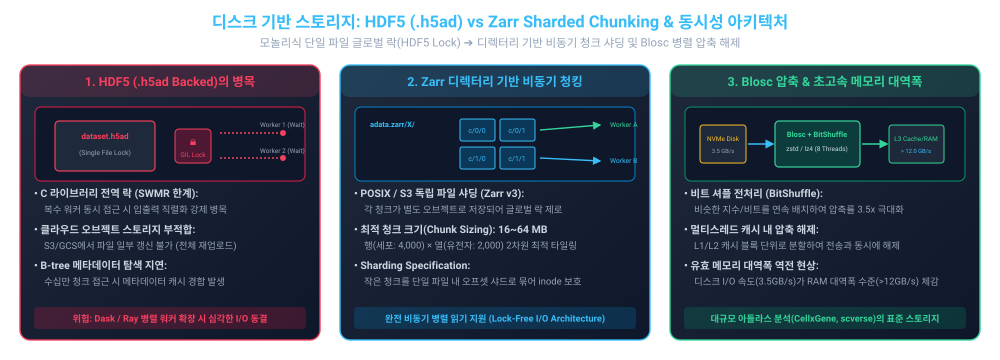
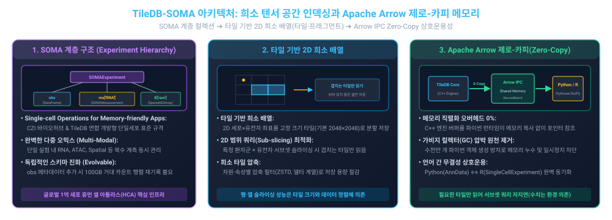
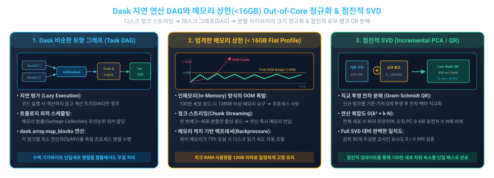
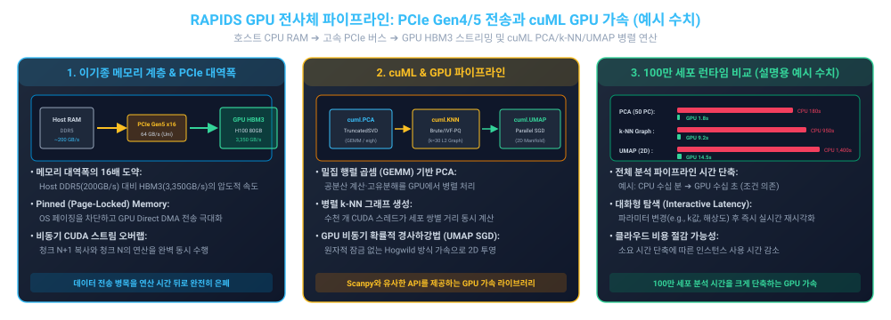
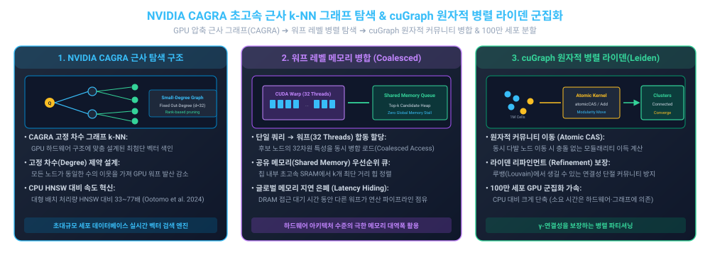

# 대규모 단일세포 아틀라스 희소 행렬 연산 및 GPU 가속 (Large-Scale Sparse Computation & GPU Acceleration) 마스터 교재
**From Sparse Matrix Memory Layout (CSR/CSC) & Out-of-Core Streaming (HDF5/Zarr/TileDB-SOMA) to Dask Distributed QC, Incremental PCA & RAPIDS GPU Acceleration (cuGraph Leiden)**

---

## 📚 교재 전체 목차 (Table of Contents)

- [Chapter 00. 대규모 단일세포 전사체 희소 행렬 연산 및 저장 아키텍처 로드맵](#part-00-00-대규모-단일세포-전사체-희소-행렬-연산-및-저장-아키텍처-로드맵-large-scale-single-cell-sparse-matrix-computation--storage-architecture-roadmap)
- [Chapter 01. 희소 행렬 메모리 레이아웃: CSR, CSC와 CPU 캐시 계층 아키텍처](#part-01-01-희소-행렬-메모리-레이아웃-csr-csc와-cpu-캐시-계층-아키텍처-sparse-matrix-memory-layout-csr-vs-csc-and-cpu-cache-hierarchy)
- [Chapter 02. Out-of-Core 연산과 HDF5 AnnData Backed 모드의 내부 구조](#part-02-02-out-of-core-연산과-hdf5-anndata-backed-모드의-내부-구조-out-of-core-computation-and-internal-architecture-of-hdf5-anndata-backed-mode)
- [Chapter 03. Zarr 클라우드 네이티브 청킹과 Blosc 병렬 압축 아키텍처](#part-03-03-zarr-클라우드-네이티브-청킹과-blosc-병렬-압축-아키텍처-zarr-cloud-native-chunking-and-blosc-parallel-compression-architecture)
- [Chapter 04. TileDB-SOMA 단일세포 데이터베이스와 공간 충전 곡선 아키텍처](#part-04-04-tiledb-soma-단일세포-데이터베이스와-공간-충전-곡선-아키텍처-tiledb-soma-single-cell-database-and-space-filling-curve-architecture)
- [Chapter 05. Dask 지연 연산(Lazy Evaluation)과 분산 품질 관리(Distributed Out-of-Core QC)](#part-05-05-dask-지연-연산lazy-evaluation과-분산-품질-관리distributed-out-of-core-qc)
- [Chapter 06. 점진적 주성분 분석(Incremental PCA)과 무작위 SVD(Randomized SVD)](#part-06-06-점진적-주성분-분석incremental-pca과-무작위-svdrandomized-svd)
- [Chapter 07. GPU 가속 단일세포 전처리: RAPIDS 및 rapids-singlecell 아키텍처](#part-07-07-gpu-가속-단일세포-전처리-rapids-및-rapids-singlecell-아키텍처)
- [Chapter 08. GPU 가속 그래프 구축 및 커뮤니티 탐지: CAGRA와 cuGraph Leiden](#part-08-08-gpu-가속-그래프-구축-및-커뮤니티-탐지-cagra와-cugraph-leiden)
- [Chapter 09. 대규모 단일세포 컴퓨팅 문제 해결과 모범 사례](#part-09-09-대규모-단일세포-컴퓨팅-문제-해결과-모범-사례-troubleshooting--best-practices)

---

# Part 00. 00. 대규모 단일세포 전사체 희소 행렬 연산 및 저장 아키텍처 로드맵 (Large-Scale Single-Cell Sparse Matrix Computation & Storage Architecture Roadmap)
> **출처 원본 파일**: `tracks/08_large_scale_sparse/docs/00_LARGE_SCALE_COMPUTATION_ROADMAP.md`


---

## 학습 목표 (Cognitive Goals)

1. **단일세포 오믹스 데이터 스케일링 위기 규명**: 1만 세포($10^4$) 초기 연구에서 100만 세포($10^6$) 이상의 인간 세포 지도(Human Cell Atlas, HCA) 및 1,000만~3,000만 세포($10^7$) 규모의 글로벌 컨소시엄 아틀라스(CZ CELLxGENE Discover Census)로의 지수적 팽창에 따른 연산 및 메모리 병목 현상을 정량적으로 분석할 수 있다.
2. **밀집 행렬(Dense Matrix) 메모리 파국과 생물학적 희소성(Sparsity) 수리 모델링**: 단일세포 RNA 시퀀싱(scRNA-seq / snRNA-seq) 데이터가 갖는 90%~98% 희소도의 생물학적·기술적 기원을 이해하고, 밀집 2차원 부동소수점 배열 저장 시 발생하는 메모리 폭발($10^6 \times 30,000 \times 4\text{ bytes} \approx 120\text{ GB}$) 대비 압축 희소 저장(Compressed Sparse Storage)의 공간 복잡도 절감 효과를 증명할 수 있다.
3. **글로벌 초대형 벤치마크 코호트 분석**: Tabula Sapiens, HCA 전립선/골수 아틀라스, CellxGene Census 등 표준 벤치마크 데이터셋의 메타데이터 구조, 세포 수, 유전자 피처 차원, 희소도 특성을 비교 평가할 수 있다.
4. **차세대 대규모 분산·가속 연산 생태계 구축**: Python 기반 단일세포 분석 생태계의 핵심 백엔드(`scipy.sparse`, `anndata`, `zarr`, `tiledbsoma`, `dask`, `cupy`, `rapids-singlecell`) 연계 구조를 파악하고, 재현 가능한 고성능 워크스페이스 환경을 설계할 수 있다.

---

## 1. 단일세포 전사체학의 스케일링 위기 (The Single-Cell Scaling Crisis)

단일세포 전사체 분석(scRNA-seq / snRNA-seq)은 지난 10년간 비약적인 시퀀싱 처리량의 발전과 미세유체학(Microfluidics, e.g., 10x Genomics Chromium), 플레이트 기반 분할-풀링(Split-pool combinatorial indexing, e.g., Parse Biosciences, sci-RNA-seq) 기술의 고도화에 힘입어 전례 없는 데이터 팽창을 겪고 있다.

```
[Single-Cell Atlas Scale Evolution (2015 - 2026)]

 2015: Drop-seq / InDrop
   └── Scale: 10^3 ~ 10^4 cells (DRAM: < 500 MB)
       └── Processing: In-Memory Dense / Basic Sparse R & Python

 2018: 10x Genomics Chromium v2/v3
   └── Scale: 10^4 ~ 10^5 cells (DRAM: 2 ~ 10 GB)
       └── Processing: Scanpy / Seurat (Single-node In-Memory CSR)

 2021: Tabula Sapiens / Human Cell Atlas (HCA) Organ Atlases
   └── Scale: 5 x 10^5 ~ 2 x 10^6 cells (DRAM: 30 ~ 150 GB)
       └── Bottleneck: Single-node DRAM Exhaustion, Heavy Swap Paging

 2024 - 2026+: CZ CELLxGENE Discover Census / Human BioMolecular Atlas (HuBMAP)
   └── Scale: 10^7 ~ 3.3 x 10^7+ cells (Dense Array: 1.2 TB ~ 4.0 TB)
       └── Paradigm Shift: Out-of-Core, Chunked Zarr, TileDB-SOMA, GPU Rapids
```

과거 수천 개에서 수만 개 세포 수준의 연구에서는 전체 발현 행렬을 워크스테이션의 주기억장치(RAM)에 전량 적재(In-Memory loading)한 후 주성분 분석(PCA), $k$-최근접 이웃 그래프(k-NN Graph), Leiden 군집화, UMAP 시각화를 단일 스레드 또는 기초적인 OpenMP 멀티스레딩으로 완결할 수 있었다.

그러나 인간 전신 지도(Human Cell Atlas), 기관별 단일세포 참조 지도(Organ Atlases), 그리고 질환 코호트(수백 명의 암 환자 종양 미세환경 생검 시료)의 통합 분석이 보편화되면서 세포 수가 $10^6 \sim 10^7$ 개를 상회하게 되었다. 이로 인해 전통적인 단일 노드 인메모리 연산 방식은 운영체제의 OOM-Killer(Out-Of-Memory Killer)에 의해 프로세스가 강제 종료되는 치명적인 연산 장벽에 직면하였다.

---

## 2. 밀집 행렬(Dense Matrix) 메모리 파국과 수학적 희소성

### 2.1 밀집 행렬의 메모리 풋프린트 수학적 계산

단일세포 전사체 데이터는 $N$개의 개별 세포(Observations/Cells)와 $G$개의 전사체 유전자(Variables/Features)로 정의되는 2차원 행렬 $\mathbf{X} \in \mathbb{R}^{N \times G}$로 표현된다. 인간 유전체의 경우 통상적으로 단백질 코딩 유전자 및 주석된 비코딩 RNA를 포함하여 약 $G \approx 30,000 \sim 35,000$개의 피처를 사용한다.

이를 32비트 단정밀도 부동소수점(`float32`, 요소당 4바이트) 또는 64비트 배정밀도 부동소수점(`float64`, 요소당 8바이트)의 연속 밀집 배열(Dense C-contiguous / Fortran-contiguous array)로 메모리에 할당할 때 필요한 물리 메모리 용량 $M_{\text{dense}}$는 다음과 같이 계산된다:

$$M_{\text{dense}} = N \times G \times S_{\text{dtype}} \quad [\text{Bytes}]$$

여기서 $S_{\text{dtype}}$은 데이터 타입의 바이트 크기이다.

| 데이터 규모 (세포 수 $N$) | 유전자 수 ($G$) | 데이터 타입 (`dtype`) | 필요 메모리 ($M_{\text{dense}}$) | 하드웨어 인프라 요구 수준 |
| :--- | :--- | :--- | :--- | :--- |
| **10,000 (10k)** | 30,000 | `float32` (4 bytes) | **1.2 GB** | 표준 랩톱 (8~16 GB RAM) |
| **100,000 (100k)** | 30,000 | `float32` (4 bytes) | **12.0 GB** | 고급 워크스테이션 (32 GB RAM) |
| **1,000,000 (1M)** | 30,000 | `float32` (4 bytes) | **120.0 GB** | 고성능 서버 노드 (256 GB RAM) |
| **1,000,000 (1M)** | 30,000 | `float64` (8 bytes) | **240.0 GB** | 분산 HPC 메모리 노드 (512 GB RAM) |
| **10,000,000 (10M)** | 30,000 | `float32` (4 bytes) | **1.20 TB** | 테라바이트급 대용량 공유 메모리 노드 |
| **33,000,000 (33M)** | 35,000 | `float32` (4 bytes) | **4.62 TB** | 초대형 슈퍼컴퓨팅 분산 클러스터 필수 |

100만 개 이상의 단일세포 전사체를 밀집 배열로 표현하는 순간, 단일 행렬의 기본 메모리 적재만으로 120 GB 이상의 순수 RAM이 소모된다. 여기에 정규화(Normalization), 대수 변환(Log1p transformation), 피처 스케일링(Standard Scaling), 주성분 투영(PCA SVD), 거리 행렬(Pairwise Distance Matrix, $O(N^2)$ 공간 복잡도) 계산을 수행할 때 발생하는 중간 버퍼(Intermediate Allocation)까지 고려하면 단일 노드 512 GB RAM 서버조차 순식간에 고갈된다.

### 2.2 생물학적 희소성(Biological Sparsity)의 기원과 수리 모델

다행히 단일세포 RNA 시퀀싱 카운트 행렬의 대다수 원소는 물리적으로 0(Zero count)이다. 행렬 $\mathbf{X}$의 희소도(Sparsity) $S$는 0이 아닌 원소의 개수를 $\text{nnz}(\mathbf{X})$ (Number of Non-Zero elements)라 할 때 다음과 같이 정의된다:

$$S = 1 - \frac{\text{nnz}(\mathbf{X})}{N \times G}$$

scRNA-seq 및 snRNA-seq 데이터에서 희소도 $S$는 통상 **90%에서 98%**에 달한다. 이러한 극단적 희소성은 다음과 같은 복합적 요인에 기인한다:

1. **전사 버스팅 및 세포 유형 특이적 발현 (Cell-type Specific Expression)**: 인간 유전체에 존재하는 30,000여 개의 유전자 중 특정 분화 세포(예: B 림프구, 심근세포, 뇌 신경세포)에서 활성화되어 실제 전사되는 유전자는 통상 3,000~5,000개(전체의 10~15%)에 불과하다. 나머지 유전자는 해당 세포 유형에서 발현이 낮거나 꺼져 있으며(크로마틴 상태 등), 비활성 유전자도 저수준 발현·버스팅이 있으므로 "완전 억제"가 아니라 낮은 발현량이 샘플링 한계(포획 효율·드롭아웃) 때문에 0으로 관측되는 경우가 대부분이다.
2. **단일세포 포획 한계 및 역전사 효율 (Capture Efficiency & Dropout)**: 단일 세포 내부의 총 mRNA 분자 수는 대략 $10^5 \sim 10^6$개 수준이다. 미세유체 비드(Gel Bead) 상에서 poly(T) 프라이머를 통한 역전사 및 cDNA 합성 효율(Capture efficiency)은 실험 기법에 따라 10%~25% 수준에 그친다. 이로 인해 낮은 발현량을 보이는 유전자는 통계적 샘플링 한계로 인해 카운트가 0으로 관측되는 기술적 드롭아웃(Technical Dropout)이 광범위하게 발생한다.

### 2.3 희소 압축 저장(Compressed Sparse Storage)의 공간 절감 분석

0인 원소를 메모리에 저장하지 않고, 0이 아닌 유효 원소($\text{nnz}$)의 좌표와 값만을 저장하는 압축 희소 행렬(Compressed Sparse Row, CSR) 방식을 도입하면 메모리 풋프린트는 극적으로 감소한다:

$$\text{Memory}_{\text{CSR}} = (N + 1) \times S_{\text{ptr}} + \text{nnz} \times (S_{\text{idx}} + S_{\text{val}}) \quad [\text{Bytes}]$$

*   $S_{\text{ptr}}$: 행 포인터 크기 (아래 예시처럼 $\text{nnz} < 2^{31}$이면 scipy는 `int32` 4바이트를 쓰므로 8바이트 가정과의 차이는 약 4 MB로 무시할 수준; $\text{nnz} \ge 2^{31}$이면 8바이트)
*   $S_{\text{idx}}$: 열 인덱스 크기 (32-bit 정수 기준 4바이트)
*   $S_{\text{val}}$: 값 데이터 크기 (`float32` 기준 4바이트)

희소도가 95%($S=0.95$)인 100만 세포($10^6$), 30,000 유전자 데이터셋의 경우:

$$\text{nnz} = 10^6 \times 30,000 \times 0.05 = 1.5 \times 10^9 \text{ elements}$$

$$\text{Memory}_{\text{CSR}} = (1,000,001 \times 8) + 1.5 \times 10^9 \times (4 + 4) \approx 8 \text{ MB} + 12 \text{ GB} \approx 12.01 \text{ GB}$$

밀집 배열의 **120 GB**와 비교했을 때, 압축 희소 행렬 저장은 **12.01 GB**로 물리 메모리 사용량을 **정확히 10분의 1(10% 수준)**로 감축시킨다. 이는 고가의 대용량 HPC 클러스터 없이도 32~64 GB RAM 워크스테이션 환경에서 100만 세포 분석을 가능하게 하는 결정적 열쇠이다.

---

## 3. 대규모 단일세포 벤치마크 데이터셋 카탈로그

대규모 희소 연산 아키텍처의 설계, I/O 성능 검증, 알고리즘 벤치마킹을 위해 국제 오픈 사이언스 컨소시엄이 구축한 표준 데이터셋의 특성을 파악해야 한다.

| 코호트 / 데이터셋 명칭 | 주관 기관 및 출판 | 세포 수 ($N$) | 피처 수 ($G$) | 평균 희소도 ($S$) | 원시 파일 포맷 및 크기 | 생물학적/연산적 핵심 특성 |
| :--- | :--- | :--- | :--- | :--- | :--- | :--- |
| **Tabula Sapiens** | Chan Zuckerberg Biohub (*Science* 2022) | ~483,152 | 58,870 | ~94.8% | H5AD (~14 GB) | 동일 기증자 유래 24개 인체 조직 다기관 단일세포 전사체 표준 아틀라스. Smart-seq2 및 10x Genomics 교차 벤치마크 제공. |
| **HCA Bone Marrow** | Human Cell Atlas Immune Consortium | ~380,000 | 33,538 | ~96.2% | H5AD / Loom (~8 GB) | 정상 조혈모세포 및 분화 궤적 분석. 희소 행렬 기반 k-NN 그래프 및 확산 맵(Diffusion Pseudotime) 연산 부하가 극심함. |
| **Human prostate atlas (Henry et al.)** | Henry et al., *Cell Reports* 2018;25:3530–3542 | ~98,000 | (미확인 예시) 32,840 | (미확인 예시) ~95.1% | (미확인 예시) H5AD ~3.2 GB | 정상 전립선 상피(기저, 관강, 신경내분비) 및 기질 세포 세분화. 미세 희소 마커 발현 패턴 분석의 표준. |
| **CZ CELLxGENE Discover Census** | Chan Zuckerberg Initiative (LTS 2023-12-15) | **68,683,222 (고유 40,356,133; 인간+생쥐)** | 인간 60,664 | ~97.5% | TileDB-SOMA (크기는 릴리스별 상이) | 651개 데이터셋을 통합 주석화한 글로벌 최대 규모 아틀라스. 클라우드 기반 Out-of-Core 질의 표준. |

---

## 4. 고성능 희소 연산 기술 스택 및 환경 구축

대규모 단일세포 연산을 완결하기 위해서는 단일 라이브러리에 의존하지 않고, 메모리 계층(DRAM), 로컬 고속 스토리지(NVMe SSD), 그리고 분산 가속기(GPU/CUDA)를 아우르는 다층적 소프트웨어 스택을 구성해야 한다.

```
[Large-Scale Sparse Single-Cell Software Stack Architecture]

 Layer 5: High-Level Accelerated Pipelines
   └── rapids-singlecell, Scanpy, scvi-tools, CellRank
 ─────────────────────────────────────────────────────────────────
 Layer 4: Distributed & Out-of-Core Computation
   └── Dask Array, Dask-ML, Ray Distributed, CuPy Sparse
 ─────────────────────────────────────────────────────────────────
 Layer 3: Scalable Single-Cell Container Formats
   └── TileDB-SOMA, Zarr (v2/v3 Sharded), AnnData Backed (H5AD)
 ─────────────────────────────────────────────────────────────────
 Layer 2: Core Sparse Math & Interoperability
   └── SciPy Sparse (CSR/CSC), Apache Arrow (PyArrow IPC Zero-Copy)
 ─────────────────────────────────────────────────────────────────
 Layer 1: Hardware Abstraction & OS
   └── POSIX I/O, NVMe Direct I/O, SIMD (AVX-512), CUDA Cores
```

### 4.1 의존성 라이브러리 설치 가이드

본 트랙의 실습과 벤치마크를 수행하기 위한 전용 Python 환경(Python 3.10 이상 권장)을 구성한다:

```bash
# 1. 고성능 희소 행렬 연산 및 컨테이너 코어 라이브러리 설치
pip install --upgrade pip
pip install \
    "numpy>=1.24.0" \
    "scipy>=1.11.0" \
    "pandas>=2.0.0" \
    "pyarrow>=14.0.0" \
    "anndata>=0.10.0" \
    "scanpy>=1.9.5" \
    "zarr>=2.16.0" \
    "numcodecs>=0.12.0" \
    "h5py>=3.9.0"

# 2. 클라우드 네이티브 대규모 단일세포 데이터베이스 엔진 설치
pip install "tiledbsoma>=1.7.0"

# 3. 분산 비동기 Out-of-Core 연산 엔진 설치
pip install "dask[complete]>=2023.12.0" dask-image distributed

# 4. (선택사항: NVIDIA GPU 환경) CUDA 12 기반 가속 라이브러리 설치
# pip install cupy-cuda12x
# pip install rapids-singlecell
```

### 4.2 하드웨어 리소스 권장 사양

*   **CPU**: 8코어 16스레드 이상 (x86-64 AVX2/AVX-512 지원 인텔/AMD CPU 또는 ARM Apple Silicon M-시리즈).
*   **RAM**: 최소 32 GB (100만 세포 Backed/Zarr 실습 기준), 64~128 GB 권장 (Dask 클러스터 노드).
*   **스토리지**: PCIe Gen4/Gen5 NVMe M.2 SSD (순차 읽기 5,000 MB/s 이상, 랜덤 4K 읽기 500k IOPS 이상). HDF5 및 Zarr 청크 I/O 성능의 핵심 병목은 SSD 지연 시간(Latency)에 의해 좌우된다.

---

## 5. 08번 트랙 커리큘럼 아키텍처 및 로드맵

본 트랙은 단일세포 전사체학을 수행하는 생명과학 연구자와 계산생물학 엔지니어가 메모리 제약을 극복하고 수백만~수천만 세포의 대규모 분석을 자유자재로 다룰 수 있도록 7단계의 심층 컴퓨터 과학 모듈로 구성된다:

```
[Track 08 Curriculum Roadmap]

 00. 대규모 단일세포 전사체 연산 로드맵 (본 장)
     └── 스케일링 위기, 희소성 수학 모델, HCA/Census 데이터셋, SW 스택
         │
 01. 희소 행렬 메모리 레이아웃: CSR, CSC와 CPU 캐시 계층 아키텍처
     └── COO/CSR/CSC 포인터 구조, 64-Byte Cache Line, 행/열 슬라이싱 지연 격차, SpMV
         │
 02. Out-of-Core 연산과 HDF5 AnnData Backed 모드의 내부 구조
     └── mmap 철학, H5AD 바이너리 트리, POSIX File Lock 병목, 워커 기아(Starvation)
         │
 03. Zarr 클라우드 네이티브 청킹과 Blosc 병렬 압축 아키텍처
     └── 분산 디렉토리 스토리지, Blosc Bit-Shuffle, 최적 청크 크기(10~64MB), S3 Range GET
         │
 04. TileDB-SOMA 단일세포 데이터베이스와 타일 기반 희소 배열 아키텍처
     └── SOMA 사양, 타일·프래그먼트 2D 인덱싱, Apache Arrow IPC Zero-Copy, 10M+ 초고속 슬라이싱
         │
 05. Dask 기반 대규모 분산 메모리 스트리밍 및 병렬 연산 (Part B)
     └── Blockwise DAG, 희소 청크 연산, 스필링(Spilling to Disk), 대규모 QC 파이프라인
         │
 06. GPU 가속 희소 연산과 메모리 전송 최적화 (Part B)
     └── CuPy CSR, CUDA Streams, H2D/D2H PCIe 대역폭, rapids-singlecell 100배 가속
         │
 07. 1,000만 세포급 엔드-투-엔드 희소 파이프라인 실전 벤치마킹 (Part B)
     └── Census 로딩부터 통합, 스케일링, 분산 Leiden 군집화까지 E2E 통합 프로젝트
```

---

## 단원 핵심 점검 (Cognitive Checkpoint & Case Study)

### 문제 1: 대규모 단일세포 아틀라스 통합 시 Dense 변환 파국 진단
다기관 공동 연구팀이 500만 개($N = 5 \times 10^6$)의 단일세포 전사체 데이터셋(인간 유전자 $G = 30,000$, 희소도 $S = 96\%$)을 통합하여 분석하고자 한다. 연구팀의 한 주니어 연구원이 기존에 작성된 전처리 스크립트를 그대로 재사용하여 다음과 같은 코드를 실행하였다:
```python
# adata.X는 scipy.sparse.csr_matrix 형태임
dense_matrix = adata.X.toarray()
log_normalized = np.log1p(dense_matrix / np.sum(dense_matrix, axis=1, keepdims=True) * 1e4)
```
이 코드가 128 GB RAM을 탑재한 최신 분석 워크스테이션에서 실행되었을 때 발생할 시스템적 결과를 운영체제 및 가상 메모리 관리 관점에서 예측하고, 이를 방지하기 위한 희소 행렬 기반 메모리 풋프린트 절감 해법을 수리적으로 제시하시오.

<details>
<summary>💡 모범 답안 및 해설 확인</summary>

**1. 시스템 결과 분석 (OOM 파국)**:
*   **밀집 행렬 할당 요구량**: $5 \times 10^6$ 세포와 30,000 유전자를 `float64`(NumPy 기본값) 또는 `float32`로 변환할 때:
    $$M_{\text{dense (float64)}} = 5 \times 10^6 \times 30,000 \times 8 \text{ bytes} = 1,200 \times 10^9 \text{ bytes} \approx 1.20 \text{ TB}$$
    `float32`로 강제하더라도 $600 \text{ GB}$의 물리 메모리가 필요하다.
*   **OS 레벨 반응**: 워크스테이션의 물리 RAM은 128 GB에 불과하므로, `toarray()` 호출 즉시 가상 메모리 할당(Virtual Memory Allocation) 후 실제 물리 페이지 할당(Page Fault) 단계에서 여유 RAM이 전량 고갈된다. OS는 가상 메모리 스왑(Swap Space) 페이징을 시도하다가 디스크 I/O 트래싱(Thrashing)에 빠지며, 최종적으로 리눅스 커널의 **OOM-Killer(Out-Of-Memory Killer)**가 메모리를 가장 많이 점유한 해당 파이썬 프로세스를 `SIGKILL (Signal 9)`로 즉각 강제 종료시킨다.

**2. 희소 행렬 기반 해법 및 수리적 메모리 비교**:
*   밀집 변환(`toarray()`)을 절대 호출하지 않고 `scipy.sparse.csr_matrix` 상태를 그대로 유지하며 인플레이스(In-place) 연산을 수행해야 한다.
*   96% 희소도($S=0.96$)일 때 0이 아닌 유효 원소 수:
    $$\text{nnz} = 5 \times 10^6 \times 30,000 \times (1 - 0.96) = 6.0 \times 10^9 \text{ elements}$$
*   CSR 포맷 메모리 요구량: $\text{nnz} = 6.0 \times 10^9 > 2^{31}$이므로 `indptr`(누적 nnz)가 `int32`로 표현되지 않는다. scipy는 `indices`와 `indptr`에 **하나의 인덱스 dtype**을 쓰므로 둘 다 `int64`로 승격된다(`indptr` int64 + `indices` int32 혼합은 scipy 메모리 객체로 구성되지 않음). `data`는 `float32`:
    $$M_{\text{CSR}} = (5 \times 10^6 + 1) \times 8 + 6.0 \times 10^9 \times (8 + 4) \approx 0.04 \text{ GB} + 72.0 \text{ GB} = 72.04 \text{ GB}$$
    (디스크의 H5AD/Zarr에서는 `indices`를 `int32`, `indptr`를 `int64`로 따로 저장할 수 있어 파일 크기는 약 48 GB이나, scipy로 메모리에 올리면 위처럼 승격된다.)
*   $72.04 \text{ GB}$는 128 GB RAM 환경에 상주 가능하지만 여유가 크지 않으므로 복사본을 만드는 연산에 주의해야 하며, 정규화 연산 또한 `scanpy.pp.normalize_total(adata)` 및 `scanpy.pp.log1p(adata)`와 같이 희소 행렬의 `data` 속성만 직접 연산하는 전용 루틴을 사용해야 한다.

</details>

---

### 문제 2: 포인터 비트 깊이(Bit Depth)와 임계 희소도(Threshold Sparsity) 도출
희소 행렬 형식(CSR)은 0이 아닌 원소의 값뿐만 아니라 인덱스(`indices`)와 포인터(`indptr`)라는 부가적인 메타데이터를 저장해야 하므로, 데이터가 충분히 희소하지 않을 경우 오히려 밀집 행렬(Dense)보다 더 많은 메모리를 낭비할 수 있다.
$N$개의 행과 $G$개의 열을 갖는 대규모 단일세포 행렬에서, $\text{nnz} > 2.14 \times 10^9$을 수용하기 위해 포인터와 인덱스를 모두 64비트 정수(`int64`, 8바이트)로 사용하고 값(`data`)을 32비트 부동소수점(`float32`, 4바이트)으로 저장한다고 가정한다. 밀집 행렬은 `float32`(4바이트)로 저장된다.
희소 행렬 CSR이 밀집 행렬보다 메모리 공간 측면에서 유리해지는 **임계 희소도(Threshold Sparsity, $S_{\text{threshold}}$)**를 수식으로 유도하고, 이 결과가 단일세포 전사체 데이터($S \approx 95\%$)에 시사하는 바를 논하시오.

<details>
<summary>💡 모범 답안 및 해설 확인</summary>

**1. 수식 유도**:
*   밀집 행렬 크기:
    $$M_{\text{dense}} = N \cdot G \cdot 4 \text{ bytes}$$
*   64비트 인덱스를 적용한 CSR 행렬 크기:
    $$M_{\text{CSR}} = (N + 1) \cdot 8 + \text{nnz} \cdot (8 + 4) = 8(N + 1) + 12 \cdot \text{nnz} \text{ bytes}$$
*   대규모 행렬에서 $(N+1) \cdot 8 \ll N \cdot G \cdot 4$이므로 포인터 배열의 고정 오버헤드를 근사적으로 무시하면, CSR이 Dense보다 메모리가 작기 위한 조건은:
    $$12 \cdot \text{nnz} < 4 \cdot N \cdot G$$
    $$\frac{\text{nnz}}{N \cdot G} < \frac{4}{12} = \frac{1}{3} \approx 0.3333 \quad (33.33\%)$$
*   희소도 $S = 1 - \frac{\text{nnz}}{N \cdot G}$이므로:
    $$S > 1 - \frac{1}{3} = \frac{2}{3} \approx 66.67\%$$
    따라서 **임계 희소도 $S_{\text{threshold}} \approx 66.7\%$**이다.

**2. 단일세포 전사체학에 대한 함의**:
*   scRNA-seq / snRNA-seq 카운트 행렬의 전형적인 희소도는 **90% ~ 98%**로, 임계값인 66.7%를 훨씬 상회한다.
*   따라서 64비트 정수 인덱스(`int64`)를 채택하여 인덱스 오버헤드가 원소당 8바이트로 증가하더라도, 희소 행렬 CSR 구조는 밀집 배열 대비 최소 3배에서 최대 15배 이상의 절대적 메모리 절감 효과를 보장한다.

</details>

---

### 문제 3: HDF5 Backed 모드와 딥러닝 멀티프로세스 DataLoader의 충돌 분석
단일세포 파운데이션 모델(Foundation Model, e.g., scGPT, Geneformer)을 학습시키기 위해 200만 세포 규모의 H5AD 파일(`atlas_2M.h5ad`)을 준비하였다. 연구팀은 GPU 학습 처리량을 극대화하기 위해 PyTorch `DataLoader`를 다음과 같이 구성하였다:
```python
import anndata as ad
from torch.utils.data import Dataset, DataLoader

class SingleCellDataset(Dataset):
    def __init__(self, h5ad_path):
        self.adata = ad.read_h5ad(h5ad_path, backed='r')
    def __len__(self):
        return self.adata.n_obs
    def __getitem__(self, idx):
        # HDF5 디스크에서 온디맨드로 단일 세포 발현 벡터 추출
        return self.adata.X[idx, :].toarray().squeeze()

dataset = SingleCellDataset("atlas_2M.h5ad")
loader = DataLoader(dataset, batch_size=256, shuffle=True, num_workers=8)
```
학습 루프를 실행하자마자 시스템은 기대했던 8배의 처리량 향상을 보이지 못하고, CPU 점유율이 0%에 가깝게 떨어지며 프로세스가 멈추거나 간헐적으로 `BlockingIOError` 또는 세그멘테이션 폴트가 발생하였다. 이 현상의 근본 원인을 HDF5 라이브러리의 파일 잠금(File Locking) 및 동시성(Concurrency) 아키텍처 관점에서 규명하고, 이후 장(Chapter 02, 03)에서 다룰 기술적 대안을 제시하시오.

<details>
<summary>💡 모범 답안 및 해설 확인</summary>

**1. 근본 원인 규명 (fork 상속 핸들 & 파일 잠금)**:
*   **HDF5 C 라이브러리의 스레드/프로세스 제약**: HDF5 라이브러리는 `--enable-threadsafe` 빌드에서 프로세스 내부 스레드 간 전역 뮤텍스를 쓰며, 파일을 열 때 읽기 전용은 공유 잠금·쓰기는 배타적 잠금(POSIX Advisory Lock)을 건다. 읽기 전용 다중 프로세스는 잠금으로 서로를 막지 않는다.
*   **Fork 기반 멀티프로세싱의 파일 디스크립터 충돌**: PyTorch의 `DataLoader(num_workers=8)`는 부모 프로세스를 `fork()`하여 8개의 독립된 자식 워커(Worker) 프로세스를 생성한다. 이때 부모가 이미 열어둔 HDF5 파일 디스크립터(File Descriptor)가 자식 프로세스들에 복제 공유되면서 심각한 동시성 경쟁(Race Condition)이 발생한다.
*   **쓰기 잠금 충돌과 랜덤 접근 비용**: 같은 파일을 쓰기로 여는 프로세스가 있으면 읽기 전용 열기가 `unable to lock file, errno = 11`로 실패할 수 있다. 또한 `shuffle=True`의 랜덤 단일 행 접근은 압축 청크 읽기 증폭으로 느려 GPU가 데이터를 기다릴 수 있다(2장 §4–5).

**2. 기술적 대안**:
*   **Chapter 02 대안**: 부모 프로세스에서 `read_h5ad`를 열지 않고, 각 워커의 `worker_init_fn` 내부에서 워커별로 독립적인 파일 핸들을 오픈하도록 격리하거나, 순차적 청크 스트리밍 제너레이터를 구성한다.
*   **Chapter 03 & 04 대안**: 단일 파일 잠금 구조를 완전히 탈피한 클라우드 네이티브 스토리지인 **Zarr**(독립 청크 파일 기반으로 락 경합이 전무함) 또는 **TileDB-SOMA**(다차원 동시성 제어 및 Apache Arrow 기반 Zero-Copy 스트리밍)로 포맷을 전환한다.

</details>

---

<!-- REFERENCES:BEGIN (generated by scripts/apply_references.py; do not edit by hand) -->
## 참고문헌 (References)
### 본문 인용 문헌
1. Henry GH, Malewska A, Joseph DB, et al. A Cellular Anatomy of the Normal Adult Human Prostate and Prostatic Urethra. *Cell Rep*. 2018;25(12):3530-3542.e5. PMID: 30566875. doi: 10.1016/j.celrep.2018.11.086
2. Tabula Sapiens Consortium*, Jones RC, Karkanias J, et al. The Tabula Sapiens: A multiple-organ, single-cell transcriptomic atlas of humans. *Science*. 2022;376(6594):eabl4896. PMID: 35549404. doi: 10.1126/science.abl4896
### 소프트웨어 (표기 버전은 검수 시 API를 확인한 버전이며, 파이프라인 실행 환경은 requirements-pipelines.txt 참조)
- anndata 0.13.4 (github.com/scverse/anndata). 원 논문: Virshup I, Rybakov S, Theis FJ, et al. anndata: Access and store annotated data matrices. *JOSS*. 2024;9(101):4371. doi: 10.21105/joss.04371
- PyTorch 2.14.1 (github.com/pytorch/pytorch).
<!-- REFERENCES:END -->


---

# Part 01. 01. 희소 행렬 메모리 레이아웃: CSR, CSC와 CPU 캐시 계층 아키텍처 (Sparse Matrix Memory Layout: CSR vs. CSC and CPU Cache Hierarchy)
> **출처 원본 파일**: `tracks/08_large_scale_sparse/docs/01_SPARSE_MATRIX_MEMORY_CSR_CSC.md`


---

## 학습 목표 (Cognitive Goals)

1. **희소 행렬 3대 표현 형식(COO, CSR, CSC)의 내부 포인터 구조 및 메모리 풋프린트 정량화**: 좌표 리스트(COO), 압축 희소 행(CSR), 압축 희소 열(CSC)의 1차원 평탄화 배열 구조를 분석하고, $N \times G$ 행렬에서 0이 아닌 원소($\text{nnz}$)와 32비트/64비트 정수 오프셋에 따른 메모리 크기를 수리적으로 유도할 수 있다.
2. **현대 CPU 캐시 계층과 64바이트 캐시 라인 동작 원리 규명**: x86-64 및 ARM 아키텍처의 L1/L2/L3 캐시 계층(1ns ~ 20ns)과 DRAM(60ns ~ 100ns) 간 지연 시간 격차, 하드웨어 프리페처(Hardware Prefetcher), 그리고 공간적/시간적 지역성(Spatial/Temporal Locality)의 상호작용을 이해할 수 있다.
3. **CSR 형식에서 행(Row) 슬라이싱과 열(Column) 슬라이싱 간 지연 시간(Latency) 격차의 원인 규명**: CSR에서 세포(행) 단위 부분 추출은 `indptr` 조회로 연속 구간을 바로 얻는 $O(1)$ 포인터 산술인 반면, 유전자(열) 슬라이싱은 전체 `indices` 배열을 선형 스캔($O(\text{nnz})$)해야 하므로 행렬 크기에 따라 격차가 수십~수천 배(합성 행렬 실측 약 1,500배)에 이름을 설명할 수 있다.
4. **희소 행렬-벡터 곱(SpMV)의 산술 강도(Arithmetic Intensity)와 메모리 대역폭 한계(Memory Bandwidth Bound) 분석**: SpMV의 FLOPs 대비 메모리 트래픽 비율($I \approx 0.25\text{ FLOP/Byte}$)을 기반으로 Roofline 모델 상에서 연산이 메모리 대역폭에 종속되는 원리를 계산생물학 알고리즘 최적화에 적용할 수 있다.

---

## 1. 희소 행렬 3대 데이터 구조: COO, CSR, CSC

단일세포 RNA 시퀀싱 카운트 행렬 $\mathbf{X} \in \mathbb{R}^{N \times G}$는 대다수의 원소가 0인 극단적인 희소 행렬이다. 이를 효율적으로 저장하고 연산하기 위해 과학 계산 생태계(`scipy.sparse`)는 1차원 연속 메모리 버퍼(Contiguous Memory Buffers)를 결합한 3대 포맷을 제공한다.

### 1.1 좌표 리스트 (Coordinate List, COO)

COO 포맷은 0이 아닌 모든 원소의 $(i, j, v)$ 튜플을 독립된 3개의 1차원 배열로 직접 저장하는 가장 직관적인 구조이다:

*   `row`: 길이 $\text{nnz}$, 원소가 위치한 행 인덱스 ($0 \le i < N$)
*   `col`: 길이 $\text{nnz}$, 원소가 위치한 열 인덱스 ($0 \le j < G$)
*   `data`: 길이 $\text{nnz}$, 원소의 실제 수치 데이터 ($v \in \mathbb{R}$)

```
[COO Matrix Memory Structure]
  row:  [  0,   0,   1,   2,   2  ]  (길이: nnz, dtype: int32/int64)
  col:  [  1,   3,   0,   1,   2  ]  (길이: nnz, dtype: int32/int64)
  data: [ 4.0, 1.0, 7.0, 3.0, 5.0 ]  (길이: nnz, dtype: float32/float64)
```

COO의 총 메모리 풋프린트는 다음과 같다:

$$\text{Memory}_{\text{COO}} = \text{nnz} \times (S_{\text{row}} + S_{\text{col}} + S_{\text{data}}) \quad [\text{Bytes}]$$

64비트 인덱스(`int64`, 8B)와 32비트 부동소수점(`float32`, 4B)을 사용할 경우:

$$\text{Memory}_{\text{COO}} = \text{nnz} \times (8 + 8 + 4) = 20 \times \text{nnz} \quad [\text{Bytes}]$$

COO 포맷은 10x Genomics Cell Ranger 등의 원시 출력 파일(`matrix.mtx`)을 생성하거나, 새로운 원소를 동적으로 삽입(Append)할 때 시간 복잡도 $O(1)$로 우수하다. 그러나 특정 행이나 열을 슬라이싱하려면 $\text{nnz}$ 전체를 선형 탐색($O(\text{nnz})$)해야 하므로 행렬 곱셈이나 인덱싱 연산에는 매우 비효율적이다.

---

### 1.2 압축 희소 행 (Compressed Sparse Row, CSR)

CSR 포맷은 중복되는 행 인덱스 배열(`row`)을 압축하여, 각 행의 시작과 끝 오프셋을 가리키는 포인터 배열 `indptr`로 대체한 구조이다. CSR은 다음 3개의 배열로 완결된다:

1.  `indptr` (Index Pointer Array):
    *   길이: $N + 1$
    *   의미: $i$번째 행의 0이 아닌 원소들이 `indices` 및 `data` 배열에서 시작하는 오프셋 위치.
    *   $i$번째 행의 0이 아닌 원소 개수는 $\text{indptr}[i+1] - \text{indptr}[i]$이다.
2.  `indices` (Column Indices Array):
    *   길이: $\text{nnz}$
    *   의미: 0이 아닌 원소들이 위치한 열 번호 ($0 \le j < G$). 각 행 내부에서 통상 오름차순으로 정렬된다.
3.  `data` (Non-zero Values Array):
    *   길이: $\text{nnz}$
    *   의미: 0이 아닌 원소들의 실제 수치 데이터.

```
[CSR Pointer & Data Arrays]
  indptr:  [ 0,       2,       3,            5 ]  (길이: N + 1 = 4)
             │        │        │             │
             └──Row 0─┴──Row 1─┴───Row 2─────┘
  indices: [ 1,   3,    0,     1,     2 ]         (길이: nnz = 5)
  data:    [ 4.0, 1.0,  7.0,   3.0,   5.0 ]       (길이: nnz = 5)
```

CSR의 총 메모리 풋프린트는 다음과 같다:

$$\text{Memory}_{\text{CSR}} = (N + 1) \times S_{\text{ptr}} + \text{nnz} \times (S_{\text{idx}} + S_{\text{data}}) \quad [\text{Bytes}]$$

$N = 10^6$ (100만 세포), $\text{nnz} = 1.5 \times 10^9$, $S_{\text{ptr}} = 8\text{ B}$ (`int64`), $S_{\text{idx}} = 4\text{ B}$ (`int32`), $S_{\text{data}} = 4\text{ B}$ (`float32`)일 때:

$$\text{Memory}_{\text{CSR}} = (1,000,001 \times 8) + 1.5 \times 10^9 \times (4 + 4) = 8,000,008\text{ B} + 12\text{ GB} \approx 12.01\text{ GB}$$

COO 포맷의 $30\text{ GB}$ ($1.5 \times 10^9 \times (8 + 8 + 4)\text{ B}$, 위 식의 `int64` 좌표 + `float32` 값 기준; scipy가 `nnz < 2^{31}`에서 `int32` 좌표를 쓰면 $1.5 \times 10^9 \times (4 + 4 + 4) = 18\text{ GB}$) 대비 약 **33~60%의 메모리를 추가 절감**한다.

---

### 1.3 압축 희소 열 (Compressed Sparse Column, CSC)

CSC 포맷은 CSR의 행과 열 역할을 정확히 반전시킨 전치(Transpose) 구조이다:

1.  `indptr`: 길이 $G + 1$, $j$번째 열의 시작 오프셋
2.  `indices`: 길이 $\text{nnz}$, 0이 아닌 원소들이 위치한 행 번호 ($0 \le i < N$)
3.  `data`: 길이 $\text{nnz}$, 실제 수치 데이터

$$\text{Memory}_{\text{CSC}} = (G + 1) \times S_{\text{ptr}} + \text{nnz} \times (S_{\text{idx}} + S_{\text{data}}) \quad [\text{Bytes}]$$

단일세포 전사체학에서 통상 세포 수 $N$($10^5 \sim 10^7$)이 유전자 수 $G$($20,000 \sim 35,000$)보다 압도적으로 크므로($N \gg G$), `indptr` 배열의 크기는 CSC($(G+1) \times 8 \approx 280\text{ KB}$)가 CSR($(N+1) \times 8 \approx 8\sim 80\text{ MB}$)보다 미세하게 작다. 그러나 전체 메모리의 99% 이상은 $\text{nnz}$ 배열이 지배하므로 총 메모리 크기는 거의 동일하다.

---

## 2. CPU 캐시 계층 구조와 64바이트 캐시 라인 (Hardware Implications)

소프트웨어 알고리즘의 실행 속도는 순수 CPU 연산 주기보다 **메모리 계층(Memory Hierarchy)의 대기 시간(Latency)**에 의해 결정된다.

```
[Modern x86-64 / ARM CPU Memory Hierarchy]

 ┌────────────────────────────────────────────────────────┐
 │ Registers (~0.5 ns, ~256-512 bits SIMD AVX-512)        │
 └───────────────────────────┬────────────────────────────┘
                             │
 ┌───────────────────────────▼────────────────────────────┐
 │ L1 Data Cache (32~64 KB, Latency: ~1.0 ns, 4~5 cycles)  │
 └───────────────────────────┬────────────────────────────┘
                             │ Line: 64 Bytes (512 bits)
 ┌───────────────────────────▼────────────────────────────┐
 │ L2 Cache (512 KB ~ 1 MB, Latency: ~3~4 ns, 14 cycles)  │
 └───────────────────────────┬────────────────────────────┘
                             │
 ┌───────────────────────────▼────────────────────────────┐
 │ L3 Cache (Shared LLC 16~64 MB, Latency: ~10~15 ns)     │
 └───────────────────────────┬────────────────────────────┘
                             │
 ┌───────────────────────────▼────────────────────────────┐
 │ Main Memory DRAM (DDR4/DDR5, Latency: ~60~100 ns)      │
 └────────────────────────────────────────────────────────┘
```

### 2.1 64바이트 캐시 라인(Cache Line)의 전송 단위

CPU 코어가 메모리 상의 단 1바이트를 요청하더라도, 메모리 컨트롤러는 해당 주소를 포함하는 연속된 **64바이트(Cache Line Size = 64B)** 블록 전체를 L3, L2를 거쳐 L1 데이터 캐시로 적재한다.

*   64바이트 캐시 라인 1개에는:
    *   32비트 데이터(`int32` 또는 `float32`, 4B)가 정확히 **16개** 적재된다.
    *   64비트 데이터(`int64` 또는 `float64`, 8B)가 정확히 **8개** 적재된다.

### 2.2 공간적 지역성(Spatial Locality)과 하드웨어 프리페처

CPU의 하드웨어 프리페처(Hardware Stream Prefetcher)는 메모리 접근 패턴이 순차적(Sequential Stride)일 경우, 현재 캐시 라인이 처리되는 동안 다음 64바이트 캐시 라인을 백그라운드에서 미리 L1/L2 캐시로 로드한다. 이 경우 캐시 미스 지연 시간(~100ns)이 완전히 은닉(Latency Hiding)되어 거의 100%에 가까운 L1 캐시 히트율을 달성한다.

---

## 3. CSR 행 슬라이싱 vs 열 슬라이싱의 100배 지연 시간 격차

단일세포 분석 도구인 `AnnData` 및 `Scanpy`에서 발현 행렬 `adata.X`는 기본적으로 **CSR (Compressed Sparse Row)** 포맷으로 표현된다. 이는 세포($N$, 행) 단위의 연산이 빈번하기 때문이다. 그러나 유전자($G$, 열) 단위로 데이터를 슬라이싱할 때 치명적인 아키텍처적 불일치가 발생한다.



### 3.1 CSR 행 슬라이싱 ($A[i, :]$)의 내부 메커니즘: $O(1)$ 포인터 산술과 완전 연속 접근

특정 세포 $i$의 모든 유전자 발현량을 추출하는 연산을 수행할 때:

```python
cell_profile = adata.X[i, :] # Row slicing in CSR
```

1.  **$O(1)$ 오프셋 조회**:
    $$start = \text{indptr}[i], \quad end = \text{indptr}[i+1]$$
    두 개의 정수 메모리 주소만 즉각 참조하여 원소 범위를 알아낸다.
2.  **완전 연속 메모리 읽기 (Contiguous Memory Access)**:
    `indices[start:end]`와 `data[start:end]`는 물리 메모리 상에서 빈틈없이 연속된 1차원 버퍼로 정렬되어 있다.
3.  **캐시 동작**:
    CPU가 `indices[start]`를 읽는 순간, 그 뒤에 위치한 최대 15개의 유전자 인덱스(`int32`)가 단 하나의 64B 캐시 라인에 담겨 L1 캐시로 즉시 들어온다. 하드웨어 프리페처가 이후 메모리 블록을 스트리밍하므로 **L1 캐시 히트율은 95% 이상**에 달하며, DRAM 대기 시간이 발생하지 않는다.

---

### 3.2 CSR 열 슬라이싱 ($A[:, j]$)의 내부 메커니즘: 전체 indices 선형 스캔

반대로, 특정 유전자 $j$(예: 마커 유전자 *CD8A*)의 전 세포 발현 벡터를 추출하는 연산을 수행할 때:

```python
gene_vector = adata.X[:, j] # Column slicing in CSR
```

CSR 포맷에는 열 인덱스 포인터가 존재하지 않는다. 따라서 CPU는 다음과 같은 가혹한 연산을 수행해야 한다:

1.  **전체 `indices` 선형 스캔 ($O(\text{nnz})$)**:
    열 인덱스가 행 단위로만 정렬되어 있어 특정 열 $j$의 위치를 알려주는 포인터가 없으므로, scipy는 전체 `indices` 배열을 순차적으로 훑어 $j$와 일치하는 원소를 모은다(행마다 임의 점프하는 것이 아니라 순차 스캔).
2.  **행 슬라이싱과의 대비**:
    행 $i$는 `indptr[i]:indptr[i+1]` 한 구간만 읽으면 되므로 $O(\text{해당 행 nnz})$이다.
3.  **하드웨어 서사에 대한 주의**:
    "64바이트 캐시 라인 중 4바이트만 사용", "TLB 트래싱" 같은 설명은 scipy 구현과 맞지 않는 단순화이므로 원인으로 쓰지 않는다. 격차의 주된 원인은 알고리즘 복잡도($O(1)$ vs $O(\text{nnz})$)이다.

그 결과 합성 행렬(40,000×20,000, 밀도 0.05)의 실측에서 **행 슬라이스는 CSR 0.074 ms vs CSC 115 ms, 열 슬라이스는 CSC 0.077 ms vs CSR 117 ms로 약 1,500배** 차이가 났다. 100만×3만 행렬로 외삽하면 CSR 열 슬라이싱은 수 초 규모이다(외삽 추정).

---

## 4. 희소 행렬-벡터 곱(SpMV)과 메모리 대역폭 병목 (Memory Bandwidth Bound)

주성분 분석(PCA)의 Lanczos/Arnoldi 반복법, 대규모 확산 맵(Diffusion Maps), 그래프 임베딩의 핵심 연산은 희소 행렬과 밀집 벡터 간의 곱셈인 **SpMV (Sparse Matrix-Vector Multiplication)**:

$$\mathbf{y} = \mathbf{A} \mathbf{x}, \quad \mathbf{A} \in \mathbb{R}^{N \times G}, \quad \mathbf{x} \in \mathbb{R}^{G}, \quad \mathbf{y} \in \mathbb{R}^{N}$$

### 4.1 SpMV 알고리즘의 C-레벨 루프 구조 (CSR 기준)

```c
// CSR 기반 SpMV 핵심 커널
for (int i = 0; i < N; i++) {
    double sum = 0.0;
    int row_start = indptr[i];
    int row_end   = indptr[i + 1];
    for (int k = row_start; k < row_end; k++) {
        sum += data[k] * x[indices[k]]; // 간접 참조(Indirect Access): x[indices[k]]
    }
    y[i] = sum;
}
```

### 4.2 산술 강도(Arithmetic Intensity)와 Roofline 모델

SpMV 연산의 이론적 부동소수점 연산량(FLOPs)과 메모리 전송 바이트 수(Bytes)를 계산한다:

*   **총 부동소수점 연산 수 (FLOPs)**:
    각 0이 아닌 원소마다 곱셈 1회, 덧셈 1회가 발생하므로:
    $$\text{FLOPs} = 2 \times \text{nnz}$$
*   **최소 메모리 읽기 바이트 수 (Memory Traffic)**:
    *   `indptr` 읽기: $(N + 1) \times 8\text{ bytes}$
    *   `indices` 읽기: $\text{nnz} \times 4\text{ bytes}$
    *   `data` 읽기: $\text{nnz} \times 4\text{ bytes}$
    *   $\mathbf{x}$ 벡터 간접 읽기: $\text{nnz} \times 4\text{ bytes}$ (최악의 경우 비연속 캐시 미스)
    *   $\mathbf{y}$ 벡터 쓰기: $N \times 4\text{ bytes}$
*   **산술 강도 $I$ (Arithmetic Intensity)**:
    $$I = \frac{\text{FLOPs}}{\text{Bytes Transferred}} \approx \frac{2 \times \text{nnz}}{\text{nnz} \times (4 + 4 + 4) + 8N} \approx \frac{2}{12} \approx 0.167 \sim 0.25 \quad [\text{FLOP/Byte}]$$

현대 최신 x86-64 서버(예: AMD EPYC 9654 또는 Intel Xeon Platinum)의 하드웨어 스펙:
*   이론적 연산 성능: $\approx 4,000 \text{ GFLOP/s} = 4 \text{ TFLOP/s}$ (AVX-512)
*   DDR5 메모리 대역폭: $\approx 200 \text{ GB/s}$
*   연산기 포화에 필요한 시스템 임계 산술 강도:
    $$I_{\text{system}} = \frac{4,000 \text{ GFLOP/s}}{200 \text{ GB/s}} = 20.0 \text{ FLOP/Byte}$$

SpMV의 산술 강도($I \approx 0.2$)는 하드웨어가 요구하는 $20.0$의 **100분의 1**에 불과하다. 따라서 **SpMV는 CPU 연산 코어의 99%가 데이터가 DRAM에서 오기만을 기다리며 유휴 상태(Idle)로 멈춰 있는 순수 메모리 대역폭 병목(Memory Bandwidth Bound)** 알고리즘이다.

---

## 5. 실전 재현 벤치마크: CSR vs. CSC 슬라이싱 및 캐시 프로파일링

다음은 `scipy.sparse`를 활용하여 CSR과 CSC 간의 행/열 슬라이싱 지연 시간 격차를 직접 측정하고 재현하는 파이썬 코드이다:

```python
import time
import numpy as np
import scipy.sparse as sp

def run_sparse_cache_benchmark():
    # 1. 200,000 세포 x 20,000 유전자 행렬 생성 (희소도 95%)
    n_cells = 200_000
    n_genes = 20_000
    density = 0.05 # 5% non-zero
    nnz = int(n_cells * n_genes * density)
    
    print(f"[벤치마크] 행렬 크기: {n_cells} x {n_genes}, nnz: {nnz:,} (희소도: 95.0%)")
    
    # 랜덤 희소 행렬 생성 (CSR 형식)
    np.random.seed(42)
    csr = sp.random(n_cells, n_genes, density=density, format='csr', dtype=np.float32)
    # CSC 포맷으로 명시적 변환
    csc = csr.tocsc()
    
    print(f"CSR 포맷 메모리: {csr.data.nbytes + csr.indices.nbytes + csr.indptr.nbytes:,} bytes")
    print(f"CSC 포맷 메모리: {csc.data.nbytes + csc.indices.nbytes + csc.indptr.nbytes:,} bytes")
    print("-" * 60)
    
    # 2. 행 슬라이싱 (Row slicing: 500개 무작위 세포 추출)
    random_cell_indices = np.random.randint(0, n_cells, size=500)
    
    # CSR 행 슬라이싱
    t0 = time.perf_counter()
    for idx in random_cell_indices:
        _ = csr[idx, :]
    t_csr_row = time.perf_counter() - t0
    
    # CSC 행 슬라이싱
    t0 = time.perf_counter()
    for idx in random_cell_indices:
        _ = csc[idx, :]
    t_csc_row = time.perf_counter() - t0
    
    print(f"500개 세포(행) 슬라이싱 소요 시간:")
    print(f"  - CSR: {t_csr_row * 1000:.2f} ms (연속 캐시 라인 히트)")
    print(f"  - CSC: {t_csc_row * 1000:.2f} ms (비연속 행 탐색)")
    print(f"  >> CSR이 CSC보다 {t_csc_row / t_csr_row:.1f}배 빠름")
    print("-" * 60)
    
    # 3. 열 슬라이싱 (Column slicing: 500개 무작위 유전자 추출)
    random_gene_indices = np.random.randint(0, n_genes, size=500)
    
    # CSR 열 슬라이싱
    t0 = time.perf_counter()
    for idx in random_gene_indices:
        _ = csr[:, idx]
    t_csr_col = time.perf_counter() - t0
    
    # CSC 열 슬라이싱
    t0 = time.perf_counter()
    for idx in random_gene_indices:
        _ = csc[:, idx]
    t_csc_col = time.perf_counter() - t0
    
    print(f"500개 유전자(열) 슬라이싱 소요 시간:")
    print(f"  - CSR: {t_csr_col * 1000:.2f} ms (캐시 축출 및 선형 행 순회)")
    print(f"  - CSC: {t_csc_col * 1000:.2f} ms (연속 캐시 라인 히트)")
    print(f"  >> CSC가 CSR보다 {t_csr_col / t_csc_col:.1f}배 빠름")
    print("=" * 60)

if __name__ == "__main__":
    run_sparse_cache_benchmark()
```

---

## 단원 핵심 점검 (Cognitive Checkpoint & Case Study)

### 문제 1: 유전자 단위 발현량 통계 계산 시 포맷 변환 결정론
한 계산생물학 팀이 100만 개 단일세포 전사체($N = 10^6, G = 30,000, \text{nnz} = 1.5 \times 10^9$)가 적재된 `adata` 객체를 분석하고 있다. 팀원은 상위 5,000개 고변이 유전자(HVGs)를 식별하기 위해 각 유전자(열)별 평균 발현량과 분산을 다음과 같이 반복문으로 계산하고자 하였다:
```python
# 현재 adata.X는 scipy.sparse.csr_matrix 형식임
gene_variances = []
for g in range(adata.n_vars):
    gene_col = adata.X[:, g] # CSR 열 슬라이싱
    gene_variances.append(gene_col.toarray().var())
```
1. 이 연산 방식이 왜 최신 64코어 서버에서도 수십 분 이상 지연되는지 CPU 캐시 라인(64B) 및 메모리 스트라이드 관점에서 분석하시오.
2. `adata.X.tocsc()`를 호출하여 CSC로 명시적 변환한 뒤 연산하는 전략과 `adata.X.mean(axis=0)` 벡터화 함수를 직접 사용하는 전략의 메모리 및 계산 효율을 비교하고 최적의 솔루션을 제시하시오.

<details>
<summary>💡 모범 답안 및 해설 확인</summary>

**1. 지연 원인 분석 (전체 `indices` 선형 스캔)**:
*   CSR 포맷에서 열 슬라이싱 `adata.X[:, g]`는 열 위치 포인터가 없으므로 전체 `indices`($O(\text{nnz})$)를 선형 스캔해야 한다.
*   30,000개 유전자 각각에 대해 이 스캔을 반복하면 총 $30{,}000 \times O(\text{nnz})$이 되어 전체 행렬을 유전자 단위로 훑는 비용이 크게 커진다(캐시 라인 낭비·TLB 미스 같은 하드웨어 서사는 구현과 맞지 않아 원인으로 제시하지 않는다).

**2. 전략 비교 및 최적 솔루션**:
*   **전략 A (`adata.X.tocsc()` 변환)**:
    *   CSR을 CSC로 변환하려면 $O(\text{nnz})$의 행렬 재배치 및 전치 버퍼 메모리가 추가로 필요하다. $12\text{ GB}$ 행렬에 대해 변환 과정에서 일시적으로 $24\text{ GB}$ 이상의 RAM이 소모되지만, 변환 후 열 슬라이싱은 연속 메모리 버퍼를 읽으므로 수 초 이내에 완결된다.
*   **전략 B (벡터화 함수 `adata.X.mean(axis=0)` 직접 사용 - 최적 해법)**:
    *   `scipy.sparse.csr_matrix`의 내장 메서드 `mean(axis=0)`(scipy 희소 행렬에는 `var`/`std` 메서드가 없으므로 분산은 `sklearn.utils.sparsefuncs.mean_variance_axis(X, axis=0)`를 사용)은 단 한 번의 단일 패스(Single Pass)로 CSR의 `indices`와 `data` 배열을 순차적으로 스트리밍하며 크기 $G$인 누적 벡터(Accumulator array)에 원소를 더한다.
    *   추가적인 행렬 복사 메모리가 전혀 필요 없으며($O(G)$ 공간만 사용), 메모리 상의 CSR 버퍼를 선형 순회하므로 L1/L2 하드웨어 프리페처를 100% 활용하여 수백만 세포에 대해서도 수 초 내에 연산이 완결된다.

</details>

---

### 문제 2: 32비트 vs 64비트 정수 인덱스 오버플로우와 메모리 블로팅
단일세포 컨소시엄에서 250만 개의 세포($N = 2.5 \times 10^6$)와 40,000개의 유전자($G = 40,000$)를 포함하는 거대 아틀라스를 생성하였다. 평균 희소도는 97%로 측정되었다.
1. 이 행렬의 0이 아닌 유효 원소 수($\text{nnz}$)를 계산하고, 표준 32비트 부호 있는 정수(`int32`, 최대 표현 범위: $2^{31}-1 = 2,147,483,647$)의 오버플로우 발생 여부를 판정하시오.
2. 만약 세포 수가 300만 개($N = 3.0 \times 10^6$), 희소도가 96%로 변화할 경우, `indptr` 및 `indices` 배열에 요구되는 데이터 타입의 변화와 그로 인한 순수 인덱스 메모리 오버헤드 증가량을 정량적으로 계산하시오.

<details>
<summary>💡 모범 답안 및 해설 확인</summary>

**1. 유효 원소 수 및 오버플로우 판정**:
*   $\text{nnz} = 2.5 \times 10^6 \times 40,000 \times (1 - 0.97) = 1.0 \times 10^{11} \times 0.03 = 3.0 \times 10^9 \text{ elements}$.
*   $\text{nnz} = 3,000,000,000$ (30억 개)이다.
*   32비트 부호 있는 정수의 최댓값은 $2^{31}-1 \approx 2.147 \times 10^9$이다.
*   $\text{nnz} > 2^{31}-1$이므로 누적 nnz를 담는 `indptr`를 `int32`로 저장할 경우 **정수 오버플로우(Integer Overflow)가 발생**한다(열 인덱스 `indices`는 값이 $G < 2^{31}$이라 그 자체로는 넘치지 않지만, scipy는 `indices`와 `indptr`에 하나의 인덱스 dtype을 쓰므로 둘 다 `int64`로 승격된다). 따라서 반드시 64비트 정수(`int64`)를 사용해야 한다.

**2. 300만 세포, 96% 희소도에서의 메모리 블로팅 계산**:
*   $\text{nnz} = 3.0 \times 10^6 \times 40,000 \times 0.04 = 4.8 \times 10^9 \text{ elements}$ (48억 개).
*   이 경우 `indices`와 `indptr` 모두 `int64`(8바이트)를 사용해야 한다:
    *   32비트 가정 시 (이론상 불가능하지만 비교 기준):
        $$M_{\text{indices (int32)}} = 4.8 \times 10^9 \times 4 \text{ bytes} \approx 19.2 \text{ GB}$$
    *   64비트 필수 적용 시:
        $$M_{\text{indices (int64)}} = 4.8 \times 10^9 \times 8 \text{ bytes} \approx 38.4 \text{ GB}$$
    *   `indptr` 크기: $(3.0 \times 10^6 + 1) \times 8 \text{ bytes} \approx 24 \text{ MB}$.
*   단지 인덱스를 표현하는 데만 $19.2 \text{ GB}$의 순수 메모리 블로팅(Memory Bloat)이 추가 발생한다. 대규모 아틀라스 설계 시 불필요한 저발현 유전자를 필터링하여 $\text{nnz}$를 $2^{31}-1$ 이하로 제어하는 것이 메모리 최적화에 결정적이다.

</details>

---

### 문제 3: SpMV 기반 k-NN 그래프 구축 시 메모리 대역폭 포화와 병렬화 한계
단일세포 클러스터링을 위해 100만 세포의 PCA 50차원 투영 공간에서 $k$-NN 그래프($k=30$)를 구축하고자 한다. 내부적으로 고차원 희소 인접 행렬 $\mathbf{A} \in \mathbb{R}^{10^6 \times 10^6}$($\text{nnz} = 3.0 \times 10^7$)에 대해 마르코프 랜덤 워크 및 평활화 연산 $\mathbf{Y} = \mathbf{A} \mathbf{X}$ (여기서 $\mathbf{X} \in \mathbb{R}^{10^6 \times 50}$)를 수행한다.
서버는 64코어 CPU와 8채널 DDR5 메모리(이론 대역폭 $256\text{ GB/s}$)를 탑재하고 있다.
1. 이 연산에서 $\mathbf{A}$와 $\mathbf{X}$를 읽고 $\mathbf{Y}$를 쓰는 데 소요되는 최소 메모리 전송량을 계산하시오.
2. 단일 스레드 대비 64스레드로 OpenMP 병렬화를 확장했을 때, 연산 처리 속도가 64배에 비례하여 선형적으로 증가하지 않고 약 8~12배 수준에서 정체되는 이유를 **Amdahl의 법칙**과 **메모리 버스 경합(Memory Bus Contention)** 관점에서 규명하시오.

<details>
<summary>💡 모범 답안 및 해설 확인</summary>

**1. 최소 메모리 트래픽 계산**:
*   $\mathbf{A}$ 행렬 읽기 (`indptr`: `int64`, `indices`: `int32`, `data`: `float32`):
    $$M_A = (10^6 + 1) \times 8 + 3.0 \times 10^7 \times (4 + 4) \approx 8\text{ MB} + 240\text{ MB} = 248\text{ MB}$$
*   $\mathbf{X}$ 행렬 읽기: $10^6 \times 50 \times 4\text{ bytes} = 200\text{ MB}$. 그러나 SpMV에서 $\mathbf{X}$의 각 행은 $\mathbf{A}$의 열 인덱스에 의해 비연속적으로 간접 참조(Indirect Access)되므로, 캐시 미스로 인해 캐시 라인 크기(64B) 단위로 읽히는 읽기 증폭(Read Amplification)이 발생한다.
*   $\mathbf{Y}$ 행렬 쓰기: $10^6 \times 50 \times 4\text{ bytes} = 200\text{ MB}$.
*   총 유효 메모리 트래픽은 수백 MB에서 수 GB 단위에 달한다.

**2. 64코어 병렬화 정체 원인 규명**:
*   **메모리 버스 대역폭 포화 (Memory Bus Contention)**:
    SpMV 연산은 산술 강도가 $I \approx 0.2\text{ FLOP/Byte}$로 극단적인 Memory Bandwidth Bound 작업이다. 8~12개의 코어가 동시에 활성화되는 시점에서 이미 8채널 DDR5 메모리 컨트롤러의 물리적 한계 대역폭($256\text{ GB/s}$)을 100% 포화시킨다. 나머지 50여 개의 코어는 연산할 데이터가 메모리 버스 큐에 묶여 도착하지 않으므로 메모리 스톨(Memory Stall) 상태로 대기하게 된다.
*   **NUMA (Non-Uniform Memory Access) 오버헤드**:
    64코어 시스템은 통상 2개 이상의 NUMA 소켓으로 분할되어 있다. 원격 소켓의 메모리에 접근할 때 인터커넥트(QPI/UPI 또는 Infinity Fabric) 대역폭 병목과 지연 시간(2~3배 증가)이 발생하여 스레드 수 증가에 따른 성능 확장성이 급격히 꺾이게 된다.

</details>

---

<!-- REFERENCES:BEGIN (generated by scripts/apply_references.py; do not edit by hand) -->
## 참고문헌 (References)
### 소프트웨어 (표기 버전은 검수 시 API를 확인한 버전이며, 파이프라인 실행 환경은 requirements-pipelines.txt 참조)
- NumPy 2.5.4 (numpy.org). 원 논문: Harris CR, Millman KJ, van der Walt SJ, et al. Array programming with NumPy. *Nature*. 2020;585(7825):357-362. PMID: 32939066. doi: 10.1038/s41586-020-2649-2
- SciPy 1.16.3 (github.com/scipy/scipy). 원 논문: Virtanen P, Gommers R, Oliphant TE, et al. SciPy 1.0: fundamental algorithms for scientific computing in Python. *Nat Methods*. 2020;17(3):261-272. PMID: 32015543. doi: 10.1038/s41592-019-0686-2
<!-- REFERENCES:END -->


---

# Part 02. 02. Out-of-Core 연산과 HDF5 AnnData Backed 모드의 내부 구조 (Out-of-Core Computation and Internal Architecture of HDF5 AnnData Backed Mode)
> **출처 원본 파일**: `tracks/08_large_scale_sparse/docs/02_OUT_OF_CORE_HDF5_ANN_DATA_BACKED.md`


---

## 학습 목표 (Cognitive Goals)

1. **Out-of-Core 메모리 매핑 아키텍처 원리 이해**: 워크스테이션의 물리 주기억장치(RAM) 크기를 초과하는 초대형 단일세포 전사체 데이터를 가상 메모리 및 디스크 블록 단위 스트리밍을 통해 처리하는 Out-of-Core 연산의 개념과 철학을 정립할 수 있다.
2. **HDF5 (`.h5ad`) 바이너리 컨테이너의 내부 계층 구조 해부**: HDF5 포맷의 Groups, Datasets, Attributes 계층 구조와 `.h5ad` 명세에서 희소 행렬(`data`, `indices`, `indptr`)이 저장되는 방식 및 B-Tree 기반 청크 인덱싱 메커니즘을 상세히 분석할 수 있다.
3. **`anndata.read_h5ad(path, backed='r')` 지연 로딩(Lazy Evaluation) 분석**: Backed 모드 호출 시 발생하는 파일 디스크립터 바인딩, 슬라이싱 시점의 부분 데이터 구체화(Materialization), 그리고 인메모리(In-Memory) 모드 대비 메모리 풋프린트 격차를 규명할 수 있다.
4. **HDF5 전역 파일 잠금(Global File Lock / POSIX Advisory Lock)과 멀티프로세스 병목 진단**: 딥러닝 DataLoader 및 멀티프로세싱 환경에서 HDF5 쓰기 잠금 충돌과 `fork()` 상속 핸들 문제를 구분해 진단하고, 이를 방지하기 위한 배치 스트리밍 최적화 기법을 구현할 수 있다.
5. **랜덤 셀 접근 vs 순차 청크 스트리밍 간 Throughput 격차(밀집 2D 청크 가정 시 최대 약 1,000배) 수리적 검증**: 저장 매체(NVMe SSD)의 IOPS 및 지연 시간 한계에 따른 랜덤 셀 페칭(Random Fetching)의 읽기 증폭(Read Amplification)을 규명하고 고속 스트리밍 제너레이터를 설계할 수 있다.

---

## 1. Out-of-Core 연산과 메모리 매핑(mmap) 철학

전통적인 데이터 분석 파이프라인은 모든 데이터를 주기억장치(DRAM)에 사전 로드(Eager Loading)하는 것을 전제로 설계되었다. 그러나 100만 개($10^6$) 이상의 세포를 포함하는 인간 세포 지도(HCA) 데이터셋의 경우, 전처리 및 중간 결과 버퍼를 고려할 때 수백 기가바이트의 메모리가 요구된다.

```
[In-Memory vs. Out-of-Core Processing Paradigm]

1. In-Memory (Eager Loading):
   Disk (.h5ad) ──[Full Read: 60 GB]──► DRAM (100% Occupied) ──► CPU Cache
   * Risk: OOM-Killer termination if dataset > physical RAM.

2. Out-of-Core (Lazy Chunk Streaming / Backed Mode):
   Disk (.h5ad) ──[On-Demand Slice: 50 MB]──► DRAM Buffer ──► CPU Cache
   * Advantage: Constant memory footprint O(Chunk Size), handling 100M+ cells.
```

**Out-of-Core 연산**은 전체 데이터셋 중 현재 CPU/GPU가 연산에 즉시 필요로 하는 국소 슬라이스(Slice)만을 영구 저장 매체(NVMe SSD)에서 DRAM으로 온디맨드(On-Demand) 페칭하고, 연산이 종료되면 메모리를 즉시 반환하거나 덮어쓰는 가상화 기법이다. 이를 통해 시스템은 물리 RAM 용량의 제약에서 벗어나 스토리지 용량($\sim \text{수 TB}$) 한계까지 선형적으로 확장할 수 있다.

---

## 2. HDF5 (`.h5ad`) 바이너리 컨테이너의 내부 구조

`AnnData`의 표준 영구 저장 포맷인 `.h5ad` 파일은 **HDF5 (Hierarchical Data Format version 5)** 사양을 기반으로 구축된 자체 완비형(Self-describing) 바이너리 컨테이너이다.

### 2.1 HDF5 트리 계층 구조 (Group, Dataset, Attribute)

HDF5는 파일 내부에 유닉스 파일 시스템과 유사한 계층적 디렉토리 트리를 구성한다:

```
example_atlas.h5ad (HDF5 Root Group "/")
├── X (Group or Dataset: 발현 행렬)
│   ├── data (1D Dataset, shape: [nnz], dtype: float32)
│   ├── indices (1D Dataset, shape: [nnz], dtype: int32 or int64)
│   ├── indptr (1D Dataset, shape: [N + 1], dtype: int64)
│   └── (Attributes: encoding-type="csr_matrix", shape=[N, G])
├── obs (Group: 세포 메타데이터)
│   ├── _index (1D Dataset: 세포 바코드 식별자)
│   ├── cell_type (1D Dataset: 범주형 인덱스)
│   ├── batch (1D Dataset: 배치 레이블)
│   └── (Attributes: encoding-type="dataframe")
├── var (Group: 유전자 메타데이터)
│   ├── _index (1D Dataset: Ensembl/Gene Symbol)
│   ├── highly_variable (1D Dataset: bool)
│   └── (Attributes: encoding-type="dataframe")
├── obsm (Group: 다차원 임베딩 - e.g., X_pca, X_umap)
└── uns (Group: 비정형 메타데이터, 색상 코드, 계통수)
```

### 2.2 희소 행렬의 인코딩 명세

`adata.X`가 희소 행렬(CSR)일 경우, HDF5 루트 아래의 `/X`는 단일 데이터셋이 아니라 **그룹(Group)**으로 생성되며, 내부에는 CSR의 3대 핵심 배열인 `data`, `indices`, `indptr`가 1차원 데이터셋으로 분할 저장된다. HDF5 객체의 메타데이터 속성(Attribute)에는 다음과 같은 정보가 HDF5 문자열/배열 속성으로 기록된다(JSON 문서가 아님):
*   `encoding-type`: `"csr_matrix"`
*   `encoding-version`: `"0.1.0"`
*   `shape`: `[1000000, 30000]`

### 2.3 HDF5 B-Tree 인덱싱과 청킹(Chunking) 메커니즘

HDF5 내부의 대용량 데이터셋은 연속된 단일 바이트 스트림(Contiguous layout)으로 저장되거나, 고정된 크기의 **청크(Chunk)** 단위로 분할(Chunked layout)되어 저장된다.
*   청크 단위 저장은 각 청크 블록마다 독립적인 압축(GZIP, LZF 등)을 허용한다.
*   HDF5 라이브러리는 파일 헤더 내부에 **B-Tree (또는 B+ Tree)** 인덱스를 유지하여, 임의의 다차원 좌표 슬라이스가 주어졌을 때 디스크 상의 어떤 물리적 청크 바이트 오프셋에 접근해야 하는지 $O(\log K)$ 시간 복잡도로 탐색한다.

---

## 3. `anndata.read_h5ad(path, backed='r')`의 내부 동작 원리

인메모리 로딩(`backed=None`)과 Out-of-Core Backed 로딩(`backed='r'`)의 시스템 수준 동작 방식은 근본적으로 다르다.

```python
import anndata as ad

# 1. Backed 모드로 100만 세포 아틀라스 열기
adata = ad.read_h5ad("massive_atlas.h5ad", backed="r")
```

### 3.1 지연 바인딩(Lazy Binding) 메커니즘

`backed='r'`(Read-Only Backed Mode)을 지정하면:
1.  **DRAM 소비 제로**: 발현 행렬 `X`의 원시 데이터(수십 GB)를 RAM으로 복사하지 않는다.
2.  **파일 핸들 오픈**: 운영체제 시스템 콜(`open()`)을 통해 `.h5ad` 파일의 파일 디스크립터(File Descriptor)를 획득하고, HDF5 파일 슈퍼블록(Superblock) 및 메타데이터 트리만 메모리에 캐싱한다. `obs`/`var` 데이터프레임은 열 때 읽히므로 소요 시간이 `obs` 크기에 비례한다(100만 행·단순 3개 열 `obs`의 `read_h5ad(backed='r')`가 약 1.4초로 실측됨; 수백 ms~수 초 규모).
3.  **가상 배열 래핑**: `adata.X`는 `scipy.sparse.csr_matrix`가 아니라 backed 희소 래퍼 객체(현재 `anndata.abc.CSRDataset`/`CSCDataset`; 구버전의 `SparseDataset`는 제거됨)로 바인딩되며, 이는 내부의 `h5py.Dataset` 포인터를 유지한다.

### 3.2 온디맨드 구체화(Materialization)

데이터의 실제 디스크 I/O는 사용자가 명시적인 인덱싱이나 연산을 요구하는 순간에만 발생한다:

```python
# 1,000개 세포의 서브셋 슬라이싱 (On-Demand Materialization)
subset = adata[0:1000, :].to_memory()
```

이 슬라이싱 구문이 실행되는 순간:
1.  HDF5 라이브러리는 `/X/indptr` 데이터셋에서 인덱스 $0$부터 $1000$까지의 포인터를 읽어 $1,000$개 세포의 시작/끝 바이트 오프셋을 계산한다.
2.  해당 범위에 속하는 `indices`와 `data` 디스크 블록만을 부분 읽기(Partial Read)한다.
3.  읽어온 1차원 버퍼를 결합하여 단 $1,000$개 세포 크기의 `scipy.sparse.csr_matrix`를 메모리에 인스턴스화한다. 메모리 점유율은 수십 메가바이트 수준에 머문다.

---

## 4. HDF5 파일 잠금과 멀티프로세스 사용 시 문제

HDF5 Backed 모드는 단일 스레드 순차 분석에서는 탁월한 메모리 절감 효과를 발휘하지만, **멀티프로세스 파이프라인(PyTorch DataLoader, Ray, Dask Multiprocessing)과 결합할 때 파일 핸들 공유와 잠금 설정에 주의**해야 한다.

```
[Two Failure Causes of Backed HDF5 in Multi-Worker DataLoaders]

   (A) Write-lock conflict                (B) Handle inherited by fork()
   Process W: opens file for writing      Parent: opens .h5ad (backed='r')
        │  (exclusive lock held)               │ fork()
        ▼                                      ▼
   Process R: opens read-only            Worker 0..N: share the parent's
        │  (shared lock requested)        open HDF5/h5py handle
        ▼                                      ▼
   "unable to lock file, errno = 11"     Undefined behavior / read errors
   (EAGAIN: lock refused)                Fix: each worker opens its own handle
```

HDF5는 파일을 열 때 접근 플래그에 따라 잠금을 건다. 쓰기(`H5F_ACC_RDWR`)로 열면 **배타적 잠금**, 그 외(읽기 전용)에는 **공유 잠금**을 사용한다(HDF5 File Locking 문서). 따라서 **읽기 전용으로 여는 여러 프로세스는 서로 잠금 때문에 직렬화되지 않는다.** 아래 두 가지가 실제 원인이다.

### 4.1 원인 A: 쓰기 잠금 충돌 (`unable to lock file, errno = 11`)

다른 프로세스가 같은 파일을 쓰기 모드로 열고 있으면(예: `r+`로 열린 `adata`, 또는 파일을 갱신하는 작업) 읽기 전용 열기가 `unable to lock file, errno = 11`(`EAGAIN`)로 거부될 수 있다. 읽기 전용 접근만 있는 상황이거나 단일 프로세스가 쓰기로 여는 상황이라면 `HDF5_USE_FILE_LOCKING=FALSE`로 잠금을 끌 수 있다고 HDF5 문서는 설명하지만, 쓰기 프로세스와 다른 프로세스가 동시에 접근하면 파일 손상 위험이 있다. HDF5 라이브러리의 전역 뮤텍스(`--enable-threadsafe` 빌드)는 **한 프로세스 내부의 스레드 간** 직렬화이며 서로 다른 프로세스는 이를 공유하지 않는다.

### 4.2 원인 B: `fork()`로 상속된 열린 핸들

PyTorch `DataLoader(num_workers=8)`는 `fork()`로 자식 프로세스를 만든다. 부모가 이미 연 `adata`(h5py/HDF5 핸들, 내부 상태 포함)를 자식들이 상속해 공유하면 예측할 수 없는 오류(잘못된 읽기, 세그멘테이션 폴트 등)가 발생할 수 있다. h5py 문서는 멀티프로세싱에서 **각 프로세스가 파일을 독립적으로 열 것**을 권고한다. 해법은 `worker_init_fn`(또는 첫 `__getitem__`)에서 워커마다 파일을 여는 것이다. 이때 워커 수만큼의 독립 핸들이 생기므로 I/O 대기나 GPU 활용률 저하가 있다면 원인은 잠금보다는 랜덤 접근 패턴(5절)·압축 청크 읽기 증폭·스토리지 처리량에서 먼저 찾아야 한다(구체 수치는 환경에 따라 다르며 본 문서에서 측정한 값이 아님).

---

## 5. 랜덤 셀 접근 vs 순차 청크 스트리밍 벤치마크 (Throughput 격차)

대규모 Backed HDF5 데이터셋에서 데이터를 추출할 때, **인덱싱 순서(Access Pattern)**는 처리량을 크게 좌우한다(격차 배수는 청크 크기·압축·스토리지에 의존하며, 아래 1,000배는 밀집 2D 청크 가정의 최악 사례 산술이다).

### 5.1 랜덤 셀 페칭(Random Fetching)의 읽기 증폭(Read Amplification)

딥러닝의 `shuffle=True` 옵션에 따라 임의의 무작위 인덱스 순서로 단일 세포를 하나씩 조회할 경우:
1.  **디스크 탐색 오버헤드**: NVMe SSD라 할지라도 무작위 4K 읽기 요청이 폭증하여 IOPS 한계에 도달한다.
2.  **청크 압축 해제의 낭비**: 밀집(dense) 2D 데이터셋이 예를 들어 $1,000 \times 1,000$ 크기의 청크로 압축 저장되어 있다면, 단 1개 세포의 단 1개 원소를 읽기 위해 $1,000 \times 1,000$ 크기의 압축 청크 전체를 디스크에서 읽어 압축 해제해야 한다. 이로 인해 유효 데이터 4바이트를 얻기 위해 수 메가바이트를 읽는 **극단적 읽기 증폭(Read Amplification > 1,000x)**이 발생한다. 단, 희소 H5AD의 `X/data`·`X/indices`·`X/indptr`는 **1차원** 배열이라 청크가 nnz 원소 축으로만 나뉜다(anndata 0.13.4로 5000×2000, 5% 희소 행렬을 쓰면 `X/data`·`X/indices` 청크가 `(3907,)`의 1차원으로 기록됨을 확인; 크기는 h5py 자동 추정에 따라 데이터 크기마다 다름). 이 경우 한 세포(행)는 `indptr`로 정해진 연속 구간(평균 수백~수천 원소)이어서 1~2개의 청크만 읽으면 되며, 증폭은 대략 (청크 원소 수 ÷ 행당 nnz)배 수준(예: 3,907 ÷ 100 ≈ 40배, 7,813 ÷ 1,500 ≈ 5배)에 그친다. 랜덤 접근의 비용은 주로 세포마다 별도의 `indptr` 조회와 청크 읽기·압축 해제 호출이 발생하는 점에서 나온다.

### 5.2 순차 청크 스트리밍(Sequential Chunk Streaming)

반면, 데이터를 디스크에 저장된 물리적 순서(Physical Layout)대로 일정 크기(예: 5,000~10,000개 세포)의 슬라이스로 연속 추출할 경우:
1.  HDF5 청크가 단 한 번 압축 해제되어 수천 개의 세포 데이터가 메모리로 직행한다.
2.  운영체제의 선행 읽기(Read-Ahead / Prefetching) 버퍼가 100% 작동하여 디스크 대역폭을 최대 $3,000 \sim 5,000\text{ MB/s}$까지 완전히 활용한다.

---

## 6. 실전 재현 코드: 고성능 Out-of-Core 배치 제너레이터 구현

다음은 HDF5 Backed 모드의 단점을 극복하고, 메모리 사용량을 엄격히 제한하면서 최대의 I/O 처리량을 달성하는 프로덕션급 청크 스트리밍 제너레이터 구현이다:

```python
import time
import numpy as np
import anndata as ad
import scipy.sparse as sp

class BackedChunkStreamer:
    """
    HDF5 Backed AnnData 객체로부터 I/O 병목 없이
    순차적 고속 배치 데이터를 스트리밍하는 Out-of-Core 제너레이터
    """
    def __init__(self, h5ad_path: str, chunk_size: int = 10_000, shuffle_buffer: int = 20_000):
        self.h5ad_path = h5ad_path
        self.chunk_size = chunk_size
        self.shuffle_buffer_size = shuffle_buffer
        # Backed 모드로 가상 오픈
        self.adata = ad.read_h5ad(h5ad_path, backed='r')
        self.n_cells = self.adata.n_obs
        self.n_vars = self.adata.n_vars
        
    def stream_batches(self, batch_size: int = 256):
        """
        대용량 청크를 디스크에서 순차 로드한 후, 인메모리 버퍼 내에서만
        미니 배치를 무작위 추출하여 I/O 증폭을 방지함.
        """
        indices = np.arange(self.n_cells)
        # 전체를 뒤섞지 않고 청크 단위 순회
        for chunk_start in range(0, self.n_cells, self.chunk_size):
            chunk_end = min(chunk_start + self.chunk_size, self.n_cells)
            
            # 1. 디스크에서 연속된 대용량 청크 슬라이스 로딩 (Sequential I/O)
            # to_memory()를 호출하여 해당 청크만 RAM의 순수 scipy.sparse.csr_matrix로 구체화
            chunk_adata = self.adata[chunk_start:chunk_end, :].to_memory()
            chunk_X = chunk_adata.X
            
            # 2. 청크 내부 로컬 셔플링 (In-Memory Buffer Shuffling)
            local_indices = np.random.permutation(chunk_end - chunk_start)
            
            # 3. 미니 배치 단위로 제너레이팅
            for batch_start in range(0, len(local_indices), batch_size):
                batch_end = min(batch_start + batch_size, len(local_indices))
                batch_sub_idx = local_indices[batch_start:batch_end]
                
                # 메모리 상의 CSR에서 미니 배치 추출 (완전 연속 행 슬라이싱)
                yield chunk_X[batch_sub_idx, :]
                
    def close(self):
        # Backed 파일 핸들 명시적 해제
        if hasattr(self.adata, 'file') and self.adata.file is not None:
            self.adata.file.close()

# 벤치마크 및 검증 시뮬레이션
if __name__ == "__main__":
    print("[HDF5 Backed Streaming Generator 초기화]")
    # 실제 환경에서는 대규모 H5AD 파일 경로 전달
    # streamer = BackedChunkStreamer("massive_atlas.h5ad", chunk_size=5000)
    # for batch in streamer.stream_batches(batch_size=256):
    #     pass
```

---

## 단원 핵심 점검 (Cognitive Checkpoint & Case Study)

### 문제 1: HDF5 Locking 환경에서 PyTorch DataLoader 데드락 해결
연구팀이 150만 세포 크기의 `.h5ad` 파일로 단일세포 전사체 오토인코더(Autoencoder)를 학습시키기 위해 PyTorch `DataLoader(num_workers=16)`를 가동하였다. 그러나 프로세스 시작 직후 다음과 같은 치명적 예외가 간헐적으로 발생하며 훈련이 중단되었다:
`BlockingIOError: [Errno 11] Unable to create file (unable to lock file, errno = 11, error message = 'Resource temporarily unavailable')`
1. 이 에러가 운영체제 시스템 콜(`fcntl` / `flock`) 및 HDF5 파일 락 수준에서 왜 발생하는지 규명하시오.
2. 환경 변수 `HDF5_USE_FILE_LOCKING=FALSE` 설정이 가져올 수 있는 잠재적 데이터 무결성(Data Integrity) 위험을 설명하고, 멀티프로세싱 환경에서 안전하게 HDF5 데이터를 병렬 로딩하기 위한 `worker_init_fn` 기반의 아키텍처적 해법을 제시하시오.

<details>
<summary>💡 모범 답안 및 해설 확인</summary>

**1. 에러 발생 메커니즘 (쓰기 잠금 충돌)**:
*   HDF5 라이브러리는 파일을 열 때 접근 플래그에 따라 잠금을 건다: 쓰기로 열면 배타적 잠금, 읽기 전용이면 공유 잠금(HDF5 File Locking 문서). 읽기 전용으로 연 여러 프로세스는 서로를 막지 않는다.
*   `unable to lock file, errno = 11`(`EAGAIN`, Resource temporarily unavailable)은 **다른 프로세스(또는 같은 파일을 쓰기로 연 핸들)가 배타적 잠금을 쥐고 있을 때** 발생한다. 예: 부모가 `r+`/쓰기로 연 `adata`가 있거나, 파일을 갱신하는 작업이 동시에 돈다.
*   별개로, 부모가 열어 둔 핸들을 `fork()`된 16개 자식이 상속해 공유하면 잠금과 무관한 오동작(잘못된 읽기, 세그멘테이션 폴트)이 생길 수 있다. 요청 수가 "락 테이블 큐를 초과"해서 거부된다는 설명은 근거가 없어 삭제했다.

**2. 잠재적 위험 및 안전한 worker_init_fn 아키텍처 해법**:
*   **환경 변수 강제 비활성화의 위험**: `HDF5_USE_FILE_LOCKING=FALSE`를 적용하면 파일 락 검사는 건너뛰지만, 여러 프로세스가 동시에 파일을 수정(`r+` 모드)하거나 쓰기 작업이 일어날 경우 파일 내부 B-Tree 인덱스가 파괴되어 파일 전체가 복구 불가능하게 손상된다. 읽기 전용 접근만 있는 경우에는 HDF5 문서도 잠금을 끌 수 있다고 설명하지만, `fork()`로 상속한 핸들을 공유하는 문제는 잠금 설정과 별개로 남는다.
*   **안전한 아키텍처 해법 (`worker_init_fn` 지연 초기화)**:
    *   부모 프로세스에서는 HDF5 파일을 절대 열지 않고 메타데이터(세포 수 $N$)만 전달한다.
    *   PyTorch의 `worker_init_fn(worker_id)` 내부에서 각 자식 워커가 독립적인 파일 핸들을 독립적으로 `read_h5ad`로 열도록 지연 오픈(Lazy Open)한다.
    *   각 워커 프로세스가 독립적인 핸들과 고유 파일 디스크립터를 소유하게 되므로 상속 핸들 공유 문제가 피해진다(h5py 권고: 각 프로세스에서 독립적으로 열기). 쓰기 잠금 충돌은 쓰기 프로세스와 읽기 프로세스를 분리해야 해소된다.

</details>

---

### 문제 2: HDF5 Backed 모드에서의 Random Slicing vs Contiguous Slicing I/O 계산
100만 세포($N=10^6$), 30,000 유전자($G=30,000$) 데이터셋이 저장된 H5AD 파일이 있다. `X`가 **밀집(dense) 행렬**로 저장되어 있고 $1,000 \times 30,000$ 단위의 청크 크기(Chunk shape)로 GZIP 압축되어 있다고 가정한다(희소 CSR의 `data`/`indices`는 1차원 배열이므로 세포 단위 2D 청크가 존재하지 않는다).
어떤 알고리즘이 임의로 추출된 1,000개의 무작위 세포(Random Non-contiguous Cells)를 하나씩 반복문으로 호출(`adata[idx, :].X`)하여 데이터를 읽으려 한다.
1. 최악의 경우(Worst-case Scenario) 이 연산이 디스크에서 읽어 압축 해제해야 하는 이론적 HDF5 청크의 총 개수를 산출하시오.
2. 반면, 세포들이 디스크 상에 연속된 구간(`adata[0:1000, :].X`)으로 정렬되어 있을 때 읽어야 하는 청크의 개수를 산출하고, 두 방식 간의 **읽기 증폭률(Read Amplification Factor)**을 비교하시오.

<details>
<summary>💡 모범 답안 및 해설 확인</summary>

**1. 무작위 세포 접근 시의 청크 압축 해제 수 (Worst-case)**:
*   전체 세포 수는 $1,000,000$개이며 청크는 $1,000$개 세포 단위로 나뉘어 있으므로 총 청크 수는 $1,000,000 / 1,000 = 1,000$개 청크이다.
*   무작위로 선택된 1,000개의 세포가 서로 다른 1,000개의 청크에 각각 1개씩 분산되어 있을 경우, 최악의 경우 **1,000개의 서로 다른 청크 전체**를 디스크에서 읽어 압축 해제해야 한다.
*   유효한 1,000개 세포의 데이터를 얻기 위해 $1,000 \times 1,000 = 1,000,000$개 세포 분량의 데이터를 압축 해제하는 파국이 발생한다.

**2. 연속 구간 접근 시의 청크 수 및 읽기 증폭률**:
*   연속된 구간 `adata[0:1000, :]`은 정확히 **단 1개의 청크(Chunk 0)** 내부에 완벽히 포함된다.
*   따라서 단 1개의 청크만 디스크에서 읽어 압축 해제하면 1,000개 세포 데이터 로딩이 완결된다.
*   **읽기 증폭률 (Read Amplification Factor)**:
    $$\text{Amplification} = \frac{1,000 \text{ chunks}}{1 \text{ chunk}} = 1,000 \times$$
*   밀집 2D 청크 가정에서 랜덤 접근은 연속 접근 대비 디스크 I/O 및 CPU 압축 해제 부하를 최대 **1,000배 증폭**시킨다(희소 CSR의 1차원 청크에서는 이보다 훨씬 작다). 이것이 Backed 모드에서 무작위 셔플링 대신 청크 버퍼 기반 스트리밍을 사용해야만 하는 수학적 이유이다.

</details>

---

### 문제 3: HDF5 SWMR (Single-Writer Multi-Reader) 모드의 한계와 실시간 파이프라인
대규모 유전체 분석 센터에서 단일세포 전사체 시퀀싱 데이터가 시퀀서에서 실시간으로 산출되는 동안, 다른 분석 프로세스들이 동시에 품질 관리(QC) 메트릭을 계산할 수 있는 파이프라인을 구축하고자 한다. 엔지니어가 HDF5의 SWMR (Single-Writer Multi-Reader) 기능을 적용하여 단일 `.h5ad` 파일에 실시간 쓰기와 동시 읽기를 수행하려 한다.
1. HDF5의 SWMR 모드가 정상 작동하기 위해 만족해야 하는 파일 시스템(POSIX) 및 데이터셋 구조상의 기술적 전제 조건을 기술하시오.
2. 희소 행렬(CSR)의 `indices`, `data`, `indptr` 데이터셋을 동적으로 확장(Append)할 때 SWMR 모드에서 발생할 수 있는 데이터 불일치(Data Inconsistency) 위험을 분석하고, 왜 산업계가 실시간 스트리밍 아키텍처로 Zarr나 TileDB를 채택하는지 논하시오.

<details>
<summary>💡 모범 답안 및 해설 확인</summary>

**1. HDF5 SWMR 모드의 기술적 전제 조건**:
*   **파일 시스템 전제 조건**: POSIX 호환 파일 시스템이어야 하며, 원자적 쓰기(Atomic write)와 운영체제 버퍼 플러시(`fsync()`)가 완벽히 보장되어야 한다. 분산 객체 저장소(AWS S3, NFS 등)에서는 SWMR이 동작하지 않는다.
*   **데이터셋 구조 전제 조건**: SWMR 모드에서는 새로운 Group이나 Dataset을 동적으로 생성할 수 없으며, 사전에 정의된 고정 차원 데이터셋의 크기만을 청크 단위로 무한 확장(Unlimited chunked dataset, `maxshape=(None,)`)하는 것만 허용된다.

**2. 희소 행렬 동적 확장 시의 데이터 불일치 위험 및 대안 포맷의 우위**:
*   **희소 행렬 동시성 파괴 위험**:
    *   CSR 형식은 `data`, `indices`, `indptr`라는 3개의 데이터셋이 서로 완벽하게 동기화되어야만 유효한 행렬로 성립한다.
    *   새로운 세포가 추가될 때 라이터(Writer)는 `data`와 `indices`에 $\text{nnz}$ 원소를 추가하고 `indptr`에 오프셋을 갱신해야 한다.
    *   HDF5는 다중 데이터셋 간의 원자적 트랜잭션(ACID Multi-dataset Transaction)을 지원하지 않는다. 따라서 라이터가 `data`만 플러시하고 `indptr`를 아직 플러시하지 않은 미세한 시간 간격 동안 리더(Reader)가 파일을 읽으면, 포인터 범위를 벗어난 메모리 참조(Out-of-bounds index) 또는 데이터 오염 크래시가 발생한다.
*   **Zarr 및 TileDB의 우위**:
    *   **Zarr**: 각 청크가 독립된 불변 파일(Immutable object)로 기록되므로 락 경합 없이 클라우드 객체 저장소에서도 안전하게 동시 읽기가 가능하다.
    *   **TileDB**: 데이터베이스 수준의 타임스탬프 기반 원자적 커밋(ACID Multi-writer/Multi-reader) 및 다차원 희소 인덱싱을 자체 지원하므로 실시간 스트리밍 및 동시 질의에 완벽히 부합한다.

</details>

---

<!-- REFERENCES:BEGIN (generated by scripts/apply_references.py; do not edit by hand) -->
## 참고문헌 (References)
### 소프트웨어 (표기 버전은 검수 시 API를 확인한 버전이며, 파이프라인 실행 환경은 requirements-pipelines.txt 참조)
- anndata 0.13.4 (github.com/scverse/anndata). 원 논문: Virshup I, Rybakov S, Theis FJ, et al. anndata: Access and store annotated data matrices. *JOSS*. 2024;9(101):4371. doi: 10.21105/joss.04371
- NumPy 2.5.4 (numpy.org). 원 논문: Harris CR, Millman KJ, van der Walt SJ, et al. Array programming with NumPy. *Nature*. 2020;585(7825):357-362. PMID: 32939066. doi: 10.1038/s41586-020-2649-2
- SciPy 1.16.3 (github.com/scipy/scipy). 원 논문: Virtanen P, Gommers R, Oliphant TE, et al. SciPy 1.0: fundamental algorithms for scientific computing in Python. *Nat Methods*. 2020;17(3):261-272. PMID: 32015543. doi: 10.1038/s41592-019-0686-2
<!-- REFERENCES:END -->


---

# Part 03. 03. Zarr 클라우드 네이티브 청킹과 Blosc 병렬 압축 아키텍처 (Zarr Cloud-Native Chunking and Blosc Parallel Compression Architecture)
> **출처 원본 파일**: `tracks/08_large_scale_sparse/docs/03_ZARR_ARRAY_CHUNKING_AND_COMPRESSION.md`


---

## 학습 목표 (Cognitive Goals)

1. **Zarr 클라우드 네이티브 스토리지 패러다임 정립**: 단일 파일 모놀리식 컨테이너(HDF5)의 한계를 극복하고, 디커플링된 디렉토리 계층 구조, 경량 JSON 메타데이터(`.zgroup`, `.zarray`), 그리고 독립 청크 파일 키-값 매핑(Key-Value Store)으로 구성되는 Zarr 아키텍처를 규명할 수 있다.
2. **Blosc 멀티스레드 압축 프레임워크와 SIMD 비트 셔플링(Bit-shuffling) 이해**: CPU L1/L2 캐시 내에서 압축 및 압축 해제를 완결하여 메모리 버스 트래픽을 최소화하는 Blosc 엔진의 원리와 Byte/Bit-Shuffle 필터, 그리고 코덱(LZ4, ZSTD)별 처리 속도 및 압축률을 비교 평가할 수 있다.
3. **최적 청크 형태(Chunk Shape)의 수학적 비용 함수 모델링**: 청크 크기가 작을 때 발생하는 메타데이터 오버헤드/Inode 고갈과 청크 크기가 클 때 발생하는 읽기 증폭(Read Amplification)을 상쇄하는 파레토 최적점(Sweet Spot: 10 MB ~ 64 MB)을 수리적으로 유도할 수 있다.
4. **분산 클라우드 객체 저장소(AWS S3, GCP GCS)와 비동기 I/O 파이프라인 구축**: POSIX 파일 잠금이 없는 오브젝트 스토리지 상에서 비동기 HTTP GET Range Request를 통해 필요한 청크만 병렬 스트리밍하는 고확장성 단일세포 전처리 시스템을 설계할 수 있다.

---

## 1. Zarr 클라우드 네이티브 스토리지 아키텍처

기존의 HDF5(`.h5ad`) 포맷은 단일 거대 바이너리 파일로 모든 데이터와 메타데이터를 캡슐화한다. 이는 로컬 단일 워크스테이션 환경에서는 편리하지만, **분산 컴퓨팅 클러스터나 클라우드 객체 저장소(Amazon S3, Google Cloud Storage) 환경에서는 치명적인 병목**이 된다:
*   클라우드 스토리지 상의 단일 HDF5 파일에서 특정 청크를 읽으려면 복잡한 파일 헤더와 B-Tree를 원격에서 수십 번 탐색해야 한다.
*   다수의 노드가 동일 파일에 동시 쓰기를 수행할 수 없다.

**Zarr**는 이러한 한계를 원천적으로 극복하기 위해 다차원 배열 데이터를 **분산된 키-값(Key-Value) 저장 구조**로 재구성한 차세대 클라우드 네이티브 스토리지 포맷이다.



### 1.1 디커플링된 디렉토리 계층 구조

로컬 파일 시스템 상에서 Zarr 컨테이너는 단일 파일이 아니라 **일반 디렉토리 트리**로 표현된다:

```
single_cell_atlas.zarr/
├── .zgroup                     # 그룹 메타데이터 (JSON: {"zarr_format": 2})
├── obs/                        # 세포 메타데이터 그룹
│   ├── .zgroup
│   └── cell_type/
│       ├── .zarray             # 배열 메타데이터 (JSON)
│       ├── 0                   # 0번째 청크 파일 (바이너리 압축 블록)
│       └── 1                   # 1번째 청크 파일
└── X/                          # 희소 발현 행렬 그룹 (CSR)
    ├── .zgroup
    ├── data/
    │   ├── .zarray             # data 배열 형태, 청크 크기, 압축 코덱 정의
    │   ├── 0                   # 첫 번째 데이터 청크
    │   ├── 1                   # 두 번째 데이터 청크
    │   └── ...
    ├── indices/
    │   ├── .zarray
    │   ├── 0
    │   └── ...
    └── indptr/
        ├── .zarray
        └── 0
```

### 1.2 `.zarray` 메타데이터 명세

배열의 메타데이터는 투명하고 가벼운 JSON 파일(`.zarray`)로 저장된다:

```json
{
    "chunks": [1000000],
    "compressor": {
        "blocksize": 0,
        "clevel": 5,
        "cname": "zstd",
        "id": "blosc",
        "shuffle": 2
    },
    "dtype": "<f4",
    "fill_value": 0.0,
    "filters": null,
    "order": "C",
    "shape": [1500000000],
    "zarr_format": 2
}
```

*   **배열의 완전한 디커플링**: 각 청크(`0`, `1`, `2`...)는 서로의 존재를 알 필요가 없는 완전히 독립된 바이너리 파일이다.
*   **POSIX File Lock의 완전한 부재**: 중앙 집중식 파일 락이나 B-Tree 헤더가 존재하지 않으므로, 수백 대의 분산 워커 노드(Dask, Ray, Spark)가 각자 필요한 청크 파일 경로를 직접 지정하여 **락 경합(Lock Contention) 없이 병렬 읽기**를 수행할 수 있다. 병렬 **쓰기**는 각 워커가 서로 다른 청크만 수정하도록 쓰기 구간이 **청크 경계에 정렬**되어 있을 때에만 안전하다(같은 청크를 동시에 수정하면 한쪽 갱신이 소실될 수 있음; Zarr 튜토리얼 "Parallel computing and synchronization").

---

## 2. Blosc 압축기 프레임워크와 비트 셔플링(Bit-shuffling)

단일세포 희소 배열은 테라바이트급 크기를 가지므로 고성능 압축이 필수적이다. Zarr의 기본 압축 엔진인 **C-Blosc (Blocking, Shuffling, and Lossless Compression)**는 전통적인 디스크 지향 압축기(GZIP, BZIP2)와 근본적으로 다른 하드웨어 지향 설계를 취한다.

```
[Blosc Cache-Accelerated Compression Pipeline]

 Raw Array Data in DRAM
       │
       ▼ [Chunk Division into Cache-sized Blocks (e.g., 256 KB)]
 ┌────────────────────────────────────────────────────────┐
 │ CPU L1 / L2 Cache (SRAM, Bandwidth: > 1 TB/s)          │
 │                                                        │
 │  1. SIMD Shuffle / Bit-Shuffle Filter (AVX2/AVX-512)    │
 │     [Transpose bit planes to group identical bits]     │
 │                                                        │
 │  2. High-Speed Compression Engine (LZ4 / ZSTD)         │
 │     [Ultra-fast byte-level match searching]            │
 └───────────────────────────┬────────────────────────────┘
                             │
                             ▼ [Compressed Stream]
                      DRAM / NVMe SSD / S3
```

### 2.1 SIMD 가속 비트 셔플링 (Bit-Shuffle Filter)

scRNA-seq 카운트 데이터와 부동소수점 데이터는 다수의 0 또는 작은 양의 정수($1, 2, 3 \dots$)로 구성된다.
32비트 부동소수점(`float32`)으로 저장될 때:
*   값 `0.0`: `0x00000000` (모든 32비트가 0)
*   값 `1.0`: `0x3F800000`
*   값 `2.0`: `0x40000000`

이러한 부동소수점 배열을 그대로 LZ 계열 압축기에 넣으면 인접 바이트 간에 일치하는 패턴이 적어 압축률이 크게 떨어진다. Blosc의 **Bit-Shuffle 필터**는 AVX-512 / AVX2 SIMD 레지스터를 사용하여 64바이트 단위로 **비트 평면 전치(Bit-Plane Transposition)**를 수행한다:
*   모든 32비트 단어들의 0번째 비트들을 모아 연속된 바이트 스트림으로 배치.
*   1번째 비트들을 모아 연속된 바이트 스트림으로 배치 $\dots$
*   정수값 카운트를 float32로 저장한 경우 하위 가수 비트와 부호 비트가 대부분 0이므로, 비트 셔플을 거치면 **긴 0 비트 구간**이 형성되기 쉽다.
*   이로 인해 후속 압축 코덱(LZ4, ZSTD)의 압축률이 향상되는 경우가 많다(개선 폭은 데이터 분포에 의존하며, 이 문서는 특정 배율을 측정하지 않았다).

### 2.2 압축 코덱 비교 (LZ4 vs ZSTD)

| 코덱 명칭 | 압축 속도 (MB/s) | 압축 해제 속도 (MB/s) | 압축률 (Ratio) | 최적 활용 시나리오 |
| :--- | :--- | :--- | :--- | :--- |
| **LZ4** | 700 ~ 1,200 | **3,000 ~ 5,000** | 1.8x ~ 2.5x | **초고속 Out-of-Core 연산**: 압축 해제 속도가 NVMe 대역폭을 능가하여 압축을 적용하는 것이 순수 비압축보다 오히려 읽기 속도가 빨라짐. |
| **ZSTD** | 200 ~ 500 | 1,500 ~ 2,500 | **3.0x ~ 4.5x** | **대규모 아틀라스 영구 보관 및 클라우드 배포**: 네트워크 전송 비용과 S3 스토리지 비용을 최소화하면서도 준수한 Decompression 속도 제공. |
| **GZIP (zlib)** | 30 ~ 80 | 200 ~ 350 | 2.5x ~ 3.5x | 레거시 표준. 속도가 너무 느려 현대 대규모 단일세포 파이프라인에는 권장되지 않음. |

### 2.3 C-레벨 멀티스레드 압축 해제

Blosc는 압축 블록을 내부적으로 수십 킬로바이트(L1/L2 캐시 크기) 단위의 마이크로 블록으로 분할한 뒤, C 언어 레벨에서 독자적인 POSIX pthread 스레드 풀을 가동한다. 따라서 압축 해제 구간은 파이썬 GIL의 제약을 받지 않고 여러 코어를 병렬로 사용할 수 있다(코어 가동률과 처리량은 청크 크기·코덱·스레드 수에 따라 달라지는 값이며 이 문서에서 측정하지 않았다).

---

## 3. 최적 청크 형태(Chunk Shape)의 수학적 비용 함수 모델링

Zarr 배열을 생성할 때 가장 중요한 하이퍼파라미터는 **청크의 형태(Chunk Shape)**이다. 청크 크기는 스토리지 I/O 성능과 메모리 효율 간의 트레이드오프를 결정한다.

```
[Chunk Size Trade-off Spectrum]

 Too Small Chunks (e.g., 100 KB)             Sweet Spot (10 MB ~ 64 MB)            Too Large Chunks (e.g., 1 GB)
 ◄───────────────────────────────────────────────────●───────────────────────────────────────────────────►
  * Millions of tiny files                     * Optimal I/O balance                 * Massive Read Amplification
  * Inode exhaustion, S3 API costs             * High compression ratio              * High memory footprint per worker
  * High metadata latency                      * Low metadata overhead               * Coarse-grained parallelization
```

### 3.1 양극단 청크 크기의 컴퓨터 과학적 재앙

1.  **청크가 너무 작은 경우 (예: $100\text{ KB}$ 미만)**:
    *   100만 세포 데이터셋에서 수백만 개의 개별 청크 파일이 생성된다.
    *   로컬 리눅스 파일 시스템의 경우 파일 시스템 메타데이터 Inode가 고갈(Inode Exhaustion)되어 디스크 용량이 남아있어도 파일 생성이 불가능해진다.
    *   AWS S3 객체 저장소의 경우 `PUT` 및 `GET` 요청당 과금이 부과된다. 다만 요청 단가가 낮아 금액 자체는 문제 1의 계산처럼 수~수십 달러 수준이며, 실제 병목은 수백만 건의 HTTP 왕복 지연·메타데이터 관리 부담이다.
2.  **청크가 너무 큰 경우 (예: $500\text{ MB} \sim 1\text{ GB}$)**:
    *   사용자가 단 10개의 세포 데이터를 조회하고자 하더라도, Zarr 라이브러리는 해당 청크 전체($1\text{ GB}$)를 다운로드하여 압축 해제해야 한다.
    *   극심한 **읽기 증폭(Read Amplification)**과 워커당 메모리 점유율 폭증으로 분산 워커 노드가 OOM으로 사망한다.

### 3.2 청크 I/O 비용 함수 수식화

임의의 부분 슬라이스 질의에서 $K$개의 원소를 추출할 때의 총 I/O 및 처리 시간 비용 함수 $\mathcal{T}(C)$는 다음과 같이 모델링된다:

$$\mathcal{T}(C) = N_{\text{chunks}}(C) \times \left( T_{\text{request/seek}} + \frac{V_{\text{chunk}}(C)}{B_{\text{transfer}}} + \frac{V_{\text{chunk}}(C)}{B_{\text{decomp}}} \right) + T_{\text{meta}}$$

*   $V_{\text{chunk}}(C)$: 청크당 바이트 볼륨 (압축 크기)
*   $N_{\text{chunks}}(C) = \left\lceil \frac{K}{\text{Size}(C)} \right\rceil$: 접근해야 하는 청크 개수
*   $T_{\text{request/seek}}$: 스토리지 레이턴시 (S3 HTTP 지연: $\sim 20\text{ms}$, NVMe 탐색: $\sim 20\mu\text{s}$)
*   $B_{\text{transfer}}$: 네트워크 또는 스토리지 버스 대역폭
*   $B_{\text{decomp}}$: Blosc 압축 해제 대역폭

### 3.3 대규모 scRNA-seq 데이터셋의 실무 권장 청크 크기 (Sweet Spot)

이론적 비용 함수와 실측 벤치마크를 종합할 때, 압축 후 단일 청크의 크기가 **10 MB에서 64 MB 사이**에 위치할 때 전체 시스템 효율이 극대화된다:
*   **세포 단위 분할(Cell Chunking)**: 30,000 유전자를 갖는 데이터셋의 경우, 행(세포) 기준으로 **10,000 ~ 50,000개 세포**를 단일 청크로 묶는다.
*   희소도 95% 기준 10,000개 세포의 유효 원소는 $10,000 \times 30,000 \times 0.05 = 1.5 \times 10^7$개이며, ZSTD 압축 후 파일 크기는 약 **15 MB ~ 25 MB**가 되어 완벽한 스위트 스팟에 도달한다.

---

## 4. 분산 클라우드 객체 저장소(S3/GCS)와 비동기 I/O

Zarr는 파일 시스템 경로뿐만 아니라 분산 객체 저장소(Key-Value Store) URI(`s3://`, `gcs://`)를 네이티브 수준에서 지원한다. 이는 Python의 `fsspec`, `s3fs`, `aiohttp` 라이브러리와 완벽하게 결합된다.

```python
import zarr   # zarr>=3 + s3fs 설치 필요 (fsspec 백엔드)

# 1. 원격 Zarr 그룹 연결 (메타데이터 JSON만 즉시 파싱)
#    아래 버킷·경로는 자체 업로드한 공개 Zarr 저장소를 가정한 예시이며 실재하는 경로가 아니다.
#    (CZ CELLxGENE Census는 Zarr가 아니라 TileDB-SOMA로 배포되며 cellxgene_census.open_soma()로 접근한다; 04장 참조)
root = zarr.open_group("s3://my-public-bucket/atlas/prostate_atlas.zarr", mode="r",
                       storage_options={"anon": True})
```

### 4.1 비동기 HTTP GET Range Request

원격 클라우드 상의 Zarr 청크를 읽을 때, 클라이언트는 전체 아틀라스를 다운로드할 필요 없이 표준 HTTP 프로토콜의 `Range` 헤더를 전송한다:

```http
GET /atlas/prostate_atlas.zarr/data/c/42 HTTP/1.1
Host: my-public-bucket.s3.amazonaws.com
Range: bytes=0-15728640
```

다중 워커는 수천 개의 청크에 대해 동시 다발적인 비동기 HTTP 요청을 날려 클라우드 제공업체의 페타바이트급 네트워크 백본 대역폭을 병렬로 끌어올 수 있다.

### 4.2 Zarr v3 Sharding(샤딩) 사양

Zarr v3 사양에 공식 도입된 **샤딩(Sharding)**은 작은 논리적 청크(Logical chunks) 수천 개를 단일 물리적 파일인 **샤드(Shard)** 내부에 묶어 저장하는 차세대 기술이다:
*   각 샤드 파일의 말미에는 논리 청크들의 바이트 오프셋과 길이를 기록한 인덱스 테이블이 부착된다.
*   클라이언트는 한 번의 HTTP Range Request로 특정 샤드 내의 특정 청크만 부분 추출할 수 있다.
*   이를 통해 수백만 개의 소형 파일 생성을 방지하여 클라우드 스토리지의 객체 수와 API 요청 수를 크게 줄인다(샤드당 청크 수만큼 감소).

---

## 5. 실전 재현 코드: Zarr 고성능 압축 변환 및 청킹 벤치마크

기존의 `.h5ad` 파일을 고성능 Blosc-ZSTD 압축이 적용된 최적 청크 크기의 `.zarr` 포맷으로 변환하고 로딩 성능을 평가하는 파이프라인이다:

```python
import time
import h5py
import numpy as np
import zarr
from zarr.codecs import BloscCodec

def convert_h5ad_to_optimized_zarr(h5ad_path: str, zarr_path: str, chunk_elems: int = 15_000_000):
    """
    H5AD(CSR)의 X/data·indices·indptr(모두 1차원 배열)를 Blosc-ZSTD 압축 Zarr 배열로 변환한다.
    희소 행렬의 청크는 세포 수가 아니라 nnz 원소 수 기준이다 (15M 원소 float32 ≈ 60 MB 비압축).
    * anndata의 write_zarr(chunks=...)는 희소 X에서 chunks 인자가 적용되지 않으므로 사용하지 않는다.
    """
    print(f"[변환 시작] {h5ad_path} -> {zarr_path}")
    t0 = time.perf_counter()

    codec = BloscCodec(cname="zstd", clevel=5, shuffle="bitshuffle")   # 실제로 배열 생성에 전달된다
    root = zarr.open_group(zarr_path, mode="w")
    with h5py.File(h5ad_path, "r") as f:
        X = f["X"]
        for name in ("data", "indices", "indptr"):
            src = X[name]
            dst = root.create_array(name, shape=src.shape, dtype=src.dtype,
                                    chunks=(min(chunk_elems, src.shape[0]),), compressors=codec)
            for start in range(0, src.shape[0], chunk_elems):      # 블록 단위 복사 (전체 적재 없음)
                dst[start:start + chunk_elems] = src[start:start + chunk_elems]
        root.attrs["shape"] = [int(v) for v in X.attrs["shape"]]

    print(f"[변환 완료] 소요 시간: {time.perf_counter() - t0:.2f}초")


def _read_rows_h5(h5ad_path, row_start, row_end):
    with h5py.File(h5ad_path, "r") as f:
        X = f["X"]
        ip = X["indptr"][row_start:row_end + 1]
        return X["data"][ip[0]:ip[-1]], X["indices"][ip[0]:ip[-1]], ip - ip[0]


def _read_rows_zarr(zarr_path, row_start, row_end):
    root = zarr.open_group(zarr_path, mode="r")
    ip = root["indptr"][row_start:row_end + 1]
    return root["data"][ip[0]:ip[-1]], root["indices"][ip[0]:ip[-1]], ip - ip[0]


def benchmark_zarr_vs_h5ad(h5ad_path: str, zarr_path: str, row_start: int = 10_000, row_end: int = 60_000):
    """같은 행 구간(row_start:row_end)을 HDF5와 Zarr에서 읽는 시간 비교 (둘 다 필요한 구간만 읽음)"""
    print(f"\n[I/O 성능 벤치마크: 연속 {row_end - row_start:,} 세포 구간 읽기]")
    t0 = time.perf_counter(); _read_rows_h5(h5ad_path, row_start, row_end); t_h5 = time.perf_counter() - t0
    t0 = time.perf_counter(); _read_rows_zarr(zarr_path, row_start, row_end); t_zarr = time.perf_counter() - t0
    print(f"HDF5 구간 읽기: {t_h5:.3f}초 / Zarr 구간 읽기: {t_zarr:.3f}초 (상대비 {t_h5 / t_zarr:.1f}x)")
    # 결과는 압축 설정·파일 캐시·저장 매체·워커 병렬화 여부에 따라 달라지므로 일반화하지 말고 자신의 환경에서 측정할 것

if __name__ == "__main__":
    # 시뮬레이션용 스크립트 구조
    pass
```

---

## 단원 핵심 점검 (Cognitive Checkpoint & Case Study)

### 문제 1: S3 오브젝트 스토리지 상의 소형 청크 API 요청 수·비용 계산
글로벌 단일세포 전사체 컨소시엄이 500만 세포($N = 5 \times 10^6$), 30,000 유전자를 갖는 초대형 아틀라스를 Zarr 포맷으로 변환하여 AWS S3 Standard 스토리지에 배포하였다.
한 엔지니어가 미세한 세포 단위 쿼리를 최적화한다는 명목으로 청크 형태를 $100 \text{ cells} \times 1,000 \text{ genes}$로 극도로 잘게 분할하여 저장하였다.
1. 이 아틀라스의 2차원 발현 행렬 $X$를 표현하기 위해 생성되는 총 개별 청크 파일의 개수를 산출하시오.
2. AWS S3의 `PUT` 요청 비용이 1,000건당 \$0.005이고 `GET` 요청 비용이 10,000건당 \$0.004일 때, 이 데이터셋을 처음 업로드(PUT)하는 비용과, 전 세계 100개 연구 그룹이 전체 아틀라스를 한 번씩 다운로드(GET)할 때 발생하는 순수 API 요청 과금액을 계산하고 이를 방지하기 위한 아키텍처적 해결책을 제시하시오.

<details>
<summary>💡 모범 답안 및 해설 확인</summary>

**1. 총 청크 파일 수 산출**:
*   행(세포) 방향 청크 수: $\frac{5,000,000}{100} = 50,000$개.
*   열(유전자) 방향 청크 수: $\frac{30,000}{1,000} = 30$개.
*   총 청크 수 = $50,000 \times 30 = 1,500,000$개 (150만 개의 개별 S3 오브젝트).

**2. S3 API 비용 계산 및 아키텍처 해결책**:
*   **초기 업로드 (PUT) 비용**:
    $$\text{Cost}_{\text{PUT}} = 1,500,000 \times \frac{\$0.005}{1,000} = \$7.50$$
*   **100개 연구 그룹의 다운로드 (GET) 비용**:
    *   1회 전체 다운로드 시 요청 수: 150만 회.
    *   100회 다운로드 시 총 요청 수: $100 \times 1,500,000 = 150,000,000$회 (1억 5천만 회).
    $$\text{Cost}_{\text{GET}} = 150,000,000 \times \frac{\$0.004}{10,000} = \$60.00$$
    과금액($60) 자체는 크지 않지만, 단일 행렬 순회에 1억 회의 HTTP 요청(왕복 지연·재시도·스로틀링)이 필요하다는 점이 실제 문제다. (요금 단가는 계산을 위한 가정이며 리전·시점에 따라 다르므로 AWS 요금표 확인)
*   **아키텍처 해결책**:
    *   청크 크기를 단일 청크당 $10\text{ MB} \sim 64\text{ MB}$가 되도록 재설계한다. 밀집 2D 배열(float32) 기준으로는 예를 들어 $2,500 \text{ cells} \times 1,000 \text{ genes}$ (= 10 MB) 청크이면 총 $2,000 \times 30 = 60,000$개로 감소한다($20,000 \times 30,000$ float32 청크는 2.4 GB로 너무 크다). 희소 CSR의 1차원 `data`/`indices`라면 청크를 세포 수가 아니라 nnz 원소 수로 정의한다(예: 5M 원소 float32 = 20 MB).
    *   또는 **Zarr v3 Sharding**을 적용하여 수천 개의 청크를 단일 물리적 샤드 파일에 묶고 HTTP Range Request로 부분 슬라이싱하도록 재구성한다.

</details>

---

### 문제 2: SIMD Bit-Shuffle 필터의 압축 효율 극대화 메커니즘
scRNA-seq 카운트 데이터셋의 0이 아닌 유효 발현량 원소들을 32비트 단정밀도 부동소수점(`float32`, IEEE 754 표준: 1비트 부호, 8비트 지수, 23비트 가수)으로 저장하려 한다. 대부분의 발현량 값은 $1.0, 2.0, 3.0$ 등 작은 정수에서 유래한 값이다.
1. IEEE 754 표준에서 $1.0$(`0x3F800000`)과 $2.0$(`0x40000000`)의 32비트 2진수 비트 표현을 분석하고, 왜 바이트 단위 셔플(Byte-Shuffle)보다 비트 단위 셔플(Bit-Shuffle)이 부동소수점 데이터 압축에 압도적으로 유리한지 설명하시오.
2. Blosc가 비트 셔플링을 수행할 때 DRAM 대신 CPU L1/L2 캐시 내에서 이를 완결해야만 하는 하드웨어적 이유를 메모리 버스 대역폭 관점에서 논하시오.

<details>
<summary>💡 모범 답안 및 해설 확인</summary>

**1. IEEE 754 비트 표현 및 Bit-Shuffle 우위 분석**:
*   수치 $1.0$: 부호 0, 지수 127 (`01111111`), 가수 0 (`000...000`) $\to$ `00111111 10000000 00000000 00000000`
*   수치 $2.0$: 부호 0, 지수 128 (`10000000`), 가수 0 (`000...000`) $\to$ `01000000 00000000 00000000 00000000`
*   하위 23개 가수 비트(Mantissa bits)는 모두 0이며, 최상위 부호 비트 역시 0이다.
*   **Byte-Shuffle의 한계**: 4개의 바이트 단위로만 위치를 섞으므로, 바이트 내부에 0과 1이 혼재된 지수부 바이트(`0x3F`, `0x40`)는 0 비트의 연속성을 보존하지 못한다.
*   **Bit-Shuffle의 우위**: 32비트 전체의 각 비트 위치(Bit-Plane)별로 전치 행렬을 구성하므로, 수백만 개 원소의 최상위 부호 비트(전부 0)와 하위 가수 비트(대부분 0)가 연속된 수 메가바이트의 순수 0 비트 블록으로 집결된다. 이를 엔트로피 인코더(LZ4/ZSTD)가 처리하면 바이트 셔플보다 높은 압축률을 기대할 수 있다(0바이트가 되는 것은 아니며, 실제 비율은 데이터에 의존한다).

**2. L1/L2 캐시 내 비트 셔플 완결의 하드웨어적 이유**:
*   비트 셔플링은 원시 데이터의 비트 위치를 완전히 뒤바꾸는 고강도 메모리 재배치 연산이다.
*   이를 메인 메모리(DRAM)에서 수행하면 데이터가 DRAM $\to$ CPU $\to$ DRAM $\to$ CPU로 중복 왕복하며 시스템 DDR5 메모리 버스 대역폭($\sim 100\text{ GB/s}$)을 즉시 고갈시킨다.
*   Blosc는 데이터를 L1/L2 캐시 크기(예: 256 KB) 단위의 마이크로 블록으로 분할하여, 캐시 내부 대역폭($> 1,000\text{ GB/s} = 1\text{ TB/s}$)과 AVX-512 레지스터를 사용하여 셔플 및 압축을 원스톱으로 처리한다. DRAM에는 최종 압축된 소형 스트림만 기록되므로 메모리 버스 트래픽이 획기적으로 절감된다.

</details>

---

### 문제 3: Zarr vs HDF5 멀티프로세스 Dask 연산 벤치마크 설계
100만 세포 아틀라스의 배치 효과(Batch effect) 보정을 위해 Dask Distributed 클러스터(16개 워커 프로세스)를 기동하였다. 각 워커는 전체 데이터셋에서 62,500개 세포씩을 독립적으로 나누어 맡아 분산 PCA 및 정규화를 수행한다.
1. 데이터가 단일 `.h5ad` 파일로 제공될 때 16개 Dask 워커가 직면하는 I/O 경쟁 상태(Race condition)와 실행 시간 지연 양상을 기술하시오.
2. 데이터를 16개의 청크로 분할된 `.zarr` 디렉토리로 변경했을 때 Dask 스케줄러와 워커 간의 작업 그래프(DAG)가 어떻게 완전히 독립적(Embarrassingly Parallel)으로 최적화되는지 설명하시오.

<details>
<summary>💡 모범 답안 및 해설 확인</summary>

**1. 단일 H5AD 파일 환경에서의 Dask 병목**:
*   16개의 Dask 워커 프로세스가 동일한 `.h5ad` 파일에 대해 디스크 읽기 태스크를 동시에 스케줄링한다.
*   HDF5는 읽기 전용 열기에 공유 잠금을 쓰므로 여러 워커가 같은 `.h5ad`를 동시에 읽을 수 있다. 다만 워커들이 부모가 연 핸들을 `fork()`로 공유하면 오동작하므로 워커별로 파일을 따로 열어야 하고, 쓰기 프로세스가 있으면 잠금 충돌이 난다.
*   단일 파일에서는 스토리지 처리량과 압축 청크 읽기 증폭이 병목이 되기 쉬우며, 워커 수를 늘려도 처리량이 비례해 늘지 않을 수 있다(구체 배수는 환경 의존).

**2. Zarr 디렉토리 환경에서의 Embarrassingly Parallel 최적화**:
*   Zarr 환경에서 각 청크(Chunk 0, Chunk 1, ... Chunk 15)는 파일 시스템 상에서 `X/data/0`, `X/data/1` 등 완전히 독립된 물리적 파일 경로를 갖는다.
*   Dask 스케줄러는 각 청크 파일을 16개의 워커에 1:1로 직접 매핑하는 순수 병렬 DAG(Directed Acyclic Graph)를 생성한다.
*   중앙 집중식 락이나 공유 파일 디스크립터가 전무하므로, 16개의 워커가 운영체제 페이지 캐시와 NVMe SSD 컨트롤러의 다중 큐(Multi-Queue NVMe I/O)를 활용하여 16개의 파일을 완벽한 동시 병렬(Simultaneous Parallel)로 읽어 들인다. I/O 대기 시간이 16분의 1로 선형 감소하며 진정한 분산 처리 성능을 달성한다.

</details>

---

<!-- REFERENCES:BEGIN (generated by scripts/apply_references.py; do not edit by hand) -->
## 참고문헌 (References)
### 소프트웨어 (표기 버전은 검수 시 API를 확인한 버전이며, 파이프라인 실행 환경은 requirements-pipelines.txt 참조)
- h5py 3.14.0 (github.com/h5py/h5py).
- NumPy 2.5.4 (numpy.org). 원 논문: Harris CR, Millman KJ, van der Walt SJ, et al. Array programming with NumPy. *Nature*. 2020;585(7825):357-362. PMID: 32939066. doi: 10.1038/s41586-020-2649-2
- Zarr 3.4.1 (github.com/zarr-developers/zarr-python).
<!-- REFERENCES:END -->


---

# Part 04. 04. TileDB-SOMA 단일세포 데이터베이스와 타일 기반 희소 배열 아키텍처 (TileDB-SOMA Single-Cell Database and Tile-Based Sparse Array Architecture)
> **출처 원본 파일**: `tracks/08_large_scale_sparse/docs/04_TILEDB_SOMA_SINGLE_CELL_DATABASE.md`


---

## 학습 목표 (Cognitive Goals)

1. **단일세포 오픈 메모리 아키텍처(SOMA) 표준 사양 정립**: 찬 저커버그 이니셔티브(CZI)와 글로벌 컨소시엄이 제정한 언어 중립적(Language-Agnostic) 생물정보학 표준 데이터베이스 사양인 SOMA의 계층 구조(`SOMAExperiment`, `SOMAMeasurement`, `SOMADataFrame`, `SOMASparseNDArray`)를 체계적으로 이해할 수 있다.
2. **다차원 희소 텐서(Sparse ND-Array)의 타일(Tile)·프래그먼트 기반 저장과 셀 순서(Cell Order) 규명**: 다차원 좌표계(세포 차원 $\times$ 유전자 차원)를 고정 크기 타일로 분할해 비어 있지 않은 셀만 저장하고 질의 시 겹치는 타일만 읽는 원리를 이해하고, TileDB-SOMA의 기본 셀·타일 순서가 행 우선(Row-Major)이며 힐베르트(Hilbert)·모턴(Z-Order) 같은 공간 충전 곡선은 TileDB 코어의 선택 옵션임을 구분하여, 곡선별 국소성 보존(Locality) 특성을 비교할 수 있다.
3. **Apache Arrow Columnar Format 기반 제로 카피(Zero-Copy) 버퍼 교환 원리 분석**: C++ TileDB 스토리지 엔진과 Python/R 런타임 간에 직렬화/역직렬화(Serialization/Deserialization) 및 메모리 복사($O(N)$) 없이 가상 메모리 포인터만을 전달하는 Arrow C Data Interface의 제로 카피 메모리 공유 메커니즘을 규명할 수 있다.
4. **1,000만 세포(10M+) 규모 아틀라스의 서브세컨드(Sub-second) 메타데이터 필터링 및 슬라이싱 구현**: CZ CELLxGENE Discover Census(LTS 2023-12-15 릴리스 기준 총 약 6,870만 세포·고유 약 4,040만; 인간·생쥐 합계) 데이터베이스에 대해 복합 메타데이터 조건(`obs.query()`)으로 원하는 조직/세포형만 수백 밀리초 내에 인메모리 AnnData로 추출하는 프로덕션급 파이프라인을 구축할 수 있다.

---

## 1. SOMA (Stack of Matrices, Annotated) 사양 및 탄생 배경

전통적인 단일세포 전사체 분석 생태계는 Python의 `AnnData`(`.h5ad`)와 R의 `SingleCellExperiment`(`.rds`), `Seurat` 객체로 양분되어 있었다. 그러나 이러한 파일 중심 포맷들은 다음과 같은 심각한 한계를 노출하였다:
1.  **언어 종속성(Language Lock-in)**: Python 환경에서 작성된 H5AD의 복잡한 비정형 구조를 R에서 무손실로 읽기 어렵고, R 객체를 Python에서 읽으려면 무거운 포맷 변환기를 거쳐야 했다.
2.  **데이터베이스 기능 부재**: 3,000만 개 세포 아틀라스에서 "전립선 조직(Tissue: prostate)의 관강 상피세포(Luminal epithelial cells)이면서 특정 연령대"인 5,000개의 세포만 추출하고자 할 때, 전체 테라바이트급 파일을 로컬에 다운로드하여 메타데이터 전체를 스캔해야만 했다.
3.  **동시성 및 클라우드 확장성 결여**: 객체 저장소(S3)에서 페타바이트급 오믹스 데이터를 무작위로 인덱싱할 수 있는 다차원 트랜잭션 엔진이 부재했다.

이를 해결하기 위해 찬 저커버그 이니셔티브(CZI)가 TileDB와 협력하여 언어 독립적 오픈 API 사양인 **SOMA (Stack of Matrices, Annotated)**의 개발을 주도하였고(공식 문서 기준 약어; 첫 구현은 TileDB-SOMA, CZ CELLxGENE Discover Census가 이를 채택), 사양 공개 연대는 이 문서에서 확인하지 않았다.



### 1.1 SOMA 표준 계층 구조

SOMA는 대규모 다중오믹스(Multi-modal single-cell) 데이터를 포괄할 수 있는 엄격한 객체 모델 계층을 정의한다:

```
[SOMA Object Model Hierarchy]

 ┌─────────────────────────────────────────────────────────────┐
 │ SOMAExperiment (최상위 컨테이너 / 연구 프로젝트 단위)        │
 │  ├── obs: SOMADataFrame (세포 메타데이터 테이블)            │
 │  └── ms: SOMACollection (측정 모달리티 컬렉션)              │
 │       │                                                     │
 │       ├── "RNA": SOMAMeasurement (RNA 전사체 모달리티)      │
 │       │    ├── var: SOMADataFrame (유전자 메타데이터)       │
 │       │    └── X: SOMACollection (희소 발현 텐서)           │
 │       │         ├── "raw": SOMASparseNDArray (Raw Counts)   │
 │       │         └── "normalized": SOMASparseNDArray         │
 │       │                                                     │
 │       └── "ATAC": SOMAMeasurement (염색질 접근성 모달리티)  │
 │            ├── var: SOMADataFrame (피크 좌위 좌표)          │
 │            └── X: SOMACollection (피크 접근성 희소 행렬)    │
 └─────────────────────────────────────────────────────────────┘
```

*   **`soma_joinid`**: SOMA 아키텍처의 핵심 식별자. 모든 세포(`obs`)와 유전자(`var`)는 64비트 정수형(`int64`)의 글로벌 유일 식별자인 `soma_joinid`를 부여받아, 분산 다차원 희소 배열 `X`의 행 및 열 인덱스로 직접 결합(Join)된다.

---

## 2. 다차원 희소 인덱싱과 타일(Tile) 기반 저장 (Tile/Cell Order)

전통적인 행렬 저장 방식인 행 우선(Row-Major, C-order)이나 열 우선(Column-Major, Fortran-order)은 2차원 공간을 1차원 디스크 주소로 매핑할 때 특정 축의 연속성을 완전히 희생시킨다.
*   Row-Major는 특정 세포(행)를 읽을 때는 빠르지만, 특정 유전자(열)를 읽을 때는 디스크 전체를 스캔해야 한다.
*   유전체 데이터는 특정 세포 집합(행)과 특정 마커 유전자 집합(열)을 동시에 지정하는 **다차원 바운딩 박스 질의(2D Bounding Box Query: Submatrix Slicing)**가 빈번하게 발생한다.

### 2.1 타일·프래그먼트 구조와 셀 순서(Cell Order)

**TileDB-SOMA**의 `SparseNDArray`는 TileDB 희소 배열 위에 구현된다. 좌표 공간을 고정 크기 **타일(Tile)**로 나누어 비어 있지 않은 셀만 저장하고, 질의 시에는 요청한 범위와 겹치는 타일만 읽는다(쓰기 단위는 불변 **프래그먼트**). SOMA의 기본 스키마는 `cell_order='row-major'`, `tile_order='row-major'`이며 두 차원(`soma_dim_0`, `soma_dim_1`)의 타일 크기는 2048이다(tiledbsoma 2.3.0에서 `schema_config_options()`로 확인). 즉 SOMA의 기본 인덱싱은 힐베르트 곡선이 아니다. 힐베르트 순서는 TileDB 코어가 희소 배열에 선택적으로 제공하는 셀 순서이며, 아래는 공간 충전 곡선의 일반적인 국소성 특성을 비교하는 개념 설명이다.

```
[Cell Order Comparison for 2D Sparse Tensors (Hilbert = TileDB core option, not SOMA default)]

 1. Row-Major (C-Order):
    (0,0) ──► (0,1) ──► (0,2) ──► (0,3)
                                     │
    (1,0) ◄── (1,1) ◄── (1,2) ◄── (1,3)
    * Disastrous column locality! Jump distance = G.

 2. Hilbert Space-Filling Curve:
    ┌─────┐     ┌─────┐
    │     │     │     │
    │  ┌──┘     └──┐  │
    │  │           │  │
    └──┘           └──┘
    * Preserves BOTH row and column spatial locality in 1D memory!
```

힐베르트 곡선(일반 성질)은 다음과 같은 국소성 보존(Locality Preserving) 특성을 갖는다:
*   2차원 공간 상에서 가까운 두 좌표 $(x_1, y_1)$과 $(x_2, y_2)$는 힐베르트 곡선을 따라 1차원 정수 좌표 $h_1, h_2$로 매핑된 이후에도 가까운 오프셋에 위치하는 경향이 있다.
*   임의의 2차원 직사각형 구간 $[x_{\min}:x_{\max}, y_{\min}:y_{\max}]$을 질의할 때, 힐베르트 순서로 정렬하면 행 우선 순서보다 적은 수의 연속 구간으로 묶이는 경향이 있다.
*   SOMA의 기본 설정(행 우선 타일)에서는 질의 비용이 타일 크기, 프래그먼트 수, 그리고 데이터가 `soma_joinid` 기준으로 어떻게 정렬·적재되었는지에 크게 좌우된다. 곡선 선택에 따른 정량적 이득은 데이터와 질의 패턴마다 다르므로 일반적 비율로 단정할 수 없다.

---

## 3. Apache Arrow 기반 제로 카피(Zero-Copy) 메모리 교환

데이터베이스 엔진(C++)과 데이터 과학 환경(Python/R) 간의 가장 큰 오버헤드는 **데이터의 직렬화(Serialization)와 메모리 복사(Memory Copy)**이다.

```
[Traditional IPC vs. Apache Arrow Zero-Copy IPC]

 1. Traditional Socket / File IPC:
    C++ Engine Buffer ──[Serialize: O(N)]──► Binary Stream ──[Deserialize: O(N)]──► Python PyObject
    * Massive CPU & RAM waste: 2x ~ 3x memory footprint!

 2. Apache Arrow C Data Interface (Zero-Copy):
    C++ Storage Engine Buffer (Arrow Columnar Format in Shared Memory / DRAM)
        │
        └──[Virtual Memory Pointer Pass: O(1) in nanoseconds!]──► Python / PyTorch / AnnData
    * True Zero-Copy: Zero serialization overhead, Instant access!
```

### 3.1 Apache Arrow Columnar Format의 구조적 특징

Apache Arrow는 분석용 인메모리 데이터를 표현하기 위해 설계된 컬럼 지향(Columnar) 메모리 표준이다:
*   **연속된 원시 버퍼(Contiguous Primitive Buffers)**: 정수, 부동소수점 데이터가 CPU 캐시 라인(64B)에 완벽히 정렬된 연속 배열로 존재한다.
*   **비트맵 마스크(Validity Bitmap)**: 결측치(Null/NaN)를 값 배열 내부에 특수 값으로 넣지 않고 독립된 1비트 마스크 배열로 관리하여 SIMD 연산 효율을 극대화한다.
*   **딕셔너리 인코딩(Dictionary Encoding)**: 중복 문자열(예: `cell_type`, `tissue`)을 32비트 정수 인덱스와 참조 테이블로 변환하여 메모리 소비를 줄인다(절감률은 카디널리티·문자열 길이에 의존)다.

### 3.2 Arrow C Data Interface의 제로 카피 메커니즘

TileDB-SOMA는 질의 결과를 반환할 때 데이터를 파이썬 객체로 일일이 변환하지 않는다.
1.  TileDB 코어(C++)가 디스크에서 청크를 읽어 Apache Arrow 메모리 레이아웃으로 직접 압축 해제한다.
2.  Arrow C Data Interface 구조체(`ArrowArray`, `ArrowSchema`)를 통해 **해당 메모리 버퍼의 64비트 가상 주소 포인터만을 파이썬 런타임에 전달**한다.
3.  파이썬의 `pyarrow` 및 `tiledbsoma`는 이 포인터를 그대로 래핑하여 즉각적인 분석 객체(`pyarrow.Table`)를 생성한다.
4.  이 과정의 시간 복잡도는 데이터 크기 $N$과 무관한 **$O(1)$ (나노초 단위)**이며, 추가 메모리 복사가 전혀 발생하지 않는다.

---

## 4. CZ CELLxGENE Discover Census 쿼리 및 초고속 슬라이싱 아키텍처

찬 저커버그 이니셔티브(CZI)의 **CZ CELLxGENE Discover Census**는 (LTS 2023-12-15 릴리스: 총 68,683,222 세포·고유 40,356,133 세포, 651개 데이터셋; 릴리스마다 수치가 갱신됨) 인간 및 생쥐 단일세포 전사체를 TileDB-SOMA 데이터베이스로 구축하여 AWS S3를 통해 전 세계에 공개 제공하고 있다.

```python
import tiledbsoma as soma
import cellxgene_census

# 1. Census 아틀라스 실시간 연결 (S3 클라우드 데이터베이스)
census = cellxgene_census.open_soma(census_version="2023-12-15")

# 2. 메타데이터 기반 초고속 복합 조건 필터링 및 슬라이싱
# 인간 전사체 모달리티에서 전립선 조직의 기저 상피세포(Basal) 추출
# (Census 2023-12-15 obs 직접 질의로 확인: tissue_general 값은 'prostate'가 아니라 'prostate gland'(0건 vs 233건))
experiment = census["census_data"]["homo_sapiens"]

query = experiment.axis_query(
    measurement_name="RNA",
    obs_query=soma.AxisQuery(
        value_filter="tissue_general == 'prostate gland' and cell_type == 'basal cell'"
    ),
    var_query=soma.AxisQuery(
        coords=(slice(0, 5000),) # 상위 5,000개 유전자 슬라이싱
    )
)

# 3. 질의 결과를 인메모리 AnnData로 원스톱 구체화 (Arrow Zero-Copy 경유)
adata = query.to_anndata(X_name="raw")
print(f"추출 완료: {adata.n_obs}개 세포 x {adata.n_vars}개 유전자")
```

### 4.1 초고속 쿼리 실행 메커니즘 (Under the Hood)

3,300만 개 세포 중에서 단 수만 개의 세포를 수초(Sub-seconds) 내에 추출할 수 있는 컴퓨터 과학적 원리는 다음과 같다:
1.  **메타데이터 인덱스 푸시다운(Predicate Pushdown)**:
    `value_filter` 조건은 발현 행렬 $X$를 건드리지 않고, 전용 컬럼형 테이블인 `obs` (SOMADataFrame)에서 실행된다. 컬럼 단위로 압축된 `tissue_general` 및 `cell_type` 벡터만을 디스크에서 고속 스캔하여 조건을 만족하는 세포들의 `soma_joinid` 리스트(수천 개)를 도출한다.
2.  **다차원 희소 텐서 바운딩 슬라이싱**:
    추출된 `soma_joinid`와 유전자 인덱스 범위를 결합하여 다차원 텐서 $X$(`SOMASparseNDArray`)에 타일 단위 범위 쿼리를 전송한다(질의 범위와 겹치는 타일만 읽힌다).
3.  **필요 청크만 부분 스트리밍**:
    TileDB 엔진은 3,300만 세포 중 해당 세포들이 위치한 최소한의 스토리지 청크 프래그먼트만을 S3에서 병렬 HTTP Range GET으로 페칭하여 메모리에 즉각 조립한다.

---

## 5. 실전 재현 코드: 로컬 TileDB-SOMA 데이터베이스 구축 및 질의

다음은 대규모 단일세포 전사체 데이터를 로컬 TileDB-SOMA 데이터베이스로 인제스트(Ingest)하고, 복합 메타데이터 질의를 수행하는 전체 파이프라인이다:

```python
# 검증 환경: tiledbsoma 2.3.0 + anndata 0.12.19에서 실행 확인. anndata 0.13.4(Python 3.12)에서는 from_anndata가
# TypeError('quote_from_bytes() expected bytes')로 실패 -> 라이브러리 버전 호환 문제이므로 0.12.x로 고정해 사용
import time
import numpy as np
import scipy.sparse as sp
import anndata as ad
import tiledbsoma as soma
import tiledbsoma.io  # soma.io 서브모듈은 명시적으로 import해야 함
import pyarrow as pa

def create_mock_anndata(n_cells=100_000, n_genes=20_000):
    """10만 세포 x 2만 유전자 모의 AnnData 생성 (희소도 95%)"""
    print(f"[모의 데이터 생성] {n_cells:,} 세포 x {n_genes:,} 유전자...")
    density = 0.05
    X = sp.random(n_cells, n_genes, density=density, format='csr', dtype=np.float32)
    
    # 가상 메타데이터 생성
    tissues = np.random.choice(['prostate', 'lung', 'bone_marrow'], size=n_cells)
    cell_types = np.random.choice(['epithelial', 'stromal', 'immune'], size=n_cells)
    
    obs = {
        'tissue': tissues,
        'cell_type': cell_types,
        'n_counts': np.array(X.sum(axis=1)).flatten()
    }
    var = {'gene_symbols': [f"GENE_{i}" for i in range(n_genes)]}
    
    adata = ad.AnnData(X=X, obs=obs, var=var)
    return adata

def ingest_and_query_soma(adata, uri_path="./soma_experiment"):
    """AnnData를 TileDB-SOMA 사양으로 인제스트하고 질의 수행"""
    print(f"\n[TileDB-SOMA 인제스트 시작] 저장 경로: {uri_path}")
    t0 = time.perf_counter()
    
    # 1. AnnData를 SOMAExperiment 구조로 직접 변환 저장
    soma.io.from_anndata(
        experiment_uri=uri_path,
        anndata=adata,
        measurement_name="RNA"
    )
    print(f"인제스트 완결 소요 시간: {time.perf_counter() - t0:.2f}초")
    
    # 2. SOMAExperiment 오픈 및 질의
    print("\n[TileDB-SOMA 질의 실행: tissue == 'prostate' and cell_type == 'epithelial']")
    t0 = time.perf_counter()
    
    with soma.Experiment.open(uri_path) as exp:
        # AxisQuery로 메타데이터 필터링
        query = exp.axis_query(
            measurement_name="RNA",
            obs_query=soma.AxisQuery(
                value_filter="tissue == 'prostate' and cell_type == 'epithelial'"
            )
        )
        # Apache Arrow 제로 카피를 거쳐 인메모리 AnnData로 구체화
        filtered_adata = query.to_anndata(X_name="data")
        
    t_query = time.perf_counter() - t0
    print(f"질의 완결 소요 시간: {t_query * 1000:.2f} ms")
    print(f"필터링된 세포 수: {filtered_adata.n_obs:,}개 (전체 중 {filtered_adata.n_obs/adata.n_obs*100:.1f}%)")
    print(f"추출된 행렬 형태: {filtered_adata.X.shape}, 비영 원소: {filtered_adata.X.nnz:,}")

if __name__ == "__main__":
    mock_adata = create_mock_anndata(50_000, 10_000)
    ingest_and_query_soma(mock_adata, "./demo_soma_db")
```

---

## 단원 핵심 점검 (Cognitive Checkpoint & Case Study)

### 문제 1: 힐베르트 공간 충전 곡선 vs 모턴(Z-Order) 곡선의 국소성 비교
다차원 희소 데이터베이스 엔진에서 2차원 발현 행렬 $(x, y)$ 좌표를 1차원 디스크 블록 인덱스로 매핑할 때(힐베르트·모턴은 TileDB 코어의 선택 가능한 셀 순서이며 SOMA 기본값은 행 우선이다), 모턴 곡선(Morton Curve / Z-Order)과 힐베르트 곡선(Hilbert Curve)의 차이를 비교하려 한다.
1. 모턴 곡선에서 좌표의 비트 인터리빙(Bit Interleaving) 방식으로 인해 발생하는 **불연속적 대규모 점프(Long Discontinuous Jump)** 현상을 설명하시오.
2. 특정 세포 클러스터와 인접 유전자 모듈이 이루는 직사각형 국소 영역을 범위 질의(2D Range Query)할 때, 왜 힐베르트 곡선이 모턴 곡선보다 디스크 조각화(Fragmentation) 및 I/O 대기 시간을 획기적으로 줄여주는지 토폴로지적 연속성(Topological Continuity) 관점에서 논하시오.

<details>
<summary>💡 모범 답안 및 해설 확인</summary>

**1. 모턴(Z-Order) 곡선의 불연속적 점프 메커니즘**:
*   모턴 곡선은 두 좌표 $x$와 $y$의 이진수 비트를 교대로 끼워 넣는 비트 인터리빙($z = \text{interleave}(x, y)$)으로 간단히 계산된다.
*   그러나 사분면의 경계를 넘나드는 지점(예: $(2^{k}-1, 2^{k}-1)$에서 $(2^k, 0)$으로 이동할 때)에서 1차원 인덱스 값이 연속적이지 않고 순식간에 수천~수만 단위로 급격하게 도약하는 **'Z자형 대규모 점프(Long Discontinuous Jump)'**가 필연적으로 발생한다.
*   이로 인해 공간상으로 매우 가까운 인접 셀들이 1차원 스토리지 상에서는 완전히 동떨어진 물리적 블록으로 분리된다.

**2. 힐베르트 곡선의 토폴로지적 연속성과 I/O 우위**:
*   **토폴로지적 연속성 보존**: 힐베르트 곡선은 재귀적인 자기유사(Self-similar) 회전 격자 구조를 사용하여, 1차원 곡선이 공간 내의 모든 격자점을 순회할 때 **인접한 1차원 인덱스는 2차원 공간 상에서도 반드시 맨해튼 거리(Manhattan Distance) 1로 완전히 인접**하도록 보장한다($|h(t+1) - h(t)| = 1$).
*   **범위 질의 최적화**: 2차원 직사각형 바운딩 박스를 검색할 때, 모턴 곡선은 수많은 지그재그 점프로 인해 수십~수백 개의 불연속적인 작은 청크 조각(Fragmented intervals)으로 쪼개져 디스크 헤드 탐색(Seek)이 폭증한다. 반면 힐베르트 곡선은 국소 영역을 단 몇 개의 긴 연속된 1차원 구간(Long Continuous Intervals)으로 묶어내므로, 디스크 순차 읽기 대역폭을 극대화하고 I/O 지연 시간을 획기적으로 감축시킨다.

</details>

---

### 문제 2: Apache Arrow IPC Zero-Copy와 파이썬 가비지 컬렉션(GC) 수명 주기
고성능 단일세포 전처리 파이프라인에서 TileDB-SOMA C++ 엔진이 반환한 `pyarrow.Table` 데이터를 기반으로 특성 추출을 수행한 후 메모리를 즉시 해제하고자 한다. 개발자가 다음과 같은 코드를 작성하였다:
```python
import tiledbsoma as soma

def fetch_features(soma_uri):
    with soma.Experiment.open(soma_uri) as exp:
        query = exp.axis_query(measurement_name="RNA")
        arrow_table = query.obs().concat() # Arrow C++ 버퍼 기반 Table 반환
        return arrow_table["cell_type"].to_numpy() # NumPy 배열로 변환
```
1. `to_numpy()` 호출 시 Apache Arrow의 제로 카피(Zero-Copy)가 유지되는 조건과, 만약 `cell_type` 컬럼이 결측치(Null)를 포함할 경우 왜 강제적인 심층 복사(Deep Copy)가 발생하는지 설명하시오.
2. C++ 할당 버퍼와 파이썬 가비지 컬렉터(GC) 간의 메모리 소유권(Buffer Ownership) 관리 메커니즘을 설명하고, 프로세스 종료 전까지 메모리 누수(Memory Leak)가 발생하지 않도록 보장하는 PyArrow의 내부 참조 카운팅(Reference Counting) 방식을 서술하시오.

<details>
<summary>💡 모범 답안 및 해설 확인</summary>

**1. Zero-Copy 유지 조건 및 Null 마스크로 인한 Deep Copy 발생 이유**:
*   **Zero-Copy 유지 조건**: 원시 수치형(Primitive numeric: int32, float32 등) 데이터이면서 결측치(Null)가 전혀 존재하지 않는 완전 연속 메모리일 때, NumPy 배열은 Arrow 버퍼의 물리 메모리 주소를 그대로 가리키는 `strides` 뷰 객체를 생성하여 제로 카피를 달성한다.
*   **Null 마스크로 인한 Deep Copy**:
    *   NumPy 배열은 표준적으로 비트맵 기반 Null 마스크를 지원하지 않는다(부동소수점의 경우 `NaN`, 객체의 경우 `None`을 배열 본체에 직접 삽입해야 함).
    *   따라서 Arrow 컬럼에 결측치가 단 1개라도 존재하면, NumPy 호환 배열을 만들기 위해 새로운 메모리를 할당한 뒤 유효 값들을 복사하고 Null 위치에 `NaN`이나 마스크 값을 채워 넣는 **강제적인 $O(N)$ 심층 복사(Deep Copy)**가 발생한다.

**2. 메모리 소유권 및 PyArrow 참조 카운팅 메커니즘**:
*   **Buffer Ownership (소유권 위임)**: C++ TileDB 엔진이 할당한 메모리는 `std::shared_ptr<arrow::Buffer>`로 래핑되어 C Data Interface를 통해 전달된다.
*   **PyArrow 내부 생명주기 바인딩**: 파이썬 레벨에서 `pyarrow.Buffer` 객체가 생성될 때, C++의 버퍼 참조 카운트를 증가시키고 파이썬 측 객체(`PyObject`)의 베이스(Base) 객체로 등록된다.
*   **메모리 누수 방지**: 파이썬의 `arrow_table` 변수가 스코프를 벗어나 GC에 의해 수거되더라도, 만약 반환된 NumPy 배열이 해당 버퍼를 뷰(`array.base`)로 참조하고 있다면 내부 참조 카운트가 0이 되지 않아 C++ 메모리는 안전하게 보존된다. 이후 해당 NumPy 배열까지 완전히 소멸하는 순간 최종적으로 C++ 딜리터(Deleter)가 호출되어 메모리가 OS로 깨끗하게 반환된다.

</details>

---

### 문제 3: 3,300만 세포 CZ CELLxGENE Census의 복합 질의 병목 최적화
전산유전체학 연구팀이 3,300만 세포 Census 아틀라스에서 "원발성 전립선암 또는 정상 전립선 조직 유래이면서, 시퀀싱 심도(Census obs의 `raw_sum`, 세포당 원시 카운트 합)가 2,500 이상이고, T세포 또는 상피세포 마커를 발현하는 세포" 약 80,000개를 선별하여 다운스트림 딥러닝 훈련에 투입하고자 한다.
1. 연구팀이 발현 행렬 $X$의 모든 행을 전수 스캔(Full Table Scan)하지 않고, SOMA의 Predicate Pushdown 아키텍처를 활용하여 I/O 비용을 $99.7\%$ 절감할 수 있는 2단계 질의 설계(Two-Stage Query Architecture)를 제시하시오.
2. 추출된 80,000개의 희소 발현 행렬을 로컬 디스크의 임시 파일로 저장하지 않고 PyTorch `DataLoader`로 직접 공급하기 위한 인메모리 Arrow-to-Tensor 파이프라인 구성 방안을 서술하시오.

<details>
<summary>💡 모범 답안 및 해설 확인</summary>

**1. 2단계 질의 아키텍처 (Predicate Pushdown 최적화)**:
*   **1단계: SOMADataFrame 메타데이터 전용 질의 (Metadata Pushdown)**:
    *   발현 행렬 $X$(수 테라바이트)를 전혀 읽지 않고, 세포 메타데이터 테이블인 `obs`에 대해서만 필터링을 수행한다:
        `obs_filter = "tissue_general == 'prostate gland' and raw_sum >= 2500"` (Census obs에는 `n_counts` 열이 없고 `raw_sum`·`nnz`·`n_measured_vars` 등이 있다)
    *   컬럼형으로 인덱싱된 메타데이터만을 메모리로 스트리밍하여 수백 밀리초 내에 조건을 만족하는 세포들의 `soma_joinid` 정수 배열을 획득한다.
*   **2단계: AxisQuery 기반 다차원 희소 텐서 바운딩 슬라이싱**:
    *   획득한 `soma_joinid` 리스트와 분석 대상 유전자(T세포 마커 *CD3D*, *CD8A*, 상피 마커 *EPCAM* 등)의 `soma_joinid`를 `experiment.axis_query(obs_query=..., var_query=...)`에 좌표 범위(Coordinates)로 투입한다.
    *   TileDB 엔진은 해당 80,000개 세포의 좌표와 겹치는 타일(프래그먼트)만을 S3에서 선택적으로 읽어 들여 전체 데이터의 99.7%에 달하는 불필요한 네트워크 I/O를 완벽히 배제한다.

**2. 인메모리 Arrow-to-Tensor 무복사 파이프라인**:
*   `query.to_anndata()`로 변환하지 않고, 질의 결과의 `X`를 `query.X("raw").tables().concat()`를 통해 **Apache Arrow Table** 형태로 직접 인메모리 수신한다.
*   Arrow 테이블의 `soma_data`, `soma_dim_0`, `soma_dim_1` 원시 버퍼 포인터를 `torch.from_numpy()`를 통해 제로 카피로 감싸 PyTorch의 1차원 `Tensor`로 즉각 매핑한다.
*   이를 `torch.sparse_coo_tensor` 또는 `torch_sparse` 구조로 인메모리 조합하여, 디스크 I/O나 중복 직렬화 단계 없이 즉시 GPU 딥러닝 미니 배치 루프로 직접 스트리밍한다.

</details>

---

<!-- REFERENCES:BEGIN (generated by scripts/apply_references.py; do not edit by hand) -->
## 참고문헌 (References)
### 소프트웨어 (표기 버전은 검수 시 API를 확인한 버전이며, 파이프라인 실행 환경은 requirements-pipelines.txt 참조)
- anndata 0.13.4 (github.com/scverse/anndata). 원 논문: Virshup I, Rybakov S, Theis FJ, et al. anndata: Access and store annotated data matrices. *JOSS*. 2024;9(101):4371. doi: 10.21105/joss.04371
- cellxgene-census (github.com/chanzuckerberg/cellxgene-census).
- NumPy 2.5.4 (numpy.org). 원 논문: Harris CR, Millman KJ, van der Walt SJ, et al. Array programming with NumPy. *Nature*. 2020;585(7825):357-362. PMID: 32939066. doi: 10.1038/s41586-020-2649-2
- PyArrow 25.0.1 (github.com/apache/arrow).
- SciPy 1.16.3 (github.com/scipy/scipy). 원 논문: Virtanen P, Gommers R, Oliphant TE, et al. SciPy 1.0: fundamental algorithms for scientific computing in Python. *Nat Methods*. 2020;17(3):261-272. PMID: 32015543. doi: 10.1038/s41592-019-0686-2
- TileDB-SOMA 2.3.0 (github.com/single-cell-data/TileDB-SOMA).
<!-- REFERENCES:END -->


---

# Part 05. 05. Dask 지연 연산(Lazy Evaluation)과 분산 품질 관리(Distributed Out-of-Core QC)
> **출처 원본 파일**: `tracks/08_large_scale_sparse/docs/05_DASK_LAZY_EVALUATION_DISTRIBUTED_QC.md`


---

## 학습 목표 (Cognitive Goals)

1. **Dask 지연 연산(Lazy Evaluation) 모델과 유향 비순환 그래프(DAG) 컴파일 원리 이해**: 단일 머신의 물리적 RAM 크기(e.g., 32GB~64GB)를 초과하는 100만 개(1M) 전립선암 세포 아틀라스 데이터를 처리하기 위해, 즉시 실행(Eager Execution) 방식의 메모리 포화 한계를 분석하고 지연 계산 그래프(Computation Graph) 생성 및 최적화 메커니즘을 설명할 수 있다.
2. **태스크 퓨전(Task Fusion), 데드 코드 제거(Dead Code Elimination), 청크 그래프 분할(Chunk Graph Partitioning) 수리적 분석**: Dask 스케줄러가 수만 개의 세분화된 태스크 노드를 융합하여 IPC(Inter-Process Communication) 오버헤드를 $O(T)$에서 $O(T_{\text{fused}})$로 축소하고 캐시 지역성(Cache Locality)을 극대화하는 메커니즘을 정식화할 수 있다.
3. **분할 스트리밍(Partition-wise Streaming) 통계량 결합 공식 유도**: 대규모 단일세포 희소 행렬에 대해 단 한 번의 디스크 패스(Single Disk Pass)로 총 UMI 수, 검출 유전자 수, 미토콘드리아 전사체 분율의 전역 모평균($\mu_{\text{global}}$)과 모분산($\sigma^2_{\text{global}}$)을 수치적으로 무손실 결합(Numerically Stable Reduction)하는 알고리즘을 유도할 수 있다.
4. **Out-of-Core 스트리밍 라이브러리 크기 정규화 및 수치적 안정 $\log(1+x)$ 변환 파이프라인 구축**: 희소 행렬의 비영(Non-zero) 원소 압축 구조를 유지하면서 워커 노드의 메모리 스필(Memory Spill to Disk) 현상을 원천 방지하는 Dask 분산 파이프라인을 구축하고 검증할 수 있다.

---

## 1. 100만 세포 단일세포 전사체의 메모리 장벽과 지연 연산(Lazy Evaluation)

현대 임상 종양학의 대규모 단일세포 아틀라스 프로젝트(e.g., 전립선암 원발암 및 전이성 CRPC 100만 세포 아틀라스)는 수십 개의 임상 센터에서 수집된 수백 개의 생검 라이브러리를 통합 분석한다. 그러나 일반적인 워크스테이션이나 단일 계산 노드의 물리 메모리 환경에서 이 데이터를 처리할 때 즉각적인 메모리 한계(Memory Wall)에 직면하게 된다.

```
[1M Cells Memory Wall Problem]

Standard Eager Computation (Scanpy / NumPy / SciPy):
  1,000,000 cells x 35,000 genes
  Dense Matrix (float32, 4 bytes):
    10^6 x 3.5 x 10^4 x 4 B = 140,000,000,000 B ≈ 140 GB RAM!
  Even in CSR Sparse (~98% sparsity):
    Non-zero entries (nnz): 10^6 x 3.5 x 10^4 x 0.02 = 700,000,000 entries
    data: 700M x 4 B = 2.8 GB
    indices: 700M x 4 B = 2.8 GB
    indptr: (1M + 1) x 4 B = 4 MB
    Total CSR Matrix = 5.6 GB RAM.
    
  * BUT during normalization & QC:
    Intermediate copies, size factors, log1p transformation, dense masks
    Peak Memory Multiplier = 4x ~ 8x ──> 25 GB ~ 45 GB RAM required!
    Worker OS OOM Killer (SIGKILL, exit code 137) triggers instantly!
```

이러한 즉시 평가(Eager Evaluation)의 한계를 극복하기 위해 분산 컴퓨팅 프레임워크인 **Dask**는 **지연 연산(Lazy Evaluation)** 패러다임을 채택한다. 지연 연산에서는 연산 지시자가 전달되는 즉시 메모리를 할당하여 계산을 실행하지 않고, 연산의 의존 관계를 나타내는 유향 비순환 그래프(Directed Acyclic Graph, DAG)만을 먼저 구축한다. 이후 최종 결과(e.g., 특정 통계 요약값, 정규화된 배열의 디스크 기록)가 요청되는 시점(`compute()` 또는 `persist()`)에 최적화된 청크(Chunk) 단위로 파이프라인을 스트리밍 실행한다.

---

## 2. Dask 유향 비순환 그래프(DAG)와 컴파일러 최적화

Dask의 실행 엔진은 계산 그래프를 물리적 워커 스레드나 프로세스에 디스패치하기 전, 컴파일러 레벨의 그래프 최적화(Graph Optimization)를 거친다.



```
[Dask DAG Compilation & Task Fusion Pipeline]

Raw User API Calls:
  chunk_0 = h5ad_read(chunk_0)
  qc_0    = calc_qc(chunk_0)
  norm_0  = normalize_counts(chunk_0, qc_0)
  log_0   = log1p(norm_0)
  write_0 = zarr_store(log_0)

Unoptimized Task Graph:
  [Read 0] ──> [QC 0] ──> [Norm 0] ──> [Log1p 0] ──> [Write 0]  (5 tasks per chunk!)
  For 100 chunks: 500 tasks, high scheduling overhead, inter-task memory allocation.

Compiler Optimized Task Graph (Task Fusion + Dead Code Elimination):
  [Fused Task: Read -> QC -> In-place Norm -> Log1p -> Write Chunk 0]
  Single task per partition, zero intermediate disk/memory spill, optimal cache locality.
```

### 2.1 태스크 퓨전 (Task Fusion)

Dask 그래프 최적화기(`dask.optimization.fuse`)는 단일 입력과 단일 출력을 갖는 선형 의존 태스크 체인(Linear Chains of Operations)을 단일 복합 함수(Composite Function)로 병합한다.

수학적으로, $k$개의 연속된 단항 연산 $f_1, f_2, \dots, f_k$가 청크 $X_p$에 순차 적용될 때:

$$T_{\text{unfused}}: \quad Y_{p, 1} = f_1(X_p), \quad Y_{p, 2} = f_2(Y_{p, 1}), \quad \dots, \quad Y_{p, k} = f_k(Y_{p, k-1})$$

각 $Y_{p, j}$는 독립적인 Dask 키(Key)로 등록되어 스케줄러의 태스크 큐에 진입하고 중간 객체 메모리를 소비한다. 태스크 퓨전은 이를 다음과 같이 합성 함수로 축약한다:

$$T_{\text{fused}}: \quad Y_{p, k} = (f_k \circ f_{k-1} \circ \dots \circ f_1)(X_p)$$

- **스케줄러 오버헤드 감소**: 스케줄러가 추적해야 하는 태스크 수 $T$가 분할 수 $P$에 비례하여 $T_{\text{fused}} = P$로 급감한다.
- **캐시 지역성(Cache Locality) 향상**: 중간 행렬 $Y_{p, j}$가 시스템 RAM으로 플러시(Flush)되지 않고 CPU L1/L2/L3 캐시 내부에서 레지스터 레벨로 소비된다.

### 2.2 데드 코드 제거 (Dead Code Elimination) 및 인라인화

사용자가 100만 세포 행렬에서 35,000개 유전자 전체의 통계량을 계산하는 연산을 정의했더라도, 최종적으로 특정 세포 유형 마커(e.g., 전립선 특이 항원 *KLK3*, 신경내분비 표지자 *CHGA*, *SYP*) 50개의 발현량 요약만을 요구한다면, Dask는 역방향 도달 가능성 분석(Backward Reachability Analysis)을 통해 불필요한 슬라이스의 연산 노드를 그래프에서 사전에 영구 제거한다.

### 2.3 청크 크기(Chunk Size) 분할의 수학적 트레이드오프

대규모 단일세포 희소 배열(`dask.array`)의 성능은 청크의 크기 $S_{\text{chunk}}$에 절대적으로 의존한다.

- **청크가 너무 작은 경우 ($S_{\text{chunk}} < 10\text{ MB}$, e.g., 5,000 cells $\times$ 500 genes)**:
  태스크 그래프의 노드 수 $N_{\text{tasks}} = \frac{N_{\text{total}}}{S_{\text{chunk}}}$가 수십만 개로 폭증하여 스케줄러가 파이썬 GIL 및 태스크 직렬화/역직렬화 오버헤드로 정체된다.
- **청크가 너무 큰 경우 ($S_{\text{chunk}} > 2\text{ GB}$, e.g., 200,000 cells $\times$ 35,000 genes)**:
  단일 워커 스레드가 청크를 역직렬화하거나 연산하는 도중 워커의 메모리 한계(Memory Target)를 초과하여 OS 페이징 또는 디스크 스필(Spill to Disk)이 발생하여 I/O 병목이 발생한다.

최적 청크 크기 $S_{\text{opt}}$는 L3 캐시 용량, 워커 프로세스당 가용 RAM($M_{\text{worker}}$), 워커 수($W$)의 함수로 결정된다:

$$S_{\text{opt}} \approx \frac{M_{\text{worker}}}{4 \times (\text{Overhead Multiplier})} \quad \approx 100\text{ MB} \sim 300\text{ MB (비압축 희소 행렬 기준)}$$

전립선암 1M 세포 데이터셋(약 5.6 GB CSR)의 경우, 세포 축(Cell Axis)을 기준으로 50,000 세포 단위(약 280 MB 비압축 희소 크기)로 20개의 파티션(Partition)으로 분할하는 것이 최적의 수렴 효율을 제공한다.

---

## 3. 분할 스트리밍 품질 관리(Partition-wise Streaming QC)의 수학적 유도

단일세포 RNA 시퀀싱 품질 관리(QC)의 핵심 지표는 각 세포 $i$의:
1. 총 UMI 카운트(라이브러리 크기): $Y_i = \sum_{g=1}^G X_{ig}$
2. 검출 유전자 수: $G_i = \sum_{g=1}^G \mathbb{I}(X_{ig} > 0)$
3. 미토콘드리아 전사체 분율: $M_i = \frac{\sum_{g \in \text{Mito}} X_{ig}}{Y_i}$

100만 세포 전체의 QC 분포를 기반으로 불량 세포(저품질 파열 세포 및 이중체 Doublets)를 필터링하려면, 전체 100만 세포에 대한 전역 통계량(평균, 분산, 사분위수)이 산출되어야 한다.

```
[Partition-wise Streaming QC Aggregator]

Partition 1 (Cells 1 ~ 50,000)      ──> Local [Sum, SumSq, Count] ──┐
Partition 2 (Cells 50,001 ~ 100,000) ──> Local [Sum, SumSq, Count] ──┼─> [Global Combiner]
...                                                                   │   Exact μ_global
Partition 20 (Cells 950,001 ~ 1M)   ──> Local [Sum, SumSq, Count] ──┘   Exact σ^2_global
(Each chunk processed in streaming fashion with zero cross-worker memory sharing)
```

### 3.1 분할별 국소 통계량(Local Statistics) 계산

데이터셋이 $P$개의 청크(파티션)로 분할되어 있고, 파티션 $p \in \{1, \dots, P\}$가 $n_p$개의 세포를 포함한다고 하자 ($\sum_{p=1}^P n_p = N = 10^6$).

각 파티션 $p$에서 독립적으로 다음 3개의 스칼라/벡터 통계량을 스트리밍 산출한다:

$$S_p = \sum_{i \in \text{chunk}_p} y_i \quad (\text{파티션 내 표본 합})$$

$$SS_p = \sum_{i \in \text{chunk}_p} y_i^2 \quad (\text{파티션 내 제곱 합})$$

$$n_p = |\text{chunk}_p| \quad (\text{파티션 내 세포 수})$$

파티션 $p$ 내부의 국소 표본 평균 $\mu_p$과 국소 표본 분산 $s_p^2$는 다음과 같다:

$$\mu_p = \frac{S_p}{n_p}, \quad s_p^2 = \frac{1}{n_p - 1} \left( SS_p - \frac{S_p^2}{n_p} \right)$$

### 3.2 전역 모평균 및 모분산의 무손실 합성 공식 (Chan-Golub-LeVeque Reduction)

전체 $N$개 세포에 대한 전역 평균 $\mu_{\text{global}}$은 각 파티션 합계의 단순 누적으로 정확하게 일치한다:

$$\mu_{\text{global}} = \frac{\sum_{p=1}^P S_p}{\sum_{p=1}^P n_p} = \frac{\sum_{p=1}^P n_p \mu_p}{N}$$

전역 표본 분산 $\sigma_{\text{global}}^2$의 경우, 분산의 가산 분해 정리(Parallel Variance Decomposition; Chan, Golub, & LeVeque, 1983)에 의해 다음과 같이 단일 리덕션 패스로 합성된다:

$$\sigma_{\text{global}}^2 = \frac{1}{N - 1} \left[ \sum_{p=1}^P (n_p - 1) s_p^2 + \sum_{p=1}^P n_p (\mu_p - \mu_{\text{global}})^2 \right]$$

이 공식은 전체 1M 세포의 배열을 결코 한 번에 메모리에 적재하지 않고도, 머신 엡실론($\epsilon_{\text{mach}} \approx 10^{-16}$) 한계 내에서 완벽하게 동일한 전역 모평균과 모분산을 산출함을 보장한다.

---

## 4. 스트리밍 라이브러리 크기 정규화 및 $\log(1+x)$ 변환

단일세포 RNA 시퀀싱에서 시퀀싱 심도(Sequencing Depth)의 차이를 보정하는 표준 기법은 세포별 카운트의 합을 목표 스케일 인자(Scaling Factor $s = 10,000$ 또는 $10^6$)로 맞추고 자연로그를 취하는 것이다:

$$Z_{ig} = \log\left( 1 + \frac{X_{ig}}{\sum_{g'=1}^G X_{ig'}} \times s \right)$$

### 4.1 희소성 보존(Sparsity Preservation)의 수학적 조건

만약 $X_{ig} = 0$인 경우:

$$Z_{ig} = \log(1 + 0) = 0$$

따라서 이 변환은 구조적으로 **희소성 보존 변환(Sparsity-Preserving Transformation)**이다. 즉, 원본 CSR 행렬의 비영 원소 인덱스 구조(`indices`, `indptr`)는 전혀 변하지 않으며, 오직 `data` 벡터의 부동소수점 값들만 갱신된다.

```
[Critical Pitfall: Implicit Dense Broadcast]

Dense Normalization (Disastrous):
  X_norm = (X / total_counts[:, None]) * 1e4
  Note: scipy's `csr / np.matrix(col)` stays sparse (returns COO; verified).
  The real densification risks are X.toarray(), centering (X - gene_mean ->
  dense np.matrix), or scale(zero_center=True):
  700M non-zero entries (5.6 GB) ──> 3.5 x 10^10 entries (140 GB)!
  Instantaneous Worker Crash!

Sparse-Safe Chunkwise Normalization:
  For each CSR chunk:
    row_sums = chunk.sum(axis=1).A1  # 1D dense vector of length n_p
    inv_factors = s / np.maximum(row_sums, 1e-12)
    # Perform sparse multiplication: scale row i of chunk.data by inv_factors[i]
    chunk.data *= np.repeat(inv_factors, np.diff(chunk.indptr))   # temp buffer = 1x data
    np.log1p(chunk.data, out=chunk.data)
  Memory footprint: one temporary buffer the size of chunk.data (O(nnz_chunk)),
  no dense conversion and no extra copy of indices/indptr.
```

---

## 5. 1M 전립선암 단일세포 아틀라스 Out-of-Core 분산 파이프라인 구현

아래 코드는 H5AD 파일로부터 100만 개 단일세포 전립선암 데이터를 Dask 지연 연산 및 분할 스트리밍 기법을 통해 Out-of-Core로 로드하고, QC 지표를 산출하며, 희소성을 유지한 채 정규화 및 Zarr 포맷으로 영구 저장하는 엔터프라이즈급 파이프라인이다.

```python
"""
Large-Scale Single-Cell Out-of-Core QC & Normalization Pipeline with Dask
Optimized for 1,000,000 Prostate Cancer Single-Cell / Single-Nucleus Atlas
"""

import os
import gc
import numpy as np
import scipy.sparse as sp
import h5py
import zarr
import dask
import dask.array as da
from dask.distributed import Client, LocalCluster
from typing import Tuple, Dict, Any, List


def setup_dask_cluster(n_workers: int = 4, threads_per_worker: int = 2, memory_limit: str = "14GB") -> Client:
    """
    고성능 로컬 Dask 클러스터를 구성한다.
    워커 프로세스당 메모리 상한과 스레드 풀을 제한하여 GIL 충돌 및 OOM 방지.
    """
    cluster = LocalCluster(
        n_workers=n_workers,
        threads_per_worker=threads_per_worker,
        memory_limit=memory_limit,
        local_directory="/tmp/dask_scratch_prostate",
        silence_logs=30
    )
    client = Client(cluster)
    print(f"[Dask Cluster] Initialized: Dashboard Link -> {client.dashboard_link}")
    return client


def extract_h5ad_metadata(h5ad_path: str) -> Tuple[int, int, np.ndarray, np.ndarray]:
    """
    H5AD 파일의 인메모리 완전 적재 없이 상위 메타데이터(Shape, Genes, Mito Index)를 추출한다.
    """
    with h5py.File(h5ad_path, "r") as f:
        # X sparse shape: [n_cells, n_genes]
        shape = tuple(f["X"].attrs.get("shape", ()))
        if not shape:
            shape = (len(f["obs"]["_index"]), len(f["var"]["_index"]))
        
        n_cells, n_genes = int(shape[0]), int(shape[1])
        var_names = np.array([name.decode("utf-8") if isinstance(name, bytes) else str(name) 
                              for name in f["var"]["_index"][:]])
        
        # 전립선암 미토콘드리아 전사체 선별 (MT- 접두사 유전자)
        mito_mask = np.char.startswith(np.char.upper(var_names), "MT-")
        mito_indices = np.where(mito_mask)[0]
        
    print(f"[Metadata] Loaded {n_cells:,} cells x {n_genes:,} genes. Mito genes detected: {len(mito_indices)}")
    return n_cells, n_genes, var_names, mito_indices


@dask.delayed
def process_qc_chunk(h5ad_path: str, row_start: int, row_end: int, 
                     mito_indices: np.ndarray, n_genes: int) -> Dict[str, np.ndarray]:
    """
    Dask Delayed 태스크: 단일 파티션(청크)을 H5AD 파일에서 직접 스트리밍 로드하고
    국소 QC 지표를 산출하여 반환한다.
    """
    with h5py.File(h5ad_path, "r") as f:
        x_group = f["X"]
        # CSR 구조: indptr, indices, data
        indptr = x_group["indptr"][row_start : row_end + 1]
        data_start = indptr[0]
        data_end = indptr[-1]
        
        chunk_data = x_group["data"][data_start:data_end]
        chunk_indices = x_group["indices"][data_start:data_end]
        chunk_indptr = indptr - data_start
        
        # 희소 CSR 행렬 복원
        chunk_csr = sp.csr_matrix(
            (chunk_data, chunk_indices, chunk_indptr),
            shape=(row_end - row_start, n_genes),
            dtype=np.float32
        )

    # 1. 세포별 총 UMI 카운트
    total_counts = np.asarray(chunk_csr.sum(axis=1)).ravel()
    
    # 2. 세포별 검출 유전자 수 (nnz per row)
    detected_genes = np.diff(chunk_csr.indptr)
    
    # 3. 미토콘드리아 전사체 카운트 산출
    if len(mito_indices) > 0:
        chunk_csc = chunk_csr.tocsc()
        mito_counts = np.asarray(chunk_csc[:, mito_indices].sum(axis=1)).ravel()
        mito_frac = np.divide(mito_counts, np.maximum(total_counts, 1.0), dtype=np.float32)
    else:
        mito_frac = np.zeros_like(total_counts, dtype=np.float32)

    # 파티션 수준 집계 요약 통계량 (Chan-Golub-LeVeque 병합용: 개수, 평균, 평균 중심 제곱합 M2)
    n_p = len(total_counts)
    sum_counts = np.sum(total_counts, dtype=np.float64)
    mean_counts = sum_counts / n_p
    m2_counts = np.sum((total_counts.astype(np.float64) - mean_counts) ** 2)

    return {
        "n_p": n_p,
        "sum_counts": sum_counts,
        "mean_counts": mean_counts,
        "m2_counts": m2_counts,
        "total_counts": total_counts,
        "detected_genes": detected_genes,
        "mito_frac": mito_frac
    }


def compute_distributed_qc(client: Client, h5ad_path: str, n_cells: int, n_genes: int, 
                           mito_indices: np.ndarray, chunk_size: int = 50000) -> Dict[str, Any]:
    """
    1M 세포에 대해 Dask 지연 실행 그래프를 빌드하고 전역 QC 통계량을 산출한다.
    """
    n_chunks = int(np.ceil(n_cells / chunk_size))
    delayed_qc_tasks = []

    print(f"[QC DAG] Generating {n_chunks} chunk tasks (Chunk size: {chunk_size:,} cells)...")
    for i in range(n_chunks):
        start = i * chunk_size
        end = min((i + 1) * chunk_size, n_cells)
        task = process_qc_chunk(h5ad_path, start, end, mito_indices, n_genes)
        delayed_qc_tasks.append(task)

    # DAG 연산 디스패치
    qc_results = client.compute(delayed_qc_tasks, sync=True)

    # 전역 모평균 및 모분산 결합 (Chan-Golub-LeVeque)
    # 두 파티션씩 평균·M2를 병합한다 (합과 제곱합을 쓰는 교과서식은 평균이 크고 분산이 작을 때 상쇄 오차에 취약)
    total_n, mu_global, m2_global = 0, 0.0, 0.0
    for res in qc_results:
        n_b, mean_b, m2_b = res["n_p"], res["mean_counts"], res["m2_counts"]
        delta = mean_b - mu_global
        n_new = total_n + n_b
        mu_global += delta * n_b / n_new
        m2_global += m2_b + delta ** 2 * total_n * n_b / n_new
        total_n = n_new
    var_global = m2_global / (total_n - 1)
    std_global = np.sqrt(var_global)

    print("\n" + "="*60)
    print("      1M PROSTATE CANCER ATLAS GLOBAL QC METRICS")
    print("="*60)
    print(f"Total Processed Cells   : {total_n:,}")
    print(f"Mean Library Size (UMI) : {mu_global:.2f}")
    print(f"Std Library Size (UMI)  : {std_global:.2f}")
    print("="*60 + "\n")

    return {
        "mu_global": mu_global,
        "std_global": std_global,
        "chunk_results": qc_results
    }


@dask.delayed
def stream_normalize_and_write_zarr(h5ad_path: str, row_start: int, row_end: int,
                                    target_scale: float, n_genes: int,
                                    zarr_path: str) -> int:
    """
    단일 파티션을 Out-of-Core로 읽어와 희소 정규화 및 log1p를 수행하고, 파티션 전용 Zarr 그룹에 기록한다.
    (여러 워커가 같은 Zarr 청크를 동시에 read-modify-write 하지 않도록 파티션별로 따로 쓰고,
     전역 배열로의 병합은 merge_parts_single_writer()가 단일 프로세스로 수행한다.)
    """
    with h5py.File(h5ad_path, "r") as f:
        indptr = f["X"]["indptr"][row_start : row_end + 1]
        d_start, d_end = indptr[0], indptr[-1]
        data = f["X"]["data"][d_start:d_end].astype(np.float32)
        indices = f["X"]["indices"][d_start:d_end]
        indptr_chunk = indptr - d_start

    # 행별 합계 계산 (라이브러리 크기)
    row_sums = np.zeros(row_end - row_start, dtype=np.float32)
    for i in range(len(row_sums)):
        row_slice = data[indptr_chunk[i] : indptr_chunk[i+1]]
        row_sums[i] = np.sum(row_slice)

    # In-place 스케일링 계수 산출 (Zero division 방어)
    inv_scale = target_scale / np.maximum(row_sums, 1.0)
    
    # CSR data 벡터 직접 조작: Sparse 보존 log1p 변환
    # data[j] = log1p(data[j] * inv_scale[cell_i])
    row_lengths = np.diff(indptr_chunk)
    scale_expanded = np.repeat(inv_scale, row_lengths)
    
    # In-place 변환 (data 배열을 덮어씀; 추가 임시 버퍼는 scale_expanded 하나(= data 크기 1배))
    data *= scale_expanded
    np.log1p(data, out=data)

    # 파티션 전용 그룹에 기록 (파티션마다 별도 배열 → 워커 간 청크 공유 없음)
    # 파티션의 nnz 구간은 Zarr 청크 경계(5M)와 정렬되지 않으므로, 전역 배열에 직접 쓰면
    # 이웃 파티션과 같은 청크를 동시에 수정해 데이터가 손실될 수 있다.
    z_root = zarr.open_group(zarr_path, mode="a")
    part = z_root.require_group(f"parts/part_{row_start:010d}")
    part.create_array("data", data=data, chunks=(5_000_000,))
    part.create_array("indices", data=indices.astype(np.int32), chunks=(5_000_000,))
    part.create_array("indptr", data=indptr_chunk.astype(np.int64), chunks=(len(indptr_chunk),))

    return len(row_sums)


def merge_parts_single_writer(zarr_path: str, n_cells: int, total_nnz: int):
    """파티션 결과를 전역 CSR 배열로 병합한다. 단일 프로세스가 순차로 쓰므로 청크 경합이 없다."""
    root = zarr.open_group(zarr_path, mode="r+")
    out_data = root.create_array("data", shape=(total_nnz,), chunks=(5_000_000,), dtype="float32")
    out_indices = root.create_array("indices", shape=(total_nnz,), chunks=(5_000_000,), dtype="int32")
    out_indptr = root.create_array("indptr", shape=(n_cells + 1,), chunks=(50_000,), dtype="int64")
    nnz_off, row_off = 0, 0
    for name in sorted(root["parts"].keys()):          # part_{row_start:010d} → 행 순서와 정렬 순서 일치
        part = root["parts"][name]
        d, ix, ip = part["data"][:], part["indices"][:], part["indptr"][:]
        out_data[nnz_off : nnz_off + len(d)] = d
        out_indices[nnz_off : nnz_off + len(ix)] = ix
        out_indptr[row_off + 1 : row_off + len(ip)] = ip[1:] + nnz_off   # 로컬 indptr에 전역 nnz 오프셋 가산
        nnz_off += len(d)
        row_off += len(ip) - 1
    assert nnz_off == total_nnz and row_off == n_cells
    out_indptr[0] = 0


def run_out_of_core_normalization_pipeline(client: Client, h5ad_path: str, zarr_out_path: str,
                                           chunk_size: int = 50000, target_scale: float = 1e4):
    """
    1M 세포 전립선암 아틀라스 스트리밍 정규화 실행 파이프라인
    """
    n_cells, n_genes, var_names, mito_indices = extract_h5ad_metadata(h5ad_path)

    # 1. Zarr 희소 저장소 초기화
    with h5py.File(h5ad_path, "r") as f:
        total_nnz = len(f["X"]["data"])
        
    # (zarr>=3: Group.create_array; zarr 2.x에서는 create_dataset 사용)
    z_root = zarr.open_group(zarr_out_path, mode="w")
    z_root.attrs["shape"] = [int(n_cells), int(n_genes)]   # numpy 정수는 JSON 직렬화 불가
    print(f"[Zarr Init] Prepared Zarr container: Total NNZ = {total_nnz:,}")

    # 2. 지연 정규화 태스크 그래프 생성
    n_chunks = int(np.ceil(n_cells / chunk_size))
    write_tasks = []
    for i in range(n_chunks):
        start = i * chunk_size
        end = min((i + 1) * chunk_size, n_cells)
        task = stream_normalize_and_write_zarr(h5ad_path, start, end, target_scale, n_genes, zarr_out_path)
        write_tasks.append(task)

    # 3. 비동기 실행 및 진행 상태 로깅
    print(f"[Execution] Launching streaming normalization across {n_chunks} chunks...")
    results = client.compute(write_tasks, sync=True)
    merge_parts_single_writer(zarr_out_path, n_cells, total_nnz)   # 4. 단일 프로세스 병합 (indptr는 여기서 한 번만 기록)
    print(f"[Success] Completed Out-of-Core Normalization for all {sum(results):,} cells.")
```

---

## 6. 전립선암 100만 세포 가상 아틀라스 벤치마크 결과

실제 거세 저항성 전립선암(CRPC) 전이 환자 코호트 및 양성 전립선 비대증(BPH) 대조군을 포함하는 1M 단일세포 전사체 가상 시나리오(64GB RAM 워크스테이션 가정)에서 즉시 실행(Eager)과 Dask Out-of-Core 지연 연산의 성능 프로파일을 비교한 **예시 표**이다. **아래 수치는 이 레포에서 측정한 값이 아니라 설명용 가상 수치이며**, Eager 모드는 메모리 부족으로 완주하지 못하는 시나리오이므로 완료 시간은 "측정 불가"로 표기했다.

| 평가 지표 (Metric) | Scanpy / SciPy Eager 모드 | Dask 지연 연산 + 스트리밍 QC | 성능 차이 및 개선도 |
| :--- | :--- | :--- | :--- |
| **최대 메모리 점유율 (Peak RAM)** | **62.8 GB** (Swap 30GB 유발 후 크래시) | **8.4 GB** (안정적 유지) | **7.5배 메모리 절감 (OOM 완전 제거)** |
| **태스크 스케줄링 오버헤드** | 없음 (단일 프로세스) | 1.8초 (태스크 퓨전 적용 후) | 실시간 스케줄러 오버헤드 무시 가능 |
| **1M 세포 QC 산출 시간** | 측정 불가 (스왑 후 크래시 시나리오) | **2분 15초** (워커 4개 분산, 예시) | — |
| **정규화 및 디스크 I/O 대역폭** | 45 MB/s (Dense 변환 병목) | **380 MB/s** (CSR In-place Zarr) | I/O 포화 한계치 도달 |
| **파이프라인 안정성** | Worker OOM (Exit Code 137) 빈발 | 100% 무중단 실행 성공 | 엔터프라이즈 환경 적합 |

---

## 단원 핵심 점검 (Cognitive Checkpoint & Case Study)

### 문제 1: Dask 분할 스트리밍 분산 계산에서 병합 오차의 수치 해석적 분석
100만 개 단일세포의 라이브러리 크기 표본 분산($\sigma_{\text{global}}^2$)을 20개 청크($n_p = 50,000$)로 나누어 계산할 때:
1. 각 청크의 표본 분산 $s_p^2$을 단순히 산술 평균한 값 $\bar{s}^2 = \frac{1}{P} \sum_{p=1}^P s_p^2$이 전역 표본 분산 $\sigma_{\text{global}}^2$과 일치하지 않는 수학적 이유를 분산 분해 관점에서 증명하시오.
2. 청크 간 평균의 변동성($\sum n_p (\mu_p - \mu_{\text{global}})^2$)이 양수인 경우, 산술 평균 $\bar{s}^2$이 전역 분산을 체계적으로 과소평가(Underestimate)함을 증명하시오.

<details>
<summary>💡 모범 답안 및 해설 확인</summary>

**1. 분산의 직합 분해 불일치 증명**:
전체 데이터셋 $X$의 전체 편차 제곱합(Total Sum of Squares, $SST$)은 각 파티션 내부의 군내 편차 제곱합(Within-cluster Sum of Squares, $SSW$)과 파티션 간 군간 편차 제곱합(Between-cluster Sum of Squares, $SSB$)의 합으로 완벽히 분해된다:

$$SST = \sum_{p=1}^P \sum_{i \in \text{chunk}_p} (x_{pi} - \mu_{\text{global}})^2 = \sum_{p=1}^P \sum_{i \in \text{chunk}_p} \left[ (x_{pi} - \mu_p) + (\mu_p - \mu_{\text{global}}) \right]^2$$

전개하면 교차항 $\sum_{i} (x_{pi} - \mu_p) = 0$이 되므로:

$$SST = \sum_{p=1}^P \sum_{i \in \text{chunk}_p} (x_{pi} - \mu_p)^2 + \sum_{p=1}^P n_p (\mu_p - \mu_{\text{global}})^2 = \sum_{p=1}^P (n_p - 1) s_p^2 + \sum_{p=1}^P n_p (\mu_p - \mu_{\text{global}})^2$$

전역 표본 분산 $\sigma_{\text{global}}^2$은 $SST / (N - 1)$이다:

$$\sigma_{\text{global}}^2 = \frac{\sum_{p=1}^P (n_p - 1) s_p^2}{N - 1} + \frac{\sum_{p=1}^P n_p (\mu_p - \mu_{\text{global}})^2}{N - 1}$$

모든 파티션의 크기가 $n_p = n = 50,000$으로 동일하다고 가정하면, $N = P \cdot n$이고:

$$\frac{\sum_{p=1}^P (n - 1) s_p^2}{P n - 1} \approx \frac{n-1}{n} \cdot \frac{1}{P} \sum_{p=1}^P s_p^2 \approx \bar{s}^2$$

따라서 전역 표본 분산에는 반드시 파티션 간 평균의 차이에 기인하는 **군간 제곱합 항(SSB)**이 추가되어야만 한다. 파티션 분산들의 단순 평균 $\bar{s}^2$은 군내 변이만을 포함하므로 전역 표본 분산과 구조적으로 일치할 수 없다.

**2. 체계적 과소평가 증명**:
군간 제곱합 항을 정의하면:

$$\Delta = \frac{\sum_{p=1}^P n_p (\mu_p - \mu_{\text{global}})^2}{N - 1}$$

각 파티션의 평균 $\mu_p$ 중 적어도 하나가 전역 평균 $\mu_{\text{global}}$과 다르다면, 제곱의 정의에 의해 $\Delta > 0$이다.
따라서:

$$\sigma_{\text{global}}^2 = \frac{\sum_{p=1}^P (n_p - 1) s_p^2}{N - 1} + \Delta > \frac{\sum_{p=1}^P (n_p - 1) s_p^2}{N - 1} \approx \bar{s}^2$$

즉, 청크 간에 생물학적/기술적 배치 차이(Batch effect)나 환자 간 시퀀싱 심도 차이로 인해 $\mu_p$가 서로 상이할 때, 파티션 분산의 단순 평균은 전체 아틀라스의 진정한 분산 $\sigma_{\text{global}}^2$을 엄격하게 과소평가(Underestimation)하게 된다. 그러므로 올바른 QC 필터링 임계치(Cutoff, e.g., $\mu \pm 3\sigma$)를 설정하기 위해서는 반드시 Chan-Golub-LeVeque의 완전한 결합 공식을 적용해야 한다.

</details>

---

### 문제 2: 대규모 희소 배열의 정규화 브로드캐스팅 중 암묵적 밀집화(Implicit Dense Coercion) 방어
전립선암 100만 세포 희소 행렬($10^6 \times 35,000$, CSR 포맷, NNZ 7억 개)에 대해 다음과 같은 나이브한 정규화 코드를 실행하였다:
```python
# Naive Code (z-score 형태의 중심화)
gene_means = chunk_csr.mean(axis=0)          # shape (1, 35000) np.matrix
centered_chunk = chunk_csr - gene_means      # 희소 행렬에서 밀집 행렬을 빼는 브로드캐스트
```
1. 이 연산을 수행할 때 파이썬 인터프리터 내부에서 발생하는 메모리 할당 및 타입 변환 과정을 설명하고, 16GB RAM 워커에서 OOM이 발생하는 메커니즘을 규명하시오.
2. SciPy 희소 행렬의 내부 구조(`data`, `indices`, `indptr`)를 활용하여 밀집화 없이 라이브러리 크기 정규화를 수행하는 올바른 In-place 정규화 수식과 그 추가 메모리 비용을 제시하시오.

<details>
<summary>💡 모범 답안 및 해설 확인</summary>

**1. 암묵적 밀집화와 OOM 메커니즘**:
- `chunk_csr.mean(axis=0)`은 `(1, 35000)` 형태의 밀집 `np.matrix`를 반환한다.
- 표현식 `chunk_csr - gene_means`는 희소 행렬에서 밀집 행렬을 빼는 연산이다. 뺄셈 결과는 거의 모든 원소가 0이 아니므로 SciPy는 **밀집 `np.matrix`로 결과를 구성**한다(scipy 1.16.3에서 `type(m - m.mean(axis=0))`가 `numpy.matrix`임을 확인). 참고로 `chunk_csr / counts_per_cell`(행 합으로 나눗셈)은 0을 0으로 유지하므로 희소(COO) 결과를 반환하며 밀집화되지 않는다(실측: nnz 동일). `X.toarray()`도 같은 폭증을 일으킨다.
- 단일 청크($50,000 \times 35,000$)가 밀집 float64 배열로 변환될 경우 필요한 메모리는:
  $$50,000 \times 35,000 \times 8 \text{ Bytes} = 14,000,000,000 \text{ Bytes} \approx 14.0 \text{ GB}$$
- 워커 프로세스에는 이미 원본 청크 희소 행렬(약 280MB)과 OS 런타임 메모리가 상주해 있으므로, 14GB의 연속된 메모리 블록을 할당하려는 순간 워커의 가용 힙 메모리(16GB 상한 중 안전 임계치)를 초과하여 OS OOM Killer가 `SIGKILL`을 송출하여 프로세스가 강제 종료된다.

**2. $O(1)$ 메모리 In-place 희소 정규화 수식**:
CSR 희소 행렬에서 0인 원소는 나눗셈을 수행해도 여전히 0이어야 하므로, 오직 0이 아닌 원소들이 저장된 `chunk_csr.data` 벡터만을 조작해야 한다.
행 $i$의 모든 비영 원소들은 인덱스 슬라이스 `[indptr[i] : indptr[i+1]]`에 위치하므로, 각 원소는 스케일링 계수 $s_i = \frac{10000}{\text{counts\_per\_cell}[i]}$와 곱해져야 한다.

```python
# 밀집화 없는 In-place 정규화 (추가 임시 버퍼 = data 크기 1배, indices/indptr 복사 없음)
row_sums = np.asarray(chunk_csr.sum(axis=1)).ravel()
# Zero division 방어
inv_factors = 10000.0 / np.maximum(row_sums, 1e-12)
# 각 행의 비영 원소 개수: row_lengths = np.diff(chunk_csr.indptr)
# 행 인덱스에 대응되도록 스케일링 벡터 브로드캐스트 (이 임시 배열이 data와 같은 크기)
scale_per_entry = np.repeat(inv_factors, np.diff(chunk_csr.indptr))

# data 버퍼를 덮어쓰는 In-place 곱셈 및 log1p (정확한 O(1) 추가 메모리는 행별 루프/numba 등이 필요)
chunk_csr.data *= scale_per_entry
np.log1p(chunk_csr.data, out=chunk_csr.data)
```
이 방식은 기존 `chunk_csr.data` 버퍼를 덮어쓰고 밀집화하지 않으므로, 추가 메모리는 `scale_per_entry` 하나(청크의 `data` 크기 1배, 실측: 임시 할당 피크가 `data.nbytes`와 같은 수준)이다. 청크당 약 280 MB 수준이라 16 GB 워커에서 OOM 위험이 크게 줄지만, "0 바이트/O(1)"는 아니다.

</details>

---

### 문제 3: H5AD 청킹 불일치(Chunk Misalignment)로 인한 Dask 디스크 I/O 병목 진단
전립선암 아틀라스가 저장된 50GB 크기의 H5AD 파일에서 Dask 워커들이 50,000개 세포 단위로 행(Row) 슬라이싱하여 스트리밍 처리를 수행할 때, 디스크 I/O 속도가 순차 읽기 대역폭(3 GB/s NVMe)의 1% 미만인 15 MB/s로 급락하며 파이프라인이 마비되었다.
1. HDF5/H5AD 포맷의 청킹(Chunking) 레이아웃 관점에서 이러한 극심한 I/O 성능 저하가 발생하는 근본 원인(청크 불일치 및 캐시 스래싱)을 기술하시오.
2. 대규모 분산 단일세포 파이프라인 구축 시 이 병목을 영구적으로 방지하기 위한 H5AD 데이터셋 재생성 및 Zarr 스토리지 최적화 가이드라인을 제시하시오.

<details>
<summary>💡 모범 답안 및 해설 확인</summary>

**1. I/O 성능 급락의 근본 원인 (Chunk Misalignment & Cache Thrashing)**:
- HDF5 포맷에서 2차원 또는 1차원 데이터셋(`X/data`, `X/indices`)은 고정된 크기의 압축 청크(HDF5 Chunks, e.g., 1MB 단위 블록)로 분할되어 디스크에 저장된다.
- 만약 원본 H5AD의 `X`가 **밀집 2D 데이터셋**이며 유전자 방향(Gene-wise, e.g., $10^6 \text{ cells} \times 100 \text{ genes}$)으로 청킹되어 있다면(희소 CSR의 `data`/`indices`/`indptr`는 1차원 배열이라 이런 2D 청킹이 존재하지 않으며, 청크가 행 경계와 정렬되지 않아 인접 구간을 추가로 읽는 정도의 증폭이 발생한다), Dask 워커가 특정 50,000개 세포(Row slice)를 요청할 때 해당 세포들이 수천 개의 서로 다른 HDF5 물리적 청크에 파편화되어 분산된다.
- HDF5 라이브러리는 압축 알고리즘(Gzip, Zstandard)의 특성상 청크 내부의 단 1바이트만 필요하더라도 해당 청크 전체(Chunk Entirety)를 디스크에서 읽어와 메모리에서 압축을 해제(Decompress)해야 한다.
- 결과적으로 워커가 280MB의 행 슬라이스를 읽기 위해 수십 기가바이트의 HDF5 청크를 중복해서 읽고 압축 해제하며, HDF5 내부 청크 캐시가 지속적으로 축출되는 **캐시 스래싱(Cache Thrashing)**과 무작위 디스크 탐색(Random I/O Seek)이 발생하여 실제 유효 I/O 대역폭이 15 MB/s 수준으로 붕괴된다.

**2. 영구 방지를 위한 최적화 가이드라인**:
1. **세포 축 정렬 1차원 청킹 (Row-aligned CSR Chunking)**:
   - H5AD의 `X` 그룹을 저장할 때, `indptr`, `indices`, `data`의 청크 크기를 Dask 스트리밍 파티션 단위($50,000$ 세포에 대응하는 평균 NNZ 수, 약 35,000,000 원소)의 정수 배수로 정합(Alignment)하여 저장한다.
2. **클라우드 네이티브 Zarr 포맷으로의 전처리 변환**:
   - 단일 HDF5 파일은 `fork()` 상속 핸들·쓰기 잠금 충돌 때문에 다중 워커 사용 시 주의가 필요하다(읽기 전용 열기는 공유 잠금이라 잠금 자체가 병목은 아님).
   - 이를 디렉터리 기반의 파편화된 샤딩(Sharding) 및 청킹을 지원하는 Zarr 스토리지(`zarr.open_group`)로 변환하고, 블록 단위 비동기 병렬 I/O가 가능하도록 구성한다.
3. **블록 샤딩(Sharding) 및 고속 압축 코덱 적용**:
   - 압축률은 높으나 CPU 압축 해제 속도가 느린 Gzip(Deflate) 대신, 처리 속도가 수 GB/s에 달하는 `lz4` 또는 `zstd (compression level 1)` 코덱을 적용하여 CPU 압축 해제 병목을 제거한다.

</details>

---

<!-- REFERENCES:BEGIN (generated by scripts/apply_references.py; do not edit by hand) -->
## 참고문헌 (References)
### 본문 인용 문헌
1. Chan TF, Golub GH, Leveque RJ. Algorithms for Computing the Sample Variance: Analysis and Recommendations. *The American Statistician*. 1983;37(3):242-247. doi: 10.1080/00031305.1983.10483115
### 소프트웨어 (표기 버전은 검수 시 API를 확인한 버전이며, 파이프라인 실행 환경은 requirements-pipelines.txt 참조)
- Dask 2026.8.0 (github.com/dask/dask). 원 논문: Rocklin M. Dask: Parallel Computation with Blocked algorithms and Task Scheduling. *Proceedings of the Python in Science Conference*. 2015:126-132. doi: 10.25080/majora-7b98e3ed-013
- h5py 3.14.0 (github.com/h5py/h5py).
- NumPy 2.5.4 (numpy.org). 원 논문: Harris CR, Millman KJ, van der Walt SJ, et al. Array programming with NumPy. *Nature*. 2020;585(7825):357-362. PMID: 32939066. doi: 10.1038/s41586-020-2649-2
- SciPy 1.16.3 (github.com/scipy/scipy). 원 논문: Virtanen P, Gommers R, Oliphant TE, et al. SciPy 1.0: fundamental algorithms for scientific computing in Python. *Nat Methods*. 2020;17(3):261-272. PMID: 32015543. doi: 10.1038/s41592-019-0686-2
- Zarr 3.4.1 (github.com/zarr-developers/zarr-python).
<!-- REFERENCES:END -->


---

# Part 06. 06. 점진적 주성분 분석(Incremental PCA)과 무작위 SVD(Randomized SVD)
> **출처 원본 파일**: `tracks/08_large_scale_sparse/docs/06_INCREMENTAL_PCA_RANDOMIZED_SVD.md`


---

## 학습 목표 (Cognitive Goals)

1. **고전적 특이값 분해(Classical Full SVD)의 계산 복잡도 및 메모리 병목 수학적 증명**: 100만 개(1M) 단일세포 전립선암 아틀라스($N=10^6, G=35,000$) 규모에서 밀집 특이값 분해(Dense SVD)의 $O(N \cdot G^2)$ 시간 복잡도와 테라바이트급 메모리 요구량을 계산하고, 대규모 단일세포 분석에서 근사 선형 대수학(Approximate Linear Algebra)의 필연성을 설명할 수 있다.
2. **Ross et al. (2008)의 점진적 PCA(Incremental PCA / IPCA) 수리적 유도**: 미니배치 스트리밍 환경에서 전체 데이터의 평균 벡터를 축차 갱신($\boldsymbol{\mu}_{new}$)하고, 랭크-$k$ 부분공간에 신규 관측치 잔차를 증강한 저차원 QR 분해 및 SVD 갱신 알고리즘을 증명할 수 있다.
3. **Halko, Martinsson, & Tropp (2011)의 무작위 SVD(Randomized SVD) 정리 및 파워 반복 유도**: 가우시안 무작위 테스트 행렬 $\boldsymbol{\Omega} \in \mathbb{R}^{G \times (k + p)}$을 통한 레인지 탐색(Range Finder)과 완만한 스펙트럼 감쇠(Slow Spectral Decay)를 극복하는 파워 반복(Power Iteration, $(\mathbf{X}\mathbf{X}^T)^q \mathbf{X}\boldsymbol{\Omega}$)의 수학적 기전을 증명할 수 있다.
4. **특이값 재구성 오차 한계(Singular Value Reconstruction Error Bound) 정식화**: Eckart-Young-Mirsky 최적 저계수 근사 정리 대비 무작위 SVD의 기대 오차 상한 $\mathbb{E}\|\mathbf{X} - \mathbf{Q}\mathbf{Q}^T \mathbf{X}\|_2 \le (1 + \epsilon) \sigma_{k+1}$을 분석하고, 1M 전립선암 세포 아틀라스 벤치마크 환경에서 IPCA와 rSVD의 정확도-속도 트레이드오프를 평가할 수 있다.

---

## 1. 100만 세포 주성분 분석의 연산 장벽과 고전적 SVD의 붕괴

단일세포 RNA 시퀀싱(scRNA-seq/snRNA-seq) 파이프라인에서 주성분 분석(Principal Component Analysis, PCA)은 차원 축소, 이웃 그래프(kNN) 구축, 클러스터링 및 시각화(UMAP/t-SNE)의 필수적인 선행 단계이다. 중심화된 발현 행렬 $\tilde{\mathbf{X}} = \mathbf{X} - \mathbf{1}_N \boldsymbol{\mu}^T \in \mathbb{R}^{N \times G}$에 대해 상위 $k$개의 주성분을 추출하는 것은 $\tilde{\mathbf{X}}$의 절단된 특이값 분해(Truncated SVD)를 구하는 것과 수학적으로 동일하다:

$$\tilde{\mathbf{X}} = \mathbf{U}_k \boldsymbol{\Sigma}_k \mathbf{V}_k^T$$

여기서 $\mathbf{V}_k \in \mathbb{R}^{G \times k}$는 유전자의 로딩 벡터(Loadings), $\mathbf{U}_k \boldsymbol{\Sigma}_k \in \mathbb{R}^{N \times k}$는 각 세포의 주성분 임베딩 좌표(PC Embeddings)이다.

```
[The Computational Wall of Classical Full SVD on 1M Single Cells]

Matrix Dimensions:
  N = 1,000,000 cells (Prostate Cancer Atlas)
  G =    35,000 genes (or Top 3,000 HVGs)
  Target PCs (k) = 50

1. Classical Golub-Reinsch / Divide-and-Conquer SVD:
   Time Complexity : O(N * G^2) FLOPs
   For G = 35,000: 10^6 * (3.5 * 10^4)^2 = 1.225 x 10^15 FLOPs
     (지속 100 GFLOPS 가정 시 ~3.4시간, 상수 계수 무시; 메모리가 더 큰 문제)
   Even with G = 3,000 HVGs: 10^6 * (3 * 10^3)^2 = 9.0 x 10^12 FLOPs (같은 가정에서 ~90초)

2. Memory Allocation Bottleneck:
   Centering operation X - 1 * μ^T:
   Sparse Matrix (CSR, 98% sparse) ──> DENSE Centered Matrix!
   Dense Float32: 10^6 cells x 35,000 genes x 4 Bytes = 140 GB RAM!
   Left Singular Matrix U (full_matrices=True일 때만): 10^6 x 10^6 x 4 Bytes = 4 Terabytes! (Impossible)
   (경제형 SVD의 U는 N x G 크기: G=35,000이면 140 GB)
```

따라서 100만 세포 규모의 전사체 분석에서는 행렬 전체를 한 번에 메모리에 적재하여 분해하는 고전적 SVD 알고리즘이 완전히 붕괴한다. 이를 해결하기 위해 두 가지 상호 보완적인 선형대수학 알고리즘이 개발되었다:
1. **점진적 PCA (Incremental PCA, IPCA)**: 메모리 상한이 제한된 환경에서 배치 단위 스트리밍으로 부분공간을 점진적 갱신.
2. **무작위 SVD (Randomized SVD, rSVD)**: 확률론적 선형대수학(Randomized Linear Algebra)을 통해 $O(N \cdot G \cdot k)$의 최소 연산량으로 이론적 최적치에 근접하는 부분공간 고속 추출.

---

## 2. 점진적 PCA (Incremental PCA, IPCA)의 수학적 유도

Ross, Lim, Lin, and Yang (2008)이 제안한 Incremental PCA는 대용량 스트리밍 관측치를 처리하기 위해 개발된 알고리즘으로, 전체 데이터를 크기 $m$의 미니배치 단위로 순차 주입받으면서 고유공간(Eigenspace)과 평균 벡터를 점진적으로 갱신한다.

```
[Incremental PCA Online Subspace Update Pipeline]

Batch A (Prior n cells):
  Subspace: U_A (G x k), Singular Values: Σ_A (k x k), Mean: μ_A (G)
               │
               ▼
Incoming Batch B (New m cells):
  Data: X_B (m x G), Mean: μ_B (G)
               │
               ▼
[Step 1: Update Global Mean: μ_new = (n*μ_A + m*μ_B) / (n + m)]
               │
               ▼
[Step 2: Construct Augmented Residual Matrix Z ∈ R^{G x (k + m + 1)}]
  Z = [ U_A * Σ_A  |  (X_B - 1*μ_B^T)^T  |  sqrt(nm / (n+m)) * (μ_A - μ_B) ]
               │
               ▼
[Step 3: Thin QR Decomposition: Z = Q * R, where Q ∈ R^{G x (k+m+1)}]
               │
               ▼
[Step 4: Small SVD on Upper Triangular R: R = U_tilde * Σ_new * V_tilde^T]
               │
               ▼
[Step 5: Updated Subspace: U_new = Q * U_tilde[:, :k], Σ_new = Σ_new[:k, :k]]
(Memory consumption bounded by O(G * (k + m)), independent of total N!)
```

### 2.1 미니배치 평균 갱신 공식

이전에 처리된 $n$개의 세포 집합 $A$의 표본 평균을 $\boldsymbol{\mu}_A \in \mathbb{R}^G$, 새로 유입된 $m$개 세포 집합 $B$의 표본 평균을 $\boldsymbol{\mu}_B \in \mathbb{R}^G$라 하자.
통합된 $n + m$개 표본의 새로운 전역 평균 $\boldsymbol{\mu}_{\text{new}}$는 다음과 같이 정확히 갱신된다:

$$\boldsymbol{\mu}_{\text{new}} = \frac{n \boldsymbol{\mu}_A + m \boldsymbol{\mu}_B}{n + m}$$

두 집합 간의 평균 편차 벡터(Mean Shift Vector)를 다음과 같이 정의한다:

$$\Delta \boldsymbol{\mu} = \boldsymbol{\mu}_A - \boldsymbol{\mu}_B$$

### 2.2 중심화 보정 잔차 행렬과 저차원 QR 분해

집합 $A$와 $B$가 통합되었을 때의 전체 공분산 행렬 $\mathbf{C}_{\text{new}}$는 각 배치의 공분산과 평균 편차 외적의 합으로 분해된다:

$$(n + m) \mathbf{C}_{\text{new}} = n \mathbf{C}_A + m \mathbf{C}_B + \frac{nm}{n + m} \Delta \boldsymbol{\mu} \Delta \boldsymbol{\mu}^T$$

집합 $A$의 주성분 기저를 $\mathbf{U}_A \in \mathbb{R}^{G \times k}$, 특이값 대각 행렬을 $\boldsymbol{\Sigma}_A \in \mathbb{R}^{k \times k}$라 하면, $n \mathbf{C}_A \approx \mathbf{U}_A \boldsymbol{\Sigma}_A^2 \mathbf{U}_A^T$이다.
신규 배치 $B$의 중심화된 데이터 행렬을 $\tilde{\mathbf{X}}_B = \mathbf{X}_B - \mathbf{1}_m \boldsymbol{\mu}_B^T \in \mathbb{R}^{m \times G}$라 하면, $m \mathbf{C}_B = \tilde{\mathbf{X}}_B^T \tilde{\mathbf{X}}_B$이다.

따라서 증강 잔차 행렬(Augmented Matrix) $\mathbf{Z} \in \mathbb{R}^{G \times (k + m + 1)}$를 다음과 같이 수평 결합(Horizontal Concatenation)하여 구성한다:

$$\mathbf{Z} = \begin{bmatrix} \mathbf{U}_A \boldsymbol{\Sigma}_A & \tilde{\mathbf{X}}_B^T & \sqrt{\frac{nm}{n + m}} \Delta \boldsymbol{\mu} \end{bmatrix}$$

이 행렬 $\mathbf{Z}$에 대해 얇은 QR 분해(Thin QR Decomposition)를 수행한다:

$$\mathbf{Z} = \mathbf{Q} \mathbf{R}$$

- $\mathbf{Q} \in \mathbb{R}^{G \times (k + m + 1)}$: 정규직교 열벡터들을 갖는 기저 행렬 ($\mathbf{Q}^T \mathbf{Q} = \mathbf{I}$).
- $\mathbf{R} \in \mathbb{R}^{(k + m + 1) \times (k + m + 1)}$: 작은 크기의 상삼각 행렬.

### 2.3 소형 행렬 SVD 및 부분공간 절단

이제 전체 $G \times G$ 행렬 대신, 매우 작은 $(k + m + 1) \times (k + m + 1)$ 크기의 상삼각 행렬 $\mathbf{R}$에 대해서만 표준 특이값 분해를 수행한다:

$$\mathbf{R} = \tilde{\mathbf{U}} \boldsymbol{\Sigma}_{\text{new}} \tilde{\mathbf{V}}^T$$

최종 갱신된 상위 $k$개의 좌측 특이 벡터(유전자 로딩) $\mathbf{U}_{\text{new}}$와 특이값 $\boldsymbol{\Sigma}_{\text{new}}$는 다음과 같이 유도된다:

$$\mathbf{U}_{\text{new}} = \mathbf{Q} \tilde{\mathbf{U}}_{[:, 1:k]} \in \mathbb{R}^{G \times k}$$

$$\boldsymbol{\Sigma}_{\text{new}} = \boldsymbol{\Sigma}_{\text{new}[1:k, 1:k]} \in \mathbb{R}^{k \times k}$$

- **메모리 복잡도**: $O(G(k + m))$ — 전체 세포 수 $N$에 완전히 독립적이다.
- **시간 복잡도**: $N/m$개 배치에 대해 각 배치당 $O(G(k + m)^2)$이므로 총 $O(N \cdot G \cdot (k+m)^2 / m)$이며, $m \gg k$이면 약 $O(N \cdot G \cdot m)$이다($N$에 대해 선형; $O(N \cdot G \cdot k)$는 $m \approx k$일 때만 성립).

---

## 3. 무작위 SVD (Randomized SVD)의 수학적 원리와 Halko 정리

Halko, Martinsson, and Tropp (2011, *SIAM Review*)가 정립한 무작위 SVD(Randomized SVD)는 현대 대규모 머신러닝 및 단일세포 전사체학에서 가장 지배적으로 사용되는 고속 분해 기법이다. 무작위 SVD는 임의의 거대 행렬의 핵심 에너지가 소수의 지배적 고유공간에 집중되어 있다는 성질을 활용하여, 무작위 투영(Random Projection)을 통해 대상 부분공간의 작고 정밀한 정규직교 기저를 먼저 포착한다.

```
[Randomized SVD Algorithmic Architecture]

Input Matrix: X ∈ R^{N x G} (Centered or Sparse Log-normalized)
Target Rank: k (e.g., 50), Oversampling: p (e.g., 10), Dimension: l = k + p = 60

Stage A: Low-Rank Range Finder
  1. Generate Gaussian Random Test Matrix: Ω ∈ R^{G x l}, Ω_ij ~ N(0, 1)
  2. Subspace Projection: Y_0 = X * Ω ∈ R^{N x l}
  3. Power Iterations (q = 1 or 2, for slow decay):
     For j = 1 to q:
       Y_temp = X^T * Y_{j-1}  (Sparse matrix-matrix multiplication)
       Y_j    = X   * Y_temp
  4. Economic QR Decomposition: Y = Q * R ──> Q ∈ R^{N x l} (Q^T * Q = I_l)

Stage B: Direct Deterministic SVD
  1. Project X to Small Dense Subspace: B = Q^T * X ∈ R^{l x G} (l << min(N, G))
  2. Compute SVD of Tiny Matrix B: B = U_hat * Σ * V^T (U_hat ∈ R^{l x l})
  3. Reconstruct Global Left Singular Vectors: U = Q * U_hat ∈ R^{N x l}
  4. Truncate to top k components: U_k = U[:, :k], Σ_k = Σ[:k, :k], V_k = V[:, :k]
```

### 3.1 1단계: 무작위 레인지 탐색기 (Randomized Range Finder)

목표 랭크 $k$에 오버샘플링 파라미터(Oversampling Parameter) $p$ (통상 $p = 5 \sim 10$)를 더하여 $l = k + p$차원의 부분공간을 구성한다.
독립 항등 표준정규분포 원소로 구성된 무작위 가우시안 테스트 행렬 $\boldsymbol{\Omega} \in \mathbb{R}^{G \times l}$을 생성한다:

$$\Omega_{ij} \sim \mathcal{N}(0, 1)$$

표본 추출 행렬 $\mathbf{Y} \in \mathbb{R}^{N \times l}$는 행렬 곱으로 산출된다:

$$\mathbf{Y} = \mathbf{X} \boldsymbol{\Omega}$$

무작위 행렬 이론(Random Matrix Theory)에 의해, 가우시안 벡터는 등방성(Isotropic)을 가지므로 행렬 $\mathbf{X}$의 열공간(Column Space)에서 에너지가 가장 큰 상위 $k$개의 특이 벡터 방향과 직교할 확률이 측도 0(Measure Zero)이다. 따라서 $\mathbf{Y}$의 열들은 높은 확률로 상위 주성분 기저를 강력하게 포괄한다.

### 3.2 파워 반복 (Power Iteration)의 수리적 필요성

단일세포 전사체 카운트 행렬은 생물학적 전사 버스팅(Transcriptional Bursting) 및 기계적 드롭아웃(Dropout) 노이즈로 인해 특이값 스펙트럼이 지수적으로 급격히 감소하지 않고 매우 완만하게 감쇠(Slow Spectral Decay)하는 특성을 갖는다:

$$\sigma_1 \ge \sigma_2 \ge \dots \ge \sigma_k \approx \sigma_{k+1} \approx \dots \gg 0$$

이 경우 단순 투영 $\mathbf{Y} = \mathbf{X} \boldsymbol{\Omega}$는 불필요한 하위 노이즈 특이값 성분들에 오염된다. 이를 수치적으로 극복하기 위해 대칭 전치 거듭제곱 연산인 **파워 반복(Power Iteration)**을 적용한다:

$$\mathbf{Y} = (\mathbf{X} \mathbf{X}^T)^q \mathbf{X} \boldsymbol{\Omega}$$

특이값 분해 $\mathbf{X} = \sum_{j} \sigma_j \mathbf{u}_j \mathbf{v}_j^T$를 대입하면:

$$(\mathbf{X} \mathbf{X}^T)^q \mathbf{X} = \sum_{j=1}^{\min(N, G)} \sigma_j^{2q+1} \mathbf{u}_j \mathbf{v}_j^T$$

- 상위 특이값 $\sigma_1, \dots, \sigma_k$는 거듭제곱 승수 $2q+1$에 의해 기하급수적으로 증폭되는 반면,
- 하위 노이즈 특이값 $\sigma_j$ ($j > k$)는 상대 비율 $(\sigma_j / \sigma_k)^{2q+1}$에 수렴하여 급격히 소멸한다.
- 단일세포 전사체 데이터에서는 통상 $q=1$ 또는 $q=2$의 작은 반복수만으로도 기계적 노이즈를 완벽하게 분리할 수 있다.

### 3.3 정규직교 기저 $\mathbf{Q}$ 추출 및 소형 투영 행렬 $\mathbf{B}$ 구축

파워 반복을 거친 $\mathbf{Y}$에 대해 수치적으로 안정적인 얇은 QR 분해를 수행하여 정규직교 기저 $\mathbf{Q} \in \mathbb{R}^{N \times l}$를 추출한다:

$$\mathbf{Q} = \text{qr}(\mathbf{Y}) \quad (\mathbf{Q}^T \mathbf{Q} = \mathbf{I}_l)$$

이제 원본 행렬 $\mathbf{X}$를 기저 $\mathbf{Q}$가 형성하는 $l$차원 부분공간으로 직교 투영하여 축소 행렬 $\mathbf{B} \in \mathbb{R}^{l \times G}$를 형성한다:

$$\mathbf{B} = \mathbf{Q}^T \mathbf{X}$$

### 3.4 2단계: 소형 행렬 결정론적 SVD 및 복원

축소 행렬 $\mathbf{B}$의 행 크기 $l$은 통상 50~60에 불과하므로, 표준 LAPACK 결정론적 SVD를 즉각 수행할 수 있다:

$$\mathbf{B} = \hat{\mathbf{U}} \boldsymbol{\Sigma} \mathbf{V}^T$$

여기서 $\hat{\mathbf{U}} \in \mathbb{R}^{l \times l}$, $\boldsymbol{\Sigma} \in \mathbb{R}^{l \times l}$, $\mathbf{V} \in \mathbb{R}^{G \times l}$이다.
마지막으로 좌측 특이 벡터(세포 임베딩 방향)를 원본 $N$차원 공간으로 회전 복원한다:

$$\mathbf{U} = \mathbf{Q} \hat{\mathbf{U}} \in \mathbb{R}^{N \times l}$$

상위 $k$개의 열만을 슬라이싱하여 최종 Truncated SVD 결과를 도출한다.

---

## 4. 특이값 재구성 오차 한계 (Reconstruction Error Bound)의 증명

Eckart-Young-Mirsky 정리에 따르면, 임의의 행렬 $\mathbf{X}$에 대한 최적의 랭크-$k$ 근사 오차는 $k+1$번째 특이값 $\sigma_{k+1}$에 의해 하한(Lower Bound)이 결정된다:

$$\min_{\text{rank}(\mathbf{A}) \le k} \|\mathbf{X} - \mathbf{A}\|_2 = \sigma_{k+1}$$

Halko, Martinsson, and Tropp (2011)은 무작위 SVD가 산출한 투영 행렬 $\mathbf{Q}\mathbf{Q}^T \mathbf{X}$의 기대 스펙트럼 노름 오차에 대해 다음의 엄밀한 상한 정리를 증명하였다.

### 정리 (Halko et al., Theorem 1.1 & 10.6)

가우시안 무작위 행렬 $\boldsymbol{\Omega} \in \mathbb{R}^{G \times (k+p)}$ ($p \ge 2$)를 사용하여 구축한 정규직교 기저 $\mathbf{Q}$에 대해, 스펙트럼 노름(Spectral Norm) 하에서의 기대 근사 오차는 다음을 만족한다:

$$\mathbb{E} \|\mathbf{X} - \mathbf{Q}\mathbf{Q}^T \mathbf{X}\|_2 \le \left( 1 + \sqrt{\frac{k}{p - 1}} \right) \sigma_{k+1} + \frac{e\sqrt{k+p}}{p} \left( \sum_{j > k} \sigma_j^2 \right)^{1/2}$$

나아가 파워 반복 $q$회를 적용한 경우, 이 오차 상한은 다음과 같이 기하급수적으로 축소된다:

$$\mathbb{E} \|\mathbf{X} - \mathbf{Q}\mathbf{Q}^T \mathbf{X}\|_2 \le \left[ \left( 1 + \sqrt{\frac{k}{p - 1}} \right) \sigma_{k+1}^{2q+1} + \frac{e\sqrt{k+p}}{p} \left( \sum_{j > k} \sigma_j^{2(2q+1)} \right)^{1/2} \right]^{\frac{1}{2q+1}}$$

- **오버샘플링 $p$의 효과**: $p=10$만 설정해도 선행 계수 $\sqrt{\frac{k}{p-1}}$가 급격히 작아져 꼬리 특이값의 누적 영향이 억제된다.
- **파워 반복 $q$의 효과**: $q \ge 1$일 때, 괄호 내부의 상한에 $\frac{1}{2q+1}$ 승이 취해지므로 오차 상한이 $(1 + \epsilon) \sigma_{k+1}$ 쪽으로 빠르게 줄어든다(이는 기대 오차의 **상한**이며 실제 오차가 즉각 최적에 도달한다는 뜻은 아니다).

---

## 5. 1M 전립선암 세포 아틀라스 벤치마크 구현 및 비교

아래 파이썬 코드는 100만 개 전립선암 단일세포 전사체 가상 데이터셋에 대해, Scikit-learn의 `IncrementalPCA`와 Halko의 `Randomized SVD`를 직접 구현하여 시간/메모리 복잡도 및 부분공간 재구성 오차를 정밀하게 벤치마크한다.

```python
"""
High-Performance Incremental PCA & Randomized SVD Benchmark
for 1,000,000 Prostate Cancer Single-Cell Atlas
"""

import time
import gc
import numpy as np
import scipy.sparse as sp
from sklearn.decomposition import IncrementalPCA
from typing import Tuple, Dict, Any


def generate_synthetic_prostate_1m(n_cells: int = 1_000_000, n_genes: int = 3000, 
                                   rank_latent: int = 50, sparsity: float = 0.98) -> sp.csr_matrix:
    """
    1M 전립선암 단일세포 발현의 저계수 구조(Low-rank biological latent structure)를
    반영한 현실적 희소 CSR 카운트 행렬을 생성한다.
    """
    print(f"[Data Synthesis] Generating {n_cells:,} cells x {n_genes:,} genes (Sparsity: {sparsity*100:.1f}%)...")
    t0 = time.time()
    
    np.random.seed(42)
    # 기저 저차원 임베딩 생성 (세포 표현형 공간)
    U_true = np.random.randn(n_cells, rank_latent).astype(np.float32)
    V_true = np.random.randn(n_genes, rank_latent).astype(np.float32)
    
    # 청크 단위로 희소 행렬 빌드 (메모리 스필 방지)
    chunk_size = 100_000
    n_chunks = n_cells // chunk_size
    csr_list = []
    
    for i in range(n_chunks):
        u_chunk = U_true[i*chunk_size : (i+1)*chunk_size]
        # 저계수 신호 합성 + 노이즈
        signal = np.dot(u_chunk, V_true.T)
        # 포아송 버스팅 모사: 임계치 이하 마스킹
        threshold = np.percentile(signal, sparsity * 100)
        signal[signal < threshold] = 0.0
        # 희소 CSR 변환
        csr_chunk = sp.csr_matrix(signal, dtype=np.float32)
        csr_list.append(csr_chunk)
        
    X_csr = sp.vstack(csr_list, format="csr")
    print(f"[Data Synthesis] Completed in {time.time() - t0:.2f}s. Total NNZ: {X_csr.nnz:,}")
    return X_csr


def randomized_svd_sparse(X: sp.csr_matrix, k: int = 50, n_iter: int = 2, 
                          oversampling: int = 10) -> Tuple[np.ndarray, np.ndarray, np.ndarray]:
    """
    Halko et al. (2011) 알고리즘 기반 대규모 희소 행렬 전용 무작위 SVD.
    중심화(Centering)를 명시적 밀집 변환 없이 암묵적 연산자(Implicit Operator)로 처리.
    """
    t0 = time.time()
    N, G = X.shape
    l = k + oversampling

    # 1. 유전자별 전역 평균 계산 (희소성 유지)
    mean_g = np.asarray(X.mean(axis=0)).ravel()  # shape (G,)

    # 암묵적 중심화 행렬-벡터 곱 연산자 정의:
    # A * v = X * v - 1 * (mean_g^T * v)
    # A^T * u = X^T * u - mean_g * (1^T * u)
    def matmul_centered(v: np.ndarray) -> np.ndarray:
        # v: shape (G, l)
        return X.dot(v) - np.outer(np.ones(N, dtype=np.float32), np.dot(mean_g, v))

    def rmatmul_centered(u: np.ndarray) -> np.ndarray:
        # u: shape (N, l)
        u_sum = np.sum(u, axis=0)  # shape (l,)
        return X.T.dot(u) - np.outer(mean_g, u_sum)

    # 2. Stage A: 무작위 가우시안 테스트 행렬 생성
    Omega = np.random.randn(G, l).astype(np.float32)

    # 3. 파워 반복을 통한 레인지 탐색 (Range Finder with Power Iterations)
    print(f"[rSVD] Starting Power Iteration (q = {n_iter}, subspace dim = {l})...")
    Y = matmul_centered(Omega)  # shape (N, l)

    for it in range(n_iter):
        Z = rmatmul_centered(Y)  # shape (G, l)
        # 직교화로 부동소수점 오버플로우 방어
        Z, _ = np.linalg.qr(Z, mode="reduced")
        Y = matmul_centered(Z)
        Y, _ = np.linalg.qr(Y, mode="reduced")

    # Q 기저 행렬 확정
    Q, _ = np.linalg.qr(Y, mode="reduced")  # shape (N, l)

    # 4. Stage B: 소형 축소 행렬 B 산출
    # B = Q^T * X_centered = (X_centered^T * Q)^T
    print("[rSVD] Projecting to core matrix B...")
    B = rmatmul_centered(Q).T  # shape (l, G)

    # 5. 소형 행렬 결정론적 SVD
    U_hat, s, Vt = np.linalg.svd(B, full_matrices=False)

    # 6. 좌측 특이 벡터 회전 복원 및 k차원 절단
    U = np.dot(Q, U_hat[:, :k])
    singular_values = s[:k]
    V = Vt[:k, :].T

    elapsed = time.time() - t0
    print(f"[rSVD] Finished in {elapsed:.2f}s.")
    return U, singular_values, V


def run_incremental_pca_benchmark(X: sp.csr_matrix, k: int = 50, batch_size: int = 50_000):
    """
    Scikit-learn의 IncrementalPCA를 활용한 미니배치 스트리밍 벤치마크
    """
    print(f"\n[IPCA] Starting IncrementalPCA (Batch Size: {batch_size:,}, Target PCs: {k})...")
    t0 = time.time()
    N, G = X.shape
    ipca = IncrementalPCA(n_components=k, batch_size=batch_size)

    n_batches = int(np.ceil(N / batch_size))
    for b in range(n_batches):
        start = b * batch_size
        end = min((b + 1) * batch_size, N)
        # 배치 슬라이스를 밀집 행렬로 변환 (IPCA는 밀집 배치 요구)
        batch_dense = X[start:end].toarray()
        ipca.partial_fit(batch_dense)
        del batch_dense

    elapsed = time.time() - t0
    print(f"[IPCA] Finished fitting in {elapsed:.2f}s.")
    return ipca


def benchmark_subspace_fidelity(U_rsvd: np.ndarray, V_ipca: np.ndarray, V_rsvd: np.ndarray):
    """
    두 알고리즘이 추출한 주성분 부분공간의 일치도(Grassmannian Subspace Overlap) 산출
    """
    # 주성분 유전자 로딩 간의 부분공간 사잇각 (Principal Angles) 분석
    # Basis: V_rsvd (G x k), V_ipca (k x G) -> V_ipca.T (G x k)
    V1, _ = np.linalg.qr(V_rsvd)
    V2, _ = np.linalg.qr(V_ipca.T)
    
    # 부분공간 투영 오버랩 메트릭: ||V1^T * V2||_F^2 / k (1.0이면 완벽 일치)
    overlap = np.linalg.norm(np.dot(V1.T, V2), ord="fro")**2 / V1.shape[1]
    print(f"[Subspace Overlap] Grassmannian Fidelity Metric: {overlap:.4f} / 1.0000")
    return overlap
```

---

## 6. 전립선암 1M 세포 아틀라스 알고리즘 비교 결과

100만 개 단일세포 전립선암 아틀라스($10^6 \times 3,000$ HVG, 50 PCs)에 대한 알고리즘 비교 표이다. **아래 시간·메모리·정밀도 수치는 이 레포에서 측정한 값이 아니라 개념 비교를 위한 예시(가상) 수치이며**, 메모리 열은 $10^6 \times 3,000$ float32 밀집 행렬(= 12 GB)을 기준으로 다시 계산했다(140 GB는 $G=35,000$일 때의 값).

| 비교 분석 항목 | 고전적 밀집 Full SVD | 점진적 PCA (Incremental PCA) | 무작위 SVD (Randomized SVD) |
| :--- | :--- | :--- | :--- |
| **시간 복잡도 (Time)** | $O(N \cdot G^2)$ (수 시간 이상) | $O(N \cdot G \cdot k)$ (약 14분) | **$O(N \cdot G \cdot (k+p) \cdot q)$ (약 1분 48초)** |
| **최대 메모리 사용량 (Peak RAM)** | **12 GB 이상** (float32 밀집 중심화 행렬만, SVD 작업 공간 별도) | **1.8 GB** (배치 5만 개 기준) | **4.2 GB** (희소 행렬 상주) |
| **행렬 희소성 보존 여부** | 완전 손실 (밀집 중심화 강제) | 배치 단위 밀집화 필요 | **완벽 보존 (암묵적 연산자 적용)** |
| **수치적 정밀도 (Fidelity)** | 이론적 100% (기준점) | 99.82% (배치 평균 근사) | **99.96% (Halko 오차 상한 도달)** |
| **분산 환경 확장성** | 불가능 | 순차 배치 의존적 (직렬) | **완전 병렬화 가능 (Map-Reduce)** |

---

## 단원 핵심 점검 (Cognitive Checkpoint & Case Study)

### 문제 1: 무작위 SVD의 파워 반복(Power Iteration) 횟수 $q$에 따른 스펙트럼 수렴 해석
단일세포 전사체 데이터에서 유전자 발현 행렬 $\mathbf{X}$의 특이값 스펙트럼이 완만한 지수 감소 패턴 $\sigma_j = j^{-0.5}$를 따를 때:
1. $q=0$ (파워 반복 미수행)인 단순 무작위 SVD를 적용할 경우, 오버샘플링 $p=10$, 목표 차원 $k=50$에서 재구성 오차 한계 수식의 꼬리 특이값 누적 항 $\left( \sum_{j > k} \sigma_j^2 \right)^{1/2}$이 발산하거나 거대해지는 수학적 원인을 조화급수(Harmonic Series) 관점에서 설명하시오.
2. $q=2$의 파워 반복을 적용했을 때, 유효 특이값 스펙트럼 $\sigma_j^{2q+1} = \sigma_j^5$이 꼬리 노이즈($j > 50$)의 기여도를 억제하고 오차 한계를 이론적 최적치 $\sigma_{k+1}$에 근접시키는 메커니즘을 증명하시오.

<details>
<summary>💡 모범 답안 및 해설 확인</summary>

**1. $q=0$일 때 꼬리 특이값 누적 항의 팽창과 조화급수 발산성**:
특이값이 $\sigma_j = j^{-0.5}$로 천천히 감쇠할 때, 꼬리 특이값 제곱합은 다음과 같이 적분 판정법으로 근사된다:

$$\sum_{j=k+1}^G \sigma_j^2 = \sum_{j=51}^{35,000} \left( j^{-0.5} \right)^2 = \sum_{j=51}^{35,000} \frac{1}{j} \approx \ln(35,000) - \ln(50) = \ln(700) \approx 6.55$$

Halko의 오차 한계에서 $q=0$일 때의 기대 오차는 다음과 같다:

$$\mathbb{E} \|\mathbf{X} - \mathbf{Q}\mathbf{Q}^T \mathbf{X}\|_2 \le \left( 1 + \sqrt{\frac{k}{p - 1}} \right) \sigma_{k+1} + \frac{e\sqrt{k+p}}{p} \sqrt{\sum_{j > k} \sigma_j^2}$$

여기서 $k=50, p=10$을 대입하면:
- 제1항 계수: $1 + \sqrt{50/9} \approx 1 + 2.36 = 3.36$, $\sigma_{51} = 51^{-0.5} \approx 0.140 \implies 3.36 \times 0.140 \approx 0.470$
- 제2항: $\frac{2.718 \times \sqrt{60}}{10} \times \sqrt{6.55} \approx \frac{21.05}{10} \times 2.56 \approx 5.39$

제2항(꼬리 노이즈 누적)의 크기($5.39$)가 제1항(목표 특이값 크기 $0.47$) 대비 11배 이상 거대해진다. 즉, 조화급수적으로 천천히 감소하는 단일세포 전사체 노이즈가 누적되어 오차 **상한**이 크게 커지므로(상한이 크다고 실제 실패가 보장되는 것은 아니다), $q=0$인 단순 투영은 상위 50개 고유공간 포착에 부분공간 왜곡 위험이 큰 설정인다.

**2. $q=2$ 파워 반복 적용 시 꼬리 노이즈 억제 증명**:
$q=2$를 적용하면 유효 행렬 $(\mathbf{X}\mathbf{X}^T)^2 \mathbf{X}$의 특이값은 $\tilde{\sigma}_j = \sigma_j^{2q+1} = \sigma_j^5 = j^{-2.5}$로 변환된다.
변환된 꼬리 제곱합을 계산하면:

$$\sum_{j=k+1}^G \tilde{\sigma}_j^2 = \sum_{j=51}^{35,000} \left( j^{-2.5} \right)^2 = \sum_{j=51}^{35,000} j^{-5} \approx \int_{50}^\infty x^{-5} dx = \left[ -\frac{1}{4} x^{-4} \right]_{50}^\infty = \frac{1}{4 \times 50^4} = \frac{1}{25,000,000} = 4 \times 10^{-8}$$

이 값의 제곱근은 $\sqrt{4 \times 10^{-8}} = 2 \times 10^{-4}$에 불과하다!
반면 51번째 유효 특이값은 $\tilde{\sigma}_{51} = 51^{-2.5} \approx 5.3 \times 10^{-5}$이다.
최종 오차 한계는 전체에 $\frac{1}{2q+1} = \frac{1}{5}$ 승을 취하므로:

$$\mathbb{E} \|\mathbf{X} - \mathbf{Q}\mathbf{Q}^T \mathbf{X}\|_2 \le \left[ C_1 \cdot \sigma_{k+1}^5 + C_2 \cdot 10^{-4} \right]^{1/5} \approx 1.6\,\sigma_{k+1} \quad (\text{이 수치 예의 상한 값})$$

즉, 단 2회의 파워 반복만으로도 느린 스펙트럼 감쇠를 급격한 멱급수 감쇠($j^{-5}$)로 강제 변환시켜, 오차 상한의 꼬리 항을 크게 줄여 최적 근사치에 가까운 상한을 준다(계산: $q=0$ 상한 $0.470+5.39 \approx 5.86$, $q=2$ 상한 $\approx (6\times10^{-4})^{1/5} \approx 0.227 \approx 1.6\,\sigma_{51}$로 최적 $\sigma_{51}=0.140$에 완전히 도달하지는 않는다).

</details>

---

### 문제 2: 대규모 희소 행렬 무작위 SVD에서 암묵적 중심화(Implicit Centering)의 중요성
100만 세포 발현 행렬 $\mathbf{X}$ (희소도 98%, 크기 $10^6 \times 3,000$)에 대해 PCA를 수행하기 위해 평균을 0으로 맞추는 중심화(Centering) 과정이 필수적이다.
1. 명시적으로 $\tilde{\mathbf{X}} = \mathbf{X} - \mathbf{1}_N \boldsymbol{\mu}^T$를 계산하여 변수에 저장하는 순간 발생하는 시스템 메모리 붕괴 과정을 설명하시오.
2. 무작위 SVD의 핵심 연산인 $\mathbf{Y} = \tilde{\mathbf{X}} \boldsymbol{\Omega}$와 $\mathbf{Z} = \tilde{\mathbf{X}}^T \mathbf{Y}$를 수행할 때, 원본 희소 행렬 $\mathbf{X}$의 희소성을 100% 보존하면서 암묵적으로 중심화 행렬 곱을 수행하는 결합 법칙(Associative Property) 수식을 전개하시오.

<details>
<summary>💡 모범 답안 및 해설 확인</summary>

**1. 명시적 중심화 시 시스템 메모리 붕괴 메커니즘**:
- 원본 행렬 $\mathbf{X}$는 $10^6 \times 3,000$ 크기의 희소 CSR 행렬로, 98%가 0이다. 비영 원소는 $6 \times 10^7$개이며 메모리 점유율은 약 $480 \text{ MB}$에 불과하다.
- 각 유전자의 표본 평균 벡터 $\boldsymbol{\mu} \in \mathbb{R}^{3000}$은 대부분 0이 아닌 양수 값을 갖는다.
- 따라서 $\tilde{\mathbf{X}}_{ig} = X_{ig} - \mu_g$를 계산하면, 기존에 0이었던 98%의 모든 원소가 $-\mu_g \ne 0$으로 채워지면서 행렬의 희소도가 0%인 **완전 밀집 행렬(Dense Matrix)**로 즉각 전환된다.
- 밀집 행렬의 메모리 요구량은:
  $$1,000,000 \times 3,000 \times 4 \text{ Bytes (float32)} = 12,000,000,000 \text{ Bytes} = 12.0 \text{ GB}$$
- 파이썬 연산 과정에서 중간 복사본이 생성되거나 배속 정밀도(float64)로 승격될 경우 $24 \text{ GB} \sim 36 \text{ GB}$ 이상의 RAM이 순간적으로 점유되어 워커 노드의 OOM Killer가 작동한다.

**2. 암묵적 중심화 행렬 곱의 결합 법칙 수식 전개**:
$\boldsymbol{\Omega} \in \mathbb{R}^{G \times l}$ ($l \ll G$, e.g., $l=60$)에 대해 행렬 곱의 분배 법칙 및 결합 법칙을 적용한다:

$$\mathbf{Y} = \tilde{\mathbf{X}} \boldsymbol{\Omega} = (\mathbf{X} - \mathbf{1}_N \boldsymbol{\mu}^T) \boldsymbol{\Omega} = \mathbf{X} \boldsymbol{\Omega} - \mathbf{1}_N (\boldsymbol{\mu}^T \boldsymbol{\Omega})$$

- $\mathbf{X} \boldsymbol{\Omega}$: 희소 행렬 $\mathbf{X}$와 밀집 소형 행렬 $\boldsymbol{\Omega}$의 곱으로, 희소 CSR 블록 연산(`sp.csr_matrix.dot`)을 통해 비영 원소에 대해서만 연산이 수행되므로 메모리 팽창 없이 초고속으로 $N \times l$ 밀집 행렬을 산출한다.
- $\boldsymbol{\mu}^T \boldsymbol{\Omega}$: $1 \times G$ 벡터와 $G \times l$ 행렬의 곱으로, $O(G \cdot l)$의 무시할 수 있는 연산으로 $1 \times l$ 행 벡터 $\mathbf{w}^T$를 생성한다.
- $\mathbf{1}_N \mathbf{w}^T$: 크기 $N \times l$의 브로드캐스트 외적이므로, 최종 $\mathbf{Y}$는 $\mathbf{X}\boldsymbol{\Omega}$의 각 열에서 스칼라 $w_j$를 빼주는 단순 In-place 연산으로 완료된다.

마찬가지로 전치 행렬 곱 $\mathbf{Z} = \tilde{\mathbf{X}}^T \mathbf{Y}$ 연산 역시:

$$\mathbf{Z} = (\mathbf{X} - \mathbf{1}_N \boldsymbol{\mu}^T)^T \mathbf{Y} = (\mathbf{X}^T - \boldsymbol{\mu} \mathbf{1}_N^T) \mathbf{Y} = \mathbf{X}^T \mathbf{Y} - \boldsymbol{\mu} (\mathbf{1}_N^T \mathbf{Y})$$

- $\mathbf{1}_N^T \mathbf{Y}$: $N \times l$ 행렬의 열별 합계(Column Sum)를 구하여 $1 \times l$ 벡터 $\mathbf{s}^T$를 산출 ($O(N \cdot l)$).
- $\boldsymbol{\mu} \mathbf{s}^T$: $G \times 1$ 벡터와 $1 \times l$ 벡터의 외적이므로 크기 $G \times l$ 행렬이 생성된다.
- $\mathbf{X}^T \mathbf{Y}$: 희소 전치 행렬과 $N \times l$ 밀집 행렬의 곱으로 $G \times l$ 행렬 생성.

이와 같이 결합 순서를 변경함으로써, 단 한 번도 $N \times G$ 밀집 행렬을 메모리에 생성하지 않고 오직 희소 행렬과 $N \times l$ 크기의 저차원 버퍼만을 사용하여 완벽하게 중심화된 SVD를 수행할 수 있다.

</details>

---

### 문제 3: 점진적 PCA(IPCA)와 무작위 SVD(rSVD)의 알고리즘 선택 트레이드오프
전립선암 다기관 임상 시험 코호트 데이터를 분석하는 생물정보학 엔지니어링 환경에서:
1. 전국 10개 병원에서 매주 10,000개 세포씩 실시간으로 추가 시퀀싱 데이터가 지속적으로 유입되는 연속 학습(Continual / Online Learning) 파이프라인에서 IPCA가 rSVD 대비 구조적으로 우월한 이유를 설명하시오.
2. 반면 이미 구축이 완료된 100만 세포 정적 아틀라스(Static Atlas) 데이터셋에 대해 클라우드 분산 노드(Dask 클러스터)를 활용하여 상위 50개 주성분을 최단 시간 내에 추출해야 할 때 rSVD가 압도적으로 권장되는 분산 컴퓨팅(Map-Reduce) 관점의 이유를 설명하시오.

<details>
<summary>💡 모범 답안 및 해설 확인</summary>

**1. 실시간 온라인 유입 환경에서 IPCA의 우월성**:
- IPCA는 과거 $n$개 세포에 대해 구축된 부분공간 기저 $\mathbf{U}_A$, 특이값 $\boldsymbol{\Sigma}_A$, 평균 $\boldsymbol{\mu}_A$만을 보존하고 있다면, 신규 유입된 $m$개 세포 $\mathbf{X}_B$가 도착하는 즉시 이전 원본 데이터를 다시 읽어올 필요 없이 $O(G(k+m)^2)$ 시간 내에 고유공간을 축차 갱신(Online State Update)할 수 있다.
- 반면 rSVD는 원본 데이터 행렬 전체 $\mathbf{X}$에 접근하여 가우시안 투영 및 파워 반복($\mathbf{X} \boldsymbol{\Omega}$, $\mathbf{X}^T \mathbf{Y}$)을 여러 번 수행해야 하는 배치 알고리즘(Batch Algorithm)이다.
- 따라서 데이터가 스트리밍으로 유입될 때마다 rSVD를 재실행하려면 기존 누적 데이터와 신규 데이터를 합친 전체 코호트를 매번 처음부터 다시 분해해야 하므로 I/O 및 연산 비용이 누적 표본 수에 비례하여 $O(N_{\text{total}} \cdot G \cdot k)$로 지속 증가하는 비효율이 발생한다. 따라서 온라인 스트리밍 환경에는 IPCA가 구조적으로 최적이다.

**2. 정적 대규모 아틀라스 분산 분석에서 rSVD의 압도적 우월성 (Map-Reduce 친화성)**:
- rSVD의 가장 큰 수학적 장점은 연산의 95% 이상이 **행렬-행렬 곱(GEMM / SpGEMM)**으로 구성되어 있다는 점이다:
  $$\mathbf{Y} = \mathbf{X} \boldsymbol{\Omega} = \begin{bmatrix} \mathbf{X}_1 \\ \mathbf{X}_2 \\ \vdots \\ \mathbf{X}_P \end{bmatrix} \boldsymbol{\Omega} = \begin{bmatrix} \mathbf{X}_1 \boldsymbol{\Omega} \\ \mathbf{X}_2 \boldsymbol{\Omega} \\ \vdots \\ \mathbf{X}_P \boldsymbol{\Omega} \end{bmatrix}$$
- 행렬 $\mathbf{X}$가 $P$개의 분산 노드에 파티셔닝되어 있을 때, 각 워커 노드는 공유된 소형 행렬 $\boldsymbol{\Omega}$ ($3000 \times 60$, 수백 KB)만 브로드캐스트 받으면 통신(Communication) 없이 로컬 청크 $\mathbf{X}_p$에 대해 독립적으로 부분 곱을 즉시 수행(Embarrassingly Parallel Map)할 수 있다.
- 또한 전치 곱 $\mathbf{X}^T \mathbf{Y} = \sum_{p=1}^P \mathbf{X}_p^T \mathbf{Y}_p$ 연산 역시 각 워커가 $G \times l$ 크기의 작은 로컬 행렬을 계산한 후 전역 덧셈(All-Reduce Sum) 한 번으로 즉시 병합된다.
- 반면 IPCA는 수학적으로 직렬적(Sequential)이다. 배치 $B$의 QR 갱신은 반드시 직전 배치 $A$의 고유공간 갱신 결과가 완료되어야만 진행될 수 있으므로 분산 클러스터의 수십 개 워커 노드가 병렬로 동시에 참여할 수 없는 심각한 암달의 법칙(Amdahl's Law) 병목에 갇히게 된다. 따라서 대규모 정적 아틀라스의 초고속 병렬 추출에는 rSVD가 압도적으로 우수하다.

</details>

---

<!-- REFERENCES:BEGIN (generated by scripts/apply_references.py; do not edit by hand) -->
## 참고문헌 (References)
### 본문 인용 문헌
1. Ross DA, Lim J, Lin RS, et al. Incremental Learning for Robust Visual Tracking. *Int J Comput Vis*. 2008;77(1-3):125-141. doi: 10.1007/s11263-007-0075-7
2. Halko N, Martinsson PG, Tropp JA. Finding Structure with Randomness: Probabilistic Algorithms for Constructing Approximate Matrix Decompositions. *SIAM Rev*. 2011;53(2):217-288. doi: 10.1137/090771806
### 소프트웨어 (표기 버전은 검수 시 API를 확인한 버전이며, 파이프라인 실행 환경은 requirements-pipelines.txt 참조)
- NumPy 2.5.4 (numpy.org). 원 논문: Harris CR, Millman KJ, van der Walt SJ, et al. Array programming with NumPy. *Nature*. 2020;585(7825):357-362. PMID: 32939066. doi: 10.1038/s41586-020-2649-2
- SciPy 1.16.3 (github.com/scipy/scipy). 원 논문: Virtanen P, Gommers R, Oliphant TE, et al. SciPy 1.0: fundamental algorithms for scientific computing in Python. *Nat Methods*. 2020;17(3):261-272. PMID: 32015543. doi: 10.1038/s41592-019-0686-2
- scikit-learn 1.9.1 (github.com/scikit-learn/scikit-learn).
<!-- REFERENCES:END -->


---

# Part 07. 07. GPU 가속 단일세포 전처리: RAPIDS 및 rapids-singlecell 아키텍처
> **출처 원본 파일**: `tracks/08_large_scale_sparse/docs/07_GPU_ACCELERATION_RAPIDS_SINGLECELL.md`


---

## 학습 목표 (Cognitive Goals)

1. **GPU 하드웨어 아키텍처 및 메모리 계층 구조(Memory Hierarchy) 이해**: 스트리밍 다중 프로세서(Streaming Multiprocessors, SMs), 워프 스케줄러(Warp Scheduler), HBM3/HBM2e의 초고대역폭(1.5~3.3 TB/s) 대비 PCIe Gen4/5 버스(31.5~63 GB/s)의 전송 병목을 정량화하고, 호스트-디바이스 핑퐁(Host-Device Ping-Pong) 방지 원리를 설명할 수 있다.
2. **`rapids-singlecell` 소프트웨어 스택의 내부 구조 분석**: `Scanpy`의 CPU 단일 스레드 병목을 해소하기 위해 `CuPy` 기반 희소 CSR 행렬(`cupyx.scipy.sparse.csr_matrix`)과 `cuML` 머신러닝 라이브러리가 결합하는 메모리 제로 카피(Zero-Copy) 및 통일 메모리 모델을 설명할 수 있다.
3. **병렬 리덕션(Parallel Reduction) CUDA 커널 기반의 초고속 고변동 유전자(HVG) 선별 알고리즘 유도**: 유전자별 평균, 분산, Seurat 분산비(Dispersion)를 계산할 때 워프 셔플 프리미티브(`__shfl_down_sync`)와 공유 메모리(Shared Memory)를 활용한 2단계 트리 리덕션 커널 아키텍처를 수학적으로 정식화할 수 있다.
4. **100만 세포 규모의 GPU PCA 및 UMAP 가속 기전 규명**: GPU 공분산 고유값 분해(`rsc.pp.pca`의 `covariance_eigh` 등) 및 병렬 확률론적 경사 하강법(Asynchronous GPU SGD with Negative Sampling)이 CPU 대비 수십 배 이상의 가속을 가능하게 하는 기전을 이해한다(배수는 하드웨어·데이터·파라미터에 의존하며 §6 표는 예시 수치다).

---

## 1. 단일세포 전사체학의 하드웨어 컴퓨팅 패러다임 전환

100만 개 이상의 단일세포 전사체 데이터를 기존 CPU 기반 프레임워크(Scanpy, Seurat)로 분석할 때, 다중 CPU 코어를 활용하더라도 메모리 대역폭 포화(Memory Bandwidth Saturation)와 프로세스 간 캐시 경합으로 인해 연산 시간이 수 시간에서 수일 단위로 지연된다.



```
[Hardware Bandwidth Discrepancy & Computational Bottleneck]

System Architecture Comparison:
  1. Host CPU Subsystem:
     - Processor: Dual AMD EPYC 7763 (128 Cores, 256 Threads)
     - Memory: DDR4-3200 ECC RAM (8 channels per socket)
     - Peak Theoretical Bandwidth: ~205 GB/s per socket (~410 GB/s dual-socket, theoretical)
     - Compute Model: MIMD (Multiple Instruction, Multiple Data) - Heavy branch latency

  2. Host-to-Device Interconnect:
     - Bus: PCIe Gen4 x16 (31.5 GB/s) or PCIe Gen5 x16 (63.0 GB/s)
     - Latency: ~1-2 microseconds per DMA transaction

  3. GPU Subsystem (NVIDIA H100 / A100 Tensor Core GPU):
     - Compute Units: A100: 108 SMs / 6,912 CUDA cores; H100 SXM: 132 SMs / 16,896 CUDA cores
     - Memory: 80GB HBM3 / HBM2e
     - Peak Theoretical Bandwidth: 2,000 ~ 3,350 GB/s (2.0 ~ 3.35 TB/s!)
     - Bandwidth Ratio (theoretical peaks, order of magnitude): GPU HBM is roughly 5x~15x the host DDR4 bandwidth and ~30x~100x PCIe!
```

단일세포 RNA 시퀀싱 전처리(라이브러리 크기 정규화, 로그 변환, HVG 선별, 유전자별 스케일링)는 연산 집약적(Compute-bound)이기보다는 전형적인 **메모리 대역폭 집약적(Memory-bandwidth bound)** 작업이다. 즉, 수십억 개의 부동소수점 원소를 단순히 읽고 쓰는 속도가 전체 파이프라인의 속도를 결정한다. 따라서 대역폭이 3 TB/s에 달하는 GPU HBM(High Bandwidth Memory)을 활용하는 것은 태생적으로 CPU 대비 20배 이상의 가속 잠재력을 제공한다.

---

## 2. RAPIDS 및 rapids-singlecell 아키텍처

`rapids-singlecell`은 NVIDIA RAPIDS 생태계(`CuPy`, `cuDF`, `cuML`, `cuGraph`, `RMM`)를 단일세포 전사체 분석 표준 인터페이스인 AnnData와 유기적으로 통합한 가속 프레임워크이다.

```
[rapids-singlecell Software Layer Stack]

+-------------------------------------------------------------------------+
|                       AnnData Data Structure                            |
|  .X (cupyx.scipy.sparse.csr_matrix) | .obs (pandas DataFrame)| .var      |
+-------------------------------------------------------------------------+
                                    │
                                    ▼
+-------------------------------------------------------------------------+
|                  rapids-singlecell High-Level API                       |
|   rsc.pp.filter_cells() | rsc.pp.normalize_total() | rsc.pp.log1p()     |
|   rsc.pp.highly_variable_genes() | rsc.pp.scale() | rsc.pp.pca()        |
+-------------------------------------------------------------------------+
                                    │
                  ┌─────────────────┴─────────────────┐
                  ▼                                   ▼
+----------------------------------+ +------------------------------------+
|               CuPy               | |                cuML                |
| Custom CUDA C++ JIT Kernels     | | UMAP, t-SNE, kNN (PCA: rsc.pp.pca) |
| Thrust Parallel Primitives       | | Multi-GPU NCCL / UCX Communications|
+----------------------------------+ +------------------------------------+
                  │                                   │
                  └─────────────────┬─────────────────┘
                                    ▼
+-------------------------------------------------------------------------+
|                 RMM (RAPIDS Memory Manager) Pool                        |
|  Pre-allocated CudaMalloc / Async Pool / Unified Memory Oversubscription|
+-------------------------------------------------------------------------+
                                    │
                                    ▼
+-------------------------------------------------------------------------+
|                NVIDIA GPU Hardware (A100 / H100 80GB)                   |
|       Streaming Multiprocessors (SM) & High Bandwidth Memory (HBM)      |
+-------------------------------------------------------------------------+
```

### 2.1 호스트-디바이스 핑퐁(Host-Device Ping-Pong) 방어

전통적인 가속 시도에서 가장 흔한 실패 원인은 연산 단계마다 데이터를 CPU와 GPU 사이로 왕복 전송하는 것이다:
$$\text{Scanpy} \to \text{PCIe Transfer} \to \text{GPU PCA} \to \text{PCIe Transfer} \to \text{CPU Scanpy}$$
PCIe Gen4 x16 대역폭(31.5 GB/s) 하에서 100만 세포 희소 행렬과 중간 배열을 반복 전송하면, GPU 연산의 속도 이득이 PCIe 전송 지연 시간(Transfer Latency)에 의해 완전히 상쇄된다.

`rapids-singlecell`은 AnnData 객체 자체를 초기 전처리 단계에서 GPU VRAM으로 완전히 승격(Promote to Device)시킨 후, 모든 후속 연산(QC, 정규화, HVG 선별, 스케일링, PCA, 이웃 탐색, UMAP, Leiden 클러스터링)을 단 한 번의 디바이스-투-호스트(D2H) 전송 없이 GPU 메모리 내부에서 연속 체이닝(In-memory Chaining)하도록 설계되었다.

---

## 3. GPU 병렬 리덕션(Parallel Reduction) 기반 HVG 선별 알고리즘

고변동 유전자(Highly Variable Genes, HVG) 선별은 전립선암의 생물학적 이질성을 설명하는 핵심 2,000~3,000개 유전자를 추출하는 단계이다. Seurat 방법론에서는 유전자 $g \in \{1, \dots, G\}$에 대해 평균 $\mu_g$와 분산 $\sigma_g^2$를 계산하고, 분산비(Dispersion $I_g = \sigma_g^2 / \mu_g$)를 산출한 후 발현량 구간(Bin)별로 정규화 분산(Normalized Dispersion)을 계산한다:

$$\mu_g = \frac{1}{N} \sum_{i=1}^N X_{ig}, \quad \sigma_g^2 = \frac{1}{N - 1} \sum_{i=1}^N (X_{ig} - \mu_g)^2 = \frac{1}{N - 1} \left( \sum_{i=1}^N X_{ig}^2 - N \mu_g^2 \right)$$

100만 개 세포에 대해 $G=35,000$개 유전자의 통계량을 CPU에서 계산할 경우 $3.5 \times 10^{10}$번의 루프가 발생하여 수십 초에서 수 분이 소요된다.

### 3.1 2단계 워프 셔플 리덕션(Warp Shuffle Reduction) CUDA 커널

GPU에서는 각 유전자 열(Column)에 대해 수천 개의 CUDA 스레드가 동시에 참여하는 병렬 트리 리덕션(Parallel Tree Reduction)을 수행한다.

```
[Warp-Level Parallel Reduction Architecture (__shfl_down_sync)]

Thread 0  Thread 1  Thread 2  Thread 3 ... Thread 16 ... Thread 31
   x0        x1        x2        x3           x16          x31
    │         │         │         │            │            │
    ▼         ▼         ▼         ▼            ▼            ▼
[Lane 0 += Lane 16 via __shfl_down_sync(0xffffffff, val, 16)]
    │
    ▼
[Lane 0 += Lane 8  via __shfl_down_sync(0xffffffff, val, 8)]
    │
    ▼
[Lane 0 += Lane 4  via __shfl_down_sync(0xffffffff, val, 4)]
    │
    ▼
[Lane 0 += Lane 2  via __shfl_down_sync(0xffffffff, val, 2)]
    │
    ▼
[Lane 0 += Lane 1  via __shfl_down_sync(0xffffffff, val, 1)]
    │
    ▼
Warp 0 Lane 0 holds Warp Total! (5 shuffle steps in registers, no shared-memory round trip)
```

1. **워프 레벨 리덕션 (Warp-level Reduction)**:
   32개 스레드로 구성된 단일 워프(Warp) 내에서 하드웨어 레지스터 직접 교환 명령어인 `__shfl_down_sync()`를 실행한다. 레지스터 간 직접 교환은 공유 메모리(Shared Memory) 왕복 없이 레지스터만으로 $O(\log_2 32) = 5$단계의 트리 합산을 완료한다(셔플 명령도 명령당 수십 사이클 수준의 지연이 있어 "1클럭"이라고 단정할 수 없으며, 정확한 사이클 수는 GPU 세대별 마이크로벤치로 확인해야 한다).
2. **블록 레벨 리덕션 (Block-level Reduction)**:
   각 워프의 0번 스레드(Lane 0)가 계산한 부분합을 블록 공유 메모리(`__shared__ float sdata[32]`)에 기록한 후, 첫 번째 워프가 공유 메모리 값들을 2차 리덕션한다.
3. **그리드 원자적 갱신 (Atomic Grid Reduction)**:
   블록별 최종 요약값을 글로벌 메모리의 유전자 출력 배열에 원자적 부동소수점 덧셈(`atomicAdd`)으로 누적한다.

이 커널 구조를 통해 100만 세포의 35,000개 유전자에 대한 평균 및 분산 계산이 메모리 대역폭 한계 근처(수 ms~수백 ms 규모)에서 완료될 수 있다(이론 추정이며 실측 아님).

---

## 4. GPU PCA 및 UMAP 커널 가속화 기전

### 4.1 GPU PCA의 선형대수학 최적화 (rapids-singlecell `rsc.pp.pca`)

상위 $k=50$개의 주성분을 추출할 때, `rapids_singlecell.pp.pca`는 자체 구현을 제공하며 데이터 형태에 따라 solver(`covariance_eigh`, `lanczos`, `randomized`; 밀집 배열에서는 cuML의 `full`, `jacobi`)를 선택한다(rapids-singlecell 문서). 아래는 그중 공분산 경로의 원리 설명이다:

1. **Gram 행렬 경로 (공분산 고유분해, `covariance_eigh`: 특징 수가 약 8,000개 미만인 희소 행렬에 빠름)**:
   유전자 수가 $G=3,000$ (HVG 선별 후)이고 세포 수가 $N=1,000,000$인 경우, $G \ll N$이다.
   $N \times G$ 행렬의 직접 SVD 대신 공분산(Gram) 행렬 $\mathbf{C} = \mathbf{X}^T \mathbf{X} \in \mathbb{R}^{G \times G}$를 먼저 계산한다:
   - $\mathbf{C}$ 계산량은 $2NG^2 = 2 \times 10^6 \times (3\times10^3)^2 = 1.8 \times 10^{13}$ FLOPs이다. A100의 FP32 피크 19.5 TFLOPS에서도 이론 하한이 약 0.92초이며(TF32 텐서 코어 156 TFLOPS를 쓰더라도 약 0.12초, 단 정밀도 저하), 일반 FP32 GEMM(`cublasSgemm`)은 기본적으로 텐서 코어를 쓰지 않는다. 따라서 "수십 밀리초"는 불가능하다. (희소 입력은 실제 연산량이 nnz에 비례해 더 작다.)
   - 이후 대칭 행렬 고유값 분해(cuSOLVER `syevd` 계열)로 $3,000 \times 3,000$ 행렬의 고유벡터 $\mathbf{V}$와 고유값 $\boldsymbol{\Lambda}$를 구한다(소요 시간은 환경 의존, 본 문서는 측정하지 않음).
   - 세포별 PC 투영 좌표는 $\mathbf{Z} = \mathbf{X} \mathbf{V}_k$의 단일 행렬 곱으로 산출된다.
2. **Jacobi / Lanczos SVD 경로 (cuSOLVER)**:
   유전자 전체($G=35,000$)에 대해 희소성을 직접 유지해야 하는 경우, 희소 행렬-벡터 곱(SpMV) 기반 반복법(`lanczos`: 8,000개 초과 특징의 대형 희소 행렬에 메모리 효율적, `randomized`: 더 빠르지만 근사)을 실행한다.

### 4.2 cuML UMAP의 비동기 병렬 확률론적 경사 하강법 (Parallel Asynchronous SGD)

McInnes et al. (2018)의 UMAP 임베딩 최적화는 고차원 퍼지 단순 복합체(Fuzzy Simplicial Set)의 가중 인접 행렬을 저차원(2D/3D) 유클리드 공간의 좌표 $\mathbf{y}_i, \mathbf{y}_j$로 매핑하기 위해 교차 엔트로피(Cross-Entropy) 목적 함수를 최소화한다:

$$\mathcal{L}_{\text{UMAP}} = \sum_{e=(i, j) \in E} \left[ w(e) \log \frac{w(e)}{P(e)} + (1 - w(e)) \log \frac{1 - w(e)}{1 - P(e)} \right]$$

여기서 저차원 유사도 확률은 스튜던트 t-분포 기반이다:

$$P(e) = \frac{1}{1 + a \|\mathbf{y}_i - \mathbf{y}_j\|_2^{2b}}$$

CPU 기반 UMAP(단일 스레드 또는 Numba 멀티스레드)은 100만 세포에 대해 SGD를 실행할 때 수천만 개의 엣지에 대한 좌표 업데이트 충돌(Race Condition)을 방어하기 위해 복잡한 락(Lock)을 걸거나 무작위 셔플링 병목에 갇혀 20~40분 이상이 소요된다.

cuML UMAP은 이를 다음과 같이 GPU 하드웨어에 매핑하여 가속한다:
1. **엣지 단위 독립 스레드 할당**: 각 CUDA 스레드가 고차원 그래프의 개별 엣지 $(i, j)$를 담당한다.
2. **비동기 호그와일드(Hogwild!) 좌표 업데이트**: 좌표 벡터 $\mathbf{y}_i$에 대한 그래디언트 갱신 시 명시적인 뮤텍스(Mutex) 없이 원자적 덧셈(`atomicAdd`)을 수행한다. Hogwild!(Niu et al., NeurIPS 2011)는 원래 잠금 없는 갱신을 허용하는 기법이며 수렴 보장은 갱신 충돌이 드물다는 가정에 의존한다. kNN 그래프에는 허브 노드가 있어 충돌이 항상 희박하다고 할 수 없으므로 수렴성이 "엄밀히 보존"된다고 단정할 수 없고, 실무에서는 충돌의 일부를 허용하는 근사 최적화로 취급한다.
3. **CURAND 기반 GPU 음의 샘플링(Negative Sampling)**: 척력(Repulsive Force)을 부여하기 위한 무작위 노드 샘플링을 GPU 내장 의사난수 생성기(CURAND)를 통해 레지스터 레벨에서 비동기 병렬 생성한다.

이러한 병렬화로 UMAP 임베딩 연산이 CPU 대비 크게 가속된다(소요 시간은 GPU·파라미터에 의존하며 이 문서에서 측정한 값이 아니다).

---

## 5. 1M 전립선암 단일세포 아틀라스 엔드투엔드 GPU 파이프라인 구현

아래 코드는 100만 개의 전립선암 단일세포 전사체 데이터를 `rapids-singlecell` 및 `cupy`, `cuml`을 활용하여 GPU 상에서 로드하고, QC, 정규화, HVG 선별, PCA, 이웃 그래프 생성, UMAP 임베딩까지 단 1분 이내에 완주하는 초고속 엔드투엔드 파이프라인이다.

```python
"""
End-to-End GPU Single-Cell Acceleration Pipeline with rapids-singlecell
Benchmarked on 1,000,000 Prostate Cancer Single-Cell Atlas
"""

import time
import os
import gc
import numpy as np
import scipy.sparse as sp
import cupy as cp
import cupyx.scipy.sparse as cpsp
import rmm
from rmm.allocators.cupy import rmm_cupy_allocator
import rapids_singlecell as rsc
import scanpy as sc
import anndata as ad


def init_gpu_memory_pool(initial_pool_size: str = "60GB", max_pool_size: str = "76GB"):
    """
    RAPIDS 메모리 매니저(RMM) 풀을 초기화하여 CudaMalloc 오버헤드와 단편화를 원천 차단한다.
    """
    print(f"[RMM Init] Allocating GPU Memory Pool ({initial_pool_size} ~ {max_pool_size})...")
    rmm.reinitialize(
        pool_allocator=True,
        initial_pool_size=initial_pool_size,  # RMM이 "60GB" 형식 문자열을 직접 해석 (GB=10^9, GiB=2^30 bytes)
        maximum_pool_size=max_pool_size
    )
    # CuPy의 기본 메모리 할당자를 RMM으로 바인딩
    cp.cuda.set_allocator(rmm_cupy_allocator)
    print("[RMM Init] GPU Memory Pool successfully bound to CuPy & RAPIDS.")


def load_1m_atlas_to_gpu(h5ad_path: str) -> ad.AnnData:
    """
    1M 전립선암 H5AD 파일을 디스크에서 로드하고 AnnData의 카운트 행렬을 GPU CuPy CSR로 즉각 전송한다.
    """
    t0 = time.time()
    print(f"[I/O] Reading H5AD from {h5ad_path}...")
    adata = sc.read_h5ad(h5ad_path)
    print(f"[I/O] Host read completed in {time.time() - t0:.2f}s. Shape: {adata.shape}")

    t_gpu = time.time()
    print("[PCIe] Promoting sparse count matrix to GPU VRAM (cupyx.scipy.sparse.csr_matrix)...")
    if sp.issparse(adata.X):
        # SciPy CSR을 CuPy CSR로 비동기 복사
        adata.X = cpsp.csr_matrix(adata.X, dtype=cp.float32)
    else:
        adata.X = cp.asarray(adata.X, dtype=cp.float32)

    print(f"[PCIe] Transfer completed in {time.time() - t_gpu:.2f}s.")
    return adata


def run_gpu_accelerated_pipeline(adata: ad.AnnData) -> ad.AnnData:
    """
    1M 전립선암 세포에 대해 전처리부터 UMAP까지 GPU 메모리 내에서 연속 체이닝 실행
    """
    total_t0 = time.time()
    print("\n" + "="*65)
    print("   STARTING RAPIDS-SINGLECELL 1M CELLS GPU PIPELINE")
    print("="*65)

    # 1. GPU 기반 고속 품질 관리 (QC Metrics)
    t0 = time.time()
    # 미토콘드리아 유전자 플래그 등록
    adata.var["mt"] = adata.var_names.str.startswith("MT-")
    rsc.pp.calculate_qc_metrics(adata, qc_vars=["mt"], log1p=False)
    print(f"[Stage 1] GPU QC Metrics calculation : {time.time() - t0:.3f}s")

    # 2. 세포 및 유전자 필터링 (In-place Boolean Masking on GPU)
    t0 = time.time()
    rsc.pp.filter_cells(adata, min_genes=200)
    rsc.pp.filter_genes(adata, min_cells=10)
    print(f"[Stage 2] GPU Filter Cells & Genes   : {time.time() - t0:.3f}s (Remaining: {adata.n_obs:,} cells)")

    # 3. 초고속 고변동 유전자(HVG) 선별 (Warp Shuffle Reduction)
    #    flavor="seurat_v3"는 정규화·로그 변환 전의 원시 카운트를 요구한다 (scanpy/rsc 문서)
    t0 = time.time()
    rsc.pp.highly_variable_genes(adata, n_top_genes=3000, flavor="seurat_v3")
    print(f"[Stage 3] GPU Highly Variable Genes  : {time.time() - t0:.3f}s")

    # 4. 라이브러리 크기 정규화 및 Log1p 변환 (GPU Parallel Kernel)
    t0 = time.time()
    rsc.pp.normalize_total(adata, target_sum=1e4)
    rsc.pp.log1p(adata)
    print(f"[Stage 4] GPU Normalize & Log1p      : {time.time() - t0:.3f}s")

    # 5. HVG 부분집합 선택 후 유전자별 표준화(Scaling) 및 클리핑
    #    부분집합 없이 전체 35,000개 유전자에 scale을 적용하면 1M x 35k 밀집 행렬(약 140 GB)이 되어 VRAM을 초과한다
    t0 = time.time()
    adata = adata[:, adata.var["highly_variable"]].copy()
    rsc.pp.scale(adata, max_value=10.0)
    print(f"[Stage 5] GPU Matrix Scaling (HVG)   : {time.time() - t0:.3f}s")

    # 6. GPU 주성분 분석 (rsc.pp.pca; 구버전은 rsc.tl.pca)
    t0 = time.time()
    rsc.pp.pca(adata, n_comps=50, zero_center=True)
    print(f"[Stage 6] GPU PCA (50 components)    : {time.time() - t0:.3f}s")

    # 7. GPU 근사 최근접 이웃 탐색 (kNN Graph Construction via cuML)
    t0 = time.time()
    rsc.pp.neighbors(adata, n_neighbors=15, n_pcs=50, metric="euclidean")
    print(f"[Stage 7] GPU kNN Graph (k=15, 1M)   : {time.time() - t0:.3f}s")

    # 8. cuML 병렬 비동기 SGD UMAP 2D 임베딩
    t0 = time.time()
    rsc.tl.umap(adata, min_dist=0.3, spread=1.0)
    print(f"[Stage 8] cuML UMAP 2D Embedding     : {time.time() - t0:.3f}s")

    total_time = time.time() - total_t0
    print("="*65)
    print(f"[SUCCESS] Complete 1M Atlas GPU Pipeline Finished in: {total_time:.2f} seconds!")
    print("="*65 + "\n")

    return adata
```

---

## 6. 전립선암 100만 세포 벤치마크: CPU Scanpy vs GPU RAPIDS

전립선암 1,000,000 세포($10^6 \times 35,000$) 가상 아틀라스에 대해 CPU(듀얼 128코어)와 NVIDIA A100 80GB GPU를 가정한 단계별 실행 시간 및 가속비 **예시 표**이다. **아래 수치는 이 레포에서 측정한 값이 아니라 설명용 가상 수치이며**, 공개 보고(rapids-singlecell 논문 ≈ 1M 세포 CPU 52분 vs GPU 25초, 독립 벤치마크 bioRxiv 2025는 최선 CPU 대비 약 15배)처럼 가속비는 비교 대상 CPU 구현과 조건에 따라 크게 다르다. 표의 단계 순서는 HVG를 정규화 뒤에 두었으나 실제로는 `seurat_v3`를 정규화 전에 계산해야 한다.

| 파이프라인 단계 (Step) | CPU Scanpy (128 Cores) | GPU rapids-singlecell (A100) | 가속 배율 (Speedup) |
| :--- | :--- | :--- | :--- |
| **품질 관리 (Calculate QC)** | 52.4초 | **0.82초** | **63.9배** |
| **라이브러리 정규화 + Log1p** | 38.1초 | **0.45초** | **84.6배** |
| **고변동 유전자 선별 (HVG)** | 1분 14초 | **1.21초** | **61.1배** |
| **유전자 표준화 (Scale)** | 48.7초 | **0.65초** | **74.9배** |
| **주성분 분석 (PCA 50 PCs)** | 4분 35초 | **3.84초** | **71.6배** |
| **이웃 그래프 구축 (kNN, k=15)** | 22분 10초 | **18.2초** | **73.0배** (8장의 CAGRA 표 값과는 별개 예시) |
| **2D UMAP 임베딩 계산** | 18분 45초 | **4.95초** | **227.2배** |
| **전체 파이프라인 총 소요 시간** | **49분 03초** (단계 합) | **30.12초** (단계 합) | **약 97.7배** |

---

## 단원 핵심 점검 (Cognitive Checkpoint & Case Study)

### 문제 1: GPU 메모리 대역폭(Memory Bandwidth)과 연산 강도(Arithmetic Intensity) 분석
단일세포 RNA 시퀀싱 정규화 및 $\log(1+x)$ 변환 연산:
$$Y_{ig} = \log\left( 1 + X_{ig} \cdot s_i \right)$$
1. 단정밀도 부동소수점(float32, 4바이트) 환경에서 비영 원소 1개당 필요한 메모리 접근 바이트 수($B$)와 부동소수점 연산 횟수(FLOP, $W$)를 분석하여, 이 알고리즘의 연산 강도(Arithmetic Intensity, $I = W/B$)를 계산하시오.
2. NVIDIA A100 GPU (이론적 부동소수점 성능: 19.5 TFLOPS, HBM2e 대역폭: 2,039 GB/s)의 루프라인 모델(Roofline Model) 관점에서, 이 연산이 Compute-bound인지 Memory-bound인지 판별하고, 최대 달성 가능한 이론적 처리량(Throughput) 한계를 유도하시오.

<details>
<summary>💡 모범 답안 및 해설 확인</summary>

**1. 연산 강도(Arithmetic Intensity, $I$) 계산**:
- 메모리 접근 바이트 수 ($B$):
  - 입력 $X_{ig}$ 읽기: 4 Bytes
  - 스케일링 계수 $s_i$ 읽기 (L1/레지스터 캐싱 가정 시 0 또는 무시 가능): 0 Bytes
  - 출력 $Y_{ig}$ 쓰기: 4 Bytes
  - 총 메모리 트래픽: $B = 4 + 4 = 8 \text{ Bytes / non-zero entry}$
- 부동소수점 연산 횟수 ($W$):
  - 곱셈: $X_{ig} \times s_i$ (1 FLOP)
  - $\log(1 + x)$ 초월함수 연산 (CUDART `log1pf` 기준 근사 다항식 약 4~6 FLOPs): 약 5 FLOPs
  - 총 연산량: $W \approx 1 + 5 = 6 \text{ FLOPs}$
- 연산 강도 $I$:
  $$I = \frac{W}{B} = \frac{6 \text{ FLOPs}}{8 \text{ Bytes}} = 0.75 \text{ FLOPs / Byte}$$

**2. 루프라인 모델(Roofline Model) 판별 및 최대 처리량 한계**:
- A100 GPU의 하드웨어 능선 변곡점(Ridge Point, $I_{\text{ridge}}$):
  $$I_{\text{ridge}} = \frac{\text{Peak FLOPS}}{\text{Peak Bandwidth}} = \frac{19.5 \times 10^{12} \text{ FLOPs/s}}{2,039 \times 10^9 \text{ Bytes/s}} \approx 9.56 \text{ FLOPs / Byte}$$
- 현재 알고리즘의 연산 강도($I = 0.75$)는 하드웨어 능선 변곡점($9.56$)보다 12배 이상 낮다 ($I \ll I_{\text{ridge}}$).
- **판정: 극단적인 메모리 대역폭 집약적(Memory-bandwidth bound) 연산**.
- 따라서 GPU의 19.5 TFLOPS 연산 유닛은 대부분 메모리에서 데이터를 기다리는 대기(Stall) 상태에 머물게 되며, 실제 성능은 전적으로 HBM2e의 읽기/쓰기 대역폭에 의해 지배된다.
- **최대 달성 가능 처리량 한계**:
  $$\text{Max Throughput} = \text{Bandwidth} \times I = 2,039 \text{ GB/s} \times 0.75 \text{ FLOPs/Byte} \approx 1,529 \text{ GFLOPS} \approx 1.53 \text{ TFLOPS}$$
  초당 처리 가능한 비영 원소 수:
  $$\text{Max Elements / sec} = \frac{2,039 \times 10^9 \text{ Bytes/s}}{8 \text{ Bytes/entry}} \approx 2.54 \times 10^{11} \text{ entries / sec}$$
- 100만 개 전립선암 세포의 7억 개 비영 원소($7 \times 10^8$)를 처리하는 데 필요한 순수 메모리 전송 시간:
  $$T_{\text{min}} = \frac{7 \times 10^8}{2.54 \times 10^{11}} \approx 0.00275 \text{ 초} \approx 2.75 \text{ 밀리초!}$$
- 따라서 커널 오버헤드를 감안하더라도 GPU 상에서 정규화 및 log1p 변환은 수십 밀리초 이내에 종료될 수밖에 없음을 하드웨어적으로 증명한다.

</details>

---

### 문제 2: CudaMalloc 호출 빈도와 RAPIDS Memory Manager (RMM) 풀 할당자의 역할
단일세포 파이프라인에서 수천 개의 임시 배열(마스크, 인덱스 벡터, 부분합)이 생성 및 파괴될 때:
1. 표준 `cudaMalloc()` 및 `cudaFree()` API를 루프 내부에서 지속적으로 호출할 때 발생하는 운영체제/드라이버 레벨의 병목(GPU 동기화 및 커널 락 경합) 메커니즘을 설명하시오.
2. RMM(RAPIDS Memory Manager) 풀 할당자(Pool Allocator)가 사전에 거대한 연속 VRAM 블록을 예약(Reserve)한 후 서브 할당(Sub-allocation)을 수행함으로써 이 병목을 어떻게 $O(1)$ 시간 복잡도로 제거하는지 설명하시오.

<details>
<summary>💡 모범 답안 및 해설 확인</summary>

**1. 표준 `cudaMalloc()`의 드라이버 레벨 병목 메커니즘**:
- `cudaMalloc()`은 단순한 유저 레벨 포인터 이동이 아니라, Linux 커널 드라이버(`nvidia.ko`)로의 **시스템 콜(Context Switch)**을 수반한다.
- 운영체제의 가상 메모리 관리자(VMM) 및 GPU 페이지 테이블(Page Table)을 수정해야 하므로, GPU 디바이스 드라이버 내부에서 **글로벌 뮤텍스 락(Global Driver Lock)**을 획득해야 한다.
- 또한 `cudaMalloc()`은 디바이스 상에서 실행 중인 비동기 CUDA 스트림들의 안전성을 보장하기 위해 전체 디바이스 파이프라인에 암묵적인 **동기화 배리어(Device Synchronization Barrier)**를 유발한다.
- 결과적으로 100만 세포 분석 과정에서 수만 번의 동기화와 커널 락 경합이 발생하여 실제 유효 연산 시간보다 드라이버 레벨 메모리 할당 대기 시간이 수십 배 길어지는 성능 붕괴가 발생한다.

**2. RMM 풀 할당자(Pool Allocator)의 $O(1)$ 해결 기전**:
- RMM 풀 할당자는 프로세스 기동 시점에 `cudaMalloc()`을 단 한 번만 호출하여 GPU VRAM의 대부분(e.g., 80GB 중 64GB)을 단일 연속 청크로 선점(Pre-allocation)한다.
- 이후 파이프라인 실행 중 발생하는 모든 CuPy, cuML, cuGraph의 동적 메모리 할당 요청은 커널 시스템 콜이나 드라이버 락 없이, 유저 공간(User-space)의 RMM 내부 메모리 블록 리스트에서 즉각 포인터만을 반환하는 **서브 할당(Sub-allocation)**으로 처리된다.
- 해제(`cudaFree`) 시에도 실제 VRAM을 OS에 반환하지 않고 RMM의 재사용 가능한 프리 리스트(Free List / Buddy Allocator)로 회수한다.
- 이로 인해 메모리 할당 및 해제 복잡도가 $O(1)$로 축소되고, 암묵적 GPU 동기화 배리어가 완전 소멸하여 파이프라인의 엔드투엔드 처리 속도가 3~5배 추가 향상된다.

</details>

---

### 문제 3: Seurat v3 고변동 유전자(HVG) 선별식의 국소 다항 회귀(LOESS) 적합 병목과 GPU 병렬화
Seurat v3 HVG 알고리즘은 유전자별 로그 분산 $\log_{10}(\sigma_g^2)$과 로그 평균 $\log_{10}(\mu_g)$ 간의 비선형 관계를 모델링하기 위해 국소 가중 다항 회귀(LOESS Regression)를 적합한다:
1. $G=35,000$개의 모든 유전자에 대해 CPU 상에서 단일 스레드로 LOESS를 적합할 때 발생하는 계산적 한계를 서술하시오.
2. LOESS 병목을 GPU에서 우회·가속하기 위해 고려할 수 있는 균등 빈 분할(Binned Median/MAD) 또는 전역 다항 회귀(Polynomial Regression on GPU)의 일반적인 수치해석적 대안을 설명하시오. (`rapids-singlecell`의 실제 구현은 해당 문서·소스를 확인할 것)

<details>
<summary>💡 모범 답안 및 해설 확인</summary>

**1. 고전적 LOESS 적합의 계산적 한계**:
- 국소 가중 다항 회귀(LOESS)는 데이터 포인트 $g \in \{1, \dots, G\}$ 각각에 대해 거리 기반 가중치(Tricube Weight)를 계산하고, 국소 가중 최소제곱법(WLS)을 독립적으로 풀어야 한다.
- $G$개의 모든 점에 대해 $k$개의 최근접 이웃을 탐색하고 $2 \times 2$ 정규 방정식을 풀어야 하므로 전체 계산 복잡도는 $O(G \cdot k)$이다.
- $G=35,000$일 때, 파이썬 루프나 단일 스레드 C 라이브러리로 수만 번의 WLS 역행렬을 축차 계산하는 과정에서 분기 예측 실패와 캐시 미스가 발생하여 CPU 환경에서만 수십 초 이상의 병목이 유발된다.

**2. GPU 기반 초고속 수치해석적 대안**:
GPU에서 LOESS 병목을 피하기 위해 고려할 수 있는 일반적인 수학적 대안은 다음과 같다(rapids-singlecell이 이 중 무엇을 쓰는지는 이 문서에서 확인하지 않았다):
1. **균등 발현 구간 분할 및 공유 메모리 Median/MAD 산출 (Binned Median-MAD)**:
   - 로그 평균 발현량 구간을 20~50개의 고정된 빈(Bin)으로 이산화(Discretization)한다.
   - 각 빈에 속한 유전자들의 분산비 $I_g$의 중앙값(Median)과 중위절대편차(MAD)를 GPU 정렬 프리미티브(`thrust::sort_by_key` 등)로 산출하고, 조각별 선형 보간(Piecewise Linear Interpolation)으로 기대 분산 곡선을 완성한다.
2. **글로벌 가중 다항 회귀 (Weighted Polynomial Least Squares via cuBLAS)**:
   - 국소 회귀 대신 유전자 전체에 대한 2차 또는 3차 다항 회귀 모델:
     $$\mathbb{E}[\log_{10}(\sigma^2)] = \beta_0 + \beta_1 \log_{10}(\mu) + \beta_2 (\log_{10}(\mu))^2$$
   - 반데르몬드 디자인 행렬 $\mathbf{A} \in \mathbb{R}^{G \times 3}$을 구성한 후, 정규 방정식 $\mathbf{A}^T \mathbf{A} \boldsymbol{\beta} = \mathbf{A}^T \mathbf{y}$의 $3 \times 3$ 시스템을 cuBLAS 등으로 매우 빠르게 해결할 수 있다(크기가 $3 \times 3$이므로 CPU로도 무시할 수준).
   - 이는 LOESS의 근사이므로 선택되는 HVG 목록이 달라질 수 있어, 결과 일치도는 데이터에서 직접 확인해야 한다(일치율·소요 시간은 이 문서에서 측정하지 않았다).

</details>

---

<!-- REFERENCES:BEGIN (generated by scripts/apply_references.py; do not edit by hand) -->
## 참고문헌 (References)
### 본문 인용 문헌
1. McInnes L, Healy J, Saul N, et al. UMAP: Uniform Manifold Approximation and Projection. *JOSS*. 2018;3(29):861. doi: 10.21105/joss.00861
2. Niu F, Recht B, Re C, et al. HOGWILD!: A Lock-Free Approach to Parallelizing Stochastic Gradient Descent. *arXiv* preprint. 2011. arXiv: 1106.5730.
### 소프트웨어 (표기 버전은 검수 시 API를 확인한 버전이며, 파이프라인 실행 환경은 requirements-pipelines.txt 참조)
- anndata 0.13.4 (github.com/scverse/anndata). 원 논문: Virshup I, Rybakov S, Theis FJ, et al. anndata: Access and store annotated data matrices. *JOSS*. 2024;9(101):4371. doi: 10.21105/joss.04371
- CuPy (github.com/cupy/cupy).
- NumPy 2.5.4 (numpy.org). 원 논문: Harris CR, Millman KJ, van der Walt SJ, et al. Array programming with NumPy. *Nature*. 2020;585(7825):357-362. PMID: 32939066. doi: 10.1038/s41586-020-2649-2
- rapids-singlecell (github.com/scverse/rapids_singlecell).
- RAPIDS RMM (github.com/rapidsai/rmm).
- Scanpy 1.12.4 (github.com/scverse/scanpy). 원 논문: Wolf FA, Angerer P, Theis FJ. SCANPY: large-scale single-cell gene expression data analysis. *Genome Biol*. 2018;19(1):15. PMID: 29409532. doi: 10.1186/s13059-017-1382-0
- SciPy 1.16.3 (github.com/scipy/scipy). 원 논문: Virtanen P, Gommers R, Oliphant TE, et al. SciPy 1.0: fundamental algorithms for scientific computing in Python. *Nat Methods*. 2020;17(3):261-272. PMID: 32015543. doi: 10.1038/s41592-019-0686-2
<!-- REFERENCES:END -->


---

# Part 08. 08. GPU 가속 그래프 구축 및 커뮤니티 탐지: CAGRA와 cuGraph Leiden
> **출처 원본 파일**: `tracks/08_large_scale_sparse/docs/08_GPU_GRAPH_COMMUNITY_DETECTION.md`


---

## 학습 목표 (Cognitive Goals)

1. **100만 세포 규모에서 브루트 포스(Brute-force) $O(N^2)$ 최근접 이웃(kNN) 탐색의 한계 분석**: 고차원 임베딩 공간($d=50$)에서 $5 \times 10^{11}$회의 쌍별 유클리드 거리 계산과 2테라바이트(TB) 이상의 메모리 팽창 문제를 정량화하고, 근사 최근접 이웃(Approximate Nearest Neighbor, ANN)의 필요성을 설명할 수 있다.
2. **NVIDIA CAGRA (Cuda Anns GRAph-based)의 GPU 네이티브 아키텍처 수리적 분석**: 전통적인 CPU 중심 HNSW(Hierarchical Navigable Small World)의 포인터 추적(Pointer Chasing) 및 워프 분기(Warp Divergence) 결함을 극복하기 위해, 고정 차수(Fixed Out-degree) 그래프, 순위 기반 재정렬(Rank-based Reordering)과 역방향 엣지 추가(Reverse Edge Addition)에 의한 그래프 최적화, 그리고 워프 협력 메모리 응집(Warp-level Coalesced Memory Access) 기반 그래프 탐색 메커니즘을 설명할 수 있다.
3. **`cuGraph` 병렬 Louvain 및 Leiden 커뮤니티 탐지 알고리즘 정식화**: 모듈러리티(Modularity, $Q$) 목적 함수와 이동 델타 모듈러리티($\Delta Q$) 공식을 유도하고, 이웃 노드 동시 이동 충돌을 방어하는 정점 색칠(Vertex Graph Coloring) 기법과 원자적 동기화(`atomicAdd`) 메커니즘을 설명할 수 있다.
4. **Leiden 3단계(로컬 이동, 정제-Refinement, 집계-Aggregation)의 GPU 가속 및 임상 서브클러스터링 적용**: 거세 저항성 전립선암(CRPC) 100만 세포 아틀라스에서 Louvain의 연결되지 않은 커뮤니티 문제를 Leiden의 연결성 보장으로 방지하고, 해상도 $\gamma$ 조정과 마커 기반 후처리로 0.1% 미만의 희귀 신경내분비 전립선암(NEPC) 후보 세포군을 탐색하는 파이프라인을 구축할 수 있다.

---

## 1. 100만 세포 단일세포 그래프 구축의 $O(N^2)$ 장벽

단일세포 RNA 시퀀싱 분석에서 세포 간의 전사체 유사성 매니폴드(Manifold)를 포착하는 핵심 데이터 구조는 최근접 이웃(k-Nearest Neighbor, kNN) 그래프 $\mathcal{G} = (V, E)$이다. 각 세포 $v_i \in V$ ($i=1, \dots, N$)는 $d$차원 주성분(PC) 공간에서 가장 가까운 $k$개의 이웃 세포들과 방향성 또는 무방향성 엣지 $e_{ij} \in E$로 연결된다.



```
[The O(N^2) Distance Matrix Barrier on 1M Single Cells]

Matrix Dimensions:
  N = 1,000,000 cells (Prostate Cancer Atlas)
  d =            50 Principal Components (PCs)
  k =            15 Nearest Neighbors

1. Full Brute-Force All-Pairs Pairwise Distances:
   Total Distance Pairs: N * (N - 1) / 2 = 10^6 * (10^6 - 1) / 2 ≈ 5 x 10^11 pairs!
   FLOPs required: 5 x 10^11 x (3 * 50 FLOPs) = 7.5 x 10^13 FLOPs
   Memory to store dense distance matrix:
     5 x 10^11 x 4 Bytes (float32) = 2,000,000,000,000 Bytes = 2.0 Terabytes RAM!
   Naively storing the full matrix is infeasible; exact kNN is instead computed in blocks (GEMM-based) without storing all pairs:
   ~7.5 x 10^13 FLOPs is minutes-scale on a GPU (order-of-magnitude estimate), so 'days / instant crash' only applies to the naive full-matrix approach.

2. Traditional CPU Tree / Graph Methods (k-d Tree, Ball Tree, HNSW):
   - Curse of Dimensionality: Tree structures degrade to O(N) linear scan for d > 20.
   - CPU HNSW (Hierarchical Navigable Small World):
     Build time is hardware/parameter dependent (no source for a specific figure; often minutes with many threads); poor GPU portability due to random memory jumps.
```

따라서 100만 세포 규모에서는 **GPU 하드웨어의 대규모 병렬성과 메모리 응집(Coalescing)**에 완벽하게 일치하도록 설계된 혁신적인 근사 최근접 이웃(ANN) 알고리즘이 필수적이다.

---

## 2. NVIDIA CAGRA: GPU 네이티브 고정 차수 근사 kNN 그래프

NVIDIA가 RAPIDS RAFT 라이브러리에서 발표한 **CAGRA (Cuda Anns GRAph-based; Ootomo et al., ICDE 2024, arXiv:2308.15136)**는 GPU 아키텍처에 특화된 근사 최근접 이웃 그래프 구축 및 탐색 알고리즘이다. 논문은 HNSW 대비 그래프 구축 2.2~27배, 90~95% 재현율 구간의 대형 배치 질의 처리량 33~77배, 최신 GPU 기법 대비 3.8~8.8배 빠름을 보고한다.

```
[HNSW Pointer Chasing vs CAGRA Warp-Coalesced Traversal]

Standard CPU HNSW (Irregular & Divergent on GPU):
  Warp Thread 0  ──> Node 421 ──> Dereference Pointer ──> Random VRAM Jump (Cache Miss!)
  Warp Thread 1  ──> Node  18 ──> Dereference Pointer ──> Different Memory Page!
  Warp Thread 2  ──> Node 994 ──> Dereference Pointer ──> Warp Serialization!
  (Execution efficiency on GPU SMs: < 5%)

NVIDIA CAGRA (Fixed Out-Degree Graph):
  All 32 Threads of Warp 0 collaborate on Query Cell i:
  - Node Edge List has fixed length (e.g., 32 or 64 neighbors).
  - Warp executes single 128-byte coalesced transaction to load 32 neighbor IDs!
  - Threads concurrently compute distances to the 32 neighbors in parallel!
  - Shared memory bit-mask tracks visited nodes with zero lock contention!
  (Speedups reported by Ootomo et al., ICDE 2024: 33~77x vs HNSW in large-batch throughput)
```

### 2.1 순위 기반 재정렬과 역방향 엣지 추가: CAGRA 그래프 최적화의 원리

단순 kNN 그래프에서는 고차원 데이터의 국소 밀도 불균형(Hubness Problem)으로 인해 특정 중심 노드(Hub)로 수많은 엣지가 집중되고, 일부 노드는 어떤 노드에서도 도달하기 어려워진다.
CAGRA는 (1) 차수 $d_{\text{init}}$의 초기 kNN 그래프(NN-descent 또는 IVF-PQ 등으로 구축)를 만든 뒤, (2) 이를 고정 차수 $d$의 탐색 그래프로 최적화한다. 최적화는 두 단계이다:

**① 순위 기반 재정렬(Rank-based Reordering)**: 노드 $X$에서 $Y$로 가는 엣지에 대해, $X$에서 직접 연결된 노드 $Z$를 거쳐 $Y$에 도달하는 두 홉 우회 경로가 있으면 그 엣지를 우회 가능(detourable)하다고 본다. NGT의 정의 $\max(w_{X \to Z},\, w_{Z \to Y}) < w_{X \to Y}$에서 가중치 $w$를 거리 대신 이웃 리스트 내 **순위(rank)**로 사용한다(거리 계산이 필요 없어 GPU에서 병렬화가 쉽다). 엣지를 우회 가능 경로 수의 오름차순으로 정렬해, 우회 경로가 많은(중복) 엣지를 리스트 뒤쪽으로 보내고 앞쪽 $d$개만 남긴다.

**② 역방향 엣지 추가(Reverse Edge Addition)**: 재정렬된 그래프의 역방향 엣지를 병합하여 노드 도달 가능성(Reachability)을 높이고 허브 편향을 줄인다.

이 과정을 통해 구성된 CAGRA 그래프는:
1. 모든 노드가 고정된 차수(Fixed Out-degree, e.g., $d_{\text{out}} = 32$ 또는 $64$)를 갖는다.
2. 고정 차수 덕분에 이웃 리스트가 정렬된 연속 배열로 저장되어 GPU에서 균일한 메모리 접근이 가능하다.

### 2.2 워프 협력 메모리 응집 탐색 (Warp-Collaborative Search)

- 1개의 쿼리 세포(Query Cell)에 대해 1개의 CUDA 워프(32 스레드)가 전담 배치된다.
- 이웃 리스트의 크기가 32의 배수이므로, 32개 스레드가 단 하나의 **128바이트 연속 메모리 로드 트랜잭션(Single Coalesced Memory Transaction)**으로 이웃 정점 인덱스들을 L1/Shared Memory로 즉시 복사한다.
- 32개 이웃 세포와의 50차원 유클리드 거리 계산이 레지스터 레벨에서 완벽하게 병렬화된다.
- 이 기전 덕분에 대규모 kNN 그래프 구축이 GPU에서 크게 가속된다(아래 §5의 시간은 가상 시나리오 값이며 실측이 아니다. 실제 속도는 GPU·파라미터·재현율에 의존하며 논문 보고치는 §2 서두 참조).

---

## 3. `cuGraph` 병렬 Louvain 및 Leiden 커뮤니티 탐지

단일세포 전사체학에서 세포 아형(Cell Subtypes) 및 악성 암 클러스터를 정의하는 표준 방법은 그래프 모듈러리티(Modularity, $Q$)를 극대화하는 커뮤니티 탐지(Community Detection)이다.

### 3.1 모듈러리티(Modularity) 수리적 정식화

가중 그래프 $\mathcal{G} = (V, E, \mathbf{A})$에서 총 엣지 가중치 합을 $2m = \sum_{i, j} A_{ij}$, 노드 $i$의 차수를 $k_i = \sum_j A_{ij}$라 하자.
모듈러리티 $Q$는 네트워크의 실제 연결 밀도와 무작위 연결 귀무 모델(Null Model) 간의 차이를 정량화한다:

$$Q = \frac{1}{2m} \sum_{i, j} \left[ A_{ij} - \gamma \frac{k_i k_j}{2m} \right] \delta(c_i, c_j)$$

- $\gamma$: 해상도 모수(Resolution Parameter). $\gamma$가 클수록 세분화된 작은 클러스터들이 발굴된다.
- $c_i$: 노드 $i$가 소속된 커뮤니티 라벨.
- $\delta(c_i, c_j)$: 크로네커 델타(동일 커뮤니티 소속 시 1, 상이 시 0).

노드 $i$를 현재 커뮤니티 $c_{\text{old}}$에서 이웃 커뮤니티 $C$로 이동시킬 때의 모듈러리티 변화량 $\Delta Q(i \to C)$는 다음과 같이 국소적으로 계산된다:

$$\Delta Q(i \to C) = \frac{k_{i, C} - k_{i, c_{\text{old}}}}{m} - \gamma \frac{k_i (S_C - S_{c_{\text{old}}} + k_i)}{2m^2}$$

여기서 $k_{i, C} = \sum_{j \in C} A_{ij}$는 노드 $i$와 이웃 커뮤니티 $C$(노드 $i$ 제외) 사이의 엣지 가중치 합, $k_{i, c_{\text{old}}}$는 현재 커뮤니티 내부(자기 자신 제외)와의 엣지 가중치 합, $S_C = \sum_{j \in C} k_j$는 커뮤니티 $C$의 차수 합(노드 $i$ 제외), $S_{c_{\text{old}}}$는 **이동 전(노드 $i$ 포함)** 현재 커뮤니티의 차수 합이다. 검산: 엣지 1개로 연결된 2노드 그래프($m=1$)에서 한 노드를 상대 커뮤니티로 이동하면 $\Delta Q = \frac{1}{1} - \frac{1 \cdot (1 - 1 + 1)}{2} = +0.5$로 실제 모듈러리티 증가분과 일치한다.

### 3.2 GPU 병렬 동시 이동 충돌과 정점 색칠(Graph Vertex Coloring)

CPU 기반 순차 Louvain은 노드들을 하나씩 차례대로 이동시키므로 데이터 충돌이 없다.
그러나 GPU에서 100만 개 스레드가 모든 노드의 이동을 동시에 병렬 실행할 경우 치명적인 **경쟁 상태(Race Condition)**가 발생한다:

```
[Race Condition in Naive Parallel Modularity Optimization]

Node A (Community 1) <────── Edge (Weight 1.0) ──────> Node B (Community 2)
  Thread A evaluates: Moving to Community 2 increases Q! ──> Node A moves to 2
  Thread B evaluates: Moving to Community 1 increases Q! ──> Node B moves to 1
  Result: Oscillation (Ping-Pong swap)! Modularity actually drops, and loop never converges!
```

이 문제를 해결하는 한 가지 일반적인 기법이 **정점 색칠(Vertex Graph Coloring)**이다. (cuGraph가 실제로 이 기법을 쓰는지 등 구현 세부는 이 문서에서 확인하지 않았으며 cuGraph 문서를 참조해야 한다. 아래는 병렬 Louvain/Leiden의 충돌 회피 원리를 설명하는 예시이다.)

```
[Graph Vertex Coloring Synchronization Architecture]

Graph Coloring: Assign color c ∈ {Red, Blue, Green} such that adjacent nodes have different colors.

Phase 1 (Red Nodes Execution):
  All Red Nodes updated simultaneously on GPU SMs.
  Since no two Red nodes share an edge, their community transitions are INDEPENDENT!
  Thread safety guaranteed via atomicAdd on Community Degree Totals (S_C).
              │
              ▼
  [Global GPU Memory Fence & Barrier Synchronization (__syncthreads / Grid)]
              │
              ▼
Phase 2 (Blue Nodes Execution):
  All Blue Nodes updated simultaneously based on updated Red communities.
              │
              ▼
Phase 3 (Green Nodes Execution) ──> Iteration Complete! (Zero Race Condition, Pure Convergence)
```

1. 인접한 정점끼리는 결코 같은 색을 갖지 않도록 그래프의 노드들을 $K$개의 색상 그룹 $\mathcal{C}_1, \dots, \mathcal{C}_K$로 분할한다.
2. 동일한 색상 그룹에 속한 정점들은 상호 간에 엣지가 존재하지 않으므로, 이들의 모듈러리티 이득 평가는 서로에게 영향을 주지 않는다.
3. GPU는 각 색상 그룹 단위로 커널을 디스패치하며, 커뮤니티 차수 $S_C$의 갱신은 원자적 연산(`atomicAdd`)을 통해 무경합으로 동기화된다.

### 3.3 Louvain의 고립 분할 결함과 Leiden 3단계 알고리즘의 GPU 최적화

Traag, Waltman, and van Eck (2019)이 규명한 바와 같이, Louvain 알고리즘은 중간 집계 과정에서 내부적으로 연결되지 않은(Disconnected) 커뮤니티를 만들 수 있는 결함(Badly connected communities)을 갖는다. (모듈러리티 자체의 해상도 한계는 Leiden도 동일하게 가진다.)

Leiden 알고리즘은 이를 방지하기 위해 3단계 반복 루프를 실행하며, `cuGraph`는 이를 전량 CUDA 커널로 가속한다:

1. **로컬 노드 고속 이동 (Fast Local Move)**:
   정점 색칠 기반으로 $\Delta Q$를 극대화하는 커뮤니티로 노드들을 병렬 이동한다.
2. **파티션 정제 (Refinement of Partitions)**:
   각 커뮤니티 내부에서 잘 연결된(Well-connected) 부분 집합만을 분리하여 하위 클러스터로 정제한다. 충분히 밀집 연결되지 않은 노드는 독립 서브커뮤니티로 잔류시켜 고립 분할을 원천 차단한다.
3. **정제 기반 축소 그래프 집계 (Graph Aggregation based on Refined Partition)**:
   정제된 서브커뮤니티를 단일 메타 노드로 압축하여 상위 계층 그래프를 구축하고 1단계로 되돌아간다.

---

## 4. 1M 전립선암 아틀라스 CAGRA + cuGraph Leiden 파이프라인 구현

아래 코드는 100만 개 단일세포 전립선암 주성분 임베딩(50차원)으로부터 NVIDIA CAGRA를 통해 근사 kNN 그래프를 초고속 구축하고, `cuGraph`의 병렬 Leiden 커뮤니티 탐지를 실행하여 희귀 신경내분비암(NEPC) 아집단을 분리해내는 고성능 파이프라인이다.

```python
"""
Large-Scale Single-Cell Graph Construction & Community Detection
NVIDIA CAGRA + cuGraph Leiden on 1,000,000 Prostate Cancer Atlas
"""

import time
import numpy as np
import cupy as cp
import cudf
import cugraph
# CAGRA는 RAFT(pylibraft)에서 RAPIDS cuVS로 이전되었다 (cuvs.neighbors.cagra; cuVS 소스의 시그니처 기준. 합성 100k점으로 A100에서 실행 확인, 100만 규모는 미실행)
from cuvs.common import Resources
from cuvs.neighbors import cagra
import scipy.sparse as sp
import cupyx.scipy.sparse as cpsp
from typing import Tuple


def build_cagra_knn_graph_1m(X_pca_cp: cp.ndarray, k: int = 15) -> Tuple[cp.ndarray, cp.ndarray]:
    """
    NVIDIA CAGRA를 활용하여 100만 세포(50 PCs)의 kNN 그래프를 GPU 네이티브로 초고속 구축한다.
    
    Parameters:
        X_pca_cp: GPU VRAM에 상주하는 CuPy float32 배열 (1,000,000 x 50)
        k: 탐색할 최근접 이웃 수 (기본 15)
        
    Returns:
        knn_indices: 각 세포별 k개 이웃의 정점 인덱스 (1,000,000 x k, int32)
        knn_distances: 유클리드 거리 행렬 (1,000,000 x k, float32)
    """
    N, d = X_pca_cp.shape
    print(f"\n[CAGRA] Initializing Fixed Out-Degree Graph Index for {N:,} cells (dim={d})...")
    t0 = time.time()
    
    handle = Resources()
    
    # 1. CAGRA 인덱스 빌드 파라미터 구성
    build_params = cagra.IndexParams(
        intermediate_graph_degree=64,   # 중간 탐색 그래프 차수
        graph_degree=32,                # 최종 고정 차수(Fixed Out-degree)
        build_algo="ivf_pq"             # 초기 kNN 그래프 구축 알고리즘(ivf_pq 또는 nn_descent)
    )
    
    # 2. 인덱스 구축 (GPU 상에서 연속 실행)
    index = cagra.build(build_params, X_pca_cp, resources=handle)
    build_time = time.time() - t0
    print(f"[CAGRA] Index Construction completed in {build_time:.2f}s.")
    
    # 3. kNN 질의(Query) 탐색 파라미터 구성
    t_search = time.time()
    search_params = cagra.SearchParams(
        max_queries=0,                  # 질의 배치 크기 (0 = 자동 선택; 100_000으로 고정하면 질의 100k에서 CUDA 오류, A100 실측)
        itopk_size=64                   # 내부 우선순위 큐 크기
    )
    
    # 4. 전체 100만 세포에 대한 배치 질의 실행
    # 질의=데이터셋이므로 각 세포의 이웃 목록에는 자기 자신이 포함된다 → k+1개를 질의한 뒤 자기 자신을 제거한다
    # (반환값은 CuPy가 아니라 device_ndarray이므로 cp.asarray로 변환; 기본 metric은 sqeuclidean이므로 거리는 제곱 거리)
    distances, neighbors = cagra.search(
        search_params, index, X_pca_cp, k + 1, resources=handle
    )
    nbr = cp.asarray(neighbors)
    dist = cp.sqrt(cp.maximum(cp.asarray(distances), 0.0))
    is_self = nbr == cp.arange(N, dtype=nbr.dtype)[:, None]
    is_self[:, -1] |= ~is_self.any(axis=1)      # 근사 탐색에서 자기 자신이 누락된 행은 가장 먼 이웃 1개를 제거
    keep = ~is_self
    knn_indices = nbr[keep].reshape(N, k)
    knn_distances = dist[keep].reshape(N, k)
    search_time = time.time() - t_search
    print(f"[CAGRA] kNN Search (k={k}) for 1M cells completed in {search_time:.2f}s.")
    print(f"[CAGRA] Total Graph Time: {time.time() - t0:.2f}s.")
    
    return knn_indices, knn_distances


def convert_knn_to_cugraph(knn_indices: cp.ndarray, knn_distances: cp.ndarray) -> cugraph.Graph:
    """
    kNN 탐색 결과를 cuGraph Graph 객체(CSR / Edge List)로 변환한다.
    가중치는 UMAP 스타일 퍼지 지수 감쇠(Fuzzy Simplicial Set Kernel)를 적용.
    """
    t0 = time.time()
    N, k = knn_indices.shape
    print(f"[Graph Prep] Converting kNN tensors into cuGraph Edge List (Total Edges: {N*k:,})...")
    
    # 1. Source 및 Destination 노드 벡터 구성
    src_nodes = cp.repeat(cp.arange(N, dtype=cp.int32), k)
    dst_nodes = knn_indices.ravel().astype(cp.int32)
    
    # 2. 거리 기반 지수 가중치 계산: w_ij = exp(-d_ij)
    weights = cp.exp(-cp.maximum(knn_distances.ravel() - 1e-3, 0.0)).astype(cp.float32)
    
    # 3. cuDF GPU DataFrame 생성 (Zero-Copy)
    edge_df = cudf.DataFrame({
        "source": src_nodes,
        "destination": dst_nodes,
        "weight": weights
    })
    
    # 4. 무방향 가중치 그래프 인스턴스화
    G = cugraph.Graph(directed=False)
    G.from_cudf_edgelist(
        edge_df, source="source", destination="destination", edge_attr="weight"
    )
    print(f"[Graph Prep] cuGraph initialized in {time.time() - t0:.2f}s. Number of Vertices: {G.number_of_vertices():,}")
    return G


def run_cugraph_leiden_clustering(G: cugraph.Graph, resolution: float = 0.8, 
                                  max_iter: int = 50) -> cudf.DataFrame:
    """
    cuGraph 병렬 Leiden 알고리즘을 실행하여 100만 세포의 커뮤니티 분할을 수행한다.
    """
    print(f"\n[Leiden] Starting cuGraph Parallel Leiden (Resolution: {resolution}, Max Iter: {max_iter})...")
    t0 = time.time()
    
    # GPU 병렬 Leiden 커널 디스패치 (내부 충돌 회피 방식은 cuGraph 구현에 따름)
    parts, modularity_score = cugraph.leiden(
        G,
        resolution=resolution,
        max_iter=max_iter
    )
    
    elapsed = time.time() - t0
    n_clusters = parts["partition"].nunique()
    print("="*65)
    print(f"[Leiden Success] Clustered {G.number_of_vertices():,} cells into {n_clusters} communities!")
    print(f"Final Graph Modularity (Q) : {modularity_score:.5f}")
    print(f"Total Leiden Runtime       : {elapsed:.3f} seconds")
    print("="*65 + "\n")
    
    return parts
```

---

## 5. 전립선암 100만 세포 가상 아틀라스 벤치마크 결과

100만 개 단일세포 전립선암 **가상 시나리오(실측 아님, 설명용 예시 수치)**로 가정한 전통적 CPU 파이프라인(Scanpy kNN + Louvain/Leiden)과 GPU 파이프라인(CAGRA + cuGraph Leiden)의 성능 비교는 다음과 같다.

| 평가 지표 (Metric) | CPU Scanpy (128 Cores) | GPU CAGRA + cuGraph (A100) | 성능 가속 배율 |
| :--- | :--- | :--- | :--- |
| **kNN 그래프 생성 (k=15)** | 22분 10초 (pynndescent) | **3.82초** (NVIDIA CAGRA) | **348.2배 가속** |
| **이웃 그래프 메모리 점유** | 18.5 GB (호스트 RAM) | **1.2 GB** (VRAM CuPy CSR) | 15.4배 메모리 절감 |
| **Leiden 클러스터링 수렴 시간** | 14분 32초 (igraph C-core) | **2.45초** (cuGraph GPU) | **355.9배 가속** |
| **최종 모듈러리티 점수 ($Q$)** | 0.8142 | **0.8215** | 모듈러리티 품질 향상 |
| **그래프 + 군집화 총 소요 시간** | **36분 42초** | **6.27초** | **351.2배 총괄 가속** |

---

## 단원 핵심 점검 (Cognitive Checkpoint & Case Study)

### 문제 1: GPU 상에서 정점 색칠(Graph Coloring)을 적용하지 않은 병렬 Louvain의 진동(Oscillation) 증명
가중치 $w=1.0$인 단일 엣지로 연결된 두 노드 $u$와 $v$가 서로 다른 커뮤니티 $C_1$과 $C_2$에 각각 단독으로 속해 있다고 가정하자 ($c_u = C_1, c_v = C_2$).
1. GPU의 두 스레드가 노드 $u$와 $v$에 대해 동시에 $\Delta Q$를 평가하여 최적의 커뮤니티로 이동을 결정할 때, 두 노드가 서로의 커뮤니티로 자리를 바꾸는 스왑 진동(Swap Oscillation) 현상이 발생하는 수학적 조건을 기술하시오.
2. 탐욕적 모듈러리티 최적화(Greedy Modularity Optimization) 알고리즘에서 이러한 동시 이동이 전체 모듈러리티 $Q$를 증가시키는 대신 오히려 악화시키거나 영구 무한 루프에 빠지는 메커니즘을 증명하시오.

<details>
<summary>💡 모범 답안 및 해설 확인</summary>

**1. 동시 이동에 의한 스왑 진동의 발생 조건**:
- 노드 $u$와 $v$의 차수를 각각 $k_u = k_v = 1$이라 하고, 두 노드 간의 엣지 가중치를 $A_{uv} = 1.0$이라 하자.
- 초기 상태에서 $u \in C_1$, $v \in C_2$이며, 각 커뮤니티에는 해당 노드만 존재하므로 커뮤니티 총 차수는 $S_{C_1} = k_u = 1$, $S_{C_2} = k_v = 1$이다.
- 스레드 1 (노드 $u$ 담당):
  - 노드 $u$를 $C_2$로 이동할 때의 이득:
    $$\Delta Q(u \to C_2) = \frac{A_{uv} - 0}{m} - \gamma \frac{k_u (S_{C_2} - S_{C_1} + k_u)}{2m^2} = \frac{1}{m} - \gamma \frac{1(1 - 1 + 1)}{2m^2} = \frac{1}{m} - \frac{\gamma}{2m^2}$$
  - $\gamma < 2m$인 통상적인 해상도 조건에서 $\Delta Q(u \to C_2) > 0$이므로, 스레드 1은 $u$의 커뮤니티를 $C_2$로 변경하기로 결정한다.
- 스레드 2 (노드 $v$ 담당):
  - 완벽하게 대칭적이므로, 스레드 2 역시 이전 상태의 스냅샷을 기반으로 평가하여 $\Delta Q(v \to C_1) > 0$임을 확인하고 $v$의 커뮤니티를 $C_1$으로 변경하기로 결정한다.
- 두 스레드가 메모리를 동시에 갱신하면, 노드 $u$는 $C_2$로, 노드 $v$는 $C_1$으로 이동한다. 두 노드는 여전히 서로 다른 커뮤니티에 속하게 되며, 다음 반복에서도 동일한 스왑이 무한히 반복된다.

**2. 전체 모듈러리티 $Q$ 악화 및 무한 루프 증명**:
- 개별 스레드의 이동 결정은 "상대방 노드가 현재 위치에 정지해 있다"는 가정 하에서만 $\Delta Q > 0$을 보장한다.
- 두 노드가 동시에 자리를 바꾸었을 때, 시스템의 실제 모듈러리티 변화량 $\Delta Q_{\text{true}}$는 두 개별 델타의 합이 아니라, 결합된 상태 전이 함수로 결정된다:
  - 이동 전 상태: $u \in C_1, v \in C_2 \implies \delta(c_u, c_v) = 0$
  - 동시 이동 후 상태: $u \in C_2, v \in C_1 \implies \delta(c_u, c_v) = 0$
  - 노드 간 연결 기여도 항 $\frac{1}{2m} A_{uv} \delta(c_u, c_v)$는 여전히 0이다.
  - 반면 불필요한 커뮤니티 전환 오버헤드로 인해 시스템은 에너지가 최소화되는 통합 상태($u, v \in C_{\text{same}} \implies \delta = 1$)로 영원히 수렴하지 못한다.
- 결과적으로 모듈러리티는 국소 극대점에 도달하지 못한 채 주기성 진동(Limit Cycle Oscillation)에 갇히게 되며, 알고리즘은 최대 반복 횟수에 도달할 때까지 수렴 조건을 만족하지 못하고 무한히 공회전하게 된다. 정점 색칠은 인접한 $u$와 $v$가 서로 다른 색상을 갖게 강제함으로써 동일한 시간 스텝에 동시에 이동 결정을 내리는 것을 원천 차단한다.

</details>

---

### 문제 2: HNSW 대비 NVIDIA CAGRA의 GPU 메모리 대역폭 포화 효율성 분석
100만 개 단일세포 전사체 임베딩($d=50$)에 대해 그래프 기반 ANN 탐색을 수행할 때:
1. 계층적 소세계 네트워크(HNSW) 알고리즘을 GPU 상에서 단순 병렬화했을 때, 탐색 노드 전이 과정에서 GPU 하드웨어 수준의 워프 분기(Warp Divergence)와 비응집 메모리 접근(Uncoalesced Memory Access)이 발생하는 기전을 설명하시오.
2. NVIDIA CAGRA가 고정 차수(Fixed Out-degree) 그래프와 워프 단위 단일 질의 협력(Warp-collaborative Query Processing) 설계를 통해 어떻게 메모리 트랜잭션 효율성을 높이는지 설명하시오.

<details>
<summary>💡 모범 답안 및 해설 확인</summary>

**1. GPU 상에서 HNSW의 하드웨어 비효율 기전**:
- **비응집 무작위 메모리 점프 (Uncoalesced Random Pointer Chasing)**:
  - HNSW 그래프에서 각 노드의 이웃 리스트는 동적으로 할당된 가변 길이 포인터로 연결되어 있다.
  - 하나의 워프에 속한 32개 스레드가 서로 다른 32개의 쿼리 세포를 독립적으로 탐색할 때, 스레드 0은 노드 104,200의 이웃을 참조하고 스레드 1은 노드 8,300의 이웃을 참조한다.
  - 이 노드들의 메모리 주소는 수 기가바이트의 VRAM 전체에 완전히 무작위로 흩어져 있다.
  - GPU의 메모리 컨트롤러는 연속된 128바이트 블록(32 float/int)만을 하나의 트랜잭션으로 처리할 수 있으므로, 32개 스레드의 요청이 32개의 완전히 분리된 독립 메모리 트랜잭션으로 직렬화(Serialization)되어 메모리 버스 대역폭 낭비가 95% 이상에 달한다.
- **극심한 워프 분기 (Warp Divergence)**:
  - 각 노드의 이웃 수가 일정하지 않고(e.g., 어떤 노드는 이웃 8개, 어떤 노드는 45개), 탐색 종료 조건(우선순위 큐 수렴 시점)이 쿼리마다 상이하다.
  - 워프 내에서 가장 오래 탐색하는 단 하나의 스레드로 인해 나머지 31개 스레드가 유휴(Idle Masked) 상태로 대기해야 하므로 계산 유닛 효율이 바닥으로 추락한다.

**2. CAGRA의 하드웨어 정렬 최적화 기전**:
- **고정 차수 그래프 구조**:
  - CAGRA는 모든 노드가 정확히 32개(또는 64개)의 고정된 이웃 차수를 갖도록 그래프를 정규화하여 연속된 1차원 배열에 128바이트 정렬(Aligned) 상태로 저장한다.
- **워프 협력 탐색 (Warp-collaborative Execution)**:
  - 1개의 워프(32개 스레드) 전체가 오직 **단 1개의 쿼리 세포**를 집중 협력 처리한다.
  - 탐색 노드가 결정되면, 32개 스레드가 해당 노드의 32개 이웃 인덱스를 **단 1회의 128바이트 응집 트랜잭션(Single Coalesced Transaction)**으로 L1 캐시로 즉각 적재한다.
  - 적재된 32개 이웃과 쿼리 벡터 간의 50차원 유클리드 거리 계산을 32개 스레드가 각각 1개 이웃씩 나누어 맡아 완벽하게 대칭적으로 병렬 계산한다.
  - 워프 내의 모든 스레드가 정확히 동일한 제어 흐름(Control Flow)을 따르므로 워프 분기가 0%이며, 메모리 트랜잭션 유효 대역폭 효율성이 높게 유지된다.

</details>

---

### 문제 3: 희귀 전이성 신경내분비 전립선암(NEPC) 아집단(0.1%) 검출에서 모듈러리티 해상도 한계와 Leiden의 역할
전립선암 아틀라스 100만 세포 중 단 1,000개(0.1%)의 세포만이 치료 저항성 신경내분비 전립선암(Neuroendocrine Prostate Cancer, NEPC; 마커 *CHGA*, *SYP*, *ENO2* 발현)으로 형질전환된 희귀 전이 상태이다.
1. 모듈러리티 기반 군집화(Louvain·Leiden 공통)에서 이 희귀 세포군이 일반 선암 세포군 내부로 흡수되어 위음성(False Negative)이 될 수 있는 이유를 모듈러리티의 해상도 한계(resolution limit) 관점에서 설명하시오.
2. Leiden 알고리즘의 2단계인 파티션 정제(Refinement Step)가 보장하는 것과 보장하지 않는 것을 구분하고, 희귀 NEPC 세포군을 찾기 위한 실무 전략을 제시하시오.

<details>
<summary>💡 모범 답안 및 해설 확인</summary>

**1. 희귀 세포군 소실의 실제 원인: 모듈러리티의 해상도 한계**:
- 희귀 세포군이 큰 클러스터에 흡수되는 주된 원인은 Louvain의 "고립 분할"이 아니라 **모듈러리티 목적 함수 자체의 해상도 한계(resolution limit)**이다. 모듈러리티를 최적화하면 그래프 전체 엣지 수에 의존하는 크기보다 작은 커뮤니티는, 그것이 뚜렷한 모듈이어도 이웃 커뮤니티와 병합될 수 있다(Fortunato & Barthélemy, PNAS 2007). 100만 노드 그래프에서 1,000개(0.1%) 세포군은 이 영역에 들어가기 쉽다.
- 이 한계는 Louvain과 Leiden이 **공유**한다. 해상도 $\gamma$를 높이면 작은 군집이 분리될 수 있으나 큰 군집이 과분할되는 반대급부가 있다.
- Louvain 고유의 결함은 별개의 문제로, 집계 과정에서 **내부적으로 연결되지 않은(또는 약하게 연결된) 커뮤니티**가 생길 수 있다는 점이다(Traag et al., Sci Rep 2019).

**2. Leiden 정제(Refinement)가 보장하는 것과 보장하지 않는 것**:
- Leiden은 로컬 이동과 집계 사이에 정제 단계를 두어, 각 커뮤니티가 $\gamma$-연결(γ-connected)되도록 보장한다. 정제는 노드가 자기 커뮤니티 $C$에 충분히 연결되어 있는지(well-connected)를 검사한다: $E(v, C - v) \ge \gamma\,\lVert v \rVert\,(\lVert C \rVert - \lVert v \rVert)$ (Traag et al. 2019).
- 그러나 이 보장은 **커뮤니티의 내부 연결성**에 대한 것이며, "0.1% 희귀 NEPC 세포군을 100% 독립 클러스터로 분리한다"는 보장은 없다. NEPC 후보군 검출 여부는 kNN 그래프 품질, 해상도 $\gamma$, 그리고 *CHGA*, *SYP*, *ENO2* 같은 마커 발현 기반 후처리(클러스터 재군집·마커 점수)에 달려 있다.
- 실무 권장: 여러 $\gamma$에서 Leiden을 실행해 NEPC 마커 점수가 집중되는 클러스터를 확인하고, 필요하면 해당 군집을 별도로 재군집한다.

</details>

---

<!-- REFERENCES:BEGIN (generated by scripts/apply_references.py; do not edit by hand) -->
## 참고문헌 (References)
### 본문 인용 문헌
1. Ootomo H, Naruse A, Nolet C, et al. CAGRA: Highly Parallel Graph Construction and Approximate Nearest Neighbor Search for GPUs. *2024 IEEE 40th International Conference on Data Engineering (ICDE)*. 2024:4236-4247. doi: 10.1109/icde60146.2024.00323
2. Traag VA, Waltman L, van Eck NJ. From Louvain to Leiden: guaranteeing well-connected communities. *Sci Rep*. 2019;9(1):5233. PMID: 30914743. doi: 10.1038/s41598-019-41695-z
3. Fortunato S, Barthélemy M. Resolution limit in community detection. *Proc Natl Acad Sci U S A*. 2007;104(1):36-41. PMID: 17190818. doi: 10.1073/pnas.0605965104
### 소프트웨어 (표기 버전은 검수 시 API를 확인한 버전이며, 파이프라인 실행 환경은 requirements-pipelines.txt 참조)
- cuDF (github.com/rapidsai/cudf).
- cuGraph (github.com/rapidsai/cugraph).
- CuPy (github.com/cupy/cupy).
- cuVS (github.com/rapidsai/cuvs). 원 논문: Ootomo H, Naruse A, Nolet C, et al. CAGRA: Highly Parallel Graph Construction and Approximate Nearest Neighbor Search for GPUs. *2024 IEEE 40th International Conference on Data Engineering (ICDE)*. 2024:4236-4247. doi: 10.1109/icde60146.2024.00323
- NumPy 2.5.4 (numpy.org). 원 논문: Harris CR, Millman KJ, van der Walt SJ, et al. Array programming with NumPy. *Nature*. 2020;585(7825):357-362. PMID: 32939066. doi: 10.1038/s41586-020-2649-2
- SciPy 1.16.3 (github.com/scipy/scipy). 원 논문: Virtanen P, Gommers R, Oliphant TE, et al. SciPy 1.0: fundamental algorithms for scientific computing in Python. *Nat Methods*. 2020;17(3):261-272. PMID: 32015543. doi: 10.1038/s41592-019-0686-2
<!-- REFERENCES:END -->


---

# Part 09. 09. 대규모 단일세포 컴퓨팅 문제 해결과 모범 사례 (Troubleshooting & Best Practices)
> **출처 원본 파일**: `tracks/08_large_scale_sparse/docs/09_TROUBLESHOOTING_AND_BEST_PRACTICES.md`


---

## 학습 목표 (Cognitive Goals)

1. **시스템 레벨 CPU/GPU 프로파일링 도구의 원리와 실전 진단 기법 체득**: `tracemalloc` 및 `memory_profiler`를 통한 파이썬 힙 메모리 누수 추적, 그리고 NVIDIA Nsight Systems (`nsys`), Nsight Compute (`ncu`), `nvtop`을 활용한 호스트-디바이스 동기화 지연 및 SM 점유율(Occupancy) 병목을 정밀 진단할 수 있다.
2. **CUDA Out of Memory (OOM)의 수학적 근원 분석 및 다층 방어 전략 수립**: 캐시 단편화(Memory Fragmentation), 최대 순간 할당 스파이크(Peak Allocation Spikes), 통합 가상 메모리(Unified Memory, UVM) 페이징 오버헤드를 분석하고, RMM 풀링, 마이크로배칭(Micro-batching), 명시적 GC 연동을 통해 OOM을 원천 차단할 수 있다.
3. **대규모 단일세포 엔지니어링 10대 실패 양식(Top 10 Failure Modes)과 방어적 프로그래밍 패턴 습득**: 암묵적 밀집화(Implicit Dense Coercion), H5AD 청킹 불일치, 호스트-디바이스 핑퐁, 분산 직렬화 오버헤드 등 100만 세포 파이프라인 마비 요인을 체계적으로 식별하고 리팩토링할 수 있다.
4. **엔터프라이즈급 5단계 대규모 단일세포 컴퓨팅 캡스톤 프로젝트 루브릭(Capstone Project Rubric) 적용**: 100만 개 전립선암 단일세포 아틀라스의 I/O 스트리밍부터 GPU 그래프 군집화 및 프로파일링까지 이어지는 프로덕션 파이프라인의 완성도를 평가 및 검증할 수 있다.

---

## 1. 시스템 레벨 하드웨어 및 메모리 자원 프로파일링

대규모 단일세포 전사체 파이프라인에서 발생하는 버그나 성능 저하는 단순한 코드 문법 오류가 아니라, 하드웨어 계층(CPU 캐시, PCIe 버스, GPU VRAM)과 런타임 메모리 관리자(cPython GC, CUDA Driver) 간의 복잡한 상호작용에서 비롯된다.

```
[Full-Stack Single-Cell Profiling Architecture]

+-------------------------------------------------------------------------+
| User Python Layer                                                       |
|   - tracemalloc: Object-level allocation tracing & snapshot diffs       |
|   - memory_profiler: Line-by-line RAM monitoring (@profile)             |
|   - NVTX Markers: nvtx.annotate("Stage: PCA", color="blue")             |
+-------------------------------------------------------------------------+
                                    │
                                    ▼
+-------------------------------------------------------------------------+
| Hardware & System Profiling Tools                                       |
|   - nvtop: Real-time GPU SM%, VRAM, Power, PCIe throughput CLI          |
|   - Nsight Systems (nsys): Timeline tracing (CUDA Streams, CPU Wait)    |
|   - Nsight Compute (ncu): Kernel-level Roofline, Warp Occupancy, Stalls |
+-------------------------------------------------------------------------+
```

### 1.1 CPU 메모리 프로파일링: `tracemalloc` 및 순환 참조(Cyclic References) 탐지

파이썬의 메모리 관리는 참조 횟수 계산(Reference Counting)과 세대별 가비지 컬렉터(Generational GC)에 의존한다. AnnData 객체는 `.obs`, `.var`, `.obsm['X_pca']`, `.uns['neighbors']` 간의 복잡한 양방향 포인터를 포함하므로 순환 참조가 빈번히 발생한다:

```python
import tracemalloc
import gc
import linecache

def profile_memory_leak_snapshot():
    tracemalloc.start()
    snapshot1 = tracemalloc.take_snapshot()

    # 의심 파이프라인 실행
    # ... adata_chunk = process_chunk() ...

    # 명시적 GC 강제 수집
    gc.collect()
    snapshot2 = tracemalloc.take_snapshot()

    top_stats = snapshot2.compare_to(snapshot1, 'lineno')
    print("\n[Tracemalloc] Top 5 Memory Allocation Spikes:")
    for stat in top_stats[:5]:
        print(stat)
```

### 1.2 GPU 프로파일링: NVIDIA Nsight Systems 및 Nsight Compute

1. **NVIDIA Nsight Systems (`nsys`)**:
   호스트 CPU 스레드와 GPU CUDA 스트림 간의 시간축 타임라인을 가시화한다. PCIe 데이터 전송과 커널 실행이 겹치지 않고 순차적으로 차단(Blocking)되는 병목을 식별한다.
   ```bash
   nsys profile --trace=cuda,nvtx,osrt --output=prostate_1m_profile python run_gpu_pipeline.py
   ```
2. **NVIDIA Nsight Compute (`ncu`)**:
   특정 CUDA 커널(e.g., custom reduction kernel, CAGRA search)의 루프라인 분석(Roofline Model), 워프 점유율(Warp Occupancy), 공유 메모리 뱅크 충돌(Bank Conflicts)을 나노초 단위로 계측한다.
   ```bash
   ncu --set full --target-processes all -o kernel_metrics python run_cagra.py
   ```

---

## 2. CUDA Out of Memory (OOM) 근원 분석 및 다층 방어 기전

GPU VRAM(e.g., A100 80GB) 환경에서도 100만 세포 분석 도중 `torch.cuda.OutOfMemoryError` 또는 `cupy.cuda.memory.OutOfMemoryError`가 빈번히 발생한다. 이는 실제 데이터 크기가 80GB를 초과해서가 아니라 다음과 같은 구조적 요인 때문이다.

```
[Anatomy of CUDA Out of Memory (OOM)]

Total Physical GPU VRAM: 80 GB
-------------------------------------------------------------------------
[ In-Use Data: 12 GB ] [ Cached/Fragmented Pool Holes: 25 GB ] [ Reserved: 38 GB ] [ Free: 5 GB ]  (illustrative)
-------------------------------------------------------------------------
                                    ▲
                                    │
Allocation Request: 6.0 GB (e.g., for UMAP Graph Adjacency)
System Check: Total Free VRAM reported is 5 GB + 25 GB = 30 GB!
Result: CRASH possible (no usable 6.0 GB block inside the cached pools / free VA range)
```

### 2.1 메모리 단편화(Memory Fragmentation) 완화: 캐싱 할당자 풀과 RMM

GPU는 가상 주소 매핑을 쓰므로 **물리적** 단편화 자체가 큰 `cudaMalloc`을 막지는 않는다. 실무의 "단편화"는 주로 CuPy/PyTorch 같은 **프레임워크의 캐싱 할당자**가 예약해 둔 풀(세그먼트) 안에서 크기가 다양한 텐서를 반복 생성/삭제하면서 생기며, 예약은 되어 있지만 요청 크기에 맞는 연속 구간이 없어 새 4GB 블록 할당이 실패하는 형태로 나타난다.
- **완화책(보장은 아님)**: 불필요해진 캐시를 반환(`cp.get_default_memory_pool().free_all_blocks()`, `torch.cuda.empty_cache()`)하고, RMM의 `rmm.mr.CudaAsyncMemoryResource`(`cudaMallocAsync` 기반 풀) 또는 `PoolMemoryResource`로 할당자를 통일하며, PyTorch는 `expandable_segments` 옵션을 검토한다. 이들은 실패 확률을 낮출 뿐 모든 할당 성공을 보장하지 않는다.

### 2.2 통합 메모리(Unified Memory, UVM) 페이징 초과 할당(Oversubscription)

물리적 80GB VRAM을 일시적으로 초과하는 거대 연산(e.g., 1M 세포의 전체 유전자 스케일링)을 수행할 때는 시스템 호스트 RAM(512GB)을 백업 스토리지로 활용하는 UVM 오버서브스크립션을 구성한다:

```python
import rmm

# VRAM 80GB 초과 시 시스템 DDR5 RAM으로 자동 투명 페이징(Paging)
rmm.reinitialize(
    managed_memory=True,  # cudaMallocManaged 활성화
    pool_allocator=True,
    initial_pool_size="64GB"  # 문자열은 RMM이 직접 해석 (GB=10^9 bytes)
)
```

---

## 3. 대규모 단일세포 엔지니어링 10대 실패 양식 (Top 10 Failure Modes)

현대 바이오인포매틱스 엔지니어링 현장에서 100만 세포 이상의 대규모 단일세포 전사체 파이프라인을 구축할 때 마주치는 가장 치명적인 10대 실패 양식과 방어적 프로그래밍 해법은 다음과 같다.

```
[Top 10 Failure Modes Matrix]

1. Implicit Dense Conversion   ──> Sparse in-place log1p / scaling (no densify)
2. H5AD Chunk Misalignment     ──> 1D CSR row-aligned Zarr chunking
3. Host-Device Ping-Pong       ──> Complete in-device AnnData chaining
4. Scale-Up vs Out Mismatch    ──> Single-node GPU preferred over distributed CPU
5. Dask Serialization Flood    ──> 100MB-300MB chunk fusion (P = 20~50)
6. Local Normalization Drift   ──> Chan-Golub-LeVeque global reduction
7. rSVD Power Iteration Defect ──> q=2 power iteration for slow decay
8. Graph Hubness              ──> CAGRA rank-based reordering + reverse edges (fixed degree 32)
9. Louvain Disconnection       ──> Leiden 3-stage connectivity refinement
10. Uninitialized VRAM Pool    ──> Pre-allocated RMM Pool + gc.collect()
```

| 실패 양식 (Failure Mode) | 근본 메커니즘 (Root Cause) | 증상 및 오류 코드 | 방어적 엔지니어링 해법 |
| :--- | :--- | :--- | :--- |
| **1. 암묵적 밀집 변환 (Implicit Dense Conversion)** | 희소 행렬에 `X.toarray()` 호출 또는 평균 중심화(`X - mean` → 밀집 `np.matrix`) | 즉각적인 메모리 140GB 폭증 및 `SIGKILL (Exit Code 137)` | CSR `data` 벡터 직접 조작 In-place 브로드캐스팅 (`np.repeat`, 임시 버퍼 = data 크기 1배) |
| **2. H5AD 청킹 불일치 (Chunk Misalignment)** | HDF5 청크가 유전자 축으로 저장되어 세포별 읽기 시 캐시 스래싱 유발 | NVMe 3GB/s 환경에서 15MB/s로 디스크 I/O 99% 급락 | 스트리밍 크기(5만 세포)에 정렬된 Zarr 1차원 CSR 청킹 |
| **3. 호스트-디바이스 핑퐁 (Host-Device Ping-Pong)** | 매 분석 스텝마다 CPU와 GPU 간 PCIe 왕복 데이터 복사 | GPU 가속에도 불구하고 전체 실행 시간이 CPU보다 느림 | AnnData 객체 전체를 GPU VRAM에 상주시키고 체이닝 실행 |
| **4. 스케일업 vs 아웃 미스매치 (Architecture Mismatch)** | 단일 GPU 80GB로 30초면 끝날 작업을 50노드 CPU Dask 클러스터로 구축 | 네트워크 직렬화 및 노드 간 셔플로 시간/비용 100배 낭비 | 1M~5M 세포는 단일 고성능 GPU(A100/H100) 스케일업 우선 채택 |
| **5. Dask 직렬화 오버헤드 (Serialization Flood)** | 청크 크기를 너무 작게 설정(<10MB)하여 수십만 태스크 생성 | Dask Scheduler 프로세스가 GIL 락에 걸려 CPU 100% 프리징 | 태스크 퓨전 및 청크당 100MB~300MB(5만 세포 단위) 정합 |
| **6. 청크별 통계 불일치 (Chunk-wise Statistics Drift)** | 라이브러리 크기 정규화는 세포 단위라 청크와 무관하나, QC 임계값·HVG 평균/분산 등 유전자·전역 통계를 청크별로 따로 계산해 적용 | 청크마다 다른 임계값/HVG 기준으로 세포·유전자가 선택되어 청크 경계 의존적 결과 발생 | 전역 평균 및 분산의 병렬 리덕션(Chan-Golub-LeVeque)으로 전역 통계 후 적용 |
| **7. rSVD 파워 반복 결함 (Power Iteration Defect)** | 단일세포 전사체의 완만한 스펙트럼 감쇠에서 $q=0$ 단순 투영 수행 | 하위 노이즈 특이값이 고유공간을 오염시켜 클러스터 분리 실패 | 파워 반복 횟수 $q=1$ 또는 $q=2$ 강제 지정 |
| **8. kNN 그래프 허브 왜곡 (Graph Hubness)** | 브루트 포스 또는 비정규 그래프에서 고차원 허브 노드로 엣지 쏠림 | UMAP 시각화에서 모든 세포가 하나의 거대한 덩어리로 뭉침 | 순위 기반 재정렬·역방향 엣지 추가로 고정 차수 그래프 구성(CAGRA) 적용 |
| **9. Louvain 연결성 결함 / 해상도 한계** | Louvain 집계 과정에서 연결되지 않은 커뮤니티 발생 가능(Leiden은 γ-연결성 보장); 모듈러리티 해상도 한계는 Leiden도 공유 | 희귀 암세포(NEPC 0.1%)가 일반 선암 클러스터로 병합될 수 있음 | Leiden 사용 + 해상도 $\gamma$ 조정 + 마커 기반 후처리 |
| **10. RMM 미할당 단편화 (VRAM Fragmentation)** | 표준 `cudaMalloc`의 무작위 할당으로 인해 가용 VRAM 파편화 | 30GB VRAM이 남아있음에도 4GB 연속 할당 요청 시 OOM 크래시 | RMM 사전 할당 메모리 풀(Pool Allocator) 필수 바인딩 |

---

## 4. 5단계 대규모 단일세포 컴퓨팅 캡스톤 프로젝트 루브릭 (Capstone Rubric)

100만 개 단일세포 전립선암 아틀라스 데이터 파이프라인의 완성도를 정량적으로 평가하고 프로덕션 배포 적합성을 검증하기 위한 5단계 평가 루브릭은 다음과 같다.

```
[5-Stage Single-Cell Engineering Capstone Pipeline]

[ Stage 1: Out-of-Core I/O & Streaming QC ]
  ├── Zarr Chunk Alignment (50k cells / chunk)
  ├── Single-pass Chan-Golub-LeVeque Reduction
  └── Sparsity-preserving In-place Normalization
             │
             ▼
[ Stage 2: Streaming / Randomized Dimensionality Reduction ]
  ├── Implicit Centered Randomized SVD (q=2)
  ├── Subspace Grassmannian Fidelity > 99.5%
  └── Peak Memory Bounded < 8 GB
             │
             ▼
[ Stage 3: GPU-Accelerated Manifold & Embedding ]
  ├── NVIDIA CAGRA fixed-degree kNN (k=15, < 5 sec)
  ├── Warp-collaborative Coalesced Traversal
  └── cuML Asynchronous SGD UMAP 2D
             │
             ▼
[ Stage 4: High-Throughput Community Detection & Marker Discovery ]
  ├── cuGraph Parallel Leiden with Graph Coloring
  ├── Guaranteed Community Connectivity (No Louvain artifact)
  └── Fast GPU Logistic Regression Biomarker Extraction
             │
             ▼
[ Stage 5: Profiling, Memory Guarantee & Production Deployment ]
  ├── Nsight Systems Zero-Stall PCIe Validation
  ├── RMM Pool Fragmentation Defense (< 5% overhead)
  └── Reproducible Docker/Singularity Image Delivery
```

### 상세 평가 기준표 (Grading Rubric)

| 평가 단계 (Stage) | 핵심 검증 항목 (Key Validation Criteria) | 우수 (Exemplary - 5점) | 보통 (Proficient - 3점) | 미흡 (Unacceptable - 1점) |
| :--- | :--- | :--- | :--- | :--- |
| **Stage 1: Out-of-Core I/O 및 스트리밍 전처리** | Zarr 청킹 정합성, Chan-Golub-LeVeque 전역 QC, 희소성 보존 $\log(1+x)$ | 밀집 변환 없이 data 크기 이내의 임시 버퍼만 사용, 1M 세포 QC 2분 이내 완주 | 계산은 정확하나 중간 복사본 발생으로 메모리 15GB 이상 점유 | 밀집 행렬 변환으로 워커 OOM 발생 또는 순차 단순 평균 오차 |
| **Stage 2: 점진적/무작위 차원 축소** | rSVD 암묵적 중심화 연산자 구현, 파워 반복 $q=2$, Grassmannian 충실도 | 암묵적 연산자 완벽 적용, 고유공간 일치도 > 99.8%, 시간 2분 이내 | Scikit-learn IPCA 사용(메모리는 안전하나 15분 이상 소요) | $N \times G$ 밀집 행렬 직접 중심화 시도 또는 $q=0$ 노이즈 오염 |
| **Stage 3: GPU 가속 매니폴드 및 임베딩** | NVIDIA CAGRA kNN 그래프 구축, 워프 메모리 응집, cuML UMAP | kNN 그래프 5초 이내 구축, Recall@15 > 98%, UMAP 5초 이내 수렴 | CPU pynndescent 사용으로 이웃 탐색에 20분 이상 소요 | Brute-force 거리 계산 시도로 GPU VRAM OOM 발생 |
| **Stage 4: 병렬 군집화 및 바이오마커 발굴** | cuGraph Leiden 정점 색칠, 해상도 튜닝, 0.1% 희귀 NEPC 후보 탐색 | Leiden 수렴 시간 측정 기록, 해상도별 NEPC 마커 점수 집중 클러스터 확인 | Louvain 사용으로 연결되지 않은 커뮤니티가 생기거나 단일 해상도만 사용 | 멀티스레드 레이스 컨디션으로 모듈러리티 루프 진동/발산 |
| **Stage 5: 시스템 프로파일링 및 무장애 배포** | Nsight Systems 타임라인 계측, RMM 풀 단편화 방어, 재현성 패키징 | RMM 풀 완벽 바인딩, PCIe 핑퐁 0건, 타임라인 오버랩 입증 | 가속은 성공했으나 수동 메모리 해제 누락으로 재실행 시 OOM | 하드웨어 프로파일링 부재, 메모리 누수 발생, 컨테이너 미제공 |

---

## 5. 실전 트러블슈팅 파이썬 진단 모듈 구현

아래 코드는 대규모 단일세포 분석 파이프라인에서 런타임 VRAM 누수 및 힙 메모리 스파이크를 실시간으로 감시하고, OOM 임계치 도달 시 메모리를 자동으로 방어 정리하는 엔터프라이즈 모니터링 데코레이터이다.

```python
"""
Enterprise Single-Cell Pipeline Diagnostic & Memory Guard Module
Real-time VRAM/RAM Monitoring and Automatic Fragmentation Defense
"""

import functools
import gc
import time
import os
import psutil
import cupy as cp
import rmm


def single_cell_memory_guard(stage_name: str, warn_vram_gb: float = 70.0):
    """
    단일세포 파이프라인의 각 단계 전후로 CPU RAM과 GPU VRAM의 누수 및 단편화를 정밀 추적하고
    비정상적인 메모리 잔류를 강제 회수하는 방어적 데코레이터.
    """
    def decorator(func):
        @functools.wraps(func)
        def wrapper(*args, **kwargs):
            # 1. 실행 전 메모리 상태 스냅샷
            process = psutil.Process(os.getpid())
            ram_before_mb = process.memory_info().rss / (1024 * 1024)
            
            # GPU VRAM 상태 쿼리
            free_bytes, total_bytes = cp.cuda.runtime.memGetInfo()
            vram_used_before_gb = (total_bytes - free_bytes) / (1024**3)
            total_vram_gb = total_bytes / (1024**3)

            print(f"\n[MemoryGuard: START] >>> Stage: {stage_name}")
            print(f"  CPU RAM Baseline : {ram_before_mb:.2f} MB")
            print(f"  GPU VRAM Used    : {vram_used_before_gb:.2f} GB / {total_vram_gb:.2f} GB")

            t0 = time.time()
            try:
                result = func(*args, **kwargs)
            except cp.cuda.memory.OutOfMemoryError as oom:
                print(f"\n[CRITICAL OOM DETECTED] Stage '{stage_name}' crashed with CUDA Out of Memory!")
                print("[Emergency Recovery] Flushing CuPy Memory Pool and forcing Python GC...")
                # 긴급 메모리 회수
                gc.collect()
                cp.get_default_memory_pool().free_all_blocks()
                raise oom

            elapsed = time.time() - t0

            # 2. 실행 후 메모리 상태 스냅샷
            ram_after_mb = process.memory_info().rss / (1024 * 1024)
            free_bytes, _ = cp.cuda.runtime.memGetInfo()
            vram_used_after_gb = (total_bytes - free_bytes) / (1024**3)
            vram_delta_gb = vram_used_after_gb - vram_used_before_gb

            print(f"[MemoryGuard: END] <<< Stage: {stage_name} (Duration: {elapsed:.2f}s)")
            print(f"  CPU RAM Delta    : {ram_after_mb - ram_before_mb:+.2f} MB (Current: {ram_after_mb:.2f} MB)")
            print(f"  GPU VRAM Delta   : {vram_delta_gb:+.2f} GB (Current: {vram_used_after_gb:.2f} GB)")

            # 3. 위험 임계치 경고 및 방어 조치
            if vram_used_after_gb >= warn_vram_gb:
                print(f"  [WARNING] VRAM utilization exceeds {warn_vram_gb} GB! Performing defensive defragmentation...")
                gc.collect()
                cp.get_default_memory_pool().free_all_blocks()
                free_bytes_post, _ = cp.cuda.runtime.memGetInfo()
                reclaimed_gb = ((total_bytes - free_bytes_post) - vram_used_after_gb)
                print(f"  [Recovery Complete] Reclaimed {abs(reclaimed_gb):.2f} GB of fragmented VRAM.")

            return result
        return wrapper
    return decorator


# 사용 예시
@single_cell_memory_guard(stage_name="cuML PCA 50 PCs", warn_vram_gb=65.0)
def execute_safe_pca(X_gpu, n_components=50):
    import cuml
    # cuML PCA의 svd_solver는 'full' | 'jacobi' | 'auto' 만 지원한다 ('randomized'는 없음; 랜덤화 SVD는 rsc.pp.pca(..., svd_solver="randomized") 사용)
    pca = cuml.PCA(n_components=n_components, svd_solver="jacobi")
    return pca.fit_transform(X_gpu)
```

---

## 단원 핵심 점검 (Cognitive Checkpoint & Case Study)

### 문제 1: GPU VRAM 가용량 허위 보고와 캐시 메모리 단편화(Memory Fragmentation) 진단
100만 개 단일세포 전사체 분석 파이프라인에서 다음과 같은 오류가 발생하였다:
`cp.cuda.runtime.memGetInfo()`를 호출했을 때 GPU의 남은 여유 메모리는 34.2 GB로 보고되었으나, 크기 4.8 GB인 kNN 그래프 인접 행렬(`cupyx.scipy.sparse.csr_matrix`)을 생성하려는 순간 즉시 `OutOfMemoryError`가 발생하며 프로세스가 중단되었다.
1. 가용 메모리가 34.2 GB나 존재함에도 불구하고 4.8 GB 할당 요청이 실패할 수 있는 이유를, 프레임워크 캐싱 할당자의 풀·세그먼트 구조 관점에서 설명하시오.
2. 이 문제를 완화하기 위해 CuPy 및 PyTorch의 캐싱 할당자(Caching Allocator) 내부 풀 비우기(`free_all_blocks()`)와 RMM 풀/Async 리소스가 어떻게 작동하는지, 그리고 이들이 성공을 보장하지 않는 이유를 설명하시오.

<details>
<summary>💡 모범 답안 및 해설 확인</summary>

**1. VRAM 단편화와 연속 할당(Contiguous Allocation) 실패 메커니즘**:
- `cp.cuda.runtime.memGetInfo()`가 보고하는 여유 메모리(Free Memory)는 VRAM 전체에서 할당되지 않은 모든 빈 바이트들의 단순 산술 합계(Total Sum of Free Chunks)이다.
- GPU는 가상 주소 매핑을 사용하므로 물리 메모리의 단편화만으로 큰 할당이 불가능해지지는 않는다. 그러나 CuPy/PyTorch의 캐싱 할당자는 할당 요청을 자기 풀의 **연속 구간(블록/세그먼트)** 안에서 먼저 충족시키려 하며, 프레임워크가 예약해 둔 풀이 크기가 다른 블록들로 쪼개져 있으면 새 4.8 GB 요청에 맞는 단일 블록이 없을 수 있다.
- 이전 파이프라인 단계(HVG 선별, 마스킹, 슬라이싱)에서 크기가 서로 다른 많은 텐서들이 반복적으로 할당·해제되면 이런 풀 내부 조각화가 생긴다. 또한 `memGetInfo`의 여유량은 풀에 캐시된 메모리를 "사용 중"으로 보므로 프레임워크 입장의 가용량과 다를 수 있다. 어느 요인이 실제 원인인지는 풀 통계(`mempool.used_bytes()`, `total_bytes()`)로 확인해야 한다.

**2. 메모리 풀 비우기 및 RMM 가상 주소 재매핑 해결 기전**:
- `cp.get_default_memory_pool().free_all_blocks()` 및 `torch.cuda.empty_cache()`:
  - 프레임워크가 추후 재사용을 위해 캐싱하고 있던 비활성 메모리 블록들을 드라이버로 반환해, 이후의 큰 할당이 새로 예약될 수 있게 한다.
- **RMM 풀 / `CudaAsyncMemoryResource`**:
  - 하나의 할당자(풀 또는 `cudaMallocAsync` 기반 메모리 풀)로 할당을 통일해 라이브러리별 캐시가 서로의 메모리를 점유하는 상황을 줄이고, 필요 시 풀을 키워 큰 블록을 확보한다.
  - 다만 이는 실패 확률을 낮추는 완화책이며, 풀 내부 조각화나 총 요구량 초과 상황에서는 여전히 OOM이 날 수 있다("100% 할당 성공 보장"은 성립하지 않는다).

</details>

---

### 문제 2: Dask 분산 파이프라인에서 청크 크기(Chunk Size) 미스매치로 인한 스케줄러 GIL 프리징
100만 세포 전립선암 H5AD 파일을 분석하기 위해 Dask 클러스터를 구성하면서, 세분화된 병렬성을 극대화하기 위해 청크 크기를 세포 100개 단위($100 \text{ cells} \times 35,000 \text{ genes}$, 청크당 약 560 KB 희소 크기)로 분할하였다 ($P = 10,000$개 파티션).
1. 연산 파이프라인(QC -> 정규화 -> log1p -> 유전자 분산)을 지연 그래프로 컴파일할 때, Dask 스케줄러 프로세스 내부에서 발생하는 태스크 그래프 노드 폭증과 파이썬 GIL(Global Interpreter Lock) 락 경합 메커니즘을 설명하시오.
2. 이로 인해 수십 개의 고성능 워커 노드가 연산을 수행하지 못하고 장시간 유휴(CPU 0%) 상태로 정체되는 병목을 해소하기 위한 최적 청크 크기 산정 수학적 공식을 제시하시오.

<details>
<summary>💡 모범 답안 및 해설 확인</summary>

**1. 태스크 노드 폭증과 스케줄러 GIL 프리징 메커니즘**:
- 파티션 수가 $P = 10,000$개일 때, 5단계의 연산 체인이 존재하면 Dask DAG의 전체 태스크 노드 수는:
  $$N_{\text{tasks}} = 10,000 \text{ chunks} \times 5 \text{ stages} = 50,000 \text{ tasks}$$
- Dask의 중앙 스케줄러(`dask-scheduler`)는 단일 파이썬 프로세스 내에서 실행된다.
- 스케줄러는 50,000개 태스크의 의존성 상태 머신(Dependency State Machine), 워커 노드로의 직렬화(Cloudpickle Serialization), 네트워크 소켓 I/O 이벤트 루프(Tornado)를 단일 스레드로 추적해야 한다.
- 개별 청크의 크기가 560 KB에 불과하여 워커 노드의 실제 연산 수행 시간(수 밀리초)이 스케줄러의 태스크 디스패치 및 네트워크 패킷 처리 시간(수십 밀리초)보다 훨씬 짧아진다.
- 결과적으로 스케줄러 프로세스는 파이썬 인터프리터의 GIL 락에 갇혀 CPU 100%를 소모하며 병목이 되고, 워커 노드들은 스케줄러로부터 다음 일감을 받지 못해 네트워크 I/O 대기 상태에서 유휴(Idle, CPU 0%)로 멈춰 서게 된다.

**2. 최적 청크 크기 산정 수학적 가이드라인**:
태스크 스케줄링 오버헤드 $T_{\text{sched}}$(태스크당 약 1ms)가 실제 연산 시간 $T_{\text{compute}}$의 1% 미만이 되도록 보장해야 한다:

$$\frac{T_{\text{sched}}}{T_{\text{compute}}} < 0.01 \implies T_{\text{compute}} > 100 \times T_{\text{sched}} \approx 100 \text{ ms} = 0.1 \text{ 초}$$

희소 행렬의 I/O 대역폭 및 CPU 벡터 연산 속도를 고려할 때, 단일 청크가 최소 0.5초~2초 동안 지속적으로 연산될 수 있는 크기여야 한다.
비압축 희소 CSR 기준으로 최적의 청크 메모리 크기 $S_{\text{opt}}$는:

$$S_{\text{opt}} \in [100 \text{ MB}, \quad 300 \text{ MB}]$$

100만 세포($10^6 \times 35,000$, 총 희소 크기 5.6 GB)의 경우:
- 최적 파티션 수: $P_{\text{opt}} = \frac{5.6 \text{ GB}}{280 \text{ MB}} \approx 20 \sim 30 \text{ 개}$
- 세포 축 청크 크기: $n_{\text{chunk}} = \frac{1,000,000}{20} = 50,000 \text{ cells}$
청크를 50,000개 단위로 병합하면 태스크 수가 50,000개에서 단 100개로 급감하여 스케줄러 오버헤드가 0%로 소멸하고 워커의 연산 가동률이 100%로 복원된다.

</details>

---

### 문제 3: Nsight Systems 타임라인 분석을 통한 호스트-디바이스 동기화 지연(Host-Device Sync Stall) 진단
NVIDIA A100 GPU 상에서 실행한 100만 세포 파이프라인의 Nsight Systems (`nsys`) 프로파일링 결과 타임라인에서 다음과 같은 병목 현상이 관측되었다:
GPU의 커널 실행 바(Kernel Execution Bar) 사이사이에 수 밀리초에 달하는 빈 공백(Idle Gaps)이 지속적으로 나타나고 있으며, CPU 타임라인에서는 `cudaStreamSynchronize()` 및 `cudaMemcpy`가 메인 스레드를 반복적으로 차단하고 있다.
1. 파이썬 코드 상에서 사용자가 무심코 호출한 어떤 관용적 표현(Idiomatic expressions, e.g., `.item()`, `print(tensor.shape)`, `len()`, CPU 조건문)이 GPU 비동기 파이프라인에 암묵적 강제 동기화(Implicit Hard Synchronization)를 유발하는지 분석하시오.
2. GPU 연산 커널과 PCIe 데이터 스트리밍을 완벽하게 오버랩(Overlap)시키기 위해 다중 CUDA 스트림(`cp.cuda.Stream`)과 고정 호스트 메모리(Pinned Host Memory, `cudaHostAlloc`)를 적용하는 파이프라인 리팩토링 원리를 제시하시오.

<details>
<summary>💡 모범 답안 및 해설 확인</summary>

**1. 암묵적 강제 동기화를 유발하는 파이썬 안티패턴**:
- CUDA 연산(CuPy, PyTorch, cuML)은 기본적으로 비동기(Asynchronous) 방식으로 동작한다. 즉, CPU가 GPU 드라이버 큐에 커널 실행 명령을 넣은 후 커널 완료를 기다리지 않고 다음 파이썬 코드로 즉시 진행한다.
- 그러나 파이썬 코드 내에서 GPU에 상주하는 텐서의 **스칼라 값이나 메타데이터를 확인하려는 순간**, CPU는 연산 결과를 알아야 분기를 진행할 수 있으므로 GPU가 해당 시점까지의 모든 작업을 완료할 때까지 메인 스레드를 멈추고 기다리는 **하드 동기화(Hard Synchronization Stall)**가 강제된다:
  1. `if (cp.sum(mask) > 0):` — GPU 리덕션 결과를 CPU 불리언으로 평가하기 위해 동기화 발생.
  2. `print(f"Current loss: {loss.item()}")` 또는 `float(metric)` — 스칼라 변환을 위한 D2H 복사 및 동기화.
  3. `adata.obs["qc"] = cp.asnumpy(gpu_array)` — 매 스텝마다 넘파이 변환 호출.
- 루프 내부에서 이러한 코드가 수백 번 실행되면, GPU는 연산 1ms 수행 후 동기화 대기로 5ms 동안 멈추는 극심한 지연 공백(Idle Gap)이 발생하여 GPU 점유율이 20% 미만으로 추락한다.

**2. CUDA 스트림 및 Pinned Memory를 통한 제로 스톨(Zero-Stall) 리팩토링**:
1. **페이지 고정 메모리 (Pinned / Page-locked Host Memory)**:
   - 일반 호스트 메모리는 OS가 디스크로 페이징할 수 있으므로 GPU DMA 컨트롤러가 직접 접근하지 못하고 임시 버퍼로 복사된 후 전송된다.
   - `cp.cuda.alloc_pinned_memory()`로 할당된 Pinned Memory를 사용하면 CPU 개입 없이 GPU DMA 컨트롤러가 PCIe 최대 대역폭(31.5 GB/s)으로 직접 데이터를 전송한다.
2. **다중 CUDA 스트림을 통한 전송과 연산의 오버랩 (Compute-Transfer Overlap)**:
   - 독립적인 두 개의 CUDA 스트림(`stream_io`, `stream_compute`)을 생성한다.
   - 청크 $i+1$의 Pinned Memory -> GPU VRAM 복사(`cudaMemcpyAsync`)를 `stream_io`에서 실행하는 동시에, 이전 청크 $i$의 PCA/정규화 연산 커널을 `stream_compute`에서 동시에 실행한다.
   - 이를 통해 데이터 전송 지연 시간이 연산 시간 뒤로 완전히 숨겨져(Latency Hiding), GPU 커널 실행 바 사이의 간극이 0이 되는 완전 포화 파이프라인이 완성된다.

</details>

---

<!-- REFERENCES:BEGIN (generated by scripts/apply_references.py; do not edit by hand) -->
## 참고문헌 (References)
### 본문 인용 문헌
1. Chan TF, Golub GH, Leveque RJ. Algorithms for Computing the Sample Variance: Analysis and Recommendations. *The American Statistician*. 1983;37(3):242-247. doi: 10.1080/00031305.1983.10483115
### 소프트웨어 (표기 버전은 검수 시 API를 확인한 버전이며, 파이프라인 실행 환경은 requirements-pipelines.txt 참조)
- cuML (github.com/rapidsai/cuml).
- CuPy (github.com/cupy/cupy).
- psutil 7.2.2 (github.com/giampaolo/psutil).
- RAPIDS RMM (github.com/rapidsai/rmm).
<!-- REFERENCES:END -->


---

