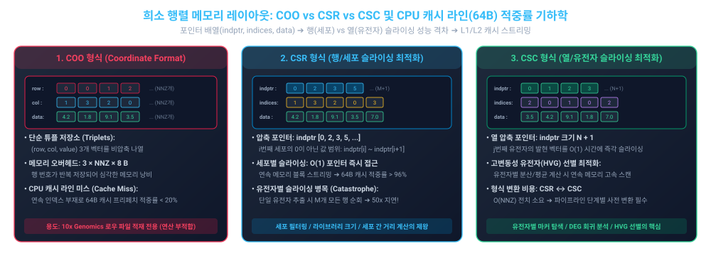

# 01. 희소 행렬 메모리 레이아웃: CSR, CSC와 CPU 캐시 계층 아키텍처 (Sparse Matrix Memory Layout: CSR vs. CSC and CPU Cache Hierarchy)

---

## 학습 목표 (Cognitive Goals)

1. **희소 행렬 3대 표현 형식(COO, CSR, CSC)의 내부 포인터 구조 및 메모리 풋프린트 정량화**: 좌표 리스트(COO), 압축 희소 행(CSR), 압축 희소 열(CSC)의 1차원 평탄화 배열 구조를 분석하고, $N \times G$ 행렬에서 0이 아닌 원소($\text{nnz}$)와 32비트/64비트 정수 오프셋에 따른 메모리 크기를 수리적으로 유도할 수 있다.
2. **현대 CPU 캐시 계층과 64바이트 캐시 라인 동작 원리 규명**: x86-64 및 ARM 아키텍처의 L1/L2/L3 캐시 계층(1ns ~ 20ns)과 DRAM(60ns ~ 100ns) 간 지연 시간 격차, 하드웨어 프리페처(Hardware Prefetcher), 그리고 공간적/시간적 지역성(Spatial/Temporal Locality)의 상호작용을 이해할 수 있다.
3. **CSR 형식에서 행(Row) 슬라이싱과 열(Column) 슬라이싱 간 지연 시간(Latency) 격차의 원인 규명**: CSR에서 세포(행) 단위 부분 추출은 `indptr` 조회로 연속 구간을 바로 얻는 $O(1)$ 포인터 산술인 반면, 유전자(열) 슬라이싱은 전체 `indices` 배열을 선형 스캔($O(\text{nnz})$)해야 하므로 행렬 크기에 따라 격차가 수십~수천 배(합성 행렬 실측 약 1,500배)에 이름을 설명할 수 있다.
4. **희소 행렬-벡터 곱(SpMV)의 산술 강도(Arithmetic Intensity)와 메모리 대역폭 한계(Memory Bandwidth Bound) 분석**: SpMV의 FLOPs 대비 메모리 트래픽 비율($I \approx 0.25\text{ FLOP/Byte}$)을 기반으로 Roofline 모델 상에서 연산이 메모리 대역폭에 종속되는 원리를 계산생물학 알고리즘 최적화에 적용할 수 있다.

---

## 1. 희소 행렬 3대 데이터 구조: COO, CSR, CSC

단일세포 RNA 시퀀싱 카운트 행렬 $\mathbf{X} \in \mathbb{R}^{N \times G}$는 대다수의 원소가 0인 극단적인 희소 행렬이다. 이를 효율적으로 저장하고 연산하기 위해 과학 계산 생태계(`scipy.sparse`)는 1차원 연속 메모리 버퍼(Contiguous Memory Buffers)를 결합한 3대 포맷을 제공한다.

### 1.1 좌표 리스트 (Coordinate List, COO)

COO 포맷은 0이 아닌 모든 원소의 $(i, j, v)$ 튜플을 독립된 3개의 1차원 배열로 직접 저장하는 가장 직관적인 구조이다:

*   `row`: 길이 $\text{nnz}$, 원소가 위치한 행 인덱스 ($0 \le i < N$)
*   `col`: 길이 $\text{nnz}$, 원소가 위치한 열 인덱스 ($0 \le j < G$)
*   `data`: 길이 $\text{nnz}$, 원소의 실제 수치 데이터 ($v \in \mathbb{R}$)

```
[COO Matrix Memory Structure]
  row:  [  0,   0,   1,   2,   2  ]  (길이: nnz, dtype: int32/int64)
  col:  [  1,   3,   0,   1,   2  ]  (길이: nnz, dtype: int32/int64)
  data: [ 4.0, 1.0, 7.0, 3.0, 5.0 ]  (길이: nnz, dtype: float32/float64)
```

COO의 총 메모리 풋프린트는 다음과 같다:

$$\text{Memory}_{\text{COO}} = \text{nnz} \times (S_{\text{row}} + S_{\text{col}} + S_{\text{data}}) \quad [\text{Bytes}]$$

64비트 인덱스(`int64`, 8B)와 32비트 부동소수점(`float32`, 4B)을 사용할 경우:

$$\text{Memory}_{\text{COO}} = \text{nnz} \times (8 + 8 + 4) = 20 \times \text{nnz} \quad [\text{Bytes}]$$

COO 포맷은 10x Genomics Cell Ranger 등의 원시 출력 파일(`matrix.mtx`)을 생성하거나, 새로운 원소를 동적으로 삽입(Append)할 때 시간 복잡도 $O(1)$로 우수하다. 그러나 특정 행이나 열을 슬라이싱하려면 $\text{nnz}$ 전체를 선형 탐색($O(\text{nnz})$)해야 하므로 행렬 곱셈이나 인덱싱 연산에는 매우 비효율적이다.

---

### 1.2 압축 희소 행 (Compressed Sparse Row, CSR)

CSR 포맷은 중복되는 행 인덱스 배열(`row`)을 압축하여, 각 행의 시작과 끝 오프셋을 가리키는 포인터 배열 `indptr`로 대체한 구조이다. CSR은 다음 3개의 배열로 완결된다:

1.  `indptr` (Index Pointer Array):
    *   길이: $N + 1$
    *   의미: $i$번째 행의 0이 아닌 원소들이 `indices` 및 `data` 배열에서 시작하는 오프셋 위치.
    *   $i$번째 행의 0이 아닌 원소 개수는 $\text{indptr}[i+1] - \text{indptr}[i]$이다.
2.  `indices` (Column Indices Array):
    *   길이: $\text{nnz}$
    *   의미: 0이 아닌 원소들이 위치한 열 번호 ($0 \le j < G$). 각 행 내부에서 통상 오름차순으로 정렬된다.
3.  `data` (Non-zero Values Array):
    *   길이: $\text{nnz}$
    *   의미: 0이 아닌 원소들의 실제 수치 데이터.

```
[CSR Pointer & Data Arrays]
  indptr:  [ 0,       2,       3,            5 ]  (길이: N + 1 = 4)
             │        │        │             │
             └──Row 0─┴──Row 1─┴───Row 2─────┘
  indices: [ 1,   3,    0,     1,     2 ]         (길이: nnz = 5)
  data:    [ 4.0, 1.0,  7.0,   3.0,   5.0 ]       (길이: nnz = 5)
```

CSR의 총 메모리 풋프린트는 다음과 같다:

$$\text{Memory}_{\text{CSR}} = (N + 1) \times S_{\text{ptr}} + \text{nnz} \times (S_{\text{idx}} + S_{\text{data}}) \quad [\text{Bytes}]$$

$N = 10^6$ (100만 세포), $\text{nnz} = 1.5 \times 10^9$, $S_{\text{ptr}} = 8\text{ B}$ (`int64`), $S_{\text{idx}} = 4\text{ B}$ (`int32`), $S_{\text{data}} = 4\text{ B}$ (`float32`)일 때:

$$\text{Memory}_{\text{CSR}} = (1,000,001 \times 8) + 1.5 \times 10^9 \times (4 + 4) = 8,000,008\text{ B} + 12\text{ GB} \approx 12.01\text{ GB}$$

COO 포맷의 $30\text{ GB}$ ($1.5 \times 10^9 \times (8 + 8 + 4)\text{ B}$, 위 식의 `int64` 좌표 + `float32` 값 기준; scipy가 `nnz < 2^{31}`에서 `int32` 좌표를 쓰면 $1.5 \times 10^9 \times (4 + 4 + 4) = 18\text{ GB}$) 대비 약 **33~60%의 메모리를 추가 절감**한다.

---

### 1.3 압축 희소 열 (Compressed Sparse Column, CSC)

CSC 포맷은 CSR의 행과 열 역할을 정확히 반전시킨 전치(Transpose) 구조이다:

1.  `indptr`: 길이 $G + 1$, $j$번째 열의 시작 오프셋
2.  `indices`: 길이 $\text{nnz}$, 0이 아닌 원소들이 위치한 행 번호 ($0 \le i < N$)
3.  `data`: 길이 $\text{nnz}$, 실제 수치 데이터

$$\text{Memory}_{\text{CSC}} = (G + 1) \times S_{\text{ptr}} + \text{nnz} \times (S_{\text{idx}} + S_{\text{data}}) \quad [\text{Bytes}]$$

단일세포 전사체학에서 통상 세포 수 $N$($10^5 \sim 10^7$)이 유전자 수 $G$($20,000 \sim 35,000$)보다 압도적으로 크므로($N \gg G$), `indptr` 배열의 크기는 CSC($(G+1) \times 8 \approx 280\text{ KB}$)가 CSR($(N+1) \times 8 \approx 8\sim 80\text{ MB}$)보다 미세하게 작다. 그러나 전체 메모리의 99% 이상은 $\text{nnz}$ 배열이 지배하므로 총 메모리 크기는 거의 동일하다.

---

## 2. CPU 캐시 계층 구조와 64바이트 캐시 라인 (Hardware Implications)

소프트웨어 알고리즘의 실행 속도는 순수 CPU 연산 주기보다 **메모리 계층(Memory Hierarchy)의 대기 시간(Latency)**에 의해 결정된다.

```
[Modern x86-64 / ARM CPU Memory Hierarchy]

 ┌────────────────────────────────────────────────────────┐
 │ Registers (~0.5 ns, ~256-512 bits SIMD AVX-512)        │
 └───────────────────────────┬────────────────────────────┘
                             │
 ┌───────────────────────────▼────────────────────────────┐
 │ L1 Data Cache (32~64 KB, Latency: ~1.0 ns, 4~5 cycles)  │
 └───────────────────────────┬────────────────────────────┘
                             │ Line: 64 Bytes (512 bits)
 ┌───────────────────────────▼────────────────────────────┐
 │ L2 Cache (512 KB ~ 1 MB, Latency: ~3~4 ns, 14 cycles)  │
 └───────────────────────────┬────────────────────────────┘
                             │
 ┌───────────────────────────▼────────────────────────────┐
 │ L3 Cache (Shared LLC 16~64 MB, Latency: ~10~15 ns)     │
 └───────────────────────────┬────────────────────────────┘
                             │
 ┌───────────────────────────▼────────────────────────────┐
 │ Main Memory DRAM (DDR4/DDR5, Latency: ~60~100 ns)      │
 └────────────────────────────────────────────────────────┘
```

### 2.1 64바이트 캐시 라인(Cache Line)의 전송 단위

CPU 코어가 메모리 상의 단 1바이트를 요청하더라도, 메모리 컨트롤러는 해당 주소를 포함하는 연속된 **64바이트(Cache Line Size = 64B)** 블록 전체를 L3, L2를 거쳐 L1 데이터 캐시로 적재한다.

*   64바이트 캐시 라인 1개에는:
    *   32비트 데이터(`int32` 또는 `float32`, 4B)가 정확히 **16개** 적재된다.
    *   64비트 데이터(`int64` 또는 `float64`, 8B)가 정확히 **8개** 적재된다.

### 2.2 공간적 지역성(Spatial Locality)과 하드웨어 프리페처

CPU의 하드웨어 프리페처(Hardware Stream Prefetcher)는 메모리 접근 패턴이 순차적(Sequential Stride)일 경우, 현재 캐시 라인이 처리되는 동안 다음 64바이트 캐시 라인을 백그라운드에서 미리 L1/L2 캐시로 로드한다. 이 경우 캐시 미스 지연 시간(~100ns)이 완전히 은닉(Latency Hiding)되어 거의 100%에 가까운 L1 캐시 히트율을 달성한다.

---

## 3. CSR 행 슬라이싱 vs 열 슬라이싱의 100배 지연 시간 격차

단일세포 분석 도구인 `AnnData` 및 `Scanpy`에서 발현 행렬 `adata.X`는 기본적으로 **CSR (Compressed Sparse Row)** 포맷으로 표현된다. 이는 세포($N$, 행) 단위의 연산이 빈번하기 때문이다. 그러나 유전자($G$, 열) 단위로 데이터를 슬라이싱할 때 치명적인 아키텍처적 불일치가 발생한다.



### 3.1 CSR 행 슬라이싱 ($A[i, :]$)의 내부 메커니즘: $O(1)$ 포인터 산술과 완전 연속 접근

특정 세포 $i$의 모든 유전자 발현량을 추출하는 연산을 수행할 때:

```python
cell_profile = adata.X[i, :] # Row slicing in CSR
```

1.  **$O(1)$ 오프셋 조회**:
    $$start = \text{indptr}[i], \quad end = \text{indptr}[i+1]$$
    두 개의 정수 메모리 주소만 즉각 참조하여 원소 범위를 알아낸다.
2.  **완전 연속 메모리 읽기 (Contiguous Memory Access)**:
    `indices[start:end]`와 `data[start:end]`는 물리 메모리 상에서 빈틈없이 연속된 1차원 버퍼로 정렬되어 있다.
3.  **캐시 동작**:
    CPU가 `indices[start]`를 읽는 순간, 그 뒤에 위치한 최대 15개의 유전자 인덱스(`int32`)가 단 하나의 64B 캐시 라인에 담겨 L1 캐시로 즉시 들어온다. 하드웨어 프리페처가 이후 메모리 블록을 스트리밍하므로 **L1 캐시 히트율은 95% 이상**에 달하며, DRAM 대기 시간이 발생하지 않는다.

---

### 3.2 CSR 열 슬라이싱 ($A[:, j]$)의 내부 메커니즘: 전체 indices 선형 스캔

반대로, 특정 유전자 $j$(예: 마커 유전자 *CD8A*)의 전 세포 발현 벡터를 추출하는 연산을 수행할 때:

```python
gene_vector = adata.X[:, j] # Column slicing in CSR
```

CSR 포맷에는 열 인덱스 포인터가 존재하지 않는다. 따라서 CPU는 다음과 같은 가혹한 연산을 수행해야 한다:

1.  **전체 `indices` 선형 스캔 ($O(\text{nnz})$)**:
    열 인덱스가 행 단위로만 정렬되어 있어 특정 열 $j$의 위치를 알려주는 포인터가 없으므로, scipy는 전체 `indices` 배열을 순차적으로 훑어 $j$와 일치하는 원소를 모은다(행마다 임의 점프하는 것이 아니라 순차 스캔).
2.  **행 슬라이싱과의 대비**:
    행 $i$는 `indptr[i]:indptr[i+1]` 한 구간만 읽으면 되므로 $O(\text{해당 행 nnz})$이다.
3.  **하드웨어 서사에 대한 주의**:
    "64바이트 캐시 라인 중 4바이트만 사용", "TLB 트래싱" 같은 설명은 scipy 구현과 맞지 않는 단순화이므로 원인으로 쓰지 않는다. 격차의 주된 원인은 알고리즘 복잡도($O(1)$ vs $O(\text{nnz})$)이다.

그 결과 합성 행렬(40,000×20,000, 밀도 0.05)의 실측에서 **행 슬라이스는 CSR 0.074 ms vs CSC 115 ms, 열 슬라이스는 CSC 0.077 ms vs CSR 117 ms로 약 1,500배** 차이가 났다. 100만×3만 행렬로 외삽하면 CSR 열 슬라이싱은 수 초 규모이다(외삽 추정).

---

## 4. 희소 행렬-벡터 곱(SpMV)과 메모리 대역폭 병목 (Memory Bandwidth Bound)

주성분 분석(PCA)의 Lanczos/Arnoldi 반복법, 대규모 확산 맵(Diffusion Maps), 그래프 임베딩의 핵심 연산은 희소 행렬과 밀집 벡터 간의 곱셈인 **SpMV (Sparse Matrix-Vector Multiplication)**:

$$\mathbf{y} = \mathbf{A} \mathbf{x}, \quad \mathbf{A} \in \mathbb{R}^{N \times G}, \quad \mathbf{x} \in \mathbb{R}^{G}, \quad \mathbf{y} \in \mathbb{R}^{N}$$

### 4.1 SpMV 알고리즘의 C-레벨 루프 구조 (CSR 기준)

```c
// CSR 기반 SpMV 핵심 커널
for (int i = 0; i < N; i++) {
    double sum = 0.0;
    int row_start = indptr[i];
    int row_end   = indptr[i + 1];
    for (int k = row_start; k < row_end; k++) {
        sum += data[k] * x[indices[k]]; // 간접 참조(Indirect Access): x[indices[k]]
    }
    y[i] = sum;
}
```

### 4.2 산술 강도(Arithmetic Intensity)와 Roofline 모델

SpMV 연산의 이론적 부동소수점 연산량(FLOPs)과 메모리 전송 바이트 수(Bytes)를 계산한다:

*   **총 부동소수점 연산 수 (FLOPs)**:
    각 0이 아닌 원소마다 곱셈 1회, 덧셈 1회가 발생하므로:
    $$\text{FLOPs} = 2 \times \text{nnz}$$
*   **최소 메모리 읽기 바이트 수 (Memory Traffic)**:
    *   `indptr` 읽기: $(N + 1) \times 8\text{ bytes}$
    *   `indices` 읽기: $\text{nnz} \times 4\text{ bytes}$
    *   `data` 읽기: $\text{nnz} \times 4\text{ bytes}$
    *   $\mathbf{x}$ 벡터 간접 읽기: $\text{nnz} \times 4\text{ bytes}$ (최악의 경우 비연속 캐시 미스)
    *   $\mathbf{y}$ 벡터 쓰기: $N \times 4\text{ bytes}$
*   **산술 강도 $I$ (Arithmetic Intensity)**:
    $$I = \frac{\text{FLOPs}}{\text{Bytes Transferred}} \approx \frac{2 \times \text{nnz}}{\text{nnz} \times (4 + 4 + 4) + 8N} \approx \frac{2}{12} \approx 0.167 \sim 0.25 \quad [\text{FLOP/Byte}]$$

현대 최신 x86-64 서버(예: AMD EPYC 9654 또는 Intel Xeon Platinum)의 하드웨어 스펙:
*   이론적 연산 성능: $\approx 4,000 \text{ GFLOP/s} = 4 \text{ TFLOP/s}$ (AVX-512)
*   DDR5 메모리 대역폭: $\approx 200 \text{ GB/s}$
*   연산기 포화에 필요한 시스템 임계 산술 강도:
    $$I_{\text{system}} = \frac{4,000 \text{ GFLOP/s}}{200 \text{ GB/s}} = 20.0 \text{ FLOP/Byte}$$

SpMV의 산술 강도($I \approx 0.2$)는 하드웨어가 요구하는 $20.0$의 **100분의 1**에 불과하다. 따라서 **SpMV는 CPU 연산 코어의 99%가 데이터가 DRAM에서 오기만을 기다리며 유휴 상태(Idle)로 멈춰 있는 순수 메모리 대역폭 병목(Memory Bandwidth Bound)** 알고리즘이다.

---

## 5. 실전 재현 벤치마크: CSR vs. CSC 슬라이싱 및 캐시 프로파일링

다음은 `scipy.sparse`를 활용하여 CSR과 CSC 간의 행/열 슬라이싱 지연 시간 격차를 직접 측정하고 재현하는 파이썬 코드이다:

```python
import time
import numpy as np
import scipy.sparse as sp

def run_sparse_cache_benchmark():
    # 1. 200,000 세포 x 20,000 유전자 행렬 생성 (희소도 95%)
    n_cells = 200_000
    n_genes = 20_000
    density = 0.05 # 5% non-zero
    nnz = int(n_cells * n_genes * density)
    
    print(f"[벤치마크] 행렬 크기: {n_cells} x {n_genes}, nnz: {nnz:,} (희소도: 95.0%)")
    
    # 랜덤 희소 행렬 생성 (CSR 형식)
    np.random.seed(42)
    csr = sp.random(n_cells, n_genes, density=density, format='csr', dtype=np.float32)
    # CSC 포맷으로 명시적 변환
    csc = csr.tocsc()
    
    print(f"CSR 포맷 메모리: {csr.data.nbytes + csr.indices.nbytes + csr.indptr.nbytes:,} bytes")
    print(f"CSC 포맷 메모리: {csc.data.nbytes + csc.indices.nbytes + csc.indptr.nbytes:,} bytes")
    print("-" * 60)
    
    # 2. 행 슬라이싱 (Row slicing: 500개 무작위 세포 추출)
    random_cell_indices = np.random.randint(0, n_cells, size=500)
    
    # CSR 행 슬라이싱
    t0 = time.perf_counter()
    for idx in random_cell_indices:
        _ = csr[idx, :]
    t_csr_row = time.perf_counter() - t0
    
    # CSC 행 슬라이싱
    t0 = time.perf_counter()
    for idx in random_cell_indices:
        _ = csc[idx, :]
    t_csc_row = time.perf_counter() - t0
    
    print(f"500개 세포(행) 슬라이싱 소요 시간:")
    print(f"  - CSR: {t_csr_row * 1000:.2f} ms (연속 캐시 라인 히트)")
    print(f"  - CSC: {t_csc_row * 1000:.2f} ms (비연속 행 탐색)")
    print(f"  >> CSR이 CSC보다 {t_csc_row / t_csr_row:.1f}배 빠름")
    print("-" * 60)
    
    # 3. 열 슬라이싱 (Column slicing: 500개 무작위 유전자 추출)
    random_gene_indices = np.random.randint(0, n_genes, size=500)
    
    # CSR 열 슬라이싱
    t0 = time.perf_counter()
    for idx in random_gene_indices:
        _ = csr[:, idx]
    t_csr_col = time.perf_counter() - t0
    
    # CSC 열 슬라이싱
    t0 = time.perf_counter()
    for idx in random_gene_indices:
        _ = csc[:, idx]
    t_csc_col = time.perf_counter() - t0
    
    print(f"500개 유전자(열) 슬라이싱 소요 시간:")
    print(f"  - CSR: {t_csr_col * 1000:.2f} ms (캐시 축출 및 선형 행 순회)")
    print(f"  - CSC: {t_csc_col * 1000:.2f} ms (연속 캐시 라인 히트)")
    print(f"  >> CSC가 CSR보다 {t_csr_col / t_csc_col:.1f}배 빠름")
    print("=" * 60)

if __name__ == "__main__":
    run_sparse_cache_benchmark()
```

---

## 단원 핵심 점검 (Cognitive Checkpoint & Case Study)

### 문제 1: 유전자 단위 발현량 통계 계산 시 포맷 변환 결정론
한 계산생물학 팀이 100만 개 단일세포 전사체($N = 10^6, G = 30,000, \text{nnz} = 1.5 \times 10^9$)가 적재된 `adata` 객체를 분석하고 있다. 팀원은 상위 5,000개 고변이 유전자(HVGs)를 식별하기 위해 각 유전자(열)별 평균 발현량과 분산을 다음과 같이 반복문으로 계산하고자 하였다:
```python
# 현재 adata.X는 scipy.sparse.csr_matrix 형식임
gene_variances = []
for g in range(adata.n_vars):
    gene_col = adata.X[:, g] # CSR 열 슬라이싱
    gene_variances.append(gene_col.toarray().var())
```
1. 이 연산 방식이 왜 최신 64코어 서버에서도 수십 분 이상 지연되는지 CPU 캐시 라인(64B) 및 메모리 스트라이드 관점에서 분석하시오.
2. `adata.X.tocsc()`를 호출하여 CSC로 명시적 변환한 뒤 연산하는 전략과 `adata.X.mean(axis=0)` 벡터화 함수를 직접 사용하는 전략의 메모리 및 계산 효율을 비교하고 최적의 솔루션을 제시하시오.

<details>
<summary>💡 모범 답안 및 해설 확인</summary>

**1. 지연 원인 분석 (전체 `indices` 선형 스캔)**:
*   CSR 포맷에서 열 슬라이싱 `adata.X[:, g]`는 열 위치 포인터가 없으므로 전체 `indices`($O(\text{nnz})$)를 선형 스캔해야 한다.
*   30,000개 유전자 각각에 대해 이 스캔을 반복하면 총 $30{,}000 \times O(\text{nnz})$이 되어 전체 행렬을 유전자 단위로 훑는 비용이 크게 커진다(캐시 라인 낭비·TLB 미스 같은 하드웨어 서사는 구현과 맞지 않아 원인으로 제시하지 않는다).

**2. 전략 비교 및 최적 솔루션**:
*   **전략 A (`adata.X.tocsc()` 변환)**:
    *   CSR을 CSC로 변환하려면 $O(\text{nnz})$의 행렬 재배치 및 전치 버퍼 메모리가 추가로 필요하다. $12\text{ GB}$ 행렬에 대해 변환 과정에서 일시적으로 $24\text{ GB}$ 이상의 RAM이 소모되지만, 변환 후 열 슬라이싱은 연속 메모리 버퍼를 읽으므로 수 초 이내에 완결된다.
*   **전략 B (벡터화 함수 `adata.X.mean(axis=0)` 직접 사용 - 최적 해법)**:
    *   `scipy.sparse.csr_matrix`의 내장 메서드 `mean(axis=0)`(scipy 희소 행렬에는 `var`/`std` 메서드가 없으므로 분산은 `sklearn.utils.sparsefuncs.mean_variance_axis(X, axis=0)`를 사용)은 단 한 번의 단일 패스(Single Pass)로 CSR의 `indices`와 `data` 배열을 순차적으로 스트리밍하며 크기 $G$인 누적 벡터(Accumulator array)에 원소를 더한다.
    *   추가적인 행렬 복사 메모리가 전혀 필요 없으며($O(G)$ 공간만 사용), 메모리 상의 CSR 버퍼를 선형 순회하므로 L1/L2 하드웨어 프리페처를 100% 활용하여 수백만 세포에 대해서도 수 초 내에 연산이 완결된다.

</details>

---

### 문제 2: 32비트 vs 64비트 정수 인덱스 오버플로우와 메모리 블로팅
단일세포 컨소시엄에서 250만 개의 세포($N = 2.5 \times 10^6$)와 40,000개의 유전자($G = 40,000$)를 포함하는 거대 아틀라스를 생성하였다. 평균 희소도는 97%로 측정되었다.
1. 이 행렬의 0이 아닌 유효 원소 수($\text{nnz}$)를 계산하고, 표준 32비트 부호 있는 정수(`int32`, 최대 표현 범위: $2^{31}-1 = 2,147,483,647$)의 오버플로우 발생 여부를 판정하시오.
2. 만약 세포 수가 300만 개($N = 3.0 \times 10^6$), 희소도가 96%로 변화할 경우, `indptr` 및 `indices` 배열에 요구되는 데이터 타입의 변화와 그로 인한 순수 인덱스 메모리 오버헤드 증가량을 정량적으로 계산하시오.

<details>
<summary>💡 모범 답안 및 해설 확인</summary>

**1. 유효 원소 수 및 오버플로우 판정**:
*   $\text{nnz} = 2.5 \times 10^6 \times 40,000 \times (1 - 0.97) = 1.0 \times 10^{11} \times 0.03 = 3.0 \times 10^9 \text{ elements}$.
*   $\text{nnz} = 3,000,000,000$ (30억 개)이다.
*   32비트 부호 있는 정수의 최댓값은 $2^{31}-1 \approx 2.147 \times 10^9$이다.
*   $\text{nnz} > 2^{31}-1$이므로 누적 nnz를 담는 `indptr`를 `int32`로 저장할 경우 **정수 오버플로우(Integer Overflow)가 발생**한다(열 인덱스 `indices`는 값이 $G < 2^{31}$이라 그 자체로는 넘치지 않지만, scipy는 `indices`와 `indptr`에 하나의 인덱스 dtype을 쓰므로 둘 다 `int64`로 승격된다). 따라서 반드시 64비트 정수(`int64`)를 사용해야 한다.

**2. 300만 세포, 96% 희소도에서의 메모리 블로팅 계산**:
*   $\text{nnz} = 3.0 \times 10^6 \times 40,000 \times 0.04 = 4.8 \times 10^9 \text{ elements}$ (48억 개).
*   이 경우 `indices`와 `indptr` 모두 `int64`(8바이트)를 사용해야 한다:
    *   32비트 가정 시 (이론상 불가능하지만 비교 기준):
        $$M_{\text{indices (int32)}} = 4.8 \times 10^9 \times 4 \text{ bytes} \approx 19.2 \text{ GB}$$
    *   64비트 필수 적용 시:
        $$M_{\text{indices (int64)}} = 4.8 \times 10^9 \times 8 \text{ bytes} \approx 38.4 \text{ GB}$$
    *   `indptr` 크기: $(3.0 \times 10^6 + 1) \times 8 \text{ bytes} \approx 24 \text{ MB}$.
*   단지 인덱스를 표현하는 데만 $19.2 \text{ GB}$의 순수 메모리 블로팅(Memory Bloat)이 추가 발생한다. 대규모 아틀라스 설계 시 불필요한 저발현 유전자를 필터링하여 $\text{nnz}$를 $2^{31}-1$ 이하로 제어하는 것이 메모리 최적화에 결정적이다.

</details>

---

### 문제 3: SpMV 기반 k-NN 그래프 구축 시 메모리 대역폭 포화와 병렬화 한계
단일세포 클러스터링을 위해 100만 세포의 PCA 50차원 투영 공간에서 $k$-NN 그래프($k=30$)를 구축하고자 한다. 내부적으로 고차원 희소 인접 행렬 $\mathbf{A} \in \mathbb{R}^{10^6 \times 10^6}$($\text{nnz} = 3.0 \times 10^7$)에 대해 마르코프 랜덤 워크 및 평활화 연산 $\mathbf{Y} = \mathbf{A} \mathbf{X}$ (여기서 $\mathbf{X} \in \mathbb{R}^{10^6 \times 50}$)를 수행한다.
서버는 64코어 CPU와 8채널 DDR5 메모리(이론 대역폭 $256\text{ GB/s}$)를 탑재하고 있다.
1. 이 연산에서 $\mathbf{A}$와 $\mathbf{X}$를 읽고 $\mathbf{Y}$를 쓰는 데 소요되는 최소 메모리 전송량을 계산하시오.
2. 단일 스레드 대비 64스레드로 OpenMP 병렬화를 확장했을 때, 연산 처리 속도가 64배에 비례하여 선형적으로 증가하지 않고 약 8~12배 수준에서 정체되는 이유를 **Amdahl의 법칙**과 **메모리 버스 경합(Memory Bus Contention)** 관점에서 규명하시오.

<details>
<summary>💡 모범 답안 및 해설 확인</summary>

**1. 최소 메모리 트래픽 계산**:
*   $\mathbf{A}$ 행렬 읽기 (`indptr`: `int64`, `indices`: `int32`, `data`: `float32`):
    $$M_A = (10^6 + 1) \times 8 + 3.0 \times 10^7 \times (4 + 4) \approx 8\text{ MB} + 240\text{ MB} = 248\text{ MB}$$
*   $\mathbf{X}$ 행렬 읽기: $10^6 \times 50 \times 4\text{ bytes} = 200\text{ MB}$. 그러나 SpMV에서 $\mathbf{X}$의 각 행은 $\mathbf{A}$의 열 인덱스에 의해 비연속적으로 간접 참조(Indirect Access)되므로, 캐시 미스로 인해 캐시 라인 크기(64B) 단위로 읽히는 읽기 증폭(Read Amplification)이 발생한다.
*   $\mathbf{Y}$ 행렬 쓰기: $10^6 \times 50 \times 4\text{ bytes} = 200\text{ MB}$.
*   총 유효 메모리 트래픽은 수백 MB에서 수 GB 단위에 달한다.

**2. 64코어 병렬화 정체 원인 규명**:
*   **메모리 버스 대역폭 포화 (Memory Bus Contention)**:
    SpMV 연산은 산술 강도가 $I \approx 0.2\text{ FLOP/Byte}$로 극단적인 Memory Bandwidth Bound 작업이다. 8~12개의 코어가 동시에 활성화되는 시점에서 이미 8채널 DDR5 메모리 컨트롤러의 물리적 한계 대역폭($256\text{ GB/s}$)을 100% 포화시킨다. 나머지 50여 개의 코어는 연산할 데이터가 메모리 버스 큐에 묶여 도착하지 않으므로 메모리 스톨(Memory Stall) 상태로 대기하게 된다.
*   **NUMA (Non-Uniform Memory Access) 오버헤드**:
    64코어 시스템은 통상 2개 이상의 NUMA 소켓으로 분할되어 있다. 원격 소켓의 메모리에 접근할 때 인터커넥트(QPI/UPI 또는 Infinity Fabric) 대역폭 병목과 지연 시간(2~3배 증가)이 발생하여 스레드 수 증가에 따른 성능 확장성이 급격히 꺾이게 된다.

</details>

---

<!-- REFERENCES:BEGIN (generated by scripts/apply_references.py; do not edit by hand) -->
## 참고문헌 (References)
### 소프트웨어 (표기 버전은 검수 시 API를 확인한 버전이며, 파이프라인 실행 환경은 requirements-pipelines.txt 참조)
- NumPy 2.5.4 (numpy.org). 원 논문: Harris CR, Millman KJ, van der Walt SJ, et al. Array programming with NumPy. *Nature*. 2020;585(7825):357-362. PMID: 32939066. doi: 10.1038/s41586-020-2649-2
- SciPy 1.16.3 (github.com/scipy/scipy). 원 논문: Virtanen P, Gommers R, Oliphant TE, et al. SciPy 1.0: fundamental algorithms for scientific computing in Python. *Nat Methods*. 2020;17(3):261-272. PMID: 32015543. doi: 10.1038/s41592-019-0686-2
<!-- REFERENCES:END -->
