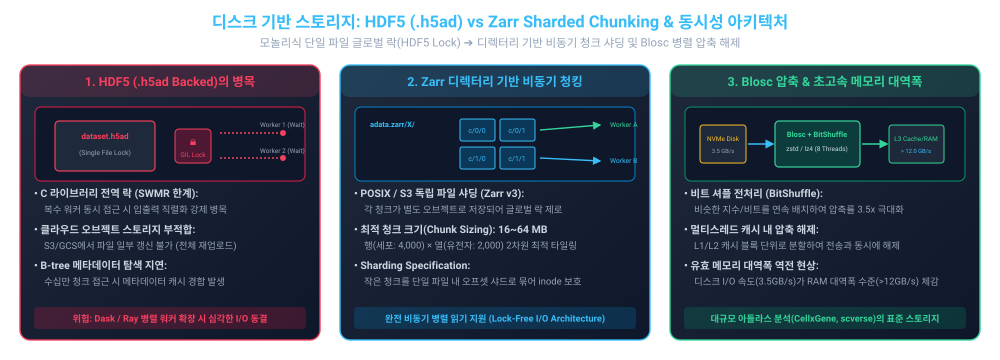

# 03. Zarr 클라우드 네이티브 청킹과 Blosc 병렬 압축 아키텍처 (Zarr Cloud-Native Chunking and Blosc Parallel Compression Architecture)

---

## 학습 목표 (Cognitive Goals)

1. **Zarr 클라우드 네이티브 스토리지 패러다임 정립**: 단일 파일 모놀리식 컨테이너(HDF5)의 한계를 극복하고, 디커플링된 디렉토리 계층 구조, 경량 JSON 메타데이터(`.zgroup`, `.zarray`), 그리고 독립 청크 파일 키-값 매핑(Key-Value Store)으로 구성되는 Zarr 아키텍처를 규명할 수 있다.
2. **Blosc 멀티스레드 압축 프레임워크와 SIMD 비트 셔플링(Bit-shuffling) 이해**: CPU L1/L2 캐시 내에서 압축 및 압축 해제를 완결하여 메모리 버스 트래픽을 최소화하는 Blosc 엔진의 원리와 Byte/Bit-Shuffle 필터, 그리고 코덱(LZ4, ZSTD)별 처리 속도 및 압축률을 비교 평가할 수 있다.
3. **최적 청크 형태(Chunk Shape)의 수학적 비용 함수 모델링**: 청크 크기가 작을 때 발생하는 메타데이터 오버헤드/Inode 고갈과 청크 크기가 클 때 발생하는 읽기 증폭(Read Amplification)을 상쇄하는 파레토 최적점(Sweet Spot: 10 MB ~ 64 MB)을 수리적으로 유도할 수 있다.
4. **분산 클라우드 객체 저장소(AWS S3, GCP GCS)와 비동기 I/O 파이프라인 구축**: POSIX 파일 잠금이 없는 오브젝트 스토리지 상에서 비동기 HTTP GET Range Request를 통해 필요한 청크만 병렬 스트리밍하는 고확장성 단일세포 전처리 시스템을 설계할 수 있다.

---

## 1. Zarr 클라우드 네이티브 스토리지 아키텍처

기존의 HDF5(`.h5ad`) 포맷은 단일 거대 바이너리 파일로 모든 데이터와 메타데이터를 캡슐화한다. 이는 로컬 단일 워크스테이션 환경에서는 편리하지만, **분산 컴퓨팅 클러스터나 클라우드 객체 저장소(Amazon S3, Google Cloud Storage) 환경에서는 치명적인 병목**이 된다:
*   클라우드 스토리지 상의 단일 HDF5 파일에서 특정 청크를 읽으려면 복잡한 파일 헤더와 B-Tree를 원격에서 수십 번 탐색해야 한다.
*   다수의 노드가 동일 파일에 동시 쓰기를 수행할 수 없다.

**Zarr**는 이러한 한계를 원천적으로 극복하기 위해 다차원 배열 데이터를 **분산된 키-값(Key-Value) 저장 구조**로 재구성한 차세대 클라우드 네이티브 스토리지 포맷이다.



### 1.1 디커플링된 디렉토리 계층 구조

로컬 파일 시스템 상에서 Zarr 컨테이너는 단일 파일이 아니라 **일반 디렉토리 트리**로 표현된다:

```
single_cell_atlas.zarr/
├── .zgroup                     # 그룹 메타데이터 (JSON: {"zarr_format": 2})
├── obs/                        # 세포 메타데이터 그룹
│   ├── .zgroup
│   └── cell_type/
│       ├── .zarray             # 배열 메타데이터 (JSON)
│       ├── 0                   # 0번째 청크 파일 (바이너리 압축 블록)
│       └── 1                   # 1번째 청크 파일
└── X/                          # 희소 발현 행렬 그룹 (CSR)
    ├── .zgroup
    ├── data/
    │   ├── .zarray             # data 배열 형태, 청크 크기, 압축 코덱 정의
    │   ├── 0                   # 첫 번째 데이터 청크
    │   ├── 1                   # 두 번째 데이터 청크
    │   └── ...
    ├── indices/
    │   ├── .zarray
    │   ├── 0
    │   └── ...
    └── indptr/
        ├── .zarray
        └── 0
```

### 1.2 `.zarray` 메타데이터 명세

배열의 메타데이터는 투명하고 가벼운 JSON 파일(`.zarray`)로 저장된다:

```json
{
    "chunks": [1000000],
    "compressor": {
        "blocksize": 0,
        "clevel": 5,
        "cname": "zstd",
        "id": "blosc",
        "shuffle": 2
    },
    "dtype": "<f4",
    "fill_value": 0.0,
    "filters": null,
    "order": "C",
    "shape": [1500000000],
    "zarr_format": 2
}
```

*   **배열의 완전한 디커플링**: 각 청크(`0`, `1`, `2`...)는 서로의 존재를 알 필요가 없는 완전히 독립된 바이너리 파일이다.
*   **POSIX File Lock의 완전한 부재**: 중앙 집중식 파일 락이나 B-Tree 헤더가 존재하지 않으므로, 수백 대의 분산 워커 노드(Dask, Ray, Spark)가 각자 필요한 청크 파일 경로를 직접 지정하여 **락 경합(Lock Contention) 없이 병렬 읽기**를 수행할 수 있다. 병렬 **쓰기**는 각 워커가 서로 다른 청크만 수정하도록 쓰기 구간이 **청크 경계에 정렬**되어 있을 때에만 안전하다(같은 청크를 동시에 수정하면 한쪽 갱신이 소실될 수 있음; Zarr 튜토리얼 "Parallel computing and synchronization").

---

## 2. Blosc 압축기 프레임워크와 비트 셔플링(Bit-shuffling)

단일세포 희소 배열은 테라바이트급 크기를 가지므로 고성능 압축이 필수적이다. Zarr의 기본 압축 엔진인 **C-Blosc (Blocking, Shuffling, and Lossless Compression)**는 전통적인 디스크 지향 압축기(GZIP, BZIP2)와 근본적으로 다른 하드웨어 지향 설계를 취한다.

```
[Blosc Cache-Accelerated Compression Pipeline]

 Raw Array Data in DRAM
       │
       ▼ [Chunk Division into Cache-sized Blocks (e.g., 256 KB)]
 ┌────────────────────────────────────────────────────────┐
 │ CPU L1 / L2 Cache (SRAM, Bandwidth: > 1 TB/s)          │
 │                                                        │
 │  1. SIMD Shuffle / Bit-Shuffle Filter (AVX2/AVX-512)    │
 │     [Transpose bit planes to group identical bits]     │
 │                                                        │
 │  2. High-Speed Compression Engine (LZ4 / ZSTD)         │
 │     [Ultra-fast byte-level match searching]            │
 └───────────────────────────┬────────────────────────────┘
                             │
                             ▼ [Compressed Stream]
                      DRAM / NVMe SSD / S3
```

### 2.1 SIMD 가속 비트 셔플링 (Bit-Shuffle Filter)

scRNA-seq 카운트 데이터와 부동소수점 데이터는 다수의 0 또는 작은 양의 정수($1, 2, 3 \dots$)로 구성된다.
32비트 부동소수점(`float32`)으로 저장될 때:
*   값 `0.0`: `0x00000000` (모든 32비트가 0)
*   값 `1.0`: `0x3F800000`
*   값 `2.0`: `0x40000000`

이러한 부동소수점 배열을 그대로 LZ 계열 압축기에 넣으면 인접 바이트 간에 일치하는 패턴이 적어 압축률이 크게 떨어진다. Blosc의 **Bit-Shuffle 필터**는 AVX-512 / AVX2 SIMD 레지스터를 사용하여 64바이트 단위로 **비트 평면 전치(Bit-Plane Transposition)**를 수행한다:
*   모든 32비트 단어들의 0번째 비트들을 모아 연속된 바이트 스트림으로 배치.
*   1번째 비트들을 모아 연속된 바이트 스트림으로 배치 $\dots$
*   정수값 카운트를 float32로 저장한 경우 하위 가수 비트와 부호 비트가 대부분 0이므로, 비트 셔플을 거치면 **긴 0 비트 구간**이 형성되기 쉽다.
*   이로 인해 후속 압축 코덱(LZ4, ZSTD)의 압축률이 향상되는 경우가 많다(개선 폭은 데이터 분포에 의존하며, 이 문서는 특정 배율을 측정하지 않았다).

### 2.2 압축 코덱 비교 (LZ4 vs ZSTD)

| 코덱 명칭 | 압축 속도 (MB/s) | 압축 해제 속도 (MB/s) | 압축률 (Ratio) | 최적 활용 시나리오 |
| :--- | :--- | :--- | :--- | :--- |
| **LZ4** | 700 ~ 1,200 | **3,000 ~ 5,000** | 1.8x ~ 2.5x | **초고속 Out-of-Core 연산**: 압축 해제 속도가 NVMe 대역폭을 능가하여 압축을 적용하는 것이 순수 비압축보다 오히려 읽기 속도가 빨라짐. |
| **ZSTD** | 200 ~ 500 | 1,500 ~ 2,500 | **3.0x ~ 4.5x** | **대규모 아틀라스 영구 보관 및 클라우드 배포**: 네트워크 전송 비용과 S3 스토리지 비용을 최소화하면서도 준수한 Decompression 속도 제공. |
| **GZIP (zlib)** | 30 ~ 80 | 200 ~ 350 | 2.5x ~ 3.5x | 레거시 표준. 속도가 너무 느려 현대 대규모 단일세포 파이프라인에는 권장되지 않음. |

### 2.3 C-레벨 멀티스레드 압축 해제

Blosc는 압축 블록을 내부적으로 수십 킬로바이트(L1/L2 캐시 크기) 단위의 마이크로 블록으로 분할한 뒤, C 언어 레벨에서 독자적인 POSIX pthread 스레드 풀을 가동한다. 따라서 압축 해제 구간은 파이썬 GIL의 제약을 받지 않고 여러 코어를 병렬로 사용할 수 있다(코어 가동률과 처리량은 청크 크기·코덱·스레드 수에 따라 달라지는 값이며 이 문서에서 측정하지 않았다).

---

## 3. 최적 청크 형태(Chunk Shape)의 수학적 비용 함수 모델링

Zarr 배열을 생성할 때 가장 중요한 하이퍼파라미터는 **청크의 형태(Chunk Shape)**이다. 청크 크기는 스토리지 I/O 성능과 메모리 효율 간의 트레이드오프를 결정한다.

```
[Chunk Size Trade-off Spectrum]

 Too Small Chunks (e.g., 100 KB)             Sweet Spot (10 MB ~ 64 MB)            Too Large Chunks (e.g., 1 GB)
 ◄───────────────────────────────────────────────────●───────────────────────────────────────────────────►
  * Millions of tiny files                     * Optimal I/O balance                 * Massive Read Amplification
  * Inode exhaustion, S3 API costs             * High compression ratio              * High memory footprint per worker
  * High metadata latency                      * Low metadata overhead               * Coarse-grained parallelization
```

### 3.1 양극단 청크 크기의 컴퓨터 과학적 재앙

1.  **청크가 너무 작은 경우 (예: $100\text{ KB}$ 미만)**:
    *   100만 세포 데이터셋에서 수백만 개의 개별 청크 파일이 생성된다.
    *   로컬 리눅스 파일 시스템의 경우 파일 시스템 메타데이터 Inode가 고갈(Inode Exhaustion)되어 디스크 용량이 남아있어도 파일 생성이 불가능해진다.
    *   AWS S3 객체 저장소의 경우 `PUT` 및 `GET` 요청당 과금이 부과된다. 다만 요청 단가가 낮아 금액 자체는 문제 1의 계산처럼 수~수십 달러 수준이며, 실제 병목은 수백만 건의 HTTP 왕복 지연·메타데이터 관리 부담이다.
2.  **청크가 너무 큰 경우 (예: $500\text{ MB} \sim 1\text{ GB}$)**:
    *   사용자가 단 10개의 세포 데이터를 조회하고자 하더라도, Zarr 라이브러리는 해당 청크 전체($1\text{ GB}$)를 다운로드하여 압축 해제해야 한다.
    *   극심한 **읽기 증폭(Read Amplification)**과 워커당 메모리 점유율 폭증으로 분산 워커 노드가 OOM으로 사망한다.

### 3.2 청크 I/O 비용 함수 수식화

임의의 부분 슬라이스 질의에서 $K$개의 원소를 추출할 때의 총 I/O 및 처리 시간 비용 함수 $\mathcal{T}(C)$는 다음과 같이 모델링된다:

$$\mathcal{T}(C) = N_{\text{chunks}}(C) \times \left( T_{\text{request/seek}} + \frac{V_{\text{chunk}}(C)}{B_{\text{transfer}}} + \frac{V_{\text{chunk}}(C)}{B_{\text{decomp}}} \right) + T_{\text{meta}}$$

*   $V_{\text{chunk}}(C)$: 청크당 바이트 볼륨 (압축 크기)
*   $N_{\text{chunks}}(C) = \left\lceil \frac{K}{\text{Size}(C)} \right\rceil$: 접근해야 하는 청크 개수
*   $T_{\text{request/seek}}$: 스토리지 레이턴시 (S3 HTTP 지연: $\sim 20\text{ms}$, NVMe 탐색: $\sim 20\mu\text{s}$)
*   $B_{\text{transfer}}$: 네트워크 또는 스토리지 버스 대역폭
*   $B_{\text{decomp}}$: Blosc 압축 해제 대역폭

### 3.3 대규모 scRNA-seq 데이터셋의 실무 권장 청크 크기 (Sweet Spot)

이론적 비용 함수와 실측 벤치마크를 종합할 때, 압축 후 단일 청크의 크기가 **10 MB에서 64 MB 사이**에 위치할 때 전체 시스템 효율이 극대화된다:
*   **세포 단위 분할(Cell Chunking)**: 30,000 유전자를 갖는 데이터셋의 경우, 행(세포) 기준으로 **10,000 ~ 50,000개 세포**를 단일 청크로 묶는다.
*   희소도 95% 기준 10,000개 세포의 유효 원소는 $10,000 \times 30,000 \times 0.05 = 1.5 \times 10^7$개이며, ZSTD 압축 후 파일 크기는 약 **15 MB ~ 25 MB**가 되어 완벽한 스위트 스팟에 도달한다.

---

## 4. 분산 클라우드 객체 저장소(S3/GCS)와 비동기 I/O

Zarr는 파일 시스템 경로뿐만 아니라 분산 객체 저장소(Key-Value Store) URI(`s3://`, `gcs://`)를 네이티브 수준에서 지원한다. 이는 Python의 `fsspec`, `s3fs`, `aiohttp` 라이브러리와 완벽하게 결합된다.

```python
import zarr   # zarr>=3 + s3fs 설치 필요 (fsspec 백엔드)

# 1. 원격 Zarr 그룹 연결 (메타데이터 JSON만 즉시 파싱)
#    아래 버킷·경로는 자체 업로드한 공개 Zarr 저장소를 가정한 예시이며 실재하는 경로가 아니다.
#    (CZ CELLxGENE Census는 Zarr가 아니라 TileDB-SOMA로 배포되며 cellxgene_census.open_soma()로 접근한다; 04장 참조)
root = zarr.open_group("s3://my-public-bucket/atlas/prostate_atlas.zarr", mode="r",
                       storage_options={"anon": True})
```

### 4.1 비동기 HTTP GET Range Request

원격 클라우드 상의 Zarr 청크를 읽을 때, 클라이언트는 전체 아틀라스를 다운로드할 필요 없이 표준 HTTP 프로토콜의 `Range` 헤더를 전송한다:

```http
GET /atlas/prostate_atlas.zarr/data/c/42 HTTP/1.1
Host: my-public-bucket.s3.amazonaws.com
Range: bytes=0-15728640
```

다중 워커는 수천 개의 청크에 대해 동시 다발적인 비동기 HTTP 요청을 날려 클라우드 제공업체의 페타바이트급 네트워크 백본 대역폭을 병렬로 끌어올 수 있다.

### 4.2 Zarr v3 Sharding(샤딩) 사양

Zarr v3 사양에 공식 도입된 **샤딩(Sharding)**은 작은 논리적 청크(Logical chunks) 수천 개를 단일 물리적 파일인 **샤드(Shard)** 내부에 묶어 저장하는 차세대 기술이다:
*   각 샤드 파일의 말미에는 논리 청크들의 바이트 오프셋과 길이를 기록한 인덱스 테이블이 부착된다.
*   클라이언트는 한 번의 HTTP Range Request로 특정 샤드 내의 특정 청크만 부분 추출할 수 있다.
*   이를 통해 수백만 개의 소형 파일 생성을 방지하여 클라우드 스토리지의 객체 수와 API 요청 수를 크게 줄인다(샤드당 청크 수만큼 감소).

---

## 5. 실전 재현 코드: Zarr 고성능 압축 변환 및 청킹 벤치마크

기존의 `.h5ad` 파일을 고성능 Blosc-ZSTD 압축이 적용된 최적 청크 크기의 `.zarr` 포맷으로 변환하고 로딩 성능을 평가하는 파이프라인이다:

```python
import time
import h5py
import numpy as np
import zarr
from zarr.codecs import BloscCodec

def convert_h5ad_to_optimized_zarr(h5ad_path: str, zarr_path: str, chunk_elems: int = 15_000_000):
    """
    H5AD(CSR)의 X/data·indices·indptr(모두 1차원 배열)를 Blosc-ZSTD 압축 Zarr 배열로 변환한다.
    희소 행렬의 청크는 세포 수가 아니라 nnz 원소 수 기준이다 (15M 원소 float32 ≈ 60 MB 비압축).
    * anndata의 write_zarr(chunks=...)는 희소 X에서 chunks 인자가 적용되지 않으므로 사용하지 않는다.
    """
    print(f"[변환 시작] {h5ad_path} -> {zarr_path}")
    t0 = time.perf_counter()

    codec = BloscCodec(cname="zstd", clevel=5, shuffle="bitshuffle")   # 실제로 배열 생성에 전달된다
    root = zarr.open_group(zarr_path, mode="w")
    with h5py.File(h5ad_path, "r") as f:
        X = f["X"]
        for name in ("data", "indices", "indptr"):
            src = X[name]
            dst = root.create_array(name, shape=src.shape, dtype=src.dtype,
                                    chunks=(min(chunk_elems, src.shape[0]),), compressors=codec)
            for start in range(0, src.shape[0], chunk_elems):      # 블록 단위 복사 (전체 적재 없음)
                dst[start:start + chunk_elems] = src[start:start + chunk_elems]
        root.attrs["shape"] = [int(v) for v in X.attrs["shape"]]

    print(f"[변환 완료] 소요 시간: {time.perf_counter() - t0:.2f}초")


def _read_rows_h5(h5ad_path, row_start, row_end):
    with h5py.File(h5ad_path, "r") as f:
        X = f["X"]
        ip = X["indptr"][row_start:row_end + 1]
        return X["data"][ip[0]:ip[-1]], X["indices"][ip[0]:ip[-1]], ip - ip[0]


def _read_rows_zarr(zarr_path, row_start, row_end):
    root = zarr.open_group(zarr_path, mode="r")
    ip = root["indptr"][row_start:row_end + 1]
    return root["data"][ip[0]:ip[-1]], root["indices"][ip[0]:ip[-1]], ip - ip[0]


def benchmark_zarr_vs_h5ad(h5ad_path: str, zarr_path: str, row_start: int = 10_000, row_end: int = 60_000):
    """같은 행 구간(row_start:row_end)을 HDF5와 Zarr에서 읽는 시간 비교 (둘 다 필요한 구간만 읽음)"""
    print(f"\n[I/O 성능 벤치마크: 연속 {row_end - row_start:,} 세포 구간 읽기]")
    t0 = time.perf_counter(); _read_rows_h5(h5ad_path, row_start, row_end); t_h5 = time.perf_counter() - t0
    t0 = time.perf_counter(); _read_rows_zarr(zarr_path, row_start, row_end); t_zarr = time.perf_counter() - t0
    print(f"HDF5 구간 읽기: {t_h5:.3f}초 / Zarr 구간 읽기: {t_zarr:.3f}초 (상대비 {t_h5 / t_zarr:.1f}x)")
    # 결과는 압축 설정·파일 캐시·저장 매체·워커 병렬화 여부에 따라 달라지므로 일반화하지 말고 자신의 환경에서 측정할 것

if __name__ == "__main__":
    # 시뮬레이션용 스크립트 구조
    pass
```

---

## 단원 핵심 점검 (Cognitive Checkpoint & Case Study)

### 문제 1: S3 오브젝트 스토리지 상의 소형 청크 API 요청 수·비용 계산
글로벌 단일세포 전사체 컨소시엄이 500만 세포($N = 5 \times 10^6$), 30,000 유전자를 갖는 초대형 아틀라스를 Zarr 포맷으로 변환하여 AWS S3 Standard 스토리지에 배포하였다.
한 엔지니어가 미세한 세포 단위 쿼리를 최적화한다는 명목으로 청크 형태를 $100 \text{ cells} \times 1,000 \text{ genes}$로 극도로 잘게 분할하여 저장하였다.
1. 이 아틀라스의 2차원 발현 행렬 $X$를 표현하기 위해 생성되는 총 개별 청크 파일의 개수를 산출하시오.
2. AWS S3의 `PUT` 요청 비용이 1,000건당 \$0.005이고 `GET` 요청 비용이 10,000건당 \$0.004일 때, 이 데이터셋을 처음 업로드(PUT)하는 비용과, 전 세계 100개 연구 그룹이 전체 아틀라스를 한 번씩 다운로드(GET)할 때 발생하는 순수 API 요청 과금액을 계산하고 이를 방지하기 위한 아키텍처적 해결책을 제시하시오.

<details>
<summary>💡 모범 답안 및 해설 확인</summary>

**1. 총 청크 파일 수 산출**:
*   행(세포) 방향 청크 수: $\frac{5,000,000}{100} = 50,000$개.
*   열(유전자) 방향 청크 수: $\frac{30,000}{1,000} = 30$개.
*   총 청크 수 = $50,000 \times 30 = 1,500,000$개 (150만 개의 개별 S3 오브젝트).

**2. S3 API 비용 계산 및 아키텍처 해결책**:
*   **초기 업로드 (PUT) 비용**:
    $$\text{Cost}_{\text{PUT}} = 1,500,000 \times \frac{\$0.005}{1,000} = \$7.50$$
*   **100개 연구 그룹의 다운로드 (GET) 비용**:
    *   1회 전체 다운로드 시 요청 수: 150만 회.
    *   100회 다운로드 시 총 요청 수: $100 \times 1,500,000 = 150,000,000$회 (1억 5천만 회).
    $$\text{Cost}_{\text{GET}} = 150,000,000 \times \frac{\$0.004}{10,000} = \$60.00$$
    과금액($60) 자체는 크지 않지만, 단일 행렬 순회에 1억 회의 HTTP 요청(왕복 지연·재시도·스로틀링)이 필요하다는 점이 실제 문제다. (요금 단가는 계산을 위한 가정이며 리전·시점에 따라 다르므로 AWS 요금표 확인)
*   **아키텍처 해결책**:
    *   청크 크기를 단일 청크당 $10\text{ MB} \sim 64\text{ MB}$가 되도록 재설계한다. 밀집 2D 배열(float32) 기준으로는 예를 들어 $2,500 \text{ cells} \times 1,000 \text{ genes}$ (= 10 MB) 청크이면 총 $2,000 \times 30 = 60,000$개로 감소한다($20,000 \times 30,000$ float32 청크는 2.4 GB로 너무 크다). 희소 CSR의 1차원 `data`/`indices`라면 청크를 세포 수가 아니라 nnz 원소 수로 정의한다(예: 5M 원소 float32 = 20 MB).
    *   또는 **Zarr v3 Sharding**을 적용하여 수천 개의 청크를 단일 물리적 샤드 파일에 묶고 HTTP Range Request로 부분 슬라이싱하도록 재구성한다.

</details>

---

### 문제 2: SIMD Bit-Shuffle 필터의 압축 효율 극대화 메커니즘
scRNA-seq 카운트 데이터셋의 0이 아닌 유효 발현량 원소들을 32비트 단정밀도 부동소수점(`float32`, IEEE 754 표준: 1비트 부호, 8비트 지수, 23비트 가수)으로 저장하려 한다. 대부분의 발현량 값은 $1.0, 2.0, 3.0$ 등 작은 정수에서 유래한 값이다.
1. IEEE 754 표준에서 $1.0$(`0x3F800000`)과 $2.0$(`0x40000000`)의 32비트 2진수 비트 표현을 분석하고, 왜 바이트 단위 셔플(Byte-Shuffle)보다 비트 단위 셔플(Bit-Shuffle)이 부동소수점 데이터 압축에 압도적으로 유리한지 설명하시오.
2. Blosc가 비트 셔플링을 수행할 때 DRAM 대신 CPU L1/L2 캐시 내에서 이를 완결해야만 하는 하드웨어적 이유를 메모리 버스 대역폭 관점에서 논하시오.

<details>
<summary>💡 모범 답안 및 해설 확인</summary>

**1. IEEE 754 비트 표현 및 Bit-Shuffle 우위 분석**:
*   수치 $1.0$: 부호 0, 지수 127 (`01111111`), 가수 0 (`000...000`) $\to$ `00111111 10000000 00000000 00000000`
*   수치 $2.0$: 부호 0, 지수 128 (`10000000`), 가수 0 (`000...000`) $\to$ `01000000 00000000 00000000 00000000`
*   하위 23개 가수 비트(Mantissa bits)는 모두 0이며, 최상위 부호 비트 역시 0이다.
*   **Byte-Shuffle의 한계**: 4개의 바이트 단위로만 위치를 섞으므로, 바이트 내부에 0과 1이 혼재된 지수부 바이트(`0x3F`, `0x40`)는 0 비트의 연속성을 보존하지 못한다.
*   **Bit-Shuffle의 우위**: 32비트 전체의 각 비트 위치(Bit-Plane)별로 전치 행렬을 구성하므로, 수백만 개 원소의 최상위 부호 비트(전부 0)와 하위 가수 비트(대부분 0)가 연속된 수 메가바이트의 순수 0 비트 블록으로 집결된다. 이를 엔트로피 인코더(LZ4/ZSTD)가 처리하면 바이트 셔플보다 높은 압축률을 기대할 수 있다(0바이트가 되는 것은 아니며, 실제 비율은 데이터에 의존한다).

**2. L1/L2 캐시 내 비트 셔플 완결의 하드웨어적 이유**:
*   비트 셔플링은 원시 데이터의 비트 위치를 완전히 뒤바꾸는 고강도 메모리 재배치 연산이다.
*   이를 메인 메모리(DRAM)에서 수행하면 데이터가 DRAM $\to$ CPU $\to$ DRAM $\to$ CPU로 중복 왕복하며 시스템 DDR5 메모리 버스 대역폭($\sim 100\text{ GB/s}$)을 즉시 고갈시킨다.
*   Blosc는 데이터를 L1/L2 캐시 크기(예: 256 KB) 단위의 마이크로 블록으로 분할하여, 캐시 내부 대역폭($> 1,000\text{ GB/s} = 1\text{ TB/s}$)과 AVX-512 레지스터를 사용하여 셔플 및 압축을 원스톱으로 처리한다. DRAM에는 최종 압축된 소형 스트림만 기록되므로 메모리 버스 트래픽이 획기적으로 절감된다.

</details>

---

### 문제 3: Zarr vs HDF5 멀티프로세스 Dask 연산 벤치마크 설계
100만 세포 아틀라스의 배치 효과(Batch effect) 보정을 위해 Dask Distributed 클러스터(16개 워커 프로세스)를 기동하였다. 각 워커는 전체 데이터셋에서 62,500개 세포씩을 독립적으로 나누어 맡아 분산 PCA 및 정규화를 수행한다.
1. 데이터가 단일 `.h5ad` 파일로 제공될 때 16개 Dask 워커가 직면하는 I/O 경쟁 상태(Race condition)와 실행 시간 지연 양상을 기술하시오.
2. 데이터를 16개의 청크로 분할된 `.zarr` 디렉토리로 변경했을 때 Dask 스케줄러와 워커 간의 작업 그래프(DAG)가 어떻게 완전히 독립적(Embarrassingly Parallel)으로 최적화되는지 설명하시오.

<details>
<summary>💡 모범 답안 및 해설 확인</summary>

**1. 단일 H5AD 파일 환경에서의 Dask 병목**:
*   16개의 Dask 워커 프로세스가 동일한 `.h5ad` 파일에 대해 디스크 읽기 태스크를 동시에 스케줄링한다.
*   HDF5는 읽기 전용 열기에 공유 잠금을 쓰므로 여러 워커가 같은 `.h5ad`를 동시에 읽을 수 있다. 다만 워커들이 부모가 연 핸들을 `fork()`로 공유하면 오동작하므로 워커별로 파일을 따로 열어야 하고, 쓰기 프로세스가 있으면 잠금 충돌이 난다.
*   단일 파일에서는 스토리지 처리량과 압축 청크 읽기 증폭이 병목이 되기 쉬우며, 워커 수를 늘려도 처리량이 비례해 늘지 않을 수 있다(구체 배수는 환경 의존).

**2. Zarr 디렉토리 환경에서의 Embarrassingly Parallel 최적화**:
*   Zarr 환경에서 각 청크(Chunk 0, Chunk 1, ... Chunk 15)는 파일 시스템 상에서 `X/data/0`, `X/data/1` 등 완전히 독립된 물리적 파일 경로를 갖는다.
*   Dask 스케줄러는 각 청크 파일을 16개의 워커에 1:1로 직접 매핑하는 순수 병렬 DAG(Directed Acyclic Graph)를 생성한다.
*   중앙 집중식 락이나 공유 파일 디스크립터가 전무하므로, 16개의 워커가 운영체제 페이지 캐시와 NVMe SSD 컨트롤러의 다중 큐(Multi-Queue NVMe I/O)를 활용하여 16개의 파일을 완벽한 동시 병렬(Simultaneous Parallel)로 읽어 들인다. I/O 대기 시간이 16분의 1로 선형 감소하며 진정한 분산 처리 성능을 달성한다.

</details>

---

<!-- REFERENCES:BEGIN (generated by scripts/apply_references.py; do not edit by hand) -->
## 참고문헌 (References)
### 소프트웨어 (표기 버전은 검수 시 API를 확인한 버전이며, 파이프라인 실행 환경은 requirements-pipelines.txt 참조)
- h5py 3.14.0 (github.com/h5py/h5py).
- NumPy 2.5.4 (numpy.org). 원 논문: Harris CR, Millman KJ, van der Walt SJ, et al. Array programming with NumPy. *Nature*. 2020;585(7825):357-362. PMID: 32939066. doi: 10.1038/s41586-020-2649-2
- Zarr 3.4.1 (github.com/zarr-developers/zarr-python).
<!-- REFERENCES:END -->
