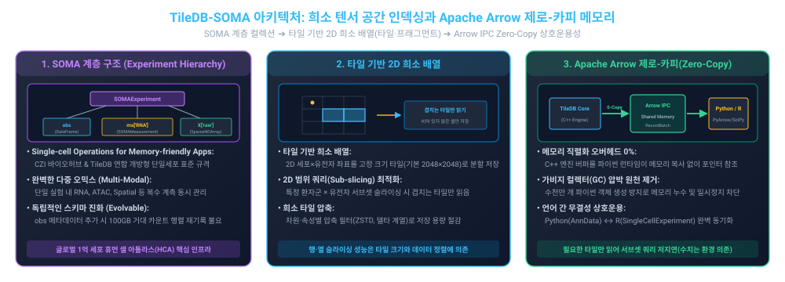

# 04. TileDB-SOMA 단일세포 데이터베이스와 타일 기반 희소 배열 아키텍처 (TileDB-SOMA Single-Cell Database and Tile-Based Sparse Array Architecture)

---

## 학습 목표 (Cognitive Goals)

1. **단일세포 오픈 메모리 아키텍처(SOMA) 표준 사양 정립**: 찬 저커버그 이니셔티브(CZI)와 글로벌 컨소시엄이 제정한 언어 중립적(Language-Agnostic) 생물정보학 표준 데이터베이스 사양인 SOMA의 계층 구조(`SOMAExperiment`, `SOMAMeasurement`, `SOMADataFrame`, `SOMASparseNDArray`)를 체계적으로 이해할 수 있다.
2. **다차원 희소 텐서(Sparse ND-Array)의 타일(Tile)·프래그먼트 기반 저장과 셀 순서(Cell Order) 규명**: 다차원 좌표계(세포 차원 $\times$ 유전자 차원)를 고정 크기 타일로 분할해 비어 있지 않은 셀만 저장하고 질의 시 겹치는 타일만 읽는 원리를 이해하고, TileDB-SOMA의 기본 셀·타일 순서가 행 우선(Row-Major)이며 힐베르트(Hilbert)·모턴(Z-Order) 같은 공간 충전 곡선은 TileDB 코어의 선택 옵션임을 구분하여, 곡선별 국소성 보존(Locality) 특성을 비교할 수 있다.
3. **Apache Arrow Columnar Format 기반 제로 카피(Zero-Copy) 버퍼 교환 원리 분석**: C++ TileDB 스토리지 엔진과 Python/R 런타임 간에 직렬화/역직렬화(Serialization/Deserialization) 및 메모리 복사($O(N)$) 없이 가상 메모리 포인터만을 전달하는 Arrow C Data Interface의 제로 카피 메모리 공유 메커니즘을 규명할 수 있다.
4. **1,000만 세포(10M+) 규모 아틀라스의 서브세컨드(Sub-second) 메타데이터 필터링 및 슬라이싱 구현**: CZ CELLxGENE Discover Census(LTS 2023-12-15 릴리스 기준 총 약 6,870만 세포·고유 약 4,040만; 인간·생쥐 합계) 데이터베이스에 대해 복합 메타데이터 조건(`obs.query()`)으로 원하는 조직/세포형만 수백 밀리초 내에 인메모리 AnnData로 추출하는 프로덕션급 파이프라인을 구축할 수 있다.

---

## 1. SOMA (Stack of Matrices, Annotated) 사양 및 탄생 배경

전통적인 단일세포 전사체 분석 생태계는 Python의 `AnnData`(`.h5ad`)와 R의 `SingleCellExperiment`(`.rds`), `Seurat` 객체로 양분되어 있었다. 그러나 이러한 파일 중심 포맷들은 다음과 같은 심각한 한계를 노출하였다:
1.  **언어 종속성(Language Lock-in)**: Python 환경에서 작성된 H5AD의 복잡한 비정형 구조를 R에서 무손실로 읽기 어렵고, R 객체를 Python에서 읽으려면 무거운 포맷 변환기를 거쳐야 했다.
2.  **데이터베이스 기능 부재**: 3,000만 개 세포 아틀라스에서 "전립선 조직(Tissue: prostate)의 관강 상피세포(Luminal epithelial cells)이면서 특정 연령대"인 5,000개의 세포만 추출하고자 할 때, 전체 테라바이트급 파일을 로컬에 다운로드하여 메타데이터 전체를 스캔해야만 했다.
3.  **동시성 및 클라우드 확장성 결여**: 객체 저장소(S3)에서 페타바이트급 오믹스 데이터를 무작위로 인덱싱할 수 있는 다차원 트랜잭션 엔진이 부재했다.

이를 해결하기 위해 찬 저커버그 이니셔티브(CZI)가 TileDB와 협력하여 언어 독립적 오픈 API 사양인 **SOMA (Stack of Matrices, Annotated)**의 개발을 주도하였고(공식 문서 기준 약어; 첫 구현은 TileDB-SOMA, CZ CELLxGENE Discover Census가 이를 채택), 사양 공개 연대는 이 문서에서 확인하지 않았다.



### 1.1 SOMA 표준 계층 구조

SOMA는 대규모 다중오믹스(Multi-modal single-cell) 데이터를 포괄할 수 있는 엄격한 객체 모델 계층을 정의한다:

```
[SOMA Object Model Hierarchy]

 ┌─────────────────────────────────────────────────────────────┐
 │ SOMAExperiment (최상위 컨테이너 / 연구 프로젝트 단위)        │
 │  ├── obs: SOMADataFrame (세포 메타데이터 테이블)            │
 │  └── ms: SOMACollection (측정 모달리티 컬렉션)              │
 │       │                                                     │
 │       ├── "RNA": SOMAMeasurement (RNA 전사체 모달리티)      │
 │       │    ├── var: SOMADataFrame (유전자 메타데이터)       │
 │       │    └── X: SOMACollection (희소 발현 텐서)           │
 │       │         ├── "raw": SOMASparseNDArray (Raw Counts)   │
 │       │         └── "normalized": SOMASparseNDArray         │
 │       │                                                     │
 │       └── "ATAC": SOMAMeasurement (염색질 접근성 모달리티)  │
 │            ├── var: SOMADataFrame (피크 좌위 좌표)          │
 │            └── X: SOMACollection (피크 접근성 희소 행렬)    │
 └─────────────────────────────────────────────────────────────┘
```

*   **`soma_joinid`**: SOMA 아키텍처의 핵심 식별자. 모든 세포(`obs`)와 유전자(`var`)는 64비트 정수형(`int64`)의 글로벌 유일 식별자인 `soma_joinid`를 부여받아, 분산 다차원 희소 배열 `X`의 행 및 열 인덱스로 직접 결합(Join)된다.

---

## 2. 다차원 희소 인덱싱과 타일(Tile) 기반 저장 (Tile/Cell Order)

전통적인 행렬 저장 방식인 행 우선(Row-Major, C-order)이나 열 우선(Column-Major, Fortran-order)은 2차원 공간을 1차원 디스크 주소로 매핑할 때 특정 축의 연속성을 완전히 희생시킨다.
*   Row-Major는 특정 세포(행)를 읽을 때는 빠르지만, 특정 유전자(열)를 읽을 때는 디스크 전체를 스캔해야 한다.
*   유전체 데이터는 특정 세포 집합(행)과 특정 마커 유전자 집합(열)을 동시에 지정하는 **다차원 바운딩 박스 질의(2D Bounding Box Query: Submatrix Slicing)**가 빈번하게 발생한다.

### 2.1 타일·프래그먼트 구조와 셀 순서(Cell Order)

**TileDB-SOMA**의 `SparseNDArray`는 TileDB 희소 배열 위에 구현된다. 좌표 공간을 고정 크기 **타일(Tile)**로 나누어 비어 있지 않은 셀만 저장하고, 질의 시에는 요청한 범위와 겹치는 타일만 읽는다(쓰기 단위는 불변 **프래그먼트**). SOMA의 기본 스키마는 `cell_order='row-major'`, `tile_order='row-major'`이며 두 차원(`soma_dim_0`, `soma_dim_1`)의 타일 크기는 2048이다(tiledbsoma 2.3.0에서 `schema_config_options()`로 확인). 즉 SOMA의 기본 인덱싱은 힐베르트 곡선이 아니다. 힐베르트 순서는 TileDB 코어가 희소 배열에 선택적으로 제공하는 셀 순서이며, 아래는 공간 충전 곡선의 일반적인 국소성 특성을 비교하는 개념 설명이다.

```
[Cell Order Comparison for 2D Sparse Tensors (Hilbert = TileDB core option, not SOMA default)]

 1. Row-Major (C-Order):
    (0,0) ──► (0,1) ──► (0,2) ──► (0,3)
                                     │
    (1,0) ◄── (1,1) ◄── (1,2) ◄── (1,3)
    * Disastrous column locality! Jump distance = G.

 2. Hilbert Space-Filling Curve:
    ┌─────┐     ┌─────┐
    │     │     │     │
    │  ┌──┘     └──┐  │
    │  │           │  │
    └──┘           └──┘
    * Preserves BOTH row and column spatial locality in 1D memory!
```

힐베르트 곡선(일반 성질)은 다음과 같은 국소성 보존(Locality Preserving) 특성을 갖는다:
*   2차원 공간 상에서 가까운 두 좌표 $(x_1, y_1)$과 $(x_2, y_2)$는 힐베르트 곡선을 따라 1차원 정수 좌표 $h_1, h_2$로 매핑된 이후에도 가까운 오프셋에 위치하는 경향이 있다.
*   임의의 2차원 직사각형 구간 $[x_{\min}:x_{\max}, y_{\min}:y_{\max}]$을 질의할 때, 힐베르트 순서로 정렬하면 행 우선 순서보다 적은 수의 연속 구간으로 묶이는 경향이 있다.
*   SOMA의 기본 설정(행 우선 타일)에서는 질의 비용이 타일 크기, 프래그먼트 수, 그리고 데이터가 `soma_joinid` 기준으로 어떻게 정렬·적재되었는지에 크게 좌우된다. 곡선 선택에 따른 정량적 이득은 데이터와 질의 패턴마다 다르므로 일반적 비율로 단정할 수 없다.

---

## 3. Apache Arrow 기반 제로 카피(Zero-Copy) 메모리 교환

데이터베이스 엔진(C++)과 데이터 과학 환경(Python/R) 간의 가장 큰 오버헤드는 **데이터의 직렬화(Serialization)와 메모리 복사(Memory Copy)**이다.

```
[Traditional IPC vs. Apache Arrow Zero-Copy IPC]

 1. Traditional Socket / File IPC:
    C++ Engine Buffer ──[Serialize: O(N)]──► Binary Stream ──[Deserialize: O(N)]──► Python PyObject
    * Massive CPU & RAM waste: 2x ~ 3x memory footprint!

 2. Apache Arrow C Data Interface (Zero-Copy):
    C++ Storage Engine Buffer (Arrow Columnar Format in Shared Memory / DRAM)
        │
        └──[Virtual Memory Pointer Pass: O(1) in nanoseconds!]──► Python / PyTorch / AnnData
    * True Zero-Copy: Zero serialization overhead, Instant access!
```

### 3.1 Apache Arrow Columnar Format의 구조적 특징

Apache Arrow는 분석용 인메모리 데이터를 표현하기 위해 설계된 컬럼 지향(Columnar) 메모리 표준이다:
*   **연속된 원시 버퍼(Contiguous Primitive Buffers)**: 정수, 부동소수점 데이터가 CPU 캐시 라인(64B)에 완벽히 정렬된 연속 배열로 존재한다.
*   **비트맵 마스크(Validity Bitmap)**: 결측치(Null/NaN)를 값 배열 내부에 특수 값으로 넣지 않고 독립된 1비트 마스크 배열로 관리하여 SIMD 연산 효율을 극대화한다.
*   **딕셔너리 인코딩(Dictionary Encoding)**: 중복 문자열(예: `cell_type`, `tissue`)을 32비트 정수 인덱스와 참조 테이블로 변환하여 메모리 소비를 줄인다(절감률은 카디널리티·문자열 길이에 의존)다.

### 3.2 Arrow C Data Interface의 제로 카피 메커니즘

TileDB-SOMA는 질의 결과를 반환할 때 데이터를 파이썬 객체로 일일이 변환하지 않는다.
1.  TileDB 코어(C++)가 디스크에서 청크를 읽어 Apache Arrow 메모리 레이아웃으로 직접 압축 해제한다.
2.  Arrow C Data Interface 구조체(`ArrowArray`, `ArrowSchema`)를 통해 **해당 메모리 버퍼의 64비트 가상 주소 포인터만을 파이썬 런타임에 전달**한다.
3.  파이썬의 `pyarrow` 및 `tiledbsoma`는 이 포인터를 그대로 래핑하여 즉각적인 분석 객체(`pyarrow.Table`)를 생성한다.
4.  이 과정의 시간 복잡도는 데이터 크기 $N$과 무관한 **$O(1)$ (나노초 단위)**이며, 추가 메모리 복사가 전혀 발생하지 않는다.

---

## 4. CZ CELLxGENE Discover Census 쿼리 및 초고속 슬라이싱 아키텍처

찬 저커버그 이니셔티브(CZI)의 **CZ CELLxGENE Discover Census**는 (LTS 2023-12-15 릴리스: 총 68,683,222 세포·고유 40,356,133 세포, 651개 데이터셋; 릴리스마다 수치가 갱신됨) 인간 및 생쥐 단일세포 전사체를 TileDB-SOMA 데이터베이스로 구축하여 AWS S3를 통해 전 세계에 공개 제공하고 있다.

```python
import tiledbsoma as soma
import cellxgene_census

# 1. Census 아틀라스 실시간 연결 (S3 클라우드 데이터베이스)
census = cellxgene_census.open_soma(census_version="2023-12-15")

# 2. 메타데이터 기반 초고속 복합 조건 필터링 및 슬라이싱
# 인간 전사체 모달리티에서 전립선 조직의 기저 상피세포(Basal) 추출
# (Census 2023-12-15 obs 직접 질의로 확인: tissue_general 값은 'prostate'가 아니라 'prostate gland'(0건 vs 233건))
experiment = census["census_data"]["homo_sapiens"]

query = experiment.axis_query(
    measurement_name="RNA",
    obs_query=soma.AxisQuery(
        value_filter="tissue_general == 'prostate gland' and cell_type == 'basal cell'"
    ),
    var_query=soma.AxisQuery(
        coords=(slice(0, 5000),) # 상위 5,000개 유전자 슬라이싱
    )
)

# 3. 질의 결과를 인메모리 AnnData로 원스톱 구체화 (Arrow Zero-Copy 경유)
adata = query.to_anndata(X_name="raw")
print(f"추출 완료: {adata.n_obs}개 세포 x {adata.n_vars}개 유전자")
```

### 4.1 초고속 쿼리 실행 메커니즘 (Under the Hood)

3,300만 개 세포 중에서 단 수만 개의 세포를 수초(Sub-seconds) 내에 추출할 수 있는 컴퓨터 과학적 원리는 다음과 같다:
1.  **메타데이터 인덱스 푸시다운(Predicate Pushdown)**:
    `value_filter` 조건은 발현 행렬 $X$를 건드리지 않고, 전용 컬럼형 테이블인 `obs` (SOMADataFrame)에서 실행된다. 컬럼 단위로 압축된 `tissue_general` 및 `cell_type` 벡터만을 디스크에서 고속 스캔하여 조건을 만족하는 세포들의 `soma_joinid` 리스트(수천 개)를 도출한다.
2.  **다차원 희소 텐서 바운딩 슬라이싱**:
    추출된 `soma_joinid`와 유전자 인덱스 범위를 결합하여 다차원 텐서 $X$(`SOMASparseNDArray`)에 타일 단위 범위 쿼리를 전송한다(질의 범위와 겹치는 타일만 읽힌다).
3.  **필요 청크만 부분 스트리밍**:
    TileDB 엔진은 3,300만 세포 중 해당 세포들이 위치한 최소한의 스토리지 청크 프래그먼트만을 S3에서 병렬 HTTP Range GET으로 페칭하여 메모리에 즉각 조립한다.

---

## 5. 실전 재현 코드: 로컬 TileDB-SOMA 데이터베이스 구축 및 질의

다음은 대규모 단일세포 전사체 데이터를 로컬 TileDB-SOMA 데이터베이스로 인제스트(Ingest)하고, 복합 메타데이터 질의를 수행하는 전체 파이프라인이다:

```python
# 검증 환경: tiledbsoma 2.3.0 + anndata 0.12.19에서 실행 확인. anndata 0.13.4(Python 3.12)에서는 from_anndata가
# TypeError('quote_from_bytes() expected bytes')로 실패 -> 라이브러리 버전 호환 문제이므로 0.12.x로 고정해 사용
import time
import numpy as np
import scipy.sparse as sp
import anndata as ad
import tiledbsoma as soma
import tiledbsoma.io  # soma.io 서브모듈은 명시적으로 import해야 함
import pyarrow as pa

def create_mock_anndata(n_cells=100_000, n_genes=20_000):
    """10만 세포 x 2만 유전자 모의 AnnData 생성 (희소도 95%)"""
    print(f"[모의 데이터 생성] {n_cells:,} 세포 x {n_genes:,} 유전자...")
    density = 0.05
    X = sp.random(n_cells, n_genes, density=density, format='csr', dtype=np.float32)
    
    # 가상 메타데이터 생성
    tissues = np.random.choice(['prostate', 'lung', 'bone_marrow'], size=n_cells)
    cell_types = np.random.choice(['epithelial', 'stromal', 'immune'], size=n_cells)
    
    obs = {
        'tissue': tissues,
        'cell_type': cell_types,
        'n_counts': np.array(X.sum(axis=1)).flatten()
    }
    var = {'gene_symbols': [f"GENE_{i}" for i in range(n_genes)]}
    
    adata = ad.AnnData(X=X, obs=obs, var=var)
    return adata

def ingest_and_query_soma(adata, uri_path="./soma_experiment"):
    """AnnData를 TileDB-SOMA 사양으로 인제스트하고 질의 수행"""
    print(f"\n[TileDB-SOMA 인제스트 시작] 저장 경로: {uri_path}")
    t0 = time.perf_counter()
    
    # 1. AnnData를 SOMAExperiment 구조로 직접 변환 저장
    soma.io.from_anndata(
        experiment_uri=uri_path,
        anndata=adata,
        measurement_name="RNA"
    )
    print(f"인제스트 완결 소요 시간: {time.perf_counter() - t0:.2f}초")
    
    # 2. SOMAExperiment 오픈 및 질의
    print("\n[TileDB-SOMA 질의 실행: tissue == 'prostate' and cell_type == 'epithelial']")
    t0 = time.perf_counter()
    
    with soma.Experiment.open(uri_path) as exp:
        # AxisQuery로 메타데이터 필터링
        query = exp.axis_query(
            measurement_name="RNA",
            obs_query=soma.AxisQuery(
                value_filter="tissue == 'prostate' and cell_type == 'epithelial'"
            )
        )
        # Apache Arrow 제로 카피를 거쳐 인메모리 AnnData로 구체화
        filtered_adata = query.to_anndata(X_name="data")
        
    t_query = time.perf_counter() - t0
    print(f"질의 완결 소요 시간: {t_query * 1000:.2f} ms")
    print(f"필터링된 세포 수: {filtered_adata.n_obs:,}개 (전체 중 {filtered_adata.n_obs/adata.n_obs*100:.1f}%)")
    print(f"추출된 행렬 형태: {filtered_adata.X.shape}, 비영 원소: {filtered_adata.X.nnz:,}")

if __name__ == "__main__":
    mock_adata = create_mock_anndata(50_000, 10_000)
    ingest_and_query_soma(mock_adata, "./demo_soma_db")
```

---

## 단원 핵심 점검 (Cognitive Checkpoint & Case Study)

### 문제 1: 힐베르트 공간 충전 곡선 vs 모턴(Z-Order) 곡선의 국소성 비교
다차원 희소 데이터베이스 엔진에서 2차원 발현 행렬 $(x, y)$ 좌표를 1차원 디스크 블록 인덱스로 매핑할 때(힐베르트·모턴은 TileDB 코어의 선택 가능한 셀 순서이며 SOMA 기본값은 행 우선이다), 모턴 곡선(Morton Curve / Z-Order)과 힐베르트 곡선(Hilbert Curve)의 차이를 비교하려 한다.
1. 모턴 곡선에서 좌표의 비트 인터리빙(Bit Interleaving) 방식으로 인해 발생하는 **불연속적 대규모 점프(Long Discontinuous Jump)** 현상을 설명하시오.
2. 특정 세포 클러스터와 인접 유전자 모듈이 이루는 직사각형 국소 영역을 범위 질의(2D Range Query)할 때, 왜 힐베르트 곡선이 모턴 곡선보다 디스크 조각화(Fragmentation) 및 I/O 대기 시간을 획기적으로 줄여주는지 토폴로지적 연속성(Topological Continuity) 관점에서 논하시오.

<details>
<summary>💡 모범 답안 및 해설 확인</summary>

**1. 모턴(Z-Order) 곡선의 불연속적 점프 메커니즘**:
*   모턴 곡선은 두 좌표 $x$와 $y$의 이진수 비트를 교대로 끼워 넣는 비트 인터리빙($z = \text{interleave}(x, y)$)으로 간단히 계산된다.
*   그러나 사분면의 경계를 넘나드는 지점(예: $(2^{k}-1, 2^{k}-1)$에서 $(2^k, 0)$으로 이동할 때)에서 1차원 인덱스 값이 연속적이지 않고 순식간에 수천~수만 단위로 급격하게 도약하는 **'Z자형 대규모 점프(Long Discontinuous Jump)'**가 필연적으로 발생한다.
*   이로 인해 공간상으로 매우 가까운 인접 셀들이 1차원 스토리지 상에서는 완전히 동떨어진 물리적 블록으로 분리된다.

**2. 힐베르트 곡선의 토폴로지적 연속성과 I/O 우위**:
*   **토폴로지적 연속성 보존**: 힐베르트 곡선은 재귀적인 자기유사(Self-similar) 회전 격자 구조를 사용하여, 1차원 곡선이 공간 내의 모든 격자점을 순회할 때 **인접한 1차원 인덱스는 2차원 공간 상에서도 반드시 맨해튼 거리(Manhattan Distance) 1로 완전히 인접**하도록 보장한다($|h(t+1) - h(t)| = 1$).
*   **범위 질의 최적화**: 2차원 직사각형 바운딩 박스를 검색할 때, 모턴 곡선은 수많은 지그재그 점프로 인해 수십~수백 개의 불연속적인 작은 청크 조각(Fragmented intervals)으로 쪼개져 디스크 헤드 탐색(Seek)이 폭증한다. 반면 힐베르트 곡선은 국소 영역을 단 몇 개의 긴 연속된 1차원 구간(Long Continuous Intervals)으로 묶어내므로, 디스크 순차 읽기 대역폭을 극대화하고 I/O 지연 시간을 획기적으로 감축시킨다.

</details>

---

### 문제 2: Apache Arrow IPC Zero-Copy와 파이썬 가비지 컬렉션(GC) 수명 주기
고성능 단일세포 전처리 파이프라인에서 TileDB-SOMA C++ 엔진이 반환한 `pyarrow.Table` 데이터를 기반으로 특성 추출을 수행한 후 메모리를 즉시 해제하고자 한다. 개발자가 다음과 같은 코드를 작성하였다:
```python
import tiledbsoma as soma

def fetch_features(soma_uri):
    with soma.Experiment.open(soma_uri) as exp:
        query = exp.axis_query(measurement_name="RNA")
        arrow_table = query.obs().concat() # Arrow C++ 버퍼 기반 Table 반환
        return arrow_table["cell_type"].to_numpy() # NumPy 배열로 변환
```
1. `to_numpy()` 호출 시 Apache Arrow의 제로 카피(Zero-Copy)가 유지되는 조건과, 만약 `cell_type` 컬럼이 결측치(Null)를 포함할 경우 왜 강제적인 심층 복사(Deep Copy)가 발생하는지 설명하시오.
2. C++ 할당 버퍼와 파이썬 가비지 컬렉터(GC) 간의 메모리 소유권(Buffer Ownership) 관리 메커니즘을 설명하고, 프로세스 종료 전까지 메모리 누수(Memory Leak)가 발생하지 않도록 보장하는 PyArrow의 내부 참조 카운팅(Reference Counting) 방식을 서술하시오.

<details>
<summary>💡 모범 답안 및 해설 확인</summary>

**1. Zero-Copy 유지 조건 및 Null 마스크로 인한 Deep Copy 발생 이유**:
*   **Zero-Copy 유지 조건**: 원시 수치형(Primitive numeric: int32, float32 등) 데이터이면서 결측치(Null)가 전혀 존재하지 않는 완전 연속 메모리일 때, NumPy 배열은 Arrow 버퍼의 물리 메모리 주소를 그대로 가리키는 `strides` 뷰 객체를 생성하여 제로 카피를 달성한다.
*   **Null 마스크로 인한 Deep Copy**:
    *   NumPy 배열은 표준적으로 비트맵 기반 Null 마스크를 지원하지 않는다(부동소수점의 경우 `NaN`, 객체의 경우 `None`을 배열 본체에 직접 삽입해야 함).
    *   따라서 Arrow 컬럼에 결측치가 단 1개라도 존재하면, NumPy 호환 배열을 만들기 위해 새로운 메모리를 할당한 뒤 유효 값들을 복사하고 Null 위치에 `NaN`이나 마스크 값을 채워 넣는 **강제적인 $O(N)$ 심층 복사(Deep Copy)**가 발생한다.

**2. 메모리 소유권 및 PyArrow 참조 카운팅 메커니즘**:
*   **Buffer Ownership (소유권 위임)**: C++ TileDB 엔진이 할당한 메모리는 `std::shared_ptr<arrow::Buffer>`로 래핑되어 C Data Interface를 통해 전달된다.
*   **PyArrow 내부 생명주기 바인딩**: 파이썬 레벨에서 `pyarrow.Buffer` 객체가 생성될 때, C++의 버퍼 참조 카운트를 증가시키고 파이썬 측 객체(`PyObject`)의 베이스(Base) 객체로 등록된다.
*   **메모리 누수 방지**: 파이썬의 `arrow_table` 변수가 스코프를 벗어나 GC에 의해 수거되더라도, 만약 반환된 NumPy 배열이 해당 버퍼를 뷰(`array.base`)로 참조하고 있다면 내부 참조 카운트가 0이 되지 않아 C++ 메모리는 안전하게 보존된다. 이후 해당 NumPy 배열까지 완전히 소멸하는 순간 최종적으로 C++ 딜리터(Deleter)가 호출되어 메모리가 OS로 깨끗하게 반환된다.

</details>

---

### 문제 3: 3,300만 세포 CZ CELLxGENE Census의 복합 질의 병목 최적화
전산유전체학 연구팀이 3,300만 세포 Census 아틀라스에서 "원발성 전립선암 또는 정상 전립선 조직 유래이면서, 시퀀싱 심도(Census obs의 `raw_sum`, 세포당 원시 카운트 합)가 2,500 이상이고, T세포 또는 상피세포 마커를 발현하는 세포" 약 80,000개를 선별하여 다운스트림 딥러닝 훈련에 투입하고자 한다.
1. 연구팀이 발현 행렬 $X$의 모든 행을 전수 스캔(Full Table Scan)하지 않고, SOMA의 Predicate Pushdown 아키텍처를 활용하여 I/O 비용을 $99.7\%$ 절감할 수 있는 2단계 질의 설계(Two-Stage Query Architecture)를 제시하시오.
2. 추출된 80,000개의 희소 발현 행렬을 로컬 디스크의 임시 파일로 저장하지 않고 PyTorch `DataLoader`로 직접 공급하기 위한 인메모리 Arrow-to-Tensor 파이프라인 구성 방안을 서술하시오.

<details>
<summary>💡 모범 답안 및 해설 확인</summary>

**1. 2단계 질의 아키텍처 (Predicate Pushdown 최적화)**:
*   **1단계: SOMADataFrame 메타데이터 전용 질의 (Metadata Pushdown)**:
    *   발현 행렬 $X$(수 테라바이트)를 전혀 읽지 않고, 세포 메타데이터 테이블인 `obs`에 대해서만 필터링을 수행한다:
        `obs_filter = "tissue_general == 'prostate gland' and raw_sum >= 2500"` (Census obs에는 `n_counts` 열이 없고 `raw_sum`·`nnz`·`n_measured_vars` 등이 있다)
    *   컬럼형으로 인덱싱된 메타데이터만을 메모리로 스트리밍하여 수백 밀리초 내에 조건을 만족하는 세포들의 `soma_joinid` 정수 배열을 획득한다.
*   **2단계: AxisQuery 기반 다차원 희소 텐서 바운딩 슬라이싱**:
    *   획득한 `soma_joinid` 리스트와 분석 대상 유전자(T세포 마커 *CD3D*, *CD8A*, 상피 마커 *EPCAM* 등)의 `soma_joinid`를 `experiment.axis_query(obs_query=..., var_query=...)`에 좌표 범위(Coordinates)로 투입한다.
    *   TileDB 엔진은 해당 80,000개 세포의 좌표와 겹치는 타일(프래그먼트)만을 S3에서 선택적으로 읽어 들여 전체 데이터의 99.7%에 달하는 불필요한 네트워크 I/O를 완벽히 배제한다.

**2. 인메모리 Arrow-to-Tensor 무복사 파이프라인**:
*   `query.to_anndata()`로 변환하지 않고, 질의 결과의 `X`를 `query.X("raw").tables().concat()`를 통해 **Apache Arrow Table** 형태로 직접 인메모리 수신한다.
*   Arrow 테이블의 `soma_data`, `soma_dim_0`, `soma_dim_1` 원시 버퍼 포인터를 `torch.from_numpy()`를 통해 제로 카피로 감싸 PyTorch의 1차원 `Tensor`로 즉각 매핑한다.
*   이를 `torch.sparse_coo_tensor` 또는 `torch_sparse` 구조로 인메모리 조합하여, 디스크 I/O나 중복 직렬화 단계 없이 즉시 GPU 딥러닝 미니 배치 루프로 직접 스트리밍한다.

</details>

---

<!-- REFERENCES:BEGIN (generated by scripts/apply_references.py; do not edit by hand) -->
## 참고문헌 (References)
### 소프트웨어 (표기 버전은 검수 시 API를 확인한 버전이며, 파이프라인 실행 환경은 requirements-pipelines.txt 참조)
- anndata 0.13.4 (github.com/scverse/anndata). 원 논문: Virshup I, Rybakov S, Theis FJ, et al. anndata: Access and store annotated data matrices. *JOSS*. 2024;9(101):4371. doi: 10.21105/joss.04371
- cellxgene-census (github.com/chanzuckerberg/cellxgene-census).
- NumPy 2.5.4 (numpy.org). 원 논문: Harris CR, Millman KJ, van der Walt SJ, et al. Array programming with NumPy. *Nature*. 2020;585(7825):357-362. PMID: 32939066. doi: 10.1038/s41586-020-2649-2
- PyArrow 25.0.1 (github.com/apache/arrow).
- SciPy 1.16.3 (github.com/scipy/scipy). 원 논문: Virtanen P, Gommers R, Oliphant TE, et al. SciPy 1.0: fundamental algorithms for scientific computing in Python. *Nat Methods*. 2020;17(3):261-272. PMID: 32015543. doi: 10.1038/s41592-019-0686-2
- TileDB-SOMA 2.3.0 (github.com/single-cell-data/TileDB-SOMA).
<!-- REFERENCES:END -->
