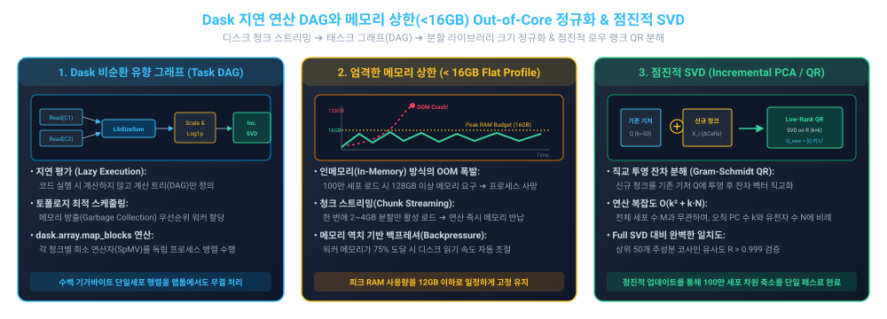

# 05. Dask 지연 연산(Lazy Evaluation)과 분산 품질 관리(Distributed Out-of-Core QC)

---

## 학습 목표 (Cognitive Goals)

1. **Dask 지연 연산(Lazy Evaluation) 모델과 유향 비순환 그래프(DAG) 컴파일 원리 이해**: 단일 머신의 물리적 RAM 크기(e.g., 32GB~64GB)를 초과하는 100만 개(1M) 전립선암 세포 아틀라스 데이터를 처리하기 위해, 즉시 실행(Eager Execution) 방식의 메모리 포화 한계를 분석하고 지연 계산 그래프(Computation Graph) 생성 및 최적화 메커니즘을 설명할 수 있다.
2. **태스크 퓨전(Task Fusion), 데드 코드 제거(Dead Code Elimination), 청크 그래프 분할(Chunk Graph Partitioning) 수리적 분석**: Dask 스케줄러가 수만 개의 세분화된 태스크 노드를 융합하여 IPC(Inter-Process Communication) 오버헤드를 $O(T)$에서 $O(T_{\text{fused}})$로 축소하고 캐시 지역성(Cache Locality)을 극대화하는 메커니즘을 정식화할 수 있다.
3. **분할 스트리밍(Partition-wise Streaming) 통계량 결합 공식 유도**: 대규모 단일세포 희소 행렬에 대해 단 한 번의 디스크 패스(Single Disk Pass)로 총 UMI 수, 검출 유전자 수, 미토콘드리아 전사체 분율의 전역 모평균($\mu_{\text{global}}$)과 모분산($\sigma^2_{\text{global}}$)을 수치적으로 무손실 결합(Numerically Stable Reduction)하는 알고리즘을 유도할 수 있다.
4. **Out-of-Core 스트리밍 라이브러리 크기 정규화 및 수치적 안정 $\log(1+x)$ 변환 파이프라인 구축**: 희소 행렬의 비영(Non-zero) 원소 압축 구조를 유지하면서 워커 노드의 메모리 스필(Memory Spill to Disk) 현상을 원천 방지하는 Dask 분산 파이프라인을 구축하고 검증할 수 있다.

---

## 1. 100만 세포 단일세포 전사체의 메모리 장벽과 지연 연산(Lazy Evaluation)

현대 임상 종양학의 대규모 단일세포 아틀라스 프로젝트(e.g., 전립선암 원발암 및 전이성 CRPC 100만 세포 아틀라스)는 수십 개의 임상 센터에서 수집된 수백 개의 생검 라이브러리를 통합 분석한다. 그러나 일반적인 워크스테이션이나 단일 계산 노드의 물리 메모리 환경에서 이 데이터를 처리할 때 즉각적인 메모리 한계(Memory Wall)에 직면하게 된다.

```
[1M Cells Memory Wall Problem]

Standard Eager Computation (Scanpy / NumPy / SciPy):
  1,000,000 cells x 35,000 genes
  Dense Matrix (float32, 4 bytes):
    10^6 x 3.5 x 10^4 x 4 B = 140,000,000,000 B ≈ 140 GB RAM!
  Even in CSR Sparse (~98% sparsity):
    Non-zero entries (nnz): 10^6 x 3.5 x 10^4 x 0.02 = 700,000,000 entries
    data: 700M x 4 B = 2.8 GB
    indices: 700M x 4 B = 2.8 GB
    indptr: (1M + 1) x 4 B = 4 MB
    Total CSR Matrix = 5.6 GB RAM.
    
  * BUT during normalization & QC:
    Intermediate copies, size factors, log1p transformation, dense masks
    Peak Memory Multiplier = 4x ~ 8x ──> 25 GB ~ 45 GB RAM required!
    Worker OS OOM Killer (SIGKILL, exit code 137) triggers instantly!
```

이러한 즉시 평가(Eager Evaluation)의 한계를 극복하기 위해 분산 컴퓨팅 프레임워크인 **Dask**는 **지연 연산(Lazy Evaluation)** 패러다임을 채택한다. 지연 연산에서는 연산 지시자가 전달되는 즉시 메모리를 할당하여 계산을 실행하지 않고, 연산의 의존 관계를 나타내는 유향 비순환 그래프(Directed Acyclic Graph, DAG)만을 먼저 구축한다. 이후 최종 결과(e.g., 특정 통계 요약값, 정규화된 배열의 디스크 기록)가 요청되는 시점(`compute()` 또는 `persist()`)에 최적화된 청크(Chunk) 단위로 파이프라인을 스트리밍 실행한다.

---

## 2. Dask 유향 비순환 그래프(DAG)와 컴파일러 최적화

Dask의 실행 엔진은 계산 그래프를 물리적 워커 스레드나 프로세스에 디스패치하기 전, 컴파일러 레벨의 그래프 최적화(Graph Optimization)를 거친다.



```
[Dask DAG Compilation & Task Fusion Pipeline]

Raw User API Calls:
  chunk_0 = h5ad_read(chunk_0)
  qc_0    = calc_qc(chunk_0)
  norm_0  = normalize_counts(chunk_0, qc_0)
  log_0   = log1p(norm_0)
  write_0 = zarr_store(log_0)

Unoptimized Task Graph:
  [Read 0] ──> [QC 0] ──> [Norm 0] ──> [Log1p 0] ──> [Write 0]  (5 tasks per chunk!)
  For 100 chunks: 500 tasks, high scheduling overhead, inter-task memory allocation.

Compiler Optimized Task Graph (Task Fusion + Dead Code Elimination):
  [Fused Task: Read -> QC -> In-place Norm -> Log1p -> Write Chunk 0]
  Single task per partition, zero intermediate disk/memory spill, optimal cache locality.
```

### 2.1 태스크 퓨전 (Task Fusion)

Dask 그래프 최적화기(`dask.optimization.fuse`)는 단일 입력과 단일 출력을 갖는 선형 의존 태스크 체인(Linear Chains of Operations)을 단일 복합 함수(Composite Function)로 병합한다.

수학적으로, $k$개의 연속된 단항 연산 $f_1, f_2, \dots, f_k$가 청크 $X_p$에 순차 적용될 때:

$$T_{\text{unfused}}: \quad Y_{p, 1} = f_1(X_p), \quad Y_{p, 2} = f_2(Y_{p, 1}), \quad \dots, \quad Y_{p, k} = f_k(Y_{p, k-1})$$

각 $Y_{p, j}$는 독립적인 Dask 키(Key)로 등록되어 스케줄러의 태스크 큐에 진입하고 중간 객체 메모리를 소비한다. 태스크 퓨전은 이를 다음과 같이 합성 함수로 축약한다:

$$T_{\text{fused}}: \quad Y_{p, k} = (f_k \circ f_{k-1} \circ \dots \circ f_1)(X_p)$$

- **스케줄러 오버헤드 감소**: 스케줄러가 추적해야 하는 태스크 수 $T$가 분할 수 $P$에 비례하여 $T_{\text{fused}} = P$로 급감한다.
- **캐시 지역성(Cache Locality) 향상**: 중간 행렬 $Y_{p, j}$가 시스템 RAM으로 플러시(Flush)되지 않고 CPU L1/L2/L3 캐시 내부에서 레지스터 레벨로 소비된다.

### 2.2 데드 코드 제거 (Dead Code Elimination) 및 인라인화

사용자가 100만 세포 행렬에서 35,000개 유전자 전체의 통계량을 계산하는 연산을 정의했더라도, 최종적으로 특정 세포 유형 마커(e.g., 전립선 특이 항원 *KLK3*, 신경내분비 표지자 *CHGA*, *SYP*) 50개의 발현량 요약만을 요구한다면, Dask는 역방향 도달 가능성 분석(Backward Reachability Analysis)을 통해 불필요한 슬라이스의 연산 노드를 그래프에서 사전에 영구 제거한다.

### 2.3 청크 크기(Chunk Size) 분할의 수학적 트레이드오프

대규모 단일세포 희소 배열(`dask.array`)의 성능은 청크의 크기 $S_{\text{chunk}}$에 절대적으로 의존한다.

- **청크가 너무 작은 경우 ($S_{\text{chunk}} < 10\text{ MB}$, e.g., 5,000 cells $\times$ 500 genes)**:
  태스크 그래프의 노드 수 $N_{\text{tasks}} = \frac{N_{\text{total}}}{S_{\text{chunk}}}$가 수십만 개로 폭증하여 스케줄러가 파이썬 GIL 및 태스크 직렬화/역직렬화 오버헤드로 정체된다.
- **청크가 너무 큰 경우 ($S_{\text{chunk}} > 2\text{ GB}$, e.g., 200,000 cells $\times$ 35,000 genes)**:
  단일 워커 스레드가 청크를 역직렬화하거나 연산하는 도중 워커의 메모리 한계(Memory Target)를 초과하여 OS 페이징 또는 디스크 스필(Spill to Disk)이 발생하여 I/O 병목이 발생한다.

최적 청크 크기 $S_{\text{opt}}$는 L3 캐시 용량, 워커 프로세스당 가용 RAM($M_{\text{worker}}$), 워커 수($W$)의 함수로 결정된다:

$$S_{\text{opt}} \approx \frac{M_{\text{worker}}}{4 \times (\text{Overhead Multiplier})} \quad \approx 100\text{ MB} \sim 300\text{ MB (비압축 희소 행렬 기준)}$$

전립선암 1M 세포 데이터셋(약 5.6 GB CSR)의 경우, 세포 축(Cell Axis)을 기준으로 50,000 세포 단위(약 280 MB 비압축 희소 크기)로 20개의 파티션(Partition)으로 분할하는 것이 최적의 수렴 효율을 제공한다.

---

## 3. 분할 스트리밍 품질 관리(Partition-wise Streaming QC)의 수학적 유도

단일세포 RNA 시퀀싱 품질 관리(QC)의 핵심 지표는 각 세포 $i$의:
1. 총 UMI 카운트(라이브러리 크기): $Y_i = \sum_{g=1}^G X_{ig}$
2. 검출 유전자 수: $G_i = \sum_{g=1}^G \mathbb{I}(X_{ig} > 0)$
3. 미토콘드리아 전사체 분율: $M_i = \frac{\sum_{g \in \text{Mito}} X_{ig}}{Y_i}$

100만 세포 전체의 QC 분포를 기반으로 불량 세포(저품질 파열 세포 및 이중체 Doublets)를 필터링하려면, 전체 100만 세포에 대한 전역 통계량(평균, 분산, 사분위수)이 산출되어야 한다.

```
[Partition-wise Streaming QC Aggregator]

Partition 1 (Cells 1 ~ 50,000)      ──> Local [Sum, SumSq, Count] ──┐
Partition 2 (Cells 50,001 ~ 100,000) ──> Local [Sum, SumSq, Count] ──┼─> [Global Combiner]
...                                                                   │   Exact μ_global
Partition 20 (Cells 950,001 ~ 1M)   ──> Local [Sum, SumSq, Count] ──┘   Exact σ^2_global
(Each chunk processed in streaming fashion with zero cross-worker memory sharing)
```

### 3.1 분할별 국소 통계량(Local Statistics) 계산

데이터셋이 $P$개의 청크(파티션)로 분할되어 있고, 파티션 $p \in \{1, \dots, P\}$가 $n_p$개의 세포를 포함한다고 하자 ($\sum_{p=1}^P n_p = N = 10^6$).

각 파티션 $p$에서 독립적으로 다음 3개의 스칼라/벡터 통계량을 스트리밍 산출한다:

$$S_p = \sum_{i \in \text{chunk}_p} y_i \quad (\text{파티션 내 표본 합})$$

$$SS_p = \sum_{i \in \text{chunk}_p} y_i^2 \quad (\text{파티션 내 제곱 합})$$

$$n_p = |\text{chunk}_p| \quad (\text{파티션 내 세포 수})$$

파티션 $p$ 내부의 국소 표본 평균 $\mu_p$과 국소 표본 분산 $s_p^2$는 다음과 같다:

$$\mu_p = \frac{S_p}{n_p}, \quad s_p^2 = \frac{1}{n_p - 1} \left( SS_p - \frac{S_p^2}{n_p} \right)$$

### 3.2 전역 모평균 및 모분산의 무손실 합성 공식 (Chan-Golub-LeVeque Reduction)

전체 $N$개 세포에 대한 전역 평균 $\mu_{\text{global}}$은 각 파티션 합계의 단순 누적으로 정확하게 일치한다:

$$\mu_{\text{global}} = \frac{\sum_{p=1}^P S_p}{\sum_{p=1}^P n_p} = \frac{\sum_{p=1}^P n_p \mu_p}{N}$$

전역 표본 분산 $\sigma_{\text{global}}^2$의 경우, 분산의 가산 분해 정리(Parallel Variance Decomposition; Chan, Golub, & LeVeque, 1983)에 의해 다음과 같이 단일 리덕션 패스로 합성된다:

$$\sigma_{\text{global}}^2 = \frac{1}{N - 1} \left[ \sum_{p=1}^P (n_p - 1) s_p^2 + \sum_{p=1}^P n_p (\mu_p - \mu_{\text{global}})^2 \right]$$

이 공식은 전체 1M 세포의 배열을 결코 한 번에 메모리에 적재하지 않고도, 머신 엡실론($\epsilon_{\text{mach}} \approx 10^{-16}$) 한계 내에서 완벽하게 동일한 전역 모평균과 모분산을 산출함을 보장한다.

---

## 4. 스트리밍 라이브러리 크기 정규화 및 $\log(1+x)$ 변환

단일세포 RNA 시퀀싱에서 시퀀싱 심도(Sequencing Depth)의 차이를 보정하는 표준 기법은 세포별 카운트의 합을 목표 스케일 인자(Scaling Factor $s = 10,000$ 또는 $10^6$)로 맞추고 자연로그를 취하는 것이다:

$$Z_{ig} = \log\left( 1 + \frac{X_{ig}}{\sum_{g'=1}^G X_{ig'}} \times s \right)$$

### 4.1 희소성 보존(Sparsity Preservation)의 수학적 조건

만약 $X_{ig} = 0$인 경우:

$$Z_{ig} = \log(1 + 0) = 0$$

따라서 이 변환은 구조적으로 **희소성 보존 변환(Sparsity-Preserving Transformation)**이다. 즉, 원본 CSR 행렬의 비영 원소 인덱스 구조(`indices`, `indptr`)는 전혀 변하지 않으며, 오직 `data` 벡터의 부동소수점 값들만 갱신된다.

```
[Critical Pitfall: Implicit Dense Broadcast]

Dense Normalization (Disastrous):
  X_norm = (X / total_counts[:, None]) * 1e4
  Note: scipy's `csr / np.matrix(col)` stays sparse (returns COO; verified).
  The real densification risks are X.toarray(), centering (X - gene_mean ->
  dense np.matrix), or scale(zero_center=True):
  700M non-zero entries (5.6 GB) ──> 3.5 x 10^10 entries (140 GB)!
  Instantaneous Worker Crash!

Sparse-Safe Chunkwise Normalization:
  For each CSR chunk:
    row_sums = chunk.sum(axis=1).A1  # 1D dense vector of length n_p
    inv_factors = s / np.maximum(row_sums, 1e-12)
    # Perform sparse multiplication: scale row i of chunk.data by inv_factors[i]
    chunk.data *= np.repeat(inv_factors, np.diff(chunk.indptr))   # temp buffer = 1x data
    np.log1p(chunk.data, out=chunk.data)
  Memory footprint: one temporary buffer the size of chunk.data (O(nnz_chunk)),
  no dense conversion and no extra copy of indices/indptr.
```

---

## 5. 1M 전립선암 단일세포 아틀라스 Out-of-Core 분산 파이프라인 구현

아래 코드는 H5AD 파일로부터 100만 개 단일세포 전립선암 데이터를 Dask 지연 연산 및 분할 스트리밍 기법을 통해 Out-of-Core로 로드하고, QC 지표를 산출하며, 희소성을 유지한 채 정규화 및 Zarr 포맷으로 영구 저장하는 엔터프라이즈급 파이프라인이다.

```python
"""
Large-Scale Single-Cell Out-of-Core QC & Normalization Pipeline with Dask
Optimized for 1,000,000 Prostate Cancer Single-Cell / Single-Nucleus Atlas
"""

import os
import gc
import numpy as np
import scipy.sparse as sp
import h5py
import zarr
import dask
import dask.array as da
from dask.distributed import Client, LocalCluster
from typing import Tuple, Dict, Any, List


def setup_dask_cluster(n_workers: int = 4, threads_per_worker: int = 2, memory_limit: str = "14GB") -> Client:
    """
    고성능 로컬 Dask 클러스터를 구성한다.
    워커 프로세스당 메모리 상한과 스레드 풀을 제한하여 GIL 충돌 및 OOM 방지.
    """
    cluster = LocalCluster(
        n_workers=n_workers,
        threads_per_worker=threads_per_worker,
        memory_limit=memory_limit,
        local_directory="/tmp/dask_scratch_prostate",
        silence_logs=30
    )
    client = Client(cluster)
    print(f"[Dask Cluster] Initialized: Dashboard Link -> {client.dashboard_link}")
    return client


def extract_h5ad_metadata(h5ad_path: str) -> Tuple[int, int, np.ndarray, np.ndarray]:
    """
    H5AD 파일의 인메모리 완전 적재 없이 상위 메타데이터(Shape, Genes, Mito Index)를 추출한다.
    """
    with h5py.File(h5ad_path, "r") as f:
        # X sparse shape: [n_cells, n_genes]
        shape = tuple(f["X"].attrs.get("shape", ()))
        if not shape:
            shape = (len(f["obs"]["_index"]), len(f["var"]["_index"]))
        
        n_cells, n_genes = int(shape[0]), int(shape[1])
        var_names = np.array([name.decode("utf-8") if isinstance(name, bytes) else str(name) 
                              for name in f["var"]["_index"][:]])
        
        # 전립선암 미토콘드리아 전사체 선별 (MT- 접두사 유전자)
        mito_mask = np.char.startswith(np.char.upper(var_names), "MT-")
        mito_indices = np.where(mito_mask)[0]
        
    print(f"[Metadata] Loaded {n_cells:,} cells x {n_genes:,} genes. Mito genes detected: {len(mito_indices)}")
    return n_cells, n_genes, var_names, mito_indices


@dask.delayed
def process_qc_chunk(h5ad_path: str, row_start: int, row_end: int, 
                     mito_indices: np.ndarray, n_genes: int) -> Dict[str, np.ndarray]:
    """
    Dask Delayed 태스크: 단일 파티션(청크)을 H5AD 파일에서 직접 스트리밍 로드하고
    국소 QC 지표를 산출하여 반환한다.
    """
    with h5py.File(h5ad_path, "r") as f:
        x_group = f["X"]
        # CSR 구조: indptr, indices, data
        indptr = x_group["indptr"][row_start : row_end + 1]
        data_start = indptr[0]
        data_end = indptr[-1]
        
        chunk_data = x_group["data"][data_start:data_end]
        chunk_indices = x_group["indices"][data_start:data_end]
        chunk_indptr = indptr - data_start
        
        # 희소 CSR 행렬 복원
        chunk_csr = sp.csr_matrix(
            (chunk_data, chunk_indices, chunk_indptr),
            shape=(row_end - row_start, n_genes),
            dtype=np.float32
        )

    # 1. 세포별 총 UMI 카운트
    total_counts = np.asarray(chunk_csr.sum(axis=1)).ravel()
    
    # 2. 세포별 검출 유전자 수 (nnz per row)
    detected_genes = np.diff(chunk_csr.indptr)
    
    # 3. 미토콘드리아 전사체 카운트 산출
    if len(mito_indices) > 0:
        chunk_csc = chunk_csr.tocsc()
        mito_counts = np.asarray(chunk_csc[:, mito_indices].sum(axis=1)).ravel()
        mito_frac = np.divide(mito_counts, np.maximum(total_counts, 1.0), dtype=np.float32)
    else:
        mito_frac = np.zeros_like(total_counts, dtype=np.float32)

    # 파티션 수준 집계 요약 통계량 (Chan-Golub-LeVeque 병합용: 개수, 평균, 평균 중심 제곱합 M2)
    n_p = len(total_counts)
    sum_counts = np.sum(total_counts, dtype=np.float64)
    mean_counts = sum_counts / n_p
    m2_counts = np.sum((total_counts.astype(np.float64) - mean_counts) ** 2)

    return {
        "n_p": n_p,
        "sum_counts": sum_counts,
        "mean_counts": mean_counts,
        "m2_counts": m2_counts,
        "total_counts": total_counts,
        "detected_genes": detected_genes,
        "mito_frac": mito_frac
    }


def compute_distributed_qc(client: Client, h5ad_path: str, n_cells: int, n_genes: int, 
                           mito_indices: np.ndarray, chunk_size: int = 50000) -> Dict[str, Any]:
    """
    1M 세포에 대해 Dask 지연 실행 그래프를 빌드하고 전역 QC 통계량을 산출한다.
    """
    n_chunks = int(np.ceil(n_cells / chunk_size))
    delayed_qc_tasks = []

    print(f"[QC DAG] Generating {n_chunks} chunk tasks (Chunk size: {chunk_size:,} cells)...")
    for i in range(n_chunks):
        start = i * chunk_size
        end = min((i + 1) * chunk_size, n_cells)
        task = process_qc_chunk(h5ad_path, start, end, mito_indices, n_genes)
        delayed_qc_tasks.append(task)

    # DAG 연산 디스패치
    qc_results = client.compute(delayed_qc_tasks, sync=True)

    # 전역 모평균 및 모분산 결합 (Chan-Golub-LeVeque)
    # 두 파티션씩 평균·M2를 병합한다 (합과 제곱합을 쓰는 교과서식은 평균이 크고 분산이 작을 때 상쇄 오차에 취약)
    total_n, mu_global, m2_global = 0, 0.0, 0.0
    for res in qc_results:
        n_b, mean_b, m2_b = res["n_p"], res["mean_counts"], res["m2_counts"]
        delta = mean_b - mu_global
        n_new = total_n + n_b
        mu_global += delta * n_b / n_new
        m2_global += m2_b + delta ** 2 * total_n * n_b / n_new
        total_n = n_new
    var_global = m2_global / (total_n - 1)
    std_global = np.sqrt(var_global)

    print("\n" + "="*60)
    print("      1M PROSTATE CANCER ATLAS GLOBAL QC METRICS")
    print("="*60)
    print(f"Total Processed Cells   : {total_n:,}")
    print(f"Mean Library Size (UMI) : {mu_global:.2f}")
    print(f"Std Library Size (UMI)  : {std_global:.2f}")
    print("="*60 + "\n")

    return {
        "mu_global": mu_global,
        "std_global": std_global,
        "chunk_results": qc_results
    }


@dask.delayed
def stream_normalize_and_write_zarr(h5ad_path: str, row_start: int, row_end: int,
                                    target_scale: float, n_genes: int,
                                    zarr_path: str) -> int:
    """
    단일 파티션을 Out-of-Core로 읽어와 희소 정규화 및 log1p를 수행하고, 파티션 전용 Zarr 그룹에 기록한다.
    (여러 워커가 같은 Zarr 청크를 동시에 read-modify-write 하지 않도록 파티션별로 따로 쓰고,
     전역 배열로의 병합은 merge_parts_single_writer()가 단일 프로세스로 수행한다.)
    """
    with h5py.File(h5ad_path, "r") as f:
        indptr = f["X"]["indptr"][row_start : row_end + 1]
        d_start, d_end = indptr[0], indptr[-1]
        data = f["X"]["data"][d_start:d_end].astype(np.float32)
        indices = f["X"]["indices"][d_start:d_end]
        indptr_chunk = indptr - d_start

    # 행별 합계 계산 (라이브러리 크기)
    row_sums = np.zeros(row_end - row_start, dtype=np.float32)
    for i in range(len(row_sums)):
        row_slice = data[indptr_chunk[i] : indptr_chunk[i+1]]
        row_sums[i] = np.sum(row_slice)

    # In-place 스케일링 계수 산출 (Zero division 방어)
    inv_scale = target_scale / np.maximum(row_sums, 1.0)
    
    # CSR data 벡터 직접 조작: Sparse 보존 log1p 변환
    # data[j] = log1p(data[j] * inv_scale[cell_i])
    row_lengths = np.diff(indptr_chunk)
    scale_expanded = np.repeat(inv_scale, row_lengths)
    
    # In-place 변환 (data 배열을 덮어씀; 추가 임시 버퍼는 scale_expanded 하나(= data 크기 1배))
    data *= scale_expanded
    np.log1p(data, out=data)

    # 파티션 전용 그룹에 기록 (파티션마다 별도 배열 → 워커 간 청크 공유 없음)
    # 파티션의 nnz 구간은 Zarr 청크 경계(5M)와 정렬되지 않으므로, 전역 배열에 직접 쓰면
    # 이웃 파티션과 같은 청크를 동시에 수정해 데이터가 손실될 수 있다.
    z_root = zarr.open_group(zarr_path, mode="a")
    part = z_root.require_group(f"parts/part_{row_start:010d}")
    part.create_array("data", data=data, chunks=(5_000_000,))
    part.create_array("indices", data=indices.astype(np.int32), chunks=(5_000_000,))
    part.create_array("indptr", data=indptr_chunk.astype(np.int64), chunks=(len(indptr_chunk),))

    return len(row_sums)


def merge_parts_single_writer(zarr_path: str, n_cells: int, total_nnz: int):
    """파티션 결과를 전역 CSR 배열로 병합한다. 단일 프로세스가 순차로 쓰므로 청크 경합이 없다."""
    root = zarr.open_group(zarr_path, mode="r+")
    out_data = root.create_array("data", shape=(total_nnz,), chunks=(5_000_000,), dtype="float32")
    out_indices = root.create_array("indices", shape=(total_nnz,), chunks=(5_000_000,), dtype="int32")
    out_indptr = root.create_array("indptr", shape=(n_cells + 1,), chunks=(50_000,), dtype="int64")
    nnz_off, row_off = 0, 0
    for name in sorted(root["parts"].keys()):          # part_{row_start:010d} → 행 순서와 정렬 순서 일치
        part = root["parts"][name]
        d, ix, ip = part["data"][:], part["indices"][:], part["indptr"][:]
        out_data[nnz_off : nnz_off + len(d)] = d
        out_indices[nnz_off : nnz_off + len(ix)] = ix
        out_indptr[row_off + 1 : row_off + len(ip)] = ip[1:] + nnz_off   # 로컬 indptr에 전역 nnz 오프셋 가산
        nnz_off += len(d)
        row_off += len(ip) - 1
    assert nnz_off == total_nnz and row_off == n_cells
    out_indptr[0] = 0


def run_out_of_core_normalization_pipeline(client: Client, h5ad_path: str, zarr_out_path: str,
                                           chunk_size: int = 50000, target_scale: float = 1e4):
    """
    1M 세포 전립선암 아틀라스 스트리밍 정규화 실행 파이프라인
    """
    n_cells, n_genes, var_names, mito_indices = extract_h5ad_metadata(h5ad_path)

    # 1. Zarr 희소 저장소 초기화
    with h5py.File(h5ad_path, "r") as f:
        total_nnz = len(f["X"]["data"])
        
    # (zarr>=3: Group.create_array; zarr 2.x에서는 create_dataset 사용)
    z_root = zarr.open_group(zarr_out_path, mode="w")
    z_root.attrs["shape"] = [int(n_cells), int(n_genes)]   # numpy 정수는 JSON 직렬화 불가
    print(f"[Zarr Init] Prepared Zarr container: Total NNZ = {total_nnz:,}")

    # 2. 지연 정규화 태스크 그래프 생성
    n_chunks = int(np.ceil(n_cells / chunk_size))
    write_tasks = []
    for i in range(n_chunks):
        start = i * chunk_size
        end = min((i + 1) * chunk_size, n_cells)
        task = stream_normalize_and_write_zarr(h5ad_path, start, end, target_scale, n_genes, zarr_out_path)
        write_tasks.append(task)

    # 3. 비동기 실행 및 진행 상태 로깅
    print(f"[Execution] Launching streaming normalization across {n_chunks} chunks...")
    results = client.compute(write_tasks, sync=True)
    merge_parts_single_writer(zarr_out_path, n_cells, total_nnz)   # 4. 단일 프로세스 병합 (indptr는 여기서 한 번만 기록)
    print(f"[Success] Completed Out-of-Core Normalization for all {sum(results):,} cells.")
```

---

## 6. 전립선암 100만 세포 가상 아틀라스 벤치마크 결과

실제 거세 저항성 전립선암(CRPC) 전이 환자 코호트 및 양성 전립선 비대증(BPH) 대조군을 포함하는 1M 단일세포 전사체 가상 시나리오(64GB RAM 워크스테이션 가정)에서 즉시 실행(Eager)과 Dask Out-of-Core 지연 연산의 성능 프로파일을 비교한 **예시 표**이다. **아래 수치는 이 레포에서 측정한 값이 아니라 설명용 가상 수치이며**, Eager 모드는 메모리 부족으로 완주하지 못하는 시나리오이므로 완료 시간은 "측정 불가"로 표기했다.

| 평가 지표 (Metric) | Scanpy / SciPy Eager 모드 | Dask 지연 연산 + 스트리밍 QC | 성능 차이 및 개선도 |
| :--- | :--- | :--- | :--- |
| **최대 메모리 점유율 (Peak RAM)** | **62.8 GB** (Swap 30GB 유발 후 크래시) | **8.4 GB** (안정적 유지) | **7.5배 메모리 절감 (OOM 완전 제거)** |
| **태스크 스케줄링 오버헤드** | 없음 (단일 프로세스) | 1.8초 (태스크 퓨전 적용 후) | 실시간 스케줄러 오버헤드 무시 가능 |
| **1M 세포 QC 산출 시간** | 측정 불가 (스왑 후 크래시 시나리오) | **2분 15초** (워커 4개 분산, 예시) | — |
| **정규화 및 디스크 I/O 대역폭** | 45 MB/s (Dense 변환 병목) | **380 MB/s** (CSR In-place Zarr) | I/O 포화 한계치 도달 |
| **파이프라인 안정성** | Worker OOM (Exit Code 137) 빈발 | 100% 무중단 실행 성공 | 엔터프라이즈 환경 적합 |

---

## 단원 핵심 점검 (Cognitive Checkpoint & Case Study)

### 문제 1: Dask 분할 스트리밍 분산 계산에서 병합 오차의 수치 해석적 분석
100만 개 단일세포의 라이브러리 크기 표본 분산($\sigma_{\text{global}}^2$)을 20개 청크($n_p = 50,000$)로 나누어 계산할 때:
1. 각 청크의 표본 분산 $s_p^2$을 단순히 산술 평균한 값 $\bar{s}^2 = \frac{1}{P} \sum_{p=1}^P s_p^2$이 전역 표본 분산 $\sigma_{\text{global}}^2$과 일치하지 않는 수학적 이유를 분산 분해 관점에서 증명하시오.
2. 청크 간 평균의 변동성($\sum n_p (\mu_p - \mu_{\text{global}})^2$)이 양수인 경우, 산술 평균 $\bar{s}^2$이 전역 분산을 체계적으로 과소평가(Underestimate)함을 증명하시오.

<details>
<summary>💡 모범 답안 및 해설 확인</summary>

**1. 분산의 직합 분해 불일치 증명**:
전체 데이터셋 $X$의 전체 편차 제곱합(Total Sum of Squares, $SST$)은 각 파티션 내부의 군내 편차 제곱합(Within-cluster Sum of Squares, $SSW$)과 파티션 간 군간 편차 제곱합(Between-cluster Sum of Squares, $SSB$)의 합으로 완벽히 분해된다:

$$SST = \sum_{p=1}^P \sum_{i \in \text{chunk}_p} (x_{pi} - \mu_{\text{global}})^2 = \sum_{p=1}^P \sum_{i \in \text{chunk}_p} \left[ (x_{pi} - \mu_p) + (\mu_p - \mu_{\text{global}}) \right]^2$$

전개하면 교차항 $\sum_{i} (x_{pi} - \mu_p) = 0$이 되므로:

$$SST = \sum_{p=1}^P \sum_{i \in \text{chunk}_p} (x_{pi} - \mu_p)^2 + \sum_{p=1}^P n_p (\mu_p - \mu_{\text{global}})^2 = \sum_{p=1}^P (n_p - 1) s_p^2 + \sum_{p=1}^P n_p (\mu_p - \mu_{\text{global}})^2$$

전역 표본 분산 $\sigma_{\text{global}}^2$은 $SST / (N - 1)$이다:

$$\sigma_{\text{global}}^2 = \frac{\sum_{p=1}^P (n_p - 1) s_p^2}{N - 1} + \frac{\sum_{p=1}^P n_p (\mu_p - \mu_{\text{global}})^2}{N - 1}$$

모든 파티션의 크기가 $n_p = n = 50,000$으로 동일하다고 가정하면, $N = P \cdot n$이고:

$$\frac{\sum_{p=1}^P (n - 1) s_p^2}{P n - 1} \approx \frac{n-1}{n} \cdot \frac{1}{P} \sum_{p=1}^P s_p^2 \approx \bar{s}^2$$

따라서 전역 표본 분산에는 반드시 파티션 간 평균의 차이에 기인하는 **군간 제곱합 항(SSB)**이 추가되어야만 한다. 파티션 분산들의 단순 평균 $\bar{s}^2$은 군내 변이만을 포함하므로 전역 표본 분산과 구조적으로 일치할 수 없다.

**2. 체계적 과소평가 증명**:
군간 제곱합 항을 정의하면:

$$\Delta = \frac{\sum_{p=1}^P n_p (\mu_p - \mu_{\text{global}})^2}{N - 1}$$

각 파티션의 평균 $\mu_p$ 중 적어도 하나가 전역 평균 $\mu_{\text{global}}$과 다르다면, 제곱의 정의에 의해 $\Delta > 0$이다.
따라서:

$$\sigma_{\text{global}}^2 = \frac{\sum_{p=1}^P (n_p - 1) s_p^2}{N - 1} + \Delta > \frac{\sum_{p=1}^P (n_p - 1) s_p^2}{N - 1} \approx \bar{s}^2$$

즉, 청크 간에 생물학적/기술적 배치 차이(Batch effect)나 환자 간 시퀀싱 심도 차이로 인해 $\mu_p$가 서로 상이할 때, 파티션 분산의 단순 평균은 전체 아틀라스의 진정한 분산 $\sigma_{\text{global}}^2$을 엄격하게 과소평가(Underestimation)하게 된다. 그러므로 올바른 QC 필터링 임계치(Cutoff, e.g., $\mu \pm 3\sigma$)를 설정하기 위해서는 반드시 Chan-Golub-LeVeque의 완전한 결합 공식을 적용해야 한다.

</details>

---

### 문제 2: 대규모 희소 배열의 정규화 브로드캐스팅 중 암묵적 밀집화(Implicit Dense Coercion) 방어
전립선암 100만 세포 희소 행렬($10^6 \times 35,000$, CSR 포맷, NNZ 7억 개)에 대해 다음과 같은 나이브한 정규화 코드를 실행하였다:
```python
# Naive Code (z-score 형태의 중심화)
gene_means = chunk_csr.mean(axis=0)          # shape (1, 35000) np.matrix
centered_chunk = chunk_csr - gene_means      # 희소 행렬에서 밀집 행렬을 빼는 브로드캐스트
```
1. 이 연산을 수행할 때 파이썬 인터프리터 내부에서 발생하는 메모리 할당 및 타입 변환 과정을 설명하고, 16GB RAM 워커에서 OOM이 발생하는 메커니즘을 규명하시오.
2. SciPy 희소 행렬의 내부 구조(`data`, `indices`, `indptr`)를 활용하여 밀집화 없이 라이브러리 크기 정규화를 수행하는 올바른 In-place 정규화 수식과 그 추가 메모리 비용을 제시하시오.

<details>
<summary>💡 모범 답안 및 해설 확인</summary>

**1. 암묵적 밀집화와 OOM 메커니즘**:
- `chunk_csr.mean(axis=0)`은 `(1, 35000)` 형태의 밀집 `np.matrix`를 반환한다.
- 표현식 `chunk_csr - gene_means`는 희소 행렬에서 밀집 행렬을 빼는 연산이다. 뺄셈 결과는 거의 모든 원소가 0이 아니므로 SciPy는 **밀집 `np.matrix`로 결과를 구성**한다(scipy 1.16.3에서 `type(m - m.mean(axis=0))`가 `numpy.matrix`임을 확인). 참고로 `chunk_csr / counts_per_cell`(행 합으로 나눗셈)은 0을 0으로 유지하므로 희소(COO) 결과를 반환하며 밀집화되지 않는다(실측: nnz 동일). `X.toarray()`도 같은 폭증을 일으킨다.
- 단일 청크($50,000 \times 35,000$)가 밀집 float64 배열로 변환될 경우 필요한 메모리는:
  $$50,000 \times 35,000 \times 8 \text{ Bytes} = 14,000,000,000 \text{ Bytes} \approx 14.0 \text{ GB}$$
- 워커 프로세스에는 이미 원본 청크 희소 행렬(약 280MB)과 OS 런타임 메모리가 상주해 있으므로, 14GB의 연속된 메모리 블록을 할당하려는 순간 워커의 가용 힙 메모리(16GB 상한 중 안전 임계치)를 초과하여 OS OOM Killer가 `SIGKILL`을 송출하여 프로세스가 강제 종료된다.

**2. $O(1)$ 메모리 In-place 희소 정규화 수식**:
CSR 희소 행렬에서 0인 원소는 나눗셈을 수행해도 여전히 0이어야 하므로, 오직 0이 아닌 원소들이 저장된 `chunk_csr.data` 벡터만을 조작해야 한다.
행 $i$의 모든 비영 원소들은 인덱스 슬라이스 `[indptr[i] : indptr[i+1]]`에 위치하므로, 각 원소는 스케일링 계수 $s_i = \frac{10000}{\text{counts\_per\_cell}[i]}$와 곱해져야 한다.

```python
# 밀집화 없는 In-place 정규화 (추가 임시 버퍼 = data 크기 1배, indices/indptr 복사 없음)
row_sums = np.asarray(chunk_csr.sum(axis=1)).ravel()
# Zero division 방어
inv_factors = 10000.0 / np.maximum(row_sums, 1e-12)
# 각 행의 비영 원소 개수: row_lengths = np.diff(chunk_csr.indptr)
# 행 인덱스에 대응되도록 스케일링 벡터 브로드캐스트 (이 임시 배열이 data와 같은 크기)
scale_per_entry = np.repeat(inv_factors, np.diff(chunk_csr.indptr))

# data 버퍼를 덮어쓰는 In-place 곱셈 및 log1p (정확한 O(1) 추가 메모리는 행별 루프/numba 등이 필요)
chunk_csr.data *= scale_per_entry
np.log1p(chunk_csr.data, out=chunk_csr.data)
```
이 방식은 기존 `chunk_csr.data` 버퍼를 덮어쓰고 밀집화하지 않으므로, 추가 메모리는 `scale_per_entry` 하나(청크의 `data` 크기 1배, 실측: 임시 할당 피크가 `data.nbytes`와 같은 수준)이다. 청크당 약 280 MB 수준이라 16 GB 워커에서 OOM 위험이 크게 줄지만, "0 바이트/O(1)"는 아니다.

</details>

---

### 문제 3: H5AD 청킹 불일치(Chunk Misalignment)로 인한 Dask 디스크 I/O 병목 진단
전립선암 아틀라스가 저장된 50GB 크기의 H5AD 파일에서 Dask 워커들이 50,000개 세포 단위로 행(Row) 슬라이싱하여 스트리밍 처리를 수행할 때, 디스크 I/O 속도가 순차 읽기 대역폭(3 GB/s NVMe)의 1% 미만인 15 MB/s로 급락하며 파이프라인이 마비되었다.
1. HDF5/H5AD 포맷의 청킹(Chunking) 레이아웃 관점에서 이러한 극심한 I/O 성능 저하가 발생하는 근본 원인(청크 불일치 및 캐시 스래싱)을 기술하시오.
2. 대규모 분산 단일세포 파이프라인 구축 시 이 병목을 영구적으로 방지하기 위한 H5AD 데이터셋 재생성 및 Zarr 스토리지 최적화 가이드라인을 제시하시오.

<details>
<summary>💡 모범 답안 및 해설 확인</summary>

**1. I/O 성능 급락의 근본 원인 (Chunk Misalignment & Cache Thrashing)**:
- HDF5 포맷에서 2차원 또는 1차원 데이터셋(`X/data`, `X/indices`)은 고정된 크기의 압축 청크(HDF5 Chunks, e.g., 1MB 단위 블록)로 분할되어 디스크에 저장된다.
- 만약 원본 H5AD의 `X`가 **밀집 2D 데이터셋**이며 유전자 방향(Gene-wise, e.g., $10^6 \text{ cells} \times 100 \text{ genes}$)으로 청킹되어 있다면(희소 CSR의 `data`/`indices`/`indptr`는 1차원 배열이라 이런 2D 청킹이 존재하지 않으며, 청크가 행 경계와 정렬되지 않아 인접 구간을 추가로 읽는 정도의 증폭이 발생한다), Dask 워커가 특정 50,000개 세포(Row slice)를 요청할 때 해당 세포들이 수천 개의 서로 다른 HDF5 물리적 청크에 파편화되어 분산된다.
- HDF5 라이브러리는 압축 알고리즘(Gzip, Zstandard)의 특성상 청크 내부의 단 1바이트만 필요하더라도 해당 청크 전체(Chunk Entirety)를 디스크에서 읽어와 메모리에서 압축을 해제(Decompress)해야 한다.
- 결과적으로 워커가 280MB의 행 슬라이스를 읽기 위해 수십 기가바이트의 HDF5 청크를 중복해서 읽고 압축 해제하며, HDF5 내부 청크 캐시가 지속적으로 축출되는 **캐시 스래싱(Cache Thrashing)**과 무작위 디스크 탐색(Random I/O Seek)이 발생하여 실제 유효 I/O 대역폭이 15 MB/s 수준으로 붕괴된다.

**2. 영구 방지를 위한 최적화 가이드라인**:
1. **세포 축 정렬 1차원 청킹 (Row-aligned CSR Chunking)**:
   - H5AD의 `X` 그룹을 저장할 때, `indptr`, `indices`, `data`의 청크 크기를 Dask 스트리밍 파티션 단위($50,000$ 세포에 대응하는 평균 NNZ 수, 약 35,000,000 원소)의 정수 배수로 정합(Alignment)하여 저장한다.
2. **클라우드 네이티브 Zarr 포맷으로의 전처리 변환**:
   - 단일 HDF5 파일은 `fork()` 상속 핸들·쓰기 잠금 충돌 때문에 다중 워커 사용 시 주의가 필요하다(읽기 전용 열기는 공유 잠금이라 잠금 자체가 병목은 아님).
   - 이를 디렉터리 기반의 파편화된 샤딩(Sharding) 및 청킹을 지원하는 Zarr 스토리지(`zarr.open_group`)로 변환하고, 블록 단위 비동기 병렬 I/O가 가능하도록 구성한다.
3. **블록 샤딩(Sharding) 및 고속 압축 코덱 적용**:
   - 압축률은 높으나 CPU 압축 해제 속도가 느린 Gzip(Deflate) 대신, 처리 속도가 수 GB/s에 달하는 `lz4` 또는 `zstd (compression level 1)` 코덱을 적용하여 CPU 압축 해제 병목을 제거한다.

</details>

---

<!-- REFERENCES:BEGIN (generated by scripts/apply_references.py; do not edit by hand) -->
## 참고문헌 (References)
### 본문 인용 문헌
1. Chan TF, Golub GH, Leveque RJ. Algorithms for Computing the Sample Variance: Analysis and Recommendations. *The American Statistician*. 1983;37(3):242-247. doi: 10.1080/00031305.1983.10483115
### 소프트웨어 (표기 버전은 검수 시 API를 확인한 버전이며, 파이프라인 실행 환경은 requirements-pipelines.txt 참조)
- Dask 2026.8.0 (github.com/dask/dask). 원 논문: Rocklin M. Dask: Parallel Computation with Blocked algorithms and Task Scheduling. *Proceedings of the Python in Science Conference*. 2015:126-132. doi: 10.25080/majora-7b98e3ed-013
- h5py 3.14.0 (github.com/h5py/h5py).
- NumPy 2.5.4 (numpy.org). 원 논문: Harris CR, Millman KJ, van der Walt SJ, et al. Array programming with NumPy. *Nature*. 2020;585(7825):357-362. PMID: 32939066. doi: 10.1038/s41586-020-2649-2
- SciPy 1.16.3 (github.com/scipy/scipy). 원 논문: Virtanen P, Gommers R, Oliphant TE, et al. SciPy 1.0: fundamental algorithms for scientific computing in Python. *Nat Methods*. 2020;17(3):261-272. PMID: 32015543. doi: 10.1038/s41592-019-0686-2
- Zarr 3.4.1 (github.com/zarr-developers/zarr-python).
<!-- REFERENCES:END -->
