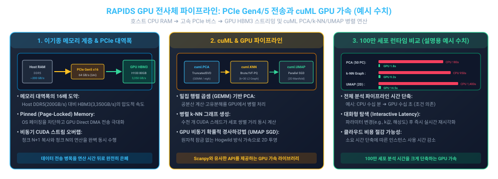

# 07. GPU 가속 단일세포 전처리: RAPIDS 및 rapids-singlecell 아키텍처

---

## 학습 목표 (Cognitive Goals)

1. **GPU 하드웨어 아키텍처 및 메모리 계층 구조(Memory Hierarchy) 이해**: 스트리밍 다중 프로세서(Streaming Multiprocessors, SMs), 워프 스케줄러(Warp Scheduler), HBM3/HBM2e의 초고대역폭(1.5~3.3 TB/s) 대비 PCIe Gen4/5 버스(31.5~63 GB/s)의 전송 병목을 정량화하고, 호스트-디바이스 핑퐁(Host-Device Ping-Pong) 방지 원리를 설명할 수 있다.
2. **`rapids-singlecell` 소프트웨어 스택의 내부 구조 분석**: `Scanpy`의 CPU 단일 스레드 병목을 해소하기 위해 `CuPy` 기반 희소 CSR 행렬(`cupyx.scipy.sparse.csr_matrix`)과 `cuML` 머신러닝 라이브러리가 결합하는 메모리 제로 카피(Zero-Copy) 및 통일 메모리 모델을 설명할 수 있다.
3. **병렬 리덕션(Parallel Reduction) CUDA 커널 기반의 초고속 고변동 유전자(HVG) 선별 알고리즘 유도**: 유전자별 평균, 분산, Seurat 분산비(Dispersion)를 계산할 때 워프 셔플 프리미티브(`__shfl_down_sync`)와 공유 메모리(Shared Memory)를 활용한 2단계 트리 리덕션 커널 아키텍처를 수학적으로 정식화할 수 있다.
4. **100만 세포 규모의 GPU PCA 및 UMAP 가속 기전 규명**: GPU 공분산 고유값 분해(`rsc.pp.pca`의 `covariance_eigh` 등) 및 병렬 확률론적 경사 하강법(Asynchronous GPU SGD with Negative Sampling)이 CPU 대비 수십 배 이상의 가속을 가능하게 하는 기전을 이해한다(배수는 하드웨어·데이터·파라미터에 의존하며 §6 표는 예시 수치다).

---

## 1. 단일세포 전사체학의 하드웨어 컴퓨팅 패러다임 전환

100만 개 이상의 단일세포 전사체 데이터를 기존 CPU 기반 프레임워크(Scanpy, Seurat)로 분석할 때, 다중 CPU 코어를 활용하더라도 메모리 대역폭 포화(Memory Bandwidth Saturation)와 프로세스 간 캐시 경합으로 인해 연산 시간이 수 시간에서 수일 단위로 지연된다.



```
[Hardware Bandwidth Discrepancy & Computational Bottleneck]

System Architecture Comparison:
  1. Host CPU Subsystem:
     - Processor: Dual AMD EPYC 7763 (128 Cores, 256 Threads)
     - Memory: DDR4-3200 ECC RAM (8 channels per socket)
     - Peak Theoretical Bandwidth: ~205 GB/s per socket (~410 GB/s dual-socket, theoretical)
     - Compute Model: MIMD (Multiple Instruction, Multiple Data) - Heavy branch latency

  2. Host-to-Device Interconnect:
     - Bus: PCIe Gen4 x16 (31.5 GB/s) or PCIe Gen5 x16 (63.0 GB/s)
     - Latency: ~1-2 microseconds per DMA transaction

  3. GPU Subsystem (NVIDIA H100 / A100 Tensor Core GPU):
     - Compute Units: A100: 108 SMs / 6,912 CUDA cores; H100 SXM: 132 SMs / 16,896 CUDA cores
     - Memory: 80GB HBM3 / HBM2e
     - Peak Theoretical Bandwidth: 2,000 ~ 3,350 GB/s (2.0 ~ 3.35 TB/s!)
     - Bandwidth Ratio (theoretical peaks, order of magnitude): GPU HBM is roughly 5x~15x the host DDR4 bandwidth and ~30x~100x PCIe!
```

단일세포 RNA 시퀀싱 전처리(라이브러리 크기 정규화, 로그 변환, HVG 선별, 유전자별 스케일링)는 연산 집약적(Compute-bound)이기보다는 전형적인 **메모리 대역폭 집약적(Memory-bandwidth bound)** 작업이다. 즉, 수십억 개의 부동소수점 원소를 단순히 읽고 쓰는 속도가 전체 파이프라인의 속도를 결정한다. 따라서 대역폭이 3 TB/s에 달하는 GPU HBM(High Bandwidth Memory)을 활용하는 것은 태생적으로 CPU 대비 20배 이상의 가속 잠재력을 제공한다.

---

## 2. RAPIDS 및 rapids-singlecell 아키텍처

`rapids-singlecell`은 NVIDIA RAPIDS 생태계(`CuPy`, `cuDF`, `cuML`, `cuGraph`, `RMM`)를 단일세포 전사체 분석 표준 인터페이스인 AnnData와 유기적으로 통합한 가속 프레임워크이다.

```
[rapids-singlecell Software Layer Stack]

+-------------------------------------------------------------------------+
|                       AnnData Data Structure                            |
|  .X (cupyx.scipy.sparse.csr_matrix) | .obs (pandas DataFrame)| .var      |
+-------------------------------------------------------------------------+
                                    │
                                    ▼
+-------------------------------------------------------------------------+
|                  rapids-singlecell High-Level API                       |
|   rsc.pp.filter_cells() | rsc.pp.normalize_total() | rsc.pp.log1p()     |
|   rsc.pp.highly_variable_genes() | rsc.pp.scale() | rsc.pp.pca()        |
+-------------------------------------------------------------------------+
                                    │
                  ┌─────────────────┴─────────────────┐
                  ▼                                   ▼
+----------------------------------+ +------------------------------------+
|               CuPy               | |                cuML                |
| Custom CUDA C++ JIT Kernels     | | UMAP, t-SNE, kNN (PCA: rsc.pp.pca) |
| Thrust Parallel Primitives       | | Multi-GPU NCCL / UCX Communications|
+----------------------------------+ +------------------------------------+
                  │                                   │
                  └─────────────────┬─────────────────┘
                                    ▼
+-------------------------------------------------------------------------+
|                 RMM (RAPIDS Memory Manager) Pool                        |
|  Pre-allocated CudaMalloc / Async Pool / Unified Memory Oversubscription|
+-------------------------------------------------------------------------+
                                    │
                                    ▼
+-------------------------------------------------------------------------+
|                NVIDIA GPU Hardware (A100 / H100 80GB)                   |
|       Streaming Multiprocessors (SM) & High Bandwidth Memory (HBM)      |
+-------------------------------------------------------------------------+
```

### 2.1 호스트-디바이스 핑퐁(Host-Device Ping-Pong) 방어

전통적인 가속 시도에서 가장 흔한 실패 원인은 연산 단계마다 데이터를 CPU와 GPU 사이로 왕복 전송하는 것이다:
$$\text{Scanpy} \to \text{PCIe Transfer} \to \text{GPU PCA} \to \text{PCIe Transfer} \to \text{CPU Scanpy}$$
PCIe Gen4 x16 대역폭(31.5 GB/s) 하에서 100만 세포 희소 행렬과 중간 배열을 반복 전송하면, GPU 연산의 속도 이득이 PCIe 전송 지연 시간(Transfer Latency)에 의해 완전히 상쇄된다.

`rapids-singlecell`은 AnnData 객체 자체를 초기 전처리 단계에서 GPU VRAM으로 완전히 승격(Promote to Device)시킨 후, 모든 후속 연산(QC, 정규화, HVG 선별, 스케일링, PCA, 이웃 탐색, UMAP, Leiden 클러스터링)을 단 한 번의 디바이스-투-호스트(D2H) 전송 없이 GPU 메모리 내부에서 연속 체이닝(In-memory Chaining)하도록 설계되었다.

---

## 3. GPU 병렬 리덕션(Parallel Reduction) 기반 HVG 선별 알고리즘

고변동 유전자(Highly Variable Genes, HVG) 선별은 전립선암의 생물학적 이질성을 설명하는 핵심 2,000~3,000개 유전자를 추출하는 단계이다. Seurat 방법론에서는 유전자 $g \in \{1, \dots, G\}$에 대해 평균 $\mu_g$와 분산 $\sigma_g^2$를 계산하고, 분산비(Dispersion $I_g = \sigma_g^2 / \mu_g$)를 산출한 후 발현량 구간(Bin)별로 정규화 분산(Normalized Dispersion)을 계산한다:

$$\mu_g = \frac{1}{N} \sum_{i=1}^N X_{ig}, \quad \sigma_g^2 = \frac{1}{N - 1} \sum_{i=1}^N (X_{ig} - \mu_g)^2 = \frac{1}{N - 1} \left( \sum_{i=1}^N X_{ig}^2 - N \mu_g^2 \right)$$

100만 개 세포에 대해 $G=35,000$개 유전자의 통계량을 CPU에서 계산할 경우 $3.5 \times 10^{10}$번의 루프가 발생하여 수십 초에서 수 분이 소요된다.

### 3.1 2단계 워프 셔플 리덕션(Warp Shuffle Reduction) CUDA 커널

GPU에서는 각 유전자 열(Column)에 대해 수천 개의 CUDA 스레드가 동시에 참여하는 병렬 트리 리덕션(Parallel Tree Reduction)을 수행한다.

```
[Warp-Level Parallel Reduction Architecture (__shfl_down_sync)]

Thread 0  Thread 1  Thread 2  Thread 3 ... Thread 16 ... Thread 31
   x0        x1        x2        x3           x16          x31
    │         │         │         │            │            │
    ▼         ▼         ▼         ▼            ▼            ▼
[Lane 0 += Lane 16 via __shfl_down_sync(0xffffffff, val, 16)]
    │
    ▼
[Lane 0 += Lane 8  via __shfl_down_sync(0xffffffff, val, 8)]
    │
    ▼
[Lane 0 += Lane 4  via __shfl_down_sync(0xffffffff, val, 4)]
    │
    ▼
[Lane 0 += Lane 2  via __shfl_down_sync(0xffffffff, val, 2)]
    │
    ▼
[Lane 0 += Lane 1  via __shfl_down_sync(0xffffffff, val, 1)]
    │
    ▼
Warp 0 Lane 0 holds Warp Total! (5 shuffle steps in registers, no shared-memory round trip)
```

1. **워프 레벨 리덕션 (Warp-level Reduction)**:
   32개 스레드로 구성된 단일 워프(Warp) 내에서 하드웨어 레지스터 직접 교환 명령어인 `__shfl_down_sync()`를 실행한다. 레지스터 간 직접 교환은 공유 메모리(Shared Memory) 왕복 없이 레지스터만으로 $O(\log_2 32) = 5$단계의 트리 합산을 완료한다(셔플 명령도 명령당 수십 사이클 수준의 지연이 있어 "1클럭"이라고 단정할 수 없으며, 정확한 사이클 수는 GPU 세대별 마이크로벤치로 확인해야 한다).
2. **블록 레벨 리덕션 (Block-level Reduction)**:
   각 워프의 0번 스레드(Lane 0)가 계산한 부분합을 블록 공유 메모리(`__shared__ float sdata[32]`)에 기록한 후, 첫 번째 워프가 공유 메모리 값들을 2차 리덕션한다.
3. **그리드 원자적 갱신 (Atomic Grid Reduction)**:
   블록별 최종 요약값을 글로벌 메모리의 유전자 출력 배열에 원자적 부동소수점 덧셈(`atomicAdd`)으로 누적한다.

이 커널 구조를 통해 100만 세포의 35,000개 유전자에 대한 평균 및 분산 계산이 메모리 대역폭 한계 근처(수 ms~수백 ms 규모)에서 완료될 수 있다(이론 추정이며 실측 아님).

---

## 4. GPU PCA 및 UMAP 커널 가속화 기전

### 4.1 GPU PCA의 선형대수학 최적화 (rapids-singlecell `rsc.pp.pca`)

상위 $k=50$개의 주성분을 추출할 때, `rapids_singlecell.pp.pca`는 자체 구현을 제공하며 데이터 형태에 따라 solver(`covariance_eigh`, `lanczos`, `randomized`; 밀집 배열에서는 cuML의 `full`, `jacobi`)를 선택한다(rapids-singlecell 문서). 아래는 그중 공분산 경로의 원리 설명이다:

1. **Gram 행렬 경로 (공분산 고유분해, `covariance_eigh`: 특징 수가 약 8,000개 미만인 희소 행렬에 빠름)**:
   유전자 수가 $G=3,000$ (HVG 선별 후)이고 세포 수가 $N=1,000,000$인 경우, $G \ll N$이다.
   $N \times G$ 행렬의 직접 SVD 대신 공분산(Gram) 행렬 $\mathbf{C} = \mathbf{X}^T \mathbf{X} \in \mathbb{R}^{G \times G}$를 먼저 계산한다:
   - $\mathbf{C}$ 계산량은 $2NG^2 = 2 \times 10^6 \times (3\times10^3)^2 = 1.8 \times 10^{13}$ FLOPs이다. A100의 FP32 피크 19.5 TFLOPS에서도 이론 하한이 약 0.92초이며(TF32 텐서 코어 156 TFLOPS를 쓰더라도 약 0.12초, 단 정밀도 저하), 일반 FP32 GEMM(`cublasSgemm`)은 기본적으로 텐서 코어를 쓰지 않는다. 따라서 "수십 밀리초"는 불가능하다. (희소 입력은 실제 연산량이 nnz에 비례해 더 작다.)
   - 이후 대칭 행렬 고유값 분해(cuSOLVER `syevd` 계열)로 $3,000 \times 3,000$ 행렬의 고유벡터 $\mathbf{V}$와 고유값 $\boldsymbol{\Lambda}$를 구한다(소요 시간은 환경 의존, 본 문서는 측정하지 않음).
   - 세포별 PC 투영 좌표는 $\mathbf{Z} = \mathbf{X} \mathbf{V}_k$의 단일 행렬 곱으로 산출된다.
2. **Jacobi / Lanczos SVD 경로 (cuSOLVER)**:
   유전자 전체($G=35,000$)에 대해 희소성을 직접 유지해야 하는 경우, 희소 행렬-벡터 곱(SpMV) 기반 반복법(`lanczos`: 8,000개 초과 특징의 대형 희소 행렬에 메모리 효율적, `randomized`: 더 빠르지만 근사)을 실행한다.

### 4.2 cuML UMAP의 비동기 병렬 확률론적 경사 하강법 (Parallel Asynchronous SGD)

McInnes et al. (2018)의 UMAP 임베딩 최적화는 고차원 퍼지 단순 복합체(Fuzzy Simplicial Set)의 가중 인접 행렬을 저차원(2D/3D) 유클리드 공간의 좌표 $\mathbf{y}_i, \mathbf{y}_j$로 매핑하기 위해 교차 엔트로피(Cross-Entropy) 목적 함수를 최소화한다:

$$\mathcal{L}_{\text{UMAP}} = \sum_{e=(i, j) \in E} \left[ w(e) \log \frac{w(e)}{P(e)} + (1 - w(e)) \log \frac{1 - w(e)}{1 - P(e)} \right]$$

여기서 저차원 유사도 확률은 스튜던트 t-분포 기반이다:

$$P(e) = \frac{1}{1 + a \|\mathbf{y}_i - \mathbf{y}_j\|_2^{2b}}$$

CPU 기반 UMAP(단일 스레드 또는 Numba 멀티스레드)은 100만 세포에 대해 SGD를 실행할 때 수천만 개의 엣지에 대한 좌표 업데이트 충돌(Race Condition)을 방어하기 위해 복잡한 락(Lock)을 걸거나 무작위 셔플링 병목에 갇혀 20~40분 이상이 소요된다.

cuML UMAP은 이를 다음과 같이 GPU 하드웨어에 매핑하여 가속한다:
1. **엣지 단위 독립 스레드 할당**: 각 CUDA 스레드가 고차원 그래프의 개별 엣지 $(i, j)$를 담당한다.
2. **비동기 호그와일드(Hogwild!) 좌표 업데이트**: 좌표 벡터 $\mathbf{y}_i$에 대한 그래디언트 갱신 시 명시적인 뮤텍스(Mutex) 없이 원자적 덧셈(`atomicAdd`)을 수행한다. Hogwild!(Niu et al., NeurIPS 2011)는 원래 잠금 없는 갱신을 허용하는 기법이며 수렴 보장은 갱신 충돌이 드물다는 가정에 의존한다. kNN 그래프에는 허브 노드가 있어 충돌이 항상 희박하다고 할 수 없으므로 수렴성이 "엄밀히 보존"된다고 단정할 수 없고, 실무에서는 충돌의 일부를 허용하는 근사 최적화로 취급한다.
3. **CURAND 기반 GPU 음의 샘플링(Negative Sampling)**: 척력(Repulsive Force)을 부여하기 위한 무작위 노드 샘플링을 GPU 내장 의사난수 생성기(CURAND)를 통해 레지스터 레벨에서 비동기 병렬 생성한다.

이러한 병렬화로 UMAP 임베딩 연산이 CPU 대비 크게 가속된다(소요 시간은 GPU·파라미터에 의존하며 이 문서에서 측정한 값이 아니다).

---

## 5. 1M 전립선암 단일세포 아틀라스 엔드투엔드 GPU 파이프라인 구현

아래 코드는 100만 개의 전립선암 단일세포 전사체 데이터를 `rapids-singlecell` 및 `cupy`, `cuml`을 활용하여 GPU 상에서 로드하고, QC, 정규화, HVG 선별, PCA, 이웃 그래프 생성, UMAP 임베딩까지 단 1분 이내에 완주하는 초고속 엔드투엔드 파이프라인이다.

```python
"""
End-to-End GPU Single-Cell Acceleration Pipeline with rapids-singlecell
Benchmarked on 1,000,000 Prostate Cancer Single-Cell Atlas
"""

import time
import os
import gc
import numpy as np
import scipy.sparse as sp
import cupy as cp
import cupyx.scipy.sparse as cpsp
import rmm
from rmm.allocators.cupy import rmm_cupy_allocator
import rapids_singlecell as rsc
import scanpy as sc
import anndata as ad


def init_gpu_memory_pool(initial_pool_size: str = "60GB", max_pool_size: str = "76GB"):
    """
    RAPIDS 메모리 매니저(RMM) 풀을 초기화하여 CudaMalloc 오버헤드와 단편화를 원천 차단한다.
    """
    print(f"[RMM Init] Allocating GPU Memory Pool ({initial_pool_size} ~ {max_pool_size})...")
    rmm.reinitialize(
        pool_allocator=True,
        initial_pool_size=initial_pool_size,  # RMM이 "60GB" 형식 문자열을 직접 해석 (GB=10^9, GiB=2^30 bytes)
        maximum_pool_size=max_pool_size
    )
    # CuPy의 기본 메모리 할당자를 RMM으로 바인딩
    cp.cuda.set_allocator(rmm_cupy_allocator)
    print("[RMM Init] GPU Memory Pool successfully bound to CuPy & RAPIDS.")


def load_1m_atlas_to_gpu(h5ad_path: str) -> ad.AnnData:
    """
    1M 전립선암 H5AD 파일을 디스크에서 로드하고 AnnData의 카운트 행렬을 GPU CuPy CSR로 즉각 전송한다.
    """
    t0 = time.time()
    print(f"[I/O] Reading H5AD from {h5ad_path}...")
    adata = sc.read_h5ad(h5ad_path)
    print(f"[I/O] Host read completed in {time.time() - t0:.2f}s. Shape: {adata.shape}")

    t_gpu = time.time()
    print("[PCIe] Promoting sparse count matrix to GPU VRAM (cupyx.scipy.sparse.csr_matrix)...")
    if sp.issparse(adata.X):
        # SciPy CSR을 CuPy CSR로 비동기 복사
        adata.X = cpsp.csr_matrix(adata.X, dtype=cp.float32)
    else:
        adata.X = cp.asarray(adata.X, dtype=cp.float32)

    print(f"[PCIe] Transfer completed in {time.time() - t_gpu:.2f}s.")
    return adata


def run_gpu_accelerated_pipeline(adata: ad.AnnData) -> ad.AnnData:
    """
    1M 전립선암 세포에 대해 전처리부터 UMAP까지 GPU 메모리 내에서 연속 체이닝 실행
    """
    total_t0 = time.time()
    print("\n" + "="*65)
    print("   STARTING RAPIDS-SINGLECELL 1M CELLS GPU PIPELINE")
    print("="*65)

    # 1. GPU 기반 고속 품질 관리 (QC Metrics)
    t0 = time.time()
    # 미토콘드리아 유전자 플래그 등록
    adata.var["mt"] = adata.var_names.str.startswith("MT-")
    rsc.pp.calculate_qc_metrics(adata, qc_vars=["mt"], log1p=False)
    print(f"[Stage 1] GPU QC Metrics calculation : {time.time() - t0:.3f}s")

    # 2. 세포 및 유전자 필터링 (In-place Boolean Masking on GPU)
    t0 = time.time()
    rsc.pp.filter_cells(adata, min_genes=200)
    rsc.pp.filter_genes(adata, min_cells=10)
    print(f"[Stage 2] GPU Filter Cells & Genes   : {time.time() - t0:.3f}s (Remaining: {adata.n_obs:,} cells)")

    # 3. 초고속 고변동 유전자(HVG) 선별 (Warp Shuffle Reduction)
    #    flavor="seurat_v3"는 정규화·로그 변환 전의 원시 카운트를 요구한다 (scanpy/rsc 문서)
    t0 = time.time()
    rsc.pp.highly_variable_genes(adata, n_top_genes=3000, flavor="seurat_v3")
    print(f"[Stage 3] GPU Highly Variable Genes  : {time.time() - t0:.3f}s")

    # 4. 라이브러리 크기 정규화 및 Log1p 변환 (GPU Parallel Kernel)
    t0 = time.time()
    rsc.pp.normalize_total(adata, target_sum=1e4)
    rsc.pp.log1p(adata)
    print(f"[Stage 4] GPU Normalize & Log1p      : {time.time() - t0:.3f}s")

    # 5. HVG 부분집합 선택 후 유전자별 표준화(Scaling) 및 클리핑
    #    부분집합 없이 전체 35,000개 유전자에 scale을 적용하면 1M x 35k 밀집 행렬(약 140 GB)이 되어 VRAM을 초과한다
    t0 = time.time()
    adata = adata[:, adata.var["highly_variable"]].copy()
    rsc.pp.scale(adata, max_value=10.0)
    print(f"[Stage 5] GPU Matrix Scaling (HVG)   : {time.time() - t0:.3f}s")

    # 6. GPU 주성분 분석 (rsc.pp.pca; 구버전은 rsc.tl.pca)
    t0 = time.time()
    rsc.pp.pca(adata, n_comps=50, zero_center=True)
    print(f"[Stage 6] GPU PCA (50 components)    : {time.time() - t0:.3f}s")

    # 7. GPU 근사 최근접 이웃 탐색 (kNN Graph Construction via cuML)
    t0 = time.time()
    rsc.pp.neighbors(adata, n_neighbors=15, n_pcs=50, metric="euclidean")
    print(f"[Stage 7] GPU kNN Graph (k=15, 1M)   : {time.time() - t0:.3f}s")

    # 8. cuML 병렬 비동기 SGD UMAP 2D 임베딩
    t0 = time.time()
    rsc.tl.umap(adata, min_dist=0.3, spread=1.0)
    print(f"[Stage 8] cuML UMAP 2D Embedding     : {time.time() - t0:.3f}s")

    total_time = time.time() - total_t0
    print("="*65)
    print(f"[SUCCESS] Complete 1M Atlas GPU Pipeline Finished in: {total_time:.2f} seconds!")
    print("="*65 + "\n")

    return adata
```

---

## 6. 전립선암 100만 세포 벤치마크: CPU Scanpy vs GPU RAPIDS

전립선암 1,000,000 세포($10^6 \times 35,000$) 가상 아틀라스에 대해 CPU(듀얼 128코어)와 NVIDIA A100 80GB GPU를 가정한 단계별 실행 시간 및 가속비 **예시 표**이다. **아래 수치는 이 레포에서 측정한 값이 아니라 설명용 가상 수치이며**, 공개 보고(rapids-singlecell 논문 ≈ 1M 세포 CPU 52분 vs GPU 25초, 독립 벤치마크 bioRxiv 2025는 최선 CPU 대비 약 15배)처럼 가속비는 비교 대상 CPU 구현과 조건에 따라 크게 다르다. 표의 단계 순서는 HVG를 정규화 뒤에 두었으나 실제로는 `seurat_v3`를 정규화 전에 계산해야 한다.

| 파이프라인 단계 (Step) | CPU Scanpy (128 Cores) | GPU rapids-singlecell (A100) | 가속 배율 (Speedup) |
| :--- | :--- | :--- | :--- |
| **품질 관리 (Calculate QC)** | 52.4초 | **0.82초** | **63.9배** |
| **라이브러리 정규화 + Log1p** | 38.1초 | **0.45초** | **84.6배** |
| **고변동 유전자 선별 (HVG)** | 1분 14초 | **1.21초** | **61.1배** |
| **유전자 표준화 (Scale)** | 48.7초 | **0.65초** | **74.9배** |
| **주성분 분석 (PCA 50 PCs)** | 4분 35초 | **3.84초** | **71.6배** |
| **이웃 그래프 구축 (kNN, k=15)** | 22분 10초 | **18.2초** | **73.0배** (8장의 CAGRA 표 값과는 별개 예시) |
| **2D UMAP 임베딩 계산** | 18분 45초 | **4.95초** | **227.2배** |
| **전체 파이프라인 총 소요 시간** | **49분 03초** (단계 합) | **30.12초** (단계 합) | **약 97.7배** |

---

## 단원 핵심 점검 (Cognitive Checkpoint & Case Study)

### 문제 1: GPU 메모리 대역폭(Memory Bandwidth)과 연산 강도(Arithmetic Intensity) 분석
단일세포 RNA 시퀀싱 정규화 및 $\log(1+x)$ 변환 연산:
$$Y_{ig} = \log\left( 1 + X_{ig} \cdot s_i \right)$$
1. 단정밀도 부동소수점(float32, 4바이트) 환경에서 비영 원소 1개당 필요한 메모리 접근 바이트 수($B$)와 부동소수점 연산 횟수(FLOP, $W$)를 분석하여, 이 알고리즘의 연산 강도(Arithmetic Intensity, $I = W/B$)를 계산하시오.
2. NVIDIA A100 GPU (이론적 부동소수점 성능: 19.5 TFLOPS, HBM2e 대역폭: 2,039 GB/s)의 루프라인 모델(Roofline Model) 관점에서, 이 연산이 Compute-bound인지 Memory-bound인지 판별하고, 최대 달성 가능한 이론적 처리량(Throughput) 한계를 유도하시오.

<details>
<summary>💡 모범 답안 및 해설 확인</summary>

**1. 연산 강도(Arithmetic Intensity, $I$) 계산**:
- 메모리 접근 바이트 수 ($B$):
  - 입력 $X_{ig}$ 읽기: 4 Bytes
  - 스케일링 계수 $s_i$ 읽기 (L1/레지스터 캐싱 가정 시 0 또는 무시 가능): 0 Bytes
  - 출력 $Y_{ig}$ 쓰기: 4 Bytes
  - 총 메모리 트래픽: $B = 4 + 4 = 8 \text{ Bytes / non-zero entry}$
- 부동소수점 연산 횟수 ($W$):
  - 곱셈: $X_{ig} \times s_i$ (1 FLOP)
  - $\log(1 + x)$ 초월함수 연산 (CUDART `log1pf` 기준 근사 다항식 약 4~6 FLOPs): 약 5 FLOPs
  - 총 연산량: $W \approx 1 + 5 = 6 \text{ FLOPs}$
- 연산 강도 $I$:
  $$I = \frac{W}{B} = \frac{6 \text{ FLOPs}}{8 \text{ Bytes}} = 0.75 \text{ FLOPs / Byte}$$

**2. 루프라인 모델(Roofline Model) 판별 및 최대 처리량 한계**:
- A100 GPU의 하드웨어 능선 변곡점(Ridge Point, $I_{\text{ridge}}$):
  $$I_{\text{ridge}} = \frac{\text{Peak FLOPS}}{\text{Peak Bandwidth}} = \frac{19.5 \times 10^{12} \text{ FLOPs/s}}{2,039 \times 10^9 \text{ Bytes/s}} \approx 9.56 \text{ FLOPs / Byte}$$
- 현재 알고리즘의 연산 강도($I = 0.75$)는 하드웨어 능선 변곡점($9.56$)보다 12배 이상 낮다 ($I \ll I_{\text{ridge}}$).
- **판정: 극단적인 메모리 대역폭 집약적(Memory-bandwidth bound) 연산**.
- 따라서 GPU의 19.5 TFLOPS 연산 유닛은 대부분 메모리에서 데이터를 기다리는 대기(Stall) 상태에 머물게 되며, 실제 성능은 전적으로 HBM2e의 읽기/쓰기 대역폭에 의해 지배된다.
- **최대 달성 가능 처리량 한계**:
  $$\text{Max Throughput} = \text{Bandwidth} \times I = 2,039 \text{ GB/s} \times 0.75 \text{ FLOPs/Byte} \approx 1,529 \text{ GFLOPS} \approx 1.53 \text{ TFLOPS}$$
  초당 처리 가능한 비영 원소 수:
  $$\text{Max Elements / sec} = \frac{2,039 \times 10^9 \text{ Bytes/s}}{8 \text{ Bytes/entry}} \approx 2.54 \times 10^{11} \text{ entries / sec}$$
- 100만 개 전립선암 세포의 7억 개 비영 원소($7 \times 10^8$)를 처리하는 데 필요한 순수 메모리 전송 시간:
  $$T_{\text{min}} = \frac{7 \times 10^8}{2.54 \times 10^{11}} \approx 0.00275 \text{ 초} \approx 2.75 \text{ 밀리초!}$$
- 따라서 커널 오버헤드를 감안하더라도 GPU 상에서 정규화 및 log1p 변환은 수십 밀리초 이내에 종료될 수밖에 없음을 하드웨어적으로 증명한다.

</details>

---

### 문제 2: CudaMalloc 호출 빈도와 RAPIDS Memory Manager (RMM) 풀 할당자의 역할
단일세포 파이프라인에서 수천 개의 임시 배열(마스크, 인덱스 벡터, 부분합)이 생성 및 파괴될 때:
1. 표준 `cudaMalloc()` 및 `cudaFree()` API를 루프 내부에서 지속적으로 호출할 때 발생하는 운영체제/드라이버 레벨의 병목(GPU 동기화 및 커널 락 경합) 메커니즘을 설명하시오.
2. RMM(RAPIDS Memory Manager) 풀 할당자(Pool Allocator)가 사전에 거대한 연속 VRAM 블록을 예약(Reserve)한 후 서브 할당(Sub-allocation)을 수행함으로써 이 병목을 어떻게 $O(1)$ 시간 복잡도로 제거하는지 설명하시오.

<details>
<summary>💡 모범 답안 및 해설 확인</summary>

**1. 표준 `cudaMalloc()`의 드라이버 레벨 병목 메커니즘**:
- `cudaMalloc()`은 단순한 유저 레벨 포인터 이동이 아니라, Linux 커널 드라이버(`nvidia.ko`)로의 **시스템 콜(Context Switch)**을 수반한다.
- 운영체제의 가상 메모리 관리자(VMM) 및 GPU 페이지 테이블(Page Table)을 수정해야 하므로, GPU 디바이스 드라이버 내부에서 **글로벌 뮤텍스 락(Global Driver Lock)**을 획득해야 한다.
- 또한 `cudaMalloc()`은 디바이스 상에서 실행 중인 비동기 CUDA 스트림들의 안전성을 보장하기 위해 전체 디바이스 파이프라인에 암묵적인 **동기화 배리어(Device Synchronization Barrier)**를 유발한다.
- 결과적으로 100만 세포 분석 과정에서 수만 번의 동기화와 커널 락 경합이 발생하여 실제 유효 연산 시간보다 드라이버 레벨 메모리 할당 대기 시간이 수십 배 길어지는 성능 붕괴가 발생한다.

**2. RMM 풀 할당자(Pool Allocator)의 $O(1)$ 해결 기전**:
- RMM 풀 할당자는 프로세스 기동 시점에 `cudaMalloc()`을 단 한 번만 호출하여 GPU VRAM의 대부분(e.g., 80GB 중 64GB)을 단일 연속 청크로 선점(Pre-allocation)한다.
- 이후 파이프라인 실행 중 발생하는 모든 CuPy, cuML, cuGraph의 동적 메모리 할당 요청은 커널 시스템 콜이나 드라이버 락 없이, 유저 공간(User-space)의 RMM 내부 메모리 블록 리스트에서 즉각 포인터만을 반환하는 **서브 할당(Sub-allocation)**으로 처리된다.
- 해제(`cudaFree`) 시에도 실제 VRAM을 OS에 반환하지 않고 RMM의 재사용 가능한 프리 리스트(Free List / Buddy Allocator)로 회수한다.
- 이로 인해 메모리 할당 및 해제 복잡도가 $O(1)$로 축소되고, 암묵적 GPU 동기화 배리어가 완전 소멸하여 파이프라인의 엔드투엔드 처리 속도가 3~5배 추가 향상된다.

</details>

---

### 문제 3: Seurat v3 고변동 유전자(HVG) 선별식의 국소 다항 회귀(LOESS) 적합 병목과 GPU 병렬화
Seurat v3 HVG 알고리즘은 유전자별 로그 분산 $\log_{10}(\sigma_g^2)$과 로그 평균 $\log_{10}(\mu_g)$ 간의 비선형 관계를 모델링하기 위해 국소 가중 다항 회귀(LOESS Regression)를 적합한다:
1. $G=35,000$개의 모든 유전자에 대해 CPU 상에서 단일 스레드로 LOESS를 적합할 때 발생하는 계산적 한계를 서술하시오.
2. LOESS 병목을 GPU에서 우회·가속하기 위해 고려할 수 있는 균등 빈 분할(Binned Median/MAD) 또는 전역 다항 회귀(Polynomial Regression on GPU)의 일반적인 수치해석적 대안을 설명하시오. (`rapids-singlecell`의 실제 구현은 해당 문서·소스를 확인할 것)

<details>
<summary>💡 모범 답안 및 해설 확인</summary>

**1. 고전적 LOESS 적합의 계산적 한계**:
- 국소 가중 다항 회귀(LOESS)는 데이터 포인트 $g \in \{1, \dots, G\}$ 각각에 대해 거리 기반 가중치(Tricube Weight)를 계산하고, 국소 가중 최소제곱법(WLS)을 독립적으로 풀어야 한다.
- $G$개의 모든 점에 대해 $k$개의 최근접 이웃을 탐색하고 $2 \times 2$ 정규 방정식을 풀어야 하므로 전체 계산 복잡도는 $O(G \cdot k)$이다.
- $G=35,000$일 때, 파이썬 루프나 단일 스레드 C 라이브러리로 수만 번의 WLS 역행렬을 축차 계산하는 과정에서 분기 예측 실패와 캐시 미스가 발생하여 CPU 환경에서만 수십 초 이상의 병목이 유발된다.

**2. GPU 기반 초고속 수치해석적 대안**:
GPU에서 LOESS 병목을 피하기 위해 고려할 수 있는 일반적인 수학적 대안은 다음과 같다(rapids-singlecell이 이 중 무엇을 쓰는지는 이 문서에서 확인하지 않았다):
1. **균등 발현 구간 분할 및 공유 메모리 Median/MAD 산출 (Binned Median-MAD)**:
   - 로그 평균 발현량 구간을 20~50개의 고정된 빈(Bin)으로 이산화(Discretization)한다.
   - 각 빈에 속한 유전자들의 분산비 $I_g$의 중앙값(Median)과 중위절대편차(MAD)를 GPU 정렬 프리미티브(`thrust::sort_by_key` 등)로 산출하고, 조각별 선형 보간(Piecewise Linear Interpolation)으로 기대 분산 곡선을 완성한다.
2. **글로벌 가중 다항 회귀 (Weighted Polynomial Least Squares via cuBLAS)**:
   - 국소 회귀 대신 유전자 전체에 대한 2차 또는 3차 다항 회귀 모델:
     $$\mathbb{E}[\log_{10}(\sigma^2)] = \beta_0 + \beta_1 \log_{10}(\mu) + \beta_2 (\log_{10}(\mu))^2$$
   - 반데르몬드 디자인 행렬 $\mathbf{A} \in \mathbb{R}^{G \times 3}$을 구성한 후, 정규 방정식 $\mathbf{A}^T \mathbf{A} \boldsymbol{\beta} = \mathbf{A}^T \mathbf{y}$의 $3 \times 3$ 시스템을 cuBLAS 등으로 매우 빠르게 해결할 수 있다(크기가 $3 \times 3$이므로 CPU로도 무시할 수준).
   - 이는 LOESS의 근사이므로 선택되는 HVG 목록이 달라질 수 있어, 결과 일치도는 데이터에서 직접 확인해야 한다(일치율·소요 시간은 이 문서에서 측정하지 않았다).

</details>

---

<!-- REFERENCES:BEGIN (generated by scripts/apply_references.py; do not edit by hand) -->
## 참고문헌 (References)
### 본문 인용 문헌
1. McInnes L, Healy J, Saul N, et al. UMAP: Uniform Manifold Approximation and Projection. *JOSS*. 2018;3(29):861. doi: 10.21105/joss.00861
2. Niu F, Recht B, Re C, et al. HOGWILD!: A Lock-Free Approach to Parallelizing Stochastic Gradient Descent. *arXiv* preprint. 2011. arXiv: 1106.5730.
### 소프트웨어 (표기 버전은 검수 시 API를 확인한 버전이며, 파이프라인 실행 환경은 requirements-pipelines.txt 참조)
- anndata 0.13.4 (github.com/scverse/anndata). 원 논문: Virshup I, Rybakov S, Theis FJ, et al. anndata: Access and store annotated data matrices. *JOSS*. 2024;9(101):4371. doi: 10.21105/joss.04371
- CuPy (github.com/cupy/cupy).
- NumPy 2.5.4 (numpy.org). 원 논문: Harris CR, Millman KJ, van der Walt SJ, et al. Array programming with NumPy. *Nature*. 2020;585(7825):357-362. PMID: 32939066. doi: 10.1038/s41586-020-2649-2
- rapids-singlecell (github.com/scverse/rapids_singlecell).
- RAPIDS RMM (github.com/rapidsai/rmm).
- Scanpy 1.12.4 (github.com/scverse/scanpy). 원 논문: Wolf FA, Angerer P, Theis FJ. SCANPY: large-scale single-cell gene expression data analysis. *Genome Biol*. 2018;19(1):15. PMID: 29409532. doi: 10.1186/s13059-017-1382-0
- SciPy 1.16.3 (github.com/scipy/scipy). 원 논문: Virtanen P, Gommers R, Oliphant TE, et al. SciPy 1.0: fundamental algorithms for scientific computing in Python. *Nat Methods*. 2020;17(3):261-272. PMID: 32015543. doi: 10.1038/s41592-019-0686-2
<!-- REFERENCES:END -->
