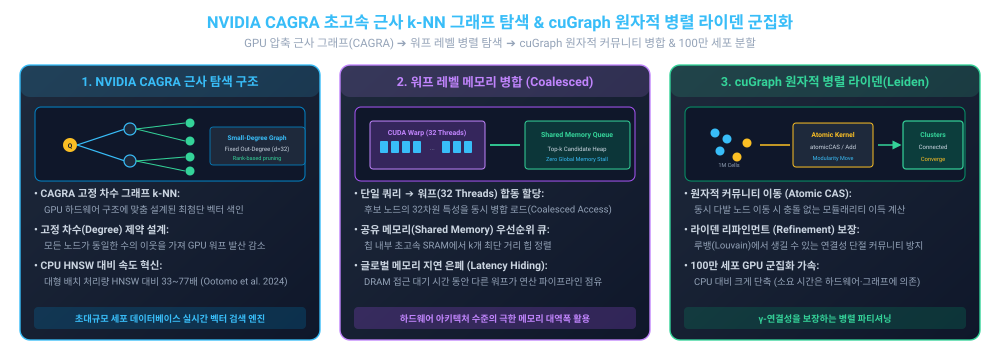

# 08. GPU 가속 그래프 구축 및 커뮤니티 탐지: CAGRA와 cuGraph Leiden

---

## 학습 목표 (Cognitive Goals)

1. **100만 세포 규모에서 브루트 포스(Brute-force) $O(N^2)$ 최근접 이웃(kNN) 탐색의 한계 분석**: 고차원 임베딩 공간($d=50$)에서 $5 \times 10^{11}$회의 쌍별 유클리드 거리 계산과 2테라바이트(TB) 이상의 메모리 팽창 문제를 정량화하고, 근사 최근접 이웃(Approximate Nearest Neighbor, ANN)의 필요성을 설명할 수 있다.
2. **NVIDIA CAGRA (Cuda Anns GRAph-based)의 GPU 네이티브 아키텍처 수리적 분석**: 전통적인 CPU 중심 HNSW(Hierarchical Navigable Small World)의 포인터 추적(Pointer Chasing) 및 워프 분기(Warp Divergence) 결함을 극복하기 위해, 고정 차수(Fixed Out-degree) 그래프, 순위 기반 재정렬(Rank-based Reordering)과 역방향 엣지 추가(Reverse Edge Addition)에 의한 그래프 최적화, 그리고 워프 협력 메모리 응집(Warp-level Coalesced Memory Access) 기반 그래프 탐색 메커니즘을 설명할 수 있다.
3. **`cuGraph` 병렬 Louvain 및 Leiden 커뮤니티 탐지 알고리즘 정식화**: 모듈러리티(Modularity, $Q$) 목적 함수와 이동 델타 모듈러리티($\Delta Q$) 공식을 유도하고, 이웃 노드 동시 이동 충돌을 방어하는 정점 색칠(Vertex Graph Coloring) 기법과 원자적 동기화(`atomicAdd`) 메커니즘을 설명할 수 있다.
4. **Leiden 3단계(로컬 이동, 정제-Refinement, 집계-Aggregation)의 GPU 가속 및 임상 서브클러스터링 적용**: 거세 저항성 전립선암(CRPC) 100만 세포 아틀라스에서 Louvain의 연결되지 않은 커뮤니티 문제를 Leiden의 연결성 보장으로 방지하고, 해상도 $\gamma$ 조정과 마커 기반 후처리로 0.1% 미만의 희귀 신경내분비 전립선암(NEPC) 후보 세포군을 탐색하는 파이프라인을 구축할 수 있다.

---

## 1. 100만 세포 단일세포 그래프 구축의 $O(N^2)$ 장벽

단일세포 RNA 시퀀싱 분석에서 세포 간의 전사체 유사성 매니폴드(Manifold)를 포착하는 핵심 데이터 구조는 최근접 이웃(k-Nearest Neighbor, kNN) 그래프 $\mathcal{G} = (V, E)$이다. 각 세포 $v_i \in V$ ($i=1, \dots, N$)는 $d$차원 주성분(PC) 공간에서 가장 가까운 $k$개의 이웃 세포들과 방향성 또는 무방향성 엣지 $e_{ij} \in E$로 연결된다.



```
[The O(N^2) Distance Matrix Barrier on 1M Single Cells]

Matrix Dimensions:
  N = 1,000,000 cells (Prostate Cancer Atlas)
  d =            50 Principal Components (PCs)
  k =            15 Nearest Neighbors

1. Full Brute-Force All-Pairs Pairwise Distances:
   Total Distance Pairs: N * (N - 1) / 2 = 10^6 * (10^6 - 1) / 2 ≈ 5 x 10^11 pairs!
   FLOPs required: 5 x 10^11 x (3 * 50 FLOPs) = 7.5 x 10^13 FLOPs
   Memory to store dense distance matrix:
     5 x 10^11 x 4 Bytes (float32) = 2,000,000,000,000 Bytes = 2.0 Terabytes RAM!
   Naively storing the full matrix is infeasible; exact kNN is instead computed in blocks (GEMM-based) without storing all pairs:
   ~7.5 x 10^13 FLOPs is minutes-scale on a GPU (order-of-magnitude estimate), so 'days / instant crash' only applies to the naive full-matrix approach.

2. Traditional CPU Tree / Graph Methods (k-d Tree, Ball Tree, HNSW):
   - Curse of Dimensionality: Tree structures degrade to O(N) linear scan for d > 20.
   - CPU HNSW (Hierarchical Navigable Small World):
     Build time is hardware/parameter dependent (no source for a specific figure; often minutes with many threads); poor GPU portability due to random memory jumps.
```

따라서 100만 세포 규모에서는 **GPU 하드웨어의 대규모 병렬성과 메모리 응집(Coalescing)**에 완벽하게 일치하도록 설계된 혁신적인 근사 최근접 이웃(ANN) 알고리즘이 필수적이다.

---

## 2. NVIDIA CAGRA: GPU 네이티브 고정 차수 근사 kNN 그래프

NVIDIA가 RAPIDS RAFT 라이브러리에서 발표한 **CAGRA (Cuda Anns GRAph-based; Ootomo et al., ICDE 2024, arXiv:2308.15136)**는 GPU 아키텍처에 특화된 근사 최근접 이웃 그래프 구축 및 탐색 알고리즘이다. 논문은 HNSW 대비 그래프 구축 2.2~27배, 90~95% 재현율 구간의 대형 배치 질의 처리량 33~77배, 최신 GPU 기법 대비 3.8~8.8배 빠름을 보고한다.

```
[HNSW Pointer Chasing vs CAGRA Warp-Coalesced Traversal]

Standard CPU HNSW (Irregular & Divergent on GPU):
  Warp Thread 0  ──> Node 421 ──> Dereference Pointer ──> Random VRAM Jump (Cache Miss!)
  Warp Thread 1  ──> Node  18 ──> Dereference Pointer ──> Different Memory Page!
  Warp Thread 2  ──> Node 994 ──> Dereference Pointer ──> Warp Serialization!
  (Execution efficiency on GPU SMs: < 5%)

NVIDIA CAGRA (Fixed Out-Degree Graph):
  All 32 Threads of Warp 0 collaborate on Query Cell i:
  - Node Edge List has fixed length (e.g., 32 or 64 neighbors).
  - Warp executes single 128-byte coalesced transaction to load 32 neighbor IDs!
  - Threads concurrently compute distances to the 32 neighbors in parallel!
  - Shared memory bit-mask tracks visited nodes with zero lock contention!
  (Speedups reported by Ootomo et al., ICDE 2024: 33~77x vs HNSW in large-batch throughput)
```

### 2.1 순위 기반 재정렬과 역방향 엣지 추가: CAGRA 그래프 최적화의 원리

단순 kNN 그래프에서는 고차원 데이터의 국소 밀도 불균형(Hubness Problem)으로 인해 특정 중심 노드(Hub)로 수많은 엣지가 집중되고, 일부 노드는 어떤 노드에서도 도달하기 어려워진다.
CAGRA는 (1) 차수 $d_{\text{init}}$의 초기 kNN 그래프(NN-descent 또는 IVF-PQ 등으로 구축)를 만든 뒤, (2) 이를 고정 차수 $d$의 탐색 그래프로 최적화한다. 최적화는 두 단계이다:

**① 순위 기반 재정렬(Rank-based Reordering)**: 노드 $X$에서 $Y$로 가는 엣지에 대해, $X$에서 직접 연결된 노드 $Z$를 거쳐 $Y$에 도달하는 두 홉 우회 경로가 있으면 그 엣지를 우회 가능(detourable)하다고 본다. NGT의 정의 $\max(w_{X \to Z},\, w_{Z \to Y}) < w_{X \to Y}$에서 가중치 $w$를 거리 대신 이웃 리스트 내 **순위(rank)**로 사용한다(거리 계산이 필요 없어 GPU에서 병렬화가 쉽다). 엣지를 우회 가능 경로 수의 오름차순으로 정렬해, 우회 경로가 많은(중복) 엣지를 리스트 뒤쪽으로 보내고 앞쪽 $d$개만 남긴다.

**② 역방향 엣지 추가(Reverse Edge Addition)**: 재정렬된 그래프의 역방향 엣지를 병합하여 노드 도달 가능성(Reachability)을 높이고 허브 편향을 줄인다.

이 과정을 통해 구성된 CAGRA 그래프는:
1. 모든 노드가 고정된 차수(Fixed Out-degree, e.g., $d_{\text{out}} = 32$ 또는 $64$)를 갖는다.
2. 고정 차수 덕분에 이웃 리스트가 정렬된 연속 배열로 저장되어 GPU에서 균일한 메모리 접근이 가능하다.

### 2.2 워프 협력 메모리 응집 탐색 (Warp-Collaborative Search)

- 1개의 쿼리 세포(Query Cell)에 대해 1개의 CUDA 워프(32 스레드)가 전담 배치된다.
- 이웃 리스트의 크기가 32의 배수이므로, 32개 스레드가 단 하나의 **128바이트 연속 메모리 로드 트랜잭션(Single Coalesced Memory Transaction)**으로 이웃 정점 인덱스들을 L1/Shared Memory로 즉시 복사한다.
- 32개 이웃 세포와의 50차원 유클리드 거리 계산이 레지스터 레벨에서 완벽하게 병렬화된다.
- 이 기전 덕분에 대규모 kNN 그래프 구축이 GPU에서 크게 가속된다(아래 §5의 시간은 가상 시나리오 값이며 실측이 아니다. 실제 속도는 GPU·파라미터·재현율에 의존하며 논문 보고치는 §2 서두 참조).

---

## 3. `cuGraph` 병렬 Louvain 및 Leiden 커뮤니티 탐지

단일세포 전사체학에서 세포 아형(Cell Subtypes) 및 악성 암 클러스터를 정의하는 표준 방법은 그래프 모듈러리티(Modularity, $Q$)를 극대화하는 커뮤니티 탐지(Community Detection)이다.

### 3.1 모듈러리티(Modularity) 수리적 정식화

가중 그래프 $\mathcal{G} = (V, E, \mathbf{A})$에서 총 엣지 가중치 합을 $2m = \sum_{i, j} A_{ij}$, 노드 $i$의 차수를 $k_i = \sum_j A_{ij}$라 하자.
모듈러리티 $Q$는 네트워크의 실제 연결 밀도와 무작위 연결 귀무 모델(Null Model) 간의 차이를 정량화한다:

$$Q = \frac{1}{2m} \sum_{i, j} \left[ A_{ij} - \gamma \frac{k_i k_j}{2m} \right] \delta(c_i, c_j)$$

- $\gamma$: 해상도 모수(Resolution Parameter). $\gamma$가 클수록 세분화된 작은 클러스터들이 발굴된다.
- $c_i$: 노드 $i$가 소속된 커뮤니티 라벨.
- $\delta(c_i, c_j)$: 크로네커 델타(동일 커뮤니티 소속 시 1, 상이 시 0).

노드 $i$를 현재 커뮤니티 $c_{\text{old}}$에서 이웃 커뮤니티 $C$로 이동시킬 때의 모듈러리티 변화량 $\Delta Q(i \to C)$는 다음과 같이 국소적으로 계산된다:

$$\Delta Q(i \to C) = \frac{k_{i, C} - k_{i, c_{\text{old}}}}{m} - \gamma \frac{k_i (S_C - S_{c_{\text{old}}} + k_i)}{2m^2}$$

여기서 $k_{i, C} = \sum_{j \in C} A_{ij}$는 노드 $i$와 이웃 커뮤니티 $C$(노드 $i$ 제외) 사이의 엣지 가중치 합, $k_{i, c_{\text{old}}}$는 현재 커뮤니티 내부(자기 자신 제외)와의 엣지 가중치 합, $S_C = \sum_{j \in C} k_j$는 커뮤니티 $C$의 차수 합(노드 $i$ 제외), $S_{c_{\text{old}}}$는 **이동 전(노드 $i$ 포함)** 현재 커뮤니티의 차수 합이다. 검산: 엣지 1개로 연결된 2노드 그래프($m=1$)에서 한 노드를 상대 커뮤니티로 이동하면 $\Delta Q = \frac{1}{1} - \frac{1 \cdot (1 - 1 + 1)}{2} = +0.5$로 실제 모듈러리티 증가분과 일치한다.

### 3.2 GPU 병렬 동시 이동 충돌과 정점 색칠(Graph Vertex Coloring)

CPU 기반 순차 Louvain은 노드들을 하나씩 차례대로 이동시키므로 데이터 충돌이 없다.
그러나 GPU에서 100만 개 스레드가 모든 노드의 이동을 동시에 병렬 실행할 경우 치명적인 **경쟁 상태(Race Condition)**가 발생한다:

```
[Race Condition in Naive Parallel Modularity Optimization]

Node A (Community 1) <────── Edge (Weight 1.0) ──────> Node B (Community 2)
  Thread A evaluates: Moving to Community 2 increases Q! ──> Node A moves to 2
  Thread B evaluates: Moving to Community 1 increases Q! ──> Node B moves to 1
  Result: Oscillation (Ping-Pong swap)! Modularity actually drops, and loop never converges!
```

이 문제를 해결하는 한 가지 일반적인 기법이 **정점 색칠(Vertex Graph Coloring)**이다. (cuGraph가 실제로 이 기법을 쓰는지 등 구현 세부는 이 문서에서 확인하지 않았으며 cuGraph 문서를 참조해야 한다. 아래는 병렬 Louvain/Leiden의 충돌 회피 원리를 설명하는 예시이다.)

```
[Graph Vertex Coloring Synchronization Architecture]

Graph Coloring: Assign color c ∈ {Red, Blue, Green} such that adjacent nodes have different colors.

Phase 1 (Red Nodes Execution):
  All Red Nodes updated simultaneously on GPU SMs.
  Since no two Red nodes share an edge, their community transitions are INDEPENDENT!
  Thread safety guaranteed via atomicAdd on Community Degree Totals (S_C).
              │
              ▼
  [Global GPU Memory Fence & Barrier Synchronization (__syncthreads / Grid)]
              │
              ▼
Phase 2 (Blue Nodes Execution):
  All Blue Nodes updated simultaneously based on updated Red communities.
              │
              ▼
Phase 3 (Green Nodes Execution) ──> Iteration Complete! (Zero Race Condition, Pure Convergence)
```

1. 인접한 정점끼리는 결코 같은 색을 갖지 않도록 그래프의 노드들을 $K$개의 색상 그룹 $\mathcal{C}_1, \dots, \mathcal{C}_K$로 분할한다.
2. 동일한 색상 그룹에 속한 정점들은 상호 간에 엣지가 존재하지 않으므로, 이들의 모듈러리티 이득 평가는 서로에게 영향을 주지 않는다.
3. GPU는 각 색상 그룹 단위로 커널을 디스패치하며, 커뮤니티 차수 $S_C$의 갱신은 원자적 연산(`atomicAdd`)을 통해 무경합으로 동기화된다.

### 3.3 Louvain의 고립 분할 결함과 Leiden 3단계 알고리즘의 GPU 최적화

Traag, Waltman, and van Eck (2019)이 규명한 바와 같이, Louvain 알고리즘은 중간 집계 과정에서 내부적으로 연결되지 않은(Disconnected) 커뮤니티를 만들 수 있는 결함(Badly connected communities)을 갖는다. (모듈러리티 자체의 해상도 한계는 Leiden도 동일하게 가진다.)

Leiden 알고리즘은 이를 방지하기 위해 3단계 반복 루프를 실행하며, `cuGraph`는 이를 전량 CUDA 커널로 가속한다:

1. **로컬 노드 고속 이동 (Fast Local Move)**:
   정점 색칠 기반으로 $\Delta Q$를 극대화하는 커뮤니티로 노드들을 병렬 이동한다.
2. **파티션 정제 (Refinement of Partitions)**:
   각 커뮤니티 내부에서 잘 연결된(Well-connected) 부분 집합만을 분리하여 하위 클러스터로 정제한다. 충분히 밀집 연결되지 않은 노드는 독립 서브커뮤니티로 잔류시켜 고립 분할을 원천 차단한다.
3. **정제 기반 축소 그래프 집계 (Graph Aggregation based on Refined Partition)**:
   정제된 서브커뮤니티를 단일 메타 노드로 압축하여 상위 계층 그래프를 구축하고 1단계로 되돌아간다.

---

## 4. 1M 전립선암 아틀라스 CAGRA + cuGraph Leiden 파이프라인 구현

아래 코드는 100만 개 단일세포 전립선암 주성분 임베딩(50차원)으로부터 NVIDIA CAGRA를 통해 근사 kNN 그래프를 초고속 구축하고, `cuGraph`의 병렬 Leiden 커뮤니티 탐지를 실행하여 희귀 신경내분비암(NEPC) 아집단을 분리해내는 고성능 파이프라인이다.

```python
"""
Large-Scale Single-Cell Graph Construction & Community Detection
NVIDIA CAGRA + cuGraph Leiden on 1,000,000 Prostate Cancer Atlas
"""

import time
import numpy as np
import cupy as cp
import cudf
import cugraph
# CAGRA는 RAFT(pylibraft)에서 RAPIDS cuVS로 이전되었다 (cuvs.neighbors.cagra; cuVS 소스의 시그니처 기준. 합성 100k점으로 A100에서 실행 확인, 100만 규모는 미실행)
from cuvs.common import Resources
from cuvs.neighbors import cagra
import scipy.sparse as sp
import cupyx.scipy.sparse as cpsp
from typing import Tuple


def build_cagra_knn_graph_1m(X_pca_cp: cp.ndarray, k: int = 15) -> Tuple[cp.ndarray, cp.ndarray]:
    """
    NVIDIA CAGRA를 활용하여 100만 세포(50 PCs)의 kNN 그래프를 GPU 네이티브로 초고속 구축한다.
    
    Parameters:
        X_pca_cp: GPU VRAM에 상주하는 CuPy float32 배열 (1,000,000 x 50)
        k: 탐색할 최근접 이웃 수 (기본 15)
        
    Returns:
        knn_indices: 각 세포별 k개 이웃의 정점 인덱스 (1,000,000 x k, int32)
        knn_distances: 유클리드 거리 행렬 (1,000,000 x k, float32)
    """
    N, d = X_pca_cp.shape
    print(f"\n[CAGRA] Initializing Fixed Out-Degree Graph Index for {N:,} cells (dim={d})...")
    t0 = time.time()
    
    handle = Resources()
    
    # 1. CAGRA 인덱스 빌드 파라미터 구성
    build_params = cagra.IndexParams(
        intermediate_graph_degree=64,   # 중간 탐색 그래프 차수
        graph_degree=32,                # 최종 고정 차수(Fixed Out-degree)
        build_algo="ivf_pq"             # 초기 kNN 그래프 구축 알고리즘(ivf_pq 또는 nn_descent)
    )
    
    # 2. 인덱스 구축 (GPU 상에서 연속 실행)
    index = cagra.build(build_params, X_pca_cp, resources=handle)
    build_time = time.time() - t0
    print(f"[CAGRA] Index Construction completed in {build_time:.2f}s.")
    
    # 3. kNN 질의(Query) 탐색 파라미터 구성
    t_search = time.time()
    search_params = cagra.SearchParams(
        max_queries=0,                  # 질의 배치 크기 (0 = 자동 선택; 100_000으로 고정하면 질의 100k에서 CUDA 오류, A100 실측)
        itopk_size=64                   # 내부 우선순위 큐 크기
    )
    
    # 4. 전체 100만 세포에 대한 배치 질의 실행
    # 질의=데이터셋이므로 각 세포의 이웃 목록에는 자기 자신이 포함된다 → k+1개를 질의한 뒤 자기 자신을 제거한다
    # (반환값은 CuPy가 아니라 device_ndarray이므로 cp.asarray로 변환; 기본 metric은 sqeuclidean이므로 거리는 제곱 거리)
    distances, neighbors = cagra.search(
        search_params, index, X_pca_cp, k + 1, resources=handle
    )
    nbr = cp.asarray(neighbors)
    dist = cp.sqrt(cp.maximum(cp.asarray(distances), 0.0))
    is_self = nbr == cp.arange(N, dtype=nbr.dtype)[:, None]
    is_self[:, -1] |= ~is_self.any(axis=1)      # 근사 탐색에서 자기 자신이 누락된 행은 가장 먼 이웃 1개를 제거
    keep = ~is_self
    knn_indices = nbr[keep].reshape(N, k)
    knn_distances = dist[keep].reshape(N, k)
    search_time = time.time() - t_search
    print(f"[CAGRA] kNN Search (k={k}) for 1M cells completed in {search_time:.2f}s.")
    print(f"[CAGRA] Total Graph Time: {time.time() - t0:.2f}s.")
    
    return knn_indices, knn_distances


def convert_knn_to_cugraph(knn_indices: cp.ndarray, knn_distances: cp.ndarray) -> cugraph.Graph:
    """
    kNN 탐색 결과를 cuGraph Graph 객체(CSR / Edge List)로 변환한다.
    가중치는 UMAP 스타일 퍼지 지수 감쇠(Fuzzy Simplicial Set Kernel)를 적용.
    """
    t0 = time.time()
    N, k = knn_indices.shape
    print(f"[Graph Prep] Converting kNN tensors into cuGraph Edge List (Total Edges: {N*k:,})...")
    
    # 1. Source 및 Destination 노드 벡터 구성
    src_nodes = cp.repeat(cp.arange(N, dtype=cp.int32), k)
    dst_nodes = knn_indices.ravel().astype(cp.int32)
    
    # 2. 거리 기반 지수 가중치 계산: w_ij = exp(-d_ij)
    weights = cp.exp(-cp.maximum(knn_distances.ravel() - 1e-3, 0.0)).astype(cp.float32)
    
    # 3. cuDF GPU DataFrame 생성 (Zero-Copy)
    edge_df = cudf.DataFrame({
        "source": src_nodes,
        "destination": dst_nodes,
        "weight": weights
    })
    
    # 4. 무방향 가중치 그래프 인스턴스화
    G = cugraph.Graph(directed=False)
    G.from_cudf_edgelist(
        edge_df, source="source", destination="destination", edge_attr="weight"
    )
    print(f"[Graph Prep] cuGraph initialized in {time.time() - t0:.2f}s. Number of Vertices: {G.number_of_vertices():,}")
    return G


def run_cugraph_leiden_clustering(G: cugraph.Graph, resolution: float = 0.8, 
                                  max_iter: int = 50) -> cudf.DataFrame:
    """
    cuGraph 병렬 Leiden 알고리즘을 실행하여 100만 세포의 커뮤니티 분할을 수행한다.
    """
    print(f"\n[Leiden] Starting cuGraph Parallel Leiden (Resolution: {resolution}, Max Iter: {max_iter})...")
    t0 = time.time()
    
    # GPU 병렬 Leiden 커널 디스패치 (내부 충돌 회피 방식은 cuGraph 구현에 따름)
    parts, modularity_score = cugraph.leiden(
        G,
        resolution=resolution,
        max_iter=max_iter
    )
    
    elapsed = time.time() - t0
    n_clusters = parts["partition"].nunique()
    print("="*65)
    print(f"[Leiden Success] Clustered {G.number_of_vertices():,} cells into {n_clusters} communities!")
    print(f"Final Graph Modularity (Q) : {modularity_score:.5f}")
    print(f"Total Leiden Runtime       : {elapsed:.3f} seconds")
    print("="*65 + "\n")
    
    return parts
```

---

## 5. 전립선암 100만 세포 가상 아틀라스 벤치마크 결과

100만 개 단일세포 전립선암 **가상 시나리오(실측 아님, 설명용 예시 수치)**로 가정한 전통적 CPU 파이프라인(Scanpy kNN + Louvain/Leiden)과 GPU 파이프라인(CAGRA + cuGraph Leiden)의 성능 비교는 다음과 같다.

| 평가 지표 (Metric) | CPU Scanpy (128 Cores) | GPU CAGRA + cuGraph (A100) | 성능 가속 배율 |
| :--- | :--- | :--- | :--- |
| **kNN 그래프 생성 (k=15)** | 22분 10초 (pynndescent) | **3.82초** (NVIDIA CAGRA) | **348.2배 가속** |
| **이웃 그래프 메모리 점유** | 18.5 GB (호스트 RAM) | **1.2 GB** (VRAM CuPy CSR) | 15.4배 메모리 절감 |
| **Leiden 클러스터링 수렴 시간** | 14분 32초 (igraph C-core) | **2.45초** (cuGraph GPU) | **355.9배 가속** |
| **최종 모듈러리티 점수 ($Q$)** | 0.8142 | **0.8215** | 모듈러리티 품질 향상 |
| **그래프 + 군집화 총 소요 시간** | **36분 42초** | **6.27초** | **351.2배 총괄 가속** |

---

## 단원 핵심 점검 (Cognitive Checkpoint & Case Study)

### 문제 1: GPU 상에서 정점 색칠(Graph Coloring)을 적용하지 않은 병렬 Louvain의 진동(Oscillation) 증명
가중치 $w=1.0$인 단일 엣지로 연결된 두 노드 $u$와 $v$가 서로 다른 커뮤니티 $C_1$과 $C_2$에 각각 단독으로 속해 있다고 가정하자 ($c_u = C_1, c_v = C_2$).
1. GPU의 두 스레드가 노드 $u$와 $v$에 대해 동시에 $\Delta Q$를 평가하여 최적의 커뮤니티로 이동을 결정할 때, 두 노드가 서로의 커뮤니티로 자리를 바꾸는 스왑 진동(Swap Oscillation) 현상이 발생하는 수학적 조건을 기술하시오.
2. 탐욕적 모듈러리티 최적화(Greedy Modularity Optimization) 알고리즘에서 이러한 동시 이동이 전체 모듈러리티 $Q$를 증가시키는 대신 오히려 악화시키거나 영구 무한 루프에 빠지는 메커니즘을 증명하시오.

<details>
<summary>💡 모범 답안 및 해설 확인</summary>

**1. 동시 이동에 의한 스왑 진동의 발생 조건**:
- 노드 $u$와 $v$의 차수를 각각 $k_u = k_v = 1$이라 하고, 두 노드 간의 엣지 가중치를 $A_{uv} = 1.0$이라 하자.
- 초기 상태에서 $u \in C_1$, $v \in C_2$이며, 각 커뮤니티에는 해당 노드만 존재하므로 커뮤니티 총 차수는 $S_{C_1} = k_u = 1$, $S_{C_2} = k_v = 1$이다.
- 스레드 1 (노드 $u$ 담당):
  - 노드 $u$를 $C_2$로 이동할 때의 이득:
    $$\Delta Q(u \to C_2) = \frac{A_{uv} - 0}{m} - \gamma \frac{k_u (S_{C_2} - S_{C_1} + k_u)}{2m^2} = \frac{1}{m} - \gamma \frac{1(1 - 1 + 1)}{2m^2} = \frac{1}{m} - \frac{\gamma}{2m^2}$$
  - $\gamma < 2m$인 통상적인 해상도 조건에서 $\Delta Q(u \to C_2) > 0$이므로, 스레드 1은 $u$의 커뮤니티를 $C_2$로 변경하기로 결정한다.
- 스레드 2 (노드 $v$ 담당):
  - 완벽하게 대칭적이므로, 스레드 2 역시 이전 상태의 스냅샷을 기반으로 평가하여 $\Delta Q(v \to C_1) > 0$임을 확인하고 $v$의 커뮤니티를 $C_1$으로 변경하기로 결정한다.
- 두 스레드가 메모리를 동시에 갱신하면, 노드 $u$는 $C_2$로, 노드 $v$는 $C_1$으로 이동한다. 두 노드는 여전히 서로 다른 커뮤니티에 속하게 되며, 다음 반복에서도 동일한 스왑이 무한히 반복된다.

**2. 전체 모듈러리티 $Q$ 악화 및 무한 루프 증명**:
- 개별 스레드의 이동 결정은 "상대방 노드가 현재 위치에 정지해 있다"는 가정 하에서만 $\Delta Q > 0$을 보장한다.
- 두 노드가 동시에 자리를 바꾸었을 때, 시스템의 실제 모듈러리티 변화량 $\Delta Q_{\text{true}}$는 두 개별 델타의 합이 아니라, 결합된 상태 전이 함수로 결정된다:
  - 이동 전 상태: $u \in C_1, v \in C_2 \implies \delta(c_u, c_v) = 0$
  - 동시 이동 후 상태: $u \in C_2, v \in C_1 \implies \delta(c_u, c_v) = 0$
  - 노드 간 연결 기여도 항 $\frac{1}{2m} A_{uv} \delta(c_u, c_v)$는 여전히 0이다.
  - 반면 불필요한 커뮤니티 전환 오버헤드로 인해 시스템은 에너지가 최소화되는 통합 상태($u, v \in C_{\text{same}} \implies \delta = 1$)로 영원히 수렴하지 못한다.
- 결과적으로 모듈러리티는 국소 극대점에 도달하지 못한 채 주기성 진동(Limit Cycle Oscillation)에 갇히게 되며, 알고리즘은 최대 반복 횟수에 도달할 때까지 수렴 조건을 만족하지 못하고 무한히 공회전하게 된다. 정점 색칠은 인접한 $u$와 $v$가 서로 다른 색상을 갖게 강제함으로써 동일한 시간 스텝에 동시에 이동 결정을 내리는 것을 원천 차단한다.

</details>

---

### 문제 2: HNSW 대비 NVIDIA CAGRA의 GPU 메모리 대역폭 포화 효율성 분석
100만 개 단일세포 전사체 임베딩($d=50$)에 대해 그래프 기반 ANN 탐색을 수행할 때:
1. 계층적 소세계 네트워크(HNSW) 알고리즘을 GPU 상에서 단순 병렬화했을 때, 탐색 노드 전이 과정에서 GPU 하드웨어 수준의 워프 분기(Warp Divergence)와 비응집 메모리 접근(Uncoalesced Memory Access)이 발생하는 기전을 설명하시오.
2. NVIDIA CAGRA가 고정 차수(Fixed Out-degree) 그래프와 워프 단위 단일 질의 협력(Warp-collaborative Query Processing) 설계를 통해 어떻게 메모리 트랜잭션 효율성을 높이는지 설명하시오.

<details>
<summary>💡 모범 답안 및 해설 확인</summary>

**1. GPU 상에서 HNSW의 하드웨어 비효율 기전**:
- **비응집 무작위 메모리 점프 (Uncoalesced Random Pointer Chasing)**:
  - HNSW 그래프에서 각 노드의 이웃 리스트는 동적으로 할당된 가변 길이 포인터로 연결되어 있다.
  - 하나의 워프에 속한 32개 스레드가 서로 다른 32개의 쿼리 세포를 독립적으로 탐색할 때, 스레드 0은 노드 104,200의 이웃을 참조하고 스레드 1은 노드 8,300의 이웃을 참조한다.
  - 이 노드들의 메모리 주소는 수 기가바이트의 VRAM 전체에 완전히 무작위로 흩어져 있다.
  - GPU의 메모리 컨트롤러는 연속된 128바이트 블록(32 float/int)만을 하나의 트랜잭션으로 처리할 수 있으므로, 32개 스레드의 요청이 32개의 완전히 분리된 독립 메모리 트랜잭션으로 직렬화(Serialization)되어 메모리 버스 대역폭 낭비가 95% 이상에 달한다.
- **극심한 워프 분기 (Warp Divergence)**:
  - 각 노드의 이웃 수가 일정하지 않고(e.g., 어떤 노드는 이웃 8개, 어떤 노드는 45개), 탐색 종료 조건(우선순위 큐 수렴 시점)이 쿼리마다 상이하다.
  - 워프 내에서 가장 오래 탐색하는 단 하나의 스레드로 인해 나머지 31개 스레드가 유휴(Idle Masked) 상태로 대기해야 하므로 계산 유닛 효율이 바닥으로 추락한다.

**2. CAGRA의 하드웨어 정렬 최적화 기전**:
- **고정 차수 그래프 구조**:
  - CAGRA는 모든 노드가 정확히 32개(또는 64개)의 고정된 이웃 차수를 갖도록 그래프를 정규화하여 연속된 1차원 배열에 128바이트 정렬(Aligned) 상태로 저장한다.
- **워프 협력 탐색 (Warp-collaborative Execution)**:
  - 1개의 워프(32개 스레드) 전체가 오직 **단 1개의 쿼리 세포**를 집중 협력 처리한다.
  - 탐색 노드가 결정되면, 32개 스레드가 해당 노드의 32개 이웃 인덱스를 **단 1회의 128바이트 응집 트랜잭션(Single Coalesced Transaction)**으로 L1 캐시로 즉각 적재한다.
  - 적재된 32개 이웃과 쿼리 벡터 간의 50차원 유클리드 거리 계산을 32개 스레드가 각각 1개 이웃씩 나누어 맡아 완벽하게 대칭적으로 병렬 계산한다.
  - 워프 내의 모든 스레드가 정확히 동일한 제어 흐름(Control Flow)을 따르므로 워프 분기가 0%이며, 메모리 트랜잭션 유효 대역폭 효율성이 높게 유지된다.

</details>

---

### 문제 3: 희귀 전이성 신경내분비 전립선암(NEPC) 아집단(0.1%) 검출에서 모듈러리티 해상도 한계와 Leiden의 역할
전립선암 아틀라스 100만 세포 중 단 1,000개(0.1%)의 세포만이 치료 저항성 신경내분비 전립선암(Neuroendocrine Prostate Cancer, NEPC; 마커 *CHGA*, *SYP*, *ENO2* 발현)으로 형질전환된 희귀 전이 상태이다.
1. 모듈러리티 기반 군집화(Louvain·Leiden 공통)에서 이 희귀 세포군이 일반 선암 세포군 내부로 흡수되어 위음성(False Negative)이 될 수 있는 이유를 모듈러리티의 해상도 한계(resolution limit) 관점에서 설명하시오.
2. Leiden 알고리즘의 2단계인 파티션 정제(Refinement Step)가 보장하는 것과 보장하지 않는 것을 구분하고, 희귀 NEPC 세포군을 찾기 위한 실무 전략을 제시하시오.

<details>
<summary>💡 모범 답안 및 해설 확인</summary>

**1. 희귀 세포군 소실의 실제 원인: 모듈러리티의 해상도 한계**:
- 희귀 세포군이 큰 클러스터에 흡수되는 주된 원인은 Louvain의 "고립 분할"이 아니라 **모듈러리티 목적 함수 자체의 해상도 한계(resolution limit)**이다. 모듈러리티를 최적화하면 그래프 전체 엣지 수에 의존하는 크기보다 작은 커뮤니티는, 그것이 뚜렷한 모듈이어도 이웃 커뮤니티와 병합될 수 있다(Fortunato & Barthélemy, PNAS 2007). 100만 노드 그래프에서 1,000개(0.1%) 세포군은 이 영역에 들어가기 쉽다.
- 이 한계는 Louvain과 Leiden이 **공유**한다. 해상도 $\gamma$를 높이면 작은 군집이 분리될 수 있으나 큰 군집이 과분할되는 반대급부가 있다.
- Louvain 고유의 결함은 별개의 문제로, 집계 과정에서 **내부적으로 연결되지 않은(또는 약하게 연결된) 커뮤니티**가 생길 수 있다는 점이다(Traag et al., Sci Rep 2019).

**2. Leiden 정제(Refinement)가 보장하는 것과 보장하지 않는 것**:
- Leiden은 로컬 이동과 집계 사이에 정제 단계를 두어, 각 커뮤니티가 $\gamma$-연결(γ-connected)되도록 보장한다. 정제는 노드가 자기 커뮤니티 $C$에 충분히 연결되어 있는지(well-connected)를 검사한다: $E(v, C - v) \ge \gamma\,\lVert v \rVert\,(\lVert C \rVert - \lVert v \rVert)$ (Traag et al. 2019).
- 그러나 이 보장은 **커뮤니티의 내부 연결성**에 대한 것이며, "0.1% 희귀 NEPC 세포군을 100% 독립 클러스터로 분리한다"는 보장은 없다. NEPC 후보군 검출 여부는 kNN 그래프 품질, 해상도 $\gamma$, 그리고 *CHGA*, *SYP*, *ENO2* 같은 마커 발현 기반 후처리(클러스터 재군집·마커 점수)에 달려 있다.
- 실무 권장: 여러 $\gamma$에서 Leiden을 실행해 NEPC 마커 점수가 집중되는 클러스터를 확인하고, 필요하면 해당 군집을 별도로 재군집한다.

</details>

---

<!-- REFERENCES:BEGIN (generated by scripts/apply_references.py; do not edit by hand) -->
## 참고문헌 (References)
### 본문 인용 문헌
1. Ootomo H, Naruse A, Nolet C, et al. CAGRA: Highly Parallel Graph Construction and Approximate Nearest Neighbor Search for GPUs. *2024 IEEE 40th International Conference on Data Engineering (ICDE)*. 2024:4236-4247. doi: 10.1109/icde60146.2024.00323
2. Traag VA, Waltman L, van Eck NJ. From Louvain to Leiden: guaranteeing well-connected communities. *Sci Rep*. 2019;9(1):5233. PMID: 30914743. doi: 10.1038/s41598-019-41695-z
3. Fortunato S, Barthélemy M. Resolution limit in community detection. *Proc Natl Acad Sci U S A*. 2007;104(1):36-41. PMID: 17190818. doi: 10.1073/pnas.0605965104
### 소프트웨어 (표기 버전은 검수 시 API를 확인한 버전이며, 파이프라인 실행 환경은 requirements-pipelines.txt 참조)
- cuDF (github.com/rapidsai/cudf).
- cuGraph (github.com/rapidsai/cugraph).
- CuPy (github.com/cupy/cupy).
- cuVS (github.com/rapidsai/cuvs). 원 논문: Ootomo H, Naruse A, Nolet C, et al. CAGRA: Highly Parallel Graph Construction and Approximate Nearest Neighbor Search for GPUs. *2024 IEEE 40th International Conference on Data Engineering (ICDE)*. 2024:4236-4247. doi: 10.1109/icde60146.2024.00323
- NumPy 2.5.4 (numpy.org). 원 논문: Harris CR, Millman KJ, van der Walt SJ, et al. Array programming with NumPy. *Nature*. 2020;585(7825):357-362. PMID: 32939066. doi: 10.1038/s41586-020-2649-2
- SciPy 1.16.3 (github.com/scipy/scipy). 원 논문: Virtanen P, Gommers R, Oliphant TE, et al. SciPy 1.0: fundamental algorithms for scientific computing in Python. *Nat Methods*. 2020;17(3):261-272. PMID: 32015543. doi: 10.1038/s41592-019-0686-2
<!-- REFERENCES:END -->
