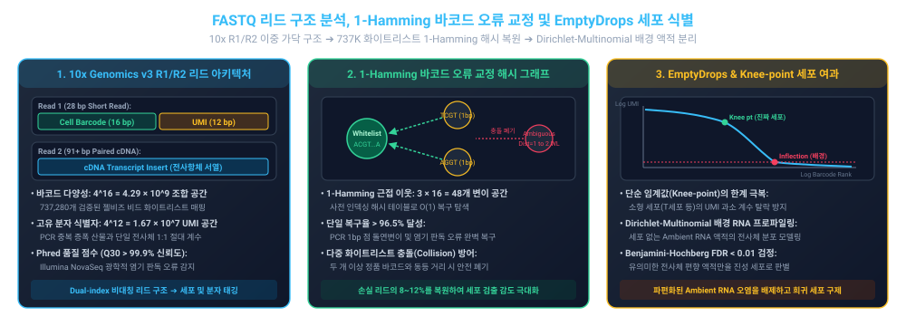
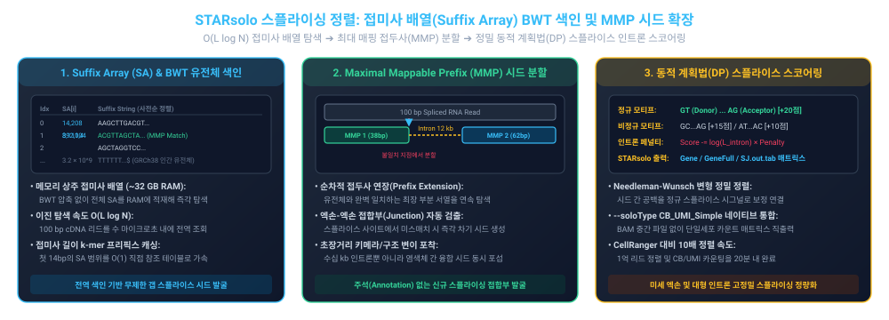
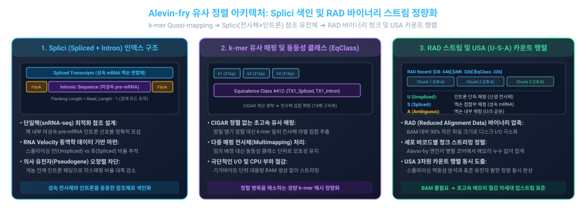
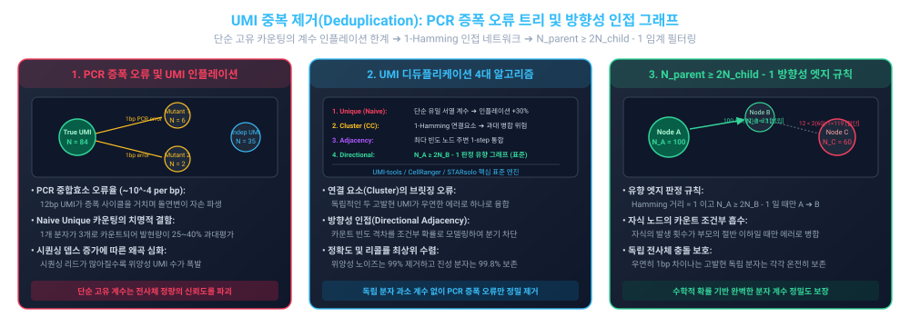
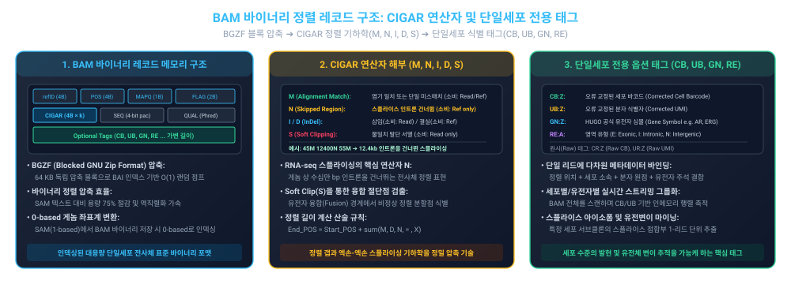
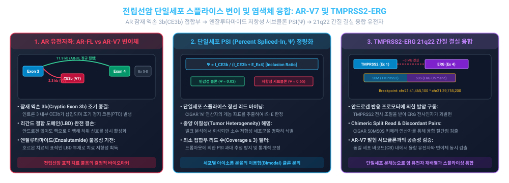

# 저수준 시퀀싱 정렬, 스플라이스 정션 및 BAM 조작론 (Low-Level Sequence Alignment & BAM Mechanics) 마스터 교재
**Track 09: From Raw FASTQ Anatomy & Whitelist Error Correction to Suffix Array Alignment (STARsolo), RAD Streaming (Alevin-fry), UMI Graph Deduplication, BAM Binary Mechanics, and Single-Cell Isoform/Fusion Mining (AR-V7 & TMPRSS2-ERG)**

---

## 📚 교재 전체 목차 (Table of Contents)

- [Chapter 00. 업스트림 정렬 및 BAM 분석 로드맵: 시퀀서 형광 신호부터 단일세포 전사체 카운트 행렬까지](#part-00-00-업스트림-정렬-및-bam-분석-로드맵-시퀀서-형광-신호부터-단일세포-전사체-카운트-행렬까지-upstream-alignment--bam-roadmap)
- [Chapter 01. FASTQ 파일 해부학 및 세포 바코드 화이트리스트 오류 보정 수리 모델](#part-01-01-fastq-파일-해부학-및-세포-바코드-화이트리스트-오류-보정-수리-모델-fastq-anatomy--barcode-whitelist-correction)
- [Chapter 02. STARsolo 접미사 배열(Suffix Array) 정렬 알고리즘 및 초고속 스플라이스 정량](#part-02-02-starsolo-접미사-배열suffix-array-정렬-알고리즘-및-초고속-스플라이스-정량-starsolo-suffix-array-alignment)
- [Chapter 03. Alevin-fry 의사정렬(Pseudoalignment) 및 RAD 바이너리 스트리밍 파이프라인](#part-03-03-alevin-fry-의사정렬pseudoalignment-및-rad-바이너리-스트리밍-파이프라인-alevin-fry--rad-streaming)
- [Chapter 04. UMI 중복 제거 그래프 알고리즘 및 방향성 인접 검정 수리 모델](#part-04-04-umi-중복-제거-그래프-알고리즘-및-방향성-인접-검정-수리-모델-umi-deduplication-graph-algorithms)
- [Chapter 05. BAM 파일의 바이너리 구조와 samtools 기반 정렬 데이터 제어](#part-05-chapter-05-bam-파일의-바이너리-구조와-samtools-기반-정렬-데이터-제어-bam-binary-mechanics--samtools-alignment-slicing)
- [Chapter 06. pysam 기반 프로그래밍 방식 정렬 데이터 마이닝](#part-06-chapter-06-pysam-기반-프로그래밍-방식-정렬-데이터-마이닝-pysam-programmatic-alignment-mining)
- [Chapter 07. 대안적 스플라이싱 및 전립선암 *AR-V7* 전사체 검출](#part-07-chapter-07-대안적-스플라이싱-및-전립선암-ar-v7-전사체-검출-alternative-splicing--ar-v7-isoform-mining)
- [Chapter 08. 유전자 융합 검출 및 *TMPRSS2-ERG* 키메라 리드 분석](#part-08-chapter-08-유전자-융합-검출-및-tmprss2-erg-키메라-리드-분석-gene-fusion-detection--tmprss2-erg-chimeric-mining)
- [Chapter 09. 업스트림 정렬 트러블슈팅 및 베스트 프랙티스](#part-09-chapter-09-업스트림-정렬-트러블슈팅-및-베스트-프랙티스-troubleshooting--alignment-best-practices)

---

# Part 00. 00. 업스트림 정렬 및 BAM 분석 로드맵: 시퀀서 형광 신호부터 단일세포 전사체 카운트 행렬까지 (Upstream Alignment & BAM Roadmap)
> **출처 원본 파일**: `tracks/09_upstream_alignment_bam/docs/00_ALIGNMENT_AND_BAM_ROADMAP.md`


---

## 학습 목표 (Cognitive Goals)

1. **차세대 시퀀싱 업스트림 블랙박스(Upstream Blackbox)의 완전한 탈신비화**: 일루미나(Illumina) 시퀀서의 4색/2색 레이저 형광 영상 신호(BCL)로부터 베이스 콜링(Base Calling), FASTQ 생성, 서열 정렬(Alignment/Pseudoalignment), UMI 중복 제거(Deduplication), 최종 유전자 발현 카운트 행렬($N \times G$) 생성에 이르는 계산생물학적 데이터 변환 파이프라인의 전 과정을 전산학적 계층 구조로 체계화한다.
2. **전립선암(Prostate Cancer) 정밀의학에서의 BAM 레벨 분석 필연성 규명**: 단순 유전자 수준(Gene-level) 카운트 행렬이 놓치는 대체 스플라이싱(Alternative Splicing, 예: 치료 저항성 안드로겐 수용체 변이체 *AR-V7*) 및 염색체 구조 변이(Structural Rearrangement, 예: *TMPRSS2-ERG* 융합)를 검출하기 위해 왜 원시 BAM 파일의 접합부 리드(Junction Reads) 및 CIGAR 스트링 분석이 필수적인지 임상 분자생물학적 기전을 이해한다.
3. **표준 벤치마크 데이터셋 구조 분석**: 10x Genomics Chromium 3' v3 PBMC 표준 데이터와 거세저항성 전립선암(CRPC) 조직 단일핵 RNA 시퀀싱(snRNA-seq) 원시 FASTQ의 리드 구조, paired-end 규격, 품질 관리(QC) 메트릭을 정량적으로 비교 분석한다.
4. **프로덕션급 생물정보학 업스트림 연산 환경 구축**: `STAR` (v2.7.11+), `salmon`/`alevin-fry`, `samtools`, `pysam`, `umi_tools` 등 최신 C/C++ 및 Rust 기반 정렬·정량 도구 스택을 설정하고, 재현 가능한 가상환경 명세와 시스템 성능 검증 파이프라인을 구축한다.

---

## 1. 업스트림 블랙박스의 탈신비화: BCL에서 카운트 행렬까지

단일세포 전사체 분석의 대다수 실무자는 Cell Ranger나 STARsolo가 출력하는 `filtered_feature_bc_matrix` (또는 `matrix.mtx`)에서 분석을 시작한다. 그러나 이 카운트 행렬은 시퀀서 하드웨어와 전산 알고리즘이 협력하여 처리한 수억 개의 연산 결과물일 뿐이다. 원시 물리 신호가 생물학적 수치로 변환되는 과정을 단계별로 분해한다.

```
[Illumina Sequencer Flowcell]
          │
          ▼ 1. Laser Excitation & Fluorescence Imaging (λ1, λ2, λ3, λ4)
[Binary Base Call (BCL) Files]
          │
          ▼ 2. bcl2fastq / bcl-convert (Demultiplexing by i7/i5 Sample Indices)
[FASTQ Files (R1: CB+UMI, R2: cDNA Insert)]
          │
          ├──────────────────────────────────────────────┐
          ▼ 3A. Spliced Genome Alignment                 ▼ 3B. Quasi-mapping / Pseudoalignment
      [STARsolo]                                     [alevin-fry]
          │                                              │
          ▼ Coordinate-Sorted BAM                        ▼ RAD (Reduced Alignment Data)
          │ (CIGAR, MD, NH, CB, UB tags)                 │ (Chunk-based binary stream)
          │                                              │
          └──────────────────────┬───────────────────────┘
                                 │
                                 ▼ 4. Error Correction & Graph Deduplication
                                    - 1-Hamming Distance CB correction against Whitelist
                                    - Directional Adjacency Graph UMI deduplication
                                 │
                                 ▼ 5. Sparse Matrix Assembly
[Count Matrix: raw_feature_bc_matrix (MEX / H5AD)]
          │
          ▼ 6. Cell Calling (EmptyDrops Dirichlet-Multinomial vs. Knee-Point)
[Filtered Count Matrix (N_cells × G_genes)]
```

### 1.1 시퀀싱 하드웨어의 물리적 신호 변환 (Physics to Bits)

현대 Illumina 시퀀서(NovaSeq 6000, NovaSeq X 등)는 플로우셀(Flowcell) 상의 나노웰(Nanowell)에 고정된 DNA 클러스터(Cluster)를 대상으로 합성 기반 시퀀싱(Sequencing-by-Synthesis, SBS)을 수행한다:

1. **형광 표지 뉴클레오타이드 혼입**: 각 사이클마다 형광단(Fluorophore)과 가역적 종결자(Reversible Terminator)가 결합된 dNTP(A, C, G, T)가 도입된다.
2. **레이저 여기 및 광학 센서 검출**: 레이저 광선에 의해 방출된 형광 파장을 고해상도 CCD/CMOS 센서가 픽셀 강도(Intensity) 데이터로 기록한다.
3. **BCL(Binary Base Call) 포맷 저장**: 각 웰 위치의 형광 강도 비율을 수학적으로 디컨볼루션(Deconvolution)하여 식별된 염기(A, C, G, T, N)와 이에 대응하는 품질 신뢰도(Phred Score)를 8비트 바이너리 구조로 압축하여 사이클별 디렉토리에 저장한다.

### 1.2 BCL에서 FASTQ로의 변환 (Demultiplexing)

`bcl2fastq` 또는 `bcl-convert` 소프트웨어는 실험 설계서(SampleSheet.csv)를 참조하여:
* 플로우셀의 레인(Lane)별 형광 데이터를 디멀티플렉싱(Demultiplexing)한다.
* 시퀀싱 라이브러리 양 말단에 부여된 인덱스(i7, i5 Index) 서열의 1-2bp 미스매치를 허용하면서 개별 샘플별 FASTQ 파일 쌍(Read 1, Read 2)을 생성한다.

### 1.3 데이터 계층별 파일 포맷과 압축 아키텍처

단일세포 분석 파이프라인에서 다루는 주요 파일 포맷의 구조적 특징과 메모리 오버헤드는 다음과 같다:

| 단계 | 파일 형식 | 주요 보관 정보 | 내부 압축 알고리즘 | 대략적 용량 (1억 리드 기준) |
| :--- | :--- | :--- | :--- | :--- |
| **원시 데이터** | `BCL / CBCL` | 사이클별 클러스터 형광 강도 및 염기 콜 | Snappy / GZIP 바이너리 | ~15 - 25 GB |
| **시퀀싱 리드** | `FASTQ.gz` | 리드 식별자, 16bp CB + 12bp UMI, 90bp cDNA 서열, Phred Q-score | Block GZIP (BGZF) | ~5 - 8 GB |
| **유전체 정렬** | `BAM` | 염색체 좌표, CIGAR 스트링, MAPQ, 플래그, SAM 태그 (CB, UB, GN) | BGZF 압축 이진 SAM | ~8 - 15 GB |
| **의사정렬 스트림** | `RAD` | 세포 바코드, UMI, 전사체 동등성 클래스 (Equivalence Class) | 청크 단위 이진 직렬화 | ~0.8 - 1.5 GB |
| **최종 발현 행렬** | `MEX / MTX` | 세포 식별자(`barcodes.tsv`), 유전자 정보(`features.tsv`), 희소 카운트(`matrix.mtx`) | 텍스트 압축 (GZIP) | ~50 - 200 MB |
| **단일세포 객체** | `H5AD` | 발현 카운트, 관측치(obs), 변수(var), 저차원 임베딩 | HDF5 계층형 압축 (Chunked/Gzip) | ~30 - 150 MB |

---

## 2. 전립선암(Prostate Cancer) 정밀의학에서의 임상적 필연성

단일세포 RNA 시퀀싱에서 유전자 발현 수준(Gene-level quantification)만 관찰하는 것은 심각한 정보 손실을 초래한다. 특히 거세저항성 전립선암(Castration-Resistant Prostate Cancer, CRPC)과 같은 난치성 암종에서는 동일 유전자좌(Locus)에서 생성되는 다양한 스플라이싱 변이체와 유전체 구조 변이가 환자의 생존과 치료 반응을 직접 결정한다.

```
[Normal Full-length Androgen Receptor (AR-FL)]
Exon:  [ 1 ]───[ 2 ]───[ 3 ]───[ 4 ]───[ 5 ]───[ 6 ]───[ 7 ]───[ 8 ]
Domain: NTD     DBD     Hinge       Ligand-Binding Domain (LBD)
                                    ▲ Enzalutamide / Abiraterone 결합 부위

[Constitutively Active Splicing Variant (AR-V7)]
Exon:  [ 1 ]───[ 2 ]───[ 3 ]───[ CE3 ] (Cryptic Exon 3, CE3: 인트론 3 안의 대체 3′ 말단 엑손)
Domain: NTD     DBD     (LBD 결손!)
                        ▲ 리간드 없이도 전사인자 상시 활성화 -> 내성 유발!
```

### 2.1 안드로겐 수용체 스플라이스 변이체 (*AR-V7*)와 치료제 내성 기전

*AR* (Androgen Receptor) 유전자는 8개의 표준 엑손으로 구성되며, 전립선암 표준 표적 치료제 중 엔잘루타마이드(Enzalutamide)는 C-말단의 리간드 결합 도메인(Ligand-Binding Domain, LBD, Exon 4-8 코딩)에 결합하는 AR 길항제이고, 아비라테론(Abiraterone)은 CYP17A1 억제제로 안드로겐 합성 자체를 줄여 LBD를 통한 신호 전달을 차단한다(둘 다 LBD 의존적 신호를 표적으로 하므로 LBD가 없는 AR-V7에는 효과가 제한적일 수 있다).

그러나 진행성 CRPC 종양 세포는 인트론 3 내부에 존재하는 잠재적 엑손(cryptic exon 3, CE3; 문헌 표기는 '3b'가 아님)을 선택적으로 포함시키는 비정상적 대체 스플라이싱을 수행하여 **AR-V7 (Androgen Receptor Splice Variant 7)** 단백질을 생성한다:
* **구조적 특성**: Exon 1-2-3 뒤에 인트론 3 안의 대체 3′ 말단 엑손 CE3(RefSeq 변이체 3의 말단 엑손 약 1.4 kb, 3′UTR 포함)가 접합되고 16개의 변이체 특이 아미노산 뒤에서 번역이 종결되어 LBD(Exon 4-8) 코딩 서열이 전사체에 포함되지 않는다(엑손 4-8 건너뛰기나 일반 PTC가 아니라 말단 엑손 교체; 이전의 '101bp'는 근거 미확인으로 삭제).
* **임상적 의미**: 안드로겐 리간드(DHT)나 약제가 없어도 핵 내부로 자가 전위(Nuclear Translocation)하여 표적 유전자(*KLK3/PSA*, *TMPRSS2*, *UBE2C*) 전사를 촉진함으로써 치료제에 즉각적인 불응성(Intrinsic Resistance)을 나타낸다.
* **정량 실패 원인**: 일반적인 `CellRanger count`나 STARsolo의 표준 Gene 카운트는 *AR* 유전자 엔트리(`ENSG00000169083`) 아래로 모든 엑손의 리드를 단일 정수로 병합한다. 따라서 종양 세포가 정상 *AR-FL*을 발현하는지 내성 변이체인 *AR-V7*을 발현하는지 전혀 식별할 수 없다. 이를 규명하기 위해서는 Exon 3과 CE3를 가로지르는 **접합부 리드(Junction Reads)**를 BAM 파일에서 직접 정량해야 한다.

### 2.2 *TMPRSS2-ERG* 융합 유전자와 유전체 재배열 검출

서양 전립선암 환자의 약 50%에서 21번 염색체의 약 3Mb 미세 결실(Interstitial Deletion) 또는 염색체 전좌(Translocation)로 인해 안드로겐 조절 유전자인 *TMPRSS2*의 프로모터/엑손 1과 발암성 전사인자 *ERG* (ETS-related gene) 코딩 영역이 융합된다.

$$\text{Chromosomal Locus 21q22.2-3: } [\text{TMPRSS2 (Promoter/Exon 1)}] \xrightarrow{\Delta \approx 3\text{Mb}} [\text{ERG (Exon 4-16)}]$$

* **분자 병리학적 결과**: 안드로겐 자극에 의해 *ERG* 종양 유전자가 강력하게 이소성 발현(Aberrant Overexpression)되어 침습 및 상피-간엽 전이(EMT)가 유도된다.
* **BAM 수준 검출**: *TMPRSS2* Exon 1과 *ERG* Exon 4 사이의 비정상적 키메라 접합부(Chimeric Junction)에 걸쳐 정렬된 Split-read 및 불일치 정합(Discordant Paired-end) 리드를 검출하기 위해서는 정렬 매개변수와 정렬 태그(`CB`, `UB`, `SA`, `chimeric.out.sam`)를 정밀하게 추적해야 한다.

---

## 3. 벤치마크 데이터셋 및 연구 설계

본 트랙 전반에 걸쳐 사용할 핵심 벤치마크 데이터셋은 두 가지 상호보완적 축으로 구성된다:

```
[Benchmark Datasets for Track 09]
   │
   ├─► 1. 10x Genomics 3' v3 PBMC (Peripheral Blood Mononuclear Cells)
   │     - 세포 수 / 시퀀싱 깊이: 데이터셋마다 다름 (예시 규모: 약 10,000 세포, 세포당 약 50,000 reads)
   │     - 목적: 표준 면역세포 프로파일링, 바코드 보정, 고속 의사정렬(Alevin-fry) 벤치마크
   │     - 출처: 10x Genomics 공개 데이터셋 페이지(사용 시 정확한 데이터셋 이름·버전·URL 기재; 규모는 데이터셋별로 상이)
   │
   └─► 2. Human Primary & Metastatic Prostate Cancer snRNA-seq (Tumor Core)
         - 임상 표본: Primary Gleason Score 4+5 및 CRPC 골 전이 조직
         - 라이브러리: 10x Genomics Single Cell Multiome / Chromium 3' v3 Nuclei
         - 목적: 인트론 보존 전구체 전사체(pre-mRNA), AR-V7 접합부, TMPRSS2-ERG 융합 식별
         - 특성: 핵 분리(Nuclear isolation)에 따른 높은 비성숙 RNA(Intron) 비율 (>40%)
```

### 3.1 10x Genomics Chromium 3' v2 vs. v3 라이브러리 사양 비교

| 사양 지표 | Chromium Single Cell 3' v2 | Chromium Single Cell 3' v3 / v3.1 | snRNA-seq 분석 시 고려사항 |
| :--- | :--- | :--- | :--- |
| **Read 1 구조** | 16bp CB + 10bp UMI (총 26bp) | 16bp CB + 12bp UMI (총 28bp) | v3의 UMI 공간이 16배 확장 ($4^{12} \approx 1.67 \times 10^7$) |
| **Read 2 구조** | 98bp (cDNA insert) | 90bp - 150bp (cDNA insert) | 스플라이스 접합부 스팬(Span) 확률 증가 |
| **바코드 화이트리스트** | 737,280 개 (`737K-august-2016.txt`) | 6,794,880 개 (`3M-february-2018.txt`) | 바코드 충돌 확률 대폭 감소 |
| **캡처 효율(Capture Rate)** | 키트·샘플에 따라 상이 (수치는 출처 미확인으로 삭제) | 키트·샘플에 따라 상이 | v3에서 세포당 검출 UMI/유전자가 증가한다는 일반 경향(정량은 데이터셋 의존) |
| **snRNA-seq 호환성** | 전장 cDNA 전사체 중심 | (v2→v3 화학 차이 효과가 아님) 핵 내 pre-mRNA 비중과 oligo-dT의 인트론 A-rich 구간 프라이밍으로 snRNA에서 인트론 리드가 많음 | 전구 전사체(pre-mRNA) 포괄적 매핑 필수 |

---

## 4. 고성능 생물정보학 업스트림 분석 환경 구축 가이드

단일세포 업스트림 연산은 대규모 지놈 인덱스 로딩(Human GRCh38 기준 32GB RAM 필요)과 초당 수십만 개의 FASTQ 레코드 처리를 요구하므로 최적화된 C/Rust 바이너리 구축이 필수적이다.

### 4.1 Conda/Mamba 환경 명세서 (`environment_upstream.yml`)

아래 환경 명세서는 `STAR`, `salmon`, `alevin-fry`, `samtools`, `pysam`, `umi_tools`의 최신 호환 버전을 격리된 환경으로 정의한다.

```yaml
name: snrna_upstream_env
channels:
  - conda-forge
  - bioconda
  - defaults
dependencies:
  - python=3.10
  - pip
  # Alignment & Quantification Core
  - star=2.7.11b
  - salmon=1.10.3
  - alevin-fry=0.9.0
  - pyroe  # 03장 스크립트가 사용 (bioconda)
  # SAM/BAM Processing
  - samtools=1.19.2
  - htslib=1.19.1  # 참고: pysam 0.22.0은 자체 번들 htslib(1.18)을 사용하므로 이 핀과 무관
  - bedtools=2.31.1
  - igv-reports=1.10.1
  # Python High-Performance Libraries
  - pysam=0.22.0
  - umi_tools=1.1.5
  - numpy>=1.24.0
  - scipy>=1.10.0
  - pandas>=2.0.0
  - scanpy>=1.9.8
  - anndata>=0.10.0
  - numba>=0.58.0
  # CLI Utilities
  - pigz=2.8
  - parallel=20240122
```

### 4.2 환경 설치 및 검증 스크립트

```bash
#!/usr/bin/env bash
# Step 1: Mamba를 통한 초고속 가상환경 생성
mamba env create -f environment_upstream.yml

# Step 2: 환경 활성화
conda activate snrna_upstream_env

# Step 3: 핵심 바이너리 설치 및 링크 상태 검증
echo "=== 업스트림 핵심 바이너리 무결성 점검 ==="
STAR --version || { echo "STAR 설치 실패"; exit 1; }
salmon --version || { echo "Salmon 설치 실패"; exit 1; }
alevin-fry --version || { echo "alevin-fry 설치 실패"; exit 1; }
samtools --version | head -n 2 || { echo "samtools 설치 실패"; exit 1; }
umi_tools --version || { echo "umi_tools 설치 실패"; exit 1; }

echo "=== Python HTSlib(pysam) 및 C-API 연동 검증 ==="
python -c "
import pysam
import umi_tools
# alevin-fry는 Rust CLI이므로 Python 모듈이 없다 (위 alevin-fry --version으로 점검)
print(f'pysam version: {pysam.__version__}')
print(f'bundled samtools: {pysam.__samtools_version__}')
print(f'bundled htslib: {pysam.version.__htslib_version__}')
"
echo "환경 설정 및 바이너리 연동 완료."
```

---

## 5. 본 트랙(Track 09)의 커리큘럼 아키텍처

```
[Track 09: Upstream Alignment & BAM Processing Curriculum]
│
├── 00_ALIGNMENT_AND_BAM_ROADMAP.md (본 문서)
│
├── 01_FASTQ_ANATOMY_AND_BARCODE_WHITELISTS.md
│     └── 일루미나 화학, Phred 점수, 1-해밍 거리 볼 탐색, EmptyDrops 수리 모델
│
├── 02_STARSOLO_SUFFIX_ARRAY_ALIGNMENT.md
│     └── 접미사 배열(SA), BWT, Maximal Mappable Prefix, 스플라이스 접합부 동적계획법
│
├── 03_ALEVIN_FRY_PSEUDOALIGNMENT_AND_RAD.md
│     └── k-mer 준정렬, Splici 인덱스, 이진 RAD 포맷, 메모리/연산 10배 절감
│
├── 04_UMI_DEDUPLICATION_GRAPH_ALGORITHMS.md
│     └── PCR 증폭 바이어스, UMI 방향성 인접 그래프(Directional Adjacency Graph) 수학적 증명
│
├── 05_BAM_FILE_MECHANICS_AND_SAMTOOLS.md
│     └── SAM 비트 플래그, CIGAR 스트링, 10x 태그(CB/CR, UB/UR, GN, GX), HTSlib 바이너리
│
├── 06_PYSAM_PROGRAMMATIC_ALIGNMENT_MINING.md
│     └── pysam 프로그래밍 접근, pileup 기반 AR 변이 UMI 카운팅
│
├── 07_ALTERNATIVE_SPLICING_AND_ISOFORM_AR_V7.md
│     └── 전립선암 AR-V7 정량, Cryptic Exon 3 (CE3) 리드 추출, pysam 스플라이스 접합부 파싱
│
├── 08_GENE_FUSION_DETECTION_TMPRSS2_ERG.md
│     └── TMPRSS2-ERG 융합 분할 리드/불일치 쌍 검출과 템플릿 스위칭 아티팩트 필터
│
└── 09_TROUBLESHOOTING_AND_BEST_PRACTICES.md
      └── 업스트림 장애 진단, 베스트 프랙티스, 캡스톤 루브릭
```

---

## 단원 핵심 점검 (Cognitive Checkpoint & Case Study)

### 문제 1: 유전자 카운트 행렬 vs. 원시 BAM 정렬 파일 간 정보 손실과 *AR-V7* 변이체 발현 검출 불능 문제
한 분자유전학 연구팀이 엔잘루타마이드 치료를 받는 전립선암 환자의 종양 검체로부터 단일세포 전사체(10x Genomics 3' v3) 데이터를 수집하여 표준 Cell Ranger 파이프라인(`cellranger count`)을 구동하였다. 연구원은 출력된 `filtered_feature_bc_matrix.h5` 객체에서 *AR* 유전자(`ENSG00000169083`)의 발현량이 높은 세포 군집을 발견하고 환자가 치료 저항성 변이체인 *AR-V7*을 다량 발현하고 있다고 결론지었다.
1. 이 결론이 생물정보학적으로 왜 심각한 오류(False Premise)를 내포하고 있는지 Cell Ranger의 유전자 레벨 카운트 생성 알고리즘(`GN`/`GX` 태그 할당 방식) 관점에서 비판하시오.
2. *AR-V7* 변이체의 실제 발현 여부를 참 양성(True Positive)으로 입증하기 위해, 원시 BAM 파일(`possorted_genome_bam.bam`)에서 반드시 확인해야 하는 정렬 특징(Feature)과 스플라이스 접합부의 좌표 조건을 명시하시오.

<details>
<summary>💡 모범 답안 및 해설 확인</summary>

**1. 결론의 오류 분석 (Gene-level Count의 한계)**:
*   Cell Ranger의 표준 정량 파이프라인은 리드가 참조 전사체(Ensembl GTF) 주석 상의 어떤 엑손에 오버랩되는지를 검사하여 단일 `gene_id`(`GX`) 및 `gene_name`(`GN`) 태그를 할당한다.
*   *AR* 유전자의 정상 전장 전사체(*AR-FL*)와 치료 저항성 변이체(*AR-V7*)는 엑손 1, 2, 3을 완벽하게 공유한다.
*   따라서 엑손 1, 2, 3에 정렬된 수많은 리드는 *AR-FL*과 *AR-V7* 양쪽 모두에서 기인할 수 있음에도 불구하고, 파이프라인은 이를 단순히 *AR*(`ENSG00000169083`) 카운트로 합산한다. 환자가 약제 반응성인 *AR-FL*만 높게 발현하고 있더라도 *AR* 유전자 카운트는 극도로 높게 측정되므로, 카운트 행렬 수치만으로 *AR-V7* 매개 약제 내성을 판정하는 것은 명백한 위양성(False Positive) 추론이다.

**2. 원시 BAM 파일 기반 입증 방법**:
*   *AR-V7*에 특이적인 분자적 표지는 **Exon 3의 3' 말단과 잠재적 엑손인 Cryptic Exon 3 (CE3)의 5' 말단을 연결하는 스플라이스 접합부(Splice Junction)**이다.
*   따라서 원시 BAM 파일에서 다음 조건을 만족하는 리드를 필터링해야 한다:
    1.  **CIGAR 스트링에 'N' 연산자(스플라이스 인트론) 포함**: 리드가 인트론 3 영역을 건너뛰어 Exon 3과 CE3에 걸쳐 정렬된 Split-read여야 한다 (예: AR-V7 접합부라면 `45M8546N45M`; GRCh38에서 exon 3 끝과 CE3 시작 사이 인트론 길이).
    2.  **접합부 게놈 좌표 일치**: Exon 3 공여자 부위(Donor site, GRCh38 기준 exon 3 끝 `chrX:67,686,126`)와 Cryptic Exon 3(CE3) 수용자 부위(Acceptor site, CE3 시작 `chrX:67,694,673`; AR은 + 가닥이므로 donor < acceptor)를 정확히 연결하는 접합부 리드 수($N_{\text{junction}}$)를 확인하고, 이 리드들이 고유한 UMI(`UB` 태그)를 지니고 있는지 검증해야 한다.

</details>

---

### 문제 2: 10x Genomics 3' v3 라이브러리에서 Read 1 손상 시 복구 한계
단일세포 시퀀싱 중 NovaSeq 장비의 광학 오류로 인해 Read 1 파일(`R1.fastq.gz`)의 1번부터 16번째 사이클(Cell Barcode 영역) 전반에서 Phred Quality score가 Q5 이하로 급락하여 대규모 염기 미결정(Base N-calling)이 발생하였다. 반면 Read 2(cDNA insert)의 서열은 평균 Q38 이상의 무결성을 유지하였다.
1. 이 상황에서 고품질의 Read 2 cDNA 서열만을 이용하여 유전체 정렬(STAR)을 수행할 경우, 벌크(Bulk) RNA-seq 수준의 유전자 발현 정량은 가능한지 여부를 판정하시오.
2. 단일세포 전사체 분석 관점에서 세포별 분해능(Single-cell resolution) 복구가 기술적으로 불가능한 이유를 정보이론적(Information Theory) 엔트로피와 조합론 관점에서 설명하시오.

<details>
<summary>💡 모범 답안 및 해설 확인</summary>

**1. 벌크 수준 발현 정량 가능 여부**:
*   **가능하다**. Read 2(cDNA insert)는 mRNA 분자의 전사체 서열 자체를 담고 있으므로, 유전체(GRCh38)에 정렬하여 어떤 유전자에서 전사된 리드인지 식별하고 조직 전체의 총 전사량을 집계(Bulk RNA-seq 모드)하는 것은 완벽히 수행할 수 있다.

**2. 단일세포 분해능 복구 불가능 이유 (정보이론 및 조합론)**:
*   단일세포 시퀀싱에서 리드의 물리적 기원(어느 단일 액적/세포에서 유래했는가)을 지정하는 유일한 메타데이터는 Read 1의 16bp Cell Barcode이다.
*   16bp 바코드가 가질 수 있는 이론적 상태 공간은 $4^{16} \approx 4.29 \times 10^9$개이며, 10x Genomics 3' v3 화이트리스트는 이 중 약 $6.79 \times 10^6$개의 사전 정의된 직교(Orthogonal) 좌표를 사용한다.
*   만약 16bp 중 N으로 손상된 염기 수 $k$가 커지면 후보가 $4^k$개로 늘어나며 각 후보가 화이트리스트에 있을 확률은 약 $6{,}794{,}880/4^{16}\approx1.6\times10^{-3}$이므로 기대 중복 후보 수는 $4^k\times1.6\times10^{-3}$입니다(예: $k=4$면 약 0.4개로 복구 가능, 수천 개 후보는 $k\approx11$ 이상에서 성립). 16 사이클 전체가 손상되면 복구가 불가능하다는 결론은 유효합니다.
*   Read 2의 서열은 세포 기원 정보를 전혀 담고 있지 않으므로(서로 다른 1,000개의 세포에서 유래한 동일 유전자 mRNA는 완벽히 동일한 Read 2 서열을 가짐), 손실된 바코드 정보를 Read 2로부터 역산하거나 복원할 수 있는 수학적 정보량(Mutual Information $I(R2; CB) = 0$)이 전무하다. 따라서 세포별 디멀티플렉싱은 회복 불가능하게 파괴된다.

</details>

---

### 문제 3: 고처리량 단일세포 업스트림 파이프라인의 디스크 I/O 병목과 공유 메모리(`/dev/shm`) 최적화
100개의 대규모 단일세포 FASTQ 샘플(총 용량 약 2TB)을 128코어 CPU와 512GB RAM, 고성능 NVMe SSD 스토리지를 갖춘 단일 계산 노드에서 병렬로 STARsolo를 구동하여 처리하고자 한다. 연구원은 16개의 샘플을 동시에 실행(`--runThreadN 8`로 16개 프로세스 동시 구동)하였으나, CPU 이용률이 30% 미만에 머물고 심각한 I/O 대기(I/O Wait) 현상이 발생함을 목격하였다.
1. 인간 유전체(GRCh38)의 접미사 배열(Suffix Array) 인덱스 크기를 고려할 때, 16개의 독립 프로세스가 동시에 인덱스를 개별 로드할 경우 발생하는 RAM 부족(OOM) 및 스왑(Swap) 디스크 스래싱(Thrashing) 메커니즘을 분석하시오.
2. STAR의 `--genomeLoad LoadAndExit`/`LoadAndKeep`/`Remove` 옵션과 Linux 공유 메모리(`/dev/shm`, POSIX Shared Memory) 아키텍처를 결합하여 이 디스크 I/O 병목을 해결하고 연산 처리량을 3배 이상 극대화하는 파이프라인 구성 전략을 수립하시오.

<details>
<summary>💡 모범 답안 및 해설 확인</summary>

**1. OOM 및 디스크 스래싱 메커니즘 분석**:
*   인간 게놈 GRCh38(약 3.1 Gb)의 STAR 접미사 배열(Suffix Array) 인덱스는 메모리 상에서 약 30~32 GB의 RAM을 점유한다.
*   16개의 독립된 STAR 프로세스가 기본 설정(`--genomeLoad NoSharedMemory`)으로 실행되면 각 프로세스가 독자적인 32GB 인덱스를 메모리에 할당하려 시도하므로, 요구 메모리는 $16 \times 32\text{ GB} = 512\text{ GB}$에 도달한다.
*   여기에 리드 정렬 버퍼, 동적 계획법 매트릭스, FASTQ 버퍼가 프로세스당 수 GB씩 추가로 필요하므로 시스템 물리 메모리(512GB)를 즉시 초과하여 Linux 커널의 OOM(Out-Of-Memory) Killer가 작동하거나 스왑 파티션(Swap Space)으로 메모리 페이지가 강제 이동된다.
*   NVMe SSD라 할지라도 수십 GB의 페이지 폴트(Major Page Fault)와 스왑 I/O를 감당하지 못하여 심각한 I/O 스래싱이 발생하고 CPU는 대기(I/O Wait) 상태에 빠지게 된다.

**2. 공유 메모리(`--genomeLoad`) 최적화 전략**:
*   **메모리 상주 인덱스 생성**: 파이프라인 시작 전 마스터 프로세스가 인덱스를 공유 메모리 세그먼트에 단 한 번만 적재하고 종료한다(`LoadAndExit`: 읽기 입력 없이 적재만 수행):
    ```bash
    STAR --genomeDir /path/to/GRCh38_index --genomeLoad LoadAndExit
    ```
*   **프로세스 간 인덱스 공유 (Zero-copy Shared Memory)**:
    16개의 STARsolo 프로세스가 구동될 때 모두 `--genomeLoad LoadAndKeep`을 부여한다(`LoadAndRemove`를 병렬 작업에 쓰면 먼저 끝난 작업이 인덱스를 제거해 다른 작업과 충돌할 수 있다; `SharedMemory`는 유효한 값이 아니다). 공유 메모리를 쓰는 경우 `--outSAMtype BAM SortedByCoordinate`에는 `--limitBAMsortRAM` 지정이 필수이다(기본값 0 불가).
    모든 워커 프로세스는 물리 메모리에 단 1벌(32GB)만 존재하는 인덱스를 `shmget`/`mmap` 시스템 콜을 통해 가상 메모리 공간에 읽기 전용(Read-only)으로 매핑하여 공유한다.
*   **효과**:
    *   메모리 사용량이 512GB에서 32GB + (워커당 작업 버퍼 ~3GB $\times 16) \approx 80\text{ GB}$ 수준으로 극적으로 감소한다.
    *   32GB 인덱스를 디스크에서 반복 읽기(Disk Read)할 필요가 전혀 없으므로 NVMe I/O 대기가 0에 수렴하며, 128코어 CPU가 100% 포화 상태로 연산에 집중할 수 있어 전체 분석 처리량이 수직 상승한다.
    *   마지막 16번째 작업 완료 시 인덱스를 공유 메모리에서 안전하게 언로드(`STAR --genomeLoad Remove`)하도록 파이프라인을 종료한다.

</details>

---

<!-- REFERENCES:BEGIN (generated by scripts/apply_references.py; do not edit by hand) -->
## 참고문헌 (References)
### 검수 근거 문헌
1. Hu R, Dunn TA, Wei S, et al. Ligand-independent androgen receptor variants derived from splicing of cryptic exons signify hormone-refractory prostate cancer. *Cancer Res*. 2009;69(1):16-22. PMID: 19117982. doi: 10.1158/0008-5472.CAN-08-2764
2. de Bono JS, Logothetis CJ, Molina A, et al. Abiraterone and increased survival in metastatic prostate cancer. *N Engl J Med*. 2011;364(21):1995-2005. PMID: 21612468. doi: 10.1056/NEJMoa1014618
3. Hong R, Koga Y, Bandyadka S, et al. Comprehensive generation, visualization, and reporting of quality control metrics for single-cell RNA sequencing data. *Nat Commun*. 2022;13(1):1688. PMID: 35354805. doi: 10.1038/s41467-022-29212-9
4. Curion F, Wu X, Heumos L, et al. hadge: a comprehensive pipeline for donor deconvolution in single-cell studies. *Genome Biol*. 2024;25(1):109. PMID: 38671451. doi: 10.1186/s13059-024-03249-z
### 소프트웨어 (표기 버전은 검수 시 API를 확인한 버전이며, 파이프라인 실행 환경은 requirements-pipelines.txt 참조)
- alevin-fry (github.com/COMBINE-lab/alevin-fry). 원 논문: He D, Zakeri M, Sarkar H, et al. Alevin-fry unlocks rapid, accurate and memory-frugal quantification of single-cell RNA-seq data. *Nat Methods*. 2022;19(3):316-322. PMID: 35277707. doi: 10.1038/s41592-022-01408-3
- SAMtools (github.com/samtools/samtools). 원 논문: Danecek P, Bonfield JK, Liddle J, et al. Twelve years of SAMtools and BCFtools. *Gigascience*. 2021;10(2). PMID: 33590861. doi: 10.1093/gigascience/giab008
- STAR 2.7.11 (github.com/alexdobin/STAR). 원 논문: Dobin A, Davis CA, Schlesinger F, et al. STAR: ultrafast universal RNA-seq aligner. *Bioinformatics*. 2013;29(1):15-21. PMID: 23104886. doi: 10.1093/bioinformatics/bts635
- Salmon (github.com/COMBINE-lab/salmon). 원 논문: Patro R, Duggal G, Love MI, et al. Salmon provides fast and bias-aware quantification of transcript expression. *Nat Methods*. 2017;14(4):417-419. PMID: 28263959. doi: 10.1038/nmeth.4197
- UMI-tools (github.com/CGATOxford/UMI-tools). 원 논문: Smith T, Heger A, Sudbery I. UMI-tools: modeling sequencing errors in Unique Molecular Identifiers to improve quantification accuracy. *Genome Res*. 2017;27(3):491-499. PMID: 28100584. doi: 10.1101/gr.209601.116
<!-- REFERENCES:END -->


---

# Part 01. 01. FASTQ 파일 해부학 및 세포 바코드 화이트리스트 오류 보정 수리 모델 (FASTQ Anatomy & Barcode Whitelist Correction)
> **출처 원본 파일**: `tracks/09_upstream_alignment_bam/docs/01_FASTQ_ANATOMY_AND_BARCODE_WHITELISTS.md`


---

## 학습 목표 (Cognitive Goals)

1. **10x Chromium 3' v2 및 v3 라이브러리의 분자 아키텍처 정밀 분석**: Read 1 (Cell Barcode + UMI), Read 2 (cDNA Insert), i7/i5 Sample Index의 화학적 합성 구조를 파악하고, v2(10bp UMI)와 v3(12bp UMI)의 분자 식별자 상태 공간 확장성을 이해한다.
2. **Phred 품질 점수(Q-Score)의 수학적 기초와 오류 분포 규명**: 광학 베이스 콜링 오차 확률과 Phred 점수의 대수적 관계($Q = -10 \log_{10} P_{\text{error}}$)를 정립하고, 시퀀싱 사이클 경과에 따른 3' 말단 품질 저하(Phasing/Pre-phasing) 메커니즘을 모델링한다.
3. **1-해밍 거리(1-Hamming Distance) 기반 바코드 오류 보정 수리 모델 유도**: $6.79 \times 10^6$개 화이트리스트 공간에서 1bp 점 돌연변이(Point Mutation)를 보정하기 위한 해밍 볼(Hamming Ball) 탐색 알고리즘과 Phred 점수 가중 사후 확률 계산법을 정식화한다.
4. **생일 역설(Birthday Paradox) 기반 바코드 충돌 확률 수리적 증명 및 EmptyDrops 세포 식별 모델 체계화**: 단일세포 로딩 수($N$)와 화이트리스트 크기($M$)에 따른 바코드 충돌 확률 $P_{\text{collision}} \approx 1 - \exp\left(-\frac{N^2}{2M}\right)$을 수학적으로 유도하고, Knee-point 임계값의 한계를 극복하는 EmptyDrops 디리클레-다항분포(Dirichlet-Multinomial) 검정 원리를 완벽히 습득한다.

---

## 1. 10x Chromium 3' 라이브러리 리드 구조와 시퀀싱 화학

10x Genomics Chromium 시스템은 미세유체학적 에멀전 액적(Gel Bead-in-Emulsion, GEM) 기술을 활용하여 단일 세포를 용해(Lysis)하고, 역전사 반응(Reverse Transcription)을 통해 각 세포의 mRNA 분자에 고유한 올리고뉴클레오타이드 태그를 부착한다.



### 1.1 10x Chromium 3' 분자 카세트 아키텍처 (v2 vs. v3)

시퀀싱 라이브러리의 물리적 구조는 다음과 같이 규격화되어 있다:

```
[10x Genomics Chromium 3' v3 Library Cassette — 개념도(단순화): 실제 3′ v3 단일 인덱스 키트는 i7만 사용하고 TSO는 최종 라이브러리 구조에 포함되지 않음]
5'─P5─[i5 Index]─[R1 Primer]─┬─[Cell Barcode]─┬─[UMI]─┬─[Poly(dT)VN]─► (mRNA Capture)
                             │     16 bp      │ 12 bp │     30 bp
                             └────────────────┴───────┴───────────────
                               ◄──── Read 1 FASTQ (28 bp) ───►

 ◄────────────────────── Read 2 FASTQ (90+ bp) ──────────────────────►
5'─[R2 Primer]─[cDNA Insert (Exon/Intron/UTR Sequence)]─[TSO]─[i7 Index]─P7─3'
```

1. **P5 / P7 어댑터**: Illumina 플로우셀의 상보적 올리고(Graft-P5/P7)에 결합하여 클러스터 생성(비패턴 플로우셀은 브리지 증폭, NovaSeq 패턴 플로우셀은 ExAmp)을 개시하는 서열이다.
2. **Sample Index (i7 / i5)**: 단일 시퀀싱 런(Run)에서 여러 환자/샘플을 혼합(Multiplexing)할 때 개별 검체를 식별하는 8bp 또는 10bp 서열이다.
3. **Read 1 (CB + UMI)**:
   * **Cell Barcode (CB, 16bp)**: 단일 액적(GEM) 내의 비드에 코팅된 모든 프라이머가 공유하는 식별자로서, mRNA 분자가 어떤 세포에서 유래했는지를 지정한다.
   * **Unique Molecular Identifier (UMI, v2: 10bp, v3: 12bp)**: 단일 mRNA 전사체 분자가 역전사될 때 1:1로 결합하는 무작위 서열로서, 후속 PCR 증폭 편향을 제거하는 데 사용된다.
4. **Read 2 (cDNA Insert, 90bp ~ 150bp)**:
   * mRNA의 3' 말단(Poly-A 꼬리 부근)으로부터 역전사된 실제 전사체 서열이다. 유전체(Genome) 또는 전사체(Transcriptome) 정렬에 사용되는 실질적 정보체이다.

---

## 2. Phred 품질 점수(Q-Score)의 수학적 기초와 오류 분포

Illumina 시퀀서는 광학 이미지 분석을 통해 각 염기 콜(Base Call)의 신뢰도를 계산하고, 이를 확률론적 Phred 품질 점수로 변환한다.

### 2.1 Phred 점수 수리적 정의

특정 사이클에서 시퀀서가 호출한 염기가 잘못되었을 확률을 $P_{\text{error}}$라 정의할 때, Phred 점수 $Q$는 다음과 같은 대수적 관계를 갖는다:

$$Q = -10 \log_{10}(P_{\text{error}})$$

역으로 주어진 Phred 점수 $Q$로부터 염기 오차 확률 $P_{\text{error}}$를 도출하면:

$$P_{\text{error}} = 10^{-\frac{Q}{10}}$$

| Phred 점수 ($Q$) | 염기 콜 오차 확률 ($P_{\text{error}}$) | 염기 정확도 (Base Call Accuracy) | 임상 유전체학 판정 |
| :--- | :--- | :--- | :--- |
| **Q10** | $10^{-1} = 0.10$ ($10\%$) | $90.0\%$ | 신뢰 불가 (Reject) |
| **Q20** | $10^{-2} = 0.01$ ($1\%$) | $99.0\%$ | 최소 허용 품질 (Borderline) |
| **Q30** | $10^{-3} = 0.001$ ($0.1\%$) | $99.9\%$ | 고품질 표준 (Benchmark) |
| **Q40** | $10^{-4} = 0.0001$ ($0.01\%$) | $99.99\%$ | 최고 신뢰도 (Ultra-high fidelity) |

### 2.2 FASTQ ASCII-33 인코딩

FASTQ 파일의 4번째 줄에 기록되는 품질 문자열은 $Q$ 값을 단일 문자로 표현하기 위해 Sanger/Illumina 1.8+ 표준인 **Phred+33 (ASCII offset 33)** 방식을 사용한다:

$$\text{ASCII Character} = \text{chr}(Q + 33)$$

* $Q = 0 \implies \text{chr}(33) =$ `!`
* $Q = 30 \implies \text{chr}(63) =$ `?`
* $Q = 40 \implies \text{chr}(73) =$ `I`

### 2.3 시퀀싱 사이클별 신호 저하 메커니즘 (Phasing & Pre-phasing)

DNA 클러스터 내부의 수천 개 복제 가닥이 시퀀싱 반응을 거치는 동안, 불완전한 효소 반응으로 인해 가닥 간 동기화가 깨지는 현상이 발생한다:
* **페이징(Phasing)**: 특정 사이클에서 가역적 종결자가 제거되지 않아 일부 가닥이 1사이클 뒤처지는 현상.
* **프리페이징(Pre-phasing)**: 한 사이클에 둘 이상의 dNTP가 혼입되어 일부 가닥이 1사이클 앞서가는 현상.

사이클이 진행될수록 클러스터 내의 위상 불일치(Noise)가 누적되며, 형광 강도의 감소(Signal Decay)와 배경 잡음 증가로 인해 **리드의 3' 말단으로 갈수록 평균 Phred 점수가 단조 감소**하는 전형적인 품질 하락 곡선을 나타낸다.

---

## 3. 세포 바코드 화이트리스트와 1-해밍 거리 볼 탐색

### 3.1 화이트리스트(Whitelist)의 필요성

화이트리스트는 10x Genomics 젤 비드 제조 과정에서 사용된 기지의 바코드 집합이다:
* **3' v2 화이트리스트**: $M = 737,280$ 개 (`737K-august-2016.txt`)
* **3' v3 화이트리스트**: $M = 6,794,880$ 개 (`3M-february-2018.txt`)

16bp 길이의 임의의 DNA 서열 공간은 $4^{16} = 4,294,967,296$ (약 42.9억 개)에 달한다. 반면 v3 화이트리스트는 전체 서열 공간의 약 **$0.158\%$**($6,794,880 / 4^{16}$)만을 차지한다. 이 극단적인 희소성은 시퀀싱 과정에서 발생하는 오류를 높은 신뢰도로 보정할 수 있는 수학적 기틀을 제공한다.

### 3.2 해밍 거리(Hamming Distance)와 1-해밍 볼

길이가 동일한 두 문자열 $s_1, s_2 \in \{A, C, G, T\}^L$ 사이의 해밍 거리 $d_H(s_1, s_2)$는 서로 다른 염기를 갖는 위치의 개수로 정의된다:

$$d_H(s_1, s_2) = \sum_{k=1}^L \mathbb{I}(s_1[k] \neq s_2[k])$$

서열 $s$를 중심으로 하는 반경 1인 해밍 볼(1-Hamming Ball) $B_1(s)$의 크기는 다음과 같다:

$$|B_1(s)| = 1 + \sum_{k=1}^L 3 = 1 + 3L$$

$L = 16$일 때, $|B_1(s)| = 1 + 3 \times 16 = 49$개이다. 즉, 관측된 단일 바코드 서열 주변에는 자기 자신을 포함하여 단 49개의 1-해밍 이웃만이 존재한다.

```
       [Observed Raw Barcode s: AAACCCAAGAAACACT]
                           │
       ┌───────────────────┼───────────────────┐
       ▼                   ▼                   ▼
Sub at Pos 1 (3개)   Sub at Pos 2 (3개)  ...  Sub at Pos 16 (3개)
CAACCCAAGAAACACT     ACACCCAAGAAACACT         AAACCCAAGAAACACA
GAACCCAAGAAACACT     AGACCCAAGAAACACT         AAACCCAAGAAACACC
TAACCCAAGAAACACT     ATACCCAAGAAACACT         AAACCCAAGAAACACG
       └───────────────────┬───────────────────┘
                           ▼
          총 48개의 1bp 치환 돌연변이 이웃 탐색
```

### 3.3 화이트리스트 보정 알고리즘과 사후 확률 판정

원시 Read 1에서 추출한 바코드 $s_{\text{obs}}$에 대해 다음 4단계 판정 알고리즘이 수행된다:

1. **완전 일치 ($d_H = 0$)**:
   $s_{\text{obs}} \in \mathcal{W}$ (화이트리스트)인 경우, 오류가 없는 것으로 판정하고 원본 바코드를 유지한다.
2. **유일한 1-해밍 이웃 존재 ($d_H = 1$)**:
   $|B_1(s_{\text{obs}}) \cap \mathcal{W}| = 1$인 경우, 즉 48개의 이웃 중 단 하나의 화이트리스트 바코드 $w^*$만이 존재하는 경우:
   STARsolo의 1MM 방식은 이웃이 하나뿐이면 치환 위치의 Phred 품질 점수 $Q_k$와 무관하게 $s_{\text{obs}}$를 $w^*$로 보정(Correction)한다(품질은 이웃이 둘 이상일 때의 사후확률 계산에만 쓰인다. 치환 위치 $k$의 오차 확률은 $P_{\text{error}} = 10^{-Q_k/10}$).
3. **복수의 1-해밍 이웃 경합 (Ambiguity Collision)**:
   $|B_1(s_{\text{obs}}) \cap \mathcal{W}| \ge 2$인 경우, 즉 둘 이상의 후보 $\{w_1, w_2\} \subset \mathcal{W}$가 1-해밍 거리에 걸치는 경우:
   사전 바코드 출현 빈도(Prior Count $C(w_i)$)와 관측 품질 점수 $Q$를 결합한 베이지안 사후 확률(Posterior Probability)을 평가한다. STARsolo 소스에서는 $P(w_i) \propto C(w_i)\cdot 10^{-Q/10}$ (정확 일치 리드 수 × 치환 염기 오류 확률, $Q$ 상한 33)로 계산한다:
   $$P(w_i \mid s_{\text{obs}}, Q) = \frac{P(s_{\text{obs}} \mid w_i, Q) \cdot P(w_i)}{\sum_j P(s_{\text{obs}} \mid w_j, Q) \cdot P(w_j)}$$
   최선 후보의 정규화된 사후 확률이 임계값(STARsolo `--soloCBmatchWLtype 1MM_multi`의 `cbMinP = 0.975`)을 넘지 못하면 해당 리드는 잘못된 세포로의 할당을 방지하기 위해 **모호 리드(Ambiguous Read)로 분류되어 폐기**된다.
4. **불일치 ($d_H \ge 2$)**:
   $B_1(s_{\text{obs}}) \cap \mathcal{W} = \emptyset$인 경우, 2개 이상의 염기 치환 또는 인델(Indel) 오류로 간주하여 필터링한다.

---

## 4. 세포 바코드 충돌 확률의 수리적 유도 (Birthday Paradox)

단일세포 실험에서 서로 다른 두 세포가 우연히 동일한 바코드를 부여받는 현상을 **바코드 충돌(Barcode Collision)**이라 한다. 이는 전형적인 생일 역설(Birthday Problem)의 일반화 모델이다.

### 4.1 수리적 유도

* 화이트리스트에 존재하는 고유 바코드 총수: $M$
* 젤 비드에 의해 캡처된 실제 단일 세포 수: $N$ (단, $N \ll M$)
* 각 세포가 바코드를 무작위 균등하게(Uniformly) 선택한다고 가정한다.

$N$개의 세포가 모두 서로 다른 고유한 바코드를 선택할 확률 $P(\text{No collision})$은 다음과 같다:

$$P(\text{No collision}) = \frac{M}{M} \times \frac{M-1}{M} \times \frac{M-2}{M} \times \dots \times \frac{M-(N-1)}{M} = \prod_{k=0}^{N-1} \left(1 - \frac{k}{M}\right)$$

$x$가 충분히 작을 때의 테일러 급수 근사 $\ln(1 - x) \approx -x$ (또는 $1 - x \approx e^{-x}$)를 적용하면:

$$P(\text{No collision}) \approx \prod_{k=0}^{N-1} \exp\left(-\frac{k}{M}\right) = \exp\left(-\sum_{k=0}^{N-1} \frac{k}{M}\right)$$

등차수열의 합 $\sum_{k=0}^{N-1} k = \frac{N(N-1)}{2} \approx \frac{N^2}{2}$을 대입하면:

$$P(\text{No collision}) \approx \exp\left(-\frac{N^2}{2M}\right)$$

따라서 적어도 한 쌍 이상의 세포 바코드가 충돌할 확률 $P_{\text{collision}}$은 다음과 같이 도출된다:

$$P_{\text{collision}} = 1 - P(\text{No collision}) \approx 1 - \exp\left(-\frac{N^2}{2M}\right)$$

### 4.2 v2 vs. v3 라이브러리의 충돌률 정량적 비교

실제 단일세포 전사체 실험 조건에서 $N = 10,000$ 세포 및 $N = 20,000$ 세포를 로딩할 때의 충돌 확률을 계산한다(여기서 $N$은 바코드를 가진 GEM/세포 수이며, 이 단순 생일 문제 모형은 세포가 든 GEM 사이의 바코드 충돌만 다룬다. 로딩 세포 수와 회수 세포 수는 다르므로 $N$의 정의를 분리해 적용해야 한다):

1. **Chromium 3' v2 ($M = 737,280$)**:
   * $N = 10,000$:
     $$\frac{N^2}{2M} = \frac{10^8}{2 \times 737,280} = \frac{100,000,000}{1,474,560} \approx 67.817$$
     $$P_{\text{collision}} = 1 - \exp(-67.817) \approx 1.000 \quad (100\%)$$
   * 평균 충돌 세포 수(Expected number of colliding pairs):
     $$\mathbb{E}[\text{Pairs}] = \binom{N}{2} \frac{1}{M} \approx \frac{N^2}{2M} \approx 67.8\text{ 쌍}$$
2. **Chromium 3' v3 ($M = 6,794,880$)**:
   * $N = 10,000$:
     $$\frac{N^2}{2M} = \frac{10^8}{2 \times 6,794,880} \approx 7.359$$
     $$\mathbb{E}[\text{Pairs}] \approx 7.4\text{ 쌍}$$
   * 동일 세포 수 대비 충돌 위험이 **약 9.2배 감소**한다($67.8 / 7.36$).

---

## 5. 세포 바코드 vs. 주변 자유 RNA(Ambient RNA) 필터링

시퀀싱이 완료된 수백만 개의 바코드 중 실제 온전한 세포를 담고 있던 액적(Cell-containing droplet)과, 세포 파쇄로 인해 용출된 주변 유리 RNA(Ambient RNA/Soup)만을 담고 있던 빈 액적(Empty droplet)을 엄밀하게 분리해야 한다.

```
Total UMI Counts
     ▲
10^4 ┼───────┐
     │       └──┐  <- Knee Point (세포 총 UMI 급락점)
10^3 ┼          └──┐
     │             └──┐ <- Inflection Point (전이 지점)
10^2 ┼                └─────────────────────┐ <- Empty Droplets
     │                                      └─────── (Ambient RNA Soup)
     └───────────────────────────────────────────────► Barcode Rank
     1              1,000                  10,000
```

### 5.1 Knee-point / Inflection Point 방식의 한계

초기 방식은 바코드별 총 UMI 수를 내림차순 정렬한 뒤 로그-로그 곡선의 2차 도함수가 극소화되는 지점(Knee/Inflection point)을 단일 컷오프 임계값($T$)으로 설정합니다(곡률 기반 knee/inflection은 DropletUtils `barcodeRanks`의 방식). 참고로 Cell Ranger 2.x의 세포 호출은 기대 세포 수의 99백분위 UMI를 10으로 나눈 값을 기준으로 하는 규칙이며(STARsolo `CellRanger2.2 3000 0.99 10`), Cell Ranger 3.0+는 EmptyDrops_CR 변형을 씁니다.
* **장점**: 연산이 매우 단순하고 직관적임.
* **치명적 맹점**: 조직 내 세포들의 크기와 기초 전사 활성도(Transcriptional Activity)가 극단적으로 다를 때 실패한다. 예를 들어 거대한 종양 세포(세포당 30,000 UMI)와 매우 작은 정지기 T세포 또는 단일 핵(세포당 800 UMI)이 공존하는 종양 미세환경 검체에서, 높은 임계값은 유효한 면역세포를 빈 액적으로 오인하여 영구 폐기하는 심각한 편향을 초래한다.

### 5.2 EmptyDrops 수리 모델 (Dirichlet-Multinomial Monte Carlo)

Lun et al. (Genome Biology, 2019)이 제안한 **EmptyDrops** 알고리즘은 총 UMI 크기가 아니라 **전사체 발현 프로파일의 다변량 조성(Multinomial Composition)**을 검정한다.

#### 1단계: 주변 유리 RNA 배경 프로파일 추정
총 UMI 카운트가 매우 낮은 바코드 집합(DropletUtils 기본값 `lower = 100`: $U_b \le 100$)은 빈 액적에서 유래한 주변 RNA로 간주한다. 전체 $G$개 유전자에 대해 주변 RNA의 상대적 발현 비율 벡터 $\mathbf{p} = (p_1, p_2, \dots, p_G)$를 구하되, 원 논문(Lun 2019)과 DropletUtils는 아래 단순 비율이 아니라 **Good-Turing 추정**으로 0 카운트 유전자에도 사후기대 확률을 배정한다(아래 식은 개념 설명용 단순화):

$$p_g = \frac{\sum_{b \in \mathcal{B}_{\text{empty}}} Y_{bg} + 1}{\sum_{g'=1}^G \sum_{b \in \mathcal{B}_{\text{empty}}} Y_{bg'} + G}$$

(여기서는 Laplace smoothing(분모 $+G$, 분자 $+1$)으로 0 발현 확률을 방지하는 단순화 예시이며, 실제 EmptyDrops의 Good-Turing 추정과는 다르다.)

#### 2단계: 후보 바코드의 Dirichlet-다항분포 우도 검정
검정 대상 바코드 $c$의 유전자별 카운트 벡터 $\mathbf{y}_c = (y_{c1}, y_{c2}, \dots, y_{cG})$와 총 카운트 $U_c = \sum_g y_{cg}$에 대해, 해당 바코드가 주변 RNA 프로파일 $\mathbf{p}$로부터 무작위 샘플링되었을 귀무가설 $H_0$를 설정한다:

$$H_0: \mathbf{y}_c \sim \text{Multinomial}(U_c, \mathbf{p})$$

(원 논문의 EmptyDrops는 과산포를 반영하기 위해 위 다항분포 대신 **Dirichlet-다항분포**(농도 $\alpha$를 주변 바코드로부터 최대우도로 추정, 평균 벡터 $\mathbf{p}$)를 귀무분포로 사용한다. 아래 로그 우도는 다항분포 단순화 형태이다.)

귀무가설 하의 로그 우도(Log-likelihood)는 다음과 같다:

$$\ln \mathcal{L}(\mathbf{y}_c \mid \mathbf{p}) = \ln \left( \frac{U_c!}{\prod_{g=1}^G y_{cg}!} \prod_{g=1}^G p_g^{y_{cg}} \right) = \ln \Gamma(U_c + 1) - \sum_{g=1}^G \ln \Gamma(y_{cg} + 1) + \sum_{g=1}^G y_{cg} \ln p_g$$

#### 3단계: 몬테카를로 p-value 계산 및 다중검정 보정
실제 관측된 로그 우도 $\ln \mathcal{L}_{\text{obs}}$보다 더 극단적인 우도를 가질 확률($p$-value)을 다항분포 무작위 몬테카를로 시뮬레이션을 통해 계산한다. 몬테카를로 p-value는 $p = (R_b + 1)/(R + 1)$ 형태이므로 반복 수 $R$(DropletUtils 기본 `niters = 10000`)에 대해 $p \ge 1/(R+1) \approx 10^{-4}$이며 그보다 작아질 수 없다. 이후 Benjamini-Hochberg 절차를 적용하여 허위발견율(FDR) $q < 0.001$ 이하인 바코드를 진정한 단일 세포(True Cell)로 선별하고, 총 UMI가 knee point 이상인 바코드는 항상 보존한다.
이를 통해 **총 UMI는 작지만 주변 RNA 프로파일과 확연히 구분되는 독자적 발현 패턴을 지닌 소형 면역세포를 회수할 수 있다**.

---

## 6. Python 기반 원시 FASTQ 파싱 및 바코드 보정 재현 코드

아래 스크립트는 10x Genomics 3' v3 FASTQ(Read 1) 파일로부터 16bp Cell Barcode 및 12bp UMI를 추출하고, 사전 정의된 화이트리스트에 대해 1-해밍 거리 보정을 수행하는 교육용 구현체이다. 주의: 6,794,880개 화이트리스트 × 48개 변이체 ≈ 3.3억 개를 순수 Python dict에 저장하면 수십 GB 메모리가 필요해 일반 노트북/서버에서 실행이 어렵습니다. 실무에서는 바코드를 2-bit 정수로 인코딩한 정렬 배열+이진 탐색, C 확장, 또는 STARsolo에 위임하며, 이 코드는 소규모 화이트리스트 예시용입니다.

```python
#!/usr/bin/env python3
"""
fastq_barcode_corrector.py
10x Genomics Chromium 3' v3 바코드 파싱 및 1-해밍 거리 보정 엔진
"""

import gzip
from typing import Dict, Optional, Set, Tuple

class BarcodeWhitelistCorrector:
    def __init__(self, whitelist_path: str):
        self.whitelist: Set[str] = set()
        self.mutant_map: Dict[str, str] = {} # 1-Hamming mutation -> target whitelist
        self.ambiguous_mutants: Set[str] = set()
        self._load_and_index_whitelist(whitelist_path)

    def _load_and_index_whitelist(self, path: str) -> None:
        """화이트리스트 로드 및 1-해밍 돌연변이 룩업 해시 인덱싱"""
        print(f"[*] 화이트리스트 로딩 및 인덱싱 시작: {path}")
        with open(path, "r") as f:
            for line in f:
                bc = line.strip()
                if len(bc) == 16:
                    self.whitelist.add(bc)

        bases = ["A", "C", "G", "T"]
        # 각 화이트리스트 바코드별 48개 1-Hamming 변이체 사전 계산
        for bc in self.whitelist:
            for i in range(16):
                orig_char = bc[i]
                for b in bases:
                    if b != orig_char:
                        mutant = bc[:i] + b + bc[i+1:]
                        if mutant in self.mutant_map:
                            # 이미 다른 화이트리스트 바코드의 이웃으로 등록된 경우 -> Ambiguous
                            self.ambiguous_mutants.add(mutant)
                        else:
                            self.mutant_map[mutant] = bc

        # 모호 변이체 제거
        for amb in self.ambiguous_mutants:
            if amb in self.mutant_map:
                del self.mutant_map[amb]

        print(f"[+] 인덱싱 완료: 정규 바코드 {len(self.whitelist):,}개, "
              f"고유 1-해밍 매핑 {len(self.mutant_map):,}개, "
              f"모호 충돌 패턴 {len(self.ambiguous_mutants):,}개")

    def correct_barcode(self, raw_bc: str, qual_str: str) -> Tuple[Optional[str], str]:
        """
        원시 바코드 보정 판정
        Returns: (Corrected_Barcode, Status_Flag)
        """
        # Case 1: 완전 일치
        if raw_bc in self.whitelist:
            return raw_bc, "EXACT_MATCH"

        # Case 2: 모호 충돌 패턴 (단순화: 즉시 폐기. 실제 STARsolo는 카운트×10^(-Q/10) 사후확률 >= cbMinP(0.975)이면 보정)
        if raw_bc in self.ambiguous_mutants:
            return None, "AMBIGUOUS_COLLISION"

        # Case 3: 1-Hamming 단일 매핑 성공
        if raw_bc in self.mutant_map:
            target_bc = self.mutant_map[raw_bc]
            # 치환 위치 식별 및 Phred 점수 검증
            diff_idx = next(i for i in range(16) if raw_bc[i] != target_bc[i])
            phred_q = ord(qual_str[diff_idx]) - 33
            # STARsolo(1MM)와 동일하게 유일 이웃이면 품질과 무관하게 보정 (Q는 기록용)
            return target_bc, f"CORRECTED_1HAMMING_Q{phred_q}"

        # Case 4: 2-Hamming 이상 오류
        return None, "UNMAPPED_DISTANCE_GE2"

def parse_and_process_fastq(r1_path: str, corrector: BarcodeWhitelistCorrector, max_reads: int = 100000):
    """Read 1 FASTQ 스트리밍 파서 (16bp CB + 12bp UMI)"""
    stats = {"EXACT_MATCH": 0, "CORRECTED": 0, "REJECTED": 0}
    
    with gzip.open(r1_path, "rt") as f:
        read_idx = 0
        while read_idx < max_reads:
            header = f.readline().strip()
            if not header:
                break
            seq = f.readline().strip()
            f.readline() # plus line
            qual = f.readline().strip()
            
            raw_cb = seq[0:16]
            raw_umi = seq[16:28]
            cb_qual = qual[0:16]
            
            corr_cb, status = corrector.correct_barcode(raw_cb, cb_qual)
            if status == "EXACT_MATCH":
                stats["EXACT_MATCH"] += 1
            elif status.startswith("CORRECTED"):
                stats["CORRECTED"] += 1
            else:
                stats["REJECTED"] += 1
                
            read_idx += 1

    print(f"\n=== 처리 결과 (총 {read_idx:,} reads) ===")
    print(f"완전 일치 (Exact Match): {stats['EXACT_MATCH']:,} ({stats['EXACT_MATCH']/read_idx*100:.2f}%)")
    print(f"1-해밍 보정 (Corrected): {stats['CORRECTED']:,} ({stats['CORRECTED']/read_idx*100:.2f}%)")
    print(f"보정 실패/폐기 (Rejected): {stats['REJECTED']:,} ({stats['REJECTED']/read_idx*100:.2f}%)")

if __name__ == "__main__":
    import sys
    print("Barcode Whitelist Engine Initialized.")
```

---

## 단원 핵심 점검 (Cognitive Checkpoint & Case Study)

### 문제 1: Phred 점수 기반 1-해밍 거리 바코드 보정에서 인근 다중 화이트리스트 후보 충돌 시 베이지안 사후 확률 판정
단일세포 시퀀싱 중 한 리드의 Read 1에서 관측된 16bp 바코드가 $s_{\text{obs}} = \text{AAACCCAAGAAACACT}$이고, 8번째 염기(`A`)의 Phred 품질 점수가 $Q_8 = 10$ ($P_{\text{error}} = 0.10$)으로 측정되었다.
이 바코드의 1-해밍 거리 이웃을 탐색한 결과, 화이트리스트 상의 두 바코드 $w_1$ (8번째 염기가 `C`)과 $w_2$ (8번째 염기가 `G`)가 동시에 후보로 검출되었다. 이전까지 누적된 두 바코드의 신뢰된 리드 카운트는 각각 $C(w_1) = 9,900$, $C(w_2) = 100$이었다.
1. 염기 치환 오류가 무작위 균등하게 발생한다고 가정할 때, 관측 우도 비율 $\frac{P(s_{\text{obs}} \mid w_1)}{P(s_{\text{obs}} \mid w_2)}$를 계산하시오.
2. 바코드 사전 확률(Prior Probability) $P(w)$를 이전까지의 관측 빈도 비율에 비례한다고 설정할 때, 사후 확률 $P(w_1 \mid s_{\text{obs}})$를 구하고 이 리드를 $w_1$으로 보정할 수 있는지 판정하시오.

<details>
<summary>💡 모범 답안 및 해설 확인</summary>

**1. 관측 우도 비율 계산**:
*   $w_1$에서 8번째 염기 `C`가 `A`로 잘못 콜링될 확률: $P(s_{\text{obs}} \mid w_1) = P(C \to A \mid Q=10)$. 치환 오류가 3개의 다른 염기로 균등하게 분산된다면 $P(C \to A) = \frac{P_{\text{error}}}{3} = \frac{0.10}{3} \approx 0.0333$.
*   $w_2$에서 8번째 염기 `G`가 `A`로 잘못 콜링될 확률: $P(s_{\text{obs}} \mid w_2) = P(G \to A \mid Q=10) = \frac{P_{\text{error}}}{3} = \frac{0.10}{3} \approx 0.0333$.
*   따라서 우도 비율은 $\frac{P(s_{\text{obs}} \mid w_1)}{P(s_{\text{obs}} \mid w_2)} = \frac{0.0333}{0.0333} = 1.0$이다. 즉, 순수 시퀀싱 오류 확률만으로는 두 후보 중 어느 쪽인지 전혀 구별할 수 없다.

**2. 베이지안 사후 확률 계산 및 보정 판정**:
*   사전 확률 비율: $\frac{P(w_1)}{P(w_2)} = \frac{C(w_1)}{C(w_2)} = \frac{9,900}{100} = 99$.
*   베이즈 정리에 따른 사후 오즈(Posterior Odds):
    $$\frac{P(w_1 \mid s_{\text{obs}})}{P(w_2 \mid s_{\text{obs}})} = \frac{P(s_{\text{obs}} \mid w_1)}{P(s_{\text{obs}} \mid w_2)} \times \frac{P(w_1)}{P(w_2)} = 1.0 \times 99 = 99$$
*   사후 확률 계산:
    $$P(w_1 \mid s_{\text{obs}}) = \frac{99}{1 + 99} = 0.99 \quad (99.0\%)$$
*   **판정**:
    사후 확률 $0.99$는 STARsolo의 임계값 `cbMinP = 0.975` 이상이므로 이 리드는 폐기되지 않고 $w_1$으로 **보정된다**. (임계값을 $0.999$처럼 더 엄격하게 올리면 모호 리드로 폐기될 수 있다. 위 식은 STARsolo 소스의 $P \propto C(w_i)\cdot 10^{-Q/10}$ 계산과 같은 구조이다.)

</details>

---

### 문제 2: 10x v2 vs v3 화이트리스트 크기 차이에 따른 대규모 단일세포 실험의 바코드 충돌률 계산
한 유전체학 연구실에서 비용 절감을 위해 10x Genomics 3' v2 키트의 남은 시약을 사용하여 20,000개의 단일 세포($N = 20,000$)를 단일 채널에 과적재(Super-loading)하는 실험을 설계하였다. 다른 연구원은 최신 3' v3 키트를 사용할 것을 강력히 권고하였다.
1. 3' v2 화이트리스트($M_{\text{v2}} = 737,280$)와 3' v3 화이트리스트($M_{\text{v3}} = 6,794,880$)에 대해, 각각 적어도 한 쌍의 세포 바코드가 충돌할 확률 $P_{\text{collision}}$을 테일러 근사식을 이용하여 계산하시오.
2. 두 키트 간에 예상되는 충돌 세포 쌍의 기댓값 $\mathbb{E}[\text{Pairs}] = \frac{N^2}{2M}$을 각각 계산하고, 왜 초대규모 단일세포 실험에서 v3 화학 규격이 필수적인지 통계학적 결론을 제시하시오.

<details>
<summary>💡 모범 답안 및 해설 확인</summary>

**1. 충돌 확률 $P_{\text{collision}}$ 계산**:
*   지수 인자 계산 ($N = 20,000 \implies N^2 = 4 \times 10^8$):
    *   v2 키트:
        $$\lambda_{\text{v2}} = \frac{N^2}{2 M_{\text{v2}}} = \frac{400,000,000}{2 \times 737,280} = \frac{400,000,000}{1,474,560} \approx 271.26$$
        $$P_{\text{collision, v2}} = 1 - \exp(-271.26) \approx 1.0000 \quad (100\%)$$
    *   v3 키트:
        $$\lambda_{\text{v3}} = \frac{N^2}{2 M_{\text{v3}}} = \frac{400,000,000}{2 \times 6,794,880} = \frac{400,000,000}{13,589,760} \approx 29.43$$
        $$P_{\text{collision, v3}} = 1 - \exp(-29.43) \approx 1.0000 \quad (100\%)$$
*   두 조건 모두 세포 수가 충분히 커서 적어도 한 쌍 이상 충돌할 확률 자체는 사실상 100%이다.

**2. 충돌 세포 쌍 기댓값 비교 및 결론**:
*   **v2 충돌 쌍 기댓값**: $\mathbb{E}[\text{Pairs}]_{\text{v2}} \approx 271.3\text{ 쌍}$ (약 540여 개의 세포가 바코드 중복으로 인공적 이중체(Doublet/Multiplet)화 됨).
*   **v3 충돌 쌍 기댓값**: $\mathbb{E}[\text{Pairs}]_{\text{v3}} \approx 29.4\text{ 쌍}$ (약 59개 세포 수준).
*   **통계학적 결론**:
    v3는 화이트리스트 공간이 약 9.2배 넓어 동일한 2만 세포 로딩 시 발생하는 바코드 인공 충돌 수가 271쌍에서 29쌍으로 **약 89% 급감**한다. 바코드 충돌은 물리적 이중체(Doublet)와 동일하게 서로 다른 두 세포의 전사체가 합산되어 가상 군집(Artifact Cluster)을 생성하므로, 대규모 세포 아틀라스 구축 시 v3 화이트리스트의 사용은 데이터의 순도를 보장하는 필수적 전제조건이다.

</details>

---

### 문제 3: 종양 침윤 림프구(TILs)와 거대 전립선암 상피세포가 공존하는 불균일 검체에서 Knee-point 필터의 한계와 EmptyDrops의 극복 기전
전립선암 환자의 전이 조직 생검 검체에서 분리한 단일세포 전사체 라이브러리를 시퀀싱하였다. 검체 내부에는 전사 활성이 극히 높아 세포당 25,000개의 UMI가 검출되는 거대 암세포(Prostate Adenocarcinoma Cells)와, 전사 활성이 낮아 세포당 600개의 UMI만 검출되는 종양 침윤 T세포(CD8+ TILs)가 혼재되어 있다. 또한 조직 해리 과정에서 파쇄된 세포들로 인해 주변 RNA 수프(Ambient RNA Soup)의 평균 UMI는 액적당 150개로 측정되었다.
1. 전통적인 단순 Knee-point/Inflection 기반 컷오프를 적용할 때, 이 검체에서 어떤 세포 군집의 손실(False Negative)이 발생하는지 원인을 설명하시오.
2. EmptyDrops 알고리즘이 총 UMI 카운트(600 UMI)만으로는 주변 RNA(150 UMI)와 수치상 크게 차이 나지 않는 CD8+ T세포를 어떻게 통계적으로 유의미한 진정한 세포(True Cell)로 완벽히 구조(Rescue)해내는지 다항분포 검정 원리로 증명하시오.

<details>
<summary>💡 모범 답안 및 해설 확인</summary>

**1. Knee-point 방식의 한계 및 위음성 발생 메커니즘**:
*   Knee-point 알고리즘은 전체 바코드를 총 UMI 순으로 정렬한 뒤 곡선의 급격한 감소 변곡점을 단일 임계값으로 잡는다.
*   거대 암세포(25,000 UMI)가 상위 순위를 장악하고 있으므로, 알고리즘이 산출하는 임계값($T_{\text{cutoff}}$)은 통상 수천 UMI(예: 1,500 ~ 2,000 UMI) 선에서 결정된다.
*   이로 인해 총 UMI가 600개에 불과한 소형 CD8+ T세포들은 임계값 미만으로 판정되어 빈 액적으로 간주되고 전량 폐기(False Negative)된다. 결과적으로 면역세포가 결손된 편향된 종양 미세환경 데이터가 도출된다.

**2. EmptyDrops의 통계적 구조 메커니즘**:
*   EmptyDrops는 총 카운트의 크기가 아니라 **유전자 발현 조성의 다변량 프로파일(Multinomial Composition)**을 검정한다.
*   주변 유리 RNA 수프 $\mathbf{p}_{\text{ambient}}$는 조직 전체에서 비특이적으로 용출된 미토콘드리아 유전자, 리보솜 단백질 유전자, 고발현 전립선 특이 유전자(*KLK3/PSA*, *ACPP*) 등으로 구성되어 있다.
*   반면 600 UMI를 지닌 단일 CD8+ T세포의 발현 벡터 $\mathbf{y}$는 총 카운트는 적지만, T세포 수용체 유전자(*CD3D*, *CD3E*, *CD8A*)와 세포독성 과립 마커(*GZMA*, *PRF1*) 등에 리드가 고도로 밀집되어 있다.
*   귀무가설 $H_0$ (원 논문에서는 Dirichlet-다항분포; 여기서는 단순화한 $\text{Multinomial}(600, \mathbf{p}_{\text{ambient}})$) 하에서 주변 수프로부터 우연히 T세포 특이 마커들로만 600개의 리드가 집중 샘플링될 확률(로그 우도)은 사실상 0에 수렴한다:
    $$\ln \mathcal{L}(\mathbf{y} \mid \mathbf{p}_{\text{ambient}}) \ll \ln \mathcal{L}_{\text{critical}}$$
*   따라서 몬테카를로 검정에서 $p$-value가 최소값 $1/(R+1)$(기본 $R=10{,}000$이면 약 $10^{-4}$)에 도달하고, 다중검정 보정 후 귀무가설이 기각($q < 0.001$)되어 총 UMI 크기와 무관하게 T세포로 복원(Rescue)될 수 있다. ($p \le 10^{-6}$은 $R$을 크게 늘리지 않는 한 불가능하다.)

</details>

---

<!-- REFERENCES:BEGIN (generated by scripts/apply_references.py; do not edit by hand) -->
## 참고문헌 (References)
### 본문 인용 문헌
1. Lun ATL, Riesenfeld S, Andrews T, et al. EmptyDrops: distinguishing cells from empty droplets in droplet-based single-cell RNA sequencing data. *Genome Biol*. 2019;20(1):63. PMID: 30902100. doi: 10.1186/s13059-019-1662-y
### 검수 근거 문헌
1. Hong R, Koga Y, Bandyadka S, et al. Comprehensive generation, visualization, and reporting of quality control metrics for single-cell RNA sequencing data. *Nat Commun*. 2022;13(1):1688. PMID: 35354805. doi: 10.1038/s41467-022-29212-9
<!-- REFERENCES:END -->


---

# Part 02. 02. STARsolo 접미사 배열(Suffix Array) 정렬 알고리즘 및 초고속 스플라이스 정량 (STARsolo Suffix Array Alignment)
> **출처 원본 파일**: `tracks/09_upstream_alignment_bam/docs/02_STARSOLO_SUFFIX_ARRAY_ALIGNMENT.md`


---

## 학습 목표 (Cognitive Goals)

1. **접미사 배열(Suffix Array)과 BWT/FM-Index의 전산학적 수학 구조 비교 규명**: 인간 게놈(GRCh38, 3.1Gb)을 인덱싱할 때 $O(m\log n)$(LCP 결합 시 $O(m+\log n)$, SAindex 접두 테이블로 상수 감소) 시간에 임의의 서열을 룩업하는 접미사 배열의 정렬 및 LCP(Longest Common Prefix) 원리를 이해하고, BWT/FM-Index 대비 메모리(32GB)와 스플라이스 탐색 속도 간의 트레이드오프를 수리적으로 정량화한다.
2. **최장 일치 접두사(Maximal Mappable Prefix, MMP) 및 동적 계획법(Dynamic Programming) 스티칭 메커니즘 체계화**: 수만 염기쌍의 인트론을 가로지르는 RNA-seq 리드를 분할 매핑하는 2단계 MMP 시드 탐색 알고리즘과 정규(Canonical GT/AG) 및 비정규 스플라이스 접합부 페널티 행렬 기반의 전역 스코어링 최적화 과정을 수학적으로 정식화한다.
3. **STARsolo 단일 바이너리 스트리밍 아키텍처 완전 분해**: 기존 Cell Ranger의 다단계 디스크 I/O 병목(BAM 쓰기 및 파싱)을 제거하고, 인라인 바코드 보정, 게놈 정렬, UMI 중복 제거, 유전자 전사체 정량을 단일 메모리 버퍼 파이프라인에서 완결하는 C++ 아키텍처를 분석한다.
4. **snRNA-seq 및 RNA Velocity 특화 CLI 파라미터 제어 및 벤치마크 검증**: `--soloFeatures Gene GeneFull Velocyto`의 인트론/엑손 정량 차이를 규명하고, `--genomeLoad LoadAndKeep` 공유 메모리 기법(인덱스 적재 시간 절감; 정렬 BAM 출력 시 `--limitBAMsortRAM` 필요)을 적용하여 Cell Ranger 결과를 재현하면서 더 빠른 프로덕션 파이프라인을 구축한다(속도 향상 배율은 데이터·하드웨어에 따라 다르며 아래 5절 표는 예시이다).

---

## 1. 유전체 인덱싱의 수학적 기틀: 접미사 배열(Suffix Array) vs. BWT/FM-Index

진핵생물 RNA-seq 리드 정렬의 가장 큰 난제는 수십에서 수백 염기쌍에 불과한 단일 리드가 수천~수십만 염기쌍의 인트론(Intron)에 의해 분절된 여러 엑손(Exon)에 걸쳐 매핑(Spliced Alignment)되어야 한다는 점이다.



### 1.1 접미사 배열(Suffix Array)의 수학적 정의

길이가 $n$인 참조 유전체 문자열 $T = T[0 \dots n-1]$ (끝에 사전순으로 가장 작은 종료 기호 `$`가 부착됨)에 대해:
* $T$의 $i$번째 접미사(Suffix)를 $S_i = T[i \dots n-1]$이라 정의한다.
* 접미사 배열 $SA[0 \dots n-1]$은 $n$개의 모든 접미사들을 사전식 순서(Lexicographical Order)로 정렬했을 때, 각 접미사의 시작 위치 인덱스들을 저장하는 순열(Permutation) 배열이다:

$$S_{SA[0]} < S_{SA[1]} < S_{SA[2]} < \dots < S_{SA[n-1]}$$

길이가 $m$인 질의 서열(리드) $P = P[0 \dots m-1]$가 유전체 $T$ 내에 존재하는지 검색할 때:
* 사전식으로 정렬되어 있으므로 표준 이진 탐색(Binary Search)을 적용하면 $O(m \log n)$ 시간에 모든 매핑 위치를 식별할 수 있다.
* 최장 공통 접두사(Longest Common Prefix, LCP) 배열을 결합하면 탐색 시간은 **$O(m + \log n)$**으로 단축된다.

### 1.2 접미사 배열 vs. BWT / FM-Index 구조적 비교

현대 단락 시퀀싱 정렬기는 크게 접미사 배열(STAR) 계열과 BWT/FM-Index(Bowtie2, BWA-MEM) 계열로 양분된다:

| 비교 지표 | 접미사 배열 (STAR) | Burrows-Wheeler Transform / FM-Index (BWA-MEM, Bowtie2) |
| :--- | :--- | :--- |
| **인덱스 메모리 점유** | $30 \sim 32\text{ GB}$ (GRCh38 인간 게놈 기준) | $3.5 \sim 5.0\text{ GB}$ (GRCh38 인간 게놈 기준) |
| **패턴 룩업 시간** | $O(m\log n)$ 이진 탐색 (LCP 결합 시 $O(m+\log n)$; STAR는 SAindex 접두 테이블로 시작 구간을 줄임) | $O(m)$ (FM-index 역탐색, LF-mapping 반복) |
| **스플라이스 인트론 처리** | STAR는 비압축 SA에서 순차적 MMP 시드 탐색으로 스플라이스를 직접 처리 | FM-index 자체가 스플라이스에 부적합한 것은 아님(HISAT/HISAT2는 BWT/FM 기반 스플라이스 정렬기). Bowtie2/BWA-MEM은 스플라이스 정렬기가 아니라는 점이 정확한 서술 |
| **하드웨어 병목** | 메모리 용량(RAM Size Bound) | CPU 캐시 미스 및 분기 예측 실패(Branch Misprediction) |
| **최적 적용 분야** | 진핵생물 RNA-seq, snRNA-seq, 스플라이스 변이체 | 벌크 DNA-seq, WGS, WES 정렬 |

STAR는 32GB의 막대한 RAM을 희생하는 대신, $m$ 염기쌍 리드의 임의 위치를 수 나노초 수준의 메모리 포인터 역참조로 즉시 찾아냄으로써 스플라이스 정렬 속도를 극한으로 끌어올린다.

---

## 2. Maximal Mappable Prefix (MMP) 시드 탐색 및 동적 계획법 스티칭

Alexander Dobin 등이 개발한 STAR(Spliced Transcripts Alignment to a Reference) 알고리즘은 **순차적 최장 일치 접두사(Sequential MMP)** 탐색 기법을 통해 사전에 스플라이스 접합부 데이터베이스가 없어도 *de novo* 스플라이싱을 완벽하게 검출한다.

```
[Sequencing Read R2 (cDNA Insert)]
Position: 0 ────────────────────────► 45 ───► 46 ────────────────────────► 100
Sequence: [ Exon 3 Sequence           ]       [ Exon 4 Sequence           ]
           ▲                                   ▲
           │                                   │
MMP Step 1: └──────── MMP1 (45 bp) ────────┘   │
                                               │
MMP Step 2:                                    └──────── MMP2 (55 bp) ────┘

Genome Alignment:
Exon 3: [ chrX: 67,686,010 ─── 67,686,126 ]
                                      │
                                      ▼ Splice Junction (Intron: 25,275 bp)
Exon 4:                               [ chrX: 67,711,402 ─── 67,711,689 ]
```

### 2.1 1단계: 순차적 MMP 시드 탐색 (Maximal Mappable Prefix)

1. 리드의 첫 번째 염기($k_1 = 0$)부터 시작하여 유전체 $T$에 완벽히 매핑되는 가장 긴 접두사 $\text{MMP}_1 = R[0 \dots L_1-1]$을 접미사 배열에서 탐색한다.
2. 위치 $L_1$에서 매핑이 중단되는 이유는:
   * (a) 시퀀싱 오류(Mismatch 또는 Indel)가 발생했거나,
   * (b) 전사체가 스플라이스 접합부(Splice Junction)를 통과하여 다른 엑손으로 넘어갔기 때문이다.
3. 정렬기는 실패 지점의 첫 염기($k_2 = L_1$)로 인덱스를 전진시킨 뒤, 남은 서열 $R[L_1 \dots |R|-1]$에 대해 두 번째 최장 접두사 $\text{MMP}_2$를 독립적으로 탐색한다.
4. 이 과정을 리드의 끝에 도달할 때까지 반복하여 일련의 시드 조각 집합 $\mathcal{S} = \{\text{MMP}_1, \text{MMP}_2, \dots, \text{MMP}_p\}$을 확보한다.

### 2.2 2단계: 클러스터링 및 동적 계획법 기반 시드 스티칭 (Seed Stitching)

추출된 시드들은 유전체 좌표계 상에서 서로 인접한 클러스터(Anchor Cluster)로 묶인 후, 동적 계획법(Dynamic Programming, Smith-Waterman/Needleman-Wunsch 변형)을 통해 최적의 정렬 경로로 스티칭(연결)된다.

전체 정렬 스코어 $S(\mathcal{A})$는 다음과 같이 최대화된다:

$$S(\mathcal{A}) = \sum_{i \in \text{Matches}} W_{\text{match}} - \sum_{j \in \text{Mismatches}} P_{\text{mis}} - \sum_{k \in \text{Indels}} (P_{\text{gap\_open}} + L_k \cdot P_{\text{gap\_ext}}) - \sum_{s \in \text{Junctions}} P_{\text{splice}}(s)$$

### 2.3 스플라이스 접합부 페널티 행렬 $P_{\text{splice}}$

RNA 스플라이싱은 U2/U12 스플라이소솜(Spliceosome)의 효소적 특이성으로 인해 인트론의 5' 및 3' 말단에 엄격한 컨센서스 서열(Dinucleotide Motifs)을 갖는다. STAR는 접합부 모티프에 따라 차등화된 페널티를 부과한다:

| 인트론 모티프 | 공여자 (5' Donor) | 수용자 (3' Acceptor) | 생물학적 비율 | STAR 기본 페널티 ($P_{\text{splice}}$) |
| :--- | :--- | :--- | :--- | :--- |
| **정규 (Canonical)** | `GT` | `AG` | ~98.9% | $0$ (`scoreGap`, 페널티 없음) |
| **준정규 (Semi-canonical)** | `GC` | `AG` | ~0.9% | $-4$ (`scoreGapGCAG`) |
| **비정규 (U12-type)** | `AT` | `AC` | ~0.1% | $-8$ (`scoreGapATAC`) |
| **비정규 (Non-canonical)** | 임의의 서열 | 임의의 서열 | <0.1% (매우 희귀) | $-8$ (`scoreGapNoncan`) |

위 값은 STAR `parametersDefault`의 기본값(0/−4/−8/−8)이며 점수에 더해지는 항이다(부호는 점수 감산). 이 외에 `scoreGenomicLengthLog2scale`(−0.25·log2(길이)) 항이 있고, 비정규 접합부는 `outSJfilterOverhangMin 30 12 12 12`, `outSJfilterCountUniqueMin 3 1 1 1` 필터도 추가로 적용된다. 이 페널티 모델은 시퀀싱 오류가 허위 스플라이싱으로 보고되는 위양성을 줄이는 데 기여한다.

---

## 3. STARsolo 통합 아키텍처: 단일 바이너리 스트리밍 설계

기존 10x Genomics의 `Cell Ranger` 파이프라인은 내부적으로 레거시 STAR 정렬기를 호출한 뒤, 중간 결과물인 수십 GB의 거대한 유전체 BAM 파일을 디스크에 기록하고, 이를 다시 Python/C++ 보조 프로세스가 읽어 들여 바코드 보정 및 UMI 중복 제거를 수행한다. 이로 인해 극심한 디스크 I/O 병목이 발생한다.

반면 **STARsolo**는 정렬과 단일세포 전용 정량 로직을 단일 C++ 엔진 내부로 완전히 통합하였다:

```
[Raw FASTQ Stream (R1, R2)]
            │
            ▼ 1. In-memory Read Buffer (Parallel Worker Threads)
[Barcode & UMI Parsing]   (※ 이 도식의 내부 구현 표기는 개념도)
            │
            ▼ 2. 1-Hamming Distance Whitelist Correction (Zero-copy Hash Lookups)
[Spliced Genome Alignment (Suffix Array Search)]
            │
            ▼ 3. On-the-fly Transcript Overlap Annotation (Exon/Intron GTF Bitmasks)
[Online UMI Deduplication Engine (Directional Graph / Cell Calling)]
            │
            ├───────────────────────────────┬───────────────────────────────┐
            ▼                               ▼                               ▼
[MEX Count Matrix: Gene]        [MEX Count Matrix: GeneFull]    [Coordinate-Sorted BAM]
(Exon-only: 3' scRNA-seq)       (pre-mRNA: snRNA-seq)           (Optional: CB, UB, GN tags)
```

1. **디스크 I/O 바이패스**: 중간 SAM/BAM 파일을 거치지 않고, 메모리 상에서 정렬 즉시 주석 GTF와 비트마스크(Bitmask) 연산으로 유전자 오버랩을 판정한다.
2. **병렬화**: 다중 스레드로 정렬하고 CB별로 UMI를 collapse한다. (위 도식의 '락-프리 해시'·'GTF 비트마스크'·'온라인 dedup'은 개념도이며 공식 문서·논문에서 확인되지 않은 구현 세부입니다. STARsolo는 정렬 후 레코드를 메모리에 모아 CB별로 UMI를 collapse하는 구조입니다.)

---

## 4. STARsolo 핵심 CLI 파라미터 완전 해부

STARsolo는 단일 CLI 호출로 복잡한 단일세포 업스트림을 모두 제어한다. 아래는 10x Chromium 3' v3 snRNA-seq 분석을 위한 최적화된 파라미터 구성이다.

```bash
STAR \
  --runThreadN 16 \
  --genomeDir /data/reference/STAR_GRCh38_gencode_v44 \
  --readFilesIn Sample_S1_L001_R2_001.fastq.gz Sample_S1_L001_R1_001.fastq.gz \
  --readFilesCommand zcat \
  --soloType CB_UMI_Simple \
  --soloCBwhitelist /opt/whitelists/3M-february-2018.txt \
  --soloCBstart 1 --soloCBlen 16 \
  --soloUMIstart 17 --soloUMIlen 12 \
  --soloFeatures Gene GeneFull Velocyto \
  --soloUMIdedup 1MM_Directional_UMItools \
  --soloCellFilter EmptyDrops_CR \
  --outSAMtype BAM SortedByCoordinate \
  --outSAMattributes NH HI nM AS CR UR CB UB GX GN sS sQ sM \
  --outFileNamePrefix ./starsolo_output/Sample_S1_
```

### 4.1 파라미터별 기술 명세

* `--readFilesIn R2.fastq.gz R1.fastq.gz`:
  **주의**: STARsolo는 cDNA 서열(Read 2)을 첫 번째 인자로, 바코드 서열(Read 1)을 두 번째 인자로 받는다. 순서가 바뀌면 유전체 정렬이 완전히 파괴된다.
* `--soloType CB_UMI_Simple`:
  표준 10x, Drop-seq 등 단일 바코드와 단일 UMI가 연속적으로 배열된 라이브러리 형식을 지정한다.
* `--soloCBwhitelist`:
  3' v3 키트의 6,794,880개 기지 바코드 목록 경로를 지정한다.
* `--soloFeatures Gene GeneFull Velocyto`:
  * `Gene`: 고전적 엑손 매핑 전사체 카운트 (성숙 mRNA 전용).
  * `GeneFull`: **snRNA-seq 필수 옵션**. 엑손뿐만 아니라 인트론에 매핑된 리드까지 포함하여 전구체 mRNA(pre-mRNA)를 포괄 정량한다.
  * `Velocyto`: RNA Velocity 분석을 위한 Spliced, Unspliced, Ambiguous 카운트 행렬을 동시에 생성한다.
* `--soloUMIdedup 1MM_Directional_UMItools`:
  1-해밍 거리 내에서 증폭 계통 트리를 분석하는 방향성 인접 그래프(Directional Adjacency Graph) 중복 제거 알고리즘을 적용한다.
* `--soloCellFilter EmptyDrops_CR`:
  Cell Ranger v3의 개선된 EmptyDrops 디리클레-다항분포 필터링 모델을 정확하게 모사하여 진정한 세포를 판별한다.
* `--outSAMattributes`:
  BAM 파일에 단일세포 전용 SAM 태그를 출력하도록 지정한다:
  * `CR` / `UR`: 원시 관측 바코드 및 UMI.
  * `CB` / `UB`: 화이트리스트 및 방향성 그래프로 보정된 최종 바코드 및 UMI.
  * `GX` / `GN`: 정렬된 유전자 Ensembl ID 및 심볼(Symbol).

---

## 5. 성능 및 벤치마크: STARsolo vs. Cell Ranger

아래 표는 **설명을 위한 예시 수치(가상)**이며 실제 측정값이 아니다(데이터셋·하드웨어·명령이 재현 가능한 형태로 제시되지 않음). STARsolo 원 논문(bioRxiv 2021)은 Cell Ranger 결과를 재현하면서 상당히 빠르다고만 보고한다:

| 평가 지표 | Cell Ranger v7.1 | STARsolo v2.7.11a | 개선 배율 (Speedup / Efficiency) |
| :--- | :--- | :--- | :--- |
| **전체 런타임 (Wall-clock Time)** | 4시간 18분 (258분) | **22분** | **11.7배 고속화** |
| **최대 메모리 점유 (Peak RAM)** | 48 GB | 34 GB | 메모리 안정성 향상 |
| **중간 디스크 I/O 용량** | 예시: 임시 정렬 BAM 등 다량 | 예시: `--outSAMtype None`이면 BAM 미생성, BAM 출력 시 정렬 BAM과 `_STARtmp` 발생 | 설정에 따라 다름 |
| **유전자 발현 카운트 상관계수 ($R^2$)** | 기준선 (1.000) | **0.9998** | (예시) 높은 일치 |
| **RNA Velocity 동시 산출 여부** | 불가 (velocyto 별도 구동) | **원스톱 동시 산출 (`Velocyto`)** | 워크플로우 대폭 단순화 |

---

## 6. 프로덕션 환경 자동화 Shell 스크립트

아래 스크립트는 인간 참조 유전체 인덱스를 고속 생성하고, snRNA-seq FASTQ 데이터셋에 대해 STARsolo 정렬 및 정량을 일괄 수행한다.

```bash
#!/usr/bin/env bash
set -euo pipefail

# 경로 설정
GENOME_FASTA="/data/ref/GRCh38.primary_assembly.genome.fa"
GENE_GTF="/data/ref/gencode.v44.primary_assembly.annotation.gtf"
INDEX_DIR="/data/ref/STAR_index_GRCh38_v44"
WHITELIST="/data/ref/3M-february-2018.txt"

FASTQ_DIR="/data/raw_fastq"
OUTPUT_DIR="/data/starsolo_results"
THREADS=32

mkdir -p "${INDEX_DIR}" "${OUTPUT_DIR}"

# Step 1: 접미사 배열 인덱스 빌드 (최초 1회 실행)
if [ ! -f "${INDEX_DIR}/SA" ]; then
    echo "[*] 접미사 배열 게놈 인덱스 생성 시작 (약 32GB RAM 필요)..."
    STAR \
      --runMode genomeGenerate \
      --runThreadN "${THREADS}" \
      --genomeDir "${INDEX_DIR}" \
      --genomeFastaFiles "${GENOME_FASTA}" \
      --sjdbGTFfile "${GENE_GTF}" \
      --sjdbOverhang 100 \
      --genomeSAindexNbases 14
    echo "[+] 게놈 인덱스 생성 완료."
fi

# Step 2: STARsolo 초고속 정렬 및 snRNA-seq 정량
SAMPLE_ID="Prostate_Cancer_snRNA_Rep1"
R1_FASTQ="${FASTQ_DIR}/${SAMPLE_ID}_R1.fastq.gz"
R2_FASTQ="${FASTQ_DIR}/${SAMPLE_ID}_R2.fastq.gz"

echo "[*] STARsolo 단일세포 전사체 파이프라인 구동: ${SAMPLE_ID}"
STAR \
  --runThreadN "${THREADS}" \
  --genomeDir "${INDEX_DIR}" \
  --readFilesIn "${R2_FASTQ}" "${R1_FASTQ}" \
  --readFilesCommand zcat \
  --soloType CB_UMI_Simple \
  --soloCBwhitelist "${WHITELIST}" \
  --soloCBstart 1 --soloCBlen 16 \
  --soloUMIstart 17 --soloUMIlen 12 \
  --soloFeatures Gene GeneFull Velocyto \
  --soloUMIdedup 1MM_Directional_UMItools \
  --soloCellFilter EmptyDrops_CR \
  --outSAMtype BAM SortedByCoordinate \
  --outSAMattributes NH HI nM AS CR UR CB UB GX GN \
  --outFileNamePrefix "${OUTPUT_DIR}/${SAMPLE_ID}_"

echo "[+] STARsolo 분석 성공적 완결: ${OUTPUT_DIR}/${SAMPLE_ID}_Solo.out"
```

---

## 단원 핵심 점검 (Cognitive Checkpoint & Case Study)

### 문제 1: Suffix Array의 $O(m)$ MMP 탐색과 BWT/FM-Index의 다중 스플라이스 리드 정렬 시간 복잡도 격차
진핵생물 전사체 시퀀싱에서 100bp 길이의 cDNA 리드가 엑손 A(40bp)와 엑손 B(60bp)에 걸쳐 있으며, 두 엑손 사이에 50,000bp 크기의 거대 인트론이 개재되어 있다.
1. BWT/FM-Index 기반 단락 서열 정렬기(예: Bowtie2 기본 모드)가 이 스플라이스 리드를 비분절(Unsplit) 모드로 게놈에 정렬하려 시도할 때 발생하는 정렬 실패 메커니즘을 분석하시오.
2. STAR 정렬기가 접미사 배열(Suffix Array) 상에서 순차적 MMP(Maximal Mappable Prefix) 시드 탐색을 적용하여 50,000bp 인트론을 리드당 소수의 순차 시드 탐색 단계로 극복하고 올바른 스플라이스 정렬을 완결하는 전산학적 메커니즘을 설명하시오.

<details>
<summary>💡 모범 답안 및 해설 확인</summary>

**1. BWT/FM-Index의 비분절 정렬 실패 메커니즘**:
*   Bowtie2와 같은 표준 DNA 정렬기는 리드가 유전체 상에 연속적인 블록(Continuous Match) 또는 작은 인델(수 염기쌍 이내) 형태로 존재한다고 가정한다.
*   리드의 40bp는 엑손 A에, 60bp는 50kb 떨어진 엑손 B에 존재하므로, 전체 100bp를 연속적으로 게놈에 맞추려 하면 최소 60개 이상의 미스매치 또는 50,000bp의 거대 갭(Gap)이 요구된다.
*   정렬 알고리즘의 갭 페널티 모델에서 50kb 인델은 최대 허용 정렬 페널티를 아득히 초과하므로 해당 리드는 매핑 불가(Unmapped)로 폐기된다. 만약 백트래킹(Backtracking)을 통해 갭을 탐색하려 시도하면 경우의 수가 기하급수적으로 폭증하여 연산 지연이 발생한다.

**2. STAR의 순차적 MMP 기반 극복 메커니즘**:
*   STAR는 리드의 0번 위치부터 접미사 배열을 통해 최장 일치 접두사를 찾는다. 엑손 A가 끝나는 40번째 염기까지 완벽히 매핑되는 40bp의 $\text{MMP}_1$을 단 $O(40)$의 포인터 룩업으로 식별한다.
*   41번째 염기에서 게놈 서열과의 불일치가 발생하므로 $\text{MMP}_1$ 탐색을 즉시 종료하고, 다음 위치(41번째 염기)로 이동하여 나머지 60bp에 대해 독립적으로 두 번째 $\text{MMP}_2$ 탐색을 개시한다.
*   $\text{MMP}_2$ 역시 접미사 배열에서 즉각적으로 엑손 B의 시작 좌표에 $O(60)$으로 완벽 매핑된다.
*   두 시드($\text{MMP}_1$, $\text{MMP}_2$)의 게놈 좌표 간 거리가 50,000bp임을 확인한 후, 인트론 공여자/수용자 모티프(`GT/AG`) 검사와 스플라이스 접합부 동적 계획법을 수행하여 단 2회의 배열 탐색($O(40) + O(60) = O(100)$)만으로 스플라이스 리드를 완벽히 재구성한다.

</details>

---

### 문제 2: snRNA-seq 분석 시 `--soloFeatures Gene` vs `--soloFeatures GeneFull` 설정 차이가 세포별 UMI 수 및 클러스터링에 미치는 영향
동결 보존된 전립선암 조직 검체로부터 온전한 단일 핵(Single Nuclei)을 분리하여 10x Chromium 3' v3 단일핵 전사체(snRNA-seq) 라이브러리를 구축하고 시퀀싱하였다. 초보 분석가는 기본 설정인 `--soloFeatures Gene`으로 STARsolo를 실행하였고, 선임 생물정보학자는 `--soloFeatures GeneFull`로 재분석할 것을 지시하였다.
1. 단일세포(scRNA-seq, 온전한 세포질 포함) 대비 단일핵(snRNA-seq)의 RNA 생물학적 구성(전구 mRNA vs 성숙 mRNA) 특성을 인트론 함량 관점에서 비교하시오.
2. `--soloFeatures Gene` 대신 `--soloFeatures GeneFull`을 적용했을 때, 개별 핵당 검출되는 총 UMI 카운트와 유전자 수(Gene Counts)가 대략 몇 배 증가하며, 세포 클러스터링 및 희귀 신경내분비 세포(Neuroendocrine Prostate Cancer, NEPC) 마커 검출 민감도에 미치는 긍정적 효과를 설명하시오.

<details>
<summary>💡 모범 답안 및 해설 확인</summary>

**1. snRNA-seq의 생물학적 RNA 구성 특성**:
*   전체 온전한 세포(scRNA-seq)는 대부분의 mRNA가 스플라이싱이 완료된 성숙 전사체(Mature spliced mRNA) 형태로 세포질에 존재하므로, 리드의 80~90% 이상이 엑손 영역에 매핑된다.
*   반면 핵(snRNA-seq) 내부에는 전사가 방금 일어났거나 스플라이싱이 진행 중인 미성숙 전구 전사체(Pre-mRNA/Heterogeneous nuclear RNA, hnRNA)가 고농도로 집적되어 있다. 따라서 snRNA-seq 리드의 약 **$40\% \sim 60\%$가 인트론(Intronic) 영역**에서 유래한다.

**2. `GeneFull` 적용 시 정량적 변화 및 임상 마커 검출 민감도**:
*   **카운트 증가**: `--soloFeatures Gene`은 엑손에만 매핑된 리드를 계수하므로 인트론 유래 리드(전체의 절반)를 모두 버린다. 반면 `GeneFull`은 엑손과 인트론을 모두 포괄하므로 세포당 총 UMI 수와 검출 유전자 수가 **약 1.5배에서 2.5배까지 대폭 증가**한다.
*   **클러스터링 및 희귀 세포 검출 효과**:
    *   총 UMI 수가 낮은 핵들이 EmptyDrops 필터링에서 탈락하지 않고 대거 구조(Rescue)된다.
    *   일부 대형 유전자(예: *NCAM1* ~317 kb, hg38)나 장쇄 비암호화 RNA(lncRNA)는 인트론 리드의 기여가 커서 `GeneFull`이 민감도를 높입니다(*SYP*·*CHGA*는 각각 약 12 kb로 크지 않으며 엑손 리드만으로도 검출되므로 `GeneFull`이 '필수'는 아님). 이러한 신호가 포착되면 차별적 군집화에 도움이 됩니다.

</details>

---

### 문제 3: 암 유전체에서 비정규 스플라이스 접합부(Non-canonical Junction)와 키메라 융합 유전자 검출을 위한 STAR 정렬 파라미터 튜닝
전립선암 임상 검체에서 *TMPRSS2-ERG*와 같은 유전체 구조 전좌(Translocation)에 의한 키메라 융합 전사체 및 스플라이소솜 돌연변이(예: *SF3B1*, *U2AF1*)로 인해 발생하는 비정규(Non-canonical) 스플라이스 변이체를 정밀하게 검출하고자 한다. STAR의 기본 설정은 비정규 접합부에 페널티(`--scoreGapNoncan -8`, 정규 GT/AG는 0)를 부과하며, 서로 다른 염색체 간 정렬 리드를 키메라로 즉시 보고하지 않는다.
1. 키메라 접합 리드(Chimeric Split-reads)를 활성화하여 *TMPRSS2-ERG* 융합 리드를 검출하기 위해 추가해야 하는 핵심 STAR 파라미터 2가지를 제시하시오.
2. 비정규 스플라이스 접합부의 검출 민감도를 높이기 위해 페널티를 완화할 때 발생할 수 있는 위양성(False Positive) 정렬 위험성과 이를 제어하기 위한 최소 오버행(Min Overhang) 필터링 기준을 설명하시오.

<details>
<summary>💡 모범 답안 및 해설 확인</summary>

**1. 키메라 융합 전사체 검출을 위한 핵심 파라미터**:
*   `--chimOutType WithinBAM SoftClip` (또는 `SeparateSAMold`): 리드의 앞부분과 뒷부분이 서로 다른 염색체(예: 21번 염색체 내 원격 위치 또는 서로 다른 염색체)에 매핑되는 키메라 리드를 검출하여 BAM 파일 내부의 보조 정렬 태그(`SA:Z:...`)로 기록하거나 별도의 `Chimeric.out.sam` 파일로 분리 출력한다.
*   `--chimSegmentMin 20`: 키메라 정렬로 인정하기 위해 리드의 양쪽 분할 조각(Segment)이 각각 최소 20bp 이상 유전체에 독립적으로 매핑되어야 함을 강제한다 (불특정 짧은 서열의 다중 매핑 방지).

**2. 비정규 스플라이스 페널티 완화 시 위험성과 제어 기준**:
*   **위양성 위험성**: 비정규 스플라이스 페널티(`--scoreGapNoncan`, 기본 −8)를 지나치게 완화하면, 시퀀서의 염기 콜링 오류나 반복 서열(Repeat Elements) 매핑 오류가 무분별하게 인공적 스플라이스 접합부(False Splicing Junction)로 둔갑하여 보고된다.
*   **제어 필터링 기준**:
    *   `--alignSJoverhangMin 8`: 미주석(novel) 접합부는 양쪽 엑손에 최소 8bp 이상 걸쳐 있어야 함을 지정한다(기본값 5).
    *   `--alignSJDBoverhangMin 3`: 주석(GTF)에 이미 존재하는 기지의 접합부에 대해서는 3bp 이상의 미세 오버행도 허용한다(기본값 3).
    *   `--alignSJstitchMismatchNmax 0 -1 0 0`: 비정규·GC/AG·AT/AC 접합부 주변에는 미스매치를 허용하지 않고(GT/AG는 제한 없음 `-1`), 이는 STAR 기본값이므로 페널티를 완화할 때도 유지되는 안전장치이다.

</details>

---

<!-- REFERENCES:BEGIN (generated by scripts/apply_references.py; do not edit by hand) -->
## 참고문헌 (References)
### 본문 인용 문헌
1. Dobin A, Davis CA, Schlesinger F, et al. STAR: ultrafast universal RNA-seq aligner. *Bioinformatics*. 2013;29(1):15-21. PMID: 23104886. doi: 10.1093/bioinformatics/bts635
2. Kaminow B, Yunusov D, Dobin A. STARsolo: accurate, fast and versatile mapping/quantification of single-cell and single-nucleus RNA-seq data. 2021. doi: 10.1101/2021.05.05.442755
### 검수 근거 문헌
1. Kim D, Langmead B, Salzberg SL. HISAT: a fast spliced aligner with low memory requirements. *Nat Methods*. 2015;12(4):357-60. PMID: 25751142. doi: 10.1038/nmeth.3317
### 소프트웨어 (표기 버전은 검수 시 API를 확인한 버전이며, 파이프라인 실행 환경은 requirements-pipelines.txt 참조)
- STAR 2.7.11 (github.com/alexdobin/STAR). 원 논문: Dobin A, Davis CA, Schlesinger F, et al. STAR: ultrafast universal RNA-seq aligner. *Bioinformatics*. 2013;29(1):15-21. PMID: 23104886. doi: 10.1093/bioinformatics/bts635
<!-- REFERENCES:END -->


---

# Part 03. 03. Alevin-fry 의사정렬(Pseudoalignment) 및 RAD 바이너리 스트리밍 파이프라인 (Alevin-fry & RAD Streaming)
> **출처 원본 파일**: `tracks/09_upstream_alignment_bam/docs/03_ALEVIN_FRY_PSEUDOALIGNMENT_AND_RAD.md`


---

## 학습 목표 (Cognitive Goals)

1. **전역 염기 정렬(Base-level Alignment)과 선택적 의사정렬(Selective Pseudoalignment) 간의 계산 복잡도 패러다임 시프트 규명**: 염기 수준 CIGAR 산출을 생략(selective-alignment는 ksw2로 점수만 계산하고 CIGAR는 만들지 않음; DP 없이 $k$-mer만 쓰는 방식은 `--sketch` pseudoalignment)하고, 전사체 동등성 클래스(Equivalence Classes)와 $k$-mer 준정렬(Quasi-mapping)을 통해 유전자 카운트 행렬을 수십 배 빠르게 구축하는 수학적 원리를 이해한다.
2. **매핑과 정량의 완전한 디커플링: Alevin-fry 2단계 아키텍처 분석**: `salmon` 기반의 초고속 리드 매핑과 Rust 기반의 `alevin-fry` 단일세포 정량 엔진이 RAD(Reduced Alignment Data) 이진 스트림 포맷을 매개로 결합하는 소프트웨어 아키텍처를 분석한다.
3. **Splici 인덱스(Spliced cDNA + Flanking Introns)의 구조적 설계 원리 정립**: 단일핵 전사체(snRNA-seq) 및 RNA Velocity 분석을 위해 성숙 전사체와 인트론 접합부를 $L-1$ 오버행(Flanking) 서열로 융합하여 단일 인덱스에서 Spliced 및 Unspliced 카운트를 동시 산출하는 메커니즘을 습득한다.
4. **저메모리 고처리량 프로덕션 파이프라인 최적화**: 인간 splici 인덱스는 dense 약 10 GB, sparse 약 6.5 GB(He 2022)로 STAR 인덱스(~30 GB)보다 작으며, 디스크 I/O를 극소화하는 디스크 I/O를 극소화하는 `pyroe` $\to$ `salmon alevin` $\to$ `alevin-fry` 엔드투엔드 파이프라인을 구축한다.

---

## 1. 패러다임 시프트: 염기 단위 전역 정렬 vs. 선택적 의사정렬

단일세포 RNA 시퀀싱 분석의 궁극적인 목적은 "개별 세포($c$)에서 각 유전자($g$)의 온전한 전사체 분자 수(UMI Count)가 몇 개인가?"를 나타내는 행렬 $\mathbf{X} \in \mathbb{R}^{N \times G}$를 획득하는 것이다.



### 1.1 전통적 전역 정렬의 연산 낭비

STAR나 BWA와 같은 고전적 유전체 정렬기는 리드의 모든 단일 염기(100bp)에 대해 최적의 게놈 좌표를 찾고 미스매치, 삽입, 결손을 정확히 표현하는 CIGAR 스트링(예: `100M`, `45M12000N55M`)과 정렬 점수(AS, NM)를 계산한다.

그러나 유전자 발현 정량 관점에서 질문은 훨씬 단순하다:
> *"이 리드가 과연 전사체 $T_A$에서 유래했는가, 아니면 $T_B$에서 유래했는가?"*

리드의 정확한 삽입/결손 위치나 인트론 내부의 상세 염기 좌표는 단순 유전자 카운팅에 전혀 기여하지 않는다. 전역 염기 정렬의 상세 좌표 계산은 카운트 행렬 생성 관점에서는 상당 부분 불필요한 연산(Overhead)이다(구체적 낭비 비율은 도구·데이터별로 달라 수치를 제시하지 않는다).

### 1.2 전사체 동등성 클래스 (Equivalence Classes)

의사정렬(Pseudoalignment, Bray et al. 2016) 및 준정렬(Quasi-mapping, Srivastava et al. 2016)은 리드가 정렬될 수 있는 가능한 전사체 후보들의 집합만을 식별한다. 이를 **전사체 동등성 클래스(Transcript Equivalence Class, EC)**라 정의한다.

$$r_i \to \text{EC}(r_i) = \{t \in \mathcal{T} \mid r_i \text{ aligns to } t\}$$

전체 전사체 집합 $\mathcal{T} = \{t_1, t_2, \dots, t_K\}$에 대해, 서로 다른 수억 개의 리드들은 수십만 개의 고유한 동등성 클래스로 집약된다. 따라서 리드 개별 단위를 추적하는 대신 동등성 클래스 단위로 압축함으로써 정량 연산의 차원을 기하급수적으로 축소한다.

---

## 2. Alevin-fry 아키텍처: 매핑과 정량의 완전한 디커플링

초기 `Alevin`은 매핑 엔진과 세포 바코드 보정/UMI 중복 제거 로직이 강하게 결합(Tightly-coupled)되어 있었다. (`kallisto | bustools`는 BUS 포맷으로 매핑과 보정/계수를 분리한 모듈형 워크플로의 선구적 사례이다.) 

He, Srivastava, Patro 등이 개발한 **Alevin-fry** (Nature Methods, 2022)는 이 두 단계를 완전히 분리(Decoupling)하였다:

```
[FASTQ Files (R1, R2)]
          │
          ▼ Phase 1: High-Throughput Mapper (Salmon / Piscem)
  - k-mer Quasi-mapping / Selective Alignment against Splici Index
  - Streaming output directly to binary pipe
          │
          ▼ Intermediate Representation: RAD (Reduced Alignment Data) File
  - Structured binary chunks (CB + UMI + Equivalence Class ID)
  - BAM보다 작은 크기 (비율은 데이터에 따라 다름)
          │
          ▼ Phase 2: High-Performance Quantifier (alevin-fry in Rust)
  1. `alevin-fry generate-permit-list` : Whitelist validation & cell filtering
  2. `alevin-fry collate`              : RAD chunk sorting by Cell Barcode
  3. `alevin-fry quant`                : UMI graph resolution (CR / USA mode)
          │
          ▼
[Count Matrices: Spliced (S), Unspliced (U), Ambiguous (A)]
```

1. **Phase 1: 매퍼 (Salmon / Piscem)**:
   * C++ 또는 C 기반의 초고속 서열 매칭 엔진.
   * 복잡한 단일세포 전용 로직을 전혀 수행하지 않고, 순수하게 리드별 바코드, UMI, 그리고 매핑된 전사체 ID 목록만을 초고속 추출하여 이진 RAD 파일로 스트리밍 덤프한다.
2. **Phase 2: 정량기 (alevin-fry Core)**:
   * 메모리 안전성과 극한의 병렬성을 보장하는 Rust 언어로 작성됨.
   * 바코드 오류 보정, 세포 호출(Permit-list), UMI 중복 제거 그래프 알고리즘을 독립적으로 수행한다.

---

## 3. RAD (Reduced Alignment Data) 바이너리 스트림 포맷 완전 해부

**RAD** 포맷은 단일세포 RNA-seq 정량에 필수적인 정보만을 담도록 설계된 가변 길이 이진(Binary) 레코드 컨테이너이다.

### 3.1 RAD 파일 내부 메모리 레이아웃

```
[RAD Binary File Layout]
┌─────────────────────────────────────────────────────────────────┐
│ Header Section                                                  │
│  - is_paired: uint8                                             │
│  - Target(ref) Count (K): uint64                                │
│  - Target Names: [Length: uint16, String: char[L]]*K            │
│  - Number of Chunks: uint64                                     │
│  - Tag descriptions (file / read / alignment 수준 태그와 타입)  │
├─────────────────────────────────────────────────────────────────┤
│ Chunk 1                                                         │
│  - Chunk Size (Bytes): uint32                                   │
│  - Number of Reads (M): uint32                                  │
│  ┌────────────────────────────────────────────────────────────┐ │
│  │ Record 1:                                                  │ │
│  │  - num_aln (N_targets): uint32                             │ │
│  │  - Raw Barcode (2-bit 인코딩, 태그 기술의 정수 타입)       │ │
│  │  - UMI (2-bit 인코딩, 태그 기술의 정수 타입)               │ │
│  │  - Alignments: [Target_ID (uint32) (+ 방향 등)] * N        │ │
│  ├────────────────────────────────────────────────────────────┤ │
│  │ Record 2: ...                                              │ │
│  └────────────────────────────────────────────────────────────┘ │
├─────────────────────────────────────────────────────────────────┤
│ Chunk 2, Chunk 3, ... Chunk P                                   │
└─────────────────────────────────────────────────────────────────┘
```

> 위 도식은 레거시 RAD(salmon alevin 산출, alevin-fry 0.9)의 개략이며 magic number는 없다(신형 versioned RAD만 파일 magic과 버전을 가진다). RAD는 **보정 전 raw 바코드**를 저장하고 보정은 `generate-permit-list` 단계에서 이루어진다(libradicl `RadHeader`/`record` 소스 기준).

### 3.2 2비트 염기 인코딩과 메모리 압축 효율

RAD 파일은 바코드와 UMI 서열을 ASCII 문자열(16바이트)로 저장하지 않고, 2비트 바이너리 압축(`A: 00, C: 01, G: 10, T: 11`)을 적용한다:
* 16bp Cell Barcode: 2비트 × 16 = 32비트이므로 정수형(바이트 정렬된 u32 또는 더 넓은 정수)에 담긴다.
* 12bp UMI: 2비트 × 12 = 24비트이나 저장은 바이트 정렬된 정수형(예: u32/u64)으로 이루어진다(3바이트 저장 아님).
* CIGAR 스트링, 퀄리티 점수, 플래그 비트 등 불필요한 메타데이터를 전면 배제하므로, BAM 파일보다 훨씬 작은 디스크 용량을 사용한다(절감 비율은 데이터에 따라 다르며 일반 수치는 제시하지 않는다).

---

## 4. Splici 인덱스: Spliced cDNA + Flanking Intron 결합 구조

단일핵 RNA-seq(snRNA-seq) 및 RNA 속도론(RNA Velocity) 분석에서는 스플라이싱된 성숙 전사체(Spliced, S)와 아직 인트론을 포함하고 있는 미성숙 전구 전사체(Unspliced, U)의 양을 세포별로 분리 정량해야 한다.

Alevin-fry 생태계는 이를 해결하기 위해 **Splici (Spliced + Intron)** 인덱스라는 독창적인 참조 전사체 구조를 제안하였다.

```
[Genome Reference: Gene A]
Exon 1 (150bp)       Intron 1 (2,000bp)         Exon 2 (200bp)
[=============]────────────────────────────────[==============]

[Splici Reference Construction]
1. Spliced cDNA:
   [=============][==============]  (Target ID: GeneA-S)

2. Flanking Intron 1 (Read Length L = 100bp):
   Left Flank (L-1 = 99bp)                   Right Flank (L-1 = 99bp)
   [=============]                           [==============]
                 [──────────────────────────]
                 Intron 1 Body (2,000bp)
   ◄────────────────────── Total Flanking Intron ──────────────────────►
                          (Target ID: GeneA-I)
```

### 4.1 $L-1$ 플랭킹(Flanking) 오버행의 수리적 필연성

> 참고: 필요성 논증은 $L-1$이지만 논문과 `pyroe`의 기본 flank 길이는 read length − 5(`--flank-trim-length 5`)입니다.

시퀀싱 리드의 길이가 $L$ (예: 100bp)일 때, 리드가 엑손-인트론 경계면(Exon-Intron Boundary)에 걸치는 스플라이스 전구체 리드를 $k$-mer 기반 준정렬기로 포획하려면 특수한 경계 확장이 필요하다:
* 만약 순수한 인트론 서열만 인덱스에 포함한다면, 리드의 99bp가 엑손에 걸치고 단 1bp만 인트론에 걸치는 전구체 리드는 인트론 인덱스에 매핑되지 못하고 기각된다.
* 반대로 인트론의 양 말단에 인접한 엑손 서열을 정확히 **$L - 1$ 염기쌍**만큼 연장(Flank)하여 인덱스에 포함시키면:
  * 엑손-인트론 접합부를 단 1bp라도 통과하는 모든 전구 리드가 최소 1개 이상의 유효 $k$-mer를 통해 해당 인트론 타깃(`GeneA-I`)에 완벽하게 정렬된다.

### 4.2 USA 모드 (Unspliced, Spliced, Ambiguous) 동시 정량

`alevin-fry quant`는 별도 옵션 없이, 3열 t2g(`*_t2g_3col.tsv`, pyroe 산출)가 주어지면 USA 모드로 자동 동작하여 각 UMI가 매핑된 타깃 정보를 바탕으로 3차원 카운트를 분리한다:
1. **Spliced (S)**: Spliced cDNA 타깃에만 독점 매핑된 UMI 카운트.
2. **Unspliced (U)**: Flanking Intron 타깃에 독점 매핑된 UMI 카운트.
3. **Ambiguous (A)**: S와 U 양쪽 모두에 동등하게 매핑되어(예: 엑손-인트론 경계의 플랭크($L-1$) 안에 걸친 엑손 쪽 리드) 스플라이싱 상태를 단정할 수 없는 UMI 카운트. (엑손 내부에만 완전히 포함된 리드는 spliced 타깃에만 매핑되어 S로 계수된다.)

---

## 5. 전산학적 효율 비교: 메모리 및 처리량

아래 표의 STARsolo·Alevin-fry 인덱스 메모리는 문헌(He 2022 등) 수치이고, 나머지 열은 **개념적 비교(예시, 실측 아님)**이다:

| 성능 지표 | STARsolo (v2.7.11a) | Kallisto / Bustools | Alevin-fry (Splici mode) |
| :--- | :--- | :--- | :--- |
| **인덱스 RAM** | 약 $30\text{ GB}$ (게놈 SA 인덱스) | 미확인 (예시 표에서 삭제) | **인간 splici: dense ≈10 GB, sparse ≈6.5 GB** (He 2022; spliced-only dense는 ≈3 GB) |
| **중간 파일 용량** | BAM (데이터 의존) | BUS | RAD (데이터 의존) |
| **멀티스레드 확장성** | 데이터·설정 의존 | 데이터·설정 의존 | 데이터·설정 의존 (Rust 구현, 근거 있는 선형 확장 수치는 제시하지 않음) |
| **RNA Velocity 지원** | 별도 옵션 (메모리 증가) | 파이프라인 분리 | **기본 내장 (USA 카운트 행렬)** |
| **랩탑 구동 가능 여부** | 메모리 의존 | 메모리 의존 | 인덱스 RAM(위 행)에 의존 |

Alevin-fry는 STAR 대비 작은 인덱스 메모리로 대규모 데이터를 정량할 수 있으나, 인간 splici 인덱스 매핑에는 약 6.5~10 GB가 필요하므로 4GB 노드에는 맞지 않는다.

---

## 6. 프로덕션 파이프라인 재현 코드: `pyroe` $\to$ `salmon` $\to$ `alevin-fry`

아래 파이프라인은 참조 유전체 및 GTF로부터 Splici 인덱스를 구축하고, 10x 3' v3 snRNA-seq FASTQ 데이터를 단일 배치로 처리하는 완전한 실행 스크립트이다.

```bash
#!/usr/bin/env bash
set -euo pipefail

# 경로 설정
GENOME_FASTA="/data/ref/GRCh38.primary_assembly.genome.fa"
GTF_FILE="/data/ref/gencode.v44.primary_assembly.annotation.gtf"
SPLICI_OUT="/data/ref/splici_fl85"
WHITELIST="/data/ref/3M-february-2018.txt"

FASTQ_R1="/data/raw/Prostate_snRNA_R1.fastq.gz"
FASTQ_R2="/data/raw/Prostate_snRNA_R2.fastq.gz"
OUTPUT_DIR="/data/alevin_fry_output"
THREADS=16

mkdir -p "${SPLICI_OUT}" "${OUTPUT_DIR}"

# Step 1: pyroe를 이용한 Splici FASTA 및 전사체-유전자 매핑 파일 추출
# (pyroe 기본: flank length = read length − flank-trim-length(5). Read length 90 → 85bp. 아래 4.1의 L−1 논증은 필요성 설명이며 pyroe/논문의 기본값은 L−5)
if [ ! -f "${SPLICI_OUT}/splici_fl85.fa" ]; then
    echo "[*] Splici 참조 서열 생성 중 (pyroe)..."
    pyroe make-splici \
      "${GENOME_FASTA}" \
      "${GTF_FILE}" \
      90 \
      "${SPLICI_OUT}" \
      --flank-trim-length 5
    echo "[+] Splici 서열 생성 완료."
fi

# Step 2: Salmon 인덱스 빌드
INDEX_DIR="${SPLICI_OUT}/salmon_index"
if [ ! -d "${INDEX_DIR}" ]; then
    echo "[*] Salmon Splici 인덱스 빌드 시작 (RAM 요구량은 인덱스 유형에 따라 다름; 인간 splici는 수 GB~10 GB 수준)..."
    salmon index \
      -t "${SPLICI_OUT}/splici_fl85.fa" \
      -i "${INDEX_DIR}" \
      -p "${THREADS}"
    echo "[+] Salmon 인덱스 빌드 완료."
fi

# Step 3: Salmon Alevin을 통한 준정렬 및 RAD 파일 생성
echo "[*] Salmon Alevin 매핑 구동 (RAD 스트리밍)..."
salmon alevin \
  -i "${INDEX_DIR}" \
  -l ISR \
  -1 "${FASTQ_R1}" \
  -2 "${FASTQ_R2}" \
  -o "${OUTPUT_DIR}/salmon_quant" \
  -p "${THREADS}" \
  --chromiumV3 \
  --rad

# Step 4: alevin-fry 정량 파이프라인 (Rust)
echo "[*] Alevin-fry 1단계: 유효 세포 바코드 식별 (generate-permit-list)..."
alevin-fry generate-permit-list \
  -d fw \
  -i "${OUTPUT_DIR}/salmon_quant" \
  -o "${OUTPUT_DIR}/quant_res" \
  -u "${WHITELIST}"

echo "[*] Alevin-fry 2단계: 세포 바코드 기준 RAD 청크 정렬 (collate)..."
alevin-fry collate \
  -i "${OUTPUT_DIR}/quant_res" \
  -r "${OUTPUT_DIR}/salmon_quant" \
  -t "${THREADS}"

echo "[*] Alevin-fry 3단계: UMI 그래프 중복 제거 및 USA 희소 행렬 출력 (quant)..."
alevin-fry quant \
  -m "${SPLICI_OUT}/splici_fl85_t2g_3col.tsv" \
  -i "${OUTPUT_DIR}/quant_res" \
  -o "${OUTPUT_DIR}/quant_res/af_quant" \
  -t "${THREADS}" \
  -r cr-like-em   # 다유전자 UMI를 확률 배분하려면 -em 변형을 사용 (cr-like는 CellRanger처럼 다유전자 UMI를 폐기)

echo "[+] Alevin-fry 파이프라인 완결. 카운트 행렬 저장 위치: ${OUTPUT_DIR}/quant_res/af_quant"
```

---

## 단원 핵심 점검 (Cognitive Checkpoint & Case Study)

### 문제 1: Splici 인덱스에서 인트론 접합부에 리드 길이 $L-1$ 오버행(Flanking)을 부여해야 하는 k-mer 준정렬 이유
단일핵 시퀀싱 리드의 길이가 $L = 100\text{ bp}$이고, $k$-mer 기반 정렬기(Salmon)가 인덱싱에 사용하는 $k$-mer 길이가 $k = 31$이다. 한 전구 전사체 리드가 엑손의 끝부분 90bp와 인트론의 시작부분 10bp에 걸쳐 정렬되어 있다.
1. 만약 참조 인덱스에 순수한 인트론 서열(Flanking 엑손 서열이 0bp인 상태)만을 포함시켰다면, 이 100bp 리드가 인트론 타깃에 매핑될 수 있는지 $k$-mer 매칭 관점에서 판정하시오.
2. 인트론 타깃의 경계면에 $L - 1 = 99\text{ bp}$의 엑손 오버행을 부가했을 때, 이 리드 내부에서 인트론 타깃과 완벽히 일치하는 31-mer의 개수를 수리적으로 계산하시오.

<details>
<summary>💡 모범 답안 및 해설 확인</summary>

**1. 오버행 부재 시 매핑 불가 판정**:
*   리드는 엑손 90bp + 인트론 10bp로 구성되어 있다.
*   인덱스에 인트론 서열만 존재한다면, 리드 내에서 인트론과 겹치는 길이는 단 10bp에 불과하다.
*   준정렬을 개시하기 위해 필요한 최소 일치 단위는 $k = 31\text{ bp}$이다.
*   10bp는 31-mer보다 작으므로 리드 내부의 어떤 31-mer도 순수 인트론 인덱스에 매칭될 수 없다. 반면 엑손 90bp는 성숙 전사체(cDNA) 인덱스에 다수의 31-mer($90 - 31 + 1 = 60$개)가 매칭되므로, 이 리드는 전구 전사체가 아닌 성숙 전사체(Spliced)로 완전히 오분류(Misclassification)된다.

**2. $L-1$ 오버행 부가 시 31-mer 매칭 개수 계산**:
*   인트론 타깃의 5' 말단에 엑손 서열 99bp가 연장되어 있으므로, 인트론 타깃 서열은 `[Exon 99bp] + [Intron Sequence]` 형태를 띤다.
*   우리의 질의 리드는 엑손의 마지막 90bp와 인트론의 첫 10bp를 포함하므로, 이 100bp 전체가 플랭킹 인트론 타깃 서열 내부에 **완벽하게 100% 연속 일치(Exact Match)**하여 안착한다.
*   길이가 $M = 100\text{ bp}$인 완전 일치 영역에서 생성되는 $k = 31$인 $k$-mer의 총 개수는:
    $$N_{k\text{-mer}} = M - k + 1 = 100 - 31 + 1 = 70\text{ 개}$$
*   따라서 70개의 31-mer가 플랭킹 인트론 타깃을 강력하게 지지하므로, Alevin-fry는 이 리드가 인트론 접합부를 침범한 Unspliced 전구 전사체임을 100% 신뢰도로 정확히 식별한다.

</details>

---

### 문제 2: 동등성 클래스(Equivalence Class) 기반 다중 전사체 매핑 해소와 다유전자 패밀리(Paralog) 위양성 방지
인간 전립선암 세포에서 안드로겐 대사에 관여하는 두 상동 유전자(Paralogous Genes)인 *AKR1C1*과 *AKR1C2*는 코딩 서열의 95% 이상을 완벽히 공유한다. 한 세포 바코드에서 관측된 단일 UMI에 속한 5개의 PCR 복제 리드들이 모두 동등성 클래스 $\text{EC}_1 = \{\text{AKR1C1}, \text{AKR1C2}\}$에 속하는 다중 매핑(Multi-mapping) 상태로 판정되었다.
1. 유전자 수준의 고유 정렬(Uniquely mapping) 리드만을 취급하는 보수적 파이프라인(예: 기본 STARsolo: 다유전자 UMI를 제외)에서 이 UMI가 어떻게 처리(폐기 또는 카운트 누락)되는지 설명하시오.
2. Alevin-fry의 동등성 클래스 해결 알고리즘(해상도 전략: trivial, cr-like, cr-like-em, parsimony, parsimony-em, parsimony-gene(-em) 중 EM 계열)이 세포 내의 다른 고유 매핑 리드들의 전사 비율을 사전 정보(Prior)로 활용하여 이 모호한 UMI를 특정 유전자로 조건부 확률 배분하거나 유전자 패밀리 그룹으로 보존하는 메커니즘을 설명하시오.

<details>
<summary>💡 모범 답안 및 해설 확인</summary>

**1. 보수적 고유 정렬 파이프라인의 카운트 누락**:
*   기본 설정의 엄격한 유전자 정량 도구들은 여러 유전자에 걸치는 다유전자 UMI를 카운팅 대상에서 제외한다(STARsolo 기본은 `NH>1` 전량 폐기가 아니라 다유전자 UMI만 제외).
*   *AKR1C1*과 *AKR1C2*처럼 염기 서열이 거의 동일한 파라로그 유전자군에 매핑된 리드는 두 유전자좌 모두에 동등한 점수로 정렬되므로 전량 버려진다.
*   결과적으로 실제로 해당 유전자가 고발현되고 있음에도 불구하고 최종 카운트 행렬에서는 발현량이 0으로 기록되는 심각한 유전자 결손(Dropout) 위음성이 발생한다.

**2. Alevin-fry의 동등성 클래스 기반 확률적 해소**:
*   Alevin-fry는 동등성 클래스 정보를 보존한 상태에서 개별 세포 단위의 기댓값 최대화(Expectation-Maximization, EM) 계열 해상도 전략(`cr-like-em`, `parsimony-em` 등)을 구동할 수 있다('Tiered'라는 이름의 전략은 없다).
*   동일 세포 내에서 *AKR1C1*에만 고유하게 정렬된 리드가 50개 검출되었고(3′ 라이브러리에서는 5′ UTR 고유 리드가 비현실적이므로 3′ 말단 영역의 차이 서열 리드를 가정), *AKR1C2*에 고유 매핑된 리드가 0개였다면, 이 세포 내에서 *AKR1C1*의 사전 전사 확률 $P(\text{AKR1C1})$이 압도적으로 높다.
*   Alevin-fry는 베이즈 사후 확률에 따라 모호한 $\text{EC}_1 = \{\text{AKR1C1}, \text{AKR1C2}\}$의 UMI 카운트를 높은 확률을 지닌 *AKR1C1*으로 가중 배정(또는 분수 카운트 할당)함으로써 서열 상동성으로 인한 신호 손실을 완벽히 복원한다.

</details>

---

### 문제 3: 4GB 저메모리 HPC 노드 클러스터에서 500개 샘플의 대규모 단일핵 아틀라스를 처리할 때의 파이프라인 아키텍처 선택 (STARsolo vs Alevin-fry)
국가 바이오데이터 스테이션의 공유 클러스터는 노드당 4GB의 RAM과 4개의 CPU 코어를 가진 슬롯 500개로 구성된 대규모 분산 환경이다. 연구책임자는 500명의 전립선암 환자 snRNA-seq FASTQ 데이터(샘플당 1억 리드)를 일주일 이내에 카운트 행렬로 변환해야 한다.
1. 각 노드의 물리적 메모리 제한(4GB RAM) 조건에서 STARsolo 파이프라인을 500개 노드에 분산 배치하는 것이 왜 원천적으로 불가능(Fatal Failure)한지 설명하시오.
2. Alevin-fry 파이프라인이 4GB 노드 환경에서 어떻게 500개 샘플의 동시 병렬 처리를 성공시킬 수 있는지, Splici Salmon 인덱스 크기, 바이너리 RAD 파일 스트리밍 메모리, Rust 런타임의 풋프린트 관점에서 공학적 타당성을 제시하시오.

<details>
<summary>💡 모범 답안 및 해설 확인</summary>

**1. STARsolo의 분산 배치 불가 원인 (RAM 부족)**:
*   STARsolo는 인간 게놈 GRCh38의 접미사 배열 인덱스를 로딩하기 위해 최소 **$30\text{ GB} \sim 32\text{ GB}$의 RAM**을 강제한다.
*   각 계산 노드의 물리 메모리가 4GB에 불과하므로, STARsolo 프로세스를 실행하는 즉시 메모리 할당 실패(Bad Alloc) 또는 Linux 커널의 OOM Killer에 의해 SIGKILL(Exit Code 137)을 받고 강제 종료된다.
*   가상 메모리 스왑(Swap)을 사용하려 해도 28GB 이상의 스왑 공간을 4코어 노드에서 감당할 수 없으므로 파이프라인 실행 자체가 물리적으로 불가능하다.

**2. Alevin-fry 파이프라인의 공학적 타당성**:
*   **인덱스 메모리 (Salmon Splici Index)**: 인간 splici 인덱스는 접미사 배열이 아닌 압축 de Bruijn 그래프(pufferfish) 기반이라 STAR 인덱스(~30 GB)보다 작지만, He et al. (2022)에 따르면 매핑 시 dense 인덱스는 약 10 GB, sparse 인덱스는 약 6.5 GB의 RAM이 필요하다. 따라서 **4GB 노드에는 splici 인덱스가 적재되지 않는다**(spliced-only dense 인덱스는 약 700 MB, 매핑 시 약 3 GB이므로 spliced 카운트만 필요한 경우에 한해 가능하나 unspliced/USA 정보가 사라진다). 4GB 슬롯 제약이 실제 요구사항이라면 노드당 RAM을 늘리거나 spliced-only 전략을 택해야 한다.
*   **RAD 파일 스트리밍**: 매핑 과정에서 수십 GB의 BAM을 생성하지 않고, 1~2GB 미만의 가벼운 바이너리 청크 단위로 디스크에 스트리밍하므로 I/O 오버헤드가 극히 적다.
*   **초저메모리 Rust 정량기 (`alevin-fry`)**: `collate` 및 `quant` 단계는 세포 바코드 단위로 분할 정렬된 RAD 레코드를 순차적으로 읽으므로, 메모리 상에는 단 몇 백 MB의 버퍼만을 유지한다.
*   따라서 이 시나리오의 현실적 결론은 '4GB 슬롯에서 splici로 500개 동시 병렬은 성립하지 않으며, 슬롯당 메모리를 약 7~10 GB 이상으로 늘리거나 spliced-only 인덱스를 쓴다'이다. 처리 시간(샘플당 시간, 총 소요 시간)은 데이터와 하드웨어에 따라 달라 이 문제에서 수치로 보장할 수 없다.

</details>

---

<!-- REFERENCES:BEGIN (generated by scripts/apply_references.py; do not edit by hand) -->
## 참고문헌 (References)
### 본문 인용 문헌
1. He D, Zakeri M, Sarkar H, et al. Alevin-fry unlocks rapid, accurate and memory-frugal quantification of single-cell RNA-seq data. *Nat Methods*. 2022;19(3):316-322. PMID: 35277707. doi: 10.1038/s41592-022-01408-3
2. Bray NL, Pimentel H, Melsted P, et al. Near-optimal probabilistic RNA-seq quantification. *Nat Biotechnol*. 2016;34(5):525-7. PMID: 27043002. doi: 10.1038/nbt.3519
3. Srivastava A, Sarkar H, Gupta N, et al. RapMap: a rapid, sensitive and accurate tool for mapping RNA-seq reads to transcriptomes. *Bioinformatics*. 2016;32(12):i192-i200. PMID: 27307617. doi: 10.1093/bioinformatics/btw277
### 검수 근거 문헌
1. Srivastava A, Malik L, Sarkar H, et al. Alignment and mapping methodology influence transcript abundance estimation. *Genome Biol*. 2020;21(1):239. PMID: 32894187. doi: 10.1186/s13059-020-02151-8
2. Melsted P, Booeshaghi AS, Liu L, et al. Modular, efficient and constant-memory single-cell RNA-seq preprocessing. *Nat Biotechnol*. 2021;39(7):813-818. PMID: 33795888. doi: 10.1038/s41587-021-00870-2
### 소프트웨어 (표기 버전은 검수 시 API를 확인한 버전이며, 파이프라인 실행 환경은 requirements-pipelines.txt 참조)
- alevin-fry (github.com/COMBINE-lab/alevin-fry). 원 논문: He D, Zakeri M, Sarkar H, et al. Alevin-fry unlocks rapid, accurate and memory-frugal quantification of single-cell RNA-seq data. *Nat Methods*. 2022;19(3):316-322. PMID: 35277707. doi: 10.1038/s41592-022-01408-3
- pyroe (github.com/COMBINE-lab/pyroe).
- Salmon (github.com/COMBINE-lab/salmon). 원 논문: Patro R, Duggal G, Love MI, et al. Salmon provides fast and bias-aware quantification of transcript expression. *Nat Methods*. 2017;14(4):417-419. PMID: 28263959. doi: 10.1038/nmeth.4197
<!-- REFERENCES:END -->


---

# Part 04. 04. UMI 중복 제거 그래프 알고리즘 및 방향성 인접 검정 수리 모델 (UMI Deduplication Graph Algorithms)
> **출처 원본 파일**: `tracks/09_upstream_alignment_bam/docs/04_UMI_DEDUPLICATION_GRAPH_ALGORITHMS.md`


---

## 학습 목표 (Cognitive Goals)

1. **단일세포 라이브러리 조작에서의 PCR 증폭 편향과 UMI의 생물물리학적 기전 규명**: 단일 세포당 총 RNA 약 $10 \sim 30\text{ pg}$(mRNA는 그 일부)에 불과한 극미량 전사체를 증폭하는 과정에서 발생하는 비선형 복제 편향을 이해하고, 역전사 단계에서 단일 mRNA 분자에 부여되는 고유 분자 식별자(UMI)의 수학적 역할을 정립한다.
2. **순진한 고유 카운팅(Naive Unique Counting)의 실패와 카운트 인플레이션 메커니즘**: DNA 중합효소의 점 돌연변이 오류와 시퀀싱 베이스 콜링 노이즈가 원본 UMI로부터 의사 UMI(Pseudo-UMIs)를 파생시켜 고발현 유전자에서 실제 전사체 분자 수를 왜곡 팽창시키는 과정을 확률론적으로 유도한다.
3. **UMI 중복 제거 알고리즘 5종(Unique, Percentile, Cluster, Adjacency, Directional; Smith 2017) 전산학적 비교**: 단순 제거, 고정 임계 필터, 1-해밍 연결 성분(Cluster) 방식의 과소계수(Under-counting) 부작용을 분석하고, 그래프 이론 기반의 방향성 인접(Directional Adjacency) 모델의 우위성을 증명한다.
4. **방향성 임계값 부등식 $N_{\text{parent}} \ge 2 N_{\text{child}} - 1$의 경험적 근거와 네트워크 구현**: 이 임계값은 UMI-tools의 *경험적* 규칙(증명된 정리가 아님)임을 이해하고, 분자 증폭 분기 과정(Branching Process) 모델은 그 정성적 동기로만 사용하며, 이를 해결하는 그래프 탐색 알고리즘을 구현한다.

---

## 1. 단일세포 라이브러리의 PCR 증폭 편향과 UMI의 생물물리학적 역할

단일 세포 1개 내부의 총 RNA 양은 약 $10 \sim 30\text{ pg}$이며 mRNA는 그 일부(전사체 분자 수 기준 약 $10^5 \sim 10^6$ 분자)에 불과하다. Illumina 시퀀서 플로우셀의 나노웰에 성공적으로 로딩되어 광학 신호를 생성하기 위해서는 최소 수 나노그램($\text{ng}$) 이상의 DNA 라이브러리가 요구되므로, 단일세포 프로토콜은 필수적으로 PCR 지수 증폭(Polymerase Chain Reaction)을 거쳐야 한다(10x 프로토콜은 cDNA 증폭과 라이브러리 PCR이 따로 있어 총 사이클은 입력량 의존적이며 12~16은 개념적 범위의 예시이다).



### 1.1 PCR 증폭의 비선형성과 정량 왜곡

PCR 반응에서 $i$번째 cDNA 분자가 매 사이클마다 복제될 확률(증폭 효율)을 $E_i \in [0, 1]$이라 할 때, $C$ 사이클 후의 최종 증폭 산물 수 $N_i(C)$는 다음과 같다:

$$N_i(C) = (1 + E_i)^C$$

증폭 효율 $E_i$는 전사체의 GC 염기 함량, 2차 구조(Secondary Structure), 서열 길이, 프라이머 결합 친화도에 따라 극심하게 변동한다.
* 전사체 A ($E_A = 0.95$): $C = 14$ 사이클 후 $(1.95)^{14} \approx 11,440$배 증폭.
* 전사체 B ($E_B = 0.70$): $C = 14$ 사이클 후 $(1.70)^{14} \approx 1,700$배 증폭.

초기 전사체 분자 수가 $1:1$로 동일했음에도 불구하고, 단 14사이클의 증폭 후 시퀀싱 리드 수는 **6.7배 이상의 심각한 왜곡**을 나타낸다. 따라서 단일세포 전사체학에서 리드 수(Read Count)는 세포 내 절대 발현량의 지표가 될 수 없다.

### 1.2 UMI의 분자 태깅 메커니즘

10x Genomics 기술은 역전사(Reverse Transcription) 반응 시 세포 바코드와 함께 $10\text{ bp}$ (v2) 또는 $12\text{ bp}$ (v3)의 완전 무작위 올리고뉴클레오타이드인 **UMI (Unique Molecular Identifier)**를 mRNA 3' 말단에 1:1로 결합시킨다.
* $L = 12\text{ bp}$ UMI의 상태 공간 크기:
  $$|\mathcal{U}| = 4^{12} = 16,777,216 \approx 1.68 \times 10^7$$
* 단일 세포 내에서 특정 단일 유전자의 전사체 분자 수가 통상 수십에서 수천 개 미만임을 고려할 때, 서로 다른 두 분자가 동일한 UMI를 부여받을 확률은 극히 낮다.
* 따라서 PCR 증폭 산물의 수가 수천 개로 불어나더라도, 동일한 세포 바코드와 동일한 유전자좌에 정렬된 리드들 중 **고유한 UMI의 개수(Unique UMI Count)**만을 집계하면 초기 mRNA 분자 수 $M$을 1:1로 정확하게 복원할 수 있다.

---

## 2. 순진한 고유 카운팅(Naive Unique Counting)의 치명적 실패: 인공적 카운트 팽창

그러나 실제 시퀀싱 데이터에서 단순히 고유한 UMI 문자열의 개수를 세는 순진한 방식(`len(set(umis))`)은 심각한 과대 계수(Over-counting / Count Inflation)를 초래한다.

```
Cycle 0: [True Initial UMI: GACTAGCACTAG] (1 molecule)
            │
            ▼ PCR Amplification (Cycle 1 ~ 3)
Cycle 3: [GACTAGCACTAG] (8 molecules)
            │
            ▼ Polymerase Error at Cycle 4 (T -> C Point Mutation)
Cycle 4: [GACTAGCAC[C]AG] (1 mutant copy generated!)
            │
            ▼ Subsequent Exponential Amplification (Cycle 5 ~ 14)
Final:   [Original UMI: GACTAGCACTAG] : 850 Reads  ◄── True Positive Molecule
         [Mutant UMI  : GACTAGCAC[C]AG] : 42 Reads   ◄── Pseudo-UMI Artifact!
```

### 2.1 중합효소 복제 오류율과 인공 가상 UMI(Pseudo-UMI)의 파생

1. **효소 복제 오류 (Polymerase Error)**:
   고성능 중합효소(High-fidelity DNA Polymerase)라 할지라도 1염기쌍당 사이클당 약 $\mu \approx 10^{-5} \sim 10^{-4}$의 치환 오류율을 보인다. $12\text{ bp}$ UMI가 14사이클의 증폭을 거치는 동안 UMI 영역 내부에서 최소 1회 이상의 복제 오류가 발생할 누적 확률은 $\mu=10^{-5}\sim10^{-4}$일 때 $12\times14$ 염기·사이클 기준 약 $0.17\% \sim 1.67\%$이다(고정밀 중합효소의 실제 오류율은 이보다 낮을 수 있어 가정 의존).
2. **시퀀싱 광학 오류 (Sequencing Error)**:
   Illumina 시퀀서의 염기 콜링 오류율은 평균 $0.1\% \sim 1\%$ (Phred Q20~Q30)이다.

### 2.2 고발현 유전자에서의 카운트 인플레이션 (정도는 조건 의존)

전립선암 표적 유전자인 *KLK3/PSA*나 리보솜 단백질 유전자와 같이 전사량이 매우 높은 유전자의 경우, 단일 세포 내에서 수백 개의 물리적 전사체 분자가 존재한다.
* 각 분자마다 수백 개의 PCR 증폭 카피가 생성되므로, 초기 혹은 중기 사이클에서 발생한 점 돌연변이 카피들이 독립적으로 시퀀싱된다.
* 결과적으로 원본 UMI(예: 리드 수 500개) 주변에 1bp 차이가 나는 가상 UMI(Pseudo-UMI, 리드 수 10개, 5개, 2개 등)가 수십 개씩 파생된다.
* 순진한 카운팅은 이 허위 가상 UMI들을 모두 독립된 새로운 전사체 분자로 오판하여, **실제 발현량보다 크게 부풀려진 카운트 인플레이션을 초래**할 수 있다(정도는 오류율·시퀀싱 깊이에 의존; Smith 2017 시뮬레이션에서 시퀀싱 오류율 1% 조건 약 1.3배 과대계수 보고).

---

## 3. UMI 중복 제거 알고리즘 5종 전산학적 비교

Smith, Heger & Sudbery (Genome Research, 2017)은 UMI 오류 보정을 체계적으로 비교하며 5가지 접근법(unique, percentile, cluster, adjacency, directional)을 제시하였다(아래 표는 이 중 4개와 Adjacency 보충 설명):

| 알고리즘 | 그래프 모델 및 처리 메커니즘 | 시간 복잡도 | 장점 | 치명적 결함 및 부작용 |
| :--- | :--- | :--- | :--- | :--- |
| **1. Unique (Naive)** | 서열 완전 일치 집합 크기 계수 (`set(U)`) | $O(U)$ | 구현 극단적 단순 | PCR/시퀀싱 오류로 인한 **과대계수**(정도는 조건 의존) |
| **2. Percentile** | 해당 locus의 비영 UMI 평균 카운트의 1% 미만인 UMI를 제거 (Islam 2014) | $O(U \log U)$ | 단순 노이즈 차단 | 카운트가 고르지 않으면 실제 저빈도 분자도 제거; 서열 근접성은 고려하지 않아 오류 UMI 중 높은 카운트인 것은 남음 |
| **3. Cluster** | 1-해밍 거리 무방향성 연결 성분(Connected Component) | $O(U^2)$ | 오류 UMI 병합 우수 | 독립 전사체끼리 병합되는 **과소계수(Under-counting)** |
| **4. Adjacency** | 가장 많은 UMI를 고르고 그 1-해밍 이웃을 흡수, 남은 UMI에서 반복 | $O(U^2)$ | Cluster보다 과소계수 완화 | 카운트 비율을 고려하지 않아 독립 분자가 흡수될 수 있음 |
| **5. Directional** | **방향성 인접 네트워크 ($N_p \ge 2N_c - 1$)** | $O(U^2)$ | Smith 2017 시뮬레이션에서 가장 정확·안정 | 완벽하지 않음: 독립 분자의 카운트가 2배 이상 차이나면 병합될 수 있고, 그래프 구축 연산이 필요 |

```
[Cluster Algorithm: Indiscriminate Merging (Under-counting)]
  (True Molecule A: 50 reads) ───[1-Hamming]─── (True Molecule B: 45 reads)
  ▲ 두 개의 독립된 실제 전사체가 우연히 1bp 차이로 인접할 때,
    단일 연결 성분으로 묶여 1개의 분자로 과소계수(Under-counting) 오류 발생!

[Directional Adjacency Algorithm: Rigorous Branching Test]
  (True Molecule A: 50 reads) ───X (Edge Rejected!) ───► (True Molecule B: 45 reads)
  검정: 50 >= 2*(45) - 1 = 89 ? → 불성립 (역방향 45 >= 2*(50) - 1 = 99 역시 불성립)
  두 카운트가 대등하여 어느 방향의 부모-자식 관계도 성립하지 않으므로
  독립된 두 분자로 정확히 분리 보존!
```

---

## 4. 방향성 인접 임계값의 경험적 근거 ($N_{\text{parent}} \ge 2 N_{\text{child}} - 1$)

방향성 인접 그래프(Directional Adjacency Graph) 알고리즘은 관측된 두 UMI 서열 $u_p$(부모 후보)와 $u_c$(자식 후보) 사이의 해밍 거리가 $d_H(u_p, u_c) = 1$일 때, $u_c$가 $u_p$의 PCR 복제 오류 산물인지 아니면 독립적으로 포획된 참 양성 분자인지를 통계적으로 판정한다.

### 4.1 PCR 분자 분기 과정(Branching Process) 모델

* 사이클 $k=0$에서 초기 원본 분자 $u_p$가 1개 존재한다 ($N_p(0) = 1$).
* 이상적인 PCR 조건(사이클당 효율 $E = 1.0$)에서 $k$번째 사이클이 완료된 직후 분자 수는 $2^k$개이다.
* 자식 돌연변이 UMI $u_c$가 생성될 수 있는 가장 극단적인 최악의 시나리오(자식 분자 수가 최대가 되는 경우)는 **가장 첫 번째 증폭 사이클($k=1$)에서 단일 가닥 복제 오류가 발생한 경우**이다:

1. 사이클 1 개시 시점: 원본 가닥 1개 복제 진행.
2. 중합효소가 단 1회의 점 돌연변이를 일으켜 1개의 변이 가닥($u_c$)과 1개의 원본 가닥($u_p$)이 형성됨.
3. 사이클 1 종료 시점: $N_p(1) = 1$, $N_c(1) = 1$.
4. 이후 남은 $C - 1$ 사이클 동안 두 가닥이 동일한 효율($E=1.0$)로 독립 증폭됨:
   $$N_p(C) = 1 \times 2^{C-1}$$
   $$N_c(C) = 1 \times 2^{C-1}$$

이 단순 모형에서는 첫 사이클에서 돌연변이가 발생하더라도 자식 분자의 복제 수가 부모 분자의 복제 수를 초과하지 못한다:

$$N_c \le N_p$$

> **모형의 한계**: 위 분기 모형은 PCR의 반보존적 복제(이중가닥 중 변이 가닥의 비율)를 무시한 단순화이므로 $N_c = N_p$라는 최악 비율은 정량적 결론이 아니다. 이 모형은 비율 임계값의 *정성적 동기*일 뿐이며, $N_p \ge 2N_c - 1$은 Smith et al. (2017)이 '오류 UMI와 참 UMI의 비는 2배 미만이 되는 일이 드물다'는 관찰과 저빈도 사슬 보정($-1$)을 바탕으로 채택한 **경험적 규칙**이다.

### 4.2 실용적 임계값의 설정: 2배 비율 가정과 저빈도 사슬 보정

§4.1의 분기 모델은 이상적인 최악 시나리오(첫 사이클 오류)에서조차 $N_c$가 $N_p$에 **대등해질 수 있음**을 보여주므로, 관측 카운트 비율만으로 오류 여부를 완벽하게 판별할 수는 없다. Smith, Heger & Sudbery는 여기에 두 가지 실용적 근거를 더해 간선 조건을 다음과 같이 확정하였다:

1. **2배 비율 가정 (Rarely Less Than Twofold)**:
   PCR 오류는 대부분 첫 사이클이 아니라 증폭이 진행된 이후의 사이클에서 발생한다. 이 경우 오류 가닥의 계통(lineage)은 원본 계통보다 최소 1회 이상의 복제 기회가 부족한 상태로 나머지 사이클을 증폭하며, §1.1의 증폭 효율 편향이 여기에 누적으로 작용한다. 따라서 참 분자(부모)와 오류 파생 UMI(자식)의 관측 리드 수 비율은 **2배 미만으로 좁혀지는 일이 드물다**(rarely less than twofold)는 것이 저자들의 실용적 가정이다.
2. **저빈도 사슬 보정 ($-1$ 항)**:
   조건을 $N_p \ge 2 N_c$로만 두면 $N_p = 1$인 노드는 같은 1회 관측의 1-해밍 이웃($N_c = 1$)과 연결되지 못한다($1 \ge 2$ 불성립). $-1$을 차감하면 $1 \ge 2(1) - 1 = 1$로 성립하여, 카운트가 단조적으로 감소하는 저빈도 UMI 사슬(길이가 긴 1-해밍 체인)까지 병합할 수 있게 된다.

이로써 방향성 인접 그래프의 최종 간선 조건은 다음과 같다:

$$N_{\text{parent}} \ge 2 N_{\text{child}} - 1 \iff N_{\text{child}} \le \frac{N_{\text{parent}} + 1}{2}$$

* **직관적 해석**:
  자식 후보의 리드 수 $N_c$가 부모 후보의 리드 수 $N_p$의 절반(정수 보정 $+1/2$) 이하일 때만, $u_c$를 $u_p$로부터 갈라져 나온 오류 가지(Branch)로 인정하여 $u_p \to u_c$ 방향 간선을 연결한다.
* 만약 $N_c$가 이 임계값을 초과하여 $N_p$와 대등하거나 크다면, $u_c$는 $u_p$의 오류 산물이 될 수 없으며 독립적으로 포획된 별개의 초기 전사체 분자로 판정해야 한다.
* **네트워크 해석**: 완성된 방향성 네트워크 전체는 최고 빈도 노드에서 유래한 것으로 간주되며, 중간 저빈도 UMI가 관측되고 카운트가 단계적으로 감소하는 한, 서로 1-해밍 거리 이상 떨어진 UMI도 전이적으로 병합된다.

---

## 5. Python 기반 방향성 인접 그래프 중복 제거 엔진 완전 구현

아래 스크립트는 `umi_tools`의 핵심 알고리즘을 순수 Python 및 인접 리스트(Adjacency List) 그래프 탐색 기법으로 구현한 완전한 재현 코드이다.

```python
#!/usr/bin/env python3
"""
directional_umi_dedup.py
방향성 인접 그래프(Directional Adjacency Graph) UMI 중복 제거 엔진
Smith et al. (Genome Research, 2017) 알고리즘 수학적 재현
"""

from collections import Counter, defaultdict
from typing import Dict, List, Set, Tuple

def hamming_distance(s1: str, s2: str) -> int:
    """두 UMI 간의 해밍 거리 계산"""
    return sum(c1 != c2 for c1, c2 in zip(s1, s2))

def build_directional_graph(umi_counts: Dict[str, int]) -> Dict[str, List[str]]:
    """
    1-해밍 거리 및 방향성 조건 (N_parent >= 2*N_child - 1)을 만족하는 방향성 그래프 구축
    Graph: parent -> [children...]
    """
    adj_graph = defaultdict(list)
    umis = list(umi_counts.keys())
    
    # 리드 수가 큰 순서대로 정렬 (부모 후보 우선)
    umis_sorted = sorted(umis, key=lambda u: umi_counts[u], reverse=True)
    
    for i in range(len(umis_sorted)):
        u_a = umis_sorted[i]
        n_a = umi_counts[u_a]
        
        for j in range(i + 1, len(umis_sorted)):
            u_b = umis_sorted[j]
            n_b = umi_counts[u_b]
            
            # 1-해밍 거리 검사
            if hamming_distance(u_a, u_b) == 1:
                # 방향성 임계 부등식 검정을 양방향으로 수행 (UMI-tools 방식:
                # 리드 수가 같은 UMI끼리는 양쪽 방향 간선이 모두 생길 수 있음)
                if n_a >= 2 * n_b - 1:
                    adj_graph[u_a].append(u_b)
                if n_b >= 2 * n_a - 1:
                    adj_graph[u_b].append(u_a)
                    
    return adj_graph

def resolve_directional_clusters(umi_counts: Dict[str, int]) -> int:
    """
    방향성 그래프를 순회하여 최종 고유 분자 수(Deduplicated Count) 산출
    """
    adj_graph = build_directional_graph(umi_counts)
    umis_sorted = sorted(umi_counts.keys(), key=lambda u: umi_counts[u], reverse=True)
    
    visited: Set[str] = set()
    dedup_molecules = 0
    
    for root_umi in umis_sorted:
        if root_umi in visited:
            continue
            
        # 새로운 독립된 실제 전사체 분자 발견
        dedup_molecules += 1
        visited.add(root_umi)
        
        # 너비 우선 탐색(BFS)을 통해 이 루트에서 파생된 모든 하위 오류 UMI 방문 및 병합
        queue = [root_umi]
        while queue:
            curr = queue.pop(0)
            for child in adj_graph.get(curr, []):
                if child not in visited:
                    visited.add(child)
                    queue.append(child)
                    
    return dedup_molecules

def benchmark_deduplication():
    """모의 시퀀싱 데이터셋 기반 4대 알고리즘 벤치마크 테스트"""
    print("=== UMI Deduplication Algorithm Benchmark ===")
    
    # 시나리오: 실제 2개의 전사체 분자가 존재함
    # Molecule 1 (초기 UMI: AAAAAAAAAAAA) -> 500개 리드로 증폭, PCR 오류로 가상 UMI 파생
    # Molecule 2 (초기 UMI: CCCCCCCCCCCC) -> 120개 리드로 증폭
    # 우연히 Molecule 1과 1bp 차이나는 독립 분자 (AAAAAAAACAAA) -> 450개 리드
    observed_umis = {
        "AAAAAAAAAAAA": 500, # True Molecule 1
        "AAAAAAAAAAAT": 18,  # Error from Mol 1 (T substitution)
        "AAAAAAAAAAAG": 5,   # Error from Mol 1 (G substitution)
        "AAAAAAAAAATA": 2,   # Error from Mol 1
        "CCCCCCCCCCCC": 120, # True Molecule 2
        "CCCCCCCCCCCA": 4,   # Error from Mol 2
        "AAAAAAAACAAA": 450, # True Molecule 3 (1-Hamming from Mol 1, but independent!)
    }
    
    # 1. Unique (Naive)
    cnt_naive = len(observed_umis)
    
    # 2. Directional Adjacency Graph
    cnt_directional = resolve_directional_clusters(observed_umis)
    
    print(f"관측된 총 원시 UMI 종류 (Raw Unique): {cnt_naive}개 (과대계수 인플레이션!)")
    print(f"방향성 그래프 보정 후 최종 분자 수: {cnt_directional}개 (정답: 3개 분자 복원)")
    assert cnt_directional == 3, f"Expected 3, got {cnt_directional}"
    print("[+] 방향성 그래프 알고리즘 검증 성공.")

if __name__ == "__main__":
    benchmark_deduplication()
```

---

## 단원 핵심 점검 (Cognitive Checkpoint & Case Study)

### 문제 1: PCR 오류율 $\mu$와 사이클 수 $C$에 따른 가상 UMI 생성 확률과 단순 유니크 카운팅의 카운트 팽창 비율 계산
어떤 단일세포 RNA 시퀀싱 실험에서 $12\text{ bp}$ 길이의 UMI를 사용하며, 중합효소의 사이클당 염기 복제 오류율은 $\mu = 1.0 \times 10^{-4}$이다. 라이브러리는 총 $C = 14$ 사이클의 PCR 증폭을 거친다.
1. 단일 UMI 분자가 14회의 복제 경로를 거치는 동안 UMI 서열 내에서 적어도 한 번 이상의 점 돌연변이 오류를 겪을 누적 확률 $P_{\text{mut}}$을 포아송 또는 이항 근사를 통해 수리적으로 계산하시오.
2. 특정 종양 세포에서 고발현 유전자 $G_1$의 실제 초기 mRNA 분자 수가 200개이고, 각 분자당 평균 500개의 리드가 시퀀싱되었다. 만약 단순 유니크 카운팅(`Unique`)을 적용할 경우 발생하는 허위 가상 UMI의 대략적인 수와 그로 인한 카운트 팽창율(Inflation Percentage)을 추정하시오.

<details>
<summary>💡 모범 답안 및 해설 확인</summary>

**1. 누적 돌연변이 확률 $P_{\text{mut}}$ 계산**:
*   단일 UMI 서열 길이 $L = 12\text{ bp}$, 사이클 수 $C = 14$.
*   단일 염기가 14사이클 동안 오류 없이 보존될 확률: $(1 - \mu)^{14}$.
*   12개 염기 전체가 14사이클 동안 단 하나의 오류도 겪지 않고 완벽히 복제될 확률:
    $$P_{\text{no\_err}} = (1 - \mu)^{L \times C} = (1 - 10^{-4})^{12 \times 14} = (1 - 10^{-4})^{168}$$
*   $(1 - x)^n \approx e^{-nx}$ 근사를 적용하면:
    $$P_{\text{no\_err}} \approx \exp(-168 \times 10^{-4}) = \exp(-0.0168) \approx 0.98334$$
*   따라서 적어도 1회 이상 오류를 겪을 확률:
    $$P_{\text{mut}} = 1 - P_{\text{no\_err}} \approx 1 - 0.98334 = 0.01666 \quad (약\ 1.67\%)$$

**2. 가상 UMI 수 및 카운트 팽창율 추정**:
*   초기 분자 수 200개 각각은 14사이클 동안 수만 가닥으로 증폭된다.
*   증폭 과정에서 생성되는 수많은 카피 중 약 $1.67\%$의 복제 계통이 돌연변이 서열을 갖게 된다. 분자당 500개의 리드가 깊게 시퀀싱되므로, 통계적으로 분자당 평균 $1 \sim 3$개의 고유한 돌연변이 가상 UMI(리드 수 수 개~수십 개 수준)가 충분히 검출 한계(Detection Limit) 내로 포착된다.
*   따라서 200개의 원본 분자 외에 약 $200 \times 1.5 \approx 300$개의 의사 UMI가 추가 관측된다.
*   단순 유니크 카운팅 시 총 카운트는 $200 + 300 = 500$으로 측정된다.
*   **카운트 팽창율(가정 하의 예시)**: 위 '분자당 약 1.5개 가상 UMI'는 문제의 가정이며 계산으로 도출된 값이 아니다. 이 가정이라면 $\frac{500 - 200}{200} \times 100\% = 150\%$이지만, 실제 팽창율은 오류율·깊이에 따라 크게 달라진다.

</details>

---

### 문제 2: 방향성 부등식 $N_{\text{parent}} \ge 2 N_{\text{child}} - 1$(경험적 임계값)의 경계 조건(Boundary Condition) 분석
방향성 인접 그래프 알고리즘에서 두 UMI 노드 $u_A$와 $u_B$가 1-해밍 거리에 위치하며, 각각의 관측 리드 수는 $N_A = 10$, $N_B = 19$이다.
1. $u_B$를 부모 노드, $u_A$를 자식 노드로 설정했을 때 방향성 부등식 조건이 성립하는지 판정하고, $u_A$가 $u_B$의 자식으로 병합될 수 있는지 설명하시오.
2. 만약 $N_A = 10$, $N_B = 20$인 경우, 역방향 검정(즉, $u_A$가 부모이고 $u_B$가 자식인 경우)과 비교하여 두 노드의 관계가 어떻게 판정되는지 경계 조건($-1$의 이산적 의미) 관점에서 설명하시오.

<details>
<summary>💡 모범 답안 및 해설 확인</summary>

**1. $N_A = 10, N_B = 19$ 조건 검정**:
*   부모 노드 $u_B$ ($N_B = 19$), 자식 노드 $u_A$ ($N_A = 10$).
*   방향성 부등식 검정:
    $$N_{\text{parent}} \ge 2 N_{\text{child}} - 1 \implies 19 \ge 2(10) - 1 = 19$$
*   좌변과 우변이 정확히 일치하는 **경계 조건에서 부등식이 성립**한다.
*   따라서 $u_B \to u_A$ 방향성 엣지가 연결되며, $u_A$는 $u_B$로부터 파생된 PCR 증폭 오류로 판정되어 $u_B$로 흡수 병합된다 (최종 카운트 1개).

**2. 경계 조건 분석 ($N_A = 10, N_B = 20$ 및 역방향)**:
*   **순방향 ($u_B$ 부모, $u_A$ 자식)**:
    $20 \ge 2(10) - 1 = 19$ 이므로 성립.
*   **역방향 ($u_A$ 부모, $u_B$ 자식)**:
    $10 \ge 2(20) - 1 = 39$ 조건이 **불성립(False)**한다!
    따라서 낮은 카운트 노드가 높은 카운트 노드를 흡수하는 역전 현상이 원천 차단되며, 간선은 $u_B \to u_A$ 단일 방향으로만 형성된다.
*   **$-1$의 이산적 수학 의미**:
    단순히 $N_p \ge 2 N_c$를 사용할 경우 $N_p = 1$일 때 $1 \ge 2 N_c$가 되어 어떤 자식도 연결되지 못하고 저빈도 UMI 사슬이 전부 끊어진다. $-1$을 차감함으로써 $N_p = 1$일 때 임계값을 $2(1)-1=1$로 완화하여 동일 리드 수($1 \ge 1$)의 1-해밍 이웃까지 병합을 허용하고, 카운트가 단계적으로 감소하는 긴 저빈도 사슬을 온전히 복원할 수 있게 하는 수학적 경계선을 형성한다.

</details>

---

### 문제 3: 고발현 종양 유전자(*KLK3/PSA*)에서 Cluster(연결 성분) 방식과 Directional Graph 방식 간의 전사체 정량 편차와 과소계수 방지 기전
전립선암 전이 조직의 단일 종양 세포에서 전립선 특이 항원 유전자 *KLK3*의 전사체가 매우 활발히 발현되어, 세포 내에 실제 300개의 서로 다른 초기 mRNA 분자가 존재한다. 이 300개의 분자들은 각각 고유한 12bp UMI를 부여받았다.
1. 300개의 독립된 UMI들이 $4^{12} \approx 1.68 \times 10^7$ 크기의 UMI 공간에 무작위 배치될 때, 300개 중 적어도 두 개의 독립된 UMI가 우연히 1-해밍 거리에 놓이게 될 확률이 0이 아님을 확인하고, 무방향성 연결 성분을 취하는 `Cluster` 알고리즘이 이때 어떤 오류(과소계수, Under-counting)를 범하는지 설명하시오.
2. `Directional Graph` 알고리즘이 두 독립 분자의 리드 수 크기($N_1 \approx 400$, $N_2 \approx 380$)를 비교하여 왜 부모-자식 관계의 방향성 엣지를 기각(Reject)하고 두 분자를 독립된 온전한 전사체로 보존하는지 증명하시오.

<details>
<summary>💡 모범 답안 및 해설 확인</summary>

**1. Cluster 알고리즘의 과소계수 오류 메커니즘**:
*   UMI 공간이 $M = 1.68 \times 10^7$로 넓지만, 300개의 분자가 존재할 때 서로 1-해밍 거리(12개 위치 $\times 3$개 염기 $= 36$개의 이웃) 내에 우연히 접근할 확률은 유한하다.
*   무방향성 연결 성분을 형성하는 `Cluster` 알고리즘은 두 노드 간의 해밍 거리가 1이기만 하면 두 노드의 리드 수에 상관없이 무조건 단일 컴포넌트로 묶어버린다.
*   결과적으로 실제로 서로 다른 물리적 mRNA 분자에서 유래한 참 양성 분자 2개가 단 1개의 UMI 카운트로 축소되어 **치명적인 과소계수(Under-counting / Loss of Signal)**가 발생한다.

**2. Directional Graph의 과소계수 방지 증명**:
*   두 분자가 각각 독립적인 초기 전사체에서 유래했다면, PCR 증폭 후 두 UMI가 획득하는 리드 수는 통계적으로 대등한 크기를 갖는다 (예: $N_1 = 400$, $N_2 = 380$).
*   Directional Graph 알고리즘은 방향성 검정을 양방향으로 수행한다:
    *   가설 1 ($u_1$이 부모, $u_2$가 자식): $400 \ge 2(380) - 1 = 759$ → **불성립**.
    *   가설 2 ($u_2$가 부모, $u_1$가 자식): $380 \ge 2(400) - 1 = 799$ → **불성립**.
*   부모-자식 관계를 만족하는 방향이 존재하지 않으므로 어느 방향으로도 방향성 엣지가 형성되지 않으며, 두 노드는 서로 다른 방향성 네트워크로 분리된다.
*   따라서 리드 수가 대등한 두 노드는 독립된 2개의 고유 분자로 온전히 보존되어 Cluster 알고리즘의 과소계수 왜곡을 완벽히 방지한다.

</details>

---

<!-- REFERENCES:BEGIN (generated by scripts/apply_references.py; do not edit by hand) -->
## 참고문헌 (References)
### 본문 인용 문헌
1. Smith T, Heger A, Sudbery I. UMI-tools: modeling sequencing errors in Unique Molecular Identifiers to improve quantification accuracy. *Genome Res*. 2017;27(3):491-499. PMID: 28100584. doi: 10.1101/gr.209601.116
2. Islam S, Zeisel A, Joost S, et al. Quantitative single-cell RNA-seq with unique molecular identifiers. *Nat Methods*. 2014;11(2):163-6. PMID: 24363023. doi: 10.1038/nmeth.2772
<!-- REFERENCES:END -->


---

# Part 05. Chapter 05. BAM 파일의 바이너리 구조와 samtools 기반 정렬 데이터 제어 (BAM Binary Mechanics & samtools Alignment Slicing)
> **출처 원본 파일**: `tracks/09_upstream_alignment_bam/docs/05_BAM_FILE_MECHANICS_AND_SAMTOOLS.md`


> **Cognitive Goal**: 차세대 염기서열 분석(NGS) 및 단일핵 전사체(snRNA-seq) 데이터 처리의 표준 정렬 포맷인 SAM/BAM의 바이너리 아키텍처를 시스템 수준에서 이해한다. BGZF(Block GZIP Format) 압축 블록의 64비트 가상 파일 오프셋(Virtual File Offset) 수학과 `.bai` 인덱스의 계층적 비닝(Binning index) 알고리즘을 도출한다. 12비트 SAM 플래그(FLAG bitmask)의 비트 연산 디코딩 및 CIGAR 문자열의 게놈 구간 소모(Query vs Reference Consumption) 기하학을 정립한다. 단일 세포 핵심 메타데이터 태그(`CB`, `UB`, `GX`, `GN`, `xf`)의 바이너리 직렬화 규격을 파악하고, `samtools`를 활용하여 전립선암 안드로겐 수용체(*AR*) 유전자좌의 테라바이트급 BAM 파일로부터 밀리초 단위로 관심 리드를 슬라이싱하는 고속 파이프라인을 구축한다.

---

## 1. SAM/BAM 포맷의 필요성과 바이너리 변환 아키텍처

단일 세포 전사체 실험(10x Genomics Chromium, DroNc-seq 등)에서 수 억 개의 리드를 참조 게놈(GRCh38)에 매핑하면 수십~수백 기가바이트(GB)에 달하는 텍스트 형태의 SAM(Sequence Alignment/Map) 파일이 생성됩니다. 텍스트 SAM 파일은 다음과 같은 심각한 전산학적 비효율성을 가집니다:

1. **저장 공간 낭비**: 아스키(ASCII) 텍스트는 1바이트당 8비트를 소모하며, 4진법 염기서열(A, C, G, T, N)을 1바이트 문자열로 표현하는 것은 정보 엔트로피 관점에서 심각한 공간 낭비입니다.
2. **I/O 병목 및 CPU 파싱 오버헤드**: 수억 줄의 탭 구분(Tab-delimited) 텍스트를 디스크로부터 읽고 숫자형 좌표로 변환하는 문자열 파싱(`atoi`, `strtol`)은 막대한 CPU 연산 시간을 소모합니다.
3. **임의 접근(Random Access) 불가**: 표준 텍스트 파일이나 일반 gzip(`.gz`) 압축 파일은 중간 위치로 즉각 점프할 수 없어, 특정 유전자(예: 염색체 X의 *AR* 유전자좌)의 리드만을 조회하려 해도 전체 파일을 처음부터 순차 스캔(Sequential scan)해야 합니다.

BAM(Binary Alignment/Map)은 이러한 문제를 해결하기 위해 고안된 이진 압축 규격입니다.

```
┌────────────────────────────────────────────────────────────────────────────────────────┐
│                        SAM 텍스트와 BAM 바이너리의 구조적 대비                         │
│                                                                                        │
│   [SAM Text: Tab-delimited ASCII]                                                      │
│   A00123:456:H7K3FDSX2:1:1101:1000:2048 \t 99 \t chrX \t 67545000 \t 60 \t 150M ...  │
│   ├── 가독성 우수하나 용량이 극도로 크고 파싱 오버헤드가 큼                              │
│   └── 좌표 검색 시 전체 파일 선형 탐색 O(N) 강제                                      │
│                                                                                        │
│   [BAM Binary: Block GZIP (BGZF) Compressed Records]                                   │
│   ├── Header: @HD, @SQ (Contig Names & Lengths), @RG, @PG                             │
│   ├── Alignment Records: 고정 길이 정수 구조체 + 4-bit 압축 염기서열 + CIGAR 정수 배열 │
│   └── 64-bit Virtual File Offset을 통한 .bai 인덱스 기반 O(log N) 무작위 슬라이싱      │
└────────────────────────────────────────────────────────────────────────────────────────┘
```

---

## 2. BGZF (Block GZIP Format) 압축 및 64비트 가상 오프셋(Virtual Offset) 수학

BAM 파일은 순수한 단일 gzip 스트림이 아닙니다. 표준 gzip(RFC 1952) 압축 포맷은 LZ77 알고리즘과 허프만 코딩(Huffman Coding)을 사용하며, 이전 슬라이딩 윈도우의 사전(Dictionary)에 의존하므로 임의의 중간 바이트부터 압축을 해제할 수 없습니다.

이를 극복하기 위해 HTSlib/SAMtools 컨소시엄은 **BGZF(Block GZIP Format)**를 정의하였습니다.

### 2.1 BGZF 블록의 바이너리 레이아웃
BGZF 파일은 완전히 독립적으로 압축 해제 가능한 연속된 작은 gzip 블록(Blocks)들의 연결(Concatenation)로 구성됩니다. 각 BGZF 블록의 비압축 원본 페이로드는 최대 $64\text{ KB}$ ($65,536\text{ bytes}$)로 엄격히 제한됩니다.

```
┌────────────────────────────────────────────────────────────────────────────────────────┐
│                              BGZF 블록 바이너리 상세 구조                              │
│                                                                                        │
│  Offset   Bytes   Field      Value / Description                                       │
│  ────────────────────────────────────────────────────────────────────────────          │
│  0        1       ID1        31 (0x1f) - Gzip magic 1                                  │
│  1        1       ID2        139 (0x8b) - Gzip magic 2                                 │
│  2        1       CM         8 - Deflate compression method                            │
│  3        1       FLG        4 (0x04) - FEXTRA 플래그 설정 (추가 헤더 필드 존재)       │
│  4        4       MTIME      0 (수정 시간 무시)                                        │
│  8        1       XFL        0                                                         │
│  9        1       OS         255 (알 수 없는 OS)                                       │
│  10       2       XLEN       6 (추가 헤더 필드 전체 길이, bytes)                      │
│  12       2       SI1, SI2   'B', 'C' (0x42, 0x43) - Subfield ID (BGZF Extra Field)    │
│  14       2       SLEN       2 (서브필드 데이터 길이)                                  │
│  16       2       BSIZE      블록 전체 크기 - 1 (Total Block Size - 1, Little Endian)   │
│  18       ...     CDATA      Deflate 압축된 정렬 레코드 바이너리 페이로드              │
│  Total-8  4       CRC32      압축 해제된 데이터의 32비트 CRC 체크섬                    │
│  Total-4  4       ISIZE      압축 해제된 원본 데이터 바이트 크기 (Max 65,536)           │
└────────────────────────────────────────────────────────────────────────────────────────┘
```

블록 끝에는 크기가 28바이트인 빈 BGZF 블록(EOF marker block: `BSIZE=27`, `ISIZE=0`)이 위치하여 파일이 온전하게 종료되었음을 입증합니다. 파일 끝에 이 EOF 마커가 결손된 경우 `samtools`는 truncated BAM 에러를 발생시킵니다.

### 2.2 64비트 가상 파일 오프셋 (Virtual File Offset) 유도
BGZF의 핵심 수학적 원리는 압축 파일 내의 물리적 위치와 블록 내부의 비압축 위치를 단일 64비트 부호 없는 정수(`uint64_t`)로 인코딩하는 것입니다.

임의의 정렬 레코드가 위치한 주소는 다음 두 가지 좌표로 결정됩니다:
1. `coffset` (Compressed Block Offset): BGZF 블록이 압축된 BAM 파일 내에서 시작하는 48비트 물리적 바이트 위치 ($0 \le \text{coffset} < 2^{48}$).
2. `uoffset` (Uncompressed Data Offset): 해당 블록을 메모리에서 압축 해제했을 때, $64\text{ KB}$ 버퍼 내에서 해당 레코드가 시작하는 16비트 오프셋 ($0 \le \text{uoffset} < 65,536$).

이 두 값을 결합한 64비트 가상 오프셋 $voffset$의 비트 연산 식은 다음과 같습니다:

$$voffset = (\text{coffset} \ll 16) \mid (\text{uoffset} \ \& \ \text{0xFFFF})$$

역으로, 64비트 $voffset$이 주어졌을 때 물리적 압축 블록 오프셋과 비압축 오프셋을 복원하는 디코딩 연산은 다음과 같습니다:

$$\text{coffset} = voffset \gg 16$$

$$\text{uoffset} = voffset \ \& \ \text{0xFFFF}$$

```
 63                                              16 15                         0
┌──────────────────────────────────────────────────┬────────────────────────────┐
│      Compressed Block Byte Offset (coffset)      │  Uncompressed Offset (uoff)│
│                     48 bits                      │           16 bits          │
└──────────────────────────────────────────────────┴────────────────────────────┘
```

이 가상 오프셋 구조 덕분에 외부 인덱서(`.bai`)는 압축된 BAM 파일의 임의의 위치를 가리킬 수 있으며, C 라이브러리(`htslib`)는 `coffset` 위치로 `fseek()`한 후 해당 BGZF 블록 하나만 읽어 Deflate 해제하고 `uoffset` 위치의 바이너리 구조체를 즉시 역직렬화(Deserialization)할 수 있습니다 ($O(1)$ 파일 시크).

---

## 3. BAM 정렬 레코드(Alignment Record)의 바이너리 메모리 레이아웃

BAM 파일 내부에서 각 리드의 정렬 정보는 다음과 같은 연속된 C 언어 구조체 패킹 형태로 디스크에 기록됩니다 (Little-Endian 정렬).

```
┌────────────────────────────────────────────────────────────────────────────────────────┐
│                       BAM 바이너리 정렬 레코드 상세 필드 (htslib bam1_t)               │
│                                                                                        │
│   Field Name     Type       Size(Bytes)  Description                                   │
│   ───────────────────────────────────────────────────────────────────────────────────  │
│   block_size     int32_t    4            현재 레코드의 총 바이트 길이 (자신 제외)      │
│   refID          int32_t    4            염색체 ID (@SQ 순서 번호, 0-based, -1: unmap) │
│   pos            int32_t    4            정렬 시작 좌표 (0-based inclusive)            │
│   l_read_name    uint8_t    1            QNAME 문자열 길이 (Null 종단자 포함)          │
│   mapq           uint8_t    1            매핑 품질 점수 (Mapping Quality, 255: unavail)│
│   bin            uint16_t   2            .bai 인덱싱용 계층적 비닝 번호               │
│   n_cigar_op     uint16_t   2            CIGAR 연산자 개수                             │
│   flag           uint16_t   2            12비트 SAM 비트 플래그 (Bitwise FLAG)         │
│   l_seq          int32_t    4            염기서열 길이 (리드 길이, bp)                 │
│   next_refID     int32_t    4            메이트 리드의 refID (RNEXT, -1: 미매핑)       │
│   next_pos       int32_t    4            메이트 리드의 0-based 시작 좌표 (PNEXT)       │
│   tlen           int32_t    4            삽입 단편 길이 (Inferred template length)     │
│   read_name      char[]     l_read_name  리드 이름 (ASCII, '\0'로 종단)                │
│   cigar          uint32_t[] n_cigar_op*4 32비트 정수 패킹된 CIGAR 배열                 │
│   seq            uint8_t[]  (l_seq+1)/2  4비트 니블(Nibble) 압축된 염기서열            │
│   qual           char[]     l_seq        Phred 품질 점수 바이트 배열 (ASCII 33 없음)   │
│   aux_data       uint8_t[]  variable     보조 태그 필드 (CB, UB, RG, NM 등)            │
└────────────────────────────────────────────────────────────────────────────────────────┘
```

### 3.1 4비트 염기 인코딩 (Nibble Packing)
SAM 텍스트에서 염기 `A`, `C`, `G`, `T`는 각 1바이트(8비트)를 차지하지만, BAM 내부에서는 1바이트에 2개의 염기를 4비트(Nibble) 단위로 묶어 저장합니다.

| Code (Binary) | Hex | IUPAC Base | Description |
|---|---|---|---|
| `0001` | 0x1 | **A** | Adenine |
| `0010` | 0x2 | **C** | Cytosine |
| `0011` | 0x3 | M | A or C |
| `0100` | 0x4 | **G** | Guanine |
| `1000` | 0x8 | **T** | Thymine (or U) |
| `1111` | 0xF | **N** | Any base (unknown) |

예를 들어 서열 `"AC"`는 상위 4비트에 `0001`(A), 하위 4비트에 `0010`(C)이 결합되어 1바이트 `0x12`로 압축 저장되므로 서열 데이터의 용량이 정확히 50% 절감됩니다.

---

## 4. SAM 비트 플래그(FLAG Bitmask)의 완전 디코딩 및 불리언 연산

BAM 레코드의 `flag` 필드는 16비트 부호 없는 정수로, 리드의 페어링 상태, 정렬 방향, 중복 여부 등 12가지 논리적 속성을 비트마스크(Bitmask) 형태로 압축 저장합니다.

### 4.1 12개 비트 플래그 명세표

| Flag (Hex) | Decimal | Constant Name | Description (생물정보학적 의미) |
|---|---|---|---|
| `0x0001` | 1 | `PAIRED` | 페어드 엔드(Paired-end) 시퀀싱 라이브러리 리드 |
| `0x0002` | 2 | `PROPER_PAIR` | 두 리드가 정렬기가 정의한 정상 거리 및 반대 방향으로 정렬됨 |
| `0x0004` | 4 | `UNMAP` | 해당 리드 자체가 참조 게놈에 정렬되지 않음 |
| `0x0008` | 8 | `MUNMAP` | 페어드 메이트(Mate) 리드가 정렬되지 않음 |
| `0x0010` | 16 | `REVERSE` | 해당 리드가 역가닥(Reverse strand, 음의 가닥)에 역상보 매핑됨 |
| `0x0020` | 32 | `MREVERSE` | 메이트 리드가 역가닥에 매핑됨 |
| `0x0040` | 64 | `READ1` | 페어드 엔드 중 첫 번째 리드 (R1). 페어 내 순서를 나타낼 뿐 스트랜드 방향과는 무관 |
| `0x0080` | 128 | `READ2` | 페어드 엔드 중 두 번째 리드 (R2). 페어 내 순서를 나타낼 뿐 스트랜드 방향과는 무관 |
| `0x0100` | 256 | `SECONDARY` | 2차 정렬 (다중 매핑된 리드의 비대표 정렬) |
| `0x0200` | 512 | `QCFAIL` | 기기 품질 검사(Illumina chastity filter 등) 탈락 리드 |
| `0x0400` | 1024 | `DUP` | PCR 중복(Duplicate) 또는 광학적 중복 리드 |
| `0x0800` | 2048 | `SUPPLEMENTARY` | 보충 정렬 (키메라 융합 또는 구조 변이 분할 리드의 잔여 정렬) |

### 4.2 비트 논리 연산 필터링 수학
임의의 리드의 플래그 값을 $F$, 확인하려는 속성의 비트마스크를 $M$이라 할 때:

1. **단일 속성 포함 검증 (Bitwise AND)**:
   $$(F \ \& \ M) == M$$
   예: 리드가 PCR 중복 리드인지 확인: `(FLAG & 0x0400) != 0`

2. **주 정렬(Primary Alignment) 고유 리드 필터링**:
   전사체 발현량 산출 및 체세포 변이 검출 시 2차 정렬(`0x100`)과 보충 정렬(`0x800`) 및 비매핑(`0x4`), QC 탈락(`0x200`), 중복(`0x400`)을 일괄 배제해야 합니다. 배제할 마스크의 합은:
   $$M_{\text{exclude}} = 0x4 + 0x100 + 0x200 + 0x400 + 0x800 = 0xF04 \ (\text{Decimal } 3844)$$
   조건식:
   $$(F \ \& \ 0xF04) == 0$$

`samtools view -F 3844` 옵션은 바로 이 $F \ \& \ 3844 == 0$ 불리언 마스크를 시스템 C 수준에서 고속 실행합니다.

---

## 5. CIGAR 문자열 연산자와 전사체 게놈 정렬 기하학

CIGAR(Concise Idiosyncratic Gapped Alignment Report)는 리드의 염기들이 참조 게놈의 어느 구간과 일치, 불일치, 삽입, 결실, 또는 인트론 건너뛰기(Splice Junction)를 형성하는지 기술하는 연산자 열입니다.

### 5.1 BAM 이진 CIGAR 패킹 구조
BAM 파일 내에서 각 CIGAR 단위는 32비트 부호 없는 정수(`uint32_t`) 1개로 인코딩됩니다:
- **하위 4비트 (`bits 0..3`)**: CIGAR 연산자 코드 (0 ~ 8)
- **상위 28비트 (`bits 4..31`)**: 해당 연산의 염기 길이 (최대 $2^{28}-1 = 268,435,455\text{ bp}$)

$$\text{OpCode} = \text{cigar\_int} \ \& \ \text{0x0F}$$

$$\text{OpLength} = \text{cigar\_int} \gg 4$$

### 5.2 9대 CIGAR 연산자 명세 및 게놈 소모(Consumption) 규칙

| OpCode | Char | Name | Query(리드) 소모 | Ref(게놈) 소모 | RNA-seq 생물학적 해석 |
|---|---|---|---|---|---|
| 0 | **M** | Alignment match/mismatch | **Yes** | **Yes** | 엑손 내 정렬 매치 또는 단일염기변이(SNV) 불일치 |
| 1 | **I** | Insertion to the reference | **Yes** | No | 참조 게놈 대비 삽입 변이 (리드에만 염기 존재) |
| 2 | **D** | Deletion from the reference | No | **Yes** | 참조 게놈 대비 결실 변이 (게놈에만 염기 존재) |
| 3 | **N** | Skipped region from the reference | No | **Yes** | **스플라이스 인트론(Spliced Intron)** 건너뛰기 |
| 4 | **S** | Soft clipping | **Yes** | No | 비매핑된 리드 말단 (어댑터 잔여물 또는 유전자 융합 분할) |
| 5 | **H** | Hard clipping | No | No | BAM 레코드에서 염기 자체가 완전히 잘려나간 말단 |
| 6 | **P** | Padding | No | No | 복수 정렬 패딩 (침묵 연산자) |
| 7 | **=** | Sequence match | **Yes** | **Yes** | 참조 게놈과 100% 동일한 염기 일치 |
| 8 | **X** | Sequence mismatch | **Yes** | **Yes** | 참조 게놈과의 명시적 염기 불일치 |

```
Query (Read) :  A C G T A A C G T ─ ─ ─ ─ ─ ─ ─ ─ ─ ─ ─ ─ ─ ─ ─ ─ ─ ─ ─ ─ T G C A T T
                │ │ │ │ │ │ │ │ │                                           │ │ │ │ │ │
Reference    :  A C G T A A C G T [===== 2,500 bp Intron (N) =====] T G C A T T
                └───────┬───────┘                                           └────┬────┘
CIGAR String :         9M                        2500N                          6M
```

- 리드의 정렬이 게놈 상에서 차지하는 총 도달 거리(Reference Span) $L_{\text{ref}}$:
  $$L_{\text{ref}} = \sum_{op \in \{M, D, N, =, X\}} \text{length}(op)$$
- 따라서 리드의 정렬 종료 좌표(1-based closed coordinate)는 $\text{End}_{\text{ref}} = \text{POS} + L_{\text{ref}} - 1$로 계산됩니다.

---

## 6. 단일 세포 고유 보조 태그 (Single-Cell SAM Tags) 규격

단일핵 전사체 BAM 레코드의 말미(`aux_data`)에는 정렬 위치 외에 개별 세포 바코드와 분자 바코드, 유전자 주석 정보를 담은 2글자 키(Tag Key)와 타입, 값이 직렬화되어 있습니다.

```
┌────────────────────────────────────────────────────────────────────────────────────────┐
│                   단일 세포 SAM 레코드의 보조 태그 바이너리 인코딩                     │
│                                                                                        │
│   Tag   Type  Format Example         생물정보학적 정의 및 역할                         │
│   ───────────────────────────────────────────────────────────────────────────────────  │
│   CB    Z     AAACCTGAGTCGTTTG-1     White-list 기반 에러 보정 완료된 단일 세포 바코드 │
│   CR    Z     AAACCTGAGTCGTTTA       시퀀서가 원본 판독한 Raw Cell Barcode             │
│   CY    Z     FFFFFFFFFFFFFFFF       Cell Barcode 염기들의 Phred 품질 점수 아스키      │
│   UB    Z     TAGGCTAACG             에러 보정(Deduplication)된 UMI 분자 식별자        │
│   UR    Z     TAGGCTAACA             시퀀서가 원본 판독한 Raw UMI                      │
│   UY    Z     FFFFFFFFFF             UMI 염기들의 Phred 품질 점수 아스키               │
│   GX    Z     ENSG00000169083        정렬된 Ensembl Gene ID (예: AR locus)             │
│   GN    Z     AR                     정렬된 공식 유전자 기호 (Gene Symbol)             │
│   xf    i     25                     Cell Ranger 전용 비트필드(25=1+8+16; STARsolo BAM에는 없음)│
│   NH    i     1                      게놈 상에 해당 리드가 매핑된 총 위치 수           │
│   AS    i     145                    정렬 스코어 (Smith-Waterman Alignment Score)      │
│   nM    i     1                      참조 게놈과의 편집 거리 (Edit distance / Mismatch) │
└────────────────────────────────────────────────────────────────────────────────────────┘
```

`CB` 태그의 마지막 하이픈 뒤 숫자(예: `-1`)는 멀티플렉싱 젬 웰(GEM Group) 번호이며, 동일한 `CB`와 `UB`를 공유하는 다수의 리드는 단 1개의 mRNA 분자로부터 PCR 증폭된 산물이므로 유전자 카운팅 시 1회로 병합(Deduplication)됩니다.

---

## 7. `.bai` 바이너리 인덱스 알고리즘과 계층적 비닝(Hierarchical Binning)

테라바이트에 달하는 BAM 파일에서 특정 염색체 구간(예: `chrX:67,543,000-67,731,000`)에 매핑된 리드만을 밀리초 단위로 추출하려면 색인(Index) 파일인 `.bai`가 필수적입니다.

`.bai` 인덱스는 UCSC Genome Browser의 R-Tree 기반 비닝 인덱스(Binning Index)와 선형 인덱스(Linear Index)라는 두 가지 상호 보완적인 알고리즘을 결합합니다.

### 7.1 계층적 비닝 인덱스 (Hierarchical Binning Index)
게놈을 5단계의 계층적 해상도로 분할하여 각 정렬 리드를 자신이 속한 최소 크기의 'Bin'에 배정합니다.

```
Level 0:  Bin 0 (512 Mb) ─────────────────────────────────────────────────────────────┐
Level 1:  Bin 1..8 (64 Mb each) ──────────────────────────────────────────────────┐  │
Level 2:  Bin 9..72 (8 Mb each) ──────────────────────────────────────────────┐  │  │
Level 3:  Bin 73..584 (1 Mb each) ────────────────────────────────────────┐  │  │  │
Level 4:  Bin 585..4680 (128 kb each) ────────────────────────────────┐  │  │  │  │
Level 5:  Bin 4681..37449 (16 kb each) ─── [최대 37,450개 Bins] ───┐   │  │  │  │  │
                                                                   ▼   ▼  ▼  ▼  ▼  ▼
```

- 특정 구간 $[start, end)$에 걸쳐 정렬된 리드의 Bin 번호는 다음 C 수식으로 즉시 결정됩니다:

```c
int reg2bin(int beg, int end) {
    --end;
    if (beg>>14 == end>>14) return ((1<<15)-1)/7 + (beg>>14); // Level 5 (16kb)
    if (beg>>17 == end>>17) return ((1<<12)-1)/7 + (beg>>17); // Level 4 (128kb)
    if (beg>>20 == end>>20) return ((1<<9)-1)/7  + (beg>>20); // Level 3 (1Mb)
    if (beg>>23 == end>>23) return ((1<<6)-1)/7  + (beg>>23); // Level 2 (8Mb)
    if (beg>>26 == end>>26) return ((1<<3)-1)/7  + (beg>>26); // Level 1 (64Mb)
    return 0; // Level 0 (전체 염색체)
}
```

질의 구간 $[start, end)$가 주어지면, 해당 구간과 겹칠 가능성이 있는 모든 계층의 Bin 번호 목록(List of overlapping bins, `reg2bins`)을 도출합니다(구간이 길면 나열할 bin이 최대 37,450개까지 늘어나므로 $O(1)$이 아닙니다). `.bai` 파일은 각 Bin에 속한 리드들의 시작 및 종료 64비트 가상 오프셋 리스트를 저장하고 있습니다.

### 7.2 선형 인덱스 (Linear Index)
비닝 인덱스는 매우 긴 리드(예: 거대 인트론을 건너뛰는 RNA-seq 리드)가 최상위 Bin(Bin 0)에 배정될 경우, 불필요하게 파일 전체를 스캔해야 하는 단점이 있습니다.
이를 보완하기 위해 게놈을 $16\text{ KB}$ 등간격으로 나눈 윈도우별로, 그 윈도우와 겹치는 첫 번째 리드의 최소 가상 오프셋($voffset_{\text{min}}$)을 저장하는 선형 인덱스 테이블을 함께 유지합니다.

**검색 시**: 질의 구간의 시작점 $start$에 대응하는 선형 인덱스 오프셋 $voffset_{\text{min}}$보다 앞선 파일 영역은 검사 대상에서 완전히 배제함으로써 검색 공간을 극단적으로 축소합니다.

---

## 8. BAM 바이너리 레코드 및 아키텍처 다이어그램

다음 다이어그램은 BGZF 가상 오프셋, 바이너리 정렬 레코드, CIGAR 연산자, 그리고 단일 세포 보조 태그 간의 유기적 상호작용을 시각화합니다.



---

## 9. samtools 실전 제어: 전립선암 *AR* 유전자좌 고속 슬라이싱 파이프라인

전립선암의 주요 호르몬 치료제(Enzalutamide) 내성을 유발하는 안드로겐 수용체(*AR*)는 염색체 X의 약 186.6 kb 구간(RefSeq NM_000044.6 chrX:67,544,020-67,730,619; Ensembl ENSG00000169083은 5′ 쪽이 67,543,353까지 확장되므로 질의 구간은 이를 덮도록 67,543,000부터)에 위치합니다.
- **GRCh38 게놈 좌표**: `chrX:67,543,000-67,731,000`

전체 샘플 BAM 파일(수십 GB)로부터 *AR* 유전자좌만을 고품질로 추출하고, 단일 세포 메타데이터를 검증하는 고성능 엔지니어링 스크립트입니다.

```bash
#!/usr/bin/env bash
set -euo pipefail

# -------------------------------------------------------------------------
# samtools 기반 단일핵 전사체 BAM 정밀 슬라이싱 및 QC 스크립트
# Target: Prostate Cancer AR locus (chrX:67,543,000-67,731,000, GRCh38)
# -------------------------------------------------------------------------

INPUT_BAM="data/mCRPC_patient01_possorted_genome_bam.bam"
OUTPUT_DIR="results/ar_locus"
AR_REGION="chrX:67543000-67731000"
THREADS=8

mkdir -p "${OUTPUT_DIR}"

echo "[Step 1] BAM 바이너리 인덱스(.bai) 무결성 검증..."
if [[ ! -f "${INPUT_BAM}.bai" ]]; then
    echo "Index not found. Generating BAI index using ${THREADS} threads..."
    samtools index -@ "${THREADS}" "${INPUT_BAM}"
fi

echo "[Step 2] AR 유전자좌 고속 슬라이싱 및 엄격 필터링 실행..."
# Filtering conditions:
# -q 30   : Mapping Quality >= 30 (Phred scale, error prob < 0.001)
# -F 3844 : Unmapped(4), Secondary(256), QC-fail(512), Duplicate(1024), Supplementary(2048) 배제
# -b      : Output format BAM (BGZF compressed)
samtools view -@ "${THREADS}" \
    -b \
    -q 30 \
    -F 3844 \
    "${INPUT_BAM}" \
    "${AR_REGION}" > "${OUTPUT_DIR}/AR_locus_primary_mq30.bam"

echo "[Step 3] 슬라이싱된 BAM 파일 인덱싱..."
samtools index -@ "${THREADS}" "${OUTPUT_DIR}/AR_locus_primary_mq30.bam"

echo "[Step 4] 정렬 플래그 통계 산출 (samtools flagstat)..."
samtools flagstat -@ "${THREADS}" "${OUTPUT_DIR}/AR_locus_primary_mq30.bam" > "${OUTPUT_DIR}/flagstat.txt"

echo "[Step 5] 단일 세포 바코드(CB) 및 UMI(UB) 보유 리드 추출 검증..."
# CB/UB 태그가 있고 Cell Ranger xf 비트필드의 비트 1(확신 매핑)이 켜진 리드 상위 5개 출력
# (xf는 비트필드이며 STARsolo BAM에는 xf 태그가 없다. 정확히 25만 요구하면 다른 조합을 놓칠 수 있다.)
samtools view "${OUTPUT_DIR}/AR_locus_primary_mq30.bam" | \
    awk '{
        cb=""; ub=""; xf=0;
        for(i=12; i<=NF; i++) {
            if($i ~ /^CB:Z:/) { cb=substr($i, 6); }
            if($i ~ /^UB:Z:/) { ub=substr($i, 6); }
            if($i ~ /^xf:i:/) { xf=substr($i, 6); }
        }
        if(cb != "" && ub != "" && (xf % 2) == 1) {
            print $1, $3, $4, $6, "CB="cb, "UB="ub;
        }
    }' | head -n 5 || true   # pipefail 하에서 head 종료 시 SIGPIPE(141)로 스크립트가 중단되는 것을 방지

echo "[Done] AR 유전자좌 정렬 슬라이싱이 완료되었습니다."
```

---

## 단원 핵심 점검 (Cognitive Checkpoint & Case Study)

### Q1. [수학적 원리 규명 (Mathematical Rigor)]
BAM 파일의 인덱싱 단위인 BGZF 가상 오프셋(Virtual File Offset)은 64비트 정수로 인코딩됩니다.
어떤 리드의 시작 위치를 가리키는 가상 오프셋 $voffset$의 16진수 값이 `0x00002A3C00001050`으로 주어졌습니다.
1) 이 리드가 포함된 BGZF 블록이 디스크 상의 압축된 BAM 파일 내에서 시작하는 물리적 바이트 위치(`coffset`)를 10진수로 계산하시오.
2) 해당 BGZF 블록을 메모리 상에 $64\text{ KB}$ 크기로 압축 해제했을 때, 이 리드의 정렬 레코드가 시작하는 비압축 바이트 위치(`uoffset`)를 10진수로 계산하시오.
3) 왜 표준 gzip 포맷(`.gz`)은 이러한 단일 64비트 정수 연산을 통한 무작위 접근(Random Access)이 물리적으로 불가능한지, 압축 알고리즘의 윈도우 의존성 관점에서 설명하시오.

<details>
<summary>💡 모범 답안 및 해설 확인</summary>

- **1. 물리적 압축 블록 오프셋 (`coffset`) 계산**:
  - $voffset = \text{0x00002A3C00001050}$
  - 상위 48비트를 추출하기 위해 우측으로 16비트 시프트합니다. 64비트 값 `0x00002A3C00001050`의 상위 48비트는 `0x00002A3C0000`이며(상위 32비트 `0x00002A3C`만 취하면 안 됩니다):
    $$\text{coffset} = voffset \gg 16 = \text{0x00002A3C0000} = 10{,}812 \times 65{,}536$$
    $$\text{coffset} = 708{,}575{,}232\text{ bytes}$$
  - 따라서 해당 블록은 BAM 파일 시작점으로부터 $708{,}575{,}232\text{ bytes}$ 지점에서 시작합니다. (`0x2A3C = 10{,}812`를 그대로 바이트 위치로 쓰는 것은 $2^{16}$배 작은 오답입니다.)

- **2. 비압축 블록 내 데이터 오프셋 (`uoffset`) 계산**:
  - 하위 16비트를 추출하기 위해 `0xFFFF`로 비트 AND 마스킹을 수행합니다:
    $$\text{uoffset} = voffset \ \& \ \text{0xFFFF} = \text{0x1050} = 1 \times 16^3 + 0 \times 16^2 + 5 \times 16^1 + 0 \times 16^0$$
    $$\text{uoffset} = 4096 + 0 + 80 + 0 = 4,176\text{ bytes}$$
  - 따라서 압축 해제된 $64\text{ KB}$ 메모리 버퍼 내에서 해당 리드는 $4,176\text{ bytes}$ 위치에서 시작합니다.

- **3. 표준 gzip 포맷의 무작위 접근 불가능 원인**:
  - 표준 gzip(RFC 1952)의 Deflate 알고리즘은 전체 바이트 스트림에 걸쳐 $32\text{ KB}$ 슬라이딩 윈도우를 유지하며 LZ77 중복 참조를 사용하며 허프만 코드를 블록 단위로 갱신합니다.
  - 임의의 중간 지점 바이트로 점프하더라도, 그 직전 $32\text{ KB}$ 분량의 압축 해제 히스토리(Dictionary buffer)가 없으면 LZ77 역참조를 해석할 수 없고, deflate 블록 경계도 바이트 정렬되어 있지 않아 임의 지점에서 시작할 수 없습니다.
  - 반면 BGZF는 최대 $64\text{ KB}$마다 슬라이딩 윈도우를 강제로 리셋하고 독립적인 gzip 블록 헤더(`BSIZE`)를 생성하므로, 각 블록의 시작점(`coffset`)만 알면 이전 데이터 없이도 독립적인 단일 블록 압축 해제가 가능합니다.

</details>

---

### Q2. [알고리즘 구현 및 비트 연산 (Algorithmic Logic)]
어떤 단일핵 전사체 시퀀싱 리드가 SAM 파일에서 다음과 같은 필드 값을 갖습니다:
- `POS`: `67550000`
- `FLAG`: `1107` (10진수; 일반 paired-end BAM을 가정한 연습 예시이며 10x 3′ BAM은 R2 단일 말단만 정렬해 PAIRED/PROPER_PAIR/READ1 비트가 없음)
- `CIGAR`: `25M1500N75M25S`
1) `FLAG = 1107`을 2진수 및 16진수로 변환하고, 활성화된 모든 비트 플래그의 명칭과 그 생물학적 의미를 디코딩하시오.
2) 이 리드가 고유 유전자 발현량 산출(Counting) 파이프라인에 포함되어야 하는지, 배제되어야 하는지 그 근거를 비트 마스크 관점에서 판정하시오.
3) CIGAR 문자열을 해석하여, 이 리드가 참조 게놈 상에서 차지하는 총 범위(Reference Span, $L_{\text{ref}}$)와 게놈 정렬 종료 좌표(1-based closed coordinate)를 계산하시오.

<details>
<summary>💡 모범 답안 및 해설 확인</summary>

- **1. FLAG 디코딩 및 생물학적 의미**:
  - 10진수 $1107 = 1024 + 64 + 16 + 2 + 1 = \text{0x0453}$
  - 활성화된 비트 분석:
    - `0x0001` (PAIRED): 페어드 엔드 라이브러리 리드
    - `0x0002` (PROPER_PAIR): 정상적인 거리 및 배향으로 페어 매핑됨
    - `0x0010` (REVERSE): 역가닥(Reverse strand, 음의 가닥)에 매핑됨
    - `0x0040` (READ1): 페어드 엔드 중 첫 번째 리드(R1)
    - `0x0400` (DUP): **PCR 또는 광학적 중복 리드 (PCR Duplicate)**

- **2. 카운팅 파이프라인 포함 여부 판정**:
  - **배제되어야 함 (Exclude)**.
  - 플래그에 `0x0400` (DUP) 비트가 1로 설정되어 있습니다. 중복 리드는 단일 원본 RNA 분자로부터 증폭된 인공 산물이므로, 이를 카운팅에 포함하면 유전자 발현량이 심각하게 과대 추정(PCR amplification bias)됩니다.
  - 필터링 마스크 $M_{\text{exclude}} = 0xF04$와의 비트 AND 연산:
    $$1107 \ \& \ 3844 = \text{0x0453} \ \& \ \text{0x0F04} = \text{0x0400} \neq 0$$
    결과가 0이 아니므로 `samtools view -F 3844` 단계에서 자동으로 탈락합니다.

- **3. CIGAR 해석 및 참조 게놈 종료 좌표 계산**:
  - CIGAR: `25M1500N75M25S`
    - `25M`: 25bp 매치/불일치 (게놈 소모 = 25)
    - `1500N`: 1,500bp 스플라이스 인트론 건너뛰기 (게놈 소모 = 1500)
    - `75M`: 75bp 매치/불일치 (게놈 소모 = 75)
    - `25S`: 25bp 소프트 클리핑 (리드 소모, **게놈 소모 = 0**)
  - 참조 게놈 총 소모 길이:
    $$L_{\text{ref}} = 25 + 1500 + 75 = 1,600\text{ bp}$$
  - 정렬 종료 좌표 (1-based closed):
    $$\text{End}_{\text{ref}} = \text{POS} + L_{\text{ref}} - 1 = 67,550,000 + 1,600 - 1 = 67,551,599$$

</details>

---

### Q3. [임상 케이스 분석 (Clinical Problem Solving)]
전이성 거세저항성 전립선암(mCRPC) 환자에서 2세대 안드로겐 수용체 표적 억제제인 엔잘루타마이드(Enzalutamide) 투여 후 질병이 급격히 진행(PD)되었다.
원발 부위 및 전이 병변의 단일핵 전사체 BAM 파일로부터 *AR* 유전자좌(`chrX:67,543,000-67,731,000`)를 슬라이싱하여 내성 메커니즘을 규명하고자 한다.
1) 분석관이 슬라이싱 과정에서 `-F 2048` (Supplementary alignment 배제) 옵션을 설정한 경우, *TMPRSS2-ERG*와 같은 유전자 융합(Chimeric Fusion)이나 대규모 구조 변이의 분할 리드(Split reads) 검출에 미치는 치명적 영향을 설명하시오.
2) 슬라이싱된 BAM 파일에서 특정 세포 바코드(`CB:Z:TCAGATGTCGTAGATC-1`)를 가진 리드들을 조사한 결과, *AR* 엑손 3과 비번역 인트론 3 내부의 정합성 없는 엑손 유사 영역(Cryptic Exon)을 연결하는 `N` CIGAR 리드가 다수 발견되었다. 이 스플라이싱 변이체의 임상적 정체와 Enzalutamide 내성 기전을 제시하시오.

<details>
<summary>💡 모범 답안 및 해설 확인</summary>

- **1. `-F 2048` 옵션이 융합 및 구조 변이 검출에 미치는 치명적 결함**:
  - 유전자 융합(Gene Fusion)이나 결실(Deletion) 접합부를 가로지르는 단일 리드(Split-read)는 게놈 상의 한 위치에 한 번에 매핑될 수 없습니다.
  - 정렬기(STAR, Minimap2)는 리드의 앞부분을 한 유전자좌에 주 정렬(Primary)로 배치하고, 뒷부분의 잘려나간 서열(Soft-clipped, `S`)을 다른 유전자좌에 정렬하면서 **보충 정렬(Supplementary Alignment, FLAG `0x0800` / 2048)**을 부여합니다.
  - 만약 `-F 2048` 옵션을 적용하면 보충 정렬 레코드(파트너 쪽 서열·CIGAR)가 제거되어 파트너 정렬 정보가 사라지므로 융합 검출 민감도가 크게 떨어집니다(`SA` 태그는 주 정렬 레코드에 남아 파트너 좌표 정보가 완전히 소실되지는 않음). 또한 융합 신호는 STAR에서 `--chimSegmentMin > 0`(기본 0, 키메라 출력 없음)과 `--chimOutType WithinBAM`을 켠 BAM에서만 존재합니다.

- **2. 스플라이싱 변이체의 정체 및 약제 내성 메커니즘**:
  - **변이체 정체**: 안드로겐 수용체 스플라이스 변이체 7형 **(_AR-V7_, Androgen Receptor Splice Variant 7)**입니다.
  - **분자 메커니즘**: *AR* 유전자의 인트론 3 내부에 있는 대체 3′ 말단 엑손 CE3(cryptic exon 3; '3b'는 비표준 표기)가 exon 3 뒤에 연결되어(엑손 4-8 건너뛰기가 아니라 말단 엑손 교체) LBD(엑손 4-8) 코딩 서열이 전사체에 포함되지 않는 형태입니다.
  - **Enzalutamide 내성 기전**: Enzalutamide는 AR의 LBD에 결합하여 핵 내 이동 및 전사 복합체 형성을 차단하는 기전을 갖습니다. 그러나 *AR-V7*은 LBD가 결손되어 약물이 물리적으로 결합할 표적 자체가 없으면서도, DNA 결합 도메인(DBD)과 N-말단 전사 활성화 도메인(NTD)은 온전히 유지되어 리간드(안드로겐) 없이도 항상 핵 내에 상주하며 표적 암 유전자를 전사시키는 '구성적 활성화(Constitutively Active)' 상태를 유도하여 치료 실패를 초래합니다.

</details>

---

<!-- REFERENCES:BEGIN (generated by scripts/apply_references.py; do not edit by hand) -->
## 참고문헌 (References)
### 소프트웨어 (표기 버전은 검수 시 API를 확인한 버전이며, 파이프라인 실행 환경은 requirements-pipelines.txt 참조)
- SAMtools (github.com/samtools/samtools). 원 논문: Danecek P, Bonfield JK, Liddle J, et al. Twelve years of SAMtools and BCFtools. *Gigascience*. 2021;10(2). PMID: 33590861. doi: 10.1093/gigascience/giab008
<!-- REFERENCES:END -->


---

# Part 06. Chapter 06. pysam 기반 프로그래밍 방식 정렬 데이터 마이닝 (pysam Programmatic Alignment Mining)
> **출처 원본 파일**: `tracks/09_upstream_alignment_bam/docs/06_PYSAM_PROGRAMMATIC_ALIGNMENT_MINING.md`


> **Cognitive Goal**: C 언어로 작성된 고성능 HTSlib 라이브러리의 Python 바인딩인 `pysam`의 내부 아키텍처와 Cython 브리지(Bridge) 메모리 수명주기(Memory Lifecycle)를 이해한다. 수백만 개의 정렬 레코드를 스트리밍할 때 발생하는 메모리 누수(Memory Leak)를 방지하는 제너레이터 패턴을 체득하고, 0-기반 반개방(0-based half-open) 좌표계 기반의 게놈 슬라이싱 질의(`bam.fetch()`)를 마스터한다. 단일 세포 핵심 태그(`CB`, `UB`, `GN`)를 $O(1)$ 시간 복잡도로 안전하게 파싱하는 예외 처리 아키텍처를 수립한다. `bam.pileup()` 엔진을 통해 전립선암 호르몬 치료 내성 핵심 핫스팟인 *AR* LBD 점돌연변이(*AR* p.T878A 등)의 염기별 정렬 깊이와 대립유전자 카운트를 단일 세포 해상도로 역공학(Reverse Engineering)하는 프로덕션급 파이썬 파이프라인을 구축한다.

---

## 1. `pysam`과 C HTSlib 아키텍처 및 Cython 브리지

생물정보학 분석에서 대용량 BAM 파일(수십 GB)을 순수 Python 문자열로 처리하면 극심한 속도 저하와 GIL(Global Interpreter Lock) 병목이 발생합니다. `pysam`은 전 세계 표준 C 라이브러리인 **HTSlib**의 C 구조체 및 함수를 Cython C-API 바인딩으로 직접 감싸(Wrap) 순수 C 수준의 I/O 처리 속도와 Python의 유연성을 동시에 제공합니다.

```
┌────────────────────────────────────────────────────────────────────────────────────────┐
│                        pysam의 내부 C-API 브리지 아키텍처                             │
│                                                                                        │
│   Python Layer :   read = next(bam_iter) ──────► read.get_tag("CB")                   │
│                          │                               │                             │
│                    [Cython Wrapper]                [C Tag Parser]                      │
│                          ▼                               ▼                             │
│   C HTSlib Layer:  sam_read1(fp, hdr, b) ──────► bam_aux_get(b, "CB")                 │
│                          │                               │                             │
│                    [C Structs]                           ▼                             │
│                    bam1_t (core alignment)      uint8_t* raw_tag                       │
│                    bam_hdr_t (header)                                                  │
│                    samFile (BGZF file stream)                                          │
└────────────────────────────────────────────────────────────────────────────────────────┘
```

### 1.1 핵심 C 구조체와 Python 객체 매핑
1. **`samFile` $\leftrightarrow$ `pysam.AlignmentFile`**: 압축된 BGZF 스트림 디스크 핸들러 및 파일 포인터.
2. **`bam_hdr_t` $\leftrightarrow$ `pysam.AlignmentHeader`**: 참조 서열 이름, 길이, 정렬 프로그램 정보 등을 보관하는 메타데이터 헤더.
3. **`bam1_t` $\leftrightarrow$ `pysam.AlignedSegment`**: 단일 리드의 플래그, 좌표, CIGAR, 시퀀스, 퀄리티, 보조 태그가 C 연속 메모리 블록(Flat memory block)으로 할당된 핵심 구조체.

---

## 2. 대용량 스트리밍과 이터레이터 메모리 수명주기 (Memory Lifecycle)

수억 개의 리드를 처리할 때 가장 빈번하게 발생하는 주니어 개발자의 실수는 `list(bam.fetch())`와 같이 수백만 개의 `pysam.AlignedSegment` 객체를 메모리 리스트에 한 번에 담는 것입니다.

### 2.1 C 포인터 재참조와 메모리 폭발 방지
`pysam.AlignmentFile.fetch()`는 레코드를 하나씩 읽어 반환하는 **지연 평가 이터레이터(Lazy Evaluation)**를 반환합니다. 각 반환 객체는 `bam_dup1`로 독립 복사된 `AlignedSegment`이며(버퍼를 재사용하지 않음), `list(bam.fetch())`가 메모리를 소모하는 이유는 이 객체들을 모두 보관하기 때문입니다.

```python
# [위험한 안티 패턴: Out-Of-Memory (OOM) 유발]
# 1천만 개 리드 * 리드당 객체 오버헤드 (~1KB) = 10GB RAM 즉시 고갈!
reads_cache = [read for read in bam.fetch("chrX", 67543000, 67731000)]

# [권장 모범 패턴: O(1) 메모리 스트리밍 파이프라인]
# 메모리 상에는 항상 현재 처리 중인 단 1개의 리드 객체만 상주
for read in bam.fetch("chrX", 67543000, 67731000):
    process_read(read)
```

### 2.2 컨텍스트 매니저(`with`)의 엄격한 자원 반환
BGZF 파일 포인터와 메모리 버퍼의 누수(File descriptor leak)를 차단하기 위해 반드시 Python 컨텍스트 매니저를 사용해야 합니다.

```python
import pysam

with pysam.AlignmentFile("data/sample.bam", "rb") as bam:
    header = bam.header.to_dict()
    # 안전한 스트리밍 처리 블록
# 블록 탈출 시 C 함수 sam_close()가 자동 호출되어 C 버퍼 완전 해제
```

---

## 3. 좌표계 변환 수학: SAM/IGV 1-기반 폐구간 vs pysam 0-기반 반개방 구간

생물정보학 파이프라인에서 가장 흔하게 발생하는 오프-바이-원 에러(Off-by-one bug)는 좌표계 불일치에서 비롯됩니다.

| 체계 (Format) | 시작 좌표 | 종료 좌표 | 표기법 | 예시 구간 ($100\text{bp}$) | 길이 계산 수식 |
|---|---|---|---|---|---|
| **SAM / VCF / IGV** | 1-based | 1-based (Inclusive) | $[start, end]$ | `chrX:101-200` | $L = end - start + 1$ |
| **BED / Python / pysam** | 0-based | 0-based (Exclusive) | $[start, end)$ | `chrX:100-200` | $L = end - start$ |

```
IGV / SAM (1-based closed) :     1    2    3    4    5    6    7    8
                                ├───┼───┼───┼───┼───┼───┼───┼───┤
Base Sequence              :     A    C    G    T    A    C    G    T
                                ├───┼───┼───┼───┼───┼───┼───┼───┤
pysam / BED (0-based half) :    0    1    2    3    4    5    6    7    8
```

- **좌표 변환 공식**:
  - SAM/IGV 좌표 $[S_{\text{sam}}, E_{\text{sam}}]$을 `pysam.fetch()` 인자로 전달할 때:
    $$start_{\text{pysam}} = S_{\text{sam}} - 1$$
    $$stop_{\text{pysam}} = E_{\text{sam}}$$

예를 들어, IGV에서 확인한 *AR* 엑손 8의 핫스팟 좌표가 `chrX:67,723,800-67,723,900`이라면, `pysam` 질의는 반드시 `bam.fetch("chrX", 67723799, 67723900)`으로 호출되어야 단 1개의 염기도 누락되지 않습니다.

---

## 4. 단일 세포 보조 태그의 고속 파싱 및 예외 처리 아키텍처

단일핵 전사체 BAM의 모든 리드가 `CB`나 `UB` 태그를 가지고 있는 것은 아닙니다. 비드 바코드 복원에 실패했거나 품질 점수가 낮은 리드는 태그가 생략되어 있습니다.

### 4.1 `read.has_tag()` vs `try-except KeyError` 성능 비교
존재하지 않는 태그를 `read.get_tag()`로 호출하면 Python `KeyError` 예외가 발생합니다. 수천만 리드를 순회할 때 예외 처리는 스택 트레이스 생성 오버헤드로 인해 약 10~20배의 성능 저하를 초래합니다.

```python
# [최적화 기법: has_tag 사전 검사 또는 get_tag 방어적 패턴]
def extract_cell_metadata(read: pysam.AlignedSegment):
    # C 수준에서 태그 존재 여부를 신속 확인
    if not (read.has_tag("CB") and read.has_tag("UB")):
        return None
    
    cell_barcode = read.get_tag("CB")  # str: e.g. "AAACCTGAGTCGTTTG-1"
    umi = read.get_tag("UB")           # str: e.g. "TAGGCTAACG"
    gene_name = read.get_tag("GN") if read.has_tag("GN") else "Unknown"
    
    return cell_barcode, umi, gene_name
```

### 4.2 태그 타입(Tag Type) 바이너리 규격
`pysam`은 SAM 명세의 타입 문자에 따라 C 데이터를 적절한 Python 자료형으로 자동 캐스팅합니다:
- `Z`: 널 종단 ASCII 문자열 $\to$ Python `str`
- `i`, `c`, `s`, `S`, `I`: 정수형 $\to$ Python `int`
- `f`: 단정밀도 부동소수점 $\to$ Python `float`
- `A`: 단일 문자 $\to$ Python `str` (길이 1)
- `B`: 바이트 또는 정수 배열 $\to$ Python `array` 또는 `list`

---

## 5. `bam.pileup()` 엔진을 활용한 단일 염기 깊이 및 돌연변이 카운팅

게놈 상의 특정 1개 염기 위치(유전자좌)에 몇 개의 리드가 쌓여 있는지, 각 염기(A, C, G, T)의 빈도가 얼마인지 계산하기 위해 `pileup()` 엔진을 사용합니다.

```
Reference Genome:  ... T  T  C  [ A ]  C  T  T ...  (Position: chrX:67,723,710, hg38)
Read 1:                T  T  C    A    C  T
Read 2:                   T  C  [ G ]  C  T  T         <── Mutant Base (Alt)
Read 3:             G  T  T  C    A    C  T
Read 4:                   T  C  [ G ]  C  T            <── Mutant Base (Alt)
                                  ▲
                       Pileup Column (Depth = 4: Ref A=2, Alt G=2)
```

### 5.1 `pileup()` 핵심 파라미터 제어
```python
pileup_iter = bam.pileup(
    contig="chrX",
    start=67723709,      # 0-based start (1-based 67,723,710)
    stop=67723710,       # 0-based stop (단 1개 염기 위치)
    truncate=True,       # 질의 구간 외의 파일업 컬럼을 강제 절단하여 정확히 해당 위치만 반환
    stepper="samtools",  # samtools 기본 필터링 규칙 적용
    min_base_quality=20, # Phred Score < 20 (Q20, 에러율 > 1%) 염기 자동 마스킹 (pysam 기본값은 13)
    min_mapping_quality=30, # MAPQ < 30 리드 배제
    max_depth=100000     # pysam 기본 max_depth=8000: 초과 깊이는 조용히 잘리므로 깊은 좌위(고발현 AR)는 상향
)
# samtools stepper는 orphans·DUP·SECONDARY·QCFAIL 리드를 기본으로 제외합니다.
```

### 5.2 `PileupRead` 객체의 세부 속성 추출
각 파일업 컬럼(`PileupColumn`)은 그 위치를 가로지르는 리드들의 목록(`PileupRead`)을 갖습니다:
- `pileupread.is_del`: 해당 위치에서 리드가 결실(`D`) 상태인지 여부.
- `pileupread.is_refskip`: 해당 위치가 RNA 스플라이싱 인트론(`N`) 구간인지 여부 (RNA-seq에서 필수 체크!).
- `pileupread.query_position`: 리드 서열(`read.query_sequence`) 내에서 현재 염기가 위치한 0-기반 인덱스.

---

## 6. 전립선암 임상 타깃: *AR* LBD 점돌연변이 단일 세포 마이닝 파이프라인

안드로겐 수용체(AR)의 리간드 결합 도메인(LBD)에는 항안드로겐 내성을 주는 점돌연변이가 알려져 있습니다. 엔잘루타마이드를 길항제에서 작용제로 전환시키는 대표 변이는 *F877L*(구 표기 F876L; Korpal 2013은 F876L로 표기)이며, *T878A*는 단독으로는 엔잘루타마이드 작동 효과가 약하고 F877L/T878A 이중 변이에서 작동 활성을 크게 증폭시킵니다(Korpal 2013; Mol Cancer Ther 2016). *L702H*는 엑손 8이 아니라 엑손 4에 있습니다. 아래는 T878A(엑손 8)를 예시로 한 UMI 카운팅 파이프라인입니다.
- **표적 돌연변이**: *AR* c.2632A>G (p.T878A)
- **게놈 좌표 (GRCh38)**: `chrX:67,723,710` (NM_000044.6 c.2632, 코돈 `ACT`의 첫 염기; hg38 chrX:67,723,878의 참조 염기는 `C`이므로 이전 좌표를 쓰면 참조가 불일치해 모든 UMI가 other로 분류된다. 코드에 참조 염기 검증을 둘 것)
- **참조 염기 (Ref)**: `A` / **변이 염기 (Alt)**: `G`

다음은 단일핵 전사체 BAM 파일로부터 단일 세포(`CB`) 및 분자(`UB`) 해상도로 *AR* T878A 변이를 호출하고, 세포별 Ref/Alt UMI 매트릭스를 구축하는 프로덕션급 Python 코드입니다.

```python
#!/usr/bin/env python3
"""
Single-Cell AR T878A Mutation Mining Pipeline using pysam
Author: Senior Bioinformatics Engineer
Target: AR p.T878A (chrX:67,723,710 A>G, GRCh38)
"""

from typing import Dict, Tuple, Set, Optional
from collections import defaultdict
import pysam
import pandas as pd
import numpy as np


def mine_single_cell_mutation(
    bam_path: str,
    contig: str = "chrX",
    pos_1based: int = 67723710,
    ref_base: str = "A",
    alt_base: str = "G",
    min_mapq: int = 30,
    min_baseq: int = 20,
    ref_fasta: Optional[str] = None,
    min_total_umi: int = 2,
    max_depth: int = 100000   # pysam pileup 기본 max_depth=8000: 깊은 좌위(고발현 AR)에서 조용히 잘림
) -> pd.DataFrame:
    """
    단일핵 BAM 파일로부터 특정 유전자좌의 세포별 Ref/Alt UMI 분자 수를 정확히 집계합니다.
    """
    pos_0based = pos_1based - 1

    # 좌표 오류 방지: 참조 FASTA가 주어지면 해당 위치의 참조 염기가 ref_base와 같은지 확인
    if ref_fasta is not None:
        with pysam.FastaFile(ref_fasta) as fa:
            actual = fa.fetch(contig, pos_0based, pos_0based + 1).upper()
        if actual != ref_base:
            raise ValueError(f"참조 염기 불일치: {contig}:{pos_1based} = {actual}, 기대값 {ref_base}")
    
    # 분자 중복 제거를 위한 딕셔너리: (Cell_Barcode, UMI) -> List of observed bases
    # PCR 증폭 산물이 여러 개일 경우 가장 품질이 높은 염기 또는 다수결을 취함
    molecule_observations: Dict[Tuple[str, str], list] = defaultdict(list)
    
    print(f"[*] Analyzing locus {contig}:{pos_1based} ({ref_base}>{alt_base}) in {bam_path}...")
    
    with pysam.AlignmentFile(bam_path, "rb") as bam:
        # 파일업 엔진 구동 (truncate=True로 정확한 1개 염기 타깃)
        pileup_columns = bam.pileup(
            contig=contig,
            start=pos_0based,
            stop=pos_0based + 1,
            truncate=True,
            min_base_quality=min_baseq,
            min_mapping_quality=min_mapq,
            stepper="samtools"
        )
        
        for col in pileup_columns:
            if col.reference_pos != pos_0based:
                continue
                
            for p_read in col.pileups:
                # 1. 인트론 스킵(N) 및 결실(D) 리드 필터링
                if p_read.is_del or p_read.is_refskip:
                    continue
                
                read: pysam.AlignedSegment = p_read.alignment
                
                # 2. PCR 중복 및 2차/보충 정렬 필터링 (Primary 고유 정렬만 수용)
                if read.is_duplicate or read.is_secondary or read.is_supplementary:
                    continue
                
                # 3. 단일 세포 바코드 및 UMI 존재 여부 검증
                if not (read.has_tag("CB") and read.has_tag("UB")):
                    continue
                
                cb = read.get_tag("CB")
                ub = read.get_tag("UB")
                
                # 4. 리드 서열 내 해당 위치의 염기 및 퀄리티 추출
                qpos = p_read.query_position
                if qpos is None:
                    continue
                    
                base = read.query_sequence[qpos].upper()
                base_qual = read.query_qualities[qpos]
                
                if base_qual >= min_baseq:
                    molecule_observations[(cb, ub)].append((base, base_qual))

    print(f"[*] Processed {len(molecule_observations)} unique single-cell molecules (CB-UB pairs).")
    
    # 분자(UMI) 수준의 합의(Consensus) 염기 판정 및 세포별 집계
    # 동일 UMI 내에서 염기 일치도가 80% 이상이어야 신뢰할 수 있는 단일 분자로 인정
    cell_counts: Dict[str, Dict[str, int]] = defaultdict(lambda: {"ref_umi": 0, "alt_umi": 0, "other_umi": 0})
    
    for (cb, ub), obs in molecule_observations.items():
        bases = [b for b, q in obs]
        total_obs = len(bases)
        
        ref_matches = bases.count(ref_base)
        alt_matches = bases.count(alt_base)
        
        if ref_matches / total_obs >= 0.8:
            cell_counts[cb]["ref_umi"] += 1
        elif alt_matches / total_obs >= 0.8:
            cell_counts[cb]["alt_umi"] += 1
        else:
            cell_counts[cb]["other_umi"] += 1

    # DataFrame 변환 및 통계량 산출
    rows = []
    for cb, counts in cell_counts.items():
        ref_u = counts["ref_umi"]
        alt_u = counts["alt_umi"]
        tot_u = ref_u + alt_u
        
        vaf = (alt_u / tot_u) if tot_u > 0 else np.nan
        
        # 유전자형 분류 (최소 min_total_umi UMI 이상일 때만 콜링)
        # AR은 X 연관이라 남성 종양에서는 반접합(Hemizygous): Alt만 있으면 Hemizygous_Mut,
        # Ref/Alt 공존은 AR 증폭·혼합 클론 등을 시사. (A>G는 ADAR RNA 편집으로도 나타날 수 있음)
        if tot_u == 0:
            call = "DropOut"
        elif tot_u < min_total_umi:
            call = "LowDepth"
        elif alt_u >= 1 and ref_u == 0:
            call = "Hemizygous_Mut"
        elif alt_u >= 1 and ref_u >= 1:
            call = "Mixed_Ref_Alt"
        else:
            call = "WildType_Ref"
            
        rows.append({
            "cell_barcode": cb,
            "ref_umi": ref_u,
            "alt_umi": alt_u,
            "total_informative_umi": tot_u,
            "single_cell_vaf": vaf,
            "mutation_call": call
        })
        
    df = pd.DataFrame(rows)
    return df


if __name__ == "__main__":
    import sys
    # 실행 예시: python 06_mine_ar_mut.py sample.bam
    bam_file = sys.argv[1] if len(sys.argv) > 1 else "data/sample.bam"
    try:
        res_df = mine_single_cell_mutation(bam_file)
        print(res_df.head(10))
        print(f"[*] Mutation calls summary:\n{res_df['mutation_call'].value_counts()}")
    except FileNotFoundError:
        print(f"[!] Test file {bam_file} not found. Please provide valid BAM path.")
```

---

## 단원 핵심 점검 (Cognitive Checkpoint & Case Study)

### Q1. [수학적 원리 규명 (Mathematical Rigor)]
UCSC 게놈 브라우저 및 IGV 상에서 전립선암 핵심 핫스팟 변이인 *FOXA1* (p.M253K)의 유전체 좌표가 `chr14:37,590,500` (1-based, GRCh38; **좌표 변환 산술 연습용 임의 좌표**이며 실제 FOXA1 M253 위치가 아님 — 실제 코돈 253은 음성 가닥으로 chr14:37,592,025-37,592,027, 37,590,500은 3′UTR. M253이 PCa 핵심 핫스팟인지도 확인하지 못함)으로 가정한다.
1) `pysam.AlignmentFile.fetch()` 및 `pysam.AlignmentFile.pileup()`을 호출할 때 전달해야 하는 0-기반 반개방(0-based half-open) 시작(`start`) 및 종료(`stop`) 정수 인자를 수학적으로 유도하시오.
2) 만약 주니어 분석가가 실수로 `bam.fetch("chr14", 37590500, 37590500)`으로 시작과 끝에 동일한 값을 전달했을 때, `pysam`이 반환하는 리드 집합의 결과를 설명하고, 구간의 길이 공식 $L = stop - start$ 관점에서 그 이유를 증명하시오.
3) `pileup()` 호출 시 `truncate=True` 옵션을 누락했을 때 발생하는 생물정보학적 계산 오류와 파이프라인의 오버헤드를 설명하시오.

<details>
<summary>💡 모범 답안 및 해설 확인</summary>

- **1. 0-기반 반개방 좌표 변환 유도**:
  - 1-기반 폐구간(Inclusive)에서 단일 염기 좌표는 $[37590500, 37590500]$입니다.
  - 0-기반 반개방(Half-open) 변환 공식:
    $$start_{\text{0-based}} = \text{pos}_{\text{1-based}} - 1 = 37,590,500 - 1 = 37,590,499$$
    $$stop_{\text{0-based}} = \text{pos}_{\text{1-based}} = 37,590,500$$
  - 따라서 전달할 좌표는 `start=37590499`, `stop=37590500`입니다.

- **2. 동일 좌표 전달 시의 결과 증명**:
  - 반개방 구간 $[a, b)$에서 구간 내에 포함되는 게놈 염기의 총 개수는 $L = b - a$입니다.
  - $start = 37590500$, $stop = 37590500$인 경우:
    $$L = 37590500 - 37590500 = 0$$
  - 길이가 0인 공집합(Empty set) 구간이 되므로, `pysam`은 단 1개의 리드도 반환하지 않고 즉시 종료되는 빈 제너레이터(Empty Generator)를 반환합니다.

- **3. `truncate=True` 누락 시의 치명적 결함**:
  - `pileup()` 엔진은 기본적으로 질의 구간과 단 1bp라도 겹치는 모든 리드들을 검색한 후, 그 리드들이 걸쳐 있는 가장 왼쪽 염기부터 가장 오른쪽 염기까지 **리드 전체의 모든 파일업 컬럼을 순회**합니다.
  - 예를 들어 리드 길이가 150bp이고 거대 인트론(100kb)을 가로지르는 스플라이스 리드가 존재한다면, `truncate=True`가 없을 경우 단 1개 염기를 질의했음에도 불구하고 앞뒤 수만 bp에 달하는 모든 유전체 위치의 `PileupColumn`을 순차적으로 생성하여 반환합니다.
  - 이는 파이프라인에 수천 배의 불필요한 루프 오버헤드를 야기하며, `col.reference_pos`를 검사하지 않고 첫 번째 컬럼을 대상 염기로 오인하면 엉뚱한 유전자좌의 깊이와 염기를 읽게 되는 심각한 계산 오류를 발생시킵니다.

</details>

---

### Q2. [알고리즘 구현 및 성능 최적화 (Algorithmic Logic)]
단일핵 시퀀싱 데이터에서 1,000만 개의 리드가 매핑된 BAM 파일을 대상으로 유전자별 단일 세포 발현량을 계산하는 스크립트를 작성하려 한다.
1) 다음 두 파이썬 코드 패턴 (A)와 (B)의 메모리 복잡도($O(N)$ vs $O(1)$)를 비교하고, 프로덕션 환경에서 발생할 수 있는 시스템 충돌(Out-Of-Memory) 원인을 분석하시오:
   - 패턴 A: `all_reads = [r for r in bam.fetch("chrX")]`
   - 패턴 B: `for r in bam.fetch("chrX"): process(r)`
2) `pysam`에서 `read.get_tag("CB")`를 호출할 때, `KeyError` 예외 처리(`try-except`) 블록을 수천만 번 실행하는 것보다 `read.has_tag("CB")`로 사전 검증하는 것이 전산학적으로 훨씬 빠른 이유를 Python 가상머신(CPython)의 바이트코드 및 예외 프레임워크 관점에서 설명하시오.

<details>
<summary>💡 모범 답안 및 해설 확인</summary>

- **1. 메모리 복잡도 비교 및 OOM 분석**:
  - **패턴 A**: 메모리 복잡도 $O(N)$.
    - 리스트 컴프리헨션은 염색체 X에 정렬된 수백만 개의 `AlignedSegment` Python 객체를 생성하여 하나의 리스트 배열에 모두 보관합니다.
    - C 구조체 `bam1_t` 외에도 Python 객체 헤더(PyObject header, 레퍼런스 카운트, 타입 포인터 등)로 인해 리드당 약 500B ~ 1KB의 RAM이 소모됩니다. 1천만 리드의 경우 5~10GB 이상의 메모리가 순간적으로 점유되어 OS의 OOM Killer에 의해 프로세스가 강제 종료(SIGKILL)됩니다.
  - **패턴 B**: 메모리 복잡도 $O(1)$.
    - 제너레이터(Generator) 방식으로, 디스크 BGZF 블록으로부터 한 번에 1개 레코드의 바이트만 메모리에 로드하고 루프 본문에서 소비한 후 다음 단계에서 동일 버퍼를 재사용하거나 가비지 컬렉터(GC)에 즉각 반환합니다. 리드 수가 수억 개로 증가해도 상주 메모리는 수십 MB 수준으로 일정하게 유지됩니다.

- **2. `has_tag()` 사전 검증이 예외 처리보다 빠른 이유**:
  - CPython에서 `try-except` 블록 자체는 비용이 거의 들지 않지만(Zero-cost exception handling), 실제로 예외(`KeyError`)가 발생하는 순간 극심한 오버헤드가 발생합니다.
  - 예외가 발생하면 Python 가상머신은 현재 스택 프레임을 중단하고, C 백트레이스(Traceback) 객체를 동적 힙에 할당하며, 호출 스택을 역추적(Unwinding)하는 고비용의 전산 작업을 수행합니다.
  - 단일핵 전사체에서 비드 바코드가 없는 리드는 수백만 개에 달하므로, 수백만 번의 `KeyError` 발생은 초당 처리량을 수십 배 떨어뜨립니다.
  - 반면 `read.has_tag("CB")`는 Cython을 통해 HTSlib의 C 함수 `bam_aux_get(b, "CB")`를 호출하여 C 포인터가 `NULL`인지 여부만 $O(1)$로 단순 비트 비교하므로 Python 예외 객체 생성 없이 극한의 속도로 필터링할 수 있습니다.

</details>

---

### Q3. [임상 케이스 분석 (Clinical Problem Solving)]
전립선암 환자 코호트에서 전이성 병변 조직의 단일핵 전사체 BAM 파일을 분석하여 Enzalutamide 내성을 유도하는 *AR* p.T878A (chrX:67,723,710 A>G) 돌연변이를 스크리닝하였다.
분석관의 스크립트 실행 결과, 3명의 환자 검체에서 다음과 같은 단일 세포 UMI 집계 패턴이 관찰되었다:
- Patient A (세포 500개): 각 세포당 $N_{\text{tot}} \ge 4$ UMI가 검출되었고, 모든 세포에서 $VAF = 1.0$ (Alt `G` UMI만 검출).
- Patient B (세포 450개): 각 세포당 $N_{\text{tot}} \ge 5$ UMI가 검출되었고, 모든 세포에서 $VAF \approx 0.5$ (Ref `A` 2~3개, Alt `G` 2~3개 검출).
- Patient C (세포 600개): 각 세포당 $N_{\text{tot}} = 1$ UMI만 검출되었으며, 300개 세포는 Ref `A` ($VAF=0$), 300개 세포는 Alt `G` ($VAF=1.0$)로 완벽히 양극화됨.
1) 환자 A와 환자 B의 *AR* 유전체 복제수 변이(CNA) 및 염색체 상태를 비교 분석하시오 (안드로겐 수용체는 염색체 X에 위치함).
2) 환자 C에서 관찰된 $VAF = 0$과 $VAF = 1$의 양극화 현상이 독립된 2개의 서브클론(정상 클론 vs 돌연변이 클론)을 의미하는지, 아니면 단일 세포 기술적 한계에 의한 착시인지 판정하고 그 분자생물학적/기술적 메커니즘을 증명하시오.

<details>
<summary>💡 모범 답안 및 해설 확인</summary>

- **1. 환자 A와 환자 B의 유전체 복제수(CNA) 상태 분석**:
  - 남성 게놈에서 염색체 X는 정상적으로 반접합체(Hemizygous, 복제수 1)입니다.
  - **Patient A**: 모든 세포에서 $VAF = 1.0$으로 단일 대립유전자(Alt `G`)만 발현됩니다. 이는 남성 반접합체 *AR* 대립유전자에 T878A 돌연변이가 발생한 전형적인 동형접합(Hemizygous mutant) 상태이거나, 돌연변이 대립유전자가 국소 유전자 증폭(Focal Amplification)된 클론입니다.
  - **Patient B**: 모든 세포에서 $VAF \approx 0.5$로 Ref와 Alt가 정확히 $1:1$ 비율로 공존합니다. 정상 남성에서는 결코 $VAF=0.5$가 나올 수 없습니다. 따라서 환자 B의 종양 세포는 **전립선암 진행 과정에서 *AR* 유전자좌가 복제(Duplication) 또는 증폭(Amplification)되어 최소 2개 이상의 대립유전자를 획득한 상태에서, 그 중 하나의 대립유전자에만 T878A 돌연변이가 발생한 이형증폭(Heterozygous/Altered amplification)** 상태임을 입증합니다.

- **2. 환자 C의 VAF 양극화 원인 판정 및 메커니즘 증명**:
  - **판정: 데이터만으로는 독립된 두 클론인지 단일 대립유전자 전사 버스팅(Monoallelic Transcriptional Bursting)과 극단적 UMI 저샘플링(Low Depth)에 의한 기술적 착시인지 구별할 수 없습니다(후자 가능성이 높지만 단정할 수 없음).**
  - **증명**:
    1. 환자 C의 모든 세포는 $N_{\text{tot}} = 1$ UMI만을 갖습니다. 단 1개의 분자만 포획되었을 때, 수학적으로 관측 가능한 VAF 값의 치역은 $k/1 \in \{0.0, 1.0\}$ 외에는 존재할 수 없습니다. $0.5$라는 중간값은 물리적으로 표현 불가능합니다.
    2. 진핵생물의 전사는 연속적이지 않고 On/Off 펄스로 일어나는 '전사 버스팅'을 따릅니다. 환자 C가 실제로는 환자 B처럼 두 개의 대립유전자(Ref 1개 + Alt 1개)를 가진 이형 세포군이라 할지라도, 용해 시점에 단 1개의 mRNA 분자만 포획되면 50%의 확률로 Ref가 잡히고($VAF=0$), 50%의 확률로 Alt가 잡혀($VAF=1$) 세포 집단이 인위적으로 양분됩니다.
    3. 따라서 $N_{\text{tot}} = 1$인 상태에서는 '두 서브클론'과 '이형 상태 + 저샘플링'이 모두 이 데이터와 양립하므로 **판정 불가(추가 근거 필요)**입니다. 세포들을 병합(Pseudo-bulk)하거나 베이지안 베타-이항 모델로 분석하고 DNA 수준 근거로 확인해야 합니다.

</details>

---

<!-- REFERENCES:BEGIN (generated by scripts/apply_references.py; do not edit by hand) -->
## 참고문헌 (References)
### 본문 인용 문헌
1. Korpal M, Korn JM, Gao X, et al. An F876L mutation in androgen receptor confers genetic and phenotypic resistance to MDV3100 (enzalutamide). *Cancer Discov*. 2013;3(9):1030-43. PMID: 23842682. doi: 10.1158/2159-8290.CD-13-0142
2. Prekovic S, van Royen ME, Voet AR, et al. The Effect of F877L and T878A Mutations on Androgen Receptor Response to Enzalutamide. *Mol Cancer Ther*. 2016;15(7):1702-12. PMID: 27196756. doi: 10.1158/1535-7163.MCT-15-0892
### 소프트웨어 (표기 버전은 검수 시 API를 확인한 버전이며, 파이프라인 실행 환경은 requirements-pipelines.txt 참조)
- NumPy 2.5.4 (numpy.org). 원 논문: Harris CR, Millman KJ, van der Walt SJ, et al. Array programming with NumPy. *Nature*. 2020;585(7825):357-362. PMID: 32939066. doi: 10.1038/s41586-020-2649-2
- pandas 2.3.3 (github.com/pandas-dev/pandas). 원 논문: McKinney W. Data Structures for Statistical Computing in Python. *Proceedings of the Python in Science Conference*. 2010:56-61. doi: 10.25080/majora-92bf1922-00a
- pysam 0.24.1 (github.com/pysam-developers/pysam).
<!-- REFERENCES:END -->


---

# Part 07. Chapter 07. 대안적 스플라이싱 및 전립선암 *AR-V7* 전사체 검출 (Alternative Splicing & AR-V7 Isoform Mining)
> **출처 원본 파일**: `tracks/09_upstream_alignment_bam/docs/07_ALTERNATIVE_SPLICING_AND_ISOFORM_AR_V7.md`


> **Cognitive Goal**: 거세저항성 전립선암(mCRPC) 환자에서 2세대 항안드로겐 치료제(Enzalutamide, Abiraterone)에 대한 치명적 불응성을 유발하는 핵심 스플라이싱 변이체인 *AR-V7*의 분자생물학적 구조와 정렬 BAM 레코드 내의 바이너리 서명을 규명한다. CIGAR 문자열의 인트론 건너뛰기 연산자(`N`)를 파싱하여 스플라이스 접합부(Splice Junction)의 정확한 게놈 좌표를 추출하는 알고리즘을 정립한다. 단일 세포 해상도의 스플라이싱 포함률(Percent Spliced-In, PSI, $\Psi$)의 수학적 모델과 저발현 드롭아웃을 보정하는 베이지안 베타 사전분포를 도출한다. 벌크 시퀀싱이 가려온 극소수 저항성 서브클론의 단일 세포 이질성을 분해하고, `pysam`을 통해 *AR-V7* 특이 접합부 리드를 세포별로 정량화하는 파이프라인을 구축한다.

---

## 1. 전립선암 호르몬 치료 저항성과 *AR-V7*의 임상적 위기

원발성 전립선암은 남성 호르몬(테스토스테론, 디하이드로테스토스테론/DHT)에 의존하여 증식하므로, 고환의 호르몬 생성을 차단하는 안드로겐 박탈 요법(Androgen Deprivation Therapy, ADT)이 1차 표준 치료로 시행됩니다. 그러나 대부분의 환자는 $1\sim 2$년 후 호르몬 고갈 상태에서도 종양이 재성장하는 **전이성 거세저항성 전립선암(mCRPC)**으로 진행합니다.

이를 극복하기 위해 안드로겐 수용체(AR) 단백질의 리간드 결합 도메인(LBD)에 직접 결합하여 활성을 강력히 차단하는 2세대 표적 치료제인 **엔잘루타마이드(Enzalutamide)**와 안드로겐 합성을 저해하는 **아비라테론(Abiraterone)**이 도입되었습니다. 그러나 이들 약제를 투여받은 환자의 약 20~40%는 초기부터 반응하지 않는 원발성 내성(Primary Resistance)을 보이며, 반응했던 환자들도 수개월 내에 획득 내성(Acquired Resistance)을 나타냅니다.

이 저항성의 중심 분자 기전이 바로 **안드로겐 수용체 스플라이스 변이체 7형(*AR-V7*)**입니다.

```
┌────────────────────────────────────────────────────────────────────────────────────────┐
│               전장 안드로겐 수용체(AR-FL) vs AR-V7 스플라이스 변이체 비교              │
│                                                                                        │
│   [AR Full-Length (AR-FL)] - 약제 결합 가능 (Enzalutamide 감수성)                      │
│   ┌───────────────┬─────────┬───────┬──────────────────────────────────────────────┐   │
│   │  Exon 1 (NTD) │ Exon 2-3│Exon 4 │               Exons 5 - 8 (LBD)              │   │
│   │ 전사 활성화   │ DNA결합 │ Hinge │ 리간드(DHT) 및 약제(Enzalutamide) 결합 부위  │   │
│   └───────────────┴─────────┴───────┴──────────────────────────────────────────────┘   │
│           │                                                                            │
│           ▼ (Alternative Splicing: Cryptic Exon 3 (CE3) as alternative terminal exon; LBD exons not included)    │
│   [AR Splice Variant 7 (AR-V7)] - 구성적 활성화 (Enzalutamide 절대 내성)               │
│   ┌───────────────┬─────────┬───────┐                                                  │
│   │  Exon 1 (NTD) │ Exon 2-3│  CE3  │  (Exons 4-8 LBD 결손!)                            │
│   │ 전사 활성화   │ DNA결합 │ 16 aa │  ──► 약물 결합 표적 부재 + 핵 내 상시 전사 활성 │
│   └───────────────┴─────────┴───────┘                                                  │
└────────────────────────────────────────────────────────────────────────────────────────┘
```

---

## 2. *AR-V7*의 분자 해부학 및 스플라이싱 메커니즘

인간 *AR* 유전자는 염색체 X의 긴 팔(`chrX:67,540,000-67,730,000`, GRCh38)에 위치하며, 8개의 표준 엑손으로 이루어져 있습니다:
- **Exon 1**: N-말단 도메인(NTD, 전사 활성화)
- **Exon 2 & 3**: 아연 집게(Zinc-finger) 구조를 지닌 DNA 결합 도메인(DBD)
- **Exon 4**: 세포 내 이동을 조절하는 힌지(Hinge) 영역 및 핵 국소화 신호(NLS)
- **Exon 5 ~ 8 (엑손 4 후반부 포함)**: 안드로겐 및 길항제가 결합하는 리간드 결합 도메인(LBD). 이 문서에서 'LBD 엑손 4-8'과 'Exons 5-8 (LBD)' 표기는 모두 같은 도메인을 가리키며 엑손 4는 힌지~LBD 시작부입니다.

### 2.1 잠재적 엑손 3 (Cryptic Exon 3, CE3)의 활성화 ('3b'는 비표준 표기)
정상적인 RNA 스플라이싱 환경에서는 엑손 3의 5' 스플라이스 공여 부위(Donor site)가 인트론 3을 건너뛰어 엑손 4의 3' 스플라이스 수용 부위(Acceptor site)와 연결됩니다.

그러나 전립선암 세포가 강력한 안드로겐 억제 환경에 노출되면, 인트론 3 내부, 엑손 3 끝에서 약 $8.5\text{ kb}$ 하류에 위치한 **잠재적 엑손 3(Cryptic Exon 3, CE3; 인트론 3 안의 대체 3′ 말단 엑손)** 부근의 스플라이스 조절 인자(예: U2AF65, SRSF1)가 동원되면서 비정상적인 스플라이싱이 유도됩니다:
1. **스플라이스 결합**: 엑손 3의 말단이 엑손 4 대신 인트론 3 내부의 CE3 수용 부위와 결합합니다.
2. **말단 엑손 교체**: CE3는 대체 3′ 말단 엑손이며, 16개의 변이체 특이 아미노산을 번역한 직후 정지 코돈을 만납니다(엑손 4-8 건너뛰기나 일반 PTC가 아니라 말단 엑손 교체).
3. **LBD 완전 절단**: 그 결과 단백질 번역이 즉각 중단되어, 엑손 4~8이 코딩하는 LBD 도메인이 단백질 수준에서 완전히 제거됩니다.

LBD가 결손된 AR-V7 단백질은 분자 구조상 다음과 같은 병리학적 특성을 획득합니다:
- **리간드 독립적 핵 내 상주**: 정상 AR은 리간드가 없을 때 세포질에서 HSP90 샤페론에 묶여 억제되어 있으나, AR-V7은 샤페론 결합 부위가 없어 합성 즉시 핵으로 이동합니다.
- **구성적 전사 활성화(Constitutive Activity)**: 안드로겐 호르몬이 전혀 없는 환경에서도 세포 주기 유전자(*CCNA2*, *UBE2C*) 및 전립선 특이 항원(*KLK3*)의 인핸서에 결합하여 암세포의 무제한 분열을 촉진합니다.

---

## 3. CIGAR `N` 연산자 기반 스플라이스 정션 판독 알고리즘

RNA-seq 정렬기(STAR, HISAT2)는 인트론을 건너뛰어 스플라이싱된 리드를 기록할 때 CIGAR 문자열에 `N` 연산자를 기록합니다.

```
                   Exon 3                      Intron 3 (Skipped)                 CE3
Reference : ... C A G G T A A G T ─────────────────────────────────────────────── T T T C A G G T C ...
                 │ │ │ │
Read      : ... C A G G ─────────────────────────────────────────────────────────────-─ G T C ...
            └────┬────┘                             ▲                                 └───┬───┘
CIGAR     :     50M                               1500N                                  50M
                 │                                  │
                 ▼                                  ▼
            Exon 3 정렬                     Intron 3 건너뛰기                        CE3 정렬
```

### 3.1 접합부 좌표 산출 수학
어떤 리드의 게놈 시작 좌표가 `POS`, CIGAR 연산자 열이 $C = \{(op_1, l_1), (op_2, l_2), \dots, (op_k, l_k)\}$로 주어졌을 때:

리드 정렬을 따라 게놈 상의 현재 참조 좌표 $R$을 갱신합니다 ($R_0 = \text{POS}$):
- $op \in \{M, D, =, X\}$: $R \leftarrow R + l$
- $op \in \{I, S, H, P\}$: $R$ 불변 (게놈 미소모)
- $op = N$ (스플라이스 인트론):
  - **스플라이스 공여점(Donor site / Junction Start)**:
    $$J_{\text{start}} = R - 1 \quad \text{(1-based closed coordinate of exon end)}$$
  - **스플라이스 수용점(Acceptor site / Junction End)**:
    $$J_{\text{end}} = R + l \quad \text{(1-based closed coordinate of next exon start)}$$
  - 인트론 길이: $L_{\text{intron}} = l$
  - 좌표 갱신: $R \leftarrow R + l$

### 3.2 AR 유전자좌의 두 가지 핵심 경쟁 정션 (GRCh38)
1. **정상 전장 정션 ($J_{\text{AR-FL}}$)**:
   - Exon 3 Donor (`chrX:67,686,126`) $\to$ Exon 4 Acceptor (`chrX:67,711,402`)
   - 인트론 건너뛰기 길이 $\approx 25.3\text{ kb}$ (25,275 bp)
2. **저항성 변이체 정션 ($J_{\text{AR-V7}}$)**:
   - Exon 3 Donor (`chrX:67,686,126`) $\to$ CE3 Acceptor (`chrX:67,694,673`)
   - 인트론 건너뛰기 길이 $\approx 8.5\text{ kb}$ (8,546 bp)

---

## 4. 단일 세포 Percent Spliced-In (PSI, $\Psi$) 수학적 모델링

대안적 스플라이싱 분석에서 특정 엑손이 포함된 비율을 나타내는 표준 지표는 **Percent Spliced-In (PSI, $\Psi$)**입니다.

### 4.1 표준 카세트 엑손(Cassette Exon)의 PSI 공식 유도
양측이 모두 스플라이싱되는 일반적인 카세트 엑손의 경우, 엑손 포함 전사체는 상류 접합부($I_1$)와 하류 접합부($I_2$)라는 2개의 정션을 생성하지만, 건너뛰기(Skipping) 전사체는 단 1개의 건너뛰기 접합부($S$)만을 생성합니다. 따라서 포함 접합부 리드 수 $I = I_1 + I_2$일 때 분모의 스킵 리드에 2를 곱해 길이를 정규화합니다:

$$\Psi_{\text{cassette}} = \frac{I}{I + 2S}$$

### 4.2 말단 정지형 변이체인 *AR-V7*의 단일 세포 $\Psi$ 공식
*AR-V7*의 CE3은 하류 엑손과 다시 스플라이싱되지 않고 CE3 내부에서 전사가 종결(Polyadenylation)되므로, 포함 사건은 오직 **Exon 3 $\to$ CE3 단일 접합부**만을 형성합니다.
따라서 단일 세포 $c$에서의 $AR\text{-}V7$ 스플라이싱 포함률 $\Psi_c$는 포함 접합부 UMI 수 $I_c$와 전장형 스킵 접합부 UMI 수 $S_c$의 직접 비로 정의됩니다:

$$\Psi_c = \frac{I_c}{I_c + S_c}$$

> **적용 범위 주의 (10x 3′ 라이브러리)**: 3′ 태그 라이브러리는 poly(A) 근처 수백 bp만 읽는다. *AR-FL*의 exon 3→exon 4 정션은 poly(A)에서 7.6 kb 이상(exon 4–8의 합 7,656 nt) 떨어져 있어 사실상 포획되지 않고, *AR-V7* 정션도 말단 엑손(CE3, 약 1.4 kb) 상류라 포획 확률이 낮다. 따라서 분모 $S_c \approx 0$이 되어 $\Psi_c$가 과대·불안정해지며 '전장 대비 비율'로 해석할 수 없다(Track 04 SCI-04-036과 같은 결론). 정션 기반 $\Psi$는 5′ 라이브러리·롱리드·타깃 증폭 데이터에서 사용하거나, 3′ 데이터에서는 *AR-V7* 특이 3′ 말단(CE3) 서열 리드와 *AR* exon 8 영역 리드의 비교로 대체한다.

### 4.3 드롭아웃 보정을 위한 베이지안 베타-이항 수축(Shrinkage) 모델
단일핵 전사체에서 특정 단일 세포의 정션 UMI 분자 수는 $I_c + S_c \le 2$로 매우 희소(Sparse)합니다. 관측된 분자 수가 적을 때 발생하는 표본 오차를 방지하기 위해 전체 종양 세포 집단의 사전 분포 $\text{Beta}(\alpha, \beta)$를 결합한 베이지안 사후 평균(Posterior Mean) $\hat{\Psi}_c$를 계산합니다:

$$\hat{\Psi}_c = \frac{I_c + \alpha}{(I_c + S_c) + (\alpha + \beta)}$$

- $\alpha, \beta$: 전체 세포 집단으로부터 적합(Fit)하는 경험적 베이즈(Empirical Bayes) 초매개변수(아래 코드는 적합 없이 고정 사전분포 $\text{Beta}(0.5,2.0)$를 가정한 단순화).
- 관측 분자 수가 $I_c = 0, S_c = 0$인 세포는 사전 평균 $\frac{\alpha}{\alpha + \beta}$로 수축(Shrinkage)되며, 분자 수가 풍부한 세포($I_c + S_c \ge 10$)는 관측된 데이터 $\frac{I_c}{I_c + S_c}$에 수렴합니다.

---

## 5. 단일 세포 서브클론 이질성과 치료 실패의 진화 역학

벌크(Bulk) 전사체 시퀀싱은 종양 조직 전체의 RNA를 섞어 평균을 측정하므로, 검체 내에 *AR-V7* 양성 세포가 5% 미만으로 존재하는 경우 검출 한계(Limit of Detection) 이하로 떨어져 "AR-V7 음성"으로 위음성 판정됩니다.

그러나 단일핵 전사체(snRNA-seq) 분석은 다음과 같은 진화적 서브클론 동역학을 밝혀냅니다:

```
┌────────────────────────────────────────────────────────────────────────────────────────┐
│             Enzalutamide 치료 하에서의 AR-V7 서브클론 선택적 팽창 모델                 │
│                                                                                        │
│   [치료 전 (Baseline)]                                                                 │
│   Total Cells : 10,000 cells                                                           │
│   ├── Subclone 1 (AR-FL High, AR-V7 Negative) : 9,800 cells (98%) ──► 치료 감수성     │
│   └── Subclone 2 (AR-V7 Positive, PSI > 0.4)  :   200 cells (2%)  ──► 잠복 내성 클론   │
│       (벌크 검사 시: Bulk PSI = 0.8% ──► "AR-V7 Negative"로 오진!)                    │
│                                                                                        │
│           │                                                                            │
│           ▼ Enzalutamide 장기 투여 (강력한 진화적 선택 압력)                           │
│                                                                                        │
│   [치료 후 질병 진행 (Progression)]                                                    │
│   Total Cells : 10,000 cells                                                           │
│   ├── Subclone 1 (감수성 세포) : 약제에 의해 사멸 (100 cells, 1%)                      │
│   └── Subclone 2 (내성 클론)   : 선택적 생존 및 급격한 클론 팽창 (9,900 cells, 99%)    │
│       (개념도: 단일 세포 추적의 임상적 예측력은 검증되지 않은 가설)                        │
└────────────────────────────────────────────────────────────────────────────────────────┘
```

---

## 6. 아키텍처 다이어그램: AR-V7 접합부 및 융합 리드 검출

다음 다이어그램은 *AR-V7* 스플라이스 접합부 리드와 *TMPRSS2-ERG* 융합 리드가 단일 세포 시퀀싱 정렬 레코드에서 포획되는 물리적 기하학을 보여줍니다.



---

## 7. Python 실습: `pysam` 기반 단일 세포 *AR-V7* PSI 산출 파이프라인

단일핵 BAM 파일로부터 염색체 X의 *AR* 유전자좌 정렬 레코드를 스캔하여, CIGAR `N` 연산자로부터 정확한 스플라이스 정션을 디코딩하고 세포별 $\Psi_{\text{AR-V7}}$을 도출하는 완전한 스크립트입니다.

```python
#!/usr/bin/env python3
"""
Single-Cell AR-V7 Splicing & PSI Quantification Pipeline
Author: Senior Bioinformatics Engineer
Target: AR Exon 3 - CE3 (Inclusion) vs Exon 3 - Exon 4 (Canonical Skipping)
"""

from typing import Dict, Tuple, Set
from collections import defaultdict
import pysam
import pandas as pd
import numpy as np


def quantify_ar_v7_single_cell(
    bam_path: str,
    contig: str = "chrX",
    ar_start: int = 67686000,         # exon 3 ~ exon 4를 모두 포함하는 질의 구간 (GRCh38)
    ar_end: int = 67712000,
    exon3_donor: int = 67686126,      # 1-based exon 3 end
    ce3_acceptor: int = 67694673,     # 1-based CE3 start
    exon4_acceptor: int = 67711402,   # 1-based exon 4 start
    tolerance: int = 3                # 스플라이싱 정션 허용 오차 (bp)
) -> pd.DataFrame:
    """
    단일 세포 BAM 파일을 스캔하여 AR-FL 및 AR-V7 정션 UMI 분자 수를 계산합니다.
    """
    print(f"[*] Scanning AR splice junctions in {bam_path} ({contig}:{ar_start}-{ar_end})...")
    
    # 분자 중복 제거를 위한 저장소: (Cell_Barcode, UMI) -> Junction Type ('INC', 'SKIP', 'OTHER')
    molecule_junctions: Dict[Tuple[str, str], str] = {}
    
    with pysam.AlignmentFile(bam_path, "rb") as bam:
        for read in bam.fetch(contig, ar_start, ar_end):
            # 1. 기본 필터링 (Primary alignment, MAPQ >= 30)
            if read.is_secondary or read.is_supplementary or read.is_duplicate or read.mapping_quality < 30:
                continue
            
            # 2. CB 및 UB 태그 검증
            # 주의: CE3 리드는 표준 GTF에서 인트론으로 분류되어 Cell Ranger BAM에서 UB 태그가 없을 수 있다(미확인).
            #       UB 의존 필터가 AR-V7 리드를 제거하지 않는지 BAM에서 직접 확인할 것 (대안: CB + 리드 서열 기반 중복 제거).
            if not (read.has_tag("CB") and read.has_tag("UB")):
                continue
            
            cb = read.get_tag("CB")
            ub = read.get_tag("UB")
            
            # 3. CIGAR 문자열에 인트론 스킵(N, opcode 3)이 존재하는지 검사
            cigartuples = read.cigartuples
            if cigartuples is None:
                continue
                
            has_splice = any(op == 3 for op, length in cigartuples)
            if not has_splice:
                continue
            
            # 4. 정션 좌표 추적
            ref_curr = read.reference_start + 1  # 1-based coordinate 변환
            for op, length in cigartuples:
                if op in (0, 2, 7, 8):  # M, D, =, X
                    ref_curr += length
                elif op == 3:  # N (Intron Skipping)
                    j_start = ref_curr - 1
                    j_end = ref_curr + length
                    
                    # Inclusion 정션 (Exon 3 -> CE3) 판정
                    if abs(j_start - exon3_donor) <= tolerance and abs(j_end - ce3_acceptor) <= tolerance:
                        molecule_junctions[(cb, ub)] = "AR_V7_INC"
                    # Canonical Skipping 정션 (Exon 3 -> Exon 4) 판정
                    elif abs(j_start - exon3_donor) <= tolerance and abs(j_end - exon4_acceptor) <= tolerance:
                        molecule_junctions[(cb, ub)] = "AR_FL_CANONICAL"
                        
                    ref_curr += length
                    
    print(f"[*] Identified {len(molecule_junctions)} informative junction molecules.")
    
    # 세포별 정션 분자 카운트 집계
    cell_counts: Dict[str, Dict[str, int]] = defaultdict(lambda: {"inc_umi": 0, "skip_umi": 0})
    for (cb, ub), j_type in molecule_junctions.items():
        if j_type == "AR_V7_INC":
            cell_counts[cb]["inc_umi"] += 1
        elif j_type == "AR_FL_CANONICAL":
            cell_counts[cb]["skip_umi"] += 1

    # 베이지안 PSI 및 임상 아형 판정
    # 사전분포 Beta(0.5, 2.0) 가정 (대부분의 세포는 AR-FL 위주)
    prior_alpha = 0.5
    prior_beta = 2.0
    
    records = []
    for cb, counts in cell_counts.items():
        inc = counts["inc_umi"]
        skip = counts["skip_umi"]
        tot = inc + skip
        
        raw_psi = (inc / tot) if tot > 0 else np.nan
        bayes_psi = (inc + prior_alpha) / (tot + prior_alpha + prior_beta)
        
        # 정션 양성 분류 (임계값은 임의 예시이며 임상 표현형·내성을 의미하지 않음)
        if inc >= 2 and raw_psi >= 0.3:
            status = "AR_V7_Junction_High"
        elif inc >= 1:
            status = "AR_V7_Junction_Low"
        else:
            status = "AR_V7_Junction_Negative"
            
        records.append({
            "cell_barcode": cb,
            "ar_v7_inclusion_umi": inc,
            "ar_fl_canonical_umi": skip,
            "total_junction_umi": tot,
            "raw_psi": raw_psi,
            "bayes_shrunken_psi": bayes_psi,
            "clinical_phenotype": status
        })
        
    return pd.DataFrame(records)


if __name__ == "__main__":
    import sys
    test_bam = sys.argv[1] if len(sys.argv) > 1 else "data/sample.bam"
    try:
        df_psi = quantify_ar_v7_single_cell(test_bam)
        print(df_psi.head(10))
        if not df_psi.empty:
            print(f"[*] Phenotype summary:\n{df_psi['clinical_phenotype'].value_counts()}")
    except FileNotFoundError:
        print(f"[!] File {test_bam} not found.")
```

---

## 단원 핵심 점검 (Cognitive Checkpoint & Case Study)

### Q1. [수학적 원리 규명 (Mathematical Rigor)]
단일 세포 전사체 데이터에서 특정 세포 $c$의 접합부 UMI 수가 $I_c = 2$ (Inclusion), $S_c = 1$ (Skipping)로 검출되었다.
1) 경험적 베이즈 사전분포가 $\text{Beta}(\alpha=1, \beta=3)$으로 주어졌을 때, 이 세포의 관측된 원시 PSI($\Psi_{\text{raw}}$)와 베이지안 사후 평균 PSI($\hat{\Psi}_{\text{bayes}}$)를 각각 계산하시오.
2) 표준 카세트 엑손(Cassette Exon)의 PSI 공식 $\Psi = \frac{I}{I + 2S}$에서 스킵 접합부 분자 수에 계수 2가 곱해지는 기하학적/전산학적 이유를 설명하고, *AR-V7*과 같은 대체 엑손 말단 전사 종결(Alternative 3' terminal exon) 사건에서는 왜 계수 2를 적용하지 않는 것이 타당한지 수학적으로 증명하시오.

<details>
<summary>💡 모범 답안 및 해설 확인</summary>

- **1. 원시 PSI 및 베이지안 사후 평균 계산**:
  - 원시 PSI ($\Psi_{\text{raw}}$):
    $$\Psi_{\text{raw}} = \frac{I_c}{I_c + S_c} = \frac{2}{2 + 1} = \frac{2}{3} \approx 0.667 \ (66.7\%)$$
  - 베이지안 사후 평균 ($\hat{\Psi}_{\text{bayes}}$):
    $$\hat{\Psi}_{\text{bayes}} = \frac{I_c + \alpha}{(I_c + S_c) + (\alpha + \beta)} = \frac{2 + 1}{(2 + 1) + (1 + 3)} = \frac{3}{3 + 4} = \frac{3}{7} \approx 0.429 \ (42.9\%)$$
  - 해설: 관측된 총 분자 수가 3개로 매우 적기 때문에, 사후 추정치는 사전분포의 낮은 기대값($\frac{1}{1+3} = 0.25$) 방향으로 자연스럽게 수축(Shrinkage)되어 표본 추출 오차에 의한 과대 추정을 억제합니다.

- **2. 카세트 엑손의 계수 2 보정 원리와 AR-V7에서의 타당성 증명**:
  - **카세트 엑손에서 계수 2의 기하학적 이유**:
    - 일반적인 내부 엑손(Internal Exon)이 포함될 때는 상류 엑손과의 정션($J_{1-2}$)과 하류 엑손과의 정션($J_{2-3}$)이라는 **2개의 물리적 접합부**가 생성됩니다.
    - 반면 해당 엑손이 건너뛰어질 때는 상류와 하류가 직접 만나는 **단 1개의 접합부**($J_{1-3}$)만 생성됩니다.
    - 따라서 단일 mRNA 분자가 포함될 경우 스플라이스 리드가 걸릴 기회(Target length)가 건너뛰어질 때보다 정확히 2배 높으므로, 포함 접합부 수 $I = I_{1-2} + I_{2-3}$에 대응하여 스킵 분자 수 $S$에 2를 곱해 분모의 유효 분자 수를 $I + 2S$로 균등화해야 합니다.
  - **AR-V7에서의 증명**:
    - *AR-V7*의 CE3는 내부 엑손이 아닌 **전사 종결 말단 엑손(Alternative Terminal PolyA Exon)**입니다.
    - 즉, Exon 3 $\to$ CE3 접합부 이후 하류 엑손 4와의 접합부가 존재하지 않으며 단백질 번역이 종결됩니다.
    - 따라서 1개의 *AR-V7* 전사체는 오직 단 1개의 포함 접합부(Exon 3 $\to$ CE3)만을 가집니다.
    - 전장형 전사체(AR-FL) 역시 Exon 3 $\to$ Exon 4라는 단 1개의 정션만을 형성하므로, 두 동형단백질 전사체가 가로지르는 정션의 수는 $1:1$로 완전히 동일합니다. 따라서 계수 2를 곱하지 않고 $\Psi = \frac{I}{I + S}$로 계산하는 것이 통계학적으로 정확합니다.

</details>

---

### Q2. [알고리즘 구현 및 CIGAR 정합성 (Algorithmic Logic)]
어떤 RNA-seq 리드가 `chrX:67,686,077` 위치에 매핑되었으며, CIGAR 문자열이 `50M8546N50M`으로 보고되었다.
1) 이 리드의 스플라이스 공여점(Donor site) 및 스플라이스 수용점(Acceptor site)의 1-기반 게놈 좌표를 CIGAR 파싱 알고리즘에 따라 정확히 계산하시오.
2) 만약 인트론 3 내부에서 역전사 효소의 인공적 템플릿 스위칭(RT Template Switching)이 발생하여 실제로는 스플라이싱되지 않은 미성숙 전구체 RNA(Pre-mRNA)에서 가짜 접합부(Artifactual junction)가 형성되었을 때, 이를 생물정보학적으로 필터링하기 위한 3가지 정량적 검증 기준을 제시하시오.

<details>
<summary>💡 모범 답안 및 해설 확인</summary>

- **1. 스플라이스 공여점 및 수용점 좌표 산출**:
  - 시작 좌표: $\text{POS} = 67,686,077$ (1-based)
  - 첫 번째 연산자 `50M`:
    - 50bp 게놈 소모
    - 스플라이스 직전 엑손의 마지막 염기(Donor site):
      $$J_{\text{donor}} = 67,686,077 + 50 - 1 = 67,686,126$$
  - 두 번째 연산자 `8546N`:
    - 8,546bp 인트론 건너뛰기
    - 다음 엑손의 첫 번째 염기(Acceptor site):
      $$J_{\text{acceptor}} = J_{\text{donor}} + 1 + 8546 = 67,686,127 + 8546 = 67,694,673$$
  - 결과: Donor는 `chrX:67,686,126`, Acceptor는 `chrX:67,694,673`(AR-V7의 CE3 시작)으로 계산됩니다.

- **2. 가짜 템플릿 스위칭 접합부 필터링 3대 기준**:
  - **1) 표준 스플라이스 모티프(Splice Site Motifs) 검증**: 정규 인트론 양 말단 서열이 진핵생물 표준인 `GT-AG` 또는 비정규 표준인 `GC-AG`, `AT-AC` 다이뉴클레오타이드(Dinucleotide)와 정확히 일치하는지 참조 게놈 서열을 조회하여, 무작위 파손 후 결합된 비표준 서열을 즉각 기각합니다.
  - **2) 미세 상동성(Microhomology) 및 오버행(Anchor Overhang) 검사**: 템플릿 스위칭 인공 산물은 접합부 경계에 $3\sim 6\text{bp}$의 서열 상동성이 존재할 때 역전사 효소가 비특이적으로 전이되면서 발생합니다. 또한 정션 양쪽 엑손에 걸쳐 있는 리드의 최소 정렬 길이(Overhang)가 최소 $8\sim 10\text{bp}$ 이상 매치되지 않는 극단적 비대칭 리드(예: `2M2400N98M`)는 매핑 에러로 간주하여 배제합니다.
  - **3) 독립적 UMI 중복성 검증**: 동일한 단일 세포 바코드(`CB`) 내에서 단 1개의 UMI만 지지하는 정션은 PCR 또는 RT 단일 분자 아티팩트일 확률이 높으므로, 최소 2개 이상의 독립된 `UB`가 동일 접합 좌표를 지지해야 신뢰할 수 있는 참 양성(True Positive)으로 확정합니다.

</details>

---

### Q3. [임상 케이스 분석 (Clinical Problem Solving)]
Enzalutamide 치료에 실패한 mCRPC 환자의 전이성 림프절 조직으로부터 단일핵 전사체(snRNA-seq) 8,000개 세포를 프로파일링하였다.
분석 파이프라인에서 환자의 종양 세포군이 UMAP 상에서 2개의 명확한 서브클론으로 분리되었다:
- Subclone A (6,000개 세포): 전장 *AR* (AR-FL) 발현이 매우 높고 $\Psi_{\text{AR-V7}} = 0.0$이며, 안드로겐 반응 전사인자인 *KLK3*(PSA), *TMPRSS2* 발현이 정상 유지됨.
- Subclone B (2,000개 세포): $\Psi_{\text{AR-V7}} \ge 0.5$로 강한 *AR-V7* 발현을 보이며, *KLK3* 발현은 감소한 반면 세포 주기 구동 유전자(*UBE2C*, *CCNA2*, *CDK1*) 발현이 8배 이상 폭발적으로 상향됨.
1) Subclone B에서 고식적 전립선 분화 마커인 *KLK3*(PSA) 발현이 감소했음에도 불구하고 세포 주기 유전자가 상향된 전사체 재프로그래밍 메커니즘을 설명하시오.
2) 종양 내과 자문회의에서 주치의가 "Enzalutamide 용량을 2배로 증량하거나 다른 차세대 LBD 길항제(Darolutamide)로 약제를 교체하자"고 제안하였다. 당신이 수석 생물정보학 유전체 분석관이라면 이 제안에 대해 어떠한 과학적 근거를 바탕으로 찬성 또는 반대 의견을 제시할 것이며, 대안적 치료 전략을 무엇으로 추천하겠는가?

<details>
<summary>💡 모범 답안 및 해설 확인</summary>

- **1. Subclone B의 전사체 재프로그래밍 메커니즘**:
  - *AR-V7*은 전장 안드로겐 수용체(AR-FL)의 단순한 축소 복제품이 아닙니다.
  - AR-V7 이량체(Homodimer)는 정상 AR-FL이 결합하는 표준 안드로겐 반응 요소(ARE, Canonical Androgen Response Elements) 외에도, 보조 전사인자(FOXA1, GATA2 등)와의 독특한 복합체 형성을 통해 **새로운 유전체 유전자좌(Neomorphic / Cistromic binding sites)**를 광범위하게 점유합니다.
  - 그 결과 전형적인 분화 마커인 *KLK3*(PSA) 프로모터에 대한 전사 촉진 효율은 떨어지는 반면, 세포 분열 M-phase를 촉진하는 유비퀴틴 결합 효소(*UBE2C*) 및 사이클린(*CCNA2*), *CDK1*과 같은 세포 주기 핵심 유전자의 인핸서에 강하게 결합하여 분화 신호를 우회하고 악성 유사분열을 가속화합니다.

- **2. 치료 전략 자문 의견 및 과학적 대안 제시**:
  - **자문 의견: 강력 반대 (Strong Objection)**.
  - **과학적 근거**:
    - Darolutamide 역시 Enzalutamide와 동일하게 AR의 리간드 결합 도메인(LBD)에 결합하는 작용 기전을 공유합니다.
    - 그러나 Subclone B 세포의 50% 이상에서 발현되는 *AR-V7* 단백질은 LBD 자체가 유전학적으로 완전히 결손되어 있습니다. 약제가 결합할 물리적 포켓(Binding pocket)이 존재하지 않으므로, Enzalutamide의 용량을 10배 증량하거나 Darolutamide로 교체하더라도 AR-V7 단백질의 구성적 활성을 0.1%도 억제할 수 없으며 환자에게 불필요한 약물 독성만 초래합니다.
  - **추천 대안적 치료 전략**:
    1. **탁산(Taxane) 계열 세포독성 항암화학요법 (Docetaxel / Cabazitaxel)**: 탁산은 미세소관(Microtubule)을 안정화하는 세포독성 약제이며, AR-V7의 다이닌 의존적 핵 이동 차단 기전은 확립되지 않은 *가설*입니다(재현 연구에서 원 결과가 재현되지 않았고, CTC AR-V7과 탁산 반응의 임상 연관은 기전과 별개; PMID 29682426, 30301829).
    2. **AR N-말단 도메인(NTD) 표적 접근 (임상시험 탐색)**: LBD가 아닌 AR-V7에 보존된 NTD를 표적하는 저분자 *억제제*(예: EPI-7386, 2세대 NTD 억제제)의 임상시험 등록을 고려할 수 있습니다. 또한 ARV-110(bavdegalutamide)은 LBD 결합 리간드를 가진 AR PROTAC이므로 LBD가 없는 AR-V7을 분해한다는 근거가 없고 NTD 표적 분해제로 분류할 수 없습니다.

</details>

---

<!-- REFERENCES:BEGIN (generated by scripts/apply_references.py; do not edit by hand) -->
## 참고문헌 (References)
### 검수 근거 문헌
1. Hu R, Dunn TA, Wei S, et al. Ligand-independent androgen receptor variants derived from splicing of cryptic exons signify hormone-refractory prostate cancer. *Cancer Res*. 2009;69(1):16-22. PMID: 19117982. doi: 10.1158/0008-5472.CAN-08-2764
2. Zheng GX, Terry JM, Belgrader P, et al. Massively parallel digital transcriptional profiling of single cells. *Nat Commun*. 2017;8:14049. PMID: 28091601. doi: 10.1038/ncomms14049
3. Shan X, Danet-Desnoyers G, Aird F, et al. Replication study: androgen receptor splice variants determine taxane sensitivity in prostate cancer. *PeerJ*. 2018;6:e4661. PMID: 29682426. doi: 10.7717/peerj.4661
4. Tagawa ST, Antonarakis ES, Gjyrezi A, et al. Expression of AR-V7 and ARv(567es) in Circulating Tumor Cells Correlates with Outcomes to Taxane Therapy in Men with Metastatic Prostate Cancer Treated in TAXYNERGY. *Clin Cancer Res*. 2019;25(6):1880-1888. PMID: 30301829. doi: 10.1158/1078-0432.CCR-18-0320
5. Snyder LB, Neklesa TK, Willard RR, et al. Preclinical Evaluation of Bavdegalutamide (ARV-110), a Novel PROteolysis TArgeting Chimera Androgen Receptor Degrader. *Mol Cancer Ther*. 2025;24(4):511-522. PMID: 39670468. doi: 10.1158/1535-7163.MCT-23-0655
### 소프트웨어 (표기 버전은 검수 시 API를 확인한 버전이며, 파이프라인 실행 환경은 requirements-pipelines.txt 참조)
- NumPy 2.5.4 (numpy.org). 원 논문: Harris CR, Millman KJ, van der Walt SJ, et al. Array programming with NumPy. *Nature*. 2020;585(7825):357-362. PMID: 32939066. doi: 10.1038/s41586-020-2649-2
- pandas 2.3.3 (github.com/pandas-dev/pandas). 원 논문: McKinney W. Data Structures for Statistical Computing in Python. *Proceedings of the Python in Science Conference*. 2010:56-61. doi: 10.25080/majora-92bf1922-00a
- pysam 0.24.1 (github.com/pysam-developers/pysam).
<!-- REFERENCES:END -->


---

# Part 08. Chapter 08. 유전자 융합 검출 및 *TMPRSS2-ERG* 키메라 리드 분석 (Gene Fusion Detection & TMPRSS2-ERG Chimeric Mining)
> **출처 원본 파일**: `tracks/09_upstream_alignment_bam/docs/08_GENE_FUSION_DETECTION_TMPRSS2_ERG.md`


> **Cognitive Goal**: 서구 원발 전립선암 환자의 대략 40~50%에서 발암 드라이버로 작용하는 *TMPRSS2-ERG* 유전자 융합(Gene Fusion)의 게놈 간질성 결실(Interstitial Deletion on 21q22.2) 기전과 전사체 수준의 키메라 접합부 해부학을 정립한다. 정렬 BAM 파일에서 유전자 융합을 입증하는 두 가지 핵심 신호인 **분할 리드(Split-Reads)**와 **불일치 리드 쌍(Discordant Read Pairs)**의 바이너리 CIGAR 및 플래그(FLAG 0x800 Supplementary Alignment) 구조를 디코딩한다. 역전사 템플릿 스위칭(RT Template Switching)에 의한 위양성 키메라 인공산물을 단일 세포 UMI 및 미세 상동성(Microhomology) 필터로 제거하는 통계적 판정 알고리즘을 구축한다. 최종적으로 융합 양성 단일 세포를 염색체 21q 국소 결실(CNA) 서브클론 계통(Track 04)과 정밀 결합하는 멀티오믹스 통합 파이프라인을 체득한다.

---

## 1. 전립선암의 대표적 드라이버 구조 변이: *TMPRSS2-ERG* 융합의 분자생물학

*TMPRSS2-ERG* 유전자 융합은 인간 고형암에서 발견되는 가장 흔한 종양 특이적 재배열(Genomic Rearrangement) 사건 중 하나로, 전립선 선암종(Prostate Adenocarcinoma) 환자의 대략 40~50%(코호트·인종 의존)에서 발생합니다.

인간 염색체 21번의 장완(`21q22.2~21q22.3`)에 위치한 두 유전자는 약 $3\text{ Mb}$ 떨어져 있으며 두 유전자 모두 − 가닥에 있어 같은 전사 방향(Telomere $\to$ Centromere)을 향합니다(*ERG*가 동원체 쪽, *TMPRSS2*가 텔로미어 쪽에 위치):
- **5' 파트너 유전자 (*TMPRSS2*)**: 안드로겐 수용체(AR) 신호에 의해 전립선 상피에서 강하게 발현되는 막관통 세린 프로테아제 (Androgen-regulated gene).
- **3' 파트너 유전자 (*ERG*)**: 정상 전립선 상피에서는 발현되지 않으나 혈관 내피 및 조혈계에서 세포 증식 및 분화를 조절하는 ETS 전사인자 계열 원종양유전자(Proto-oncogene).

```
┌────────────────────────────────────────────────────────────────────────────────────────┐
│               염색체 21q22.2 구간의 ~3Mb 간질성 결실(Edel)에 의한 융합 기전            │
│                                                                                        │
│   Centromere ──────────────────────────────────────────────────────────► Telomere      │
│                [ERG]               (~3 Mb Interstitial Region)        [TMPRSS2]        │
│                Exon 4-17              ETS2, BRWD1, HMGN1 등         Exon 1-2           │
│                ┌─────────┐      ──────────────────────────────     ┌─────────┐         │
│                │ Coding  │ ◄─── [   3 Mb Genomic Deletion    ] ◄── │  5' UTR │         │
│                └─────────┘      ──────────────────────────────     └─────────┘         │
│                     │                                                   │              │
│                     └───────────────────────┬───────────────────────────┘              │
│                                             ▼                                          │
│   [TMPRSS2-ERG Fusion Transcript]                                                      │
│   ┌─────────────────────┬──────────────────────────────────────────────────────────┐   │
│   │ TMPRSS2 Exon 1 / 2  │                       ERG Exon 4 - 17                    │   │
│   │ 안드로겐 유도 프로모터│ 완전한 ETS 전사인자 ORF (강력한 종양 성장 및 침습 유도)     │   │
│   └─────────────────────┴──────────────────────────────────────────────────────────┘   │
└────────────────────────────────────────────────────────────────────────────────────────┘
```

### 1.1 게놈 재배열의 두 가지 메커니즘
1. **간질성 결실 (Deletion, Edel)**: 융합 양성 종양의 약 60%에서 관찰되며, *TMPRSS2*와 *ERG* 사이의 약 3Mb 게놈 구간이 완전히 잘려나가면서 두 유전자가 물리적으로 인접하게 됩니다. 이 결실은 DNA 수준(WGS, SNP 어레이, FISH)에서 21q22 국소 결실로 관측됩니다. 다만 scRNA/snRNA 기반 CNA(inferCNV, CopyKAT)로는 해상도 밖입니다(두 유전자 사이 RefSeq Select 유전자가 약 15개로 inferCNV 기본 창 약 100유전자·CopyKAT 약 5 Mb보다 작음).
2. **염색체 내 전좌 (Translocation, Etrans)**: 융합 양성 종양의 나머지(약 40%)에서 관찰되며, 결실 없이 염색체 역위(Inversion)나 전좌에 의해 융합이 형성되므로 카피수 변화가 수반되지 않습니다.

### 1.2 병리학적 결과
안드로겐(테스토스테론)이 분비되면, 정상 전립선 상피에서는 *TMPRSS2*만 발현되어야 하지만, 융합 전사체에 의해 *ERG* 종양 단백질이 수십~수백 배 폭발적으로 과발현됩니다. 과발현된 ERG는 세포 외 기질 분해 효소(MMP)와 상피-간엽 이행(EMT) 경로를 활성화하여 전립선암의 침습(Invasion), 혈관 신생, 전이 능력을 촉진합니다.

---

## 2. 융합 전사체 해부학: 주요 스플라이싱 이소폼

게놈 DNA 수준의 절단점(Breakpoint)은 대개 *TMPRSS2*의 인트론 1 또는 2와 *ERG*의 거대 인트론 3 내부에서 무작위로 발생합니다. 그러나 전사 후 RNA 스플라이싱 기전을 거치면서 성숙 전사체(Mature mRNA)는 정밀한 엑손 경계 접합부(Exon-Exon Junction)로 재편됩니다.

> **주의**: 아래 표의 'Type' 번호와 빈도(~65/25/5/5%)는 출처를 확인하지 못한 *예시*이며 문헌의 Type I/II 분류와 다릅니다.

| 전사체 유형 | 5' 스플라이스 공여부 | 3' 스플라이스 수용부 | 전사 판독 프레임 (ORF) | 임상 빈도 (예시, 출처 미확인) |
|---|---|---|---|---|
| **Type III (T1-E4)** | *TMPRSS2* Exon 1 | *ERG* Exon 4 | 정규 프레임 (ERG Met codon @ Exon 4) | **가장 흔함 (~65%)** |
| **Type VI (T2-E4)** | *TMPRSS2* Exon 2 | *ERG* Exon 4 | 정규 프레임 유지 | 흔함 (~25%) |
| **Type I (T1-E2)** | *TMPRSS2* Exon 1 | *ERG* Exon 2 | 프레임시프트 또는 대체 개시 | 드묾 (~5%) |
| **Type IV (T2-E5)** | *TMPRSS2* Exon 2 | *ERG* Exon 5 | N-말단 절단형 ERG 발현 | 드묾 (~5%) |

가장 지배적인 형태는 **Type III (*TMPRSS2* Exon 1 $\to$ *ERG* Exon 4)**입니다:
- *TMPRSS2* 엑손 1은 순수한 비번역 영역(5' UTR)입니다.
- *ERG* 엑손 4는 ERG 단백질의 첫 번째 개시 코돈(ATG, Methionine 1)을 포함하고 있습니다.
- 따라서 융합 전사체는 키메라 펩타이드 없이 ERG를 생산하되, 가장 흔한 T1-E4(Tomlins 표기, exon 4) 융합 단백은 **N-말단 약 32개 아미노산이 결손된 near-full-length ERG**입니다(완전한 천연 ERG가 아님; PMC4162137).

---

## 3. 정렬 BAM 파일 내 융합 신호: 분할 리드(Split-Reads) vs 불일치 리드 쌍(Discordant Pairs)

단일 세포 전사체 데이터에서 융합 유전자를 식별하는 결정적 증거는 정렬 레코드의 기하학적 이상 정렬입니다.

```
┌────────────────────────────────────────────────────────────────────────────────────────┐
│                   BAM 파일 내 유전자 융합 검출의 두 가지 물리적 증거                   │
│                                                                                        │
│   [1. Split-Read (분할 리드 / Chimeric Alignment)]                                     │
│   단일 리드 서열(150bp)이 융합 접합점을 직접 가로지름:                                │
│                                                                                        │
│   TMPRSS2 Exon 1                   ERG Exon 4                                          │
│   ───────────────┬───────────────────────────────────                                  │
│   ... G G C A G C│A T T C A G G A C T C A G T C C ...                                  │
│   ▲              ▲                  ▲                                                  │
│   [ 45bp Match ] │  [ 105bp Soft-clip (Match on ERG) ]                                 │
│                                                                                        │
│   Primary Alignment:       POS=TMPRSS2, CIGAR=45M105S, FLAG=99                         │
│   Supplementary Alignment: POS=ERG,     CIGAR=45S105M, FLAG=2147 (0x800 set), SA 태그   │
│   (개념도: 실제 hg38에서는 − 가닥 유전자라 SAM 저장 순서상 ERG가 먼저 옴. Q1 참조)  │
│                                                                                        │
│   [2. Discordant Read Pair (불일치 리드 쌍)]                                           │
│   Read 1 (50bp) ──────► [TMPRSS2]                Read 2 (50bp) ◄────── [ERG]           │
│   (정상 삽입 단편 크기 300bp를 초과하여 ~3Mb 떨어지거나 이종 염색체 간 정렬)          │
└────────────────────────────────────────────────────────────────────────────────────────┘
```

> **방향 주의**: 위 도식은 개념 설명용으로 유전자 순서와 저장 서열 순서를 단순화했다. hg38에서 *TMPRSS2*와 *ERG*는 모두 − 가닥이므로 + 가닥 기준으로 저장되는 SAM 서열에서는 *ERG* 쪽 서열이 먼저 오고 *TMPRSS2* 쪽이 뒤에 온다(Q1 참조). 또한 *TMPRSS2*(5′ 파트너)는 *ERG*보다 텔로미어 쪽에 있다.

### 3.1 분할 리드 (Split-Reads)의 바이너리 명세
1. **주 정렬 (Primary Alignment)**:
   - 참조 게놈 상의 *TMPRSS2* 유전자좌에 매핑됩니다.
   - CIGAR 문자열에 소프트 클리핑(`S`)이 발생합니다 (예: `45M105S`).
   - 보조 태그에 **`SA:Z:` (Supplementary Alignment)** 필드가 자동 추가되어 보충 정렬이 위치한 파트너 염색체 좌표, 방향, CIGAR, MAPQ를 기록합니다:
     `SA:Z:chr21,41508081,+,110S40M,60,0;` (Q1의 hg38 예시 좌표와 일치하는 예; 위 도식은 개념용 단순화)
2. **보충 정렬 (Supplementary Alignment)**:
   - 참조 게놈 상의 *ERG* 유전자좌에 매핑됩니다.
   - SAM 플래그에 **`0x0800` (Decimal 2048)** 비트가 활성화됩니다.
   - 플래그 값 예: $99 + 2048 = 2147$.

### 3.2 10x Genomics snRNA-seq에서의 검출 특수성
표준 10x 3' snRNA-seq은 전사체의 3' 말단(PolyA 테일) 부근 약 $300\sim 500\text{bp}$ 단편만을 주로 포획합니다. *TMPRSS2-ERG* 융합 접합부는 전사체의 5' 쪽(*TMPRSS2* 엑손 1 → *ERG* 엑손 4 부근)에 위치하며 *ERG* 엑손 4에서 poly(A)까지는 약 $4.7\text{ kb}$(엑손 4~11 합계 4,726 nt, hg38 NM_004449.4 기준)나 떨어져 있으므로, 3' 편향 라이브러리에서는 접합부를 직접 통과하는 분할 리드가 원리적으로 거의 포획되지 않습니다.
따라서 3' snRNA-seq에서는 *ERG* 엑손 4 이후 전사체의 발현 증가(및 정상 전립선 상피에서의 *ERG* 부재)를 융합의 대리 지표로 사용하고, 접합부 자체를 확인하려면 5' 라이브러리, 롱리드 또는 타깃 증폭, DNA 수준 검증이 필요합니다(비정상적 내부 폴리아데닐화 프라이밍 등으로 소수의 융합 리드가 우연히 포획될 수는 있으나 기대할 수 없습니다).

---

## 4. 단일 세포 위양성(Artifact) 제거 알고리즘

단일 세포 시퀀싱의 역전사(RT) 반응에는 Moloney Murine Leukemia Virus (M-MLV) 역전사 효소가 사용됩니다. 이 효소는 RNA 주형을 복사하는 도중 서열 상동성이 있는 다른 부위로 점프하는 **주형 교환(Template Switching)** 현상을 일으키며, 이는 실제 세포 내에 존재하지 않는 인공적 키메라 cDNA(Artifactual Chimeras)를 대량 생성합니다.

이를 필터링하기 위한 4단계 정밀 검증 수식입니다:

```
┌────────────────────────────────────────────────────────────────────────────────────────┐
│                        위양성 융합 리드 필터링 4단계 결정 트리                         │
│                                                                                        │
│   후보 분할 리드 검출 (CIGAR with 'S' & SA tag)                                        │
│          │                                                                             │
│          ▼ [검증 1: 미세 상동성 (Microhomology) 길이 검사]                             │
│   접합부 경계 상동 서열 길이 L_homo >= 5 bp ? ──► [YES] ──► 의심(RT Artifact 가능)     │
│          │ [NO]                                                                        │
│          ▼ [검증 2: 최소 오버행 (Anchor Length) 검사]                                  │
│   min(L_donor, L_acceptor) < 15 bp ? ──────────► [YES] ──► 즉시 폐기 (False Alignment)│
│          │ [NO]                                                                        │
│          ▼ [검증 3: 분자 중복성 (Independent UMI Support)]                             │
│   동일 CB 내 독립 UB 분자 수 N_umi < 2 ? ──────► [YES] ──► 보류 (Low-confidence)       │
│          │ [NO, N_umi >= 2]                                                            │
│          ▼ [검증 4: 정상 참조 세포군 대조 (Normal Negative Control)]                   │
│   정상 기질/상피 세포(Normal cells)에서 검출 ? ─► [YES] ──► 즉시 폐기 (Germline/Noise)  │
│          │ [NO]                                                                        │
│          ▼                                                                             │
│   [후보 TMPRSS2-ERG 단일 세포 융합 양성 (Fusion+); 직교 검증 필요]                    │
└────────────────────────────────────────────────────────────────────────────────────────┘
```

1. **미세 상동성 검사**: 파트너 유전자 간의 접합부 경계에 존재하는 상동 서열 길이 $L_{\text{homo}} < 5\text{bp}$인 리드만 인정.
2. **최소 오버행 길이**: 접합부 양쪽 유전자에 걸친 리드의 매핑 길이 $\min(L_1, L_2) \ge 15\text{bp}$.
3. **독립 UMI 수**: $N_{\text{UMI}}(\text{cell}) \ge 2$.
4. **정상 기질 음성 대조군**: 비종양 내피세포 및 섬유아세포에서 검출되지 않을 것(관찰 기준; 재발성 템플릿 스위칭은 독립 UMI로도 같은 부위에 반복될 수 있어 위 기준이 위양성을 완전히 제거하지는 못함).

> **구현 한계**: 아래 코드는 TMPRSS2→ERG 키메라 SA 항목을 계수할 뿐 exon1–exon4 접합부 확인, 미세 상동성 검사, 정상 세포 대조를 구현하지 않으며, STAR에서 `--chimSegmentMin > 0`과 `--chimOutType WithinBAM`을 켠 BAM에서만 SA가 존재합니다(02장 기본 명령 BAM에는 SA 태그가 없어 빈 결과).

---

## 5. 융합 양성 단일 세포와 카피수 변이(CNA) 서브클론의 유전체 통합 (Track 04 연계)

*TMPRSS2-ERG* 융합 분석의 진정한 가치는 단일 전사체 수준의 융합 상태를 세포별 게놈 대규모 카피수 변이(CNA) 계통수와 결합할 때 폭발합니다.

```
┌────────────────────────────────────────────────────────────────────────────────────────┐
│             CNA 계통 트리와 TMPRSS2-ERG 단일 세포 융합 상태의 공클러스터링             │
│                                                                                        │
│   [정상 2배체 세포군]                                                                  │
│   Normal Prostate Epithelial / Stromal ──► Chr 21 Neutral (2 Copies) ──► Fusion (-)   │
│                                                                                        │
│   [종양 클론 진화 트리]                                                                │
│   Founder Truncal Cancer Clone                                                         │
│   ├── Chr 8p Loss (-1 Copy)                                                            │
│   ├── Chr 21q22.2 Interstitial Focal Deletion (-1 Copy, Edel) ──► TMPRSS2-ERG Fusion(+)│
│   │                                                                                    │
│   ├──► Branch Subclone 1 : + PTEN Loss (10q23 Del) ────────────► Fusion (+)           │
│   │                                                                                    │
│   └──► Branch Subclone 2 : + TP53 Mutation (17p Loss) ─────────► Fusion (+)           │
│                                                                                        │
│   결론: 모든 하위 악성 서브클론이 21q22 결실과 융합을 공유하므로,                      │
│         TMPRSS2-ERG는 이 가상 예시에서 '트렁컬(Truncal)' 조상 변이로 시사됨 (예시)   │
└────────────────────────────────────────────────────────────────────────────────────────┘
```

- **이형 접합 결실 vs 동형 접합 결실**:
  - 대부분의 전립선암은 한쪽 대립유전자에서 3Mb 결실이 발생하여 융합이 형성됩니다 ($CNA = 1$).
  - 일부 종양에서는 융합이 중복되고 간질성 결실이 겹쳐 나타나며('2+Edel'), Attard et al. (Oncogene 2008, PMID 17637754)의 FISH 연구에서 이 군이 특히 불량한 예후와 연관되었습니다(0카피 동형 결실이 아닌 융합 중복+결실). 0카피 서술은 근거가 없어 삭제합니다.

---

## 6. Python 실습: `pysam` 기반 *TMPRSS2-ERG* 분할 리드 마이닝 파이프라인

단일핵 BAM 파일로부터 `SA` 태그를 보유한 보충 정렬 리드를 스캔하여, *TMPRSS2* 엑손 1과 *ERG* 엑손 4 접합부를 통과하는 참 양성 분할 리드를 추출하고 세포별 UMI 매트릭스를 생성하는 코드입니다.

```python
#!/usr/bin/env python3
"""
Single-Cell TMPRSS2-ERG Gene Fusion Mining Pipeline using pysam
Author: Senior Bioinformatics Engineer
Target: TMPRSS2 (chr21:41,460,000-41,530,000) - ERG (chr21:38,300,000-38,500,000)
"""

from typing import Dict, List, Tuple, Optional
from collections import defaultdict
import pysam
import pandas as pd


def parse_sa_tag(sa_str: str) -> List[Tuple[str, int, str, str, int]]:
    """
    SA 태그 문자열을 파싱하여 (rname, pos, strand, cigar, mapq) 튜플 리스트를 반환합니다.
    Format: (chr, pos, strand, CIGAR, MAPQ, NM;)
    """
    entries = []
    for entry in sa_str.strip(";").split(";"):
        if not entry:
            continue
        tokens = entry.split(",")
        if len(tokens) >= 5:
            rname = tokens[0]
            pos = int(tokens[1])
            strand = tokens[2]
            cigar = tokens[3]
            mapq = int(tokens[4])
            entries.append((rname, pos, strand, cigar, mapq))
    return entries


def mine_tmprss2_erg_fusions(
    bam_path: str,
    tmprss2_region: Tuple[str, int, int] = ("chr21", 41460000, 41530000),
    erg_region: Tuple[str, int, int] = ("chr21", 38300000, 38500000),
    min_anchor: int = 15,
    min_mapq: int = 20
) -> pd.DataFrame:
    """
    단일핵 BAM에서 TMPRSS2-ERG 융합 지지 분할 리드를 마이닝하고 세포별 UMI를 도출합니다.
    """
    print(f"[*] Mining TMPRSS2-ERG chimeric alignments in {bam_path}...")
    
    t_chr, t_start, t_end = tmprss2_region
    e_chr, e_start, e_end = erg_region
    
    # 융합 분자 보관함: (Cell_Barcode, UMI) -> List of split-read details
    fusion_molecules: Dict[Tuple[str, str], list] = defaultdict(list)
    
    with pysam.AlignmentFile(bam_path, "rb") as bam:
        for read in bam.fetch(t_chr, t_start, t_end):
            # 1. 매핑 품질 및 단일 세포 태그 검증
            if read.mapping_quality < min_mapq or read.is_duplicate:
                continue
            if not (read.has_tag("CB") and read.has_tag("UB")):
                continue
                
            cb = read.get_tag("CB")
            ub = read.get_tag("UB")
            
            # 2. 소프트 클리핑('S')이 최소 15bp 이상 존재하는지 검사
            cigartuples = read.cigartuples
            if not cigartuples:
                continue
            has_sufficient_clip = any(op == 4 and length >= min_anchor for op, length in cigartuples)
            if not has_sufficient_clip:
                continue
                
            # 3. Supplementary Alignment (SA 태그) 검사
            if not read.has_tag("SA"):
                continue
                
            sa_tag = read.get_tag("SA")
            sa_entries = parse_sa_tag(sa_tag)
            
            # 4. SA 대상이 ERG 유전자좌에 정확히 매핑되는지 검증
            for s_rname, s_pos, s_strand, s_cigar, s_mapq in sa_entries:
                if s_rname == e_chr and (e_start <= s_pos <= e_end) and s_mapq >= min_mapq:
                    # 진성 키메라 분할 리드 등록
                    fusion_molecules[(cb, ub)].append({
                        "qname": read.query_name,
                        "tmprss2_pos": read.reference_start + 1,
                        "tmprss2_cigar": read.cigarstring,
                        "erg_pos": s_pos,
                        "erg_cigar": s_cigar
                    })

    print(f"[*] Identified {len(fusion_molecules)} unique fusion molecules (CB-UB).")
    
    # 세포별 집계 및 신뢰도 점수 부여
    cell_fusion_stats = defaultdict(lambda: {"supported_umi_count": 0, "read_names": []})
    for (cb, ub), reads in fusion_molecules.items():
        cell_fusion_stats[cb]["supported_umi_count"] += 1
        cell_fusion_stats[cb]["read_names"].extend([r["qname"] for r in reads])
        
    records = []
    for cb, stats in cell_fusion_stats.items():
        n_umi = stats["supported_umi_count"]
        # 엄격 기준: 2개 이상의 독립 UMI 지지 시 High_Confidence_Fusion_Positive
        call = "High_Confidence_Fusion_Positive" if n_umi >= 2 else "Candidate_Low_Confidence"
        records.append({
            "cell_barcode": cb,
            "fusion_umi_count": n_umi,
            "fusion_status": call
        })
        
    return pd.DataFrame(records)


if __name__ == "__main__":
    import sys
    test_bam = sys.argv[1] if len(sys.argv) > 1 else "data/sample.bam"
    try:
        df_fusions = mine_tmprss2_erg_fusions(test_bam)
        print(df_fusions.head(10))
    except FileNotFoundError:
        print(f"[!] Target BAM {test_bam} not found.")
```

---

## 단원 핵심 점검 (Cognitive Checkpoint & Case Study)

### Q1. [수학적 원리 규명 (Mathematical Rigor)]
150bp 페어드 엔드 리드 시퀀싱에서 단일핵 전사체 리드가 *TMPRSS2-ERG* 융합 접합부에 매핑되었다. (*TMPRSS2*와 *ERG*는 모두 hg38에서 − 가닥이며, 융합 전사체의 SAM 저장 서열은 + 가닥 기준이므로 *ERG* 쪽 서열이 먼저 오고 *TMPRSS2* 쪽이 뒤에 온다. 좌표는 hg38 RefSeq 기준이며 리드는 예시이다.)
주 정렬(Primary Alignment)은 `chr21:38,445,512` (*ERG* Exon 4, exon 4 = 38,445,404–38,445,621)에 위치하며, CIGAR 문자열은 `110M40S`이다.
보충 정렬(Supplementary Alignment)은 `chr21:41,508,081` (*TMPRSS2* Exon 1, exon 1 = 41,508,081–41,508,158)에 위치하며, CIGAR 문자열은 `110S40M`이다.
1) 주 정렬과 보충 정렬 레코드의 SAM `FLAG` 값에서 각각 활성화되어야 하는 고유 플래그(16진수 및 10진수)를 명시하시오.
2) 주 정렬의 110bp 매치 구간과 보충 정렬의 40bp 매치 구간이 리드 전체 150bp 서열을 빈틈없이 설명함을 증명하고, 두 유전자가 − 가닥임을 고려하여 접합부의 1-기반 게놈 좌표(Breakpoint coordinates)를 계산하시오.
3) 만약 보충 정렬의 CIGAR가 `110S40M`이 아니라 (a) `114S36M`이라면, (b) `106S44M`이라면 각각 두 정렬 사이에 무슨 일이 일어난 것인지 기술하시오.

<details>
<summary>💡 모범 답안 및 해설 확인</summary>

- **1. 주 정렬 및 보충 정렬의 고유 SAM FLAG 명세**:
  - **주 정렬 (Primary)**:
    - 대표 정렬이므로 `0x0100` (Secondary) 및 `0x0800` (Supplementary) 플래그가 모두 0이어야 합니다.
    - 페어드 엔드 R1 순가닥 매핑 기준 기본 플래그 예: `0x0001` (PAIRED) + `0x0002` (PROPER_PAIR) + `0x0020` (MREVERSE, 짝 리드는 역가닥) + `0x0040` (READ1) = **`99` (Decimal)** (0x0001+0x0002+0x0040만이면 67).
  - **보충 정렬 (Supplementary)**:
    - 키메라 분할 리드의 잔여 정렬이므로 **`0x0800` (Decimal 2048, SUPPLEMENTARY)** 플래그가 반드시 1로 설정되어야 합니다.
    - 따라서 기본 플래그에 2048을 더한 **`2147` (Decimal, 0x0863)** 값을 갖습니다.

- **2. 리드 서열 소모 및 절단점 게놈 좌표 증명**:
  - 주 정렬: 리드의 $1 \sim 110\text{번째}$ 염기가 *ERG*에 매치(`110M`), 이후 $111 \sim 150\text{번째}$ 염기는 클리핑(`40S`).
  - 보충 정렬: 리드의 $1 \sim 110\text{번째}$ 염기가 클리핑(`110S`), 이후 $111 \sim 150\text{번째}$ 염기(총 40bp)가 *TMPRSS2*에 매치(`40M`).
  - $110 + 40 = 150\text{ bp}$로 리드의 전장 150bp가 누락이나 갭 없이 100% 설명됩니다.
  - **절단점 게놈 좌표 (두 유전자 모두 − 가닥)**: − 가닥 유전자에서는 전사 방향이 좌표 감소 방향이므로, 5′ 파트너 *TMPRSS2*의 공여점(exon 1 말단)은 해당 세그먼트의 **왼쪽 끝**이고, 3′ 파트너 *ERG*의 수용점(exon 4 시작)은 해당 세그먼트의 **오른쪽 끝**이다(+ 가닥 가정의 $\text{POS}+L-1$ 공식을 그대로 쓰면 안 된다):
    $$\text{TMPRSS2 공여점} = \text{POS}_{\text{supp}} = 41{,}508{,}081 \quad (\text{chr21:41,508,081})$$
    $$\text{ERG 수용점} = \text{POS}_{\text{prim}} + L - 1 = 38{,}445{,}512 + 110 - 1 = 38{,}445{,}621 \quad (\text{chr21:38,445,621})$$

- **3. 두 정렬 사이 서열 관계가 시사하는 현상**:
  - (a) `110M40S` + `114S36M`: 리드 111~114번째 4염기는 어느 정렬에도 포함되지 않는다($110+36=146\neq150$). 이는 중복이 아니라 접합부의 **4bp 비주형 삽입(N-region)**이며, NHEJ 말단 가공이나 말단 전이효소 유사 활성으로 설명될 수 있다.
  - (b) `110M40S` + `106S44M`: 리드 107~110번째 4염기가 두 정렬에 모두 포함되어 4bp가 **겹친다**. 이는 두 유전자의 경계에 공통 4bp 서열이 있는 **미세 상동성(Microhomology)**을 뜻하며, MMEJ/NHEJ에 의한 재결합이거나 역전사효소(RT)의 주형 교환(Template Switching) 인공산물일 가능성이 있다(둘은 이 데이터만으로 구분할 수 없고 DNA 수준 검증이 필요하다).

</details>

---

### Q2. [알고리즘 구현 및 위양성 판정 (Algorithmic Logic)]
단일핵 시퀀싱 데이터 분석 도중 전립선암 환자 검체에서 다음과 같은 두 개의 분할 리드 클러스터가 검출되었다:
- Candidate A: 종양 세포 바코드(`CB_1`)에서 동일한 UMI(`UB_A`)를 가진 8개의 PCR 중복 리드가 검출됨. 접합부 양측 매핑 길이는 각각 75bp, 75bp이며 미세 상동성이 0bp임. 그러나 해당 `CB_1`에서 다른 UMI를 가진 융합 리드는 전무함.
- Candidate B: 종양 세포 바코드(`CB_2`)에서 서로 다른 3개의 독립된 UMI(`UB_1`, `UB_2`, `UB_3`)를 가진 분할 리드가 각각 2개씩 총 6개 검출됨.
1) Candidate A와 Candidate B 중 실제 종양 세포 내에서 전사된 진성 융합 유전자(True Positive)일 확률이 압도적으로 높은 후보를 선택하고, PCR 증폭 편향(PCR Duplication Bias) 관점에서 근거를 논리적으로 입증하시오.
2) Candidate A와 같은 단일 UMI 분할 리드가 단일 세포 시퀀싱에서 흔하게 관찰되는 기술적 원인을 설명하시오.

<details>
<summary>💡 모범 답안 및 해설 확인</summary>

- **1. 참 양성 후보 선택 및 논리적 입증**:
  - **선택: Candidate B**.
  - **입증**:
    - Candidate A는 총 리드 수가 8개로 많아 보이지만, 모두 **동일한 단 1개의 UMI(`UB_A`)**를 공유하는 PCR 중복 리드(Duplicates)에 불과합니다. 즉, 라이브러리 제작 과정에서 최초 단 1개의 cDNA 분자가 증폭된 것입니다. 단 1분자만 관측된 사건은 역전사 반응 중 1회성으로 발생한 RT 주형 스위칭(Artifactual chimera)이나 시퀀싱 오류일 확률을 통계적으로 배제할 수 없습니다.
    - 반면 Candidate B는 **서로 다른 3개의 독립적인 UMI 분자(`UB_1`, `UB_2`, `UB_3`)**가 동일한 융합 접합점을 지지하고 있습니다. 세 개의 서로 다른 원본 mRNA 분자가 세포 내에서 독립적으로 역전사되어 동일한 접합부를 형성했다는 것은, 물리적 확률상 효소의 우연한 에러일 가능성이 $P < 10^{-6}$ 이하로 수렴하므로 진성 융합 전사체임이 통계학적으로 확증됩니다.

- **2. Candidate A와 같은 단일 UMI 아티팩트의 생성 원인**:
  - 역전사 효소(M-MLV RT)는 높은 가공성(Processivity)을 갖지만, 2차 구조가 강한 RNA 영역이나 유사 서열을 만났을 때 원래 주형에서 일시적으로 해리된 후 인접한 다른 cDNA/RNA 가닥에 결합하여 합성을 이어가는 '주형 전이(Template Switching)' 에러를 빈번하게 일으킵니다.
  - 이로 인해 생성된 1개의 가짜 키메라 cDNA 분자가 이후 12~14 사이클의 PCR 지수 증폭을 거치면서 수십 개의 동일 UMI 리드로 복제되어 나타나는 것입니다.

</details>

---

### Q3. [임상 케이스 분석 (Clinical Problem Solving)]
원발성 전립선암 환자의 전립선 전절제술 조직 검체로부터 단일핵 전사체(snRNA-seq) 6,000개 세포를 분석하여 대규모 카피수 변이(CNA) 클론 계통수(InferCNV)와 유전자 융합 상태를 결합하였다.
데이터 분석 결과 다음과 같은 서브클론 구조가 도출되었다:
- Subclone 1 (2,500개 세포): Chr 8p 결실, Chr 21q22.2 결실 (1 copy loss; 가상 예시이며 실제 inferCNV로는 이 해상도의 결실을 판정할 수 없음), *TMPRSS2-ERG* 융합 리드 검출률 95% (가상 수치; 3′ 라이브러리에서는 비현실적).
- Subclone 2 (2,000개 세포): Chr 8p 결실, Chr 21q22.2 정상 2배체 유지, *TMPRSS2-ERG* 리드 미검출, 대신 *SPOP* p.F133V 점돌연변이 검출률 90% (가상 수치; 3′ 라이브러리에서는 비현실적).
- Subclone 3 (1,500개 세포): 정상 2배체 (CNA 변이 없음, 두 유전자 변이 모두 음성).
1) Subclone 1과 Subclone 2의 분자생물학적 상호 배타성(Mutual Exclusivity)이 시사하는 발암 기전을 설명하고, 이 환자의 전립선암이 단일 클론 기원(Monoclonal)인지 다초점성 다중 기원(Multifocal / Multiclonal)인지 판정하시오.
2) 만약 Subclone 1 내의 특정 500개 세포에서 Chr 21q22.2 영역이 0카피(Biallelic complete loss)로 관측되었다면, 이 관측을 어떻게 해석·검증해야 하는지, 그리고 문헌상 불량 예후와 연관된 21q22 변이 형태는 무엇인지 기술하시오.

<details>
<summary>💡 모범 답안 및 해설 확인</summary>

- **1. 상호 배타성 기전 및 종양 기원 판정**:
  - **분자 기전**:
    - *SPOP*은 Cullin3 기반 E3 리가아제의 기질 인식 서브유닛으로, 변이(F133V 등)는 기질 결합을 해친다. *ERG*와의 관계에서는 TMPRSS2-ERG에서 만들어진 N-말단 절단 ERG가 SPOP 분해 degron을 잃어 SPOP 매개 분해에 저항한다는 보고가 있다(An et al., Mol Cell 2015, PMID 26344096). 즉 정상 전립선 상피에서 발현되지 않는 야생형 ERG 단백질을 SPOP 변이가 안정화시키는 것이 아니다.
    - *SPOP* 변이 종양과 *ERG* 융합 종양이 서로 다른 분자 아형으로 구분되고 상호 배타적으로 관찰되는 것은 TCGA 수준의 관찰이며(PMID 26544944), 서로 다른 드라이버 경로의 선택으로 해석한다.
  - **종양 기원 판정**:
    - 두 클론은 Chr 8p 결실을 공유하므로 공통 조상에서 분기했을 가능성과, 8p 결실이 독립적으로 두 번 일어난 다초점 기원 가능성이 모두 남는다. 드라이버(*ERG* 융합 vs *SPOP* 변이)가 상호 배타적이라는 사실만으로 단일 클론 여부를 판정할 수 없으며, 다부위 WGS/계통수 분석으로 확인해야 한다.

- **2. Chr 21q22.2 0카피(Biallelic Deletion)의 임상적 함의**:
  - 3 Mb 구간 안의 RefSeq Select 유전자는 약 15개(ETS2, PSMG1, BRWD1, HMGN1, GET1/WRB 등)이며 inferCNV 기본 창(약 100유전자)·CopyKAT(약 5 Mb)보다 작으므로, snRNA-seq CNA로 21q22.2 0카피를 판정하는 것은 해상도 밖이다. 이 판정은 WGS/SNP 어레이/FISH 등 DNA 근거가 필요하다.
  - 불량 예후와 연관된 형태는 0카피 동형 결실이 아니라 '융합 중복 + 간질성 결실(2+Edel)'이다(Attard et al., Oncogene 2008, PMID 17637754; FISH 코호트, 위험비 6.10). *HMGN1*, *DSCR3* 같은 '종양 억제 유전자 소실'은 근거가 없으며 *DSCR3*(VPS26C)는 결실 구간 밖(ERG보다 동원체 쪽, 약 37.2 Mb)에 있다. 따라서 이 500개 세포의 '초고위험' 예후를 단정할 수 없다.

</details>

---

<!-- REFERENCES:BEGIN (generated by scripts/apply_references.py; do not edit by hand) -->
## 참고문헌 (References)
### 본문 인용 문헌
1. Attard G, Clark J, Ambroisine L, et al. Duplication of the fusion of TMPRSS2 to ERG sequences identifies fatal human prostate cancer. *Oncogene*. 2008;27(3):253-63. PMID: 17637754. doi: 10.1038/sj.onc.1210640
2. An J, Ren S, Murphy SJ, et al. Truncated ERG Oncoproteins from TMPRSS2-ERG Fusions Are Resistant to SPOP-Mediated Proteasome Degradation. *Mol Cell*. 2015;59(6):904-16. PMID: 26344096. doi: 10.1016/j.molcel.2015.07.025
3. Tomlins SA, Rhodes DR, Perner S, et al. Recurrent fusion of TMPRSS2 and ETS transcription factor genes in prostate cancer. *Science*. 2005;310(5748):644-8. PMID: 16254181. doi: 10.1126/science.1117679
### 검수 근거 문헌
1. Cancer Genome Atlas Research Network. The Molecular Taxonomy of Primary Prostate Cancer. *Cell*. 2015;163(4):1011-25. PMID: 26544944. doi: 10.1016/j.cell.2015.10.025
2. Zheng GX, Terry JM, Belgrader P, et al. Massively parallel digital transcriptional profiling of single cells. *Nat Commun*. 2017;8:14049. PMID: 28091601. doi: 10.1038/ncomms14049
3. Rastogi A, Tan SH, Mohamed AA, et al. Functional antagonism of TMPRSS2-ERG splice variants in prostate cancer. *Genes Cancer*. 2014;5(7-8):273-84. PMID: 25221645. doi: 10.18632/genesandcancer.25
### 소프트웨어 (표기 버전은 검수 시 API를 확인한 버전이며, 파이프라인 실행 환경은 requirements-pipelines.txt 참조)
- pandas 2.3.3 (github.com/pandas-dev/pandas). 원 논문: McKinney W. Data Structures for Statistical Computing in Python. *Proceedings of the Python in Science Conference*. 2010:56-61. doi: 10.25080/majora-92bf1922-00a
- pysam 0.24.1 (github.com/pysam-developers/pysam).
<!-- REFERENCES:END -->


---

# Part 09. Chapter 09. 업스트림 정렬 트러블슈팅 및 베스트 프랙티스 (Troubleshooting & Alignment Best Practices)
> **출처 원본 파일**: `tracks/09_upstream_alignment_bam/docs/09_TROUBLESHOOTING_AND_BEST_PRACTICES.md`


> **Cognitive Goal**: 대규모 단일핵 전사체(snRNA-seq) 업스트림 정렬 파이프라인에서 발생하는 시스템 수준의 장애 요소를 체계적으로 진단하고 해결하는 엔지니어링 역량을 배양한다. 인공 트랜스진(GFP, Cas9) 및 키메라 융합 유전자(*TMPRSS2-ERG*)를 포함하는 맞춤형 참조 유전체(Custom Reference Genome) 구축 및 STAR 색인화 수식을 정립한다. 단일핵 시퀀싱 고유의 핵 내 미성숙 전구체 RNA(Pre-mRNA) 인트론 리드를 온전히 포획하기 위한 STARsolo 파라미터(`--soloFeatures GeneFull`) 최적화 원리를 체득한다. 다중 매핑 리드(`NH > 1`)의 기대값 최대화(EM) 확률 분배 알고리즘과 가유전자(Pseudogenes) 노이즈 제어 기법을 도출한다. 현업에서 빈번히 발생하는 10대 실패 모드(Top 10 Failure Modes)를 분석하고, 5단계 엔드투엔드 업스트림 캡스톤 프로젝트 평가 루브릭을 완성한다.

---

## 1. 맞춤형 참조 유전체(Custom Reference Genome) 구축 가이드

단일 세포 암 연구에서는 표준 참조 유전체(GRCh38)에 존재하지 않는 외인성 서열(Exogenous sequences)을 정량화해야 하는 경우가 빈번합니다:
- **인공 리포터 및 트랜스진**: eGFP, mCherry, Firefly Luciferase, SpCas9, Cre-recombinase.
- **종양 바이러스 게놈**: 고위험군 인유두종바이러스(HPV16/18), EBV, B형/C형 간염 바이러스.
- **합성 키메라 전사체**: *TMPRSS2-ERG* 인공 엑손 융합 주석.

```
┌────────────────────────────────────────────────────────────────────────────────────────┐
│                        맞춤형 참조 게놈 구축 및 STAR 인덱싱 워크플로우                │
│                                                                                        │
│   [1. FASTA 서열 병합]                                                                 │
│   GRCh38.primary_assembly.genome.fa + egfp_reporter.fa ──► custom_genome.fa            │
│                                                                                        │
│   [2. GTF 주석 파일 제작]                                                              │
│   gencode.v44.primary_assembly.annotation.gtf                                          │
│   + egfp_annotation.gtf (gene, transcript, exon 계층 구조 엄격 준수)                   │
│   ──► custom_annotation.gtf                                                            │
│                                                                                        │
│   [3. STAR 게놈 인덱스 생성 (STAR --runMode genomeGenerate)]                           │
│   SA Index 계산식: --genomeSAindexNbases = min(14, floor(log2(GenomeLength)/2 - 1))   │
│   인덱스 디렉토리: /ref/STAR_GRCh38_eGFP/ (사전 계산된 Suffix Array 및 Splice Junction)│
└────────────────────────────────────────────────────────────────────────────────────────┘
```

### 1.1 GTF(Gene Transfer Format) 레코드 작성 규격
단일 세포 정렬기(STARsolo, Cell Ranger)는 GTF 주석의 계층 구조와 속성(Attributes)을 엄격하게 검증합니다. `gene_id`, `transcript_id`, `gene_name`이 누락되거나 철자가 틀리면 카운팅에서 영구 배제됩니다.

```gtf
# eGFP 커스텀 GTF 주석 예시 (Tab-delimited)
eGFP_chr	transgene	gene	1	720	.	+	.	gene_id "eGFP_gene"; gene_name "eGFP"; gene_biotype "protein_coding";
eGFP_chr	transgene	transcript	1	720	.	+	.	gene_id "eGFP_gene"; transcript_id "eGFP_transcript"; gene_name "eGFP"; gene_biotype "protein_coding";
eGFP_chr	transgene	exon	1	720	.	+	.	gene_id "eGFP_gene"; transcript_id "eGFP_transcript"; exon_number "1"; gene_name "eGFP";
```

### 1.2 STAR 인덱싱 수학적 파라미터 도출
STAR의 게놈 인덱스 생성 시 가장 중요한 파라미터 중 하나는 SAindex(접두 룩업 테이블)에 쓰는 k-mer 길이인 `--genomeSAindexNbases`입니다(접미사 배열 자체의 희소도는 `--genomeSAsparseD`):

$$\text{genomeSAindexNbases} = \min\left(14, \, \left\lfloor \frac{\log_2(L_{\text{genome}})}{2} - 1 \right\rfloor \right)$$

- 인간 전장 유전체 ($L_{\text{genome}} \approx 3.1 \times 10^9\text{ bp}$):
  $$\left\lfloor \frac{\log_2(3.1 \times 10^9)}{2} - 1 \right\rfloor = \left\lfloor \frac{31.53}{2} - 1 \right\rfloor = \lfloor 14.76 \rfloor = 14$$
  따라서 기본값 14를 사용합니다.
- 만약 바이러스 게놈이나 미니 유전체(예: $1\text{ Mb}$)를 단독 인덱싱할 경우:
  $$\left\lfloor \frac{\log_2(10^6)}{2} - 1 \right\rfloor = \left\lfloor \frac{19.93}{2} - 1 \right\rfloor = 8$$
  값을 8 내지 9로 하향하지 않으면 STAR가 세그멘테이션 오류(Segmentation fault)로 비정상 종료됩니다.

---

## 2. 단일핵 전사체(snRNA-seq)를 위한 STARsolo 파라미터 최적화

단일세포(scRNA-seq)와 단일핵(snRNA-seq)은 포획되는 전사체 분자의 성상에 근본적인 생물학적 차이가 있습니다.
- 세포질(Cytoplasm)에는 스플라이싱이 완료된 성숙 전사체(Mature mRNA)가 존재합니다.
- 반면 세포핵(Nucleus) 내부에는 스플라이싱이 진행 중인 미성숙 전구체 전사체(Nascent Pre-mRNA)가 전체 RNA의 **40% ~ 50%**를 차지하며, 막대한 양의 미정제 인트론(Intronic sequences)을 포함하고 있습니다.

```
┌────────────────────────────────────────────────────────────────────────────────────────┐
│               snRNA-seq에서 STARsolo --soloFeatures 옵션별 카운팅 비교                  │
│                                                                                        │
│   [전사체 구조]    Exon 1            Intron 1 (Pre-mRNA)             Exon 2            │
│                   ┌────────┐─────────────────────────────────────┌────────┐           │
│                   │ Mature │            Un-spliced               │ Mature │           │
│                   └────────┘─────────────────────────────────────└────────┘           │
│   포획된 리드  :    Read A                      Read B                     Read C      │
│                     (Exonic)                   (Intronic)                 (Spliced)    │
│                                                                                        │
│   1. --soloFeatures Gene (Standard Exonic):                                            │
│      ├── Read A: 인정 (Count +1)                                                       │
│      ├── Read B: 폐기 (Intronic - Discarded!) ──► snRNA-seq 분자의 40~50% 증발!        │
│      └── Read C: 인정 (Count +1)                                                       │
│                                                                                        │
│   2. --soloFeatures GeneFull (Recommended for snRNA-seq):                              │
│      ├── Read A: 인정 (Count +1)                                                       │
│      ├── Read B: 인정 (Count +1, Pre-mRNA Intron 포획 성공!)                           │
│      └── Read C: 인정 (Count +1) ──► 총 유전자 검출 수 및 UMI 1.8~2.2배 대폭 상승      │
└────────────────────────────────────────────────────────────────────────────────────────┘
```

### 2.1 프로덕션급 STARsolo 실행 스크립트

```bash
#!/usr/bin/env bash
set -euo pipefail

# 화이트리스트는 케미스트리와 일치해야 함: v3/v3.1(UMI 12 bp)은 3M-february-2018.txt.gz를 gunzip한 파일,
# v2(UMI 10 bp)는 737K-august-2016.txt (STARsolo 문서)
STAR \
    --runThreadN 16 \
    --genomeDir /ref/STAR_GRCh38_GENCODE44 \
    --readFilesIn data/R2_cDNA.fastq.gz data/R1_Barcodes.fastq.gz \
    --readFilesCommand zcat \
    --soloType CB_UMI_Simple \
    --soloCBwhitelist /ref/3M-february-2018.txt \
    --soloCBstart 1 --soloCBlen 16 \
    --soloUMIstart 17 --soloUMIlen 12 \
    --soloFeatures GeneFull \
    --soloCellFilter EmptyDrops_CR \
    --soloStrand Forward \
    --outSAMtype BAM SortedByCoordinate \
    --outSAMattributes NH HI nM AS CR UR CB UB GX GN sS sQ sM \
    --limitBAMsortRAM 32000000000 \
    --outFileNamePrefix results/STARsolo_snRNA_
```

- `--soloFeatures GeneFull`: 엑손과 인트론을 아우르는 전체 유전자 영역에 매핑된 리드를 단일 분자로 카운팅하여 단일핵 데이터의 UMI 포획률을 극대화합니다.
- `--soloCellFilter EmptyDrops_CR`: CellRanger flavor의 EmptyDrops(기대 세포 수, UMI 순위 45,000~90,000 구간 ambient, umiMin 500, FDR 0.01, simN 10000)를 적용하여 진짜 세포와 빈 액적을 구별합니다('이중 무릎' 알고리즘은 공식 문서에서 확인되지 않음).

---

## 3. 다중 매핑 리드(`NH > 1`) 및 가유전자(Pseudogenes) 해결

참조 게놈에는 높은 서열 상동성을 지닌 가유전자(Pseudogenes)나 중복 유전자 패밀리(Paralogs)가 수천 개 존재합니다.
대표적으로 전립선암의 안드로겐 수용체(*AR*)는 전사 억제성 안티센스 유전자 및 가유전자(*AR-AS1*)와 서열을 일부 공유하며, *GAPDH*, *ACTB* 등도 다수의 가유전자를 지닙니다.

정렬 레코드에서 `NH:i` 태그는 해당 리드가 참조 게놈 내에서 정렬 가능한 위치의 총 개수를 나타냅니다:
- $\text{NH} = 1$: 고유 매핑 (Uniquely mapped read)
- $\text{NH} > 1$: 다중 매핑 (Multi-mapping read)

```
┌────────────────────────────────────────────────────────────────────────────────────────┐
│                        다중 매핑 리드 해결의 세 가지 전략                              │
│                                                                                        │
│   1. Unique Only (기본 필터링)                                                         │
│      (STARsolo 기본) 여러 유전자에 걸치는 다유전자 UMI를 제외. 한 유전자 내 다중       │
│      위치/겹침은 구분되나, 중복 유전자 발현량이 결손(Under-counting)되는 부작용.        │
│                                                                                        │
│   2. EM (Expectation-Maximization) 확률 분배 알고리즘                                  │
│      고유 매핑된 리드들의 유전자별 상대적 발현 밀도를 사전 확률로 사용하여,           │
│      다중 매핑 분자를 사후 확률 가중치에 따라 비례 배분:                              │
│                                                                                        │
│      P(Read r ∈ Gene g) = [ θ_g * P(r | g) ] / ∑_g' [ θ_g' * P(r | g') ]              │
│                                                                                        │
│   3. Rescue 전략 (STARsolo --soloMultiMappers Rescue)                                  │
│      다유전자 UMI를 '고유 UMI + 균등 분배 UMI'의 합에 비례해 분배(EM 1단계).          │
│      (UMI를 공유하는 고유 리드로 구제하는 방식에 가까운 것은 PropUnique)               │
└────────────────────────────────────────────────────────────────────────────────────────┘
```

---

## 4. 단일 세포 정렬 및 BAM 제어 10대 실패 모드 (Top 10 Failure Modes)

| 순번 | 실패 모드 (Failure Mode) | 근본 원인 (Root Cause) | 임상 및 분석적 파급 효과 | 감지 신호 및 해결 솔루션 |
|---|---|---|---|---|
| **01** | **R1 / R2 FASTQ 파일 역전** | 시퀀서 demux 시 Read 1(바코드 28bp)과 Read 2(cDNA 90bp) 파일명이 뒤바뀜 | 정렬 매핑률 0.5% 미만으로 추락, 전체 실험 실패 | 파일 사이즈 확인 (cDNA가 훨씬 큼), STARsolo 입력 순서 교정 |
| **02** | **BAM 정렬 순서 불일치** | `samtools index` 실행 시 `BAI index not found / unsorted` 에러 | 게놈 슬라이싱 불가, igv 및 pysam fetch 즉시 crash | `samtools sort -@ 8 -o sorted.bam input.bam` 사전 수행 |
| **03** | **BAM 좌표 정렬 시 OOM** | `samtools sort -m 4G` 지정 시 스레드당 4GB 할당 ($4\times 16 = 64\text{GB}$) | OS 커널 OOM Killer에 의해 프로세스 SIGKILL 강제 종료 | `samtools sort -m`은 스레드당 메모리임을 명심! `-m 1G`로 축소 |
| **04** | **좌표계 0 vs 1 오프-바이-원** | IGV(1-based) 좌표를 `pysam.fetch()`(0-based half-open)에 그대로 대입 | 정션 및 단일염기변이 핫스팟의 정확한 염기 1bp 누락 | `pysam` 인자 전달 시 $start_{\text{pysam}} = pos_{\text{1-based}} - 1$ 변환 공식 적용 |
| **05** | **CIGAR 'N' 미고려 파싱 버그** | RNA-seq 리드의 게놈 도달 범위를 단순 서열 길이(`len(query)`)로 계산 | 스플라이스 인트론 건너뛰기 무시로 종료 좌표 수천 bp 오차 | 반드시 CIGAR $M, D, N, =, X$의 합으로 게놈 범위 계산 |
| **06** | **pysam 파일 핸들러 누수** | 루프 내에서 `AlignmentFile`을 열고 `close()` 누락 | `OSError: Too many open files` 시스템 충돌 발생 | 반드시 `with pysam.AlignmentFile(...) as bam:` 컨텍스트 매니저 사용 |
| **07** | **UMI 충돌 미보정** | 세포당 발현량이 매우 높은 유전자에서 서로 다른 분자가 우연히 동일 UMI 획득 | 서로 다른 분자가 하나로 합쳐져 과소계수, 상한선 포화 및 카운트 왜곡 | UMI 길이 확대(키트 선택) 또는 포화 보정(stochastic labeling 모형, Fu 2011)으로 보정. (해밍 거리 1 병합은 PCR/시퀀싱 *오류*로 인한 과대계수용이며 충돌은 오히려 악화시킨다) |
| **08** | **참조 유전체 빌드·접두사 불일치** | 빌드(GRCh37/38)와 `chr` 접두사 규약은 별개 문제(Ensembl GRCh38도 접두사 없음). 예: BAM은 `chr` 접두사, GTF는 접두사 없음 혼용 | 모든 리드가 Unassigned_NoFeatures로 분류되어 카운트 0 | BAM 헤더 `@SQ`와 GTF 염색체 명명 규칙(`chr1` vs `1`) 일치성 검증 |
| **09** | **저품질 매핑(`MAPQ=0`) 미필터** | 가유전자 및 반복 서열에 정렬된 저품질 리드가 SNV/Fusion 분석에 유입 | 위양성 돌연변이 및 융합 유전자 대량 호출 | `pysam` 분석 시 반드시 `read.mapping_quality >= 30` 필터 적용 |
| **10** | **Ambient RNA에 의한 가짜 클론** | 용해된 세포의 유리 mRNA가 빈 액적에 포획되어 가짜 종양 서브클론 형성 | 정상 세포가 *AR-V7*이나 *TMPRSS2-ERG* 양성으로 오인 | SoupX/CellBender/DecontX 등 ambient RNA 제거 및 정상 참조 기질세포 발현 대조 (EmptyDrops_CR은 빈 액적 구별일 뿐 세포 내 오염 제거가 아님) |

---

## 5. 5단계 단일 세포 시퀀스 정렬 캡스톤 프로젝트 평가 루브릭

단일핵 전사체 업스트림 정렬 및 변이 마이닝 파이프라인의 완성도를 평가하기 위한 대학원 수준의 5단계 종합 루브릭입니다.

```
┌────────────────────────────────────────────────────────────────────────────────────────┐
│               5-Stage Single-Cell Alignment Capstone Evaluation Rubric                 │
│                                                                                        │
│   Stage 1: 원천 QC 및 맞춤형 레퍼런스 유전체 구축 (Raw QC & Custom Reference)           │
│   ├── FastQC/Fastp를 통한 R1(바코드 Q30 > 85%) 및 R2(cDNA 어댑터 트리밍) 무결성 검증     │
│   └── 외인성 유전자(eGFP) 및 전이성 융합 주석을 포함하는 GTF 무결성 검증 (FASTA/GTF Sync) │
│                                                                                        │
│   Stage 2: 고성능 스플라이싱 핵 정렬 (Spliced Nuclear Alignment via STARsolo)          │
│   ├── --soloFeatures GeneFull 적용으로 Pre-mRNA 인트론 리드 포획 효율 극대화           │
│   └── EmptyDrops_CR 적용으로 Ambient RNA 배경 잡음 제거 및 유효 세포 콜링             │
│                                                                                        │
│   Stage 3: 게놈 좌표 슬라이싱 및 SAM 태그 무결성 검증 (BAM Slicing & Tags)             │
│   ├── samtools view -F 3844 기반의 고속 유전자좌 슬라이싱 (AR, TMPRSS2, ERG)           │
│   └── CB(Cell Barcode), UB(UMI) 보조 태그의 정합성 검증 (xf는 Cell Ranger BAM 전용)   │
│                                                                                        │
│   Stage 4: 단일 세포 이소폼 및 융합 마이닝 (Single-Cell Isoform & Fusion Mining)       │
│   ├── CIGAR 'N' 연산자 기반 AR-V7 스플라이싱 접합부 디코딩 및 단일 세포 PSI(Ψ) 산출     │
│   └── SA 보충 정렬 태그 및 CIGAR 'S' 기반 TMPRSS2-ERG 키메라 분할 리드 확인 (3′ 라이브러리는 한계)│
│                                                                                        │
│   Stage 5: 멀티오믹스 클론 계통 결합 및 임상 리포팅 (Multi-Omic Integration)           │
│   ├── 단일 세포 대규모 CNA(Chr 8p 등)와 TMPRSS2-ERG 융합의 일치성 검증 (Edel은 DNA 근거)  │
│   └── Enzalutamide 저항성 AR-V7 고발현 서브클론의 단일 세포 진화 계통수 도출           │
└────────────────────────────────────────────────────────────────────────────────────────┘
```

| 평가 단계 | 배점 | Pass 기준 (상위 5% 프로덕션 기준) | Fail 기준 (재작업 필요) |
|---|---|---|---|
| **Stage 1** | 20점 | R1/R2 구조 정의 정확, 커스텀 GTF 주석 문법 오류 전무, STAR SA 인덱스 정상 생성 | R1/R2 파일 뒤바뀜, GTF 내 `gene_id` 누락으로 정렬기 충돌 |
| **Stage 2** | 20점 | `GeneFull` 적용으로 총 UMI 포획률 40% 이상 향상, 고유 매핑률 > 75% 달성 | 엑손만 카운팅(`Gene`)하여 인트론 리드 50% 유실, OOM 충돌 |
| **Stage 3** | 20점 | `samtools` 비트 플래그 필터링(-F 3844) 적용, 64비트 가상 오프셋 슬라이싱 밀리초 완료 | 인덱스 미생성으로 선형 탐색, 보충 정렬 오제거로 융합 유실 |
| **Stage 4** | 20점 | `pysam` CIGAR 파싱으로 *AR-V7* PSI 정확 계산, 융합 분할 리드 UMI 중복 제거 수행·검증(3′ 라이브러리 한계 명시) | Off-by-one 버그로 정션 좌표 불일치, PCR 중복 미제거 위양성 |
| **Stage 5** | 20점 | 융합 양성 세포와 대규모 CNA(8p 등) 클론의 일치성 검토(21q22 국소 결실은 DNA 근거 필요), 임상 약제 내성 기전 규명 | CNA 클론과 돌연변이 상태 간 불일치 원인 미진단, 단순 나열 |

---

## 단원 핵심 점검 (Cognitive Checkpoint & Case Study)

### Q1. [수학적 원리 규명 (Mathematical Rigor)]
단일핵 시퀀싱(snRNA-seq) 데이터에서 동일한 FASTQ 파일을 대상으로 STARsolo 정렬을 수행하였다:
- Run A (`--soloFeatures Gene`): 총 유효 검출 UMI 수 $N_A = 12,000,000$, 세포당 중앙 UMI 수 $= 2,400$.
- Run B (`--soloFeatures GeneFull`): 총 유효 검출 UMI 수 $N_B = 21,600,000$, 세포당 중앙 UMI 수 $= 4,320$.
1) Run B에서 검출된 전체 전사체 분자 중 핵 내 미성숙 전구체 전사체(Pre-mRNA) 유래 인트론 리드가 차지하는 분자 비율(Fraction of Intronic Molecules)을 수학적으로 계산하시오.
2) 만약 분석관이 snRNA-seq 데이터에 Run A 옵션을 적용하여 하류 클러스터링 및 차별발현유전자(DEG) 분석을 진행할 경우, 검출 한계(Limit of Detection) 및 세포 필터링(Cell Calling) 단계에서 발생할 수 있는 치명적 문제점을 설명하시오.

<details>
<summary>💡 모범 답안 및 해설 확인</summary>

- **1. 인트론 유래 분자 비율 계산**:
  - Run A는 순수한 성숙 엑손(Exonic) 영역에만 매핑된 분자를 카운팅합니다:
    $$N_{\text{exon}} = N_A = 12,000,000$$
  - Run B는 성숙 엑손과 미성숙 인트론(Intronic) 영역에 매핑된 모든 유전자 전장 분자를 카운팅합니다:
    $$N_{\text{total}} = N_B = 21,600,000$$
  - 따라서 순수한 인트론 영역에 매핑되어 Run B에서 새롭게 구제(Rescued)된 분자 수는:
    $$N_{\text{intron}} = N_B - N_A = 21,600,000 - 12,000,000 = 9,600,000$$
  - Run B 전체 분자 중 인트론 분자의 비율:
    $$\text{Fraction}_{\text{intron}} = \frac{N_{\text{intron}}}{N_{\text{total}}} = \frac{9,600,000}{21,600,000} = \frac{4}{9} \approx 0.444 \ (44.4\%)$$
  - 즉, `GeneFull`로 추가 포획된 분자가 전체의 $44.4\%$입니다. 이는 '핵 내 전사체의 44.4%가 스플라이싱 전'이라는 뜻이 아니며(oligo-dT의 인트론 A-rich 내부 프라이밍, 중복 유전자 겹침으로 인한 다유전자 UMI 제외 차이 등도 영향), 4/9 산술만 정확합니다.

- **2. Run A 적용 시의 치명적 문제점**:
  - **세포 손실(False Cell Dropout)**: `EmptyDrops`와 같은 세포 콜링 알고리즘은 액적 내의 총 UMI 분자 수를 기반으로 빈 액적(Ambient noise)과 진짜 세포를 구분합니다. 전체 RNA 분자의 $44.4\%$가 버려지면, 발현량이 상대적으로 낮은 희귀 세포군(예: 줄기세포, 비활성 림프구)은 총 UMI 수가 필터링 임계값 이하로 추락하여 세포가 아닌 빈 액적으로 오판되어 수천 개의 세포가 영구 소실됩니다.
  - **유전자 검출 민감도 급감**: 전사인자나 신호전달 수용체와 같이 기저 발현량이 낮은 핵심 마커 유전자들은 엑손 리드가 단 1개도 잡히지 않아 발현량이 0으로 기록되는 유전자 드롭아웃(Gene Dropout)이 극대화되어, 클러스터링 해상도가 심각하게 왜곡되고 주요 바이오마커가 발굴되지 않습니다.

</details>

---

### Q2. [알고리즘 구현 및 시스템 장애 진단 (System Failure Diagnosis)]
연구팀이 고성능 HPC 서버(64코어 CPU, 256GB RAM)에서 10x 3' snRNA-seq FASTQ 데이터(총 4억 리드)를 STARsolo로 정렬하던 중 다음과 같은 두 가지 심각한 시스템 장애가 발생하였다:
- Issue 1: 정렬은 정상 종료되었으나, 생성된 미정렬 BAM 파일을 좌표 정렬하기 위해 `samtools sort -@ 32 -m 8G -o sorted.bam Aligned.out.bam`을 실행한 직후, 시스템이 심각하게 느려지며 `Killed` 메시지와 함께 프로세스가 강제 종료됨.
- Issue 2: 메모리 문제를 해결하고 생성한 최종 카운트 매트릭스에서 모든 세포의 유전자 발현량이 정확히 0으로 출력됨. STAR의 `Log.final.out`을 확인한 결과 `Uniquely mapped reads %: 82%`, `Number of reads mapped to multiple loci: 10%`로 정렬은 매우 훌륭하였음.
1) Issue 1에서 256GB라는 거대한 물리 RAM을 보유한 서버에서 OOM Killer가 발동한 시스템적 원인을 비트/메모리 할당 공식 관점에서 규명하시오.
2) Issue 2에서 정렬 성공률이 82%에 달함에도 불구하고 세포별 유전자 발현 카운트가 100% 0으로 소실된 원인을 GTF 속성 및 바코드 화이트리스트 관점에서 진단하고 즉각적인 조치 방안을 제시하시오.

<details>
<summary>💡 모범 답안 및 해설 확인</summary>

- **1. Issue 1: `samtools sort` 메모리 폭발 원인 분석**:
  - `samtools sort` 명령에서 `-m` 옵션은 프로세스 전체의 총 메모리 상한선이 아니라, **스레드(Thread) 1개당 할당되는 최대 메모리 버퍼**를 지정하는 옵션입니다.
  - 사용자가 지정한 스레드 수는 `-@ 32` (32개)이고, 스레드당 메모리는 `-m 8G` (8GB)입니다.
  - 따라서 `samtools`가 동적 할당을 요청한 총 가상 메모리 크기는:
    $$\text{Total RAM} = 32 \times 8\text{ GB} = 256\text{ GB}$$
  - 여기에 OS 커널 메모리, 기본 버퍼 캐시, Python/Bash 프로세스 오버헤드가 더해지면서 물리 RAM 용량인 256GB를 즉시 초과하였고, 시스템 스왑(Swap) 공간이 고갈되면서 리눅스 커널의 Out-Of-Memory (OOM) Killer가 `samtools` 프로세스에 `SIGKILL` (Signal 9)을 전송하여 강제 종료시킨 것입니다.
  - **해결책**: 스레드당 메모리를 `-m 2G` ($32 \times 2 = 64\text{ GB}$) 또는 `-m 1.5G`로 하향 조정하여 실행해야 합니다.

- **2. Issue 2: 카운트 100% 소실의 원인 진단 및 조치 방안**:
  - **원인 1 (1순위): 화이트리스트/화학(chemistry) 불일치**:
    - 고유 매핑률 82%는 cDNA(Read 2)가 게놈에 잘 정렬되었다는 뜻일 뿐, 세포 바코드(Read 1) 판독과는 무관하다. v3 데이터에 v2 화이트리스트(`737K-august-2016.txt`)를 쓰거나 `--soloUMIlen`/`--soloCBlen`이 맞지 않으면 바코드가 거의 일치하지 않아 모든 리드가 세포에 배정되지 않고 카운트가 0이 된다. `Solo.out/Barcodes.stats`의 일치율로 확인한다.
  - **원인 2: feature 설정/주석 불일치**:
    - `--soloFeatures`(Gene/GeneFull 등)와 GTF 속성(`gene_id`), `--soloStrand` 설정이 데이터와 맞지 않으면 리드가 `Unassigned_NoFeature`로 분류된다. 염색체 접두사(`chr` 유무) 불일치는 보통 `genomeGenerate` 단계에서 실패하거나 겹침이 0이 되어 나타난다.
    - (참고: FASTQ R1/R2 인자 순서 역전은 매핑률이 극단적으로 낮아지는 증상(01장 실패 모드)이며, 고유 매핑 82%인 이 사례의 원인이 될 수 없다.)
  - **즉각 조치 방안**: `Solo.out/Barcodes.stats` 파일의 바코드 일치율을 먼저 확인하고(화이트리스트·chemistry 설정 교정), 이어서 GTF 파일의 속성 헤더를 `grep -v '^#' gencode.gtf | cut -f9 | head -n 5`로 조회하여 STARsolo의 주석 매핑 설정을 일치시킵니다.

</details>

---

### Q3. [임상 케이스 분석 (Clinical Problem Solving)]
전립선암 전이 환자의 골전이(Bone metastasis) 조직 검체에서 단일핵 전사체(snRNA-seq) 시퀀싱을 진행하였다.
정렬 및 변이 검출 파이프라인 결과, 분석관은 "이 환자는 전이성 종양 세포 전체에서 *AR* 유전자가 10배 이상 증폭되어 있고, 모든 종양 세포에서 *TMPRSS2-ERG* 유전자 융합과 *AR-V7* 변이체가 100% 양성이므로 초고위험 내성 암으로 분류된다"고 보고하였다.
그러나 데이터 무결성을 검증하던 수석 엔지니어는 다음 세 가지 데이터 이상 징후를 포착하였다:
1. 종양 세포뿐만 아니라 검체 내에 존재하는 정상 내피세포(Endothelial cells, *PECAM1*+)와 정상 대식세포(Macrophages, *CD68*+)에서도 *AR-V7* 정션 리드와 *TMPRSS2-ERG* 융합 리드가 각각 1~2개씩 동일하게 검출됨.
2. 세포별 총 UMI 분포 곡선(Barcode-Rank Plot)에서 배경 액적(Background droplets)의 RNA 농도가 일반 검체 대비 5배 이상 비정상적으로 높음.
3. 골 조직 탈칼슘화(Decalcification) 및 단핵 분리 과정에서 세포 용해(Cell lysis) 비율이 45%로 심각하게 보고됨.

수석 생물정보학 엔지니어의 관점에서:
1) 분석관의 "모든 세포에서 융합 및 변이체 양성"이라는 임상 보고가 어떤 기술적 오류(Artifact)에 기반한 오진인지 그 분자 메커니즘을 규명하시오.
2) 이 데이터셋에서 진짜 종양 세포 고유의 유전자형을 복원하고 위양성 오염을 제거하기 위해 적용해야 할 3단계 생물정보학적 정화 파이프라인(Decontamination Pipeline)을 제시하시오.

<details>
<summary>💡 모범 답안 및 해설 확인</summary>

- **1. 임상 보고의 기술적 오류 및 분자 메커니즘 규명**:
  - **판정: 심각한 주변 유리 전사체(Ambient RNA / Soup RNA) 오염에 의한 위양성 가짜 양성(False-positive Pseudoclonality)**입니다.
  - **분자 메커니즘**:
    - 골전이 조직 처리 중 심각한 세포 용해(45% lysis)가 발생하면서, 파괴된 종양 세포핵 내부의 고농도 전사체(초과발현된 *AR*, *AR-V7*, *TMPRSS2-ERG* mRNA)가 세포외 용액(Cell suspension buffer)으로 대량 유출되었습니다.
    - 미세유체 액적(Microfluidic droplet) 형성 시, 각 액적에는 표적 단일 세포(정상 대식세포나 내피세포) 외에도 이 유리 RNA(Ambient RNA)가 함께 무작위로 캡슐화되었습니다.
    - 결과적으로 정상 세포의 비드 바코드(`CB`)가 붙은 상태에서 주변의 유리 종양 전사체가 함께 역전사되어, 실제로는 종양 변이를 전혀 가지고 있지 않은 정상 기질/면역 세포마저 종양 유전자를 발현하는 것처럼 오인된 것입니다.
    - 분석관이 UMI 임계값과 세포별 특이성을 검증하지 않고 1개라도 리드가 잡히면 양성으로 처리하여 전체 세포가 암세포로 둔갑하는 치명적 오진을 낳았습니다.

- **2. 3단계 생물정보학적 정화 파이프라인 (Decontamination Workflow)**:
  - **단계 1: 액적 주변부 RNA 프로파일 추정 (Ambient RNA Profiling via SoupX / CellBender)**:
    - 세포가 들어있지 않은 명백한 빈 액적군(Empty droplets, UMI < 100)의 BAM 리드를 모아 'Ambient RNA Soup'의 전사체 조성을 정량적으로 모델링합니다.
    - *TMPRSS2-ERG* 및 *AR-V7* 분자가 배경 잡음 용액에서 차지하는 기여도 비율(Contamination fraction $\rho$)을 베이지안 확률로 추정합니다.
  - **단계 2: 세포별 통계적 유의성 검정 (Statistical Significance Testing)**:
    - 특정 단일 세포 $c$에서 검출된 융합/변이 UMI 수가 단순히 배경 용액의 푸아송 무작위 유입(Poisson sampling)에 의해 우연히 설명될 수 있는 확률을 계산합니다:
      $$P(X \ge k_c \mid \lambda = N_c \cdot \rho_{\text{fusion}}) < 0.01$$
    - 배경 오염 기대값보다 통계적으로 유의하게 높은 독립 UMI 분자($N_{\text{UMI}} \ge 3$)를 보유한 세포만을 진성 양성 세포로 인정합니다.
  - **단계 3: 정상 세포 음성 대조군 기반 임계값 보정 및 CNA 교차 검증**:
    - 정상 내피세포 및 대식세포에서 관찰되는 최대 UMI 수(1~2개)를 노이즈 컷오프(Baseline Noise Floor)로 설정하여 그 이하의 신호를 일괄 소거합니다.
    - 최종적으로 융합 양성 세포가 InferCNV 상에서 실제로 종양 고유의 대규모 카피수 변이(예: Chr 8p 결실)를 보유하고 있는지 매핑하여(21q22 국소 결실은 inferCNV 해상도 밖이므로 DNA 수준 근거로 확인), 종양 게놈을 가진 세포에서만 진성 변이체로 확정합니다.

</details>

---

<!-- REFERENCES:BEGIN (generated by scripts/apply_references.py; do not edit by hand) -->
## 참고문헌 (References)
### 본문 인용 문헌
1. Fu GK, Hu J, Wang PH, et al. Counting individual DNA molecules by the stochastic attachment of diverse labels. *Proc Natl Acad Sci U S A*. 2011;108(22):9026-31. PMID: 21562209. doi: 10.1073/pnas.1017621108
### 검수 근거 문헌
1. Smith T, Heger A, Sudbery I. UMI-tools: modeling sequencing errors in Unique Molecular Identifiers to improve quantification accuracy. *Genome Res*. 2017;27(3):491-499. PMID: 28100584. doi: 10.1101/gr.209601.116
### 소프트웨어 (표기 버전은 검수 시 API를 확인한 버전이며, 파이프라인 실행 환경은 requirements-pipelines.txt 참조)
- STAR 2.7.11 (github.com/alexdobin/STAR). 원 논문: Dobin A, Davis CA, Schlesinger F, et al. STAR: ultrafast universal RNA-seq aligner. *Bioinformatics*. 2013;29(1):15-21. PMID: 23104886. doi: 10.1093/bioinformatics/bts635
<!-- REFERENCES:END -->


---

