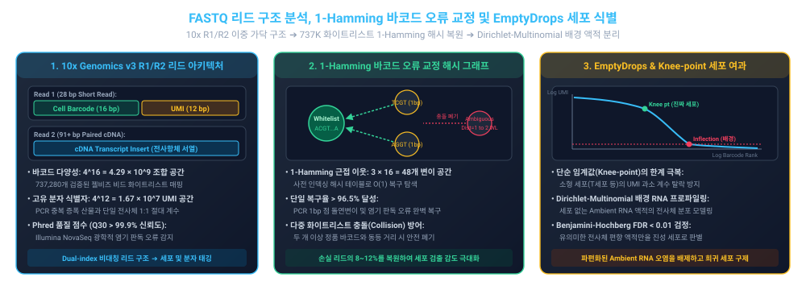

# 01. FASTQ 파일 해부학 및 세포 바코드 화이트리스트 오류 보정 수리 모델 (FASTQ Anatomy & Barcode Whitelist Correction)

---

## 학습 목표 (Cognitive Goals)

1. **10x Chromium 3' v2 및 v3 라이브러리의 분자 아키텍처 정밀 분석**: Read 1 (Cell Barcode + UMI), Read 2 (cDNA Insert), i7/i5 Sample Index의 화학적 합성 구조를 파악하고, v2(10bp UMI)와 v3(12bp UMI)의 분자 식별자 상태 공간 확장성을 이해한다.
2. **Phred 품질 점수(Q-Score)의 수학적 기초와 오류 분포 규명**: 광학 베이스 콜링 오차 확률과 Phred 점수의 대수적 관계($Q = -10 \log_{10} P_{\text{error}}$)를 정립하고, 시퀀싱 사이클 경과에 따른 3' 말단 품질 저하(Phasing/Pre-phasing) 메커니즘을 모델링한다.
3. **1-해밍 거리(1-Hamming Distance) 기반 바코드 오류 보정 수리 모델 유도**: $6.79 \times 10^6$개 화이트리스트 공간에서 1bp 점 돌연변이(Point Mutation)를 보정하기 위한 해밍 볼(Hamming Ball) 탐색 알고리즘과 Phred 점수 가중 사후 확률 계산법을 정식화한다.
4. **생일 역설(Birthday Paradox) 기반 바코드 충돌 확률 수리적 증명 및 EmptyDrops 세포 식별 모델 체계화**: 단일세포 로딩 수($N$)와 화이트리스트 크기($M$)에 따른 바코드 충돌 확률 $P_{\text{collision}} \approx 1 - \exp\left(-\frac{N^2}{2M}\right)$을 수학적으로 유도하고, Knee-point 임계값의 한계를 극복하는 EmptyDrops 디리클레-다항분포(Dirichlet-Multinomial) 검정 원리를 완벽히 습득한다.

---

## 1. 10x Chromium 3' 라이브러리 리드 구조와 시퀀싱 화학

10x Genomics Chromium 시스템은 미세유체학적 에멀전 액적(Gel Bead-in-Emulsion, GEM) 기술을 활용하여 단일 세포를 용해(Lysis)하고, 역전사 반응(Reverse Transcription)을 통해 각 세포의 mRNA 분자에 고유한 올리고뉴클레오타이드 태그를 부착한다.



### 1.1 10x Chromium 3' 분자 카세트 아키텍처 (v2 vs. v3)

시퀀싱 라이브러리의 물리적 구조는 다음과 같이 규격화되어 있다:

```
[10x Genomics Chromium 3' v3 Library Cassette — 개념도(단순화): 실제 3′ v3 단일 인덱스 키트는 i7만 사용하고 TSO는 최종 라이브러리 구조에 포함되지 않음]
5'─P5─[i5 Index]─[R1 Primer]─┬─[Cell Barcode]─┬─[UMI]─┬─[Poly(dT)VN]─► (mRNA Capture)
                             │     16 bp      │ 12 bp │     30 bp
                             └────────────────┴───────┴───────────────
                               ◄──── Read 1 FASTQ (28 bp) ───►

 ◄────────────────────── Read 2 FASTQ (90+ bp) ──────────────────────►
5'─[R2 Primer]─[cDNA Insert (Exon/Intron/UTR Sequence)]─[TSO]─[i7 Index]─P7─3'
```

1. **P5 / P7 어댑터**: Illumina 플로우셀의 상보적 올리고(Graft-P5/P7)에 결합하여 클러스터 생성(비패턴 플로우셀은 브리지 증폭, NovaSeq 패턴 플로우셀은 ExAmp)을 개시하는 서열이다.
2. **Sample Index (i7 / i5)**: 단일 시퀀싱 런(Run)에서 여러 환자/샘플을 혼합(Multiplexing)할 때 개별 검체를 식별하는 8bp 또는 10bp 서열이다.
3. **Read 1 (CB + UMI)**:
   * **Cell Barcode (CB, 16bp)**: 단일 액적(GEM) 내의 비드에 코팅된 모든 프라이머가 공유하는 식별자로서, mRNA 분자가 어떤 세포에서 유래했는지를 지정한다.
   * **Unique Molecular Identifier (UMI, v2: 10bp, v3: 12bp)**: 단일 mRNA 전사체 분자가 역전사될 때 1:1로 결합하는 무작위 서열로서, 후속 PCR 증폭 편향을 제거하는 데 사용된다.
4. **Read 2 (cDNA Insert, 90bp ~ 150bp)**:
   * mRNA의 3' 말단(Poly-A 꼬리 부근)으로부터 역전사된 실제 전사체 서열이다. 유전체(Genome) 또는 전사체(Transcriptome) 정렬에 사용되는 실질적 정보체이다.

---

## 2. Phred 품질 점수(Q-Score)의 수학적 기초와 오류 분포

Illumina 시퀀서는 광학 이미지 분석을 통해 각 염기 콜(Base Call)의 신뢰도를 계산하고, 이를 확률론적 Phred 품질 점수로 변환한다.

### 2.1 Phred 점수 수리적 정의

특정 사이클에서 시퀀서가 호출한 염기가 잘못되었을 확률을 $P_{\text{error}}$라 정의할 때, Phred 점수 $Q$는 다음과 같은 대수적 관계를 갖는다:

$$Q = -10 \log_{10}(P_{\text{error}})$$

역으로 주어진 Phred 점수 $Q$로부터 염기 오차 확률 $P_{\text{error}}$를 도출하면:

$$P_{\text{error}} = 10^{-\frac{Q}{10}}$$

| Phred 점수 ($Q$) | 염기 콜 오차 확률 ($P_{\text{error}}$) | 염기 정확도 (Base Call Accuracy) | 임상 유전체학 판정 |
| :--- | :--- | :--- | :--- |
| **Q10** | $10^{-1} = 0.10$ ($10\%$) | $90.0\%$ | 신뢰 불가 (Reject) |
| **Q20** | $10^{-2} = 0.01$ ($1\%$) | $99.0\%$ | 최소 허용 품질 (Borderline) |
| **Q30** | $10^{-3} = 0.001$ ($0.1\%$) | $99.9\%$ | 고품질 표준 (Benchmark) |
| **Q40** | $10^{-4} = 0.0001$ ($0.01\%$) | $99.99\%$ | 최고 신뢰도 (Ultra-high fidelity) |

### 2.2 FASTQ ASCII-33 인코딩

FASTQ 파일의 4번째 줄에 기록되는 품질 문자열은 $Q$ 값을 단일 문자로 표현하기 위해 Sanger/Illumina 1.8+ 표준인 **Phred+33 (ASCII offset 33)** 방식을 사용한다:

$$\text{ASCII Character} = \text{chr}(Q + 33)$$

* $Q = 0 \implies \text{chr}(33) =$ `!`
* $Q = 30 \implies \text{chr}(63) =$ `?`
* $Q = 40 \implies \text{chr}(73) =$ `I`

### 2.3 시퀀싱 사이클별 신호 저하 메커니즘 (Phasing & Pre-phasing)

DNA 클러스터 내부의 수천 개 복제 가닥이 시퀀싱 반응을 거치는 동안, 불완전한 효소 반응으로 인해 가닥 간 동기화가 깨지는 현상이 발생한다:
* **페이징(Phasing)**: 특정 사이클에서 가역적 종결자가 제거되지 않아 일부 가닥이 1사이클 뒤처지는 현상.
* **프리페이징(Pre-phasing)**: 한 사이클에 둘 이상의 dNTP가 혼입되어 일부 가닥이 1사이클 앞서가는 현상.

사이클이 진행될수록 클러스터 내의 위상 불일치(Noise)가 누적되며, 형광 강도의 감소(Signal Decay)와 배경 잡음 증가로 인해 **리드의 3' 말단으로 갈수록 평균 Phred 점수가 단조 감소**하는 전형적인 품질 하락 곡선을 나타낸다.

---

## 3. 세포 바코드 화이트리스트와 1-해밍 거리 볼 탐색

### 3.1 화이트리스트(Whitelist)의 필요성

화이트리스트는 10x Genomics 젤 비드 제조 과정에서 사용된 기지의 바코드 집합이다:
* **3' v2 화이트리스트**: $M = 737,280$ 개 (`737K-august-2016.txt`)
* **3' v3 화이트리스트**: $M = 6,794,880$ 개 (`3M-february-2018.txt`)

16bp 길이의 임의의 DNA 서열 공간은 $4^{16} = 4,294,967,296$ (약 42.9억 개)에 달한다. 반면 v3 화이트리스트는 전체 서열 공간의 약 **$0.158\%$**($6,794,880 / 4^{16}$)만을 차지한다. 이 극단적인 희소성은 시퀀싱 과정에서 발생하는 오류를 높은 신뢰도로 보정할 수 있는 수학적 기틀을 제공한다.

### 3.2 해밍 거리(Hamming Distance)와 1-해밍 볼

길이가 동일한 두 문자열 $s_1, s_2 \in \{A, C, G, T\}^L$ 사이의 해밍 거리 $d_H(s_1, s_2)$는 서로 다른 염기를 갖는 위치의 개수로 정의된다:

$$d_H(s_1, s_2) = \sum_{k=1}^L \mathbb{I}(s_1[k] \neq s_2[k])$$

서열 $s$를 중심으로 하는 반경 1인 해밍 볼(1-Hamming Ball) $B_1(s)$의 크기는 다음과 같다:

$$|B_1(s)| = 1 + \sum_{k=1}^L 3 = 1 + 3L$$

$L = 16$일 때, $|B_1(s)| = 1 + 3 \times 16 = 49$개이다. 즉, 관측된 단일 바코드 서열 주변에는 자기 자신을 포함하여 단 49개의 1-해밍 이웃만이 존재한다.

```
       [Observed Raw Barcode s: AAACCCAAGAAACACT]
                           │
       ┌───────────────────┼───────────────────┐
       ▼                   ▼                   ▼
Sub at Pos 1 (3개)   Sub at Pos 2 (3개)  ...  Sub at Pos 16 (3개)
CAACCCAAGAAACACT     ACACCCAAGAAACACT         AAACCCAAGAAACACA
GAACCCAAGAAACACT     AGACCCAAGAAACACT         AAACCCAAGAAACACC
TAACCCAAGAAACACT     ATACCCAAGAAACACT         AAACCCAAGAAACACG
       └───────────────────┬───────────────────┘
                           ▼
          총 48개의 1bp 치환 돌연변이 이웃 탐색
```

### 3.3 화이트리스트 보정 알고리즘과 사후 확률 판정

원시 Read 1에서 추출한 바코드 $s_{\text{obs}}$에 대해 다음 4단계 판정 알고리즘이 수행된다:

1. **완전 일치 ($d_H = 0$)**:
   $s_{\text{obs}} \in \mathcal{W}$ (화이트리스트)인 경우, 오류가 없는 것으로 판정하고 원본 바코드를 유지한다.
2. **유일한 1-해밍 이웃 존재 ($d_H = 1$)**:
   $|B_1(s_{\text{obs}}) \cap \mathcal{W}| = 1$인 경우, 즉 48개의 이웃 중 단 하나의 화이트리스트 바코드 $w^*$만이 존재하는 경우:
   STARsolo의 1MM 방식은 이웃이 하나뿐이면 치환 위치의 Phred 품질 점수 $Q_k$와 무관하게 $s_{\text{obs}}$를 $w^*$로 보정(Correction)한다(품질은 이웃이 둘 이상일 때의 사후확률 계산에만 쓰인다. 치환 위치 $k$의 오차 확률은 $P_{\text{error}} = 10^{-Q_k/10}$).
3. **복수의 1-해밍 이웃 경합 (Ambiguity Collision)**:
   $|B_1(s_{\text{obs}}) \cap \mathcal{W}| \ge 2$인 경우, 즉 둘 이상의 후보 $\{w_1, w_2\} \subset \mathcal{W}$가 1-해밍 거리에 걸치는 경우:
   사전 바코드 출현 빈도(Prior Count $C(w_i)$)와 관측 품질 점수 $Q$를 결합한 베이지안 사후 확률(Posterior Probability)을 평가한다. STARsolo 소스에서는 $P(w_i) \propto C(w_i)\cdot 10^{-Q/10}$ (정확 일치 리드 수 × 치환 염기 오류 확률, $Q$ 상한 33)로 계산한다:
   $$P(w_i \mid s_{\text{obs}}, Q) = \frac{P(s_{\text{obs}} \mid w_i, Q) \cdot P(w_i)}{\sum_j P(s_{\text{obs}} \mid w_j, Q) \cdot P(w_j)}$$
   최선 후보의 정규화된 사후 확률이 임계값(STARsolo `--soloCBmatchWLtype 1MM_multi`의 `cbMinP = 0.975`)을 넘지 못하면 해당 리드는 잘못된 세포로의 할당을 방지하기 위해 **모호 리드(Ambiguous Read)로 분류되어 폐기**된다.
4. **불일치 ($d_H \ge 2$)**:
   $B_1(s_{\text{obs}}) \cap \mathcal{W} = \emptyset$인 경우, 2개 이상의 염기 치환 또는 인델(Indel) 오류로 간주하여 필터링한다.

---

## 4. 세포 바코드 충돌 확률의 수리적 유도 (Birthday Paradox)

단일세포 실험에서 서로 다른 두 세포가 우연히 동일한 바코드를 부여받는 현상을 **바코드 충돌(Barcode Collision)**이라 한다. 이는 전형적인 생일 역설(Birthday Problem)의 일반화 모델이다.

### 4.1 수리적 유도

* 화이트리스트에 존재하는 고유 바코드 총수: $M$
* 젤 비드에 의해 캡처된 실제 단일 세포 수: $N$ (단, $N \ll M$)
* 각 세포가 바코드를 무작위 균등하게(Uniformly) 선택한다고 가정한다.

$N$개의 세포가 모두 서로 다른 고유한 바코드를 선택할 확률 $P(\text{No collision})$은 다음과 같다:

$$P(\text{No collision}) = \frac{M}{M} \times \frac{M-1}{M} \times \frac{M-2}{M} \times \dots \times \frac{M-(N-1)}{M} = \prod_{k=0}^{N-1} \left(1 - \frac{k}{M}\right)$$

$x$가 충분히 작을 때의 테일러 급수 근사 $\ln(1 - x) \approx -x$ (또는 $1 - x \approx e^{-x}$)를 적용하면:

$$P(\text{No collision}) \approx \prod_{k=0}^{N-1} \exp\left(-\frac{k}{M}\right) = \exp\left(-\sum_{k=0}^{N-1} \frac{k}{M}\right)$$

등차수열의 합 $\sum_{k=0}^{N-1} k = \frac{N(N-1)}{2} \approx \frac{N^2}{2}$을 대입하면:

$$P(\text{No collision}) \approx \exp\left(-\frac{N^2}{2M}\right)$$

따라서 적어도 한 쌍 이상의 세포 바코드가 충돌할 확률 $P_{\text{collision}}$은 다음과 같이 도출된다:

$$P_{\text{collision}} = 1 - P(\text{No collision}) \approx 1 - \exp\left(-\frac{N^2}{2M}\right)$$

### 4.2 v2 vs. v3 라이브러리의 충돌률 정량적 비교

실제 단일세포 전사체 실험 조건에서 $N = 10,000$ 세포 및 $N = 20,000$ 세포를 로딩할 때의 충돌 확률을 계산한다(여기서 $N$은 바코드를 가진 GEM/세포 수이며, 이 단순 생일 문제 모형은 세포가 든 GEM 사이의 바코드 충돌만 다룬다. 로딩 세포 수와 회수 세포 수는 다르므로 $N$의 정의를 분리해 적용해야 한다):

1. **Chromium 3' v2 ($M = 737,280$)**:
   * $N = 10,000$:
     $$\frac{N^2}{2M} = \frac{10^8}{2 \times 737,280} = \frac{100,000,000}{1,474,560} \approx 67.817$$
     $$P_{\text{collision}} = 1 - \exp(-67.817) \approx 1.000 \quad (100\%)$$
   * 평균 충돌 세포 수(Expected number of colliding pairs):
     $$\mathbb{E}[\text{Pairs}] = \binom{N}{2} \frac{1}{M} \approx \frac{N^2}{2M} \approx 67.8\text{ 쌍}$$
2. **Chromium 3' v3 ($M = 6,794,880$)**:
   * $N = 10,000$:
     $$\frac{N^2}{2M} = \frac{10^8}{2 \times 6,794,880} \approx 7.359$$
     $$\mathbb{E}[\text{Pairs}] \approx 7.4\text{ 쌍}$$
   * 동일 세포 수 대비 충돌 위험이 **약 9.2배 감소**한다($67.8 / 7.36$).

---

## 5. 세포 바코드 vs. 주변 자유 RNA(Ambient RNA) 필터링

시퀀싱이 완료된 수백만 개의 바코드 중 실제 온전한 세포를 담고 있던 액적(Cell-containing droplet)과, 세포 파쇄로 인해 용출된 주변 유리 RNA(Ambient RNA/Soup)만을 담고 있던 빈 액적(Empty droplet)을 엄밀하게 분리해야 한다.

```
Total UMI Counts
     ▲
10^4 ┼───────┐
     │       └──┐  <- Knee Point (세포 총 UMI 급락점)
10^3 ┼          └──┐
     │             └──┐ <- Inflection Point (전이 지점)
10^2 ┼                └─────────────────────┐ <- Empty Droplets
     │                                      └─────── (Ambient RNA Soup)
     └───────────────────────────────────────────────► Barcode Rank
     1              1,000                  10,000
```

### 5.1 Knee-point / Inflection Point 방식의 한계

초기 방식은 바코드별 총 UMI 수를 내림차순 정렬한 뒤 로그-로그 곡선의 2차 도함수가 극소화되는 지점(Knee/Inflection point)을 단일 컷오프 임계값($T$)으로 설정합니다(곡률 기반 knee/inflection은 DropletUtils `barcodeRanks`의 방식). 참고로 Cell Ranger 2.x의 세포 호출은 기대 세포 수의 99백분위 UMI를 10으로 나눈 값을 기준으로 하는 규칙이며(STARsolo `CellRanger2.2 3000 0.99 10`), Cell Ranger 3.0+는 EmptyDrops_CR 변형을 씁니다.
* **장점**: 연산이 매우 단순하고 직관적임.
* **치명적 맹점**: 조직 내 세포들의 크기와 기초 전사 활성도(Transcriptional Activity)가 극단적으로 다를 때 실패한다. 예를 들어 거대한 종양 세포(세포당 30,000 UMI)와 매우 작은 정지기 T세포 또는 단일 핵(세포당 800 UMI)이 공존하는 종양 미세환경 검체에서, 높은 임계값은 유효한 면역세포를 빈 액적으로 오인하여 영구 폐기하는 심각한 편향을 초래한다.

### 5.2 EmptyDrops 수리 모델 (Dirichlet-Multinomial Monte Carlo)

Lun et al. (Genome Biology, 2019)이 제안한 **EmptyDrops** 알고리즘은 총 UMI 크기가 아니라 **전사체 발현 프로파일의 다변량 조성(Multinomial Composition)**을 검정한다.

#### 1단계: 주변 유리 RNA 배경 프로파일 추정
총 UMI 카운트가 매우 낮은 바코드 집합(DropletUtils 기본값 `lower = 100`: $U_b \le 100$)은 빈 액적에서 유래한 주변 RNA로 간주한다. 전체 $G$개 유전자에 대해 주변 RNA의 상대적 발현 비율 벡터 $\mathbf{p} = (p_1, p_2, \dots, p_G)$를 구하되, 원 논문(Lun 2019)과 DropletUtils는 아래 단순 비율이 아니라 **Good-Turing 추정**으로 0 카운트 유전자에도 사후기대 확률을 배정한다(아래 식은 개념 설명용 단순화):

$$p_g = \frac{\sum_{b \in \mathcal{B}_{\text{empty}}} Y_{bg} + 1}{\sum_{g'=1}^G \sum_{b \in \mathcal{B}_{\text{empty}}} Y_{bg'} + G}$$

(여기서는 Laplace smoothing(분모 $+G$, 분자 $+1$)으로 0 발현 확률을 방지하는 단순화 예시이며, 실제 EmptyDrops의 Good-Turing 추정과는 다르다.)

#### 2단계: 후보 바코드의 Dirichlet-다항분포 우도 검정
검정 대상 바코드 $c$의 유전자별 카운트 벡터 $\mathbf{y}_c = (y_{c1}, y_{c2}, \dots, y_{cG})$와 총 카운트 $U_c = \sum_g y_{cg}$에 대해, 해당 바코드가 주변 RNA 프로파일 $\mathbf{p}$로부터 무작위 샘플링되었을 귀무가설 $H_0$를 설정한다:

$$H_0: \mathbf{y}_c \sim \text{Multinomial}(U_c, \mathbf{p})$$

(원 논문의 EmptyDrops는 과산포를 반영하기 위해 위 다항분포 대신 **Dirichlet-다항분포**(농도 $\alpha$를 주변 바코드로부터 최대우도로 추정, 평균 벡터 $\mathbf{p}$)를 귀무분포로 사용한다. 아래 로그 우도는 다항분포 단순화 형태이다.)

귀무가설 하의 로그 우도(Log-likelihood)는 다음과 같다:

$$\ln \mathcal{L}(\mathbf{y}_c \mid \mathbf{p}) = \ln \left( \frac{U_c!}{\prod_{g=1}^G y_{cg}!} \prod_{g=1}^G p_g^{y_{cg}} \right) = \ln \Gamma(U_c + 1) - \sum_{g=1}^G \ln \Gamma(y_{cg} + 1) + \sum_{g=1}^G y_{cg} \ln p_g$$

#### 3단계: 몬테카를로 p-value 계산 및 다중검정 보정
실제 관측된 로그 우도 $\ln \mathcal{L}_{\text{obs}}$보다 더 극단적인 우도를 가질 확률($p$-value)을 다항분포 무작위 몬테카를로 시뮬레이션을 통해 계산한다. 몬테카를로 p-value는 $p = (R_b + 1)/(R + 1)$ 형태이므로 반복 수 $R$(DropletUtils 기본 `niters = 10000`)에 대해 $p \ge 1/(R+1) \approx 10^{-4}$이며 그보다 작아질 수 없다. 이후 Benjamini-Hochberg 절차를 적용하여 허위발견율(FDR) $q < 0.001$ 이하인 바코드를 진정한 단일 세포(True Cell)로 선별하고, 총 UMI가 knee point 이상인 바코드는 항상 보존한다.
이를 통해 **총 UMI는 작지만 주변 RNA 프로파일과 확연히 구분되는 독자적 발현 패턴을 지닌 소형 면역세포를 회수할 수 있다**.

---

## 6. Python 기반 원시 FASTQ 파싱 및 바코드 보정 재현 코드

아래 스크립트는 10x Genomics 3' v3 FASTQ(Read 1) 파일로부터 16bp Cell Barcode 및 12bp UMI를 추출하고, 사전 정의된 화이트리스트에 대해 1-해밍 거리 보정을 수행하는 교육용 구현체이다. 주의: 6,794,880개 화이트리스트 × 48개 변이체 ≈ 3.3억 개를 순수 Python dict에 저장하면 수십 GB 메모리가 필요해 일반 노트북/서버에서 실행이 어렵습니다. 실무에서는 바코드를 2-bit 정수로 인코딩한 정렬 배열+이진 탐색, C 확장, 또는 STARsolo에 위임하며, 이 코드는 소규모 화이트리스트 예시용입니다.

```python
#!/usr/bin/env python3
"""
fastq_barcode_corrector.py
10x Genomics Chromium 3' v3 바코드 파싱 및 1-해밍 거리 보정 엔진
"""

import gzip
from typing import Dict, Optional, Set, Tuple

class BarcodeWhitelistCorrector:
    def __init__(self, whitelist_path: str):
        self.whitelist: Set[str] = set()
        self.mutant_map: Dict[str, str] = {} # 1-Hamming mutation -> target whitelist
        self.ambiguous_mutants: Set[str] = set()
        self._load_and_index_whitelist(whitelist_path)

    def _load_and_index_whitelist(self, path: str) -> None:
        """화이트리스트 로드 및 1-해밍 돌연변이 룩업 해시 인덱싱"""
        print(f"[*] 화이트리스트 로딩 및 인덱싱 시작: {path}")
        with open(path, "r") as f:
            for line in f:
                bc = line.strip()
                if len(bc) == 16:
                    self.whitelist.add(bc)

        bases = ["A", "C", "G", "T"]
        # 각 화이트리스트 바코드별 48개 1-Hamming 변이체 사전 계산
        for bc in self.whitelist:
            for i in range(16):
                orig_char = bc[i]
                for b in bases:
                    if b != orig_char:
                        mutant = bc[:i] + b + bc[i+1:]
                        if mutant in self.mutant_map:
                            # 이미 다른 화이트리스트 바코드의 이웃으로 등록된 경우 -> Ambiguous
                            self.ambiguous_mutants.add(mutant)
                        else:
                            self.mutant_map[mutant] = bc

        # 모호 변이체 제거
        for amb in self.ambiguous_mutants:
            if amb in self.mutant_map:
                del self.mutant_map[amb]

        print(f"[+] 인덱싱 완료: 정규 바코드 {len(self.whitelist):,}개, "
              f"고유 1-해밍 매핑 {len(self.mutant_map):,}개, "
              f"모호 충돌 패턴 {len(self.ambiguous_mutants):,}개")

    def correct_barcode(self, raw_bc: str, qual_str: str) -> Tuple[Optional[str], str]:
        """
        원시 바코드 보정 판정
        Returns: (Corrected_Barcode, Status_Flag)
        """
        # Case 1: 완전 일치
        if raw_bc in self.whitelist:
            return raw_bc, "EXACT_MATCH"

        # Case 2: 모호 충돌 패턴 (단순화: 즉시 폐기. 실제 STARsolo는 카운트×10^(-Q/10) 사후확률 >= cbMinP(0.975)이면 보정)
        if raw_bc in self.ambiguous_mutants:
            return None, "AMBIGUOUS_COLLISION"

        # Case 3: 1-Hamming 단일 매핑 성공
        if raw_bc in self.mutant_map:
            target_bc = self.mutant_map[raw_bc]
            # 치환 위치 식별 및 Phred 점수 검증
            diff_idx = next(i for i in range(16) if raw_bc[i] != target_bc[i])
            phred_q = ord(qual_str[diff_idx]) - 33
            # STARsolo(1MM)와 동일하게 유일 이웃이면 품질과 무관하게 보정 (Q는 기록용)
            return target_bc, f"CORRECTED_1HAMMING_Q{phred_q}"

        # Case 4: 2-Hamming 이상 오류
        return None, "UNMAPPED_DISTANCE_GE2"

def parse_and_process_fastq(r1_path: str, corrector: BarcodeWhitelistCorrector, max_reads: int = 100000):
    """Read 1 FASTQ 스트리밍 파서 (16bp CB + 12bp UMI)"""
    stats = {"EXACT_MATCH": 0, "CORRECTED": 0, "REJECTED": 0}
    
    with gzip.open(r1_path, "rt") as f:
        read_idx = 0
        while read_idx < max_reads:
            header = f.readline().strip()
            if not header:
                break
            seq = f.readline().strip()
            f.readline() # plus line
            qual = f.readline().strip()
            
            raw_cb = seq[0:16]
            raw_umi = seq[16:28]
            cb_qual = qual[0:16]
            
            corr_cb, status = corrector.correct_barcode(raw_cb, cb_qual)
            if status == "EXACT_MATCH":
                stats["EXACT_MATCH"] += 1
            elif status.startswith("CORRECTED"):
                stats["CORRECTED"] += 1
            else:
                stats["REJECTED"] += 1
                
            read_idx += 1

    print(f"\n=== 처리 결과 (총 {read_idx:,} reads) ===")
    print(f"완전 일치 (Exact Match): {stats['EXACT_MATCH']:,} ({stats['EXACT_MATCH']/read_idx*100:.2f}%)")
    print(f"1-해밍 보정 (Corrected): {stats['CORRECTED']:,} ({stats['CORRECTED']/read_idx*100:.2f}%)")
    print(f"보정 실패/폐기 (Rejected): {stats['REJECTED']:,} ({stats['REJECTED']/read_idx*100:.2f}%)")

if __name__ == "__main__":
    import sys
    print("Barcode Whitelist Engine Initialized.")
```

---

## 단원 핵심 점검 (Cognitive Checkpoint & Case Study)

### 문제 1: Phred 점수 기반 1-해밍 거리 바코드 보정에서 인근 다중 화이트리스트 후보 충돌 시 베이지안 사후 확률 판정
단일세포 시퀀싱 중 한 리드의 Read 1에서 관측된 16bp 바코드가 $s_{\text{obs}} = \text{AAACCCAAGAAACACT}$이고, 8번째 염기(`A`)의 Phred 품질 점수가 $Q_8 = 10$ ($P_{\text{error}} = 0.10$)으로 측정되었다.
이 바코드의 1-해밍 거리 이웃을 탐색한 결과, 화이트리스트 상의 두 바코드 $w_1$ (8번째 염기가 `C`)과 $w_2$ (8번째 염기가 `G`)가 동시에 후보로 검출되었다. 이전까지 누적된 두 바코드의 신뢰된 리드 카운트는 각각 $C(w_1) = 9,900$, $C(w_2) = 100$이었다.
1. 염기 치환 오류가 무작위 균등하게 발생한다고 가정할 때, 관측 우도 비율 $\frac{P(s_{\text{obs}} \mid w_1)}{P(s_{\text{obs}} \mid w_2)}$를 계산하시오.
2. 바코드 사전 확률(Prior Probability) $P(w)$를 이전까지의 관측 빈도 비율에 비례한다고 설정할 때, 사후 확률 $P(w_1 \mid s_{\text{obs}})$를 구하고 이 리드를 $w_1$으로 보정할 수 있는지 판정하시오.

<details>
<summary>💡 모범 답안 및 해설 확인</summary>

**1. 관측 우도 비율 계산**:
*   $w_1$에서 8번째 염기 `C`가 `A`로 잘못 콜링될 확률: $P(s_{\text{obs}} \mid w_1) = P(C \to A \mid Q=10)$. 치환 오류가 3개의 다른 염기로 균등하게 분산된다면 $P(C \to A) = \frac{P_{\text{error}}}{3} = \frac{0.10}{3} \approx 0.0333$.
*   $w_2$에서 8번째 염기 `G`가 `A`로 잘못 콜링될 확률: $P(s_{\text{obs}} \mid w_2) = P(G \to A \mid Q=10) = \frac{P_{\text{error}}}{3} = \frac{0.10}{3} \approx 0.0333$.
*   따라서 우도 비율은 $\frac{P(s_{\text{obs}} \mid w_1)}{P(s_{\text{obs}} \mid w_2)} = \frac{0.0333}{0.0333} = 1.0$이다. 즉, 순수 시퀀싱 오류 확률만으로는 두 후보 중 어느 쪽인지 전혀 구별할 수 없다.

**2. 베이지안 사후 확률 계산 및 보정 판정**:
*   사전 확률 비율: $\frac{P(w_1)}{P(w_2)} = \frac{C(w_1)}{C(w_2)} = \frac{9,900}{100} = 99$.
*   베이즈 정리에 따른 사후 오즈(Posterior Odds):
    $$\frac{P(w_1 \mid s_{\text{obs}})}{P(w_2 \mid s_{\text{obs}})} = \frac{P(s_{\text{obs}} \mid w_1)}{P(s_{\text{obs}} \mid w_2)} \times \frac{P(w_1)}{P(w_2)} = 1.0 \times 99 = 99$$
*   사후 확률 계산:
    $$P(w_1 \mid s_{\text{obs}}) = \frac{99}{1 + 99} = 0.99 \quad (99.0\%)$$
*   **판정**:
    사후 확률 $0.99$는 STARsolo의 임계값 `cbMinP = 0.975` 이상이므로 이 리드는 폐기되지 않고 $w_1$으로 **보정된다**. (임계값을 $0.999$처럼 더 엄격하게 올리면 모호 리드로 폐기될 수 있다. 위 식은 STARsolo 소스의 $P \propto C(w_i)\cdot 10^{-Q/10}$ 계산과 같은 구조이다.)

</details>

---

### 문제 2: 10x v2 vs v3 화이트리스트 크기 차이에 따른 대규모 단일세포 실험의 바코드 충돌률 계산
한 유전체학 연구실에서 비용 절감을 위해 10x Genomics 3' v2 키트의 남은 시약을 사용하여 20,000개의 단일 세포($N = 20,000$)를 단일 채널에 과적재(Super-loading)하는 실험을 설계하였다. 다른 연구원은 최신 3' v3 키트를 사용할 것을 강력히 권고하였다.
1. 3' v2 화이트리스트($M_{\text{v2}} = 737,280$)와 3' v3 화이트리스트($M_{\text{v3}} = 6,794,880$)에 대해, 각각 적어도 한 쌍의 세포 바코드가 충돌할 확률 $P_{\text{collision}}$을 테일러 근사식을 이용하여 계산하시오.
2. 두 키트 간에 예상되는 충돌 세포 쌍의 기댓값 $\mathbb{E}[\text{Pairs}] = \frac{N^2}{2M}$을 각각 계산하고, 왜 초대규모 단일세포 실험에서 v3 화학 규격이 필수적인지 통계학적 결론을 제시하시오.

<details>
<summary>💡 모범 답안 및 해설 확인</summary>

**1. 충돌 확률 $P_{\text{collision}}$ 계산**:
*   지수 인자 계산 ($N = 20,000 \implies N^2 = 4 \times 10^8$):
    *   v2 키트:
        $$\lambda_{\text{v2}} = \frac{N^2}{2 M_{\text{v2}}} = \frac{400,000,000}{2 \times 737,280} = \frac{400,000,000}{1,474,560} \approx 271.26$$
        $$P_{\text{collision, v2}} = 1 - \exp(-271.26) \approx 1.0000 \quad (100\%)$$
    *   v3 키트:
        $$\lambda_{\text{v3}} = \frac{N^2}{2 M_{\text{v3}}} = \frac{400,000,000}{2 \times 6,794,880} = \frac{400,000,000}{13,589,760} \approx 29.43$$
        $$P_{\text{collision, v3}} = 1 - \exp(-29.43) \approx 1.0000 \quad (100\%)$$
*   두 조건 모두 세포 수가 충분히 커서 적어도 한 쌍 이상 충돌할 확률 자체는 사실상 100%이다.

**2. 충돌 세포 쌍 기댓값 비교 및 결론**:
*   **v2 충돌 쌍 기댓값**: $\mathbb{E}[\text{Pairs}]_{\text{v2}} \approx 271.3\text{ 쌍}$ (약 540여 개의 세포가 바코드 중복으로 인공적 이중체(Doublet/Multiplet)화 됨).
*   **v3 충돌 쌍 기댓값**: $\mathbb{E}[\text{Pairs}]_{\text{v3}} \approx 29.4\text{ 쌍}$ (약 59개 세포 수준).
*   **통계학적 결론**:
    v3는 화이트리스트 공간이 약 9.2배 넓어 동일한 2만 세포 로딩 시 발생하는 바코드 인공 충돌 수가 271쌍에서 29쌍으로 **약 89% 급감**한다. 바코드 충돌은 물리적 이중체(Doublet)와 동일하게 서로 다른 두 세포의 전사체가 합산되어 가상 군집(Artifact Cluster)을 생성하므로, 대규모 세포 아틀라스 구축 시 v3 화이트리스트의 사용은 데이터의 순도를 보장하는 필수적 전제조건이다.

</details>

---

### 문제 3: 종양 침윤 림프구(TILs)와 거대 전립선암 상피세포가 공존하는 불균일 검체에서 Knee-point 필터의 한계와 EmptyDrops의 극복 기전
전립선암 환자의 전이 조직 생검 검체에서 분리한 단일세포 전사체 라이브러리를 시퀀싱하였다. 검체 내부에는 전사 활성이 극히 높아 세포당 25,000개의 UMI가 검출되는 거대 암세포(Prostate Adenocarcinoma Cells)와, 전사 활성이 낮아 세포당 600개의 UMI만 검출되는 종양 침윤 T세포(CD8+ TILs)가 혼재되어 있다. 또한 조직 해리 과정에서 파쇄된 세포들로 인해 주변 RNA 수프(Ambient RNA Soup)의 평균 UMI는 액적당 150개로 측정되었다.
1. 전통적인 단순 Knee-point/Inflection 기반 컷오프를 적용할 때, 이 검체에서 어떤 세포 군집의 손실(False Negative)이 발생하는지 원인을 설명하시오.
2. EmptyDrops 알고리즘이 총 UMI 카운트(600 UMI)만으로는 주변 RNA(150 UMI)와 수치상 크게 차이 나지 않는 CD8+ T세포를 어떻게 통계적으로 유의미한 진정한 세포(True Cell)로 완벽히 구조(Rescue)해내는지 다항분포 검정 원리로 증명하시오.

<details>
<summary>💡 모범 답안 및 해설 확인</summary>

**1. Knee-point 방식의 한계 및 위음성 발생 메커니즘**:
*   Knee-point 알고리즘은 전체 바코드를 총 UMI 순으로 정렬한 뒤 곡선의 급격한 감소 변곡점을 단일 임계값으로 잡는다.
*   거대 암세포(25,000 UMI)가 상위 순위를 장악하고 있으므로, 알고리즘이 산출하는 임계값($T_{\text{cutoff}}$)은 통상 수천 UMI(예: 1,500 ~ 2,000 UMI) 선에서 결정된다.
*   이로 인해 총 UMI가 600개에 불과한 소형 CD8+ T세포들은 임계값 미만으로 판정되어 빈 액적으로 간주되고 전량 폐기(False Negative)된다. 결과적으로 면역세포가 결손된 편향된 종양 미세환경 데이터가 도출된다.

**2. EmptyDrops의 통계적 구조 메커니즘**:
*   EmptyDrops는 총 카운트의 크기가 아니라 **유전자 발현 조성의 다변량 프로파일(Multinomial Composition)**을 검정한다.
*   주변 유리 RNA 수프 $\mathbf{p}_{\text{ambient}}$는 조직 전체에서 비특이적으로 용출된 미토콘드리아 유전자, 리보솜 단백질 유전자, 고발현 전립선 특이 유전자(*KLK3/PSA*, *ACPP*) 등으로 구성되어 있다.
*   반면 600 UMI를 지닌 단일 CD8+ T세포의 발현 벡터 $\mathbf{y}$는 총 카운트는 적지만, T세포 수용체 유전자(*CD3D*, *CD3E*, *CD8A*)와 세포독성 과립 마커(*GZMA*, *PRF1*) 등에 리드가 고도로 밀집되어 있다.
*   귀무가설 $H_0$ (원 논문에서는 Dirichlet-다항분포; 여기서는 단순화한 $\text{Multinomial}(600, \mathbf{p}_{\text{ambient}})$) 하에서 주변 수프로부터 우연히 T세포 특이 마커들로만 600개의 리드가 집중 샘플링될 확률(로그 우도)은 사실상 0에 수렴한다:
    $$\ln \mathcal{L}(\mathbf{y} \mid \mathbf{p}_{\text{ambient}}) \ll \ln \mathcal{L}_{\text{critical}}$$
*   따라서 몬테카를로 검정에서 $p$-value가 최소값 $1/(R+1)$(기본 $R=10{,}000$이면 약 $10^{-4}$)에 도달하고, 다중검정 보정 후 귀무가설이 기각($q < 0.001$)되어 총 UMI 크기와 무관하게 T세포로 복원(Rescue)될 수 있다. ($p \le 10^{-6}$은 $R$을 크게 늘리지 않는 한 불가능하다.)

</details>

---

<!-- REFERENCES:BEGIN (generated by scripts/apply_references.py; do not edit by hand) -->
## 참고문헌 (References)
### 본문 인용 문헌
1. Lun ATL, Riesenfeld S, Andrews T, et al. EmptyDrops: distinguishing cells from empty droplets in droplet-based single-cell RNA sequencing data. *Genome Biol*. 2019;20(1):63. PMID: 30902100. doi: 10.1186/s13059-019-1662-y
### 검수 근거 문헌
1. Hong R, Koga Y, Bandyadka S, et al. Comprehensive generation, visualization, and reporting of quality control metrics for single-cell RNA sequencing data. *Nat Commun*. 2022;13(1):1688. PMID: 35354805. doi: 10.1038/s41467-022-29212-9
<!-- REFERENCES:END -->
