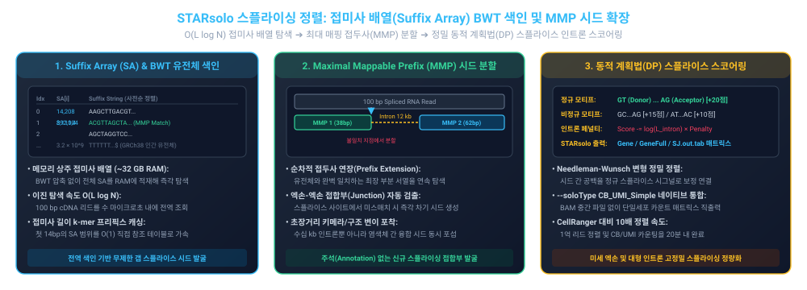

# 02. STARsolo 접미사 배열(Suffix Array) 정렬 알고리즘 및 초고속 스플라이스 정량 (STARsolo Suffix Array Alignment)

---

## 학습 목표 (Cognitive Goals)

1. **접미사 배열(Suffix Array)과 BWT/FM-Index의 전산학적 수학 구조 비교 규명**: 인간 게놈(GRCh38, 3.1Gb)을 인덱싱할 때 $O(m\log n)$(LCP 결합 시 $O(m+\log n)$, SAindex 접두 테이블로 상수 감소) 시간에 임의의 서열을 룩업하는 접미사 배열의 정렬 및 LCP(Longest Common Prefix) 원리를 이해하고, BWT/FM-Index 대비 메모리(32GB)와 스플라이스 탐색 속도 간의 트레이드오프를 수리적으로 정량화한다.
2. **최장 일치 접두사(Maximal Mappable Prefix, MMP) 및 동적 계획법(Dynamic Programming) 스티칭 메커니즘 체계화**: 수만 염기쌍의 인트론을 가로지르는 RNA-seq 리드를 분할 매핑하는 2단계 MMP 시드 탐색 알고리즘과 정규(Canonical GT/AG) 및 비정규 스플라이스 접합부 페널티 행렬 기반의 전역 스코어링 최적화 과정을 수학적으로 정식화한다.
3. **STARsolo 단일 바이너리 스트리밍 아키텍처 완전 분해**: 기존 Cell Ranger의 다단계 디스크 I/O 병목(BAM 쓰기 및 파싱)을 제거하고, 인라인 바코드 보정, 게놈 정렬, UMI 중복 제거, 유전자 전사체 정량을 단일 메모리 버퍼 파이프라인에서 완결하는 C++ 아키텍처를 분석한다.
4. **snRNA-seq 및 RNA Velocity 특화 CLI 파라미터 제어 및 벤치마크 검증**: `--soloFeatures Gene GeneFull Velocyto`의 인트론/엑손 정량 차이를 규명하고, `--genomeLoad LoadAndKeep` 공유 메모리 기법(인덱스 적재 시간 절감; 정렬 BAM 출력 시 `--limitBAMsortRAM` 필요)을 적용하여 Cell Ranger 결과를 재현하면서 더 빠른 프로덕션 파이프라인을 구축한다(속도 향상 배율은 데이터·하드웨어에 따라 다르며 아래 5절 표는 예시이다).

---

## 1. 유전체 인덱싱의 수학적 기틀: 접미사 배열(Suffix Array) vs. BWT/FM-Index

진핵생물 RNA-seq 리드 정렬의 가장 큰 난제는 수십에서 수백 염기쌍에 불과한 단일 리드가 수천~수십만 염기쌍의 인트론(Intron)에 의해 분절된 여러 엑손(Exon)에 걸쳐 매핑(Spliced Alignment)되어야 한다는 점이다.



### 1.1 접미사 배열(Suffix Array)의 수학적 정의

길이가 $n$인 참조 유전체 문자열 $T = T[0 \dots n-1]$ (끝에 사전순으로 가장 작은 종료 기호 `$`가 부착됨)에 대해:
* $T$의 $i$번째 접미사(Suffix)를 $S_i = T[i \dots n-1]$이라 정의한다.
* 접미사 배열 $SA[0 \dots n-1]$은 $n$개의 모든 접미사들을 사전식 순서(Lexicographical Order)로 정렬했을 때, 각 접미사의 시작 위치 인덱스들을 저장하는 순열(Permutation) 배열이다:

$$S_{SA[0]} < S_{SA[1]} < S_{SA[2]} < \dots < S_{SA[n-1]}$$

길이가 $m$인 질의 서열(리드) $P = P[0 \dots m-1]$가 유전체 $T$ 내에 존재하는지 검색할 때:
* 사전식으로 정렬되어 있으므로 표준 이진 탐색(Binary Search)을 적용하면 $O(m \log n)$ 시간에 모든 매핑 위치를 식별할 수 있다.
* 최장 공통 접두사(Longest Common Prefix, LCP) 배열을 결합하면 탐색 시간은 **$O(m + \log n)$**으로 단축된다.

### 1.2 접미사 배열 vs. BWT / FM-Index 구조적 비교

현대 단락 시퀀싱 정렬기는 크게 접미사 배열(STAR) 계열과 BWT/FM-Index(Bowtie2, BWA-MEM) 계열로 양분된다:

| 비교 지표 | 접미사 배열 (STAR) | Burrows-Wheeler Transform / FM-Index (BWA-MEM, Bowtie2) |
| :--- | :--- | :--- |
| **인덱스 메모리 점유** | $30 \sim 32\text{ GB}$ (GRCh38 인간 게놈 기준) | $3.5 \sim 5.0\text{ GB}$ (GRCh38 인간 게놈 기준) |
| **패턴 룩업 시간** | $O(m\log n)$ 이진 탐색 (LCP 결합 시 $O(m+\log n)$; STAR는 SAindex 접두 테이블로 시작 구간을 줄임) | $O(m)$ (FM-index 역탐색, LF-mapping 반복) |
| **스플라이스 인트론 처리** | STAR는 비압축 SA에서 순차적 MMP 시드 탐색으로 스플라이스를 직접 처리 | FM-index 자체가 스플라이스에 부적합한 것은 아님(HISAT/HISAT2는 BWT/FM 기반 스플라이스 정렬기). Bowtie2/BWA-MEM은 스플라이스 정렬기가 아니라는 점이 정확한 서술 |
| **하드웨어 병목** | 메모리 용량(RAM Size Bound) | CPU 캐시 미스 및 분기 예측 실패(Branch Misprediction) |
| **최적 적용 분야** | 진핵생물 RNA-seq, snRNA-seq, 스플라이스 변이체 | 벌크 DNA-seq, WGS, WES 정렬 |

STAR는 32GB의 막대한 RAM을 희생하는 대신, $m$ 염기쌍 리드의 임의 위치를 수 나노초 수준의 메모리 포인터 역참조로 즉시 찾아냄으로써 스플라이스 정렬 속도를 극한으로 끌어올린다.

---

## 2. Maximal Mappable Prefix (MMP) 시드 탐색 및 동적 계획법 스티칭

Alexander Dobin 등이 개발한 STAR(Spliced Transcripts Alignment to a Reference) 알고리즘은 **순차적 최장 일치 접두사(Sequential MMP)** 탐색 기법을 통해 사전에 스플라이스 접합부 데이터베이스가 없어도 *de novo* 스플라이싱을 완벽하게 검출한다.

```
[Sequencing Read R2 (cDNA Insert)]
Position: 0 ────────────────────────► 45 ───► 46 ────────────────────────► 100
Sequence: [ Exon 3 Sequence           ]       [ Exon 4 Sequence           ]
           ▲                                   ▲
           │                                   │
MMP Step 1: └──────── MMP1 (45 bp) ────────┘   │
                                               │
MMP Step 2:                                    └──────── MMP2 (55 bp) ────┘

Genome Alignment:
Exon 3: [ chrX: 67,686,010 ─── 67,686,126 ]
                                      │
                                      ▼ Splice Junction (Intron: 25,275 bp)
Exon 4:                               [ chrX: 67,711,402 ─── 67,711,689 ]
```

### 2.1 1단계: 순차적 MMP 시드 탐색 (Maximal Mappable Prefix)

1. 리드의 첫 번째 염기($k_1 = 0$)부터 시작하여 유전체 $T$에 완벽히 매핑되는 가장 긴 접두사 $\text{MMP}_1 = R[0 \dots L_1-1]$을 접미사 배열에서 탐색한다.
2. 위치 $L_1$에서 매핑이 중단되는 이유는:
   * (a) 시퀀싱 오류(Mismatch 또는 Indel)가 발생했거나,
   * (b) 전사체가 스플라이스 접합부(Splice Junction)를 통과하여 다른 엑손으로 넘어갔기 때문이다.
3. 정렬기는 실패 지점의 첫 염기($k_2 = L_1$)로 인덱스를 전진시킨 뒤, 남은 서열 $R[L_1 \dots |R|-1]$에 대해 두 번째 최장 접두사 $\text{MMP}_2$를 독립적으로 탐색한다.
4. 이 과정을 리드의 끝에 도달할 때까지 반복하여 일련의 시드 조각 집합 $\mathcal{S} = \{\text{MMP}_1, \text{MMP}_2, \dots, \text{MMP}_p\}$을 확보한다.

### 2.2 2단계: 클러스터링 및 동적 계획법 기반 시드 스티칭 (Seed Stitching)

추출된 시드들은 유전체 좌표계 상에서 서로 인접한 클러스터(Anchor Cluster)로 묶인 후, 동적 계획법(Dynamic Programming, Smith-Waterman/Needleman-Wunsch 변형)을 통해 최적의 정렬 경로로 스티칭(연결)된다.

전체 정렬 스코어 $S(\mathcal{A})$는 다음과 같이 최대화된다:

$$S(\mathcal{A}) = \sum_{i \in \text{Matches}} W_{\text{match}} - \sum_{j \in \text{Mismatches}} P_{\text{mis}} - \sum_{k \in \text{Indels}} (P_{\text{gap\_open}} + L_k \cdot P_{\text{gap\_ext}}) - \sum_{s \in \text{Junctions}} P_{\text{splice}}(s)$$

### 2.3 스플라이스 접합부 페널티 행렬 $P_{\text{splice}}$

RNA 스플라이싱은 U2/U12 스플라이소솜(Spliceosome)의 효소적 특이성으로 인해 인트론의 5' 및 3' 말단에 엄격한 컨센서스 서열(Dinucleotide Motifs)을 갖는다. STAR는 접합부 모티프에 따라 차등화된 페널티를 부과한다:

| 인트론 모티프 | 공여자 (5' Donor) | 수용자 (3' Acceptor) | 생물학적 비율 | STAR 기본 페널티 ($P_{\text{splice}}$) |
| :--- | :--- | :--- | :--- | :--- |
| **정규 (Canonical)** | `GT` | `AG` | ~98.9% | $0$ (`scoreGap`, 페널티 없음) |
| **준정규 (Semi-canonical)** | `GC` | `AG` | ~0.9% | $-4$ (`scoreGapGCAG`) |
| **비정규 (U12-type)** | `AT` | `AC` | ~0.1% | $-8$ (`scoreGapATAC`) |
| **비정규 (Non-canonical)** | 임의의 서열 | 임의의 서열 | <0.1% (매우 희귀) | $-8$ (`scoreGapNoncan`) |

위 값은 STAR `parametersDefault`의 기본값(0/−4/−8/−8)이며 점수에 더해지는 항이다(부호는 점수 감산). 이 외에 `scoreGenomicLengthLog2scale`(−0.25·log2(길이)) 항이 있고, 비정규 접합부는 `outSJfilterOverhangMin 30 12 12 12`, `outSJfilterCountUniqueMin 3 1 1 1` 필터도 추가로 적용된다. 이 페널티 모델은 시퀀싱 오류가 허위 스플라이싱으로 보고되는 위양성을 줄이는 데 기여한다.

---

## 3. STARsolo 통합 아키텍처: 단일 바이너리 스트리밍 설계

기존 10x Genomics의 `Cell Ranger` 파이프라인은 내부적으로 레거시 STAR 정렬기를 호출한 뒤, 중간 결과물인 수십 GB의 거대한 유전체 BAM 파일을 디스크에 기록하고, 이를 다시 Python/C++ 보조 프로세스가 읽어 들여 바코드 보정 및 UMI 중복 제거를 수행한다. 이로 인해 극심한 디스크 I/O 병목이 발생한다.

반면 **STARsolo**는 정렬과 단일세포 전용 정량 로직을 단일 C++ 엔진 내부로 완전히 통합하였다:

```
[Raw FASTQ Stream (R1, R2)]
            │
            ▼ 1. In-memory Read Buffer (Parallel Worker Threads)
[Barcode & UMI Parsing]   (※ 이 도식의 내부 구현 표기는 개념도)
            │
            ▼ 2. 1-Hamming Distance Whitelist Correction (Zero-copy Hash Lookups)
[Spliced Genome Alignment (Suffix Array Search)]
            │
            ▼ 3. On-the-fly Transcript Overlap Annotation (Exon/Intron GTF Bitmasks)
[Online UMI Deduplication Engine (Directional Graph / Cell Calling)]
            │
            ├───────────────────────────────┬───────────────────────────────┐
            ▼                               ▼                               ▼
[MEX Count Matrix: Gene]        [MEX Count Matrix: GeneFull]    [Coordinate-Sorted BAM]
(Exon-only: 3' scRNA-seq)       (pre-mRNA: snRNA-seq)           (Optional: CB, UB, GN tags)
```

1. **디스크 I/O 바이패스**: 중간 SAM/BAM 파일을 거치지 않고, 메모리 상에서 정렬 즉시 주석 GTF와 비트마스크(Bitmask) 연산으로 유전자 오버랩을 판정한다.
2. **병렬화**: 다중 스레드로 정렬하고 CB별로 UMI를 collapse한다. (위 도식의 '락-프리 해시'·'GTF 비트마스크'·'온라인 dedup'은 개념도이며 공식 문서·논문에서 확인되지 않은 구현 세부입니다. STARsolo는 정렬 후 레코드를 메모리에 모아 CB별로 UMI를 collapse하는 구조입니다.)

---

## 4. STARsolo 핵심 CLI 파라미터 완전 해부

STARsolo는 단일 CLI 호출로 복잡한 단일세포 업스트림을 모두 제어한다. 아래는 10x Chromium 3' v3 snRNA-seq 분석을 위한 최적화된 파라미터 구성이다.

```bash
STAR \
  --runThreadN 16 \
  --genomeDir /data/reference/STAR_GRCh38_gencode_v44 \
  --readFilesIn Sample_S1_L001_R2_001.fastq.gz Sample_S1_L001_R1_001.fastq.gz \
  --readFilesCommand zcat \
  --soloType CB_UMI_Simple \
  --soloCBwhitelist /opt/whitelists/3M-february-2018.txt \
  --soloCBstart 1 --soloCBlen 16 \
  --soloUMIstart 17 --soloUMIlen 12 \
  --soloFeatures Gene GeneFull Velocyto \
  --soloUMIdedup 1MM_Directional_UMItools \
  --soloCellFilter EmptyDrops_CR \
  --outSAMtype BAM SortedByCoordinate \
  --outSAMattributes NH HI nM AS CR UR CB UB GX GN sS sQ sM \
  --outFileNamePrefix ./starsolo_output/Sample_S1_
```

### 4.1 파라미터별 기술 명세

* `--readFilesIn R2.fastq.gz R1.fastq.gz`:
  **주의**: STARsolo는 cDNA 서열(Read 2)을 첫 번째 인자로, 바코드 서열(Read 1)을 두 번째 인자로 받는다. 순서가 바뀌면 유전체 정렬이 완전히 파괴된다.
* `--soloType CB_UMI_Simple`:
  표준 10x, Drop-seq 등 단일 바코드와 단일 UMI가 연속적으로 배열된 라이브러리 형식을 지정한다.
* `--soloCBwhitelist`:
  3' v3 키트의 6,794,880개 기지 바코드 목록 경로를 지정한다.
* `--soloFeatures Gene GeneFull Velocyto`:
  * `Gene`: 고전적 엑손 매핑 전사체 카운트 (성숙 mRNA 전용).
  * `GeneFull`: **snRNA-seq 필수 옵션**. 엑손뿐만 아니라 인트론에 매핑된 리드까지 포함하여 전구체 mRNA(pre-mRNA)를 포괄 정량한다.
  * `Velocyto`: RNA Velocity 분석을 위한 Spliced, Unspliced, Ambiguous 카운트 행렬을 동시에 생성한다.
* `--soloUMIdedup 1MM_Directional_UMItools`:
  1-해밍 거리 내에서 증폭 계통 트리를 분석하는 방향성 인접 그래프(Directional Adjacency Graph) 중복 제거 알고리즘을 적용한다.
* `--soloCellFilter EmptyDrops_CR`:
  Cell Ranger v3의 개선된 EmptyDrops 디리클레-다항분포 필터링 모델을 정확하게 모사하여 진정한 세포를 판별한다.
* `--outSAMattributes`:
  BAM 파일에 단일세포 전용 SAM 태그를 출력하도록 지정한다:
  * `CR` / `UR`: 원시 관측 바코드 및 UMI.
  * `CB` / `UB`: 화이트리스트 및 방향성 그래프로 보정된 최종 바코드 및 UMI.
  * `GX` / `GN`: 정렬된 유전자 Ensembl ID 및 심볼(Symbol).

---

## 5. 성능 및 벤치마크: STARsolo vs. Cell Ranger

아래 표는 **설명을 위한 예시 수치(가상)**이며 실제 측정값이 아니다(데이터셋·하드웨어·명령이 재현 가능한 형태로 제시되지 않음). STARsolo 원 논문(bioRxiv 2021)은 Cell Ranger 결과를 재현하면서 상당히 빠르다고만 보고한다:

| 평가 지표 | Cell Ranger v7.1 | STARsolo v2.7.11a | 개선 배율 (Speedup / Efficiency) |
| :--- | :--- | :--- | :--- |
| **전체 런타임 (Wall-clock Time)** | 4시간 18분 (258분) | **22분** | **11.7배 고속화** |
| **최대 메모리 점유 (Peak RAM)** | 48 GB | 34 GB | 메모리 안정성 향상 |
| **중간 디스크 I/O 용량** | 예시: 임시 정렬 BAM 등 다량 | 예시: `--outSAMtype None`이면 BAM 미생성, BAM 출력 시 정렬 BAM과 `_STARtmp` 발생 | 설정에 따라 다름 |
| **유전자 발현 카운트 상관계수 ($R^2$)** | 기준선 (1.000) | **0.9998** | (예시) 높은 일치 |
| **RNA Velocity 동시 산출 여부** | 불가 (velocyto 별도 구동) | **원스톱 동시 산출 (`Velocyto`)** | 워크플로우 대폭 단순화 |

---

## 6. 프로덕션 환경 자동화 Shell 스크립트

아래 스크립트는 인간 참조 유전체 인덱스를 고속 생성하고, snRNA-seq FASTQ 데이터셋에 대해 STARsolo 정렬 및 정량을 일괄 수행한다.

```bash
#!/usr/bin/env bash
set -euo pipefail

# 경로 설정
GENOME_FASTA="/data/ref/GRCh38.primary_assembly.genome.fa"
GENE_GTF="/data/ref/gencode.v44.primary_assembly.annotation.gtf"
INDEX_DIR="/data/ref/STAR_index_GRCh38_v44"
WHITELIST="/data/ref/3M-february-2018.txt"

FASTQ_DIR="/data/raw_fastq"
OUTPUT_DIR="/data/starsolo_results"
THREADS=32

mkdir -p "${INDEX_DIR}" "${OUTPUT_DIR}"

# Step 1: 접미사 배열 인덱스 빌드 (최초 1회 실행)
if [ ! -f "${INDEX_DIR}/SA" ]; then
    echo "[*] 접미사 배열 게놈 인덱스 생성 시작 (약 32GB RAM 필요)..."
    STAR \
      --runMode genomeGenerate \
      --runThreadN "${THREADS}" \
      --genomeDir "${INDEX_DIR}" \
      --genomeFastaFiles "${GENOME_FASTA}" \
      --sjdbGTFfile "${GENE_GTF}" \
      --sjdbOverhang 100 \
      --genomeSAindexNbases 14
    echo "[+] 게놈 인덱스 생성 완료."
fi

# Step 2: STARsolo 초고속 정렬 및 snRNA-seq 정량
SAMPLE_ID="Prostate_Cancer_snRNA_Rep1"
R1_FASTQ="${FASTQ_DIR}/${SAMPLE_ID}_R1.fastq.gz"
R2_FASTQ="${FASTQ_DIR}/${SAMPLE_ID}_R2.fastq.gz"

echo "[*] STARsolo 단일세포 전사체 파이프라인 구동: ${SAMPLE_ID}"
STAR \
  --runThreadN "${THREADS}" \
  --genomeDir "${INDEX_DIR}" \
  --readFilesIn "${R2_FASTQ}" "${R1_FASTQ}" \
  --readFilesCommand zcat \
  --soloType CB_UMI_Simple \
  --soloCBwhitelist "${WHITELIST}" \
  --soloCBstart 1 --soloCBlen 16 \
  --soloUMIstart 17 --soloUMIlen 12 \
  --soloFeatures Gene GeneFull Velocyto \
  --soloUMIdedup 1MM_Directional_UMItools \
  --soloCellFilter EmptyDrops_CR \
  --outSAMtype BAM SortedByCoordinate \
  --outSAMattributes NH HI nM AS CR UR CB UB GX GN \
  --outFileNamePrefix "${OUTPUT_DIR}/${SAMPLE_ID}_"

echo "[+] STARsolo 분석 성공적 완결: ${OUTPUT_DIR}/${SAMPLE_ID}_Solo.out"
```

---

## 단원 핵심 점검 (Cognitive Checkpoint & Case Study)

### 문제 1: Suffix Array의 $O(m)$ MMP 탐색과 BWT/FM-Index의 다중 스플라이스 리드 정렬 시간 복잡도 격차
진핵생물 전사체 시퀀싱에서 100bp 길이의 cDNA 리드가 엑손 A(40bp)와 엑손 B(60bp)에 걸쳐 있으며, 두 엑손 사이에 50,000bp 크기의 거대 인트론이 개재되어 있다.
1. BWT/FM-Index 기반 단락 서열 정렬기(예: Bowtie2 기본 모드)가 이 스플라이스 리드를 비분절(Unsplit) 모드로 게놈에 정렬하려 시도할 때 발생하는 정렬 실패 메커니즘을 분석하시오.
2. STAR 정렬기가 접미사 배열(Suffix Array) 상에서 순차적 MMP(Maximal Mappable Prefix) 시드 탐색을 적용하여 50,000bp 인트론을 리드당 소수의 순차 시드 탐색 단계로 극복하고 올바른 스플라이스 정렬을 완결하는 전산학적 메커니즘을 설명하시오.

<details>
<summary>💡 모범 답안 및 해설 확인</summary>

**1. BWT/FM-Index의 비분절 정렬 실패 메커니즘**:
*   Bowtie2와 같은 표준 DNA 정렬기는 리드가 유전체 상에 연속적인 블록(Continuous Match) 또는 작은 인델(수 염기쌍 이내) 형태로 존재한다고 가정한다.
*   리드의 40bp는 엑손 A에, 60bp는 50kb 떨어진 엑손 B에 존재하므로, 전체 100bp를 연속적으로 게놈에 맞추려 하면 최소 60개 이상의 미스매치 또는 50,000bp의 거대 갭(Gap)이 요구된다.
*   정렬 알고리즘의 갭 페널티 모델에서 50kb 인델은 최대 허용 정렬 페널티를 아득히 초과하므로 해당 리드는 매핑 불가(Unmapped)로 폐기된다. 만약 백트래킹(Backtracking)을 통해 갭을 탐색하려 시도하면 경우의 수가 기하급수적으로 폭증하여 연산 지연이 발생한다.

**2. STAR의 순차적 MMP 기반 극복 메커니즘**:
*   STAR는 리드의 0번 위치부터 접미사 배열을 통해 최장 일치 접두사를 찾는다. 엑손 A가 끝나는 40번째 염기까지 완벽히 매핑되는 40bp의 $\text{MMP}_1$을 단 $O(40)$의 포인터 룩업으로 식별한다.
*   41번째 염기에서 게놈 서열과의 불일치가 발생하므로 $\text{MMP}_1$ 탐색을 즉시 종료하고, 다음 위치(41번째 염기)로 이동하여 나머지 60bp에 대해 독립적으로 두 번째 $\text{MMP}_2$ 탐색을 개시한다.
*   $\text{MMP}_2$ 역시 접미사 배열에서 즉각적으로 엑손 B의 시작 좌표에 $O(60)$으로 완벽 매핑된다.
*   두 시드($\text{MMP}_1$, $\text{MMP}_2$)의 게놈 좌표 간 거리가 50,000bp임을 확인한 후, 인트론 공여자/수용자 모티프(`GT/AG`) 검사와 스플라이스 접합부 동적 계획법을 수행하여 단 2회의 배열 탐색($O(40) + O(60) = O(100)$)만으로 스플라이스 리드를 완벽히 재구성한다.

</details>

---

### 문제 2: snRNA-seq 분석 시 `--soloFeatures Gene` vs `--soloFeatures GeneFull` 설정 차이가 세포별 UMI 수 및 클러스터링에 미치는 영향
동결 보존된 전립선암 조직 검체로부터 온전한 단일 핵(Single Nuclei)을 분리하여 10x Chromium 3' v3 단일핵 전사체(snRNA-seq) 라이브러리를 구축하고 시퀀싱하였다. 초보 분석가는 기본 설정인 `--soloFeatures Gene`으로 STARsolo를 실행하였고, 선임 생물정보학자는 `--soloFeatures GeneFull`로 재분석할 것을 지시하였다.
1. 단일세포(scRNA-seq, 온전한 세포질 포함) 대비 단일핵(snRNA-seq)의 RNA 생물학적 구성(전구 mRNA vs 성숙 mRNA) 특성을 인트론 함량 관점에서 비교하시오.
2. `--soloFeatures Gene` 대신 `--soloFeatures GeneFull`을 적용했을 때, 개별 핵당 검출되는 총 UMI 카운트와 유전자 수(Gene Counts)가 대략 몇 배 증가하며, 세포 클러스터링 및 희귀 신경내분비 세포(Neuroendocrine Prostate Cancer, NEPC) 마커 검출 민감도에 미치는 긍정적 효과를 설명하시오.

<details>
<summary>💡 모범 답안 및 해설 확인</summary>

**1. snRNA-seq의 생물학적 RNA 구성 특성**:
*   전체 온전한 세포(scRNA-seq)는 대부분의 mRNA가 스플라이싱이 완료된 성숙 전사체(Mature spliced mRNA) 형태로 세포질에 존재하므로, 리드의 80~90% 이상이 엑손 영역에 매핑된다.
*   반면 핵(snRNA-seq) 내부에는 전사가 방금 일어났거나 스플라이싱이 진행 중인 미성숙 전구 전사체(Pre-mRNA/Heterogeneous nuclear RNA, hnRNA)가 고농도로 집적되어 있다. 따라서 snRNA-seq 리드의 약 **$40\% \sim 60\%$가 인트론(Intronic) 영역**에서 유래한다.

**2. `GeneFull` 적용 시 정량적 변화 및 임상 마커 검출 민감도**:
*   **카운트 증가**: `--soloFeatures Gene`은 엑손에만 매핑된 리드를 계수하므로 인트론 유래 리드(전체의 절반)를 모두 버린다. 반면 `GeneFull`은 엑손과 인트론을 모두 포괄하므로 세포당 총 UMI 수와 검출 유전자 수가 **약 1.5배에서 2.5배까지 대폭 증가**한다.
*   **클러스터링 및 희귀 세포 검출 효과**:
    *   총 UMI 수가 낮은 핵들이 EmptyDrops 필터링에서 탈락하지 않고 대거 구조(Rescue)된다.
    *   일부 대형 유전자(예: *NCAM1* ~317 kb, hg38)나 장쇄 비암호화 RNA(lncRNA)는 인트론 리드의 기여가 커서 `GeneFull`이 민감도를 높입니다(*SYP*·*CHGA*는 각각 약 12 kb로 크지 않으며 엑손 리드만으로도 검출되므로 `GeneFull`이 '필수'는 아님). 이러한 신호가 포착되면 차별적 군집화에 도움이 됩니다.

</details>

---

### 문제 3: 암 유전체에서 비정규 스플라이스 접합부(Non-canonical Junction)와 키메라 융합 유전자 검출을 위한 STAR 정렬 파라미터 튜닝
전립선암 임상 검체에서 *TMPRSS2-ERG*와 같은 유전체 구조 전좌(Translocation)에 의한 키메라 융합 전사체 및 스플라이소솜 돌연변이(예: *SF3B1*, *U2AF1*)로 인해 발생하는 비정규(Non-canonical) 스플라이스 변이체를 정밀하게 검출하고자 한다. STAR의 기본 설정은 비정규 접합부에 페널티(`--scoreGapNoncan -8`, 정규 GT/AG는 0)를 부과하며, 서로 다른 염색체 간 정렬 리드를 키메라로 즉시 보고하지 않는다.
1. 키메라 접합 리드(Chimeric Split-reads)를 활성화하여 *TMPRSS2-ERG* 융합 리드를 검출하기 위해 추가해야 하는 핵심 STAR 파라미터 2가지를 제시하시오.
2. 비정규 스플라이스 접합부의 검출 민감도를 높이기 위해 페널티를 완화할 때 발생할 수 있는 위양성(False Positive) 정렬 위험성과 이를 제어하기 위한 최소 오버행(Min Overhang) 필터링 기준을 설명하시오.

<details>
<summary>💡 모범 답안 및 해설 확인</summary>

**1. 키메라 융합 전사체 검출을 위한 핵심 파라미터**:
*   `--chimOutType WithinBAM SoftClip` (또는 `SeparateSAMold`): 리드의 앞부분과 뒷부분이 서로 다른 염색체(예: 21번 염색체 내 원격 위치 또는 서로 다른 염색체)에 매핑되는 키메라 리드를 검출하여 BAM 파일 내부의 보조 정렬 태그(`SA:Z:...`)로 기록하거나 별도의 `Chimeric.out.sam` 파일로 분리 출력한다.
*   `--chimSegmentMin 20`: 키메라 정렬로 인정하기 위해 리드의 양쪽 분할 조각(Segment)이 각각 최소 20bp 이상 유전체에 독립적으로 매핑되어야 함을 강제한다 (불특정 짧은 서열의 다중 매핑 방지).

**2. 비정규 스플라이스 페널티 완화 시 위험성과 제어 기준**:
*   **위양성 위험성**: 비정규 스플라이스 페널티(`--scoreGapNoncan`, 기본 −8)를 지나치게 완화하면, 시퀀서의 염기 콜링 오류나 반복 서열(Repeat Elements) 매핑 오류가 무분별하게 인공적 스플라이스 접합부(False Splicing Junction)로 둔갑하여 보고된다.
*   **제어 필터링 기준**:
    *   `--alignSJoverhangMin 8`: 미주석(novel) 접합부는 양쪽 엑손에 최소 8bp 이상 걸쳐 있어야 함을 지정한다(기본값 5).
    *   `--alignSJDBoverhangMin 3`: 주석(GTF)에 이미 존재하는 기지의 접합부에 대해서는 3bp 이상의 미세 오버행도 허용한다(기본값 3).
    *   `--alignSJstitchMismatchNmax 0 -1 0 0`: 비정규·GC/AG·AT/AC 접합부 주변에는 미스매치를 허용하지 않고(GT/AG는 제한 없음 `-1`), 이는 STAR 기본값이므로 페널티를 완화할 때도 유지되는 안전장치이다.

</details>

---

<!-- REFERENCES:BEGIN (generated by scripts/apply_references.py; do not edit by hand) -->
## 참고문헌 (References)
### 본문 인용 문헌
1. Dobin A, Davis CA, Schlesinger F, et al. STAR: ultrafast universal RNA-seq aligner. *Bioinformatics*. 2013;29(1):15-21. PMID: 23104886. doi: 10.1093/bioinformatics/bts635
2. Kaminow B, Yunusov D, Dobin A. STARsolo: accurate, fast and versatile mapping/quantification of single-cell and single-nucleus RNA-seq data. 2021. doi: 10.1101/2021.05.05.442755
### 검수 근거 문헌
1. Kim D, Langmead B, Salzberg SL. HISAT: a fast spliced aligner with low memory requirements. *Nat Methods*. 2015;12(4):357-60. PMID: 25751142. doi: 10.1038/nmeth.3317
### 소프트웨어 (표기 버전은 검수 시 API를 확인한 버전이며, 파이프라인 실행 환경은 requirements-pipelines.txt 참조)
- STAR 2.7.11 (github.com/alexdobin/STAR). 원 논문: Dobin A, Davis CA, Schlesinger F, et al. STAR: ultrafast universal RNA-seq aligner. *Bioinformatics*. 2013;29(1):15-21. PMID: 23104886. doi: 10.1093/bioinformatics/bts635
<!-- REFERENCES:END -->
