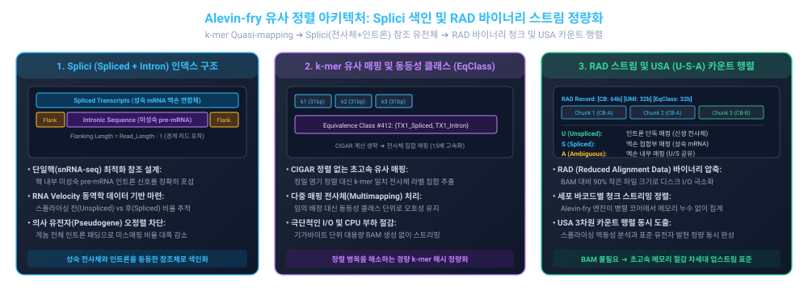

# 03. Alevin-fry 의사정렬(Pseudoalignment) 및 RAD 바이너리 스트리밍 파이프라인 (Alevin-fry & RAD Streaming)

---

## 학습 목표 (Cognitive Goals)

1. **전역 염기 정렬(Base-level Alignment)과 선택적 의사정렬(Selective Pseudoalignment) 간의 계산 복잡도 패러다임 시프트 규명**: 염기 수준 CIGAR 산출을 생략(selective-alignment는 ksw2로 점수만 계산하고 CIGAR는 만들지 않음; DP 없이 $k$-mer만 쓰는 방식은 `--sketch` pseudoalignment)하고, 전사체 동등성 클래스(Equivalence Classes)와 $k$-mer 준정렬(Quasi-mapping)을 통해 유전자 카운트 행렬을 수십 배 빠르게 구축하는 수학적 원리를 이해한다.
2. **매핑과 정량의 완전한 디커플링: Alevin-fry 2단계 아키텍처 분석**: `salmon` 기반의 초고속 리드 매핑과 Rust 기반의 `alevin-fry` 단일세포 정량 엔진이 RAD(Reduced Alignment Data) 이진 스트림 포맷을 매개로 결합하는 소프트웨어 아키텍처를 분석한다.
3. **Splici 인덱스(Spliced cDNA + Flanking Introns)의 구조적 설계 원리 정립**: 단일핵 전사체(snRNA-seq) 및 RNA Velocity 분석을 위해 성숙 전사체와 인트론 접합부를 $L-1$ 오버행(Flanking) 서열로 융합하여 단일 인덱스에서 Spliced 및 Unspliced 카운트를 동시 산출하는 메커니즘을 습득한다.
4. **저메모리 고처리량 프로덕션 파이프라인 최적화**: 인간 splici 인덱스는 dense 약 10 GB, sparse 약 6.5 GB(He 2022)로 STAR 인덱스(~30 GB)보다 작으며, 디스크 I/O를 극소화하는 디스크 I/O를 극소화하는 `pyroe` $\to$ `salmon alevin` $\to$ `alevin-fry` 엔드투엔드 파이프라인을 구축한다.

---

## 1. 패러다임 시프트: 염기 단위 전역 정렬 vs. 선택적 의사정렬

단일세포 RNA 시퀀싱 분석의 궁극적인 목적은 "개별 세포($c$)에서 각 유전자($g$)의 온전한 전사체 분자 수(UMI Count)가 몇 개인가?"를 나타내는 행렬 $\mathbf{X} \in \mathbb{R}^{N \times G}$를 획득하는 것이다.



### 1.1 전통적 전역 정렬의 연산 낭비

STAR나 BWA와 같은 고전적 유전체 정렬기는 리드의 모든 단일 염기(100bp)에 대해 최적의 게놈 좌표를 찾고 미스매치, 삽입, 결손을 정확히 표현하는 CIGAR 스트링(예: `100M`, `45M12000N55M`)과 정렬 점수(AS, NM)를 계산한다.

그러나 유전자 발현 정량 관점에서 질문은 훨씬 단순하다:
> *"이 리드가 과연 전사체 $T_A$에서 유래했는가, 아니면 $T_B$에서 유래했는가?"*

리드의 정확한 삽입/결손 위치나 인트론 내부의 상세 염기 좌표는 단순 유전자 카운팅에 전혀 기여하지 않는다. 전역 염기 정렬의 상세 좌표 계산은 카운트 행렬 생성 관점에서는 상당 부분 불필요한 연산(Overhead)이다(구체적 낭비 비율은 도구·데이터별로 달라 수치를 제시하지 않는다).

### 1.2 전사체 동등성 클래스 (Equivalence Classes)

의사정렬(Pseudoalignment, Bray et al. 2016) 및 준정렬(Quasi-mapping, Srivastava et al. 2016)은 리드가 정렬될 수 있는 가능한 전사체 후보들의 집합만을 식별한다. 이를 **전사체 동등성 클래스(Transcript Equivalence Class, EC)**라 정의한다.

$$r_i \to \text{EC}(r_i) = \{t \in \mathcal{T} \mid r_i \text{ aligns to } t\}$$

전체 전사체 집합 $\mathcal{T} = \{t_1, t_2, \dots, t_K\}$에 대해, 서로 다른 수억 개의 리드들은 수십만 개의 고유한 동등성 클래스로 집약된다. 따라서 리드 개별 단위를 추적하는 대신 동등성 클래스 단위로 압축함으로써 정량 연산의 차원을 기하급수적으로 축소한다.

---

## 2. Alevin-fry 아키텍처: 매핑과 정량의 완전한 디커플링

초기 `Alevin`은 매핑 엔진과 세포 바코드 보정/UMI 중복 제거 로직이 강하게 결합(Tightly-coupled)되어 있었다. (`kallisto | bustools`는 BUS 포맷으로 매핑과 보정/계수를 분리한 모듈형 워크플로의 선구적 사례이다.) 

He, Srivastava, Patro 등이 개발한 **Alevin-fry** (Nature Methods, 2022)는 이 두 단계를 완전히 분리(Decoupling)하였다:

```
[FASTQ Files (R1, R2)]
          │
          ▼ Phase 1: High-Throughput Mapper (Salmon / Piscem)
  - k-mer Quasi-mapping / Selective Alignment against Splici Index
  - Streaming output directly to binary pipe
          │
          ▼ Intermediate Representation: RAD (Reduced Alignment Data) File
  - Structured binary chunks (CB + UMI + Equivalence Class ID)
  - BAM보다 작은 크기 (비율은 데이터에 따라 다름)
          │
          ▼ Phase 2: High-Performance Quantifier (alevin-fry in Rust)
  1. `alevin-fry generate-permit-list` : Whitelist validation & cell filtering
  2. `alevin-fry collate`              : RAD chunk sorting by Cell Barcode
  3. `alevin-fry quant`                : UMI graph resolution (CR / USA mode)
          │
          ▼
[Count Matrices: Spliced (S), Unspliced (U), Ambiguous (A)]
```

1. **Phase 1: 매퍼 (Salmon / Piscem)**:
   * C++ 또는 C 기반의 초고속 서열 매칭 엔진.
   * 복잡한 단일세포 전용 로직을 전혀 수행하지 않고, 순수하게 리드별 바코드, UMI, 그리고 매핑된 전사체 ID 목록만을 초고속 추출하여 이진 RAD 파일로 스트리밍 덤프한다.
2. **Phase 2: 정량기 (alevin-fry Core)**:
   * 메모리 안전성과 극한의 병렬성을 보장하는 Rust 언어로 작성됨.
   * 바코드 오류 보정, 세포 호출(Permit-list), UMI 중복 제거 그래프 알고리즘을 독립적으로 수행한다.

---

## 3. RAD (Reduced Alignment Data) 바이너리 스트림 포맷 완전 해부

**RAD** 포맷은 단일세포 RNA-seq 정량에 필수적인 정보만을 담도록 설계된 가변 길이 이진(Binary) 레코드 컨테이너이다.

### 3.1 RAD 파일 내부 메모리 레이아웃

```
[RAD Binary File Layout]
┌─────────────────────────────────────────────────────────────────┐
│ Header Section                                                  │
│  - is_paired: uint8                                             │
│  - Target(ref) Count (K): uint64                                │
│  - Target Names: [Length: uint16, String: char[L]]*K            │
│  - Number of Chunks: uint64                                     │
│  - Tag descriptions (file / read / alignment 수준 태그와 타입)  │
├─────────────────────────────────────────────────────────────────┤
│ Chunk 1                                                         │
│  - Chunk Size (Bytes): uint32                                   │
│  - Number of Reads (M): uint32                                  │
│  ┌────────────────────────────────────────────────────────────┐ │
│  │ Record 1:                                                  │ │
│  │  - num_aln (N_targets): uint32                             │ │
│  │  - Raw Barcode (2-bit 인코딩, 태그 기술의 정수 타입)       │ │
│  │  - UMI (2-bit 인코딩, 태그 기술의 정수 타입)               │ │
│  │  - Alignments: [Target_ID (uint32) (+ 방향 등)] * N        │ │
│  ├────────────────────────────────────────────────────────────┤ │
│  │ Record 2: ...                                              │ │
│  └────────────────────────────────────────────────────────────┘ │
├─────────────────────────────────────────────────────────────────┤
│ Chunk 2, Chunk 3, ... Chunk P                                   │
└─────────────────────────────────────────────────────────────────┘
```

> 위 도식은 레거시 RAD(salmon alevin 산출, alevin-fry 0.9)의 개략이며 magic number는 없다(신형 versioned RAD만 파일 magic과 버전을 가진다). RAD는 **보정 전 raw 바코드**를 저장하고 보정은 `generate-permit-list` 단계에서 이루어진다(libradicl `RadHeader`/`record` 소스 기준).

### 3.2 2비트 염기 인코딩과 메모리 압축 효율

RAD 파일은 바코드와 UMI 서열을 ASCII 문자열(16바이트)로 저장하지 않고, 2비트 바이너리 압축(`A: 00, C: 01, G: 10, T: 11`)을 적용한다:
* 16bp Cell Barcode: 2비트 × 16 = 32비트이므로 정수형(바이트 정렬된 u32 또는 더 넓은 정수)에 담긴다.
* 12bp UMI: 2비트 × 12 = 24비트이나 저장은 바이트 정렬된 정수형(예: u32/u64)으로 이루어진다(3바이트 저장 아님).
* CIGAR 스트링, 퀄리티 점수, 플래그 비트 등 불필요한 메타데이터를 전면 배제하므로, BAM 파일보다 훨씬 작은 디스크 용량을 사용한다(절감 비율은 데이터에 따라 다르며 일반 수치는 제시하지 않는다).

---

## 4. Splici 인덱스: Spliced cDNA + Flanking Intron 결합 구조

단일핵 RNA-seq(snRNA-seq) 및 RNA 속도론(RNA Velocity) 분석에서는 스플라이싱된 성숙 전사체(Spliced, S)와 아직 인트론을 포함하고 있는 미성숙 전구 전사체(Unspliced, U)의 양을 세포별로 분리 정량해야 한다.

Alevin-fry 생태계는 이를 해결하기 위해 **Splici (Spliced + Intron)** 인덱스라는 독창적인 참조 전사체 구조를 제안하였다.

```
[Genome Reference: Gene A]
Exon 1 (150bp)       Intron 1 (2,000bp)         Exon 2 (200bp)
[=============]────────────────────────────────[==============]

[Splici Reference Construction]
1. Spliced cDNA:
   [=============][==============]  (Target ID: GeneA-S)

2. Flanking Intron 1 (Read Length L = 100bp):
   Left Flank (L-1 = 99bp)                   Right Flank (L-1 = 99bp)
   [=============]                           [==============]
                 [──────────────────────────]
                 Intron 1 Body (2,000bp)
   ◄────────────────────── Total Flanking Intron ──────────────────────►
                          (Target ID: GeneA-I)
```

### 4.1 $L-1$ 플랭킹(Flanking) 오버행의 수리적 필연성

> 참고: 필요성 논증은 $L-1$이지만 논문과 `pyroe`의 기본 flank 길이는 read length − 5(`--flank-trim-length 5`)입니다.

시퀀싱 리드의 길이가 $L$ (예: 100bp)일 때, 리드가 엑손-인트론 경계면(Exon-Intron Boundary)에 걸치는 스플라이스 전구체 리드를 $k$-mer 기반 준정렬기로 포획하려면 특수한 경계 확장이 필요하다:
* 만약 순수한 인트론 서열만 인덱스에 포함한다면, 리드의 99bp가 엑손에 걸치고 단 1bp만 인트론에 걸치는 전구체 리드는 인트론 인덱스에 매핑되지 못하고 기각된다.
* 반대로 인트론의 양 말단에 인접한 엑손 서열을 정확히 **$L - 1$ 염기쌍**만큼 연장(Flank)하여 인덱스에 포함시키면:
  * 엑손-인트론 접합부를 단 1bp라도 통과하는 모든 전구 리드가 최소 1개 이상의 유효 $k$-mer를 통해 해당 인트론 타깃(`GeneA-I`)에 완벽하게 정렬된다.

### 4.2 USA 모드 (Unspliced, Spliced, Ambiguous) 동시 정량

`alevin-fry quant`는 별도 옵션 없이, 3열 t2g(`*_t2g_3col.tsv`, pyroe 산출)가 주어지면 USA 모드로 자동 동작하여 각 UMI가 매핑된 타깃 정보를 바탕으로 3차원 카운트를 분리한다:
1. **Spliced (S)**: Spliced cDNA 타깃에만 독점 매핑된 UMI 카운트.
2. **Unspliced (U)**: Flanking Intron 타깃에 독점 매핑된 UMI 카운트.
3. **Ambiguous (A)**: S와 U 양쪽 모두에 동등하게 매핑되어(예: 엑손-인트론 경계의 플랭크($L-1$) 안에 걸친 엑손 쪽 리드) 스플라이싱 상태를 단정할 수 없는 UMI 카운트. (엑손 내부에만 완전히 포함된 리드는 spliced 타깃에만 매핑되어 S로 계수된다.)

---

## 5. 전산학적 효율 비교: 메모리 및 처리량

아래 표의 STARsolo·Alevin-fry 인덱스 메모리는 문헌(He 2022 등) 수치이고, 나머지 열은 **개념적 비교(예시, 실측 아님)**이다:

| 성능 지표 | STARsolo (v2.7.11a) | Kallisto / Bustools | Alevin-fry (Splici mode) |
| :--- | :--- | :--- | :--- |
| **인덱스 RAM** | 약 $30\text{ GB}$ (게놈 SA 인덱스) | 미확인 (예시 표에서 삭제) | **인간 splici: dense ≈10 GB, sparse ≈6.5 GB** (He 2022; spliced-only dense는 ≈3 GB) |
| **중간 파일 용량** | BAM (데이터 의존) | BUS | RAD (데이터 의존) |
| **멀티스레드 확장성** | 데이터·설정 의존 | 데이터·설정 의존 | 데이터·설정 의존 (Rust 구현, 근거 있는 선형 확장 수치는 제시하지 않음) |
| **RNA Velocity 지원** | 별도 옵션 (메모리 증가) | 파이프라인 분리 | **기본 내장 (USA 카운트 행렬)** |
| **랩탑 구동 가능 여부** | 메모리 의존 | 메모리 의존 | 인덱스 RAM(위 행)에 의존 |

Alevin-fry는 STAR 대비 작은 인덱스 메모리로 대규모 데이터를 정량할 수 있으나, 인간 splici 인덱스 매핑에는 약 6.5~10 GB가 필요하므로 4GB 노드에는 맞지 않는다.

---

## 6. 프로덕션 파이프라인 재현 코드: `pyroe` $\to$ `salmon` $\to$ `alevin-fry`

아래 파이프라인은 참조 유전체 및 GTF로부터 Splici 인덱스를 구축하고, 10x 3' v3 snRNA-seq FASTQ 데이터를 단일 배치로 처리하는 완전한 실행 스크립트이다.

```bash
#!/usr/bin/env bash
set -euo pipefail

# 경로 설정
GENOME_FASTA="/data/ref/GRCh38.primary_assembly.genome.fa"
GTF_FILE="/data/ref/gencode.v44.primary_assembly.annotation.gtf"
SPLICI_OUT="/data/ref/splici_fl85"
WHITELIST="/data/ref/3M-february-2018.txt"

FASTQ_R1="/data/raw/Prostate_snRNA_R1.fastq.gz"
FASTQ_R2="/data/raw/Prostate_snRNA_R2.fastq.gz"
OUTPUT_DIR="/data/alevin_fry_output"
THREADS=16

mkdir -p "${SPLICI_OUT}" "${OUTPUT_DIR}"

# Step 1: pyroe를 이용한 Splici FASTA 및 전사체-유전자 매핑 파일 추출
# (pyroe 기본: flank length = read length − flank-trim-length(5). Read length 90 → 85bp. 아래 4.1의 L−1 논증은 필요성 설명이며 pyroe/논문의 기본값은 L−5)
if [ ! -f "${SPLICI_OUT}/splici_fl85.fa" ]; then
    echo "[*] Splici 참조 서열 생성 중 (pyroe)..."
    pyroe make-splici \
      "${GENOME_FASTA}" \
      "${GTF_FILE}" \
      90 \
      "${SPLICI_OUT}" \
      --flank-trim-length 5
    echo "[+] Splici 서열 생성 완료."
fi

# Step 2: Salmon 인덱스 빌드
INDEX_DIR="${SPLICI_OUT}/salmon_index"
if [ ! -d "${INDEX_DIR}" ]; then
    echo "[*] Salmon Splici 인덱스 빌드 시작 (RAM 요구량은 인덱스 유형에 따라 다름; 인간 splici는 수 GB~10 GB 수준)..."
    salmon index \
      -t "${SPLICI_OUT}/splici_fl85.fa" \
      -i "${INDEX_DIR}" \
      -p "${THREADS}"
    echo "[+] Salmon 인덱스 빌드 완료."
fi

# Step 3: Salmon Alevin을 통한 준정렬 및 RAD 파일 생성
echo "[*] Salmon Alevin 매핑 구동 (RAD 스트리밍)..."
salmon alevin \
  -i "${INDEX_DIR}" \
  -l ISR \
  -1 "${FASTQ_R1}" \
  -2 "${FASTQ_R2}" \
  -o "${OUTPUT_DIR}/salmon_quant" \
  -p "${THREADS}" \
  --chromiumV3 \
  --rad

# Step 4: alevin-fry 정량 파이프라인 (Rust)
echo "[*] Alevin-fry 1단계: 유효 세포 바코드 식별 (generate-permit-list)..."
alevin-fry generate-permit-list \
  -d fw \
  -i "${OUTPUT_DIR}/salmon_quant" \
  -o "${OUTPUT_DIR}/quant_res" \
  -u "${WHITELIST}"

echo "[*] Alevin-fry 2단계: 세포 바코드 기준 RAD 청크 정렬 (collate)..."
alevin-fry collate \
  -i "${OUTPUT_DIR}/quant_res" \
  -r "${OUTPUT_DIR}/salmon_quant" \
  -t "${THREADS}"

echo "[*] Alevin-fry 3단계: UMI 그래프 중복 제거 및 USA 희소 행렬 출력 (quant)..."
alevin-fry quant \
  -m "${SPLICI_OUT}/splici_fl85_t2g_3col.tsv" \
  -i "${OUTPUT_DIR}/quant_res" \
  -o "${OUTPUT_DIR}/quant_res/af_quant" \
  -t "${THREADS}" \
  -r cr-like-em   # 다유전자 UMI를 확률 배분하려면 -em 변형을 사용 (cr-like는 CellRanger처럼 다유전자 UMI를 폐기)

echo "[+] Alevin-fry 파이프라인 완결. 카운트 행렬 저장 위치: ${OUTPUT_DIR}/quant_res/af_quant"
```

---

## 단원 핵심 점검 (Cognitive Checkpoint & Case Study)

### 문제 1: Splici 인덱스에서 인트론 접합부에 리드 길이 $L-1$ 오버행(Flanking)을 부여해야 하는 k-mer 준정렬 이유
단일핵 시퀀싱 리드의 길이가 $L = 100\text{ bp}$이고, $k$-mer 기반 정렬기(Salmon)가 인덱싱에 사용하는 $k$-mer 길이가 $k = 31$이다. 한 전구 전사체 리드가 엑손의 끝부분 90bp와 인트론의 시작부분 10bp에 걸쳐 정렬되어 있다.
1. 만약 참조 인덱스에 순수한 인트론 서열(Flanking 엑손 서열이 0bp인 상태)만을 포함시켰다면, 이 100bp 리드가 인트론 타깃에 매핑될 수 있는지 $k$-mer 매칭 관점에서 판정하시오.
2. 인트론 타깃의 경계면에 $L - 1 = 99\text{ bp}$의 엑손 오버행을 부가했을 때, 이 리드 내부에서 인트론 타깃과 완벽히 일치하는 31-mer의 개수를 수리적으로 계산하시오.

<details>
<summary>💡 모범 답안 및 해설 확인</summary>

**1. 오버행 부재 시 매핑 불가 판정**:
*   리드는 엑손 90bp + 인트론 10bp로 구성되어 있다.
*   인덱스에 인트론 서열만 존재한다면, 리드 내에서 인트론과 겹치는 길이는 단 10bp에 불과하다.
*   준정렬을 개시하기 위해 필요한 최소 일치 단위는 $k = 31\text{ bp}$이다.
*   10bp는 31-mer보다 작으므로 리드 내부의 어떤 31-mer도 순수 인트론 인덱스에 매칭될 수 없다. 반면 엑손 90bp는 성숙 전사체(cDNA) 인덱스에 다수의 31-mer($90 - 31 + 1 = 60$개)가 매칭되므로, 이 리드는 전구 전사체가 아닌 성숙 전사체(Spliced)로 완전히 오분류(Misclassification)된다.

**2. $L-1$ 오버행 부가 시 31-mer 매칭 개수 계산**:
*   인트론 타깃의 5' 말단에 엑손 서열 99bp가 연장되어 있으므로, 인트론 타깃 서열은 `[Exon 99bp] + [Intron Sequence]` 형태를 띤다.
*   우리의 질의 리드는 엑손의 마지막 90bp와 인트론의 첫 10bp를 포함하므로, 이 100bp 전체가 플랭킹 인트론 타깃 서열 내부에 **완벽하게 100% 연속 일치(Exact Match)**하여 안착한다.
*   길이가 $M = 100\text{ bp}$인 완전 일치 영역에서 생성되는 $k = 31$인 $k$-mer의 총 개수는:
    $$N_{k\text{-mer}} = M - k + 1 = 100 - 31 + 1 = 70\text{ 개}$$
*   따라서 70개의 31-mer가 플랭킹 인트론 타깃을 강력하게 지지하므로, Alevin-fry는 이 리드가 인트론 접합부를 침범한 Unspliced 전구 전사체임을 100% 신뢰도로 정확히 식별한다.

</details>

---

### 문제 2: 동등성 클래스(Equivalence Class) 기반 다중 전사체 매핑 해소와 다유전자 패밀리(Paralog) 위양성 방지
인간 전립선암 세포에서 안드로겐 대사에 관여하는 두 상동 유전자(Paralogous Genes)인 *AKR1C1*과 *AKR1C2*는 코딩 서열의 95% 이상을 완벽히 공유한다. 한 세포 바코드에서 관측된 단일 UMI에 속한 5개의 PCR 복제 리드들이 모두 동등성 클래스 $\text{EC}_1 = \{\text{AKR1C1}, \text{AKR1C2}\}$에 속하는 다중 매핑(Multi-mapping) 상태로 판정되었다.
1. 유전자 수준의 고유 정렬(Uniquely mapping) 리드만을 취급하는 보수적 파이프라인(예: 기본 STARsolo: 다유전자 UMI를 제외)에서 이 UMI가 어떻게 처리(폐기 또는 카운트 누락)되는지 설명하시오.
2. Alevin-fry의 동등성 클래스 해결 알고리즘(해상도 전략: trivial, cr-like, cr-like-em, parsimony, parsimony-em, parsimony-gene(-em) 중 EM 계열)이 세포 내의 다른 고유 매핑 리드들의 전사 비율을 사전 정보(Prior)로 활용하여 이 모호한 UMI를 특정 유전자로 조건부 확률 배분하거나 유전자 패밀리 그룹으로 보존하는 메커니즘을 설명하시오.

<details>
<summary>💡 모범 답안 및 해설 확인</summary>

**1. 보수적 고유 정렬 파이프라인의 카운트 누락**:
*   기본 설정의 엄격한 유전자 정량 도구들은 여러 유전자에 걸치는 다유전자 UMI를 카운팅 대상에서 제외한다(STARsolo 기본은 `NH>1` 전량 폐기가 아니라 다유전자 UMI만 제외).
*   *AKR1C1*과 *AKR1C2*처럼 염기 서열이 거의 동일한 파라로그 유전자군에 매핑된 리드는 두 유전자좌 모두에 동등한 점수로 정렬되므로 전량 버려진다.
*   결과적으로 실제로 해당 유전자가 고발현되고 있음에도 불구하고 최종 카운트 행렬에서는 발현량이 0으로 기록되는 심각한 유전자 결손(Dropout) 위음성이 발생한다.

**2. Alevin-fry의 동등성 클래스 기반 확률적 해소**:
*   Alevin-fry는 동등성 클래스 정보를 보존한 상태에서 개별 세포 단위의 기댓값 최대화(Expectation-Maximization, EM) 계열 해상도 전략(`cr-like-em`, `parsimony-em` 등)을 구동할 수 있다('Tiered'라는 이름의 전략은 없다).
*   동일 세포 내에서 *AKR1C1*에만 고유하게 정렬된 리드가 50개 검출되었고(3′ 라이브러리에서는 5′ UTR 고유 리드가 비현실적이므로 3′ 말단 영역의 차이 서열 리드를 가정), *AKR1C2*에 고유 매핑된 리드가 0개였다면, 이 세포 내에서 *AKR1C1*의 사전 전사 확률 $P(\text{AKR1C1})$이 압도적으로 높다.
*   Alevin-fry는 베이즈 사후 확률에 따라 모호한 $\text{EC}_1 = \{\text{AKR1C1}, \text{AKR1C2}\}$의 UMI 카운트를 높은 확률을 지닌 *AKR1C1*으로 가중 배정(또는 분수 카운트 할당)함으로써 서열 상동성으로 인한 신호 손실을 완벽히 복원한다.

</details>

---

### 문제 3: 4GB 저메모리 HPC 노드 클러스터에서 500개 샘플의 대규모 단일핵 아틀라스를 처리할 때의 파이프라인 아키텍처 선택 (STARsolo vs Alevin-fry)
국가 바이오데이터 스테이션의 공유 클러스터는 노드당 4GB의 RAM과 4개의 CPU 코어를 가진 슬롯 500개로 구성된 대규모 분산 환경이다. 연구책임자는 500명의 전립선암 환자 snRNA-seq FASTQ 데이터(샘플당 1억 리드)를 일주일 이내에 카운트 행렬로 변환해야 한다.
1. 각 노드의 물리적 메모리 제한(4GB RAM) 조건에서 STARsolo 파이프라인을 500개 노드에 분산 배치하는 것이 왜 원천적으로 불가능(Fatal Failure)한지 설명하시오.
2. Alevin-fry 파이프라인이 4GB 노드 환경에서 어떻게 500개 샘플의 동시 병렬 처리를 성공시킬 수 있는지, Splici Salmon 인덱스 크기, 바이너리 RAD 파일 스트리밍 메모리, Rust 런타임의 풋프린트 관점에서 공학적 타당성을 제시하시오.

<details>
<summary>💡 모범 답안 및 해설 확인</summary>

**1. STARsolo의 분산 배치 불가 원인 (RAM 부족)**:
*   STARsolo는 인간 게놈 GRCh38의 접미사 배열 인덱스를 로딩하기 위해 최소 **$30\text{ GB} \sim 32\text{ GB}$의 RAM**을 강제한다.
*   각 계산 노드의 물리 메모리가 4GB에 불과하므로, STARsolo 프로세스를 실행하는 즉시 메모리 할당 실패(Bad Alloc) 또는 Linux 커널의 OOM Killer에 의해 SIGKILL(Exit Code 137)을 받고 강제 종료된다.
*   가상 메모리 스왑(Swap)을 사용하려 해도 28GB 이상의 스왑 공간을 4코어 노드에서 감당할 수 없으므로 파이프라인 실행 자체가 물리적으로 불가능하다.

**2. Alevin-fry 파이프라인의 공학적 타당성**:
*   **인덱스 메모리 (Salmon Splici Index)**: 인간 splici 인덱스는 접미사 배열이 아닌 압축 de Bruijn 그래프(pufferfish) 기반이라 STAR 인덱스(~30 GB)보다 작지만, He et al. (2022)에 따르면 매핑 시 dense 인덱스는 약 10 GB, sparse 인덱스는 약 6.5 GB의 RAM이 필요하다. 따라서 **4GB 노드에는 splici 인덱스가 적재되지 않는다**(spliced-only dense 인덱스는 약 700 MB, 매핑 시 약 3 GB이므로 spliced 카운트만 필요한 경우에 한해 가능하나 unspliced/USA 정보가 사라진다). 4GB 슬롯 제약이 실제 요구사항이라면 노드당 RAM을 늘리거나 spliced-only 전략을 택해야 한다.
*   **RAD 파일 스트리밍**: 매핑 과정에서 수십 GB의 BAM을 생성하지 않고, 1~2GB 미만의 가벼운 바이너리 청크 단위로 디스크에 스트리밍하므로 I/O 오버헤드가 극히 적다.
*   **초저메모리 Rust 정량기 (`alevin-fry`)**: `collate` 및 `quant` 단계는 세포 바코드 단위로 분할 정렬된 RAD 레코드를 순차적으로 읽으므로, 메모리 상에는 단 몇 백 MB의 버퍼만을 유지한다.
*   따라서 이 시나리오의 현실적 결론은 '4GB 슬롯에서 splici로 500개 동시 병렬은 성립하지 않으며, 슬롯당 메모리를 약 7~10 GB 이상으로 늘리거나 spliced-only 인덱스를 쓴다'이다. 처리 시간(샘플당 시간, 총 소요 시간)은 데이터와 하드웨어에 따라 달라 이 문제에서 수치로 보장할 수 없다.

</details>

---

<!-- REFERENCES:BEGIN (generated by scripts/apply_references.py; do not edit by hand) -->
## 참고문헌 (References)
### 본문 인용 문헌
1. He D, Zakeri M, Sarkar H, et al. Alevin-fry unlocks rapid, accurate and memory-frugal quantification of single-cell RNA-seq data. *Nat Methods*. 2022;19(3):316-322. PMID: 35277707. doi: 10.1038/s41592-022-01408-3
2. Bray NL, Pimentel H, Melsted P, et al. Near-optimal probabilistic RNA-seq quantification. *Nat Biotechnol*. 2016;34(5):525-7. PMID: 27043002. doi: 10.1038/nbt.3519
3. Srivastava A, Sarkar H, Gupta N, et al. RapMap: a rapid, sensitive and accurate tool for mapping RNA-seq reads to transcriptomes. *Bioinformatics*. 2016;32(12):i192-i200. PMID: 27307617. doi: 10.1093/bioinformatics/btw277
### 검수 근거 문헌
1. Srivastava A, Malik L, Sarkar H, et al. Alignment and mapping methodology influence transcript abundance estimation. *Genome Biol*. 2020;21(1):239. PMID: 32894187. doi: 10.1186/s13059-020-02151-8
2. Melsted P, Booeshaghi AS, Liu L, et al. Modular, efficient and constant-memory single-cell RNA-seq preprocessing. *Nat Biotechnol*. 2021;39(7):813-818. PMID: 33795888. doi: 10.1038/s41587-021-00870-2
### 소프트웨어 (표기 버전은 검수 시 API를 확인한 버전이며, 파이프라인 실행 환경은 requirements-pipelines.txt 참조)
- alevin-fry (github.com/COMBINE-lab/alevin-fry). 원 논문: He D, Zakeri M, Sarkar H, et al. Alevin-fry unlocks rapid, accurate and memory-frugal quantification of single-cell RNA-seq data. *Nat Methods*. 2022;19(3):316-322. PMID: 35277707. doi: 10.1038/s41592-022-01408-3
- pyroe (github.com/COMBINE-lab/pyroe).
- Salmon (github.com/COMBINE-lab/salmon). 원 논문: Patro R, Duggal G, Love MI, et al. Salmon provides fast and bias-aware quantification of transcript expression. *Nat Methods*. 2017;14(4):417-419. PMID: 28263959. doi: 10.1038/nmeth.4197
<!-- REFERENCES:END -->
