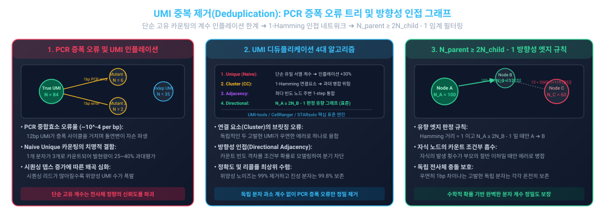

# 04. UMI 중복 제거 그래프 알고리즘 및 방향성 인접 검정 수리 모델 (UMI Deduplication Graph Algorithms)

---

## 학습 목표 (Cognitive Goals)

1. **단일세포 라이브러리 조작에서의 PCR 증폭 편향과 UMI의 생물물리학적 기전 규명**: 단일 세포당 총 RNA 약 $10 \sim 30\text{ pg}$(mRNA는 그 일부)에 불과한 극미량 전사체를 증폭하는 과정에서 발생하는 비선형 복제 편향을 이해하고, 역전사 단계에서 단일 mRNA 분자에 부여되는 고유 분자 식별자(UMI)의 수학적 역할을 정립한다.
2. **순진한 고유 카운팅(Naive Unique Counting)의 실패와 카운트 인플레이션 메커니즘**: DNA 중합효소의 점 돌연변이 오류와 시퀀싱 베이스 콜링 노이즈가 원본 UMI로부터 의사 UMI(Pseudo-UMIs)를 파생시켜 고발현 유전자에서 실제 전사체 분자 수를 왜곡 팽창시키는 과정을 확률론적으로 유도한다.
3. **UMI 중복 제거 알고리즘 5종(Unique, Percentile, Cluster, Adjacency, Directional; Smith 2017) 전산학적 비교**: 단순 제거, 고정 임계 필터, 1-해밍 연결 성분(Cluster) 방식의 과소계수(Under-counting) 부작용을 분석하고, 그래프 이론 기반의 방향성 인접(Directional Adjacency) 모델의 우위성을 증명한다.
4. **방향성 임계값 부등식 $N_{\text{parent}} \ge 2 N_{\text{child}} - 1$의 경험적 근거와 네트워크 구현**: 이 임계값은 UMI-tools의 *경험적* 규칙(증명된 정리가 아님)임을 이해하고, 분자 증폭 분기 과정(Branching Process) 모델은 그 정성적 동기로만 사용하며, 이를 해결하는 그래프 탐색 알고리즘을 구현한다.

---

## 1. 단일세포 라이브러리의 PCR 증폭 편향과 UMI의 생물물리학적 역할

단일 세포 1개 내부의 총 RNA 양은 약 $10 \sim 30\text{ pg}$이며 mRNA는 그 일부(전사체 분자 수 기준 약 $10^5 \sim 10^6$ 분자)에 불과하다. Illumina 시퀀서 플로우셀의 나노웰에 성공적으로 로딩되어 광학 신호를 생성하기 위해서는 최소 수 나노그램($\text{ng}$) 이상의 DNA 라이브러리가 요구되므로, 단일세포 프로토콜은 필수적으로 PCR 지수 증폭(Polymerase Chain Reaction)을 거쳐야 한다(10x 프로토콜은 cDNA 증폭과 라이브러리 PCR이 따로 있어 총 사이클은 입력량 의존적이며 12~16은 개념적 범위의 예시이다).



### 1.1 PCR 증폭의 비선형성과 정량 왜곡

PCR 반응에서 $i$번째 cDNA 분자가 매 사이클마다 복제될 확률(증폭 효율)을 $E_i \in [0, 1]$이라 할 때, $C$ 사이클 후의 최종 증폭 산물 수 $N_i(C)$는 다음과 같다:

$$N_i(C) = (1 + E_i)^C$$

증폭 효율 $E_i$는 전사체의 GC 염기 함량, 2차 구조(Secondary Structure), 서열 길이, 프라이머 결합 친화도에 따라 극심하게 변동한다.
* 전사체 A ($E_A = 0.95$): $C = 14$ 사이클 후 $(1.95)^{14} \approx 11,440$배 증폭.
* 전사체 B ($E_B = 0.70$): $C = 14$ 사이클 후 $(1.70)^{14} \approx 1,700$배 증폭.

초기 전사체 분자 수가 $1:1$로 동일했음에도 불구하고, 단 14사이클의 증폭 후 시퀀싱 리드 수는 **6.7배 이상의 심각한 왜곡**을 나타낸다. 따라서 단일세포 전사체학에서 리드 수(Read Count)는 세포 내 절대 발현량의 지표가 될 수 없다.

### 1.2 UMI의 분자 태깅 메커니즘

10x Genomics 기술은 역전사(Reverse Transcription) 반응 시 세포 바코드와 함께 $10\text{ bp}$ (v2) 또는 $12\text{ bp}$ (v3)의 완전 무작위 올리고뉴클레오타이드인 **UMI (Unique Molecular Identifier)**를 mRNA 3' 말단에 1:1로 결합시킨다.
* $L = 12\text{ bp}$ UMI의 상태 공간 크기:
  $$|\mathcal{U}| = 4^{12} = 16,777,216 \approx 1.68 \times 10^7$$
* 단일 세포 내에서 특정 단일 유전자의 전사체 분자 수가 통상 수십에서 수천 개 미만임을 고려할 때, 서로 다른 두 분자가 동일한 UMI를 부여받을 확률은 극히 낮다.
* 따라서 PCR 증폭 산물의 수가 수천 개로 불어나더라도, 동일한 세포 바코드와 동일한 유전자좌에 정렬된 리드들 중 **고유한 UMI의 개수(Unique UMI Count)**만을 집계하면 초기 mRNA 분자 수 $M$을 1:1로 정확하게 복원할 수 있다.

---

## 2. 순진한 고유 카운팅(Naive Unique Counting)의 치명적 실패: 인공적 카운트 팽창

그러나 실제 시퀀싱 데이터에서 단순히 고유한 UMI 문자열의 개수를 세는 순진한 방식(`len(set(umis))`)은 심각한 과대 계수(Over-counting / Count Inflation)를 초래한다.

```
Cycle 0: [True Initial UMI: GACTAGCACTAG] (1 molecule)
            │
            ▼ PCR Amplification (Cycle 1 ~ 3)
Cycle 3: [GACTAGCACTAG] (8 molecules)
            │
            ▼ Polymerase Error at Cycle 4 (T -> C Point Mutation)
Cycle 4: [GACTAGCAC[C]AG] (1 mutant copy generated!)
            │
            ▼ Subsequent Exponential Amplification (Cycle 5 ~ 14)
Final:   [Original UMI: GACTAGCACTAG] : 850 Reads  ◄── True Positive Molecule
         [Mutant UMI  : GACTAGCAC[C]AG] : 42 Reads   ◄── Pseudo-UMI Artifact!
```

### 2.1 중합효소 복제 오류율과 인공 가상 UMI(Pseudo-UMI)의 파생

1. **효소 복제 오류 (Polymerase Error)**:
   고성능 중합효소(High-fidelity DNA Polymerase)라 할지라도 1염기쌍당 사이클당 약 $\mu \approx 10^{-5} \sim 10^{-4}$의 치환 오류율을 보인다. $12\text{ bp}$ UMI가 14사이클의 증폭을 거치는 동안 UMI 영역 내부에서 최소 1회 이상의 복제 오류가 발생할 누적 확률은 $\mu=10^{-5}\sim10^{-4}$일 때 $12\times14$ 염기·사이클 기준 약 $0.17\% \sim 1.67\%$이다(고정밀 중합효소의 실제 오류율은 이보다 낮을 수 있어 가정 의존).
2. **시퀀싱 광학 오류 (Sequencing Error)**:
   Illumina 시퀀서의 염기 콜링 오류율은 평균 $0.1\% \sim 1\%$ (Phred Q20~Q30)이다.

### 2.2 고발현 유전자에서의 카운트 인플레이션 (정도는 조건 의존)

전립선암 표적 유전자인 *KLK3/PSA*나 리보솜 단백질 유전자와 같이 전사량이 매우 높은 유전자의 경우, 단일 세포 내에서 수백 개의 물리적 전사체 분자가 존재한다.
* 각 분자마다 수백 개의 PCR 증폭 카피가 생성되므로, 초기 혹은 중기 사이클에서 발생한 점 돌연변이 카피들이 독립적으로 시퀀싱된다.
* 결과적으로 원본 UMI(예: 리드 수 500개) 주변에 1bp 차이가 나는 가상 UMI(Pseudo-UMI, 리드 수 10개, 5개, 2개 등)가 수십 개씩 파생된다.
* 순진한 카운팅은 이 허위 가상 UMI들을 모두 독립된 새로운 전사체 분자로 오판하여, **실제 발현량보다 크게 부풀려진 카운트 인플레이션을 초래**할 수 있다(정도는 오류율·시퀀싱 깊이에 의존; Smith 2017 시뮬레이션에서 시퀀싱 오류율 1% 조건 약 1.3배 과대계수 보고).

---

## 3. UMI 중복 제거 알고리즘 5종 전산학적 비교

Smith, Heger & Sudbery (Genome Research, 2017)은 UMI 오류 보정을 체계적으로 비교하며 5가지 접근법(unique, percentile, cluster, adjacency, directional)을 제시하였다(아래 표는 이 중 4개와 Adjacency 보충 설명):

| 알고리즘 | 그래프 모델 및 처리 메커니즘 | 시간 복잡도 | 장점 | 치명적 결함 및 부작용 |
| :--- | :--- | :--- | :--- | :--- |
| **1. Unique (Naive)** | 서열 완전 일치 집합 크기 계수 (`set(U)`) | $O(U)$ | 구현 극단적 단순 | PCR/시퀀싱 오류로 인한 **과대계수**(정도는 조건 의존) |
| **2. Percentile** | 해당 locus의 비영 UMI 평균 카운트의 1% 미만인 UMI를 제거 (Islam 2014) | $O(U \log U)$ | 단순 노이즈 차단 | 카운트가 고르지 않으면 실제 저빈도 분자도 제거; 서열 근접성은 고려하지 않아 오류 UMI 중 높은 카운트인 것은 남음 |
| **3. Cluster** | 1-해밍 거리 무방향성 연결 성분(Connected Component) | $O(U^2)$ | 오류 UMI 병합 우수 | 독립 전사체끼리 병합되는 **과소계수(Under-counting)** |
| **4. Adjacency** | 가장 많은 UMI를 고르고 그 1-해밍 이웃을 흡수, 남은 UMI에서 반복 | $O(U^2)$ | Cluster보다 과소계수 완화 | 카운트 비율을 고려하지 않아 독립 분자가 흡수될 수 있음 |
| **5. Directional** | **방향성 인접 네트워크 ($N_p \ge 2N_c - 1$)** | $O(U^2)$ | Smith 2017 시뮬레이션에서 가장 정확·안정 | 완벽하지 않음: 독립 분자의 카운트가 2배 이상 차이나면 병합될 수 있고, 그래프 구축 연산이 필요 |

```
[Cluster Algorithm: Indiscriminate Merging (Under-counting)]
  (True Molecule A: 50 reads) ───[1-Hamming]─── (True Molecule B: 45 reads)
  ▲ 두 개의 독립된 실제 전사체가 우연히 1bp 차이로 인접할 때,
    단일 연결 성분으로 묶여 1개의 분자로 과소계수(Under-counting) 오류 발생!

[Directional Adjacency Algorithm: Rigorous Branching Test]
  (True Molecule A: 50 reads) ───X (Edge Rejected!) ───► (True Molecule B: 45 reads)
  검정: 50 >= 2*(45) - 1 = 89 ? → 불성립 (역방향 45 >= 2*(50) - 1 = 99 역시 불성립)
  두 카운트가 대등하여 어느 방향의 부모-자식 관계도 성립하지 않으므로
  독립된 두 분자로 정확히 분리 보존!
```

---

## 4. 방향성 인접 임계값의 경험적 근거 ($N_{\text{parent}} \ge 2 N_{\text{child}} - 1$)

방향성 인접 그래프(Directional Adjacency Graph) 알고리즘은 관측된 두 UMI 서열 $u_p$(부모 후보)와 $u_c$(자식 후보) 사이의 해밍 거리가 $d_H(u_p, u_c) = 1$일 때, $u_c$가 $u_p$의 PCR 복제 오류 산물인지 아니면 독립적으로 포획된 참 양성 분자인지를 통계적으로 판정한다.

### 4.1 PCR 분자 분기 과정(Branching Process) 모델

* 사이클 $k=0$에서 초기 원본 분자 $u_p$가 1개 존재한다 ($N_p(0) = 1$).
* 이상적인 PCR 조건(사이클당 효율 $E = 1.0$)에서 $k$번째 사이클이 완료된 직후 분자 수는 $2^k$개이다.
* 자식 돌연변이 UMI $u_c$가 생성될 수 있는 가장 극단적인 최악의 시나리오(자식 분자 수가 최대가 되는 경우)는 **가장 첫 번째 증폭 사이클($k=1$)에서 단일 가닥 복제 오류가 발생한 경우**이다:

1. 사이클 1 개시 시점: 원본 가닥 1개 복제 진행.
2. 중합효소가 단 1회의 점 돌연변이를 일으켜 1개의 변이 가닥($u_c$)과 1개의 원본 가닥($u_p$)이 형성됨.
3. 사이클 1 종료 시점: $N_p(1) = 1$, $N_c(1) = 1$.
4. 이후 남은 $C - 1$ 사이클 동안 두 가닥이 동일한 효율($E=1.0$)로 독립 증폭됨:
   $$N_p(C) = 1 \times 2^{C-1}$$
   $$N_c(C) = 1 \times 2^{C-1}$$

이 단순 모형에서는 첫 사이클에서 돌연변이가 발생하더라도 자식 분자의 복제 수가 부모 분자의 복제 수를 초과하지 못한다:

$$N_c \le N_p$$

> **모형의 한계**: 위 분기 모형은 PCR의 반보존적 복제(이중가닥 중 변이 가닥의 비율)를 무시한 단순화이므로 $N_c = N_p$라는 최악 비율은 정량적 결론이 아니다. 이 모형은 비율 임계값의 *정성적 동기*일 뿐이며, $N_p \ge 2N_c - 1$은 Smith et al. (2017)이 '오류 UMI와 참 UMI의 비는 2배 미만이 되는 일이 드물다'는 관찰과 저빈도 사슬 보정($-1$)을 바탕으로 채택한 **경험적 규칙**이다.

### 4.2 실용적 임계값의 설정: 2배 비율 가정과 저빈도 사슬 보정

§4.1의 분기 모델은 이상적인 최악 시나리오(첫 사이클 오류)에서조차 $N_c$가 $N_p$에 **대등해질 수 있음**을 보여주므로, 관측 카운트 비율만으로 오류 여부를 완벽하게 판별할 수는 없다. Smith, Heger & Sudbery는 여기에 두 가지 실용적 근거를 더해 간선 조건을 다음과 같이 확정하였다:

1. **2배 비율 가정 (Rarely Less Than Twofold)**:
   PCR 오류는 대부분 첫 사이클이 아니라 증폭이 진행된 이후의 사이클에서 발생한다. 이 경우 오류 가닥의 계통(lineage)은 원본 계통보다 최소 1회 이상의 복제 기회가 부족한 상태로 나머지 사이클을 증폭하며, §1.1의 증폭 효율 편향이 여기에 누적으로 작용한다. 따라서 참 분자(부모)와 오류 파생 UMI(자식)의 관측 리드 수 비율은 **2배 미만으로 좁혀지는 일이 드물다**(rarely less than twofold)는 것이 저자들의 실용적 가정이다.
2. **저빈도 사슬 보정 ($-1$ 항)**:
   조건을 $N_p \ge 2 N_c$로만 두면 $N_p = 1$인 노드는 같은 1회 관측의 1-해밍 이웃($N_c = 1$)과 연결되지 못한다($1 \ge 2$ 불성립). $-1$을 차감하면 $1 \ge 2(1) - 1 = 1$로 성립하여, 카운트가 단조적으로 감소하는 저빈도 UMI 사슬(길이가 긴 1-해밍 체인)까지 병합할 수 있게 된다.

이로써 방향성 인접 그래프의 최종 간선 조건은 다음과 같다:

$$N_{\text{parent}} \ge 2 N_{\text{child}} - 1 \iff N_{\text{child}} \le \frac{N_{\text{parent}} + 1}{2}$$

* **직관적 해석**:
  자식 후보의 리드 수 $N_c$가 부모 후보의 리드 수 $N_p$의 절반(정수 보정 $+1/2$) 이하일 때만, $u_c$를 $u_p$로부터 갈라져 나온 오류 가지(Branch)로 인정하여 $u_p \to u_c$ 방향 간선을 연결한다.
* 만약 $N_c$가 이 임계값을 초과하여 $N_p$와 대등하거나 크다면, $u_c$는 $u_p$의 오류 산물이 될 수 없으며 독립적으로 포획된 별개의 초기 전사체 분자로 판정해야 한다.
* **네트워크 해석**: 완성된 방향성 네트워크 전체는 최고 빈도 노드에서 유래한 것으로 간주되며, 중간 저빈도 UMI가 관측되고 카운트가 단계적으로 감소하는 한, 서로 1-해밍 거리 이상 떨어진 UMI도 전이적으로 병합된다.

---

## 5. Python 기반 방향성 인접 그래프 중복 제거 엔진 완전 구현

아래 스크립트는 `umi_tools`의 핵심 알고리즘을 순수 Python 및 인접 리스트(Adjacency List) 그래프 탐색 기법으로 구현한 완전한 재현 코드이다.

```python
#!/usr/bin/env python3
"""
directional_umi_dedup.py
방향성 인접 그래프(Directional Adjacency Graph) UMI 중복 제거 엔진
Smith et al. (Genome Research, 2017) 알고리즘 수학적 재현
"""

from collections import Counter, defaultdict
from typing import Dict, List, Set, Tuple

def hamming_distance(s1: str, s2: str) -> int:
    """두 UMI 간의 해밍 거리 계산"""
    return sum(c1 != c2 for c1, c2 in zip(s1, s2))

def build_directional_graph(umi_counts: Dict[str, int]) -> Dict[str, List[str]]:
    """
    1-해밍 거리 및 방향성 조건 (N_parent >= 2*N_child - 1)을 만족하는 방향성 그래프 구축
    Graph: parent -> [children...]
    """
    adj_graph = defaultdict(list)
    umis = list(umi_counts.keys())
    
    # 리드 수가 큰 순서대로 정렬 (부모 후보 우선)
    umis_sorted = sorted(umis, key=lambda u: umi_counts[u], reverse=True)
    
    for i in range(len(umis_sorted)):
        u_a = umis_sorted[i]
        n_a = umi_counts[u_a]
        
        for j in range(i + 1, len(umis_sorted)):
            u_b = umis_sorted[j]
            n_b = umi_counts[u_b]
            
            # 1-해밍 거리 검사
            if hamming_distance(u_a, u_b) == 1:
                # 방향성 임계 부등식 검정을 양방향으로 수행 (UMI-tools 방식:
                # 리드 수가 같은 UMI끼리는 양쪽 방향 간선이 모두 생길 수 있음)
                if n_a >= 2 * n_b - 1:
                    adj_graph[u_a].append(u_b)
                if n_b >= 2 * n_a - 1:
                    adj_graph[u_b].append(u_a)
                    
    return adj_graph

def resolve_directional_clusters(umi_counts: Dict[str, int]) -> int:
    """
    방향성 그래프를 순회하여 최종 고유 분자 수(Deduplicated Count) 산출
    """
    adj_graph = build_directional_graph(umi_counts)
    umis_sorted = sorted(umi_counts.keys(), key=lambda u: umi_counts[u], reverse=True)
    
    visited: Set[str] = set()
    dedup_molecules = 0
    
    for root_umi in umis_sorted:
        if root_umi in visited:
            continue
            
        # 새로운 독립된 실제 전사체 분자 발견
        dedup_molecules += 1
        visited.add(root_umi)
        
        # 너비 우선 탐색(BFS)을 통해 이 루트에서 파생된 모든 하위 오류 UMI 방문 및 병합
        queue = [root_umi]
        while queue:
            curr = queue.pop(0)
            for child in adj_graph.get(curr, []):
                if child not in visited:
                    visited.add(child)
                    queue.append(child)
                    
    return dedup_molecules

def benchmark_deduplication():
    """모의 시퀀싱 데이터셋 기반 4대 알고리즘 벤치마크 테스트"""
    print("=== UMI Deduplication Algorithm Benchmark ===")
    
    # 시나리오: 실제 2개의 전사체 분자가 존재함
    # Molecule 1 (초기 UMI: AAAAAAAAAAAA) -> 500개 리드로 증폭, PCR 오류로 가상 UMI 파생
    # Molecule 2 (초기 UMI: CCCCCCCCCCCC) -> 120개 리드로 증폭
    # 우연히 Molecule 1과 1bp 차이나는 독립 분자 (AAAAAAAACAAA) -> 450개 리드
    observed_umis = {
        "AAAAAAAAAAAA": 500, # True Molecule 1
        "AAAAAAAAAAAT": 18,  # Error from Mol 1 (T substitution)
        "AAAAAAAAAAAG": 5,   # Error from Mol 1 (G substitution)
        "AAAAAAAAAATA": 2,   # Error from Mol 1
        "CCCCCCCCCCCC": 120, # True Molecule 2
        "CCCCCCCCCCCA": 4,   # Error from Mol 2
        "AAAAAAAACAAA": 450, # True Molecule 3 (1-Hamming from Mol 1, but independent!)
    }
    
    # 1. Unique (Naive)
    cnt_naive = len(observed_umis)
    
    # 2. Directional Adjacency Graph
    cnt_directional = resolve_directional_clusters(observed_umis)
    
    print(f"관측된 총 원시 UMI 종류 (Raw Unique): {cnt_naive}개 (과대계수 인플레이션!)")
    print(f"방향성 그래프 보정 후 최종 분자 수: {cnt_directional}개 (정답: 3개 분자 복원)")
    assert cnt_directional == 3, f"Expected 3, got {cnt_directional}"
    print("[+] 방향성 그래프 알고리즘 검증 성공.")

if __name__ == "__main__":
    benchmark_deduplication()
```

---

## 단원 핵심 점검 (Cognitive Checkpoint & Case Study)

### 문제 1: PCR 오류율 $\mu$와 사이클 수 $C$에 따른 가상 UMI 생성 확률과 단순 유니크 카운팅의 카운트 팽창 비율 계산
어떤 단일세포 RNA 시퀀싱 실험에서 $12\text{ bp}$ 길이의 UMI를 사용하며, 중합효소의 사이클당 염기 복제 오류율은 $\mu = 1.0 \times 10^{-4}$이다. 라이브러리는 총 $C = 14$ 사이클의 PCR 증폭을 거친다.
1. 단일 UMI 분자가 14회의 복제 경로를 거치는 동안 UMI 서열 내에서 적어도 한 번 이상의 점 돌연변이 오류를 겪을 누적 확률 $P_{\text{mut}}$을 포아송 또는 이항 근사를 통해 수리적으로 계산하시오.
2. 특정 종양 세포에서 고발현 유전자 $G_1$의 실제 초기 mRNA 분자 수가 200개이고, 각 분자당 평균 500개의 리드가 시퀀싱되었다. 만약 단순 유니크 카운팅(`Unique`)을 적용할 경우 발생하는 허위 가상 UMI의 대략적인 수와 그로 인한 카운트 팽창율(Inflation Percentage)을 추정하시오.

<details>
<summary>💡 모범 답안 및 해설 확인</summary>

**1. 누적 돌연변이 확률 $P_{\text{mut}}$ 계산**:
*   단일 UMI 서열 길이 $L = 12\text{ bp}$, 사이클 수 $C = 14$.
*   단일 염기가 14사이클 동안 오류 없이 보존될 확률: $(1 - \mu)^{14}$.
*   12개 염기 전체가 14사이클 동안 단 하나의 오류도 겪지 않고 완벽히 복제될 확률:
    $$P_{\text{no\_err}} = (1 - \mu)^{L \times C} = (1 - 10^{-4})^{12 \times 14} = (1 - 10^{-4})^{168}$$
*   $(1 - x)^n \approx e^{-nx}$ 근사를 적용하면:
    $$P_{\text{no\_err}} \approx \exp(-168 \times 10^{-4}) = \exp(-0.0168) \approx 0.98334$$
*   따라서 적어도 1회 이상 오류를 겪을 확률:
    $$P_{\text{mut}} = 1 - P_{\text{no\_err}} \approx 1 - 0.98334 = 0.01666 \quad (약\ 1.67\%)$$

**2. 가상 UMI 수 및 카운트 팽창율 추정**:
*   초기 분자 수 200개 각각은 14사이클 동안 수만 가닥으로 증폭된다.
*   증폭 과정에서 생성되는 수많은 카피 중 약 $1.67\%$의 복제 계통이 돌연변이 서열을 갖게 된다. 분자당 500개의 리드가 깊게 시퀀싱되므로, 통계적으로 분자당 평균 $1 \sim 3$개의 고유한 돌연변이 가상 UMI(리드 수 수 개~수십 개 수준)가 충분히 검출 한계(Detection Limit) 내로 포착된다.
*   따라서 200개의 원본 분자 외에 약 $200 \times 1.5 \approx 300$개의 의사 UMI가 추가 관측된다.
*   단순 유니크 카운팅 시 총 카운트는 $200 + 300 = 500$으로 측정된다.
*   **카운트 팽창율(가정 하의 예시)**: 위 '분자당 약 1.5개 가상 UMI'는 문제의 가정이며 계산으로 도출된 값이 아니다. 이 가정이라면 $\frac{500 - 200}{200} \times 100\% = 150\%$이지만, 실제 팽창율은 오류율·깊이에 따라 크게 달라진다.

</details>

---

### 문제 2: 방향성 부등식 $N_{\text{parent}} \ge 2 N_{\text{child}} - 1$(경험적 임계값)의 경계 조건(Boundary Condition) 분석
방향성 인접 그래프 알고리즘에서 두 UMI 노드 $u_A$와 $u_B$가 1-해밍 거리에 위치하며, 각각의 관측 리드 수는 $N_A = 10$, $N_B = 19$이다.
1. $u_B$를 부모 노드, $u_A$를 자식 노드로 설정했을 때 방향성 부등식 조건이 성립하는지 판정하고, $u_A$가 $u_B$의 자식으로 병합될 수 있는지 설명하시오.
2. 만약 $N_A = 10$, $N_B = 20$인 경우, 역방향 검정(즉, $u_A$가 부모이고 $u_B$가 자식인 경우)과 비교하여 두 노드의 관계가 어떻게 판정되는지 경계 조건($-1$의 이산적 의미) 관점에서 설명하시오.

<details>
<summary>💡 모범 답안 및 해설 확인</summary>

**1. $N_A = 10, N_B = 19$ 조건 검정**:
*   부모 노드 $u_B$ ($N_B = 19$), 자식 노드 $u_A$ ($N_A = 10$).
*   방향성 부등식 검정:
    $$N_{\text{parent}} \ge 2 N_{\text{child}} - 1 \implies 19 \ge 2(10) - 1 = 19$$
*   좌변과 우변이 정확히 일치하는 **경계 조건에서 부등식이 성립**한다.
*   따라서 $u_B \to u_A$ 방향성 엣지가 연결되며, $u_A$는 $u_B$로부터 파생된 PCR 증폭 오류로 판정되어 $u_B$로 흡수 병합된다 (최종 카운트 1개).

**2. 경계 조건 분석 ($N_A = 10, N_B = 20$ 및 역방향)**:
*   **순방향 ($u_B$ 부모, $u_A$ 자식)**:
    $20 \ge 2(10) - 1 = 19$ 이므로 성립.
*   **역방향 ($u_A$ 부모, $u_B$ 자식)**:
    $10 \ge 2(20) - 1 = 39$ 조건이 **불성립(False)**한다!
    따라서 낮은 카운트 노드가 높은 카운트 노드를 흡수하는 역전 현상이 원천 차단되며, 간선은 $u_B \to u_A$ 단일 방향으로만 형성된다.
*   **$-1$의 이산적 수학 의미**:
    단순히 $N_p \ge 2 N_c$를 사용할 경우 $N_p = 1$일 때 $1 \ge 2 N_c$가 되어 어떤 자식도 연결되지 못하고 저빈도 UMI 사슬이 전부 끊어진다. $-1$을 차감함으로써 $N_p = 1$일 때 임계값을 $2(1)-1=1$로 완화하여 동일 리드 수($1 \ge 1$)의 1-해밍 이웃까지 병합을 허용하고, 카운트가 단계적으로 감소하는 긴 저빈도 사슬을 온전히 복원할 수 있게 하는 수학적 경계선을 형성한다.

</details>

---

### 문제 3: 고발현 종양 유전자(*KLK3/PSA*)에서 Cluster(연결 성분) 방식과 Directional Graph 방식 간의 전사체 정량 편차와 과소계수 방지 기전
전립선암 전이 조직의 단일 종양 세포에서 전립선 특이 항원 유전자 *KLK3*의 전사체가 매우 활발히 발현되어, 세포 내에 실제 300개의 서로 다른 초기 mRNA 분자가 존재한다. 이 300개의 분자들은 각각 고유한 12bp UMI를 부여받았다.
1. 300개의 독립된 UMI들이 $4^{12} \approx 1.68 \times 10^7$ 크기의 UMI 공간에 무작위 배치될 때, 300개 중 적어도 두 개의 독립된 UMI가 우연히 1-해밍 거리에 놓이게 될 확률이 0이 아님을 확인하고, 무방향성 연결 성분을 취하는 `Cluster` 알고리즘이 이때 어떤 오류(과소계수, Under-counting)를 범하는지 설명하시오.
2. `Directional Graph` 알고리즘이 두 독립 분자의 리드 수 크기($N_1 \approx 400$, $N_2 \approx 380$)를 비교하여 왜 부모-자식 관계의 방향성 엣지를 기각(Reject)하고 두 분자를 독립된 온전한 전사체로 보존하는지 증명하시오.

<details>
<summary>💡 모범 답안 및 해설 확인</summary>

**1. Cluster 알고리즘의 과소계수 오류 메커니즘**:
*   UMI 공간이 $M = 1.68 \times 10^7$로 넓지만, 300개의 분자가 존재할 때 서로 1-해밍 거리(12개 위치 $\times 3$개 염기 $= 36$개의 이웃) 내에 우연히 접근할 확률은 유한하다.
*   무방향성 연결 성분을 형성하는 `Cluster` 알고리즘은 두 노드 간의 해밍 거리가 1이기만 하면 두 노드의 리드 수에 상관없이 무조건 단일 컴포넌트로 묶어버린다.
*   결과적으로 실제로 서로 다른 물리적 mRNA 분자에서 유래한 참 양성 분자 2개가 단 1개의 UMI 카운트로 축소되어 **치명적인 과소계수(Under-counting / Loss of Signal)**가 발생한다.

**2. Directional Graph의 과소계수 방지 증명**:
*   두 분자가 각각 독립적인 초기 전사체에서 유래했다면, PCR 증폭 후 두 UMI가 획득하는 리드 수는 통계적으로 대등한 크기를 갖는다 (예: $N_1 = 400$, $N_2 = 380$).
*   Directional Graph 알고리즘은 방향성 검정을 양방향으로 수행한다:
    *   가설 1 ($u_1$이 부모, $u_2$가 자식): $400 \ge 2(380) - 1 = 759$ → **불성립**.
    *   가설 2 ($u_2$가 부모, $u_1$가 자식): $380 \ge 2(400) - 1 = 799$ → **불성립**.
*   부모-자식 관계를 만족하는 방향이 존재하지 않으므로 어느 방향으로도 방향성 엣지가 형성되지 않으며, 두 노드는 서로 다른 방향성 네트워크로 분리된다.
*   따라서 리드 수가 대등한 두 노드는 독립된 2개의 고유 분자로 온전히 보존되어 Cluster 알고리즘의 과소계수 왜곡을 완벽히 방지한다.

</details>

---

<!-- REFERENCES:BEGIN (generated by scripts/apply_references.py; do not edit by hand) -->
## 참고문헌 (References)
### 본문 인용 문헌
1. Smith T, Heger A, Sudbery I. UMI-tools: modeling sequencing errors in Unique Molecular Identifiers to improve quantification accuracy. *Genome Res*. 2017;27(3):491-499. PMID: 28100584. doi: 10.1101/gr.209601.116
2. Islam S, Zeisel A, Joost S, et al. Quantitative single-cell RNA-seq with unique molecular identifiers. *Nat Methods*. 2014;11(2):163-6. PMID: 24363023. doi: 10.1038/nmeth.2772
<!-- REFERENCES:END -->
