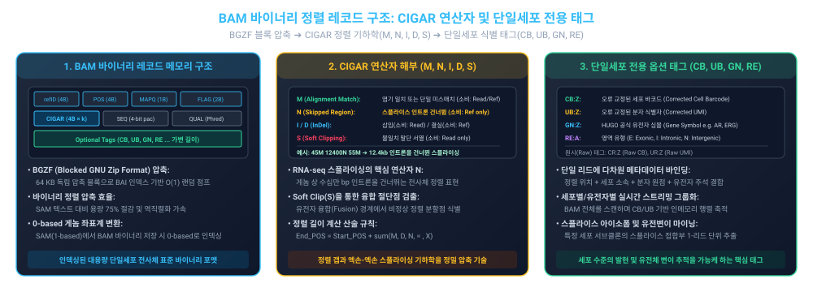

# Chapter 05. BAM 파일의 바이너리 구조와 samtools 기반 정렬 데이터 제어 (BAM Binary Mechanics & samtools Alignment Slicing)

> **Cognitive Goal**: 차세대 염기서열 분석(NGS) 및 단일핵 전사체(snRNA-seq) 데이터 처리의 표준 정렬 포맷인 SAM/BAM의 바이너리 아키텍처를 시스템 수준에서 이해한다. BGZF(Block GZIP Format) 압축 블록의 64비트 가상 파일 오프셋(Virtual File Offset) 수학과 `.bai` 인덱스의 계층적 비닝(Binning index) 알고리즘을 도출한다. 12비트 SAM 플래그(FLAG bitmask)의 비트 연산 디코딩 및 CIGAR 문자열의 게놈 구간 소모(Query vs Reference Consumption) 기하학을 정립한다. 단일 세포 핵심 메타데이터 태그(`CB`, `UB`, `GX`, `GN`, `xf`)의 바이너리 직렬화 규격을 파악하고, `samtools`를 활용하여 전립선암 안드로겐 수용체(*AR*) 유전자좌의 테라바이트급 BAM 파일로부터 밀리초 단위로 관심 리드를 슬라이싱하는 고속 파이프라인을 구축한다.

---

## 1. SAM/BAM 포맷의 필요성과 바이너리 변환 아키텍처

단일 세포 전사체 실험(10x Genomics Chromium, DroNc-seq 등)에서 수 억 개의 리드를 참조 게놈(GRCh38)에 매핑하면 수십~수백 기가바이트(GB)에 달하는 텍스트 형태의 SAM(Sequence Alignment/Map) 파일이 생성됩니다. 텍스트 SAM 파일은 다음과 같은 심각한 전산학적 비효율성을 가집니다:

1. **저장 공간 낭비**: 아스키(ASCII) 텍스트는 1바이트당 8비트를 소모하며, 4진법 염기서열(A, C, G, T, N)을 1바이트 문자열로 표현하는 것은 정보 엔트로피 관점에서 심각한 공간 낭비입니다.
2. **I/O 병목 및 CPU 파싱 오버헤드**: 수억 줄의 탭 구분(Tab-delimited) 텍스트를 디스크로부터 읽고 숫자형 좌표로 변환하는 문자열 파싱(`atoi`, `strtol`)은 막대한 CPU 연산 시간을 소모합니다.
3. **임의 접근(Random Access) 불가**: 표준 텍스트 파일이나 일반 gzip(`.gz`) 압축 파일은 중간 위치로 즉각 점프할 수 없어, 특정 유전자(예: 염색체 X의 *AR* 유전자좌)의 리드만을 조회하려 해도 전체 파일을 처음부터 순차 스캔(Sequential scan)해야 합니다.

BAM(Binary Alignment/Map)은 이러한 문제를 해결하기 위해 고안된 이진 압축 규격입니다.

```
┌────────────────────────────────────────────────────────────────────────────────────────┐
│                        SAM 텍스트와 BAM 바이너리의 구조적 대비                         │
│                                                                                        │
│   [SAM Text: Tab-delimited ASCII]                                                      │
│   A00123:456:H7K3FDSX2:1:1101:1000:2048 \t 99 \t chrX \t 67545000 \t 60 \t 150M ...  │
│   ├── 가독성 우수하나 용량이 극도로 크고 파싱 오버헤드가 큼                              │
│   └── 좌표 검색 시 전체 파일 선형 탐색 O(N) 강제                                      │
│                                                                                        │
│   [BAM Binary: Block GZIP (BGZF) Compressed Records]                                   │
│   ├── Header: @HD, @SQ (Contig Names & Lengths), @RG, @PG                             │
│   ├── Alignment Records: 고정 길이 정수 구조체 + 4-bit 압축 염기서열 + CIGAR 정수 배열 │
│   └── 64-bit Virtual File Offset을 통한 .bai 인덱스 기반 O(log N) 무작위 슬라이싱      │
└────────────────────────────────────────────────────────────────────────────────────────┘
```

---

## 2. BGZF (Block GZIP Format) 압축 및 64비트 가상 오프셋(Virtual Offset) 수학

BAM 파일은 순수한 단일 gzip 스트림이 아닙니다. 표준 gzip(RFC 1952) 압축 포맷은 LZ77 알고리즘과 허프만 코딩(Huffman Coding)을 사용하며, 이전 슬라이딩 윈도우의 사전(Dictionary)에 의존하므로 임의의 중간 바이트부터 압축을 해제할 수 없습니다.

이를 극복하기 위해 HTSlib/SAMtools 컨소시엄은 **BGZF(Block GZIP Format)**를 정의하였습니다.

### 2.1 BGZF 블록의 바이너리 레이아웃
BGZF 파일은 완전히 독립적으로 압축 해제 가능한 연속된 작은 gzip 블록(Blocks)들의 연결(Concatenation)로 구성됩니다. 각 BGZF 블록의 비압축 원본 페이로드는 최대 $64\text{ KB}$ ($65,536\text{ bytes}$)로 엄격히 제한됩니다.

```
┌────────────────────────────────────────────────────────────────────────────────────────┐
│                              BGZF 블록 바이너리 상세 구조                              │
│                                                                                        │
│  Offset   Bytes   Field      Value / Description                                       │
│  ────────────────────────────────────────────────────────────────────────────          │
│  0        1       ID1        31 (0x1f) - Gzip magic 1                                  │
│  1        1       ID2        139 (0x8b) - Gzip magic 2                                 │
│  2        1       CM         8 - Deflate compression method                            │
│  3        1       FLG        4 (0x04) - FEXTRA 플래그 설정 (추가 헤더 필드 존재)       │
│  4        4       MTIME      0 (수정 시간 무시)                                        │
│  8        1       XFL        0                                                         │
│  9        1       OS         255 (알 수 없는 OS)                                       │
│  10       2       XLEN       6 (추가 헤더 필드 전체 길이, bytes)                      │
│  12       2       SI1, SI2   'B', 'C' (0x42, 0x43) - Subfield ID (BGZF Extra Field)    │
│  14       2       SLEN       2 (서브필드 데이터 길이)                                  │
│  16       2       BSIZE      블록 전체 크기 - 1 (Total Block Size - 1, Little Endian)   │
│  18       ...     CDATA      Deflate 압축된 정렬 레코드 바이너리 페이로드              │
│  Total-8  4       CRC32      압축 해제된 데이터의 32비트 CRC 체크섬                    │
│  Total-4  4       ISIZE      압축 해제된 원본 데이터 바이트 크기 (Max 65,536)           │
└────────────────────────────────────────────────────────────────────────────────────────┘
```

블록 끝에는 크기가 28바이트인 빈 BGZF 블록(EOF marker block: `BSIZE=27`, `ISIZE=0`)이 위치하여 파일이 온전하게 종료되었음을 입증합니다. 파일 끝에 이 EOF 마커가 결손된 경우 `samtools`는 truncated BAM 에러를 발생시킵니다.

### 2.2 64비트 가상 파일 오프셋 (Virtual File Offset) 유도
BGZF의 핵심 수학적 원리는 압축 파일 내의 물리적 위치와 블록 내부의 비압축 위치를 단일 64비트 부호 없는 정수(`uint64_t`)로 인코딩하는 것입니다.

임의의 정렬 레코드가 위치한 주소는 다음 두 가지 좌표로 결정됩니다:
1. `coffset` (Compressed Block Offset): BGZF 블록이 압축된 BAM 파일 내에서 시작하는 48비트 물리적 바이트 위치 ($0 \le \text{coffset} < 2^{48}$).
2. `uoffset` (Uncompressed Data Offset): 해당 블록을 메모리에서 압축 해제했을 때, $64\text{ KB}$ 버퍼 내에서 해당 레코드가 시작하는 16비트 오프셋 ($0 \le \text{uoffset} < 65,536$).

이 두 값을 결합한 64비트 가상 오프셋 $voffset$의 비트 연산 식은 다음과 같습니다:

$$voffset = (\text{coffset} \ll 16) \mid (\text{uoffset} \ \& \ \text{0xFFFF})$$

역으로, 64비트 $voffset$이 주어졌을 때 물리적 압축 블록 오프셋과 비압축 오프셋을 복원하는 디코딩 연산은 다음과 같습니다:

$$\text{coffset} = voffset \gg 16$$

$$\text{uoffset} = voffset \ \& \ \text{0xFFFF}$$

```
 63                                              16 15                         0
┌──────────────────────────────────────────────────┬────────────────────────────┐
│      Compressed Block Byte Offset (coffset)      │  Uncompressed Offset (uoff)│
│                     48 bits                      │           16 bits          │
└──────────────────────────────────────────────────┴────────────────────────────┘
```

이 가상 오프셋 구조 덕분에 외부 인덱서(`.bai`)는 압축된 BAM 파일의 임의의 위치를 가리킬 수 있으며, C 라이브러리(`htslib`)는 `coffset` 위치로 `fseek()`한 후 해당 BGZF 블록 하나만 읽어 Deflate 해제하고 `uoffset` 위치의 바이너리 구조체를 즉시 역직렬화(Deserialization)할 수 있습니다 ($O(1)$ 파일 시크).

---

## 3. BAM 정렬 레코드(Alignment Record)의 바이너리 메모리 레이아웃

BAM 파일 내부에서 각 리드의 정렬 정보는 다음과 같은 연속된 C 언어 구조체 패킹 형태로 디스크에 기록됩니다 (Little-Endian 정렬).

```
┌────────────────────────────────────────────────────────────────────────────────────────┐
│                       BAM 바이너리 정렬 레코드 상세 필드 (htslib bam1_t)               │
│                                                                                        │
│   Field Name     Type       Size(Bytes)  Description                                   │
│   ───────────────────────────────────────────────────────────────────────────────────  │
│   block_size     int32_t    4            현재 레코드의 총 바이트 길이 (자신 제외)      │
│   refID          int32_t    4            염색체 ID (@SQ 순서 번호, 0-based, -1: unmap) │
│   pos            int32_t    4            정렬 시작 좌표 (0-based inclusive)            │
│   l_read_name    uint8_t    1            QNAME 문자열 길이 (Null 종단자 포함)          │
│   mapq           uint8_t    1            매핑 품질 점수 (Mapping Quality, 255: unavail)│
│   bin            uint16_t   2            .bai 인덱싱용 계층적 비닝 번호               │
│   n_cigar_op     uint16_t   2            CIGAR 연산자 개수                             │
│   flag           uint16_t   2            12비트 SAM 비트 플래그 (Bitwise FLAG)         │
│   l_seq          int32_t    4            염기서열 길이 (리드 길이, bp)                 │
│   next_refID     int32_t    4            메이트 리드의 refID (RNEXT, -1: 미매핑)       │
│   next_pos       int32_t    4            메이트 리드의 0-based 시작 좌표 (PNEXT)       │
│   tlen           int32_t    4            삽입 단편 길이 (Inferred template length)     │
│   read_name      char[]     l_read_name  리드 이름 (ASCII, '\0'로 종단)                │
│   cigar          uint32_t[] n_cigar_op*4 32비트 정수 패킹된 CIGAR 배열                 │
│   seq            uint8_t[]  (l_seq+1)/2  4비트 니블(Nibble) 압축된 염기서열            │
│   qual           char[]     l_seq        Phred 품질 점수 바이트 배열 (ASCII 33 없음)   │
│   aux_data       uint8_t[]  variable     보조 태그 필드 (CB, UB, RG, NM 등)            │
└────────────────────────────────────────────────────────────────────────────────────────┘
```

### 3.1 4비트 염기 인코딩 (Nibble Packing)
SAM 텍스트에서 염기 `A`, `C`, `G`, `T`는 각 1바이트(8비트)를 차지하지만, BAM 내부에서는 1바이트에 2개의 염기를 4비트(Nibble) 단위로 묶어 저장합니다.

| Code (Binary) | Hex | IUPAC Base | Description |
|---|---|---|---|
| `0001` | 0x1 | **A** | Adenine |
| `0010` | 0x2 | **C** | Cytosine |
| `0011` | 0x3 | M | A or C |
| `0100` | 0x4 | **G** | Guanine |
| `1000` | 0x8 | **T** | Thymine (or U) |
| `1111` | 0xF | **N** | Any base (unknown) |

예를 들어 서열 `"AC"`는 상위 4비트에 `0001`(A), 하위 4비트에 `0010`(C)이 결합되어 1바이트 `0x12`로 압축 저장되므로 서열 데이터의 용량이 정확히 50% 절감됩니다.

---

## 4. SAM 비트 플래그(FLAG Bitmask)의 완전 디코딩 및 불리언 연산

BAM 레코드의 `flag` 필드는 16비트 부호 없는 정수로, 리드의 페어링 상태, 정렬 방향, 중복 여부 등 12가지 논리적 속성을 비트마스크(Bitmask) 형태로 압축 저장합니다.

### 4.1 12개 비트 플래그 명세표

| Flag (Hex) | Decimal | Constant Name | Description (생물정보학적 의미) |
|---|---|---|---|
| `0x0001` | 1 | `PAIRED` | 페어드 엔드(Paired-end) 시퀀싱 라이브러리 리드 |
| `0x0002` | 2 | `PROPER_PAIR` | 두 리드가 정렬기가 정의한 정상 거리 및 반대 방향으로 정렬됨 |
| `0x0004` | 4 | `UNMAP` | 해당 리드 자체가 참조 게놈에 정렬되지 않음 |
| `0x0008` | 8 | `MUNMAP` | 페어드 메이트(Mate) 리드가 정렬되지 않음 |
| `0x0010` | 16 | `REVERSE` | 해당 리드가 역가닥(Reverse strand, 음의 가닥)에 역상보 매핑됨 |
| `0x0020` | 32 | `MREVERSE` | 메이트 리드가 역가닥에 매핑됨 |
| `0x0040` | 64 | `READ1` | 페어드 엔드 중 첫 번째 리드 (R1). 페어 내 순서를 나타낼 뿐 스트랜드 방향과는 무관 |
| `0x0080` | 128 | `READ2` | 페어드 엔드 중 두 번째 리드 (R2). 페어 내 순서를 나타낼 뿐 스트랜드 방향과는 무관 |
| `0x0100` | 256 | `SECONDARY` | 2차 정렬 (다중 매핑된 리드의 비대표 정렬) |
| `0x0200` | 512 | `QCFAIL` | 기기 품질 검사(Illumina chastity filter 등) 탈락 리드 |
| `0x0400` | 1024 | `DUP` | PCR 중복(Duplicate) 또는 광학적 중복 리드 |
| `0x0800` | 2048 | `SUPPLEMENTARY` | 보충 정렬 (키메라 융합 또는 구조 변이 분할 리드의 잔여 정렬) |

### 4.2 비트 논리 연산 필터링 수학
임의의 리드의 플래그 값을 $F$, 확인하려는 속성의 비트마스크를 $M$이라 할 때:

1. **단일 속성 포함 검증 (Bitwise AND)**:
   $$(F \ \& \ M) == M$$
   예: 리드가 PCR 중복 리드인지 확인: `(FLAG & 0x0400) != 0`

2. **주 정렬(Primary Alignment) 고유 리드 필터링**:
   전사체 발현량 산출 및 체세포 변이 검출 시 2차 정렬(`0x100`)과 보충 정렬(`0x800`) 및 비매핑(`0x4`), QC 탈락(`0x200`), 중복(`0x400`)을 일괄 배제해야 합니다. 배제할 마스크의 합은:
   $$M_{\text{exclude}} = 0x4 + 0x100 + 0x200 + 0x400 + 0x800 = 0xF04 \ (\text{Decimal } 3844)$$
   조건식:
   $$(F \ \& \ 0xF04) == 0$$

`samtools view -F 3844` 옵션은 바로 이 $F \ \& \ 3844 == 0$ 불리언 마스크를 시스템 C 수준에서 고속 실행합니다.

---

## 5. CIGAR 문자열 연산자와 전사체 게놈 정렬 기하학

CIGAR(Concise Idiosyncratic Gapped Alignment Report)는 리드의 염기들이 참조 게놈의 어느 구간과 일치, 불일치, 삽입, 결실, 또는 인트론 건너뛰기(Splice Junction)를 형성하는지 기술하는 연산자 열입니다.

### 5.1 BAM 이진 CIGAR 패킹 구조
BAM 파일 내에서 각 CIGAR 단위는 32비트 부호 없는 정수(`uint32_t`) 1개로 인코딩됩니다:
- **하위 4비트 (`bits 0..3`)**: CIGAR 연산자 코드 (0 ~ 8)
- **상위 28비트 (`bits 4..31`)**: 해당 연산의 염기 길이 (최대 $2^{28}-1 = 268,435,455\text{ bp}$)

$$\text{OpCode} = \text{cigar\_int} \ \& \ \text{0x0F}$$

$$\text{OpLength} = \text{cigar\_int} \gg 4$$

### 5.2 9대 CIGAR 연산자 명세 및 게놈 소모(Consumption) 규칙

| OpCode | Char | Name | Query(리드) 소모 | Ref(게놈) 소모 | RNA-seq 생물학적 해석 |
|---|---|---|---|---|---|
| 0 | **M** | Alignment match/mismatch | **Yes** | **Yes** | 엑손 내 정렬 매치 또는 단일염기변이(SNV) 불일치 |
| 1 | **I** | Insertion to the reference | **Yes** | No | 참조 게놈 대비 삽입 변이 (리드에만 염기 존재) |
| 2 | **D** | Deletion from the reference | No | **Yes** | 참조 게놈 대비 결실 변이 (게놈에만 염기 존재) |
| 3 | **N** | Skipped region from the reference | No | **Yes** | **스플라이스 인트론(Spliced Intron)** 건너뛰기 |
| 4 | **S** | Soft clipping | **Yes** | No | 비매핑된 리드 말단 (어댑터 잔여물 또는 유전자 융합 분할) |
| 5 | **H** | Hard clipping | No | No | BAM 레코드에서 염기 자체가 완전히 잘려나간 말단 |
| 6 | **P** | Padding | No | No | 복수 정렬 패딩 (침묵 연산자) |
| 7 | **=** | Sequence match | **Yes** | **Yes** | 참조 게놈과 100% 동일한 염기 일치 |
| 8 | **X** | Sequence mismatch | **Yes** | **Yes** | 참조 게놈과의 명시적 염기 불일치 |

```
Query (Read) :  A C G T A A C G T ─ ─ ─ ─ ─ ─ ─ ─ ─ ─ ─ ─ ─ ─ ─ ─ ─ ─ ─ ─ T G C A T T
                │ │ │ │ │ │ │ │ │                                           │ │ │ │ │ │
Reference    :  A C G T A A C G T [===== 2,500 bp Intron (N) =====] T G C A T T
                └───────┬───────┘                                           └────┬────┘
CIGAR String :         9M                        2500N                          6M
```

- 리드의 정렬이 게놈 상에서 차지하는 총 도달 거리(Reference Span) $L_{\text{ref}}$:
  $$L_{\text{ref}} = \sum_{op \in \{M, D, N, =, X\}} \text{length}(op)$$
- 따라서 리드의 정렬 종료 좌표(1-based closed coordinate)는 $\text{End}_{\text{ref}} = \text{POS} + L_{\text{ref}} - 1$로 계산됩니다.

---

## 6. 단일 세포 고유 보조 태그 (Single-Cell SAM Tags) 규격

단일핵 전사체 BAM 레코드의 말미(`aux_data`)에는 정렬 위치 외에 개별 세포 바코드와 분자 바코드, 유전자 주석 정보를 담은 2글자 키(Tag Key)와 타입, 값이 직렬화되어 있습니다.

```
┌────────────────────────────────────────────────────────────────────────────────────────┐
│                   단일 세포 SAM 레코드의 보조 태그 바이너리 인코딩                     │
│                                                                                        │
│   Tag   Type  Format Example         생물정보학적 정의 및 역할                         │
│   ───────────────────────────────────────────────────────────────────────────────────  │
│   CB    Z     AAACCTGAGTCGTTTG-1     White-list 기반 에러 보정 완료된 단일 세포 바코드 │
│   CR    Z     AAACCTGAGTCGTTTA       시퀀서가 원본 판독한 Raw Cell Barcode             │
│   CY    Z     FFFFFFFFFFFFFFFF       Cell Barcode 염기들의 Phred 품질 점수 아스키      │
│   UB    Z     TAGGCTAACG             에러 보정(Deduplication)된 UMI 분자 식별자        │
│   UR    Z     TAGGCTAACA             시퀀서가 원본 판독한 Raw UMI                      │
│   UY    Z     FFFFFFFFFF             UMI 염기들의 Phred 품질 점수 아스키               │
│   GX    Z     ENSG00000169083        정렬된 Ensembl Gene ID (예: AR locus)             │
│   GN    Z     AR                     정렬된 공식 유전자 기호 (Gene Symbol)             │
│   xf    i     25                     Cell Ranger 전용 비트필드(25=1+8+16; STARsolo BAM에는 없음)│
│   NH    i     1                      게놈 상에 해당 리드가 매핑된 총 위치 수           │
│   AS    i     145                    정렬 스코어 (Smith-Waterman Alignment Score)      │
│   nM    i     1                      참조 게놈과의 편집 거리 (Edit distance / Mismatch) │
└────────────────────────────────────────────────────────────────────────────────────────┘
```

`CB` 태그의 마지막 하이픈 뒤 숫자(예: `-1`)는 멀티플렉싱 젬 웰(GEM Group) 번호이며, 동일한 `CB`와 `UB`를 공유하는 다수의 리드는 단 1개의 mRNA 분자로부터 PCR 증폭된 산물이므로 유전자 카운팅 시 1회로 병합(Deduplication)됩니다.

---

## 7. `.bai` 바이너리 인덱스 알고리즘과 계층적 비닝(Hierarchical Binning)

테라바이트에 달하는 BAM 파일에서 특정 염색체 구간(예: `chrX:67,543,000-67,731,000`)에 매핑된 리드만을 밀리초 단위로 추출하려면 색인(Index) 파일인 `.bai`가 필수적입니다.

`.bai` 인덱스는 UCSC Genome Browser의 R-Tree 기반 비닝 인덱스(Binning Index)와 선형 인덱스(Linear Index)라는 두 가지 상호 보완적인 알고리즘을 결합합니다.

### 7.1 계층적 비닝 인덱스 (Hierarchical Binning Index)
게놈을 5단계의 계층적 해상도로 분할하여 각 정렬 리드를 자신이 속한 최소 크기의 'Bin'에 배정합니다.

```
Level 0:  Bin 0 (512 Mb) ─────────────────────────────────────────────────────────────┐
Level 1:  Bin 1..8 (64 Mb each) ──────────────────────────────────────────────────┐  │
Level 2:  Bin 9..72 (8 Mb each) ──────────────────────────────────────────────┐  │  │
Level 3:  Bin 73..584 (1 Mb each) ────────────────────────────────────────┐  │  │  │
Level 4:  Bin 585..4680 (128 kb each) ────────────────────────────────┐  │  │  │  │
Level 5:  Bin 4681..37449 (16 kb each) ─── [최대 37,450개 Bins] ───┐   │  │  │  │  │
                                                                   ▼   ▼  ▼  ▼  ▼  ▼
```

- 특정 구간 $[start, end)$에 걸쳐 정렬된 리드의 Bin 번호는 다음 C 수식으로 즉시 결정됩니다:

```c
int reg2bin(int beg, int end) {
    --end;
    if (beg>>14 == end>>14) return ((1<<15)-1)/7 + (beg>>14); // Level 5 (16kb)
    if (beg>>17 == end>>17) return ((1<<12)-1)/7 + (beg>>17); // Level 4 (128kb)
    if (beg>>20 == end>>20) return ((1<<9)-1)/7  + (beg>>20); // Level 3 (1Mb)
    if (beg>>23 == end>>23) return ((1<<6)-1)/7  + (beg>>23); // Level 2 (8Mb)
    if (beg>>26 == end>>26) return ((1<<3)-1)/7  + (beg>>26); // Level 1 (64Mb)
    return 0; // Level 0 (전체 염색체)
}
```

질의 구간 $[start, end)$가 주어지면, 해당 구간과 겹칠 가능성이 있는 모든 계층의 Bin 번호 목록(List of overlapping bins, `reg2bins`)을 도출합니다(구간이 길면 나열할 bin이 최대 37,450개까지 늘어나므로 $O(1)$이 아닙니다). `.bai` 파일은 각 Bin에 속한 리드들의 시작 및 종료 64비트 가상 오프셋 리스트를 저장하고 있습니다.

### 7.2 선형 인덱스 (Linear Index)
비닝 인덱스는 매우 긴 리드(예: 거대 인트론을 건너뛰는 RNA-seq 리드)가 최상위 Bin(Bin 0)에 배정될 경우, 불필요하게 파일 전체를 스캔해야 하는 단점이 있습니다.
이를 보완하기 위해 게놈을 $16\text{ KB}$ 등간격으로 나눈 윈도우별로, 그 윈도우와 겹치는 첫 번째 리드의 최소 가상 오프셋($voffset_{\text{min}}$)을 저장하는 선형 인덱스 테이블을 함께 유지합니다.

**검색 시**: 질의 구간의 시작점 $start$에 대응하는 선형 인덱스 오프셋 $voffset_{\text{min}}$보다 앞선 파일 영역은 검사 대상에서 완전히 배제함으로써 검색 공간을 극단적으로 축소합니다.

---

## 8. BAM 바이너리 레코드 및 아키텍처 다이어그램

다음 다이어그램은 BGZF 가상 오프셋, 바이너리 정렬 레코드, CIGAR 연산자, 그리고 단일 세포 보조 태그 간의 유기적 상호작용을 시각화합니다.



---

## 9. samtools 실전 제어: 전립선암 *AR* 유전자좌 고속 슬라이싱 파이프라인

전립선암의 주요 호르몬 치료제(Enzalutamide) 내성을 유발하는 안드로겐 수용체(*AR*)는 염색체 X의 약 186.6 kb 구간(RefSeq NM_000044.6 chrX:67,544,020-67,730,619; Ensembl ENSG00000169083은 5′ 쪽이 67,543,353까지 확장되므로 질의 구간은 이를 덮도록 67,543,000부터)에 위치합니다.
- **GRCh38 게놈 좌표**: `chrX:67,543,000-67,731,000`

전체 샘플 BAM 파일(수십 GB)로부터 *AR* 유전자좌만을 고품질로 추출하고, 단일 세포 메타데이터를 검증하는 고성능 엔지니어링 스크립트입니다.

```bash
#!/usr/bin/env bash
set -euo pipefail

# -------------------------------------------------------------------------
# samtools 기반 단일핵 전사체 BAM 정밀 슬라이싱 및 QC 스크립트
# Target: Prostate Cancer AR locus (chrX:67,543,000-67,731,000, GRCh38)
# -------------------------------------------------------------------------

INPUT_BAM="data/mCRPC_patient01_possorted_genome_bam.bam"
OUTPUT_DIR="results/ar_locus"
AR_REGION="chrX:67543000-67731000"
THREADS=8

mkdir -p "${OUTPUT_DIR}"

echo "[Step 1] BAM 바이너리 인덱스(.bai) 무결성 검증..."
if [[ ! -f "${INPUT_BAM}.bai" ]]; then
    echo "Index not found. Generating BAI index using ${THREADS} threads..."
    samtools index -@ "${THREADS}" "${INPUT_BAM}"
fi

echo "[Step 2] AR 유전자좌 고속 슬라이싱 및 엄격 필터링 실행..."
# Filtering conditions:
# -q 30   : Mapping Quality >= 30 (Phred scale, error prob < 0.001)
# -F 3844 : Unmapped(4), Secondary(256), QC-fail(512), Duplicate(1024), Supplementary(2048) 배제
# -b      : Output format BAM (BGZF compressed)
samtools view -@ "${THREADS}" \
    -b \
    -q 30 \
    -F 3844 \
    "${INPUT_BAM}" \
    "${AR_REGION}" > "${OUTPUT_DIR}/AR_locus_primary_mq30.bam"

echo "[Step 3] 슬라이싱된 BAM 파일 인덱싱..."
samtools index -@ "${THREADS}" "${OUTPUT_DIR}/AR_locus_primary_mq30.bam"

echo "[Step 4] 정렬 플래그 통계 산출 (samtools flagstat)..."
samtools flagstat -@ "${THREADS}" "${OUTPUT_DIR}/AR_locus_primary_mq30.bam" > "${OUTPUT_DIR}/flagstat.txt"

echo "[Step 5] 단일 세포 바코드(CB) 및 UMI(UB) 보유 리드 추출 검증..."
# CB/UB 태그가 있고 Cell Ranger xf 비트필드의 비트 1(확신 매핑)이 켜진 리드 상위 5개 출력
# (xf는 비트필드이며 STARsolo BAM에는 xf 태그가 없다. 정확히 25만 요구하면 다른 조합을 놓칠 수 있다.)
samtools view "${OUTPUT_DIR}/AR_locus_primary_mq30.bam" | \
    awk '{
        cb=""; ub=""; xf=0;
        for(i=12; i<=NF; i++) {
            if($i ~ /^CB:Z:/) { cb=substr($i, 6); }
            if($i ~ /^UB:Z:/) { ub=substr($i, 6); }
            if($i ~ /^xf:i:/) { xf=substr($i, 6); }
        }
        if(cb != "" && ub != "" && (xf % 2) == 1) {
            print $1, $3, $4, $6, "CB="cb, "UB="ub;
        }
    }' | head -n 5 || true   # pipefail 하에서 head 종료 시 SIGPIPE(141)로 스크립트가 중단되는 것을 방지

echo "[Done] AR 유전자좌 정렬 슬라이싱이 완료되었습니다."
```

---

## 단원 핵심 점검 (Cognitive Checkpoint & Case Study)

### Q1. [수학적 원리 규명 (Mathematical Rigor)]
BAM 파일의 인덱싱 단위인 BGZF 가상 오프셋(Virtual File Offset)은 64비트 정수로 인코딩됩니다.
어떤 리드의 시작 위치를 가리키는 가상 오프셋 $voffset$의 16진수 값이 `0x00002A3C00001050`으로 주어졌습니다.
1) 이 리드가 포함된 BGZF 블록이 디스크 상의 압축된 BAM 파일 내에서 시작하는 물리적 바이트 위치(`coffset`)를 10진수로 계산하시오.
2) 해당 BGZF 블록을 메모리 상에 $64\text{ KB}$ 크기로 압축 해제했을 때, 이 리드의 정렬 레코드가 시작하는 비압축 바이트 위치(`uoffset`)를 10진수로 계산하시오.
3) 왜 표준 gzip 포맷(`.gz`)은 이러한 단일 64비트 정수 연산을 통한 무작위 접근(Random Access)이 물리적으로 불가능한지, 압축 알고리즘의 윈도우 의존성 관점에서 설명하시오.

<details>
<summary>💡 모범 답안 및 해설 확인</summary>

- **1. 물리적 압축 블록 오프셋 (`coffset`) 계산**:
  - $voffset = \text{0x00002A3C00001050}$
  - 상위 48비트를 추출하기 위해 우측으로 16비트 시프트합니다. 64비트 값 `0x00002A3C00001050`의 상위 48비트는 `0x00002A3C0000`이며(상위 32비트 `0x00002A3C`만 취하면 안 됩니다):
    $$\text{coffset} = voffset \gg 16 = \text{0x00002A3C0000} = 10{,}812 \times 65{,}536$$
    $$\text{coffset} = 708{,}575{,}232\text{ bytes}$$
  - 따라서 해당 블록은 BAM 파일 시작점으로부터 $708{,}575{,}232\text{ bytes}$ 지점에서 시작합니다. (`0x2A3C = 10{,}812`를 그대로 바이트 위치로 쓰는 것은 $2^{16}$배 작은 오답입니다.)

- **2. 비압축 블록 내 데이터 오프셋 (`uoffset`) 계산**:
  - 하위 16비트를 추출하기 위해 `0xFFFF`로 비트 AND 마스킹을 수행합니다:
    $$\text{uoffset} = voffset \ \& \ \text{0xFFFF} = \text{0x1050} = 1 \times 16^3 + 0 \times 16^2 + 5 \times 16^1 + 0 \times 16^0$$
    $$\text{uoffset} = 4096 + 0 + 80 + 0 = 4,176\text{ bytes}$$
  - 따라서 압축 해제된 $64\text{ KB}$ 메모리 버퍼 내에서 해당 리드는 $4,176\text{ bytes}$ 위치에서 시작합니다.

- **3. 표준 gzip 포맷의 무작위 접근 불가능 원인**:
  - 표준 gzip(RFC 1952)의 Deflate 알고리즘은 전체 바이트 스트림에 걸쳐 $32\text{ KB}$ 슬라이딩 윈도우를 유지하며 LZ77 중복 참조를 사용하며 허프만 코드를 블록 단위로 갱신합니다.
  - 임의의 중간 지점 바이트로 점프하더라도, 그 직전 $32\text{ KB}$ 분량의 압축 해제 히스토리(Dictionary buffer)가 없으면 LZ77 역참조를 해석할 수 없고, deflate 블록 경계도 바이트 정렬되어 있지 않아 임의 지점에서 시작할 수 없습니다.
  - 반면 BGZF는 최대 $64\text{ KB}$마다 슬라이딩 윈도우를 강제로 리셋하고 독립적인 gzip 블록 헤더(`BSIZE`)를 생성하므로, 각 블록의 시작점(`coffset`)만 알면 이전 데이터 없이도 독립적인 단일 블록 압축 해제가 가능합니다.

</details>

---

### Q2. [알고리즘 구현 및 비트 연산 (Algorithmic Logic)]
어떤 단일핵 전사체 시퀀싱 리드가 SAM 파일에서 다음과 같은 필드 값을 갖습니다:
- `POS`: `67550000`
- `FLAG`: `1107` (10진수; 일반 paired-end BAM을 가정한 연습 예시이며 10x 3′ BAM은 R2 단일 말단만 정렬해 PAIRED/PROPER_PAIR/READ1 비트가 없음)
- `CIGAR`: `25M1500N75M25S`
1) `FLAG = 1107`을 2진수 및 16진수로 변환하고, 활성화된 모든 비트 플래그의 명칭과 그 생물학적 의미를 디코딩하시오.
2) 이 리드가 고유 유전자 발현량 산출(Counting) 파이프라인에 포함되어야 하는지, 배제되어야 하는지 그 근거를 비트 마스크 관점에서 판정하시오.
3) CIGAR 문자열을 해석하여, 이 리드가 참조 게놈 상에서 차지하는 총 범위(Reference Span, $L_{\text{ref}}$)와 게놈 정렬 종료 좌표(1-based closed coordinate)를 계산하시오.

<details>
<summary>💡 모범 답안 및 해설 확인</summary>

- **1. FLAG 디코딩 및 생물학적 의미**:
  - 10진수 $1107 = 1024 + 64 + 16 + 2 + 1 = \text{0x0453}$
  - 활성화된 비트 분석:
    - `0x0001` (PAIRED): 페어드 엔드 라이브러리 리드
    - `0x0002` (PROPER_PAIR): 정상적인 거리 및 배향으로 페어 매핑됨
    - `0x0010` (REVERSE): 역가닥(Reverse strand, 음의 가닥)에 매핑됨
    - `0x0040` (READ1): 페어드 엔드 중 첫 번째 리드(R1)
    - `0x0400` (DUP): **PCR 또는 광학적 중복 리드 (PCR Duplicate)**

- **2. 카운팅 파이프라인 포함 여부 판정**:
  - **배제되어야 함 (Exclude)**.
  - 플래그에 `0x0400` (DUP) 비트가 1로 설정되어 있습니다. 중복 리드는 단일 원본 RNA 분자로부터 증폭된 인공 산물이므로, 이를 카운팅에 포함하면 유전자 발현량이 심각하게 과대 추정(PCR amplification bias)됩니다.
  - 필터링 마스크 $M_{\text{exclude}} = 0xF04$와의 비트 AND 연산:
    $$1107 \ \& \ 3844 = \text{0x0453} \ \& \ \text{0x0F04} = \text{0x0400} \neq 0$$
    결과가 0이 아니므로 `samtools view -F 3844` 단계에서 자동으로 탈락합니다.

- **3. CIGAR 해석 및 참조 게놈 종료 좌표 계산**:
  - CIGAR: `25M1500N75M25S`
    - `25M`: 25bp 매치/불일치 (게놈 소모 = 25)
    - `1500N`: 1,500bp 스플라이스 인트론 건너뛰기 (게놈 소모 = 1500)
    - `75M`: 75bp 매치/불일치 (게놈 소모 = 75)
    - `25S`: 25bp 소프트 클리핑 (리드 소모, **게놈 소모 = 0**)
  - 참조 게놈 총 소모 길이:
    $$L_{\text{ref}} = 25 + 1500 + 75 = 1,600\text{ bp}$$
  - 정렬 종료 좌표 (1-based closed):
    $$\text{End}_{\text{ref}} = \text{POS} + L_{\text{ref}} - 1 = 67,550,000 + 1,600 - 1 = 67,551,599$$

</details>

---

### Q3. [임상 케이스 분석 (Clinical Problem Solving)]
전이성 거세저항성 전립선암(mCRPC) 환자에서 2세대 안드로겐 수용체 표적 억제제인 엔잘루타마이드(Enzalutamide) 투여 후 질병이 급격히 진행(PD)되었다.
원발 부위 및 전이 병변의 단일핵 전사체 BAM 파일로부터 *AR* 유전자좌(`chrX:67,543,000-67,731,000`)를 슬라이싱하여 내성 메커니즘을 규명하고자 한다.
1) 분석관이 슬라이싱 과정에서 `-F 2048` (Supplementary alignment 배제) 옵션을 설정한 경우, *TMPRSS2-ERG*와 같은 유전자 융합(Chimeric Fusion)이나 대규모 구조 변이의 분할 리드(Split reads) 검출에 미치는 치명적 영향을 설명하시오.
2) 슬라이싱된 BAM 파일에서 특정 세포 바코드(`CB:Z:TCAGATGTCGTAGATC-1`)를 가진 리드들을 조사한 결과, *AR* 엑손 3과 비번역 인트론 3 내부의 정합성 없는 엑손 유사 영역(Cryptic Exon)을 연결하는 `N` CIGAR 리드가 다수 발견되었다. 이 스플라이싱 변이체의 임상적 정체와 Enzalutamide 내성 기전을 제시하시오.

<details>
<summary>💡 모범 답안 및 해설 확인</summary>

- **1. `-F 2048` 옵션이 융합 및 구조 변이 검출에 미치는 치명적 결함**:
  - 유전자 융합(Gene Fusion)이나 결실(Deletion) 접합부를 가로지르는 단일 리드(Split-read)는 게놈 상의 한 위치에 한 번에 매핑될 수 없습니다.
  - 정렬기(STAR, Minimap2)는 리드의 앞부분을 한 유전자좌에 주 정렬(Primary)로 배치하고, 뒷부분의 잘려나간 서열(Soft-clipped, `S`)을 다른 유전자좌에 정렬하면서 **보충 정렬(Supplementary Alignment, FLAG `0x0800` / 2048)**을 부여합니다.
  - 만약 `-F 2048` 옵션을 적용하면 보충 정렬 레코드(파트너 쪽 서열·CIGAR)가 제거되어 파트너 정렬 정보가 사라지므로 융합 검출 민감도가 크게 떨어집니다(`SA` 태그는 주 정렬 레코드에 남아 파트너 좌표 정보가 완전히 소실되지는 않음). 또한 융합 신호는 STAR에서 `--chimSegmentMin > 0`(기본 0, 키메라 출력 없음)과 `--chimOutType WithinBAM`을 켠 BAM에서만 존재합니다.

- **2. 스플라이싱 변이체의 정체 및 약제 내성 메커니즘**:
  - **변이체 정체**: 안드로겐 수용체 스플라이스 변이체 7형 **(_AR-V7_, Androgen Receptor Splice Variant 7)**입니다.
  - **분자 메커니즘**: *AR* 유전자의 인트론 3 내부에 있는 대체 3′ 말단 엑손 CE3(cryptic exon 3; '3b'는 비표준 표기)가 exon 3 뒤에 연결되어(엑손 4-8 건너뛰기가 아니라 말단 엑손 교체) LBD(엑손 4-8) 코딩 서열이 전사체에 포함되지 않는 형태입니다.
  - **Enzalutamide 내성 기전**: Enzalutamide는 AR의 LBD에 결합하여 핵 내 이동 및 전사 복합체 형성을 차단하는 기전을 갖습니다. 그러나 *AR-V7*은 LBD가 결손되어 약물이 물리적으로 결합할 표적 자체가 없으면서도, DNA 결합 도메인(DBD)과 N-말단 전사 활성화 도메인(NTD)은 온전히 유지되어 리간드(안드로겐) 없이도 항상 핵 내에 상주하며 표적 암 유전자를 전사시키는 '구성적 활성화(Constitutively Active)' 상태를 유도하여 치료 실패를 초래합니다.

</details>

---

<!-- REFERENCES:BEGIN (generated by scripts/apply_references.py; do not edit by hand) -->
## 참고문헌 (References)
### 소프트웨어 (표기 버전은 검수 시 API를 확인한 버전이며, 파이프라인 실행 환경은 requirements-pipelines.txt 참조)
- SAMtools (github.com/samtools/samtools). 원 논문: Danecek P, Bonfield JK, Liddle J, et al. Twelve years of SAMtools and BCFtools. *Gigascience*. 2021;10(2). PMID: 33590861. doi: 10.1093/gigascience/giab008
<!-- REFERENCES:END -->
