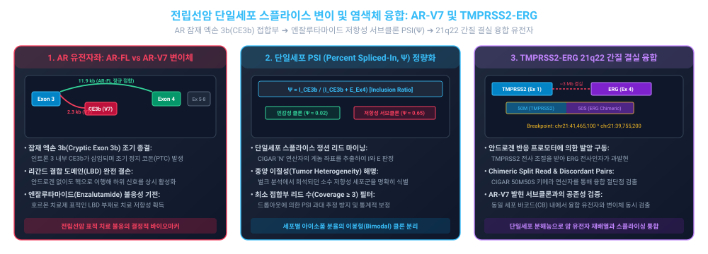

# Chapter 07. 대안적 스플라이싱 및 전립선암 *AR-V7* 전사체 검출 (Alternative Splicing & AR-V7 Isoform Mining)

> **Cognitive Goal**: 거세저항성 전립선암(mCRPC) 환자에서 2세대 항안드로겐 치료제(Enzalutamide, Abiraterone)에 대한 치명적 불응성을 유발하는 핵심 스플라이싱 변이체인 *AR-V7*의 분자생물학적 구조와 정렬 BAM 레코드 내의 바이너리 서명을 규명한다. CIGAR 문자열의 인트론 건너뛰기 연산자(`N`)를 파싱하여 스플라이스 접합부(Splice Junction)의 정확한 게놈 좌표를 추출하는 알고리즘을 정립한다. 단일 세포 해상도의 스플라이싱 포함률(Percent Spliced-In, PSI, $\Psi$)의 수학적 모델과 저발현 드롭아웃을 보정하는 베이지안 베타 사전분포를 도출한다. 벌크 시퀀싱이 가려온 극소수 저항성 서브클론의 단일 세포 이질성을 분해하고, `pysam`을 통해 *AR-V7* 특이 접합부 리드를 세포별로 정량화하는 파이프라인을 구축한다.

---

## 1. 전립선암 호르몬 치료 저항성과 *AR-V7*의 임상적 위기

원발성 전립선암은 남성 호르몬(테스토스테론, 디하이드로테스토스테론/DHT)에 의존하여 증식하므로, 고환의 호르몬 생성을 차단하는 안드로겐 박탈 요법(Androgen Deprivation Therapy, ADT)이 1차 표준 치료로 시행됩니다. 그러나 대부분의 환자는 $1\sim 2$년 후 호르몬 고갈 상태에서도 종양이 재성장하는 **전이성 거세저항성 전립선암(mCRPC)**으로 진행합니다.

이를 극복하기 위해 안드로겐 수용체(AR) 단백질의 리간드 결합 도메인(LBD)에 직접 결합하여 활성을 강력히 차단하는 2세대 표적 치료제인 **엔잘루타마이드(Enzalutamide)**와 안드로겐 합성을 저해하는 **아비라테론(Abiraterone)**이 도입되었습니다. 그러나 이들 약제를 투여받은 환자의 약 20~40%는 초기부터 반응하지 않는 원발성 내성(Primary Resistance)을 보이며, 반응했던 환자들도 수개월 내에 획득 내성(Acquired Resistance)을 나타냅니다.

이 저항성의 중심 분자 기전이 바로 **안드로겐 수용체 스플라이스 변이체 7형(*AR-V7*)**입니다.

```
┌────────────────────────────────────────────────────────────────────────────────────────┐
│               전장 안드로겐 수용체(AR-FL) vs AR-V7 스플라이스 변이체 비교              │
│                                                                                        │
│   [AR Full-Length (AR-FL)] - 약제 결합 가능 (Enzalutamide 감수성)                      │
│   ┌───────────────┬─────────┬───────┬──────────────────────────────────────────────┐   │
│   │  Exon 1 (NTD) │ Exon 2-3│Exon 4 │               Exons 5 - 8 (LBD)              │   │
│   │ 전사 활성화   │ DNA결합 │ Hinge │ 리간드(DHT) 및 약제(Enzalutamide) 결합 부위  │   │
│   └───────────────┴─────────┴───────┴──────────────────────────────────────────────┘   │
│           │                                                                            │
│           ▼ (Alternative Splicing: Cryptic Exon 3 (CE3) as alternative terminal exon; LBD exons not included)    │
│   [AR Splice Variant 7 (AR-V7)] - 구성적 활성화 (Enzalutamide 절대 내성)               │
│   ┌───────────────┬─────────┬───────┐                                                  │
│   │  Exon 1 (NTD) │ Exon 2-3│  CE3  │  (Exons 4-8 LBD 결손!)                            │
│   │ 전사 활성화   │ DNA결합 │ 16 aa │  ──► 약물 결합 표적 부재 + 핵 내 상시 전사 활성 │
│   └───────────────┴─────────┴───────┘                                                  │
└────────────────────────────────────────────────────────────────────────────────────────┘
```

---

## 2. *AR-V7*의 분자 해부학 및 스플라이싱 메커니즘

인간 *AR* 유전자는 염색체 X의 긴 팔(`chrX:67,540,000-67,730,000`, GRCh38)에 위치하며, 8개의 표준 엑손으로 이루어져 있습니다:
- **Exon 1**: N-말단 도메인(NTD, 전사 활성화)
- **Exon 2 & 3**: 아연 집게(Zinc-finger) 구조를 지닌 DNA 결합 도메인(DBD)
- **Exon 4**: 세포 내 이동을 조절하는 힌지(Hinge) 영역 및 핵 국소화 신호(NLS)
- **Exon 5 ~ 8 (엑손 4 후반부 포함)**: 안드로겐 및 길항제가 결합하는 리간드 결합 도메인(LBD). 이 문서에서 'LBD 엑손 4-8'과 'Exons 5-8 (LBD)' 표기는 모두 같은 도메인을 가리키며 엑손 4는 힌지~LBD 시작부입니다.

### 2.1 잠재적 엑손 3 (Cryptic Exon 3, CE3)의 활성화 ('3b'는 비표준 표기)
정상적인 RNA 스플라이싱 환경에서는 엑손 3의 5' 스플라이스 공여 부위(Donor site)가 인트론 3을 건너뛰어 엑손 4의 3' 스플라이스 수용 부위(Acceptor site)와 연결됩니다.

그러나 전립선암 세포가 강력한 안드로겐 억제 환경에 노출되면, 인트론 3 내부, 엑손 3 끝에서 약 $8.5\text{ kb}$ 하류에 위치한 **잠재적 엑손 3(Cryptic Exon 3, CE3; 인트론 3 안의 대체 3′ 말단 엑손)** 부근의 스플라이스 조절 인자(예: U2AF65, SRSF1)가 동원되면서 비정상적인 스플라이싱이 유도됩니다:
1. **스플라이스 결합**: 엑손 3의 말단이 엑손 4 대신 인트론 3 내부의 CE3 수용 부위와 결합합니다.
2. **말단 엑손 교체**: CE3는 대체 3′ 말단 엑손이며, 16개의 변이체 특이 아미노산을 번역한 직후 정지 코돈을 만납니다(엑손 4-8 건너뛰기나 일반 PTC가 아니라 말단 엑손 교체).
3. **LBD 완전 절단**: 그 결과 단백질 번역이 즉각 중단되어, 엑손 4~8이 코딩하는 LBD 도메인이 단백질 수준에서 완전히 제거됩니다.

LBD가 결손된 AR-V7 단백질은 분자 구조상 다음과 같은 병리학적 특성을 획득합니다:
- **리간드 독립적 핵 내 상주**: 정상 AR은 리간드가 없을 때 세포질에서 HSP90 샤페론에 묶여 억제되어 있으나, AR-V7은 샤페론 결합 부위가 없어 합성 즉시 핵으로 이동합니다.
- **구성적 전사 활성화(Constitutive Activity)**: 안드로겐 호르몬이 전혀 없는 환경에서도 세포 주기 유전자(*CCNA2*, *UBE2C*) 및 전립선 특이 항원(*KLK3*)의 인핸서에 결합하여 암세포의 무제한 분열을 촉진합니다.

---

## 3. CIGAR `N` 연산자 기반 스플라이스 정션 판독 알고리즘

RNA-seq 정렬기(STAR, HISAT2)는 인트론을 건너뛰어 스플라이싱된 리드를 기록할 때 CIGAR 문자열에 `N` 연산자를 기록합니다.

```
                   Exon 3                      Intron 3 (Skipped)                 CE3
Reference : ... C A G G T A A G T ─────────────────────────────────────────────── T T T C A G G T C ...
                 │ │ │ │
Read      : ... C A G G ─────────────────────────────────────────────────────────────-─ G T C ...
            └────┬────┘                             ▲                                 └───┬───┘
CIGAR     :     50M                               1500N                                  50M
                 │                                  │
                 ▼                                  ▼
            Exon 3 정렬                     Intron 3 건너뛰기                        CE3 정렬
```

### 3.1 접합부 좌표 산출 수학
어떤 리드의 게놈 시작 좌표가 `POS`, CIGAR 연산자 열이 $C = \{(op_1, l_1), (op_2, l_2), \dots, (op_k, l_k)\}$로 주어졌을 때:

리드 정렬을 따라 게놈 상의 현재 참조 좌표 $R$을 갱신합니다 ($R_0 = \text{POS}$):
- $op \in \{M, D, =, X\}$: $R \leftarrow R + l$
- $op \in \{I, S, H, P\}$: $R$ 불변 (게놈 미소모)
- $op = N$ (스플라이스 인트론):
  - **스플라이스 공여점(Donor site / Junction Start)**:
    $$J_{\text{start}} = R - 1 \quad \text{(1-based closed coordinate of exon end)}$$
  - **스플라이스 수용점(Acceptor site / Junction End)**:
    $$J_{\text{end}} = R + l \quad \text{(1-based closed coordinate of next exon start)}$$
  - 인트론 길이: $L_{\text{intron}} = l$
  - 좌표 갱신: $R \leftarrow R + l$

### 3.2 AR 유전자좌의 두 가지 핵심 경쟁 정션 (GRCh38)
1. **정상 전장 정션 ($J_{\text{AR-FL}}$)**:
   - Exon 3 Donor (`chrX:67,686,126`) $\to$ Exon 4 Acceptor (`chrX:67,711,402`)
   - 인트론 건너뛰기 길이 $\approx 25.3\text{ kb}$ (25,275 bp)
2. **저항성 변이체 정션 ($J_{\text{AR-V7}}$)**:
   - Exon 3 Donor (`chrX:67,686,126`) $\to$ CE3 Acceptor (`chrX:67,694,673`)
   - 인트론 건너뛰기 길이 $\approx 8.5\text{ kb}$ (8,546 bp)

---

## 4. 단일 세포 Percent Spliced-In (PSI, $\Psi$) 수학적 모델링

대안적 스플라이싱 분석에서 특정 엑손이 포함된 비율을 나타내는 표준 지표는 **Percent Spliced-In (PSI, $\Psi$)**입니다.

### 4.1 표준 카세트 엑손(Cassette Exon)의 PSI 공식 유도
양측이 모두 스플라이싱되는 일반적인 카세트 엑손의 경우, 엑손 포함 전사체는 상류 접합부($I_1$)와 하류 접합부($I_2$)라는 2개의 정션을 생성하지만, 건너뛰기(Skipping) 전사체는 단 1개의 건너뛰기 접합부($S$)만을 생성합니다. 따라서 포함 접합부 리드 수 $I = I_1 + I_2$일 때 분모의 스킵 리드에 2를 곱해 길이를 정규화합니다:

$$\Psi_{\text{cassette}} = \frac{I}{I + 2S}$$

### 4.2 말단 정지형 변이체인 *AR-V7*의 단일 세포 $\Psi$ 공식
*AR-V7*의 CE3은 하류 엑손과 다시 스플라이싱되지 않고 CE3 내부에서 전사가 종결(Polyadenylation)되므로, 포함 사건은 오직 **Exon 3 $\to$ CE3 단일 접합부**만을 형성합니다.
따라서 단일 세포 $c$에서의 $AR\text{-}V7$ 스플라이싱 포함률 $\Psi_c$는 포함 접합부 UMI 수 $I_c$와 전장형 스킵 접합부 UMI 수 $S_c$의 직접 비로 정의됩니다:

$$\Psi_c = \frac{I_c}{I_c + S_c}$$

> **적용 범위 주의 (10x 3′ 라이브러리)**: 3′ 태그 라이브러리는 poly(A) 근처 수백 bp만 읽는다. *AR-FL*의 exon 3→exon 4 정션은 poly(A)에서 7.6 kb 이상(exon 4–8의 합 7,656 nt) 떨어져 있어 사실상 포획되지 않고, *AR-V7* 정션도 말단 엑손(CE3, 약 1.4 kb) 상류라 포획 확률이 낮다. 따라서 분모 $S_c \approx 0$이 되어 $\Psi_c$가 과대·불안정해지며 '전장 대비 비율'로 해석할 수 없다(Track 04 SCI-04-036과 같은 결론). 정션 기반 $\Psi$는 5′ 라이브러리·롱리드·타깃 증폭 데이터에서 사용하거나, 3′ 데이터에서는 *AR-V7* 특이 3′ 말단(CE3) 서열 리드와 *AR* exon 8 영역 리드의 비교로 대체한다.

### 4.3 드롭아웃 보정을 위한 베이지안 베타-이항 수축(Shrinkage) 모델
단일핵 전사체에서 특정 단일 세포의 정션 UMI 분자 수는 $I_c + S_c \le 2$로 매우 희소(Sparse)합니다. 관측된 분자 수가 적을 때 발생하는 표본 오차를 방지하기 위해 전체 종양 세포 집단의 사전 분포 $\text{Beta}(\alpha, \beta)$를 결합한 베이지안 사후 평균(Posterior Mean) $\hat{\Psi}_c$를 계산합니다:

$$\hat{\Psi}_c = \frac{I_c + \alpha}{(I_c + S_c) + (\alpha + \beta)}$$

- $\alpha, \beta$: 전체 세포 집단으로부터 적합(Fit)하는 경험적 베이즈(Empirical Bayes) 초매개변수(아래 코드는 적합 없이 고정 사전분포 $\text{Beta}(0.5,2.0)$를 가정한 단순화).
- 관측 분자 수가 $I_c = 0, S_c = 0$인 세포는 사전 평균 $\frac{\alpha}{\alpha + \beta}$로 수축(Shrinkage)되며, 분자 수가 풍부한 세포($I_c + S_c \ge 10$)는 관측된 데이터 $\frac{I_c}{I_c + S_c}$에 수렴합니다.

---

## 5. 단일 세포 서브클론 이질성과 치료 실패의 진화 역학

벌크(Bulk) 전사체 시퀀싱은 종양 조직 전체의 RNA를 섞어 평균을 측정하므로, 검체 내에 *AR-V7* 양성 세포가 5% 미만으로 존재하는 경우 검출 한계(Limit of Detection) 이하로 떨어져 "AR-V7 음성"으로 위음성 판정됩니다.

그러나 단일핵 전사체(snRNA-seq) 분석은 다음과 같은 진화적 서브클론 동역학을 밝혀냅니다:

```
┌────────────────────────────────────────────────────────────────────────────────────────┐
│             Enzalutamide 치료 하에서의 AR-V7 서브클론 선택적 팽창 모델                 │
│                                                                                        │
│   [치료 전 (Baseline)]                                                                 │
│   Total Cells : 10,000 cells                                                           │
│   ├── Subclone 1 (AR-FL High, AR-V7 Negative) : 9,800 cells (98%) ──► 치료 감수성     │
│   └── Subclone 2 (AR-V7 Positive, PSI > 0.4)  :   200 cells (2%)  ──► 잠복 내성 클론   │
│       (벌크 검사 시: Bulk PSI = 0.8% ──► "AR-V7 Negative"로 오진!)                    │
│                                                                                        │
│           │                                                                            │
│           ▼ Enzalutamide 장기 투여 (강력한 진화적 선택 압력)                           │
│                                                                                        │
│   [치료 후 질병 진행 (Progression)]                                                    │
│   Total Cells : 10,000 cells                                                           │
│   ├── Subclone 1 (감수성 세포) : 약제에 의해 사멸 (100 cells, 1%)                      │
│   └── Subclone 2 (내성 클론)   : 선택적 생존 및 급격한 클론 팽창 (9,900 cells, 99%)    │
│       (개념도: 단일 세포 추적의 임상적 예측력은 검증되지 않은 가설)                        │
└────────────────────────────────────────────────────────────────────────────────────────┘
```

---

## 6. 아키텍처 다이어그램: AR-V7 접합부 및 융합 리드 검출

다음 다이어그램은 *AR-V7* 스플라이스 접합부 리드와 *TMPRSS2-ERG* 융합 리드가 단일 세포 시퀀싱 정렬 레코드에서 포획되는 물리적 기하학을 보여줍니다.



---

## 7. Python 실습: `pysam` 기반 단일 세포 *AR-V7* PSI 산출 파이프라인

단일핵 BAM 파일로부터 염색체 X의 *AR* 유전자좌 정렬 레코드를 스캔하여, CIGAR `N` 연산자로부터 정확한 스플라이스 정션을 디코딩하고 세포별 $\Psi_{\text{AR-V7}}$을 도출하는 완전한 스크립트입니다.

```python
#!/usr/bin/env python3
"""
Single-Cell AR-V7 Splicing & PSI Quantification Pipeline
Author: Senior Bioinformatics Engineer
Target: AR Exon 3 - CE3 (Inclusion) vs Exon 3 - Exon 4 (Canonical Skipping)
"""

from typing import Dict, Tuple, Set
from collections import defaultdict
import pysam
import pandas as pd
import numpy as np


def quantify_ar_v7_single_cell(
    bam_path: str,
    contig: str = "chrX",
    ar_start: int = 67686000,         # exon 3 ~ exon 4를 모두 포함하는 질의 구간 (GRCh38)
    ar_end: int = 67712000,
    exon3_donor: int = 67686126,      # 1-based exon 3 end
    ce3_acceptor: int = 67694673,     # 1-based CE3 start
    exon4_acceptor: int = 67711402,   # 1-based exon 4 start
    tolerance: int = 3                # 스플라이싱 정션 허용 오차 (bp)
) -> pd.DataFrame:
    """
    단일 세포 BAM 파일을 스캔하여 AR-FL 및 AR-V7 정션 UMI 분자 수를 계산합니다.
    """
    print(f"[*] Scanning AR splice junctions in {bam_path} ({contig}:{ar_start}-{ar_end})...")
    
    # 분자 중복 제거를 위한 저장소: (Cell_Barcode, UMI) -> Junction Type ('INC', 'SKIP', 'OTHER')
    molecule_junctions: Dict[Tuple[str, str], str] = {}
    
    with pysam.AlignmentFile(bam_path, "rb") as bam:
        for read in bam.fetch(contig, ar_start, ar_end):
            # 1. 기본 필터링 (Primary alignment, MAPQ >= 30)
            if read.is_secondary or read.is_supplementary or read.is_duplicate or read.mapping_quality < 30:
                continue
            
            # 2. CB 및 UB 태그 검증
            # 주의: CE3 리드는 표준 GTF에서 인트론으로 분류되어 Cell Ranger BAM에서 UB 태그가 없을 수 있다(미확인).
            #       UB 의존 필터가 AR-V7 리드를 제거하지 않는지 BAM에서 직접 확인할 것 (대안: CB + 리드 서열 기반 중복 제거).
            if not (read.has_tag("CB") and read.has_tag("UB")):
                continue
            
            cb = read.get_tag("CB")
            ub = read.get_tag("UB")
            
            # 3. CIGAR 문자열에 인트론 스킵(N, opcode 3)이 존재하는지 검사
            cigartuples = read.cigartuples
            if cigartuples is None:
                continue
                
            has_splice = any(op == 3 for op, length in cigartuples)
            if not has_splice:
                continue
            
            # 4. 정션 좌표 추적
            ref_curr = read.reference_start + 1  # 1-based coordinate 변환
            for op, length in cigartuples:
                if op in (0, 2, 7, 8):  # M, D, =, X
                    ref_curr += length
                elif op == 3:  # N (Intron Skipping)
                    j_start = ref_curr - 1
                    j_end = ref_curr + length
                    
                    # Inclusion 정션 (Exon 3 -> CE3) 판정
                    if abs(j_start - exon3_donor) <= tolerance and abs(j_end - ce3_acceptor) <= tolerance:
                        molecule_junctions[(cb, ub)] = "AR_V7_INC"
                    # Canonical Skipping 정션 (Exon 3 -> Exon 4) 판정
                    elif abs(j_start - exon3_donor) <= tolerance and abs(j_end - exon4_acceptor) <= tolerance:
                        molecule_junctions[(cb, ub)] = "AR_FL_CANONICAL"
                        
                    ref_curr += length
                    
    print(f"[*] Identified {len(molecule_junctions)} informative junction molecules.")
    
    # 세포별 정션 분자 카운트 집계
    cell_counts: Dict[str, Dict[str, int]] = defaultdict(lambda: {"inc_umi": 0, "skip_umi": 0})
    for (cb, ub), j_type in molecule_junctions.items():
        if j_type == "AR_V7_INC":
            cell_counts[cb]["inc_umi"] += 1
        elif j_type == "AR_FL_CANONICAL":
            cell_counts[cb]["skip_umi"] += 1

    # 베이지안 PSI 및 임상 아형 판정
    # 사전분포 Beta(0.5, 2.0) 가정 (대부분의 세포는 AR-FL 위주)
    prior_alpha = 0.5
    prior_beta = 2.0
    
    records = []
    for cb, counts in cell_counts.items():
        inc = counts["inc_umi"]
        skip = counts["skip_umi"]
        tot = inc + skip
        
        raw_psi = (inc / tot) if tot > 0 else np.nan
        bayes_psi = (inc + prior_alpha) / (tot + prior_alpha + prior_beta)
        
        # 정션 양성 분류 (임계값은 임의 예시이며 임상 표현형·내성을 의미하지 않음)
        if inc >= 2 and raw_psi >= 0.3:
            status = "AR_V7_Junction_High"
        elif inc >= 1:
            status = "AR_V7_Junction_Low"
        else:
            status = "AR_V7_Junction_Negative"
            
        records.append({
            "cell_barcode": cb,
            "ar_v7_inclusion_umi": inc,
            "ar_fl_canonical_umi": skip,
            "total_junction_umi": tot,
            "raw_psi": raw_psi,
            "bayes_shrunken_psi": bayes_psi,
            "clinical_phenotype": status
        })
        
    return pd.DataFrame(records)


if __name__ == "__main__":
    import sys
    test_bam = sys.argv[1] if len(sys.argv) > 1 else "data/sample.bam"
    try:
        df_psi = quantify_ar_v7_single_cell(test_bam)
        print(df_psi.head(10))
        if not df_psi.empty:
            print(f"[*] Phenotype summary:\n{df_psi['clinical_phenotype'].value_counts()}")
    except FileNotFoundError:
        print(f"[!] File {test_bam} not found.")
```

---

## 단원 핵심 점검 (Cognitive Checkpoint & Case Study)

### Q1. [수학적 원리 규명 (Mathematical Rigor)]
단일 세포 전사체 데이터에서 특정 세포 $c$의 접합부 UMI 수가 $I_c = 2$ (Inclusion), $S_c = 1$ (Skipping)로 검출되었다.
1) 경험적 베이즈 사전분포가 $\text{Beta}(\alpha=1, \beta=3)$으로 주어졌을 때, 이 세포의 관측된 원시 PSI($\Psi_{\text{raw}}$)와 베이지안 사후 평균 PSI($\hat{\Psi}_{\text{bayes}}$)를 각각 계산하시오.
2) 표준 카세트 엑손(Cassette Exon)의 PSI 공식 $\Psi = \frac{I}{I + 2S}$에서 스킵 접합부 분자 수에 계수 2가 곱해지는 기하학적/전산학적 이유를 설명하고, *AR-V7*과 같은 대체 엑손 말단 전사 종결(Alternative 3' terminal exon) 사건에서는 왜 계수 2를 적용하지 않는 것이 타당한지 수학적으로 증명하시오.

<details>
<summary>💡 모범 답안 및 해설 확인</summary>

- **1. 원시 PSI 및 베이지안 사후 평균 계산**:
  - 원시 PSI ($\Psi_{\text{raw}}$):
    $$\Psi_{\text{raw}} = \frac{I_c}{I_c + S_c} = \frac{2}{2 + 1} = \frac{2}{3} \approx 0.667 \ (66.7\%)$$
  - 베이지안 사후 평균 ($\hat{\Psi}_{\text{bayes}}$):
    $$\hat{\Psi}_{\text{bayes}} = \frac{I_c + \alpha}{(I_c + S_c) + (\alpha + \beta)} = \frac{2 + 1}{(2 + 1) + (1 + 3)} = \frac{3}{3 + 4} = \frac{3}{7} \approx 0.429 \ (42.9\%)$$
  - 해설: 관측된 총 분자 수가 3개로 매우 적기 때문에, 사후 추정치는 사전분포의 낮은 기대값($\frac{1}{1+3} = 0.25$) 방향으로 자연스럽게 수축(Shrinkage)되어 표본 추출 오차에 의한 과대 추정을 억제합니다.

- **2. 카세트 엑손의 계수 2 보정 원리와 AR-V7에서의 타당성 증명**:
  - **카세트 엑손에서 계수 2의 기하학적 이유**:
    - 일반적인 내부 엑손(Internal Exon)이 포함될 때는 상류 엑손과의 정션($J_{1-2}$)과 하류 엑손과의 정션($J_{2-3}$)이라는 **2개의 물리적 접합부**가 생성됩니다.
    - 반면 해당 엑손이 건너뛰어질 때는 상류와 하류가 직접 만나는 **단 1개의 접합부**($J_{1-3}$)만 생성됩니다.
    - 따라서 단일 mRNA 분자가 포함될 경우 스플라이스 리드가 걸릴 기회(Target length)가 건너뛰어질 때보다 정확히 2배 높으므로, 포함 접합부 수 $I = I_{1-2} + I_{2-3}$에 대응하여 스킵 분자 수 $S$에 2를 곱해 분모의 유효 분자 수를 $I + 2S$로 균등화해야 합니다.
  - **AR-V7에서의 증명**:
    - *AR-V7*의 CE3는 내부 엑손이 아닌 **전사 종결 말단 엑손(Alternative Terminal PolyA Exon)**입니다.
    - 즉, Exon 3 $\to$ CE3 접합부 이후 하류 엑손 4와의 접합부가 존재하지 않으며 단백질 번역이 종결됩니다.
    - 따라서 1개의 *AR-V7* 전사체는 오직 단 1개의 포함 접합부(Exon 3 $\to$ CE3)만을 가집니다.
    - 전장형 전사체(AR-FL) 역시 Exon 3 $\to$ Exon 4라는 단 1개의 정션만을 형성하므로, 두 동형단백질 전사체가 가로지르는 정션의 수는 $1:1$로 완전히 동일합니다. 따라서 계수 2를 곱하지 않고 $\Psi = \frac{I}{I + S}$로 계산하는 것이 통계학적으로 정확합니다.

</details>

---

### Q2. [알고리즘 구현 및 CIGAR 정합성 (Algorithmic Logic)]
어떤 RNA-seq 리드가 `chrX:67,686,077` 위치에 매핑되었으며, CIGAR 문자열이 `50M8546N50M`으로 보고되었다.
1) 이 리드의 스플라이스 공여점(Donor site) 및 스플라이스 수용점(Acceptor site)의 1-기반 게놈 좌표를 CIGAR 파싱 알고리즘에 따라 정확히 계산하시오.
2) 만약 인트론 3 내부에서 역전사 효소의 인공적 템플릿 스위칭(RT Template Switching)이 발생하여 실제로는 스플라이싱되지 않은 미성숙 전구체 RNA(Pre-mRNA)에서 가짜 접합부(Artifactual junction)가 형성되었을 때, 이를 생물정보학적으로 필터링하기 위한 3가지 정량적 검증 기준을 제시하시오.

<details>
<summary>💡 모범 답안 및 해설 확인</summary>

- **1. 스플라이스 공여점 및 수용점 좌표 산출**:
  - 시작 좌표: $\text{POS} = 67,686,077$ (1-based)
  - 첫 번째 연산자 `50M`:
    - 50bp 게놈 소모
    - 스플라이스 직전 엑손의 마지막 염기(Donor site):
      $$J_{\text{donor}} = 67,686,077 + 50 - 1 = 67,686,126$$
  - 두 번째 연산자 `8546N`:
    - 8,546bp 인트론 건너뛰기
    - 다음 엑손의 첫 번째 염기(Acceptor site):
      $$J_{\text{acceptor}} = J_{\text{donor}} + 1 + 8546 = 67,686,127 + 8546 = 67,694,673$$
  - 결과: Donor는 `chrX:67,686,126`, Acceptor는 `chrX:67,694,673`(AR-V7의 CE3 시작)으로 계산됩니다.

- **2. 가짜 템플릿 스위칭 접합부 필터링 3대 기준**:
  - **1) 표준 스플라이스 모티프(Splice Site Motifs) 검증**: 정규 인트론 양 말단 서열이 진핵생물 표준인 `GT-AG` 또는 비정규 표준인 `GC-AG`, `AT-AC` 다이뉴클레오타이드(Dinucleotide)와 정확히 일치하는지 참조 게놈 서열을 조회하여, 무작위 파손 후 결합된 비표준 서열을 즉각 기각합니다.
  - **2) 미세 상동성(Microhomology) 및 오버행(Anchor Overhang) 검사**: 템플릿 스위칭 인공 산물은 접합부 경계에 $3\sim 6\text{bp}$의 서열 상동성이 존재할 때 역전사 효소가 비특이적으로 전이되면서 발생합니다. 또한 정션 양쪽 엑손에 걸쳐 있는 리드의 최소 정렬 길이(Overhang)가 최소 $8\sim 10\text{bp}$ 이상 매치되지 않는 극단적 비대칭 리드(예: `2M2400N98M`)는 매핑 에러로 간주하여 배제합니다.
  - **3) 독립적 UMI 중복성 검증**: 동일한 단일 세포 바코드(`CB`) 내에서 단 1개의 UMI만 지지하는 정션은 PCR 또는 RT 단일 분자 아티팩트일 확률이 높으므로, 최소 2개 이상의 독립된 `UB`가 동일 접합 좌표를 지지해야 신뢰할 수 있는 참 양성(True Positive)으로 확정합니다.

</details>

---

### Q3. [임상 케이스 분석 (Clinical Problem Solving)]
Enzalutamide 치료에 실패한 mCRPC 환자의 전이성 림프절 조직으로부터 단일핵 전사체(snRNA-seq) 8,000개 세포를 프로파일링하였다.
분석 파이프라인에서 환자의 종양 세포군이 UMAP 상에서 2개의 명확한 서브클론으로 분리되었다:
- Subclone A (6,000개 세포): 전장 *AR* (AR-FL) 발현이 매우 높고 $\Psi_{\text{AR-V7}} = 0.0$이며, 안드로겐 반응 전사인자인 *KLK3*(PSA), *TMPRSS2* 발현이 정상 유지됨.
- Subclone B (2,000개 세포): $\Psi_{\text{AR-V7}} \ge 0.5$로 강한 *AR-V7* 발현을 보이며, *KLK3* 발현은 감소한 반면 세포 주기 구동 유전자(*UBE2C*, *CCNA2*, *CDK1*) 발현이 8배 이상 폭발적으로 상향됨.
1) Subclone B에서 고식적 전립선 분화 마커인 *KLK3*(PSA) 발현이 감소했음에도 불구하고 세포 주기 유전자가 상향된 전사체 재프로그래밍 메커니즘을 설명하시오.
2) 종양 내과 자문회의에서 주치의가 "Enzalutamide 용량을 2배로 증량하거나 다른 차세대 LBD 길항제(Darolutamide)로 약제를 교체하자"고 제안하였다. 당신이 수석 생물정보학 유전체 분석관이라면 이 제안에 대해 어떠한 과학적 근거를 바탕으로 찬성 또는 반대 의견을 제시할 것이며, 대안적 치료 전략을 무엇으로 추천하겠는가?

<details>
<summary>💡 모범 답안 및 해설 확인</summary>

- **1. Subclone B의 전사체 재프로그래밍 메커니즘**:
  - *AR-V7*은 전장 안드로겐 수용체(AR-FL)의 단순한 축소 복제품이 아닙니다.
  - AR-V7 이량체(Homodimer)는 정상 AR-FL이 결합하는 표준 안드로겐 반응 요소(ARE, Canonical Androgen Response Elements) 외에도, 보조 전사인자(FOXA1, GATA2 등)와의 독특한 복합체 형성을 통해 **새로운 유전체 유전자좌(Neomorphic / Cistromic binding sites)**를 광범위하게 점유합니다.
  - 그 결과 전형적인 분화 마커인 *KLK3*(PSA) 프로모터에 대한 전사 촉진 효율은 떨어지는 반면, 세포 분열 M-phase를 촉진하는 유비퀴틴 결합 효소(*UBE2C*) 및 사이클린(*CCNA2*), *CDK1*과 같은 세포 주기 핵심 유전자의 인핸서에 강하게 결합하여 분화 신호를 우회하고 악성 유사분열을 가속화합니다.

- **2. 치료 전략 자문 의견 및 과학적 대안 제시**:
  - **자문 의견: 강력 반대 (Strong Objection)**.
  - **과학적 근거**:
    - Darolutamide 역시 Enzalutamide와 동일하게 AR의 리간드 결합 도메인(LBD)에 결합하는 작용 기전을 공유합니다.
    - 그러나 Subclone B 세포의 50% 이상에서 발현되는 *AR-V7* 단백질은 LBD 자체가 유전학적으로 완전히 결손되어 있습니다. 약제가 결합할 물리적 포켓(Binding pocket)이 존재하지 않으므로, Enzalutamide의 용량을 10배 증량하거나 Darolutamide로 교체하더라도 AR-V7 단백질의 구성적 활성을 0.1%도 억제할 수 없으며 환자에게 불필요한 약물 독성만 초래합니다.
  - **추천 대안적 치료 전략**:
    1. **탁산(Taxane) 계열 세포독성 항암화학요법 (Docetaxel / Cabazitaxel)**: 탁산은 미세소관(Microtubule)을 안정화하는 세포독성 약제이며, AR-V7의 다이닌 의존적 핵 이동 차단 기전은 확립되지 않은 *가설*입니다(재현 연구에서 원 결과가 재현되지 않았고, CTC AR-V7과 탁산 반응의 임상 연관은 기전과 별개; PMID 29682426, 30301829).
    2. **AR N-말단 도메인(NTD) 표적 접근 (임상시험 탐색)**: LBD가 아닌 AR-V7에 보존된 NTD를 표적하는 저분자 *억제제*(예: EPI-7386, 2세대 NTD 억제제)의 임상시험 등록을 고려할 수 있습니다. 또한 ARV-110(bavdegalutamide)은 LBD 결합 리간드를 가진 AR PROTAC이므로 LBD가 없는 AR-V7을 분해한다는 근거가 없고 NTD 표적 분해제로 분류할 수 없습니다.

</details>

---

<!-- REFERENCES:BEGIN (generated by scripts/apply_references.py; do not edit by hand) -->
## 참고문헌 (References)
### 검수 근거 문헌
1. Hu R, Dunn TA, Wei S, et al. Ligand-independent androgen receptor variants derived from splicing of cryptic exons signify hormone-refractory prostate cancer. *Cancer Res*. 2009;69(1):16-22. PMID: 19117982. doi: 10.1158/0008-5472.CAN-08-2764
2. Zheng GX, Terry JM, Belgrader P, et al. Massively parallel digital transcriptional profiling of single cells. *Nat Commun*. 2017;8:14049. PMID: 28091601. doi: 10.1038/ncomms14049
3. Shan X, Danet-Desnoyers G, Aird F, et al. Replication study: androgen receptor splice variants determine taxane sensitivity in prostate cancer. *PeerJ*. 2018;6:e4661. PMID: 29682426. doi: 10.7717/peerj.4661
4. Tagawa ST, Antonarakis ES, Gjyrezi A, et al. Expression of AR-V7 and ARv(567es) in Circulating Tumor Cells Correlates with Outcomes to Taxane Therapy in Men with Metastatic Prostate Cancer Treated in TAXYNERGY. *Clin Cancer Res*. 2019;25(6):1880-1888. PMID: 30301829. doi: 10.1158/1078-0432.CCR-18-0320
5. Snyder LB, Neklesa TK, Willard RR, et al. Preclinical Evaluation of Bavdegalutamide (ARV-110), a Novel PROteolysis TArgeting Chimera Androgen Receptor Degrader. *Mol Cancer Ther*. 2025;24(4):511-522. PMID: 39670468. doi: 10.1158/1535-7163.MCT-23-0655
### 소프트웨어 (표기 버전은 검수 시 API를 확인한 버전이며, 파이프라인 실행 환경은 requirements-pipelines.txt 참조)
- NumPy 2.5.4 (numpy.org). 원 논문: Harris CR, Millman KJ, van der Walt SJ, et al. Array programming with NumPy. *Nature*. 2020;585(7825):357-362. PMID: 32939066. doi: 10.1038/s41586-020-2649-2
- pandas 2.3.3 (github.com/pandas-dev/pandas). 원 논문: McKinney W. Data Structures for Statistical Computing in Python. *Proceedings of the Python in Science Conference*. 2010:56-61. doi: 10.25080/majora-92bf1922-00a
- pysam 0.24.1 (github.com/pysam-developers/pysam).
<!-- REFERENCES:END -->
