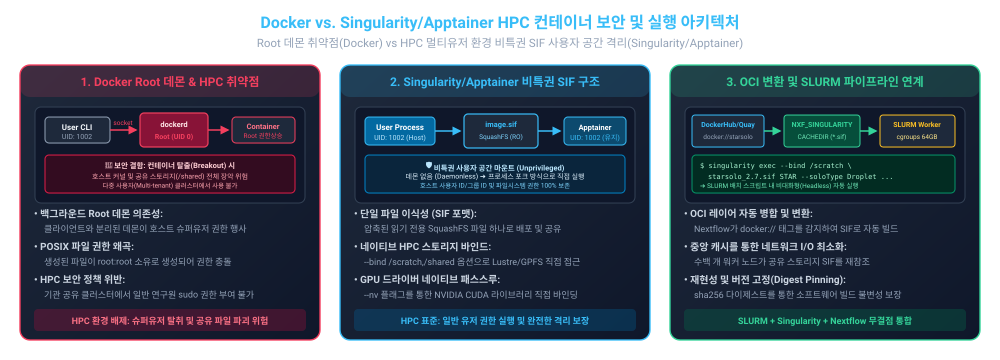
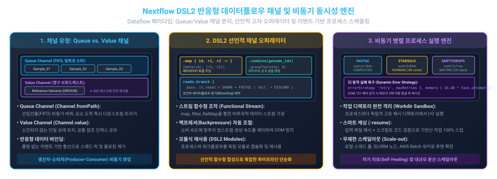
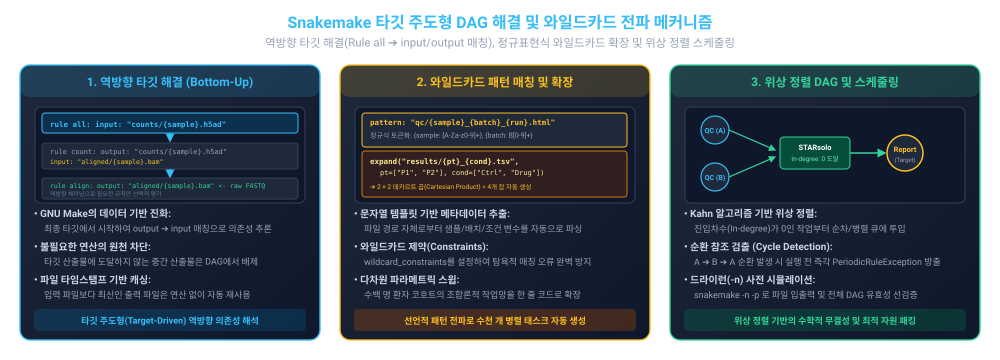
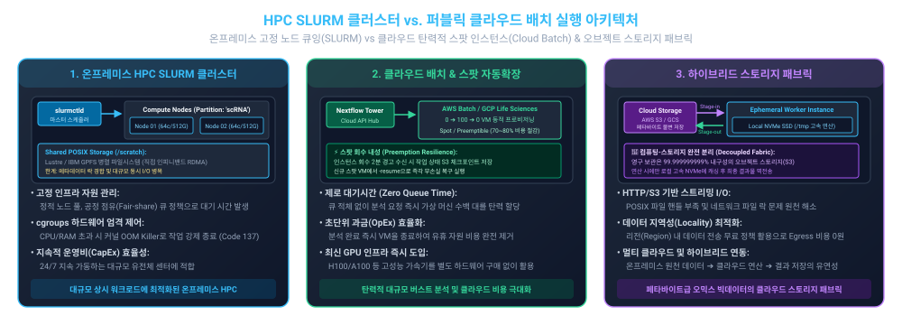
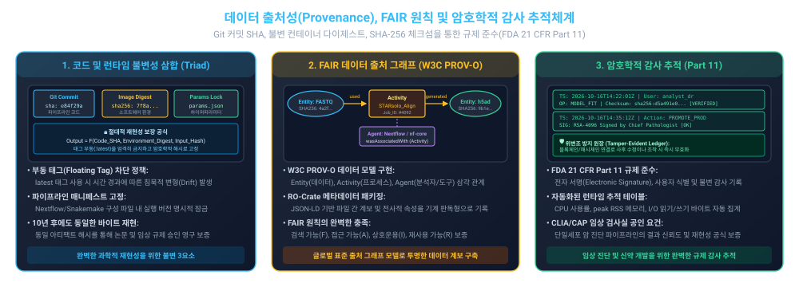
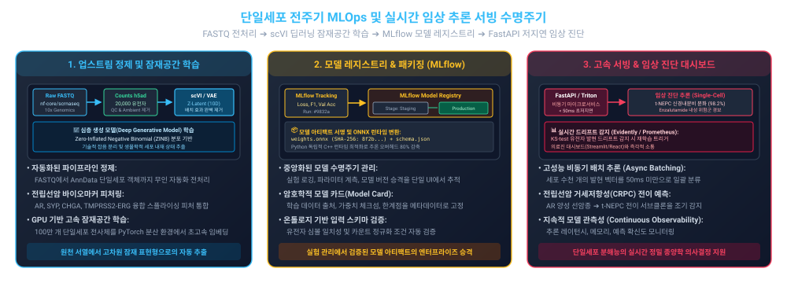

# 확장 가능한 프로덕션 파이프라인, HPC/클라우드 오케스트레이션 및 MLOps (Scalable Production Pipelines, HPC/Cloud Orchestration & MLOps) 마스터 교재
**Track 10: From Container Virtualization (Docker/Singularity), Nextflow DSL2 Reactive Channels, Snakemake Rule-Based DAGs, HPC SLURM/Cloud Batch Orchestration, nf-core/scrnaseq Custom Engineering, Cryptographic Data Provenance (W3C PROV/RO-Crate), and Single-Cell MLOps Model Serving (ONNX/Triton) to Cloud Cost Economics**

---

## 📚 교재 전체 목차 (Table of Contents)

- [Chapter 00. 프로덕션 파이프라인 및 MLOps 로드맵: 재현성 위기 극복부터 엔터프라이즈 임상 분석까지](#part-00-00-프로덕션-파이프라인-및-mlops-로드맵-재현성-위기-극복부터-엔터프라이즈-임상-분석까지-production-pipelines--mlops-roadmap)
- [Chapter 01. 컨테이너 가상화: Docker vs. Singularity/Apptainer HPC 아키텍처](#part-01-01-컨테이너-가상화-docker-vs-singularityapptainer-hpc-아키텍처-containerization-for-production-bioinformatics)
- [Chapter 02. Nextflow DSL2 모듈형 아키텍처와 리액티브 데이터플로우](#part-02-02-nextflow-dsl2-모듈형-아키텍처와-리액티브-데이터플로우-nextflow-dsl2-reactive-architecture)
- [Chapter 03. Snakemake 규칙 기반 실행 및 타깃 중심 DAG 아키텍처](#part-03-03-snakemake-규칙-기반-실행-및-타깃-중심-dag-아키텍처-snakemake-rule-based-workflow-architecture)
- [Chapter 04. HPC SLURM 클러스터 및 퍼블릭 클라우드 분산 오케스트레이션](#part-04-04-hpc-slurm-클러스터-및-퍼블릭-클라우드-분산-오케스트레이션-hpc-slurm--cloud-batch-orchestration)
- [Chapter 05. nf-core/scrnaseq 엔드투엔드 파이프라인 분석 및 커스텀 모듈 엔지니어링](#part-05-05-nf-corescrnaseq-엔드투엔드-파이프라인-분석-및-커스텀-모듈-엔지니어링-end-to-end-nf-corescrnaseq-pipeline--custom-module-engineering)
- [Chapter 06. 데이터 출처 추적성(Provenance), FAIR 원칙 및 암호학적 재현성 보증](#part-06-06-데이터-출처-추적성provenance-fair-원칙-및-암호학적-재현성-보증-data-provenance-fair-principles--cryptographic-reproducibility)
- [Chapter 07. 단일세포 전사체 MLOps 모델 서빙 및 실시간 추론 아키텍처](#part-07-07-단일세포-전사체-mlops-모델-서빙-및-실시간-추론-아키텍처-single-cell-mlops-model-serving--real-time-inference-architecture)
- [Chapter 08. 클라우드 비용 경제학, 스팟 인스턴스 내결함성 및 대규모 자원 최적화](#part-08-08-클라우드-비용-경제학-스팟-인스턴스-내결함성-및-대규모-자원-최적화-cloud-cost-economics-spot-fault-tolerance--resource-optimization)
- [Chapter 09. 프로덕션 파이프라인 트러블슈팅, 엔터프라이즈 모범 사례 및 캡스톤 프로젝트 루브릭](#part-09-09-프로덕션-파이프라인-트러블슈팅-엔터프라이즈-모범-사례-및-캡스톤-프로젝트-루브릭-production-troubleshooting-best-practices--capstone-rubric)

---

# Part 00. 00. 프로덕션 파이프라인 및 MLOps 로드맵: 재현성 위기 극복부터 엔터프라이즈 임상 분석까지 (Production Pipelines & MLOps Roadmap)
> **출처 원본 파일**: `tracks/10_production_pipelines_mlops/docs/00_PRODUCTION_PIPELINES_ROADMAP.md`


---

## 학습 목표 (Cognitive Goals)

1. **단일세포 생물학의 계산 재현성 위기(Computational Reproducibility Crisis)의 구조적 원인 규명**: 연구실 단위의 Ad-hoc 주피터 노트북(Jupyter Notebook) 및 비구조화 Bash 스크립트가 초래하는 전역 상태 오염(State Pollution), 암묵적 의존성(Implicit Dependencies), 하드웨어 종속성 문제를 전산학적 관점에서 분석하고, 엔터프라이즈급 프로덕션 워크플로우로의 전환 당위성을 정립한다.
2. **거세저항성 전립선암(mCRPC) 대규모 임상 코호트의 실전 처리 스케일 모델링**: 수백 명 환자의 원발암(Primary) 및 전이암(Metastatic) 조직 생검(Biopsy) 검체로부터 발생하는 수십 테라바이트(TB) 규모의 단일핵 전사체(snRNA-seq) 데이터를 이종 분산 컴퓨팅 인프라(On-premise HPC, Private Enclave, Public Cloud)에서 무중단·무인(Zero-touch)으로 오케스트레이션하기 위한 설계 원칙을 도출한다.
3. **현대 생물정보학 파이프라인 3대 핵심 계층의 유기적 통합 원리 체계화**: 선언적 워크플로우 DSL 엔진(Nextflow DSL2, Snakemake), OCI 표준 불변 컨테이너 가상화(Docker, Singularity/Apptainer), 사용자 공간 패키지 매니저(Conda/Mamba)가 상호작용하여 시스템 불변성과 결정론적 실행(Deterministic Execution)을 보장하는 구조를 이해한다.
4. **Track 10 전 과정(10개 챕터)의 체계적 학습 경로 및 엔터프라이즈 MLOps 인프라 명세 구축**: 파이프라인 컨테이너화부터 리액티브 데이터플로우, 규칙 기반 DAG 스케줄링, SLURM/클라우드 배치 오케스트레이션, nf-core 커뮤니티 표준, MLOps 모델 레지스트리 및 CI/CD 자동화 검증에 이르는 전 주기를 조망하고 실습 환경을 초기화한다.

---

## 1. Ad-hoc 주피터 노트북에서 엔터프라이즈급 파이프라인으로: 단일세포 생물학의 재현성 위기

단일세포 RNA 시퀀싱(scRNA-seq / snRNA-seq) 및 공간 전사체(Spatial Transcriptomics) 기술의 발전은 생물학 연구를 데이터 집약적(Data-intensive) 고성능 컴퓨팅의 영역으로 진입시켰다. 그러나 대다수의 초기 생물정보학 분석은 개별 분석가의 로컬 워크스테이션에서 구동되는 단일 주피터 노트북(Jupyter Notebook)이나 수백 줄의 절차형 Bash 스크립트에 의존하여 수행되고 있다. 이는 계산생물학 전반에 심각한 '재현성 위기(Reproducibility Crisis)'를 야기하고 있다.

```
[Ad-hoc 분석 방식 (Academic Prototype)]
┌────────────────────────────────────────────────────────┐
│ - 비순차적 노트북 셀 실행 (Hidden Execution Order)    │
│ - 로컬 절대 경로 하드코딩 (/home/user/data/sample1)    │
│ - 호스트 OS 전역 라이브러리 오염 (glibc, CUDA 드라이버) │
│ - 중간 실패 시 전체 재실행 (Check-point 부재)          │
│ - 수평적 확장 불가 (Single-node Memory 한계)          │
└────────────────────────────────────────────────────────┘
                           │
                           ▼ 패러다임 전환 (Paradigm Shift)
┌────────────────────────────────────────────────────────┐
│ [엔터프라이즈 프로덕션 파이프라인 (Production MLOps)]  │
│ 1. 선언적 비순환 유향 그래프 (Declarative DAG)       │
│ 2. 불변 OCI 컨테이너 가상화 (Docker / Singularity)     │
│ 3. 데이터 주도형 리액티브 스트림 (Reactive CSP Model)   │
│ 4. 콘텐츠 주소 지정 재실행 캐싱 (Hash-based Resume)   │
│ 5. 이종 분산 오케스트레이션 (SLURM / AWS / GCP Batch)  │
└────────────────────────────────────────────────────────┘
```

### 1.1 학술용 노트북 파이프라인의 구조적 결함 (Structural Failure Modes)

1. **상태 오염 및 암묵적 실행 순서 (State Pollution & Non-linear Execution)**:
   주피터 노트북은 커널의 전역 메모리 공간(Global Namespace)을 공유한다. 분석가가 셀을 위아래로 오가며 대화식으로 실행하는 과정에서 변수의 덮어쓰기, 메모리 잔존 객체로 인한 부수 효과(Side-effects)가 발생하며, 노트북을 상단부터 재실행(`Restart & Run All`)했을 때 동일한 결과가 도출되지 않는 '실행 순서 비결정론(Non-deterministic Execution)'이 빈번하게 발생한다.
2. **"내 컴퓨터에서는 실행된다"는 환상 (The "Works on My Machine" Fallacy)**:
   호스트 운영체제의 기본 C 라이브러리(`glibc`), 컴파일러 플래그, BLAS/LAPACK 수치해석 라이브러리 버전, 파이썬 패키지의 전이적 의존성(Transitive Dependencies) 불일치로 인해 연구실 동료나 타 기관의 클러스터에서 동일한 코드가 전혀 동작하지 않거나 미묘하게 다른 수치 결과를 출력한다.
3. **체크포인팅 부재와 연산 자원 낭비**:
   수백 개의 단일세포 샘플 정렬(Alignment) 및 정량(Quantification) 작업 중 99번째 샘플에서 Out-Of-Memory(OOM) 오류가 발생할 경우, 작업 상태가 보존되지 않아 이전 98개 샘플의 수십 시간 연산 과정을 처음부터 다시 수행해야 하는 치명적 비효율이 발생한다.
4. **수평적 확장성(Horizontal Scalability)의 한계**:
   단일 노드의 CPU 코어 수와 물리 RAM 용량을 초과하는 대규모 코호트 데이터셋을 만났을 때, 단일 스크립트는 수십 대의 분산 컴퓨팅 노드(HPC 클러스터 또는 클라우드 인스턴스)로 작업을 파티셔닝하고 스케줄링할 수 있는 메커니즘을 제공하지 못한다.

### 1.2 계산 생물학의 FAIR 원칙과 수학적 결정론

프로덕션 생물정보학 파이프라인은 계산 결과를 **FAIR(Findable, Accessible, Interoperable, Reusable)** 원칙에 부합하도록 엄밀하게 정형화해야 한다. 이를 수학적으로 정식화하면 다음과 같다.

임의의 단일세포 원시 시퀀싱 입력 데이터 $X \in \mathcal{X}$ (예: 원시 paired-end FASTQ 파일 집합), 분석 파라미터 벡터 $\theta \in \Theta$ (예: 정렬 허용 미스매치 수, UMI 필터링 임계치), 그리고 계산 환경의 암호학적 해시 $\mathcal{E} \in \mathcal{H}$ (예: Docker/Singularity 컨테이너의 SHA-256 이미지 다이제스트 및 패키지 락파일)가 주어졌을 때, 파이프라인의 실행 결과 $Y \in \mathcal{Y}$ (예: 세포 $\times$ 유전자 카운트 행렬)는 다음과 같은 결정론적 사상(Deterministic Mapping)으로 정의되어야 한다:

$$Y = f(X; \theta, \mathcal{E})$$

이때 이상적인 프로덕션 파이프라인은 다음의 세 가지 전산학적 불변성을 엄격하게 만족해야 한다:

1. **시간적 불변성 (Temporal Invariance / Determinism)**:
   임의의 시점 $t_1, t_2$ ($t_1 \neq t_2$)에 대해 동일한 입력과 환경이 주어지면 출력은 같아야(이상적으로 비트 단위로 동일; 멀티스레드 정렬기·부동소수점 환경에서는 컨테이너 고정만으로 보장되지 않으며 시드·스레드 수 고정이 필요) 한다:
   $$\forall t_1, t_2: \quad f_{t_1}(X; \theta, \mathcal{E}) \equiv f_{t_2}(X; \theta, \mathcal{E})$$
2. **멱등성 (Idempotency)**:
   동일한 입력에 파이프라인을 여러 번 재실행하더라도 시스템의 최종 상태(발행된 산출물)는 변하지 않아야 한다. 파이프라인 $f$는 FASTQ를 입력받아 카운트 행렬을 출력하므로 $f(f(X))$는 정의되지 않으며, 여기서 멱등성은 "같은 $X$에 대한 재실행 $f(X) \to f(X)$가 같은 상태를 낳는다"는 의미이다.
3. **콘텐츠 주소 지정 캐싱 (Content-Addressable Resumability)**:
   파이프라인 내 $i$번째 하위 태스크 $g_i$의 입력 데이터 $x_i$와 실행 코드 $c_i$에 대한 암호학적 다이제스트를 $\text{Hash}(x_i, c_i, \mathcal{E}_i)$라 할 때, 동일한 해시를 가진 연산은 디스크에 캐싱된 중간 아티팩트 $y_i$를 즉시 반환하여 연산 비용을 $\mathcal{O}(1)$로 단축한다.

---

## 2. 전립선암 대규모 임상 코호트의 실전 스케일

### 2.1 임상 검체 데이터의 복잡도와 규모

정밀 종양학(Precision Oncology) 연구에서 전립선암은 원발암 국소 종양(Localized Primary Prostate Cancer)부터 뼈 및 내장 기관으로 전이된 치명적인 전이성 거세저항성 전립선암(Metastatic Castration-Resistant Prostate Cancer, mCRPC)에 이르기까지 극심한 유전체적·전사체적 이질성(Heterogeneity)을 나타낸다.

수백 명의 환자 코호트(예: SU2C/PCF Dream Team 코호트, 국소 진행성 생검 코호트)를 대상으로 단일핵 RNA 시퀀싱(snRNA-seq)을 수행할 때 발생하는 데이터 연산 규모는 단일 워크스테이션의 처리 한계를 완전히 압도한다:

```
[Clinical Cohort Data Scale: 300 Prostate Cancer Biopsies]
┌────────────────────────────────────────────────────────┐
│ - 총 검체 수: 300 환자 샘플 (Primary 150 + mCRPC 150)  │
│ - 샘플당 시퀀싱 리드: 평균 80,000,000 Paired-end 리드   │
│ - 총 시퀀싱 리드 수: 2.4 × 10^10 리드 (240억 개)       │
│ - 원시 FASTQ.gz 총 용량: ~18.5 TB                       │
│ - 정렬 후 BAM 파일 총 용량: ~32.0 TB                    │
│ - 분석 대상 총 단일핵 수: ~1,500,000 Nuclei (세포핵)     │
│ - 유전자 수: 예) 36,601 (10x GRCh38-2020-A 기준 값)    │
└────────────────────────────────────────────────────────┘
```

### 2.2 이종 분산 컴퓨팅 인프라(Heterogeneous Infrastructure)의 도전 과제

대규모 임상 코호트 처리는 단일 환경에서만 수행되지 않는다. 환자 개인식별 유전정보(PHI, Protected Health Information) 보호 규정(HIPAA, GDPR)과 연구 예산 최적화를 위해 다층적 인프라가 혼용된다:

* **병원 온프레미스 프라이빗 클러스터 (Secure Enclave)**: 엄격한 외부 네트워크 차단망, 루트 권한 없는 다중 사용자 환경, SLURM 기반 자원 스케줄링.
* **학술 연구용 고성능 컴퓨팅(HPC) 센터**: 대용량 병렬 파일 시스템(Lustre, GPFS), 수천 개의 CPU 코어 및 InfiniBand 인터커넥트.
* **퍼블릭 클라우드 배치 인프라 (AWS Batch / Google Cloud Batch)**: 마감 시한 내 대량 처리를 위한 오토스케일링 및 스팟 인스턴스(Spot Instances)를 통한 연산 비용 절감, S3/GCS 오브젝트 스토리지 기반 아카이빙.

이러한 이종 인프라에서 수동으로 스크립트를 수정해가며 수백 개 샘플을 분석하는 것은 휴먼 에러(Human Error)로 인한 샘플 교차 오염, 버전 추적 실패, 감사 추적(Audit Trail) 불가 등 임상적 재앙을 초래한다. 따라서 **인프라 종속성을 완전히 추상화한 이식성 높은 워크플로우 엔진**의 도입이 필수적이다.

---

## 3. 현대 계산생물학 파이프라인 아키텍처 스택 (The Modern Bio-Pipeline Stack)

현대 엔터프라이즈 바이오인포매틱스 인프라는 계층화된 5대 소프트웨어 스택으로 구성된다:

```
┌─────────────────────────────────────────────────────────────────────────┐
│ Layer 5: MLOps 추적 및 거버넌스 (MLflow, Seqera Platform, DVC)           │
├─────────────────────────────────────────────────────────────────────────┤
│ Layer 4: 분산 인프라 및 스케줄러 (HPC SLURM, AWS Batch, GCP Batch)       │
├─────────────────────────────────────────────────────────────────────────┤
│ Layer 3: 워크플로우 DSL 엔진 (Nextflow DSL2, Snakemake)                  │
├─────────────────────────────────────────────────────────────────────────┤
│ Layer 2: 불변 OCI 컨테이너 가상화 (Docker, Singularity / Apptainer)      │
├─────────────────────────────────────────────────────────────────────────┤
│ Layer 1: 선언적 패키지 관리 (Conda, Mamba, Pixi, Environment Lockfiles) │
└─────────────────────────────────────────────────────────────────────────┘
```

### 3.1 계층별 핵심 역할 및 상호작용

| 계층 (Layer) | 대표 기술 스택 | 핵심 역할 및 엔터프라이즈 기능 | 재현성 보장 메커니즘 |
| :--- | :--- | :--- | :--- |
| **Layer 1: 패키지 관리** | `Mamba`, `Conda-lock`, `Pixi` | 바이너리 라이브러리 및 툴 체인 의존성 해결, 무충돌 가상환경 생성 | 플랫폼별 해시 고정 락파일 (`conda-lock.yml`) |
| **Layer 2: 컨테이너 가상화** | `Docker`, `Singularity`, `Apptainer` | 호스트 OS 커널을 제외한 사용자 공간(User Space) 파일시스템 및 라이브러리 불변 캡슐화 | OCI 이미지 암호화 SHA256 다이제스트, 단일 파일 SIF |
| **Layer 3: 워크플로우 DSL** | `Nextflow DSL2`, `Snakemake` | 파이프라인 태스크 간 비순환 유향 그래프(DAG) 구성, 리액티브 데이터 스트리밍, 실패 태스크 복구 | 소스 코드 Git 커밋 ID, 파라미터 스키마 유효성 검증 |
| **Layer 4: 분산 인프라** | `SLURM`, `PBS Pro`, `AWS Batch` | 물리적 CPU/RAM/GPU 자원 할당, 멀티 노드 병렬 스케줄링, 스팟 인스턴스 인터럽트 관리 | cgroups 기반 메모리 하드 리밋, 큐 정책 |
| **Layer 5: MLOps 거버넌스** | `Seqera Platform`, `MLflow`, `MultiQC` | 전체 샘플의 런타임 벤치마크 추적, 품질 관리 메트릭 통합, 임상 모델 레지스트리 관리 | 메타데이터 provenance 추적, 규정 준수 감사 로그 |

---

## 4. Track 10 전체 로드맵 및 학습 경로 (10 Modules)

본 트랙은 전립선암 단일핵 전사체 및 다중오믹스 대규모 코호트 데이터를 엔터프라이즈 수준으로 가공·분석·배포하기 위한 프로덕션 엔지니어링의 전 과정을 다룬다.

```
[Track 10: Production Pipelines & MLOps Curriculum]
  │
  ├── 00_PRODUCTION_PIPELINES_ROADMAP.md (본 로드맵: 재현성 원칙 & 인프라 개요)
  │
  ├── [Part 1: 기초 컨테이너화 및 워크플로우 오케스트레이션 엔진]
  │     ├── 01_CONTAINERIZATION_DOCKER_SINGULARITY.md (Namespaces/cgroups & HPC SIF)
  │     ├── 02_NEXTFLOW_DSL2_MODULAR_ARCHITECTURE.md (CSP 채널 & 모듈형 구조)
  │     ├── 03_SNAKEMAKE_RULE_BASED_EXECUTION.md (타깃 역방향 DAG & 와일드카드)
  │     └── 04_HPC_SLURM_AND_CLOUD_ORCHESTRATION.md (SLURM 동적 복구 & 클라우드 배치)
  │
  └── [Part 2: 엔터프라이즈 모범 사례, MLOps 및 실전 배포]
        ├── 05_NF_CORE_SCRNASEQ_END_TO_END.md (nf-core/scrnaseq 엔드투엔드 & 커스텀 모듈)
        ├── 06_DATA_PROVENANCE_AND_REPRODUCIBILITY.md (출처 추적성, FAIR, 해시 무결성, GitOps CI/CD)
        ├── 07_MLOPS_MODEL_SERVING_SINGLE_CELL.md (MLflow, ONNX 직렬화, FastAPI 서빙)
        ├── 08_COST_OPTIMIZATION_AND_RESOURCE_SCALING.md (스팟 인스턴스, -resume 캐시, 라이트사이징)
        └── 09_TROUBLESHOOTING_AND_BEST_PRACTICES.md (실패 모드, 에러 전략, 캡스톤 루브릭)
```

### 4.1 각 모듈별 상세 학습 내용

1. **Chapter 01 (`01_CONTAINERIZATION_DOCKER_SINGULARITY.md`)**:
   리눅스 커널의 Namespaces, cgroups v1/v2, OverlayFS 파일시스템의 내부 동작 원리를 파헤친다. 다중 사용자 HPC 환경에서 Docker 데몬(`dockerd`)이 보안상 금지되는 이유(Root 권한 탈취 취약점)와 Singularity/Apptainer가 비특권(Unprivileged) 사용자 공간에서 사용자 네임스페이스와 FUSE 기반 마운트(squashfuse)를 통해 SIF(Singularity Image Format)를 다루는 메커니즘을 규명한다.
2. **Chapter 02 (`02_NEXTFLOW_DSL2_MODULAR_ARCHITECTURE.md`)**:
   Groovy 기반 Nextflow의 실행 모델인 리액티브 데이터플로우(Reactive Streams)와 CSP(Communicating Sequential Processes) 이론을 체계화한다. 큐(Queue) 및 밸류(Value) 채널의 거동 차이, 비동기 연산자(`map`, `combine`, `join`, `branch`)의 활용법, DSL2 모듈 및 서브워크플로우 분리 원칙을 마스터한다.
3. **Chapter 03 (`03_SNAKEMAKE_RULE_BASED_EXECUTION.md`)**:
   GNU Make의 철학을 계승한 파이썬 기반 타깃 중심(Target-driven) 하향식 DAG 구성 알고리즘을 학습한다. 와일드카드 패턴 매칭, `expand()` 집계 함수, 벤치마크 및 섀도(Shadow) 디렉토리 격리, Nextflow와의 패러다임 비교를 정량적으로 분석한다.
4. **Chapter 04 (`04_HPC_SLURM_AND_CLOUD_ORCHESTRATION.md`)**:
   온프레미스 HPC의 표준 스케줄러인 SLURM의 작업 제출 및 회계 메커니즘을 다룬다. 메모리 부족(OOM Exit Code 137) 시 Nextflow의 동적 지수 백오프(`memory = { 8.GB * task.attempt }`) 전략과 AWS Batch/Google Cloud Batch 스팟 인스턴스 오케스트레이션, Fusion VFS의 S3 스트리밍 기술을 학습한다.
5. **Chapter 05 (`05_NF_CORE_SCRNASEQ_END_TO_END.md`)**:
   nf-core/scrnaseq의 채널 토폴로지와 얼라이너 모듈 선택(STARsolo, Alevin-fry/simpleaf, Cell Ranger 등)을 분석하고, nf-core 호환 커스텀 모듈(`versions.yml` 방출 등)과 임상 mCRPC 다중 환자 샘플시트 설계를 다룬다.
6. **Chapter 06 (`06_DATA_PROVENANCE_AND_REPRODUCIBILITY.md`)**:
   FAIR 원칙, Nextflow 실행 추적성, SHA-256 해시 기반 데이터 무결성 점검과 연쇄 보관 기록 감사 스크립트, 그리고 GitOps/GitHub Actions 기반 CI/CD 파이프라인 자동화를 다룬다.
7. **Chapter 07 (`07_MLOPS_MODEL_SERVING_SINGLE_CELL.md`)**:
   MLflow 기반 scVI/scANVI 아티팩트 거버넌스, TorchScript/ONNX 직렬화와 지연시간 분석, FastAPI 실시간 추론 마이크로서비스와 Docker 오케스트레이션을 구축한다.
8. **Chapter 08 (`08_COST_OPTIMIZATION_AND_RESOURCE_SCALING.md`)**:
   클라우드 비용 경제학과 스팟 인스턴스 내결함성, Nextflow `-resume` 캐시, 자원 과다 프로비저닝 진단과 적응형 라이트사이징, 비용 감사 도구를 다룬다.
9. **Chapter 09 (`09_TROUBLESHOOTING_AND_BEST_PRACTICES.md`)**:
   프로덕션 파이프라인의 10대 실패 모드, 엔터프라이즈 에러 전략과 지수 백오프, 작업 디렉터리 정리, 그리고 100점 만점 캡스톤 프로젝트 평가 루브릭을 제시한다.

---

## 5. 실습 환경 구축 및 도구 스택 명세 (Environment Setup)

본 트랙의 실습을 위해 다음의 선언적 Conda 환경 명세 파일(`environment.yml`)을 생성하고 시스템 도구들의 정상 설치 여부를 검증한다.

```yaml
# tracks/10_production_pipelines_mlops/environment.yml
name: snrna_production_env
channels:
  - conda-forge
  - bioconda
  - defaults
dependencies:
  - python=3.10
  - nextflow>=23.10.0
  - snakemake>=8.10.0
  - graphviz>=8.0.0
  - mamba>=1.5.0
  - conda-lock>=2.5.0
  - samtools>=1.19
  - fastqc>=0.12.1
  - multiqc>=1.21
  - scanpy>=1.9.8
  - anndata>=0.10.0
  - mlflow>=2.11.0
  - boto3>=1.34.0
  - google-cloud-batch>=0.17.0
  - pip
  - pip:
    - pytest>=8.0.0
    - rich>=13.7.0
```

### 5.1 CLI 환경 구축 및 도구 버전 무결성 검증 스크립트

```bash
# 1. Mamba를 통한 초고속 가상환경 생성
mamba env create -f tracks/10_production_pipelines_mlops/environment.yml

# 2. 가상환경 활성화
conda activate snrna_production_env

# 3. 핵심 오케스트레이션 도구 CLI 응답 확인
echo "=== Production Toolchain Verification ==="
nextflow -version
snakemake --version
samtools --version | head -n 1
multiqc --version
python -c "import mlflow; print(f'MLflow version: {mlflow.__version__}')"
```

---

## 단원 핵심 점검 (Cognitive Checkpoint & Case Study)

### 문제 1: 임상 코호트 처리 중 Ad-hoc 스크립트 실패 vs. 선언적 워크플로우 엔진의 복구 메커니즘
전립선암 환자 150명의 조직 생검 단일핵 RNA 시퀀싱 원시 FASTQ 데이터(총 12 TB)를 병렬 처리하기 위해 한 연구원이 Bash 백그라운드 루프(`for sample in samples; do bash run_alignment.sh $sample & done`)를 작성하여 128코어 서버에서 구동하였다. 18시간 동안 연산이 진행되던 중 73번째 샘플의 STAR 정렬 단계에서 서버 메모리 부족으로 Linux OOM Killer가 작동하여 4개의 프로세스가 비정상 종료(SIGKILL, Exit 137)되었다.
1. 이 상황에서 Bash 스크립트가 초래하는 데이터 상태 불일치(Inconsistent State)와 수동 복구의 기술적 위험성을 분석하시오.
2. Nextflow 또는 Snakemake와 같은 프로덕션 워크플로우 엔진이 제공하는 **콘텐츠 주소 지정 캐싱(Content-Addressable Caching)** 및 **트랜잭션 격리(Transactional Isolation)** 기능이 이 문제를 어떻게 안전하고 자동화된 방식으로 해결하는지 설명하시오.

<details>
<summary>💡 모범 답안 및 해설 확인</summary>

**1. Bash 스크립트 기반 수동 처리의 위험성**:
* **부분 작성된 불완전 파일(Corrupted Artifacts) 방치**: 프로세스가 `SIGKILL`을 맞고 즉사할 때, STAR가 출력 중이던 BAM 파일이나 임시 디렉토리가 디스크에 온전히 남아있게 된다. 스크립트는 이를 감지하지 못하거나 후속 분석 단계에서 손상된 BAM 파일을 정상 파일로 오인하여 파이프라인 전체의 신뢰성을 파괴한다.
* **상태 추적의 부재와 중복 연산**: 150개 중 어떤 샘플이 성공했고 어떤 샘플이 실패했는지, 실패한 샘플의 어느 단계(FASTQ 트리밍, 유전체 인덱스 로딩, 접합부 정렬, 정량)에서 멈췄는지를 추적할 수 있는 중앙 레지스트리가 없다. 결국 연구원은 로그 수백 개를 수작업으로 파싱해야 하며, 안전을 위해 전체 샘플을 처음부터 다시 실행하는 극심한 연산 자원 및 시간 낭비를 초래한다.

**2. 프로덕션 워크플로우 엔진의 해결 메커니즘**:
* **트랜잭션 디렉토리 격리 (Transactional Scratch Execution)**:
  Nextflow는 각 프로세스를 독립된 고유 해시 작업 디렉토리(예: `work/7a/8f1b2c...`)에서 실행한다. 작업이 정상 종료 코드(Exit Code 0)로 완료된 태스크의 결과만 `publishDir`(copy/link/symlink 등 모드)로 발행된다(`publishDir`는 트랜잭션·원자적 이동이 아니라 단순 복사/링크이다). 실패한 태스크의 임시 파일은 work 디렉토리에만 남으므로 발행 디렉토리가 오염되지 않는 것이 일반적이다.
* **작업 해시 기반 재개 (Task-Hash Resumption)**:
  `nextflow run main.nf -resume` 또는 `snakemake --rerun-incomplete` 명령을 실행하면, 엔진은 이미 정상 완료된 146개 샘플의 입력 파일 메타데이터(경로·크기·수정시각; `cache 'deep'`이면 내용), 스크립트, 컨테이너·환경 정보로 계산한 작업 해시를 비교하여 캐시된 태스크는 다시 실행하지 않고 건너뛴다(Nextflow 진행 표시의 `cached: 146` 항목; Snakemake는 재실행할 작업이 없으면 `Nothing to be done`을 출력).
* **실패 태스크 선별적 재시도**:
  메모리 초과로 비정상 종료된 4개 태스크에 대해서만 동적으로 더 큰 메모리를 할당(`memory = { 32.GB * task.attempt }`)하여 자동으로 재제출하므로, 관리자의 개입 없이 무중단으로 전체 파이프라인이 수렴한다.

</details>

---

### 문제 2: 결정론적 계산 함수 $Y = f(X; \theta, \mathcal{E})$와 컨테이너 다이제스트 SHA256 고정의 필연성
임상 진단 검사실(CLIA/CAP 인증 기관)에서 전립선암 환자의 *AR-V7* 전사체 발현 기반 엔잘루타마이드 내성 여부를 판정하기 위한 단일핵 RNA-seq 파이프라인을 운영하고 있다. 파이프라인 설정 파일에 도커 컨테이너 이미지가 `container = "biocontainers/starsolo:latest"`로 지정되어 있었다.
1. `latest` 태그를 사용하는 것이 왜 임상 파이프라인의 재현성 및 규정 준수(Compliance) 측면에서 치명적인 결함인지 설명하시오.
2. 수학적 결정론 모델 $Y = f(X; \theta, \mathcal{E})$의 관점에서 계산 환경 $\mathcal{E}$의 불변성을 보장하기 위해 컨테이너 이미지를 어떻게 선언해야 하는지 구체적인 문법과 함께 제시하시오.

<details>
<summary>💡 모범 답안 및 해설 확인</summary>

**1. `latest` 태그의 치명적 결함**:
* **가변 참조(Mutable Pointer) 위험**: Docker 레지스트리에서 `latest`는 불변하는 소프트웨어 버전이 아니라, 가장 최근에 푸시된 이미지를 가리키는 유동적인 태그(Mutable Tag)에 불과하다. 6개월 후 업스트림 개발자가 STAR 버전을 업데이트하거나 기본 C 라이브러리를 변경하여 새 이미지를 빌드하면, 파이프라인 코드를 단 한 줄도 바꾸지 않았음에도 불구하고 다운로드되는 바이너리가 완전히 변경된다.
* **미세 수치 변동 및 임상 오류**: 동일한 환자의 FASTQ 검체 $X$를 1월에 분석했을 때와 7월에 분석했을 때, 정렬 알고리즘 내부의 접합부 휴리스틱이나 타이-브레이킹(Tie-breaking) 정책 변경으로 인해 *AR-V7* 스플라이스 접합부 리드 수가 변동될 수 있다. 이는 동일 검체에 대해 약제 반응 환자가 불응성 환자로 잘못 판정되는 치명적 의료 사고를 유발할 수 있으며, CLIA/CAP의 소프트웨어 버전 추적성 감사에서 즉각적인 부적격 처분을 받게 된다.

**2. 환경 $\mathcal{E}$의 암호학적 불변 선언**:
* 컨테이너 이미지는 태그 명칭뿐만 아니라 매니페스트의 고유한 **SHA-256 암호학적 다이제스트(Immutable Digest Hash)**를 명시하여 선언해야 한다:
  ```groovy
  // Nextflow 프로세스 디렉티브에서의 불변 선언 예시
  process ALIGN_STARSOLO {
      container = 'quay.io/biocontainers/star@sha256:a9c99039aaba7a6d903cd1cfba55aeaddeca889f10d60397cdb4dd7d9642da99'  // star:2.7.11b--h43eeafb_0의 매니페스트 다이제스트(quay.io API로 조회)
      // ...
  }
  ```
* 이렇게 선언할 경우 원격 레지스트리에서 이미지 태그가 변경되거나 악의적인 코드 주입이 발생하더라도, 로컬 런타임이 비트 단위로 동일한 다이제스트를 가진 불변의 이미지 레이어만을 강제 다운로드 및 실행하므로 $\mathcal{E}_{t_1} \equiv \mathcal{E}_{t_2}$가 수학적으로 엄격히 보장된다.

</details>

---

### 문제 3: 대규모 분산 환경에서의 스토리지 I/O 병목 및 오브젝트 스토리지 아키텍처
100명의 전립선암 환자 FASTQ 데이터(총 8 TB)를 온프레미스 HPC 클러스터(NFS 기반 공유 스토리지)와 퍼블릭 클라우드(AWS S3 + AWS Batch)에서 각각 실행하고자 한다.
1. 온프레미스 HPC에서 64개의 워커 노드가 중앙 집중식 NFS(Network File System) 볼륨에 동시에 수백 기가바이트의 FASTQ 읽기 및 BAM 쓰기 작업을 시도할 때 발생하는 **메타데이터 서버 병목(Metadata Locking)** 및 **I/O 경합(I/O Contention)** 현상을 분석하시오.
2. 클라우드 오브젝트 스토리지(Amazon S3)와 로컬 임시 디스크(NVMe Instance Store)를 결합하여 이 문제를 극복하는 현대 워크플로우 엔진의 최적화 패턴을 제시하시오.

<details>
<summary>💡 모범 답안 및 해설 확인</summary>

**1. 중앙 집중식 NFS의 I/O 병목 메커니즘**:
* **메타데이터 락킹 (Metadata Serialization)**: 표준 NFS는 POSIX 파일 시스템 인터페이스를 제공하므로, 수십 대의 노드가 수천 개의 임시 파일에 대해 `stat()`, `open()`, `close()`, `unlink()` 시스템 콜을 호출할 때 단일 NFS 마스터 메타데이터 서버에 파일 잠금(Locking) 요청이 집중된다. 이로 인해 CPU가 실제 유전체 정렬 연산을 수행하지 못하고 커널 레벨의 `D-state`(Uninterruptible Disk Sleep) 및 높은 `iowait`에 빠지게 된다.
* **대역폭 포화(Bandwidth Saturation)**: 수십 개의 프로세스가 기가비트 이더넷 링크를 공유하여 대용량 FASTQ를 동시에 스트리밍하면 네트워크 스위치 백본이 포화되어 I/O 처리량이 급감한다.

**2. 클라우드 오브젝트 스토리지 및 로컬 스크래치 최적화 패턴**:
* **분산 오브젝트 스토리지(S3)의 키 파티셔닝**: Amazon S3는 단일 디스크가 아닌 분산 키-값 저장소이므로 접두사(Prefix) 분할을 통해 초당 수천 건의 GET/PUT 요청을 수평 확장(Horizontal Scaling)하여 처리한다.
* **로컬 NVMe 인스턴스 스토리지 기반 스테이징**: Nextflow와 같은 엔진은 연산 시작 시점에 원격 S3 버킷으로부터 입력 FASTQ만을 워커 인스턴스의 고성능 로컬 NVMe 스크래치 디스크(`/scratch` 또는 `/tmp`)로 비동기 프리페치(Prefetch)한다. 정렬 및 중복 제거 등 모든 극심한 I/O 연산은 초당 수십만 IOPS를 제공하는 로컬 NVMe에서 수행되며, 최종 산출물인 BAM 및 카운트 행렬만 S3 버킷으로 원자적으로 업로드한 후 로컬 디스크를 완전히 비운다.
* **차세대 가상 파일시스템(Fusion VFS) 도입**: 최신 Nextflow 환경에서는 Fusion 파일시스템을 통해 S3 데이터를 로컬 디스크에 복사하지 않고도 POSIX 인터페이스로 필요한 바이트 범위(Byte-range) 위주로 읽고 쓰므로 전체 입력 스테이징용 디스크 프로비저닝을 줄일 수 있다(단, 고속 로컬 스크래치/NVMe 캐시는 여전히 권장된다).

</details>

---

<!-- REFERENCES:BEGIN (generated by scripts/apply_references.py; do not edit by hand) -->
## 참고문헌 (References)
### 소프트웨어 (표기 버전은 검수 시 API를 확인한 버전이며, 파이프라인 실행 환경은 requirements-pipelines.txt 참조)
- Nextflow 24.04.4 (nextflow.io). 원 논문: Di Tommaso P, Chatzou M, Floden EW, et al. Nextflow enables reproducible computational workflows. *Nat Biotechnol*. 2017;35(4):316-319. PMID: 28398311. doi: 10.1038/nbt.3820
- Snakemake 9.27.0 (github.com/snakemake/snakemake). 원 논문: Mölder F, Jablonski KP, Letcher B, et al. Sustainable data analysis with Snakemake. *F1000Res*. 2021;10:33. PMID: 34035898. doi: 10.12688/f1000research.29032.3
- Docker (github.com/moby/moby).
- Apptainer (Singularity) (github.com/apptainer/apptainer). 원 논문: Kurtzer GM, Sochat V, Bauer MW. Singularity: Scientific containers for mobility of compute. *PLoS One*. 2017;12(5):e0177459. PMID: 28494014. doi: 10.1371/journal.pone.0177459
- Slurm (slurm.schedmd.com).
- SAMtools (github.com/samtools/samtools). 원 논문: Danecek P, Bonfield JK, Liddle J, et al. Twelve years of SAMtools and BCFtools. *Gigascience*. 2021;10(2). PMID: 33590861. doi: 10.1093/gigascience/giab008
- FastQC (github.com/s-andrews/FastQC).
- MultiQC (github.com/MultiQC/MultiQC). 원 논문: Ewels P, Magnusson M, Lundin S, et al. MultiQC: summarize analysis results for multiple tools and samples in a single report. *Bioinformatics*. 2016;32(19):3047-8. PMID: 27312411. doi: 10.1093/bioinformatics/btw354
- nf-core/scrnaseq (nf-co.re/scrnaseq). 원 논문: Ewels PA, Peltzer A, Fillinger S, et al. The nf-core framework for community-curated bioinformatics pipelines. *Nat Biotechnol*. 2020;38(3):276-278. PMID: 32055031. doi: 10.1038/s41587-020-0439-x
- conda (docs.conda.io).
- Mamba (github.com/mamba-org/mamba).
- MLflow 3.17.1 (github.com/mlflow/mlflow).
- FastAPI 0.143.3 (github.com/fastapi/fastapi).
- Scanpy 1.12.4 (github.com/scverse/scanpy). 원 논문: Wolf FA, Angerer P, Theis FJ. SCANPY: large-scale single-cell gene expression data analysis. *Genome Biol*. 2018;19(1):15. PMID: 29409532. doi: 10.1186/s13059-017-1382-0
<!-- REFERENCES:END -->


---

# Part 01. 01. 컨테이너 가상화: Docker vs. Singularity/Apptainer HPC 아키텍처 (Containerization for Production Bioinformatics)
> **출처 원본 파일**: `tracks/10_production_pipelines_mlops/docs/01_CONTAINERIZATION_DOCKER_SINGULARITY.md`


---

## 학습 목표 (Cognitive Goals)

1. **리눅스 커널 가상화 프리미티브(Namespaces, cgroups, OverlayFS)의 전산학적 메커니즘 규명**: 가상 머신(VM)과 컨테이너의 근본적인 하이퍼바이저 부재 차이를 이해하고, 주요 6종 Linux Namespaces(`PID`, `NET`, `MNT`, `IPC`, `UTS`, `USER`; 커널에는 `cgroup`, `time`을 포함해 총 8종이 있음), cgroups v1/v2 자원 할당 제약, OverlayFS 계층형 유니온 파일시스템(Layered Union Filesystem)의 복사-온-라이트(Copy-on-Write) 메커니즘을 상세히 분석한다.
2. **다중 사용자 HPC 클러스터에서 Docker 데몬(`dockerd`)의 보안 결함과 권한 상승(Privilege Escalation) 위험성 증명**: 클라이언트-서버 모델 기반 Docker가 호스트 루트 권한 데몬을 요구함으로써 발생하는 시스템 침해 시나리오(소켓 탈취, 루트 볼륨 바인드 마운트, CVE 취약점)를 구조적으로 증명한다.
3. **Singularity/Apptainer의 비특권(Unprivileged) 단일 바이너리 SIF 아키텍처 규명**: SUID 권한 없이 사용자 네임스페이스와 FUSE 기반 파일시스템(squashfuse)을 통해 사용자 공간에서 불변 SquashFS 이미지를 마운트하여 호스트 사용자 신원(UID/GID)을 100% 보존하면서 네이티브 속도로 구동되는 원리를 규명한다. (전통적인 SUID setuid 설치에서의 루프 디바이스 마운트와 달리, 비특권 모드는 FUSE로 SquashFS를 직접 읽는다.)
4. **프로덕션급 생물정보학 멀티스테이지 Dockerfile 및 Singularity Def 파일 설계**: STARsolo, Samtools, Scanpy 환경을 최소화된 이미지 크기와 레이어 캐싱 최적화 기법으로 패키징하고, GitHub Actions CI/CD를 통해 Docker 이미지를 자동으로 빌드하여 HPC 실행용 SIF 파일로 변환하는 프로덕션 워크플로우를 구축한다.

---

## 1. 리눅스 커널 가상화 프리미티브 (Linux Container Internals)

컨테이너는 완전한 하드웨어 가상화를 수행하는 전통적 가상 머신(Virtual Machine, Hypervisor Type-1/2)과 달리, 단일 호스트 리눅스 커널(Linux Kernel)을 공유하면서 커널이 제공하는 격리 프리미티브(Kernel Isolation Primitives)를 통해 프로세스 그룹을 캡슐화한 논리적 실행 단위이다.

```
┌────────────────────────────────────────────────────────┐
│ [User Space: Containerized Applications]              │
│  - App A (STARsolo)           - App B (Scanpy/PyTorch) │
│  - User Libraries (glibc 2.35) - User Libraries (glibc)│
├────────────────────────────────────────────────────────┤
│ [Linux Kernel Subsystems & Virtualization Primitives]  │
│  1. Namespaces: PID, MNT, NET, IPC, UTS, USER (+2)     │
│  2. Control Groups (cgroups v1/v2): CPU, Memory, IO    │
│  3. Storage Driver: OverlayFS (lowerdir / upperdir)    │
├────────────────────────────────────────────────────────┤
│ [Physical Hardware: x86_64 / ARM64, RAM, NVMe, GPU]    │
└────────────────────────────────────────────────────────┘
```

### 1.1 리눅스 네임스페이스 (Linux Namespaces): 시스템 뷰 격리

리눅스 네임스페이스는 특정 프로세스가 시스템 리소스를 바라보는 '시야(View)'를 격리하는 커널 서브시스템이다. `clone()`, `unshare()`, `setns()` 시스템 콜을 통해 프로세스 계층에 다음 6대 네임스페이스를 개별적으로 할당한다:

1. **`MNT` (Mount Namespace, CLONE_NEWNS)**:
   프로세스 그룹별로 파일시스템 마운트 테이블을 분리한다. 컨테이너 내부에서 마운트하거나 언마운트한 디스크는 호스트 파일시스템 테이블에 노출되지 않는다.
2. **`PID` (Process ID Namespace, CLONE_NEWPID)**:
   프로세스 번호 공간을 가상화한다. 컨테이너 내부의 메인 프로세스는 PID 1을 부여받아 자체적인 좀비 프로세스 수거(`waitpid`) 및 시그널 관리를 수행하지만, 호스트에서는 일반적인 PID(예: 42195)로 투명하게 관찰된다.
3. **`NET` (Network Namespace, CLONE_NEWNET)**:
   독립적인 네트워크 디바이스, IP 라우팅 테이블, 방화벽(iptables/nftables) 규칙, 포트 바인딩 공간을 제공한다. veth(Virtual Ethernet) 페어를 통해 호스트 브리지(docker0 등)와 연결된다.
4. **`IPC` (Inter-Process Communication, CLONE_NEWIPC)**:
   System V IPC 객체 및 POSIX 메시지 큐, 공유 메모리(`/dev/shm`) 세그먼트를 호스트와 격리한다.
5. **`UTS` (UNIX Timesharing System, CLONE_NEWUTS)**:
   호스트네임(Hostname)과 NIS 도메인네임을 독립적으로 설정한다.
6. **`USER` (User Namespace, CLONE_NEWUSER)**:
   컨테이너 내부의 UID/GID 매핑을 호스트와 완전히 분리한다. 예를 들어 컨테이너 내부에서는 `root` (UID 0)로 동작하더라도, 호스트 커널에서는 비특권 일반 사용자(UID 10001)로 매핑되어 권한 탈취를 방지할 수 있다.

### 1.2 제어 그룹 (cgroups v1 vs. cgroups v2): 물리 자원 할당 제약

네임스페이스가 '무엇을 볼 수 있는가'를 격리한다면, **cgroups(Control Groups)**는 '얼마나 많은 물리적 자원을 소모할 수 있는가'를 강제(Enforce)하는 회계·제약 서브시스템이다.

#### CPU 할당: 완전 공평 스케줄러(CFS) 대역폭 제어
리눅스 완전 공평 스케줄러(Completely Fair Scheduler, CFS)는 시간 슬라이스(Period) 동안 프로세스 그룹이 소모할 수 있는 최대 런타임(Quota)을 제한한다:

$$\text{CPU 할당 비율 } R_{\text{cpu}} = \frac{\text{cpu.cfs\_quota\_us}}{\text{cpu.cfs\_period\_us}} = \frac{Q}{P}$$

예를 들어 $P = 100,000\,\mu\text{s}$ (100ms)이고 $Q = 400,000\,\mu\text{s}$ (400ms)로 설정되면, 해당 컨테이너는 최대 4개의 물리 CPU 코어($R_{\text{cpu}} = 4.0$)의 연산량을 100% 점유할 수 있다. 작업량이 이를 초과하면 프로세스는 스케줄러에 의해 강제로 잠자는 CPU Throttling 상태에 빠지게 된다.

#### 메모리 제한 및 OOM(Out-Of-Memory) 킬러 작동 메커니즘
cgroups v2는 단일 계층 트리 구조에서 `memory.max` (Hard limit) 및 `memory.high` (Soft limit) 인터페이스를 제공한다. 컨테이너 내부의 익명 메모리(Anonymous memory, 힙·스택), 활성 페이지 캐시(Page cache), 커널 슬랩(Kernel slab) 메모리의 총합이 `memory.max`에 도달하면 커널은 먼저 회수 가능한 메모리(주로 파일 페이지 캐시)를 회수하며, **회수할 수 없어 한도를 줄일 수 없을 때** OOM killer를 호출한다. 따라서 "익명+파일 캐시+슬랩 합 > max ⇒ OOM"이라는 단순 부등식은 성립하지 않는다(09장 Q1의 "캐시를 먼저 회수" 서술이 정확하다). OOM이 발생하는 실질 조건은 회수 불가능한 메모리(주로 익명 메모리)가 한도를 넘을 때이다.

이때 리눅스 커널의 `oom-killer`는 프로세스 트리의 `oom_score`가 가장 높은 프로세스(통상 대규모 유전체 인덱스를 로드한 STAR 프로세스)를 타깃으로 선정하여 `SIGKILL` (Exit Code 137) 시그널을 즉시 브로드캐스트하여 메모리를 회수한다.

### 1.3 OverlayFS 계층형 유니온 파일시스템 (Layered Union Filesystem)

컨테이너 이미지는 수십 개의 불변(Immutable) 읽기 전용 레이어와 최상단의 단일 읽기-쓰기 레이어가 결합된 유니온 마운트 구조로 동작한다.

```
[Merged Directory: /var/lib/docker/overlay2/.../merged] (컨테이너 뷰)
                         ▲
                         │ Union Mount
  ┌──────────────────────┴──────────────────────┐
  │ [Upperdir (Read-Write Container Layer)]     │ (컨테이너 실행 중 생성/수정된 파일)
  ├─────────────────────────────────────────────┤
  │ [Lowerdir Layer N: pip install scanpy]      │ (불변 읽기 전용)
  ├─────────────────────────────────────────────┤
  │ [Lowerdir Layer 2: apt-get install samtools]│ (불변 읽기 전용)
  ├─────────────────────────────────────────────┤
  │ [Lowerdir Layer 1: Ubuntu 22.04 LTS Base]   │ (불변 읽기 전용)
  └─────────────────────────────────────────────┘
```

* **복사-온-라이트 (Copy-on-Write, CoW)**: 하위 읽기 전용 레이어(`lowerdir`)에 존재하는 기존 파일(예: `/etc/hosts`)을 컨테이너가 수정하려 할 때, 커널은 해당 파일을 최상단 쓰기 레이어(`upperdir`)로 즉시 복사(Copy-up)한 후 수정을 가한다.
* **성능 오버헤드**: 대용량 BAM 정렬 및 중간 임시 파일 수천 개를 OverlayFS 내부 쓰기 레이어에서 생성·삭제할 경우 기존 lower 레이어 파일을 수정할 때의 Copy-up 레이턴시와 오버레이 메타데이터 오버헤드가 발생할 수 있다(새 파일 생성은 copy-up 대상이 아님). 따라서 프로덕션 파이프라인에서는 **호스트 고성능 NVMe 디렉토리를 직접 마운트(`-v` 또는 `-B`)하여 OverlayFS 쓰기 오버헤드를 우회**해야 한다.

---

## 2. Docker vs. Singularity/Apptainer: 아키텍처 대조 및 HPC 보안 필연성



생물정보학 분야에서 클라우드/웹 서비스 표준인 Docker와 고성능 컴퓨팅(HPC) 표준인 Singularity(현 Apptainer)가 양립하는 이유는 **다중 사용자 보안 아키텍처의 근본적 차이** 때문이다.

### 2.1 Docker의 클라이언트-서버 모델과 루트 데몬 취약점

Docker는 전통적인 클라이언트-서버 아키텍처를 채택한다:
* 일반 사용자가 `docker run` 명령을 실행하면, 사용자의 명령은 UNIX 도메인 소켓(`/var/run/docker.sock`)을 통해 백그라운드에서 상시 구동 중인 **`dockerd` 루트 데몬**으로 전송된다.
* 실제 컨테이너의 생성과 호스트 커널 리소스 제어는 루트 권한을 가진 `dockerd`와 `containerd`, `runc`가 수행한다.

#### 다중 사용자 환경에서의 루트 권한 탈취 취약점 (Privilege Escalation Exploit)
HPC 클러스터 관리자가 연구원 계정을 `docker` 사용자 그룹에 추가하는 순간, 해당 연구원은 시스템의 완전한 루트(Root) 권한을 획득하게 된다:

```bash
# 악의적인 사용자의 호스트 루트 파일시스템 탈취 시나리오
docker run --rm -it -v /:/host_root alpine:latest chroot /host_root /bin/bash

# 결과: 호스트의 /etc/shadow 파일 조작, 타 사용자의 데이터 임의 삭제 및 시스템 완전 장악 가능!
```

`docker` 그룹 구성원이 사실상 루트와 같은 권한을 갖는 것은 데몬이 루트로 동작하는 구조 때문이다(runc 컨테이너 탈출 취약점 CVE-2019-5736은 이와 별개의 취약점 사례). 이 때문에 많은 공유 HPC 클러스터에서는 Docker 데몬 실행을 금지한다. 참고로 Docker의 rootless 모드나 Podman 같은 비특권 대안도 있으나, 다중 사용자 HPC에서는 Singularity/Apptainer가 흔히 쓰인다.

### 2.2 Singularity/Apptainer의 비특권(Unprivileged) SIF 아키텍처

Singularity(Apptainer)는 HPC 환경의 보안 제약을 극복하기 위해 설계된 **프로세스 통합형 단일 실행 모델**이다:

1. **상주 데몬 부재 (No Background Daemon)**:
   백그라운드에서 루트 권한으로 대기하는 데몬 프로세스가 전혀 없다. 사용자가 `singularity run`을 실행하면, 컨테이너 프로세스는 사용자의 쉘 프로세스로부터 직접 파생된 자식 프로세스(`fork()` & `execve()`)로 동작한다.
2. **엄격한 호스트 신원 일치 (Host Identity Preservation)**:
   컨테이너 내부에서의 UID 및 GID는 호스트에서의 사용자와 완전히 동일하다. 호스트에서 `uid=1052(researcher)`인 사용자는 컨테이너 내부에서도 동일하게 `uid=1052`이며, 호스트의 파일시스템 권한(POSIX permission)을 절대 우회할 수 없다.
3. **단일 불변 이미지 파일 (SIF, Singularity Image Format)**:
   도커의 파편화된 수십 개 레이어와 달리, Singularity는 전체 컨테이너 환경을 압축된 읽기 전용 파일시스템인 **SquashFS** 기반의 단일 바이너리 파일(`.sif`)로 패키징한다.
   * 전통적인 SUID setuid 설치에서는 루트 권한으로 커널 루프 디바이스(Loop Device)를 통해 읽기 전용 마운트(`mount -o loop,nosuid,nodev`)되며, 비특권(Unprivileged) 설치에서는 FUSE 기반 `squashfuse`가 사용자 공간에서 SquashFS를 직접 읽어 루프 디바이스 없이 동등한 파일시스템 뷰를 제공한다.
   * 단일 파일이므로 공유 분산 파일시스템(Lustre, GPFS, NFS)에서 수천 개의 계산 노드로 복사하거나 배포할 때 메타데이터 부하가 전혀 발생하지 않는다.

### 2.3 기술 사양 종합 비교

| 비교 항목 | Docker | Singularity / Apptainer |
| :--- | :--- | :--- |
| **주요 아키텍처** | 클라이언트-서버 (`docker` $\to$ `dockerd`) | 독립 실행형 바이너리 (No daemon) |
| **데몬 권한** | 호스트 `root` 권한 상시 구동 | 데몬 없음 (사용자 자식 프로세스) |
| **컨테이너 내부 기본 UID** | 기본값 `root` (UID 0) | 호스트 사용자 UID/GID 강제 보존 |
| **저장 포맷** | 계층화된 레이어 디렉토리 (`overlay2`) | 단일 불변 바이너리 파일 (`.sif`) |
| **HPC 파일시스템 친화성** | 매우 낮음 (수만 개의 작은 파일 I/O) | 매우 높음 (단일 파일 배포 및 마운트) |
| **GPU / InfiniBand 지원** | `nvidia-container-toolkit` 런타임 설정 필요 | `--nv` 플래그로 호스트 라이브러리 직접 주입 |
| **보안 적합성** | 퍼블릭 클라우드, 독립 전용 서버 | 다중 사용자 공유 HPC 클러스터, 병원 원내망 |

---

## 3. 프로덕션급 바이오인포매틱스 Dockerfile 작성 원칙

단일세포 업스트림 분석 도구(STARsolo, Samtools)와 다운스트림 파이썬 환경(Scanpy, PyTorch)을 결합할 때, 잘못 작성된 Dockerfile은 수십 기가바이트의 거대한 이미지와 캐시 무효화로 인한 빌드 지연을 초래한다. 프로덕션 환경의 4대 원칙을 적용한다:

1. **멀티스테이지 빌드 (Multi-stage Builds)**: 컴파일러(GCC, Make, CMake) 및 개발용 헤더 파일은 빌더(Builder) 스테이지에만 격리하고, 최종 런타임 이미지에는 컴파일된 실행 바이너리와 런타임 공유 라이브러리(`*.so`)만을 복사하여 이미지 크기를 80% 이상 압축한다.
2. **레이어 최소화 및 캐시 최적화**: 자주 변경되지 않는 기본 OS 패키지 설치를 상단에 배치하고, `&&` 연산자로 명령을 단일 `RUN` 레이어로 결합하며, 패키지 매니저 캐시(`/var/lib/apt/lists/*`)를 즉시 제거한다.
3. **버전 고정 (Deterministic Version Pinning)**: OS 패키지 및 툴 버전을 명시적으로 고정하여 향후 빌드 시 환경이 변질되는 것을 원천 차단한다.
4. **비루트 사용자 생성 (Non-root Execution)**: 보안 모범 사례를 준수하여 컨테이너 기본 실행 사용자를 일반 사용자(`bioinfo`)로 선언한다.

### 3.1 프로덕션 멀티스테이지 Dockerfile 예시

```dockerfile
# =========================================================================
# Stage 1: Build Environment (C/C++ 도구 컴파일 및 바이너리 빌드)
# =========================================================================
FROM ubuntu:22.04 AS builder

LABEL maintainer="Bioinformatics Pipeline Team <pipeline@precision.org>"

ENV DEBIAN_FRONTEND=noninteractive
ENV STAR_VERSION=2.7.11b
ENV SAMTOOLS_VERSION=1.19.2

# 빌드 필수 도구 체인 설치
RUN apt-get update && apt-get install -y --no-install-recommends \
    build-essential \
    cmake \
    zlib1g-dev \
    libbz2-dev \
    liblzma-dev \
    libncurses5-dev \
    libcurl4-gnutls-dev \
    libssl-dev \
    ca-certificates \
    wget \
    git \
 && rm -rf /var/lib/apt/lists/*

WORKDIR /tmp/build

# 1. STARsolo 소스 다운로드 및 컴파일
RUN wget https://github.com/alexdobin/STAR/archive/${STAR_VERSION}.tar.gz \
 && tar -xzf ${STAR_VERSION}.tar.gz \
 && cd STAR-${STAR_VERSION}/source \
 && make STARstatic -j$(nproc) \
 && cp STAR /usr/local/bin/

# 2. Samtools 소스 다운로드 및 정적 컴파일
RUN wget https://github.com/samtools/samtools/releases/download/${SAMTOOLS_VERSION}/samtools-${SAMTOOLS_VERSION}.tar.bz2 \
 && tar -xjf samtools-${SAMTOOLS_VERSION}.tar.bz2 \
 && cd samtools-${SAMTOOLS_VERSION} \
 && ./configure --prefix=/usr/local --without-curses \
 && make -j$(nproc) \
 && make install

# =========================================================================
# Stage 2: Final Runtime Environment (경량 런타임 및 파이썬 분석 환경)
# =========================================================================
FROM ubuntu:22.04 AS runtime

ENV DEBIAN_FRONTEND=noninteractive
ENV LANG=C.UTF-8 LC_ALL=C.UTF-8
ENV PATH=/usr/local/bin:$PATH

# 필수 런타임 공유 라이브러리 및 파이썬 런타임만 설치
# (빌더가 libcurl4-gnutls-dev로 링크했으므로 런타임에도 GnuTLS 변형 libcurl3-gnutls가 필요하다; libcurl4는 OpenSSL 변형)
RUN apt-get update && apt-get install -y --no-install-recommends \
    libgomp1 \
    libcurl3-gnutls \
    zlib1g \
    libbz2-1.0 \
    liblzma5 \
    python3 \
    python3-pip \
    ca-certificates \
 && rm -rf /var/lib/apt/lists/*

# Builder 스테이지에서 컴파일된 순수 바이너리만 복사
COPY --from=builder /usr/local/bin/STAR /usr/local/bin/STAR
COPY --from=builder /usr/local/bin/samtools /usr/local/bin/samtools

# 파이썬 의존성 고정 설치 (Scanpy 생태계)
RUN pip3 install --no-cache-dir \
    scanpy==1.9.8 \
    anndata==0.10.5 \
    pandas==2.2.1 \
    scipy==1.12.0 \
    matplotlib==3.8.3

# 비특권 사용자 생성 및 작업 디렉토리 설정
RUN groupadd -g 1000 bioinfo && \
    useradd -m -u 1000 -g bioinfo -s /bin/bash bioinfo

USER bioinfo
WORKDIR /home/bioinfo

# 바이너리 정상 동작 검증
RUN STAR --version && samtools --version && python3 -c "import scanpy; print(scanpy.__version__)"

CMD ["/bin/bash"]
```

---

## 4. Singularity Definition (`.def`) 및 고성능 HPC 최적화

HPC 환경에서는 Docker Hub 또는 OCI 레지스트리에 배포된 이미지를 기반(`Bootstrap: docker`)으로 Singularity 정의 파일(`.def`)을 작성하여 최적화된 `.sif` 이미지를 빌드한다.

### 4.1 `Singularity.def` 구조 명세

```singularity
Bootstrap: docker
From: ubuntu:22.04

%labels
    Author Precision_Bioinformatics_Team
    Version v1.0.0
    Description Production container for snRNA-seq upstream alignment and QC

%environment
    export LC_ALL=C
    export PATH=/usr/local/bin:$PATH

%post
    apt-get update && apt-get install -y --no-install-recommends \
        wget \
        ca-certificates \
        libgomp1 \
        zlib1g \
        python3 \
        python3-pip \
        unzip
    
    # 사전에 컴파일된 정적 바이너리 설치 (릴리스 자산은 STAR_2.7.11b.zip 하나이며 내부에 Linux_x86_64_static/STAR가 있다)
    wget -q -O /tmp/STAR.zip https://github.com/alexdobin/STAR/releases/download/2.7.11b/STAR_2.7.11b.zip
    unzip -q -j /tmp/STAR.zip 'STAR_2.7.11b/Linux_x86_64_static/STAR' -d /usr/local/bin
    chmod +x /usr/local/bin/STAR
    rm -f /tmp/STAR.zip

    pip3 install --no-cache-dir scanpy==1.9.8 anndata==0.10.5

    apt-get clean
    rm -rf /var/lib/apt/lists/*

%runscript
    echo "Container execution started: $(date)"
    exec "$@"

%test
    STAR --version
    python3 -c "import scanpy; print('Scanpy successfully loaded')"
```

### 4.2 HPC 런타임 바인드 마운트 및 GPU 가속 실행

Singularity는 실행 시 호스트의 파일시스템을 비특권 상태에서 컨테이너 내부로 매핑하는 매우 유연한 인터페이스를 제공한다:

```bash
# 1. 단일 SIF 파일 빌드 (루트 권한이 있는 머신 또는 fakeroot 환경)
apptainer build snrna_pipeline_v1.sif Singularity.def

# 2. HPC 클러스터에서의 실행: Lustre 고성능 스크래치 디렉토리 바인드 마운트
apptainer exec \
    --bind /scratch/project_crpc:/data \
    --bind /local_scratch:/tmp \
    snrna_pipeline_v1.sif \
    STAR --genomeDir /data/reference/GRCh38 \
         --readFilesIn /data/fastq/sample_R2.fq.gz /data/fastq/sample_R1.fq.gz \
         --readFilesCommand zcat \
         --soloType CB_UMI_Simple \
         --outFileNamePrefix /data/results/sample_

# 3. GPU 가속 딥러닝 모델(scVI 등)을 위한 NVIDIA 호스트 드라이버 패스스루
apptainer exec --nv snrna_pipeline_v1.sif python3 -c "import torch; print('CUDA Available:', torch.cuda.is_available())"
```

* `--bind` (`-B`): 컨테이너 내부의 격리된 네임스페이스에 호스트의 특정 대용량 파일 경로를 직접 마운트한다.
* `--nv`: 컨테이너 내부에 NVIDIA 드라이버 바이너리를 포함하지 않더라도, 호스트 커널의 `/dev/nvidia*` 장치 파일과 `libcuda.so`, `libnvidia-ml.so` 드라이버 라이브러리를 동적으로 컨테이너 런타임에 주입하여 즉시 GPU 가속을 가능하게 한다.

---

## 5. CI/CD 자동화: GitHub Actions를 통한 Docker 빌드 및 SIF 변환

엔터프라이즈 환경에서는 개발자가 수동으로 컨테이너를 빌드하지 않는다. GitHub 리포지토리에 코드가 푸시되면 GitHub Actions가 OCI Docker 이미지를 빌드하여 레지스트리에 등록하고, 이를 HPC에서 즉시 사용할 수 있는 `.sif` 파일로 변환하여 아티팩트로 배포한다.

```yaml
# .github/workflows/container_build.yml
name: Build and Deploy Production Bio-Containers

# 참고: 태그 푸시 이벤트에는 `paths` 필터가 적용되지 않는다(paths는 브랜치 푸시에만 적용). 태그 빌드를 막으려면 별도 조건이 필요하다.
on:
  push:
    tags:
      - 'v*.*.*'
    paths:
      - 'docker/**'
      - '.github/workflows/container_build.yml'

jobs:
  build-and-convert:
    runs-on: ubuntu-latest
    permissions:
      contents: read
      packages: write

    steps:
      - name: Check out pipeline code
        uses: actions/checkout@v4

      - name: Set up Docker Buildx
        uses: docker/setup-buildx-action@v3

      - name: Log in to GitHub Container Registry (GHCR)
        uses: docker/login-action@v3
        with:
          registry: ghcr.io
          username: ${{ github.actor }}
          password: ${{ secrets.GITHUB_TOKEN }}

      - name: Extract metadata for Docker
        id: meta
        uses: docker/metadata-action@v5
        with:
          images: ghcr.io/${{ github.repository }}/snrna-align

      # 1. 최적화된 Docker 이미지 빌드 및 GHCR 푸시
      - name: Build and push Docker image
        uses: docker/build-push-action@v5
        with:
          context: ./docker
          file: ./docker/Dockerfile
          push: true
          tags: ${{ steps.meta.outputs.tags }}
          labels: ${{ steps.meta.outputs.labels }}
          cache-from: type=gha
          cache-to: type=gha,mode=max

      # 2. Apptainer CLI 설치 및 Docker 이미지를 SIF로 변환
      - name: Set up Apptainer
        uses: eWaterCycle/setup-apptainer@v2
        with:
          apptainer-version: 1.2.5

      - name: Convert Docker image to Singularity SIF
        run: |
          IMAGE_TAG="ghcr.io/${{ github.repository }}/snrna-align:${{ github.ref_name }}"
          apptainer build snrna_align_${{ github.ref_name }}.sif docker://${IMAGE_TAG}

      # 3. HPC 배포를 위한 SIF 파일 아티팩트 업로드
      - name: Upload SIF Artifact
        uses: actions/upload-artifact@v4
        with:
          name: singularity-sif
          path: snrna_align_${{ github.ref_name }}.sif
          retention-days: 14
```

---

## 단원 핵심 점검 (Cognitive Checkpoint & Case Study)

### 문제 1: 다중 사용자 HPC에서 Docker 데몬 소켓 노출로 인한 권한 상승 취약점 공격 분석
한 연구 중심 병원의 IT 관리자가 연구원들의 편의를 위해 중앙 계산 서버의 `/var/run/docker.sock` 소켓 파일 권한을 `chmod 666`으로 개방하거나, 모든 연구원 계정을 `docker` 보조 그룹에 등록하였다.
1. 이 구성이 시스템 보안 관점에서 왜 치명적인 루트 권한 상승(Root Privilege Escalation) 결함인지, 일반 사용자가 루트 암호 없이 호스트 전체의 제어권을 획득하는 공격 명령어를 포함하여 설명하시오.
2. Singularity/Apptainer 아키텍처가 이 문제를 어떻게 구조적으로 원천 차단하는지 시스템 콜 및 프로세스 UID 모델 관점에서 비교 분석하시오.

<details>
<summary>💡 모범 답안 및 해설 확인</summary>

**1. Docker 데몬 소켓 노출 취약점 메커니즘**:
* **공격 벡터**: `/var/run/docker.sock`에 쓰기 권한이 부여된 모든 프로세스는 Docker REST API를 통해 백그라운드의 루트 권한 `dockerd`에게 임의의 컨테이너 생성 및 호스트 파일시스템 마운트를 명령할 수 있다.
* **공격 명령어 예시**:
  ```bash
  # 비특권 일반 사용자(UID 1001) 세션에서 실행
  docker run -v /:/host_fs --user 0 -it alpine sh -c "echo 'attacker ALL=(ALL:ALL) NOPASSWD:ALL' >> /host_fs/etc/sudoers"
  ```
* **결과**: 컨테이너 내부의 root(UID 0)는 마운트된 `/host_fs/etc/sudoers`에 쓰기 권한을 행사할 수 있으며, 이로써 호스트 시스템의 `sudoers` 파일이 즉시 변조된다. 이후 공격자는 `sudo su`를 통해 호스트의 무제한 루트 권한을 영구 획득하게 된다.

**2. Singularity의 구조적 방어 메커니즘**:
* **데몬 및 SUID 부재**: Singularity는 백그라운드에서 상주하는 데몬 프로세스가 전혀 없으며, 최신 Apptainer는 SUID 바이너리 없이 리눅스 커널의 비특권 사용자 네임스페이스(`CLONE_NEWUSER`)만을 활용하여 실행된다.
* **불변 UID 매핑**: 프로세스가 생성될 때 커널 레벨에서 호스트의 실제 UID(예: 1001)가 컨테이너 프로세스에 그대로 상속된다. 사용자가 컨테이너 내부에서 아무리 루트 권한을 행사하려 해도 호스트 커널은 이 프로세스의 시스템 콜(`setuid`, `chown`, 파일 쓰기)을 일반 사용자 UID 1001의 권한 범위 내로 엄격히 제한한다. 따라서 호스트의 `/etc/sudoers`나 타 환자의 데이터 파일에 접근하는 것이 불가능하다.

</details>

---

### 문제 2: 대규모 BAM 정렬 시 OverlayFS CoW 레이어 쓰기 오버헤드와 호스트 스크래치 바인드 마운트
단일세포 STAR 정렬 컨테이너를 구동하여 5천만 리드의 snRNA-seq FASTQ 데이터를 정렬하는 과정에서, 한 분석가가 컨테이너 내부의 기본 작업 경로(`/home/bioinfo/work`)에서 정렬을 수행하여 중간 정렬 파일(`_STARtmp`)과 정렬된 대용량 BAM 파일(약 15 GB)을 생성하도록 스크립트를 작성하였다. 실행 결과 호스트에서 네이티브로 실행할 때보다 I/O 처리량이 크게 감소하고(가상 시나리오, 배수는 환경 의존) 실행 시간이 대폭 증가하였다.
1. OverlayFS 계층형 유니온 파일시스템의 복사-온-라이트(Copy-on-Write) 및 디렉토리 구조 관점에서 이러한 극심한 I/O 성능 저하의 원인을 분석하시오.
2. 이 병목을 완전히 제거하기 위해 Docker 및 Singularity 실행 시 적용해야 하는 호스트 스크래치 바인드 마운트 옵션과 프로덕션 명령어를 제시하시오.

<details>
<summary>💡 모범 답안 및 해설 확인</summary>

**1. OverlayFS 성능 저하 원인 분석**:
* **Copy-up 레이턴시 및 다중 계층 순회**: OverlayFS 내부에서 파일 생성 및 수정은 최상단의 가변 `upperdir`에서 이루어진다. 수만 개의 중간 샤드(Shard)와 임시 정렬 블록이 생성되고 삭제될 때마다 유니온 파일시스템 드라이버는 하위 `lowerdir` 계층들의 dentry 및 inode 테이블을 검사하고 상위 계층에 메타데이터를 동기화하는 오버헤드를 발생시킨다.
* **POSIX 동기화 부하**: 컨테이너 내부 스토리지 드라이버(`overlay2`)는 로컬 NVMe 블록 디바이스의 다이렉트 I/O보다 추가적인 가상화 계층을 거치므로, 높은 쓰기 IOPS 환경에서 커널의 메모리 페이지 플러시 및 락 경합(Lock Contention)이 발생하여 심각한 I/O 병목이 초래된다.

**2. 호스트 스크래치 바인드 마운트 최적화**:
* 컨테이너 파일시스템 계층을 완전히 우회(Bypass)하여 호스트의 고속 로컬 NVMe 물리 디스크(`/local_scratch`)를 직접 프로세스에 노출해야 한다:
* **Docker 실행 최적화**:
  ```bash
  docker run --rm \
      -v /local_scratch:/workspace:rw \
      --workdir /workspace \
      snrna_align:v1 \
      STAR --genomeDir /workspace/ref --readFilesIn ... --outFileNamePrefix /workspace/sample_
  ```
* **Singularity 실행 최적화**:
  ```bash
  apptainer exec \
      --bind /local_scratch:/workspace \
      --pwd /workspace \
      snrna_align.sif \
      STAR --genomeDir /workspace/ref --readFilesIn ... --outFileNamePrefix /workspace/sample_
  ```
* 이렇게 바인드 마운트할 경우 I/O 연산이 커널의 네이티브 파일시스템(ext4/xfs) 블록 계층으로 직접 전달되므로 OverlayFS 가상화 오버헤드가 0%로 제거되어 네이티브 베어메탈과 동일한 I/O 처리량을 달성한다.

</details>

---

### 문제 3: Singularity `--nv` 플래그의 GPU 호스트 라이브러리 동적 바인딩 메커니즘
전립선암 단일세포 전사체 데이터의 배치 효과 제거 및 잠재 공간(Latent Space) 학습을 위해 PyTorch 기반의 `scVI` (Deep Generative Model) 알고리즘을 Singularity 컨테이너 환경에서 구동하고자 한다. 분석가는 컨테이너 이미지 크기를 줄이기 위해 1.5GB에 달하는 거대한 NVIDIA 드라이버 및 CUDA 툴킷을 이미지 내부에 포함하지 않았다.
1. Singularity 실행 시 `--nv` 플래그를 추가했을 때, 컨테이너 런타임이 호스트의 어떤 리눅스 장치 파일(Device Nodes)과 핵심 공유 라이브러리(`*.so`)를 감지하여 컨테이너 네임스페이스 내부로 동적 주입(Dynamic Injection)하는지 메커니즘을 설명하시오.
2. 만약 호스트 시스템의 NVIDIA 커널 드라이버 버전이 오래되어 컨테이너 내부 PyTorch가 요구하는 CUDA 런타임 최소 버전(예: CUDA 12.1 requires Driver >= 525.60.13)을 충족하지 못할 때 발생하는 런타임 에러(`CUDA driver version is insufficient for CUDA runtime version`)의 원인과 해결 방안을 제시하시오.

<details>
<summary>💡 모범 답안 및 해설 확인</summary>

**1. `--nv` 플래그의 동적 주입 메커니즘**:
* **장치 파일 바인딩**: Singularity 런타임은 호스트 커널의 `/dev/nvidia*` (예: `/dev/nvidia0`, `/dev/nvidiactl`, `/dev/nvidia-uvm`) 특수 장치 노드를 컨테이너의 `/dev` 네임스페이스로 즉시 바인드 마운트한다.
* **라이브러리 자동 감지 및 인젝션**: 호스트의 `ldconfig` 캐시 또는 `/etc/singularity/nvblist` 설정 파일에 등록된 NVIDIA 유저스페이스 라이브러리들을 탐색하여 컨테이너 내부의 `/usr/lib64` 또는 `LD_LIBRARY_PATH` 경로로 마운트한다:
  * 드라이버 인터페이스: `libcuda.so.1`, `libnvidia-ml.so.1` (NVML)
  * 디바이스 및 메모리 관리: `libnvidia-ptxjitcompiler.so`, `libnvidia-allocator.so`
* 이로 인해 컨테이너 내부는 거대한 드라이버 패키지 없이도 호스트 GPU 하드웨어에 다이렉트로 접근할 수 있다.

**2. CUDA 런타임 버전 불일치 원인 및 해결 방안**:
* **원인**: CUDA 아키텍처는 컨테이너 내부 유저스페이스의 CUDA 런타임(`libcudart.so`)과 호스트 커널에 로드된 NVIDIA 드라이버 커널 모듈(`nvidia.ko` 및 `libcuda.so`) 사이의 ABI 호환성을 요구한다. 상위 버전의 CUDA 런타임은 새로운 드라이버 API 심볼을 호출하므로, 구버전 호스트 드라이버는 이를 해석하지 못하고 `CUDA driver version is insufficient` 오류를 반환한다.
* **해결 방안**:
  1. 호스트 시스템의 NVIDIA 디스플레이/데이터센터 드라이버를 컨테이너 CUDA 버전에 부합하도록 최신 버전으로 업그레이드한다.
  2. 만약 HPC 호스트 관리 권한이 없어 드라이버 업데이트가 불가능하다면, 컨테이너 내부의 PyTorch 버전을 호스트 드라이버가 지원하는 하위 CUDA 버전(예: CUDA 11.8 빌드 버전)으로 다운그레이드하여 이미지를 재빌드해야 한다.
  3. NVIDIA Forward Compatibility 패키지(`cuda-compat`)를 컨테이너 내부에 설치하여 유저스페이스 레벨에서 상위 드라이버 인터페이스를 에뮬레이션하도록 설정한다.

</details>

---

<!-- REFERENCES:BEGIN (generated by scripts/apply_references.py; do not edit by hand) -->
## 참고문헌 (References)
### 소프트웨어 (표기 버전은 검수 시 API를 확인한 버전이며, 파이프라인 실행 환경은 requirements-pipelines.txt 참조)
- Docker (github.com/moby/moby).
- Apptainer (Singularity) (github.com/apptainer/apptainer). 원 논문: Kurtzer GM, Sochat V, Bauer MW. Singularity: Scientific containers for mobility of compute. *PLoS One*. 2017;12(5):e0177459. PMID: 28494014. doi: 10.1371/journal.pone.0177459
- STAR 2.7.11 (github.com/alexdobin/STAR). 원 논문: Dobin A, Davis CA, Schlesinger F, et al. STAR: ultrafast universal RNA-seq aligner. *Bioinformatics*. 2013;29(1):15-21. PMID: 23104886. doi: 10.1093/bioinformatics/bts635
- SAMtools (github.com/samtools/samtools). 원 논문: Danecek P, Bonfield JK, Liddle J, et al. Twelve years of SAMtools and BCFtools. *Gigascience*. 2021;10(2). PMID: 33590861. doi: 10.1093/gigascience/giab008
- Scanpy 1.12.4 (github.com/scverse/scanpy). 원 논문: Wolf FA, Angerer P, Theis FJ. SCANPY: large-scale single-cell gene expression data analysis. *Genome Biol*. 2018;19(1):15. PMID: 29409532. doi: 10.1186/s13059-017-1382-0
- scvi-tools 1.5.1 (github.com/scverse/scvi-tools). 원 논문: Gayoso A, Lopez R, Xing G, et al. A Python library for probabilistic analysis of single-cell omics data. *Nat Biotechnol*. 2022;40(2):163-166. PMID: 35132262. doi: 10.1038/s41587-021-01206-w
- PyTorch 2.14.1 (github.com/pytorch/pytorch).
- pandas 2.3.3 (github.com/pandas-dev/pandas). 원 논문: McKinney W. Data Structures for Statistical Computing in Python. *Proceedings of the Python in Science Conference*. 2010:56-61. doi: 10.25080/majora-92bf1922-00a
<!-- REFERENCES:END -->


---

# Part 02. 02. Nextflow DSL2 모듈형 아키텍처와 리액티브 데이터플로우 (Nextflow DSL2 Reactive Architecture)
> **출처 원본 파일**: `tracks/10_production_pipelines_mlops/docs/02_NEXTFLOW_DSL2_MODULAR_ARCHITECTURE.md`


---

## 학습 목표 (Cognitive Goals)

1. **리액티브 데이터플로우(Reactive Streams) 및 CSP(Communicating Sequential Processes) 전산 모델 규명**: 프로세스 간 공유 메모리 없이 비동기 채널을 통해서만 메시지를 전달하는 CSP 이론과 이벤트 주도형(Event-driven) 반응형 연산 메커니즘을 수학적으로 모델링한다.
2. **비동기 채널(Asynchronous Channel)의 내부 역학 및 스트림 변환 마스터**: 단일 소모성 큐 채널(Queue Channel)과 영구 브로드캐스트 밸류 채널(Value Channel)의 거동 차이를 분석하고, 5대 고급 채널 연산자(`map`, `filter`, `combine`, `join`, `branch`)를 활용하여 다중 샘플 데이터 스트림을 자유자재로 재구성한다.
3. **Nextflow DSL2 기반의 모듈화 및 계층형 워크플로우 아키텍처 구축**: 원자적 도구 실행 단위(`process`), 도구 체인 결합 단위(`subworkflow`), 최상위 진입점 파이프라인(`workflow`), 런타임 설정(`nextflow.config`)의 엄격한 관심사 분리(Separation of Concerns)를 구현한다.
4. **결함 허용(Fault-Tolerant) 동적 자원 스케줄링 및 nf-core 표준 명세 수립**: 리눅스 OOM(Exit Code 137) 발생 시 지수 백오프(Exponential Backoff)를 통한 자동 메모리 증설 재시도 전략과 `nextflow_schema.json` 기반 매개변수 유효성 검증 체계를 완성한다.

---

## 1. Nextflow 실행 모델: Reactive Streams와 CSP (Communicating Sequential Processes)

Nextflow의 근본적인 연산 모델은 1978년 토니 호어(C. A. R. Hoare)가 제안한 **CSP(Communicating Sequential Processes)**와 현대 소프트웨어 공학의 **리액티브 스트림(Reactive Streams)** 표준에 기반한다.

전통적인 절차형 파이프라인(Procedural Pipeline)은 프로세스 $A$가 모든 100개 샘플의 정렬을 완전히 마칠 때까지 대기한 후 프로세스 $B$가 일괄적으로 다음 연산을 시작한다. 반면 Nextflow의 데이터플로우 모델에서는 **데이터가 채널(Channel)에 도착하는 즉시 개별 태스크가 비동기적(Asynchronous)으로 트리거**된다.

```
[Procedural Batch Model: Lock-step Execution]
Time ────────────────────────────────────────────────────────►
Sample 1-100: [======== Step A (Alignment) ========]
Sample 1-100:                                        [==== Step B (QC) ====]
                                                     ▲ 심각한 대기 시간 발생!

[Nextflow Reactive Dataflow Model: Pipelined Streaming]
Time ────────────────────────────────────────────────────────►
Sample 1:     [== Step A ==]──►[== Step B ==]
Sample 2:        [== Step A ==]──►[== Step B ==]
Sample 3:           [== Step A ==]──►[== Step B ==]
              ▲ 샘플별 독립적 스트리밍 병렬화로 전체 처리 시간 극소화!
```

### 1.1 수학적 형식화: 유향 비순환 그래프(DAG)와 반응형 트리거

Nextflow 파이프라인의 연산 상태는 프로세스 집합 $P = \{p_1, p_2, \dots, p_n\}$와 비동기 FIFO 채널 집합 $C = \{c_1, c_2, \dots, c_m\}$로 구성된 유향 그래프(Directed Graph)로 모델링된다.

각 프로세스 $p_i$는 입력 채널들의 데카르트 곱으로부터 출력 채널들로의 변환 사상(Mapping Function)으로 정의된다:

$$p_i: \prod_{k \in \text{in}(p_i)} C_k \longrightarrow \prod_{l \in \text{out}(p_i)} C_l$$

이때 프로세스 $p_i$의 $j$번째 인스턴스가 스케줄러에 의해 큐로 디스패치(Dispatch)되는 발동 조건(Firing Condition) $\tau(p_i)$는 다음과 같이 정의된다:

$$\tau(p_i) \iff \forall C_k \in \text{in}(p_i), \quad |C_k| > 0$$

즉, 선언된 모든 입력 채널에 유효한 데이터 토큰(Tuple 또는 File)이 최소 하나 이상 도달하는 순간, Nextflow 엔진은 해당 토큰들을 팝(Pop)하여 격리된 작업 디렉토리(`work/xx/yyyy...`)를 생성하고 태스크를 즉각 실행한다.

---

## 2. 비동기 채널 메커니즘: Queue vs. Value Channels 및 채널 연산자



Nextflow 채널은 데이터가 흐르는 통로이며, 크게 두 가지 성질로 나뉜다:

### 2.1 큐 채널(Queue Channel) vs. 밸류 채널(Value Channel)

1. **큐 채널 (Queue Channel, Consumptive)**:
   * **소모성 FIFO 큐**: 데이터가 단 1회만 소비된다. 하위 프로세스가 채널에서 아이템을 가져가면 큐에서 즉시 삭제된다.
   * `Channel.fromPath()`, `Channel.fromFilePairs()`, `Channel.of()` 등으로 생성된다.
   * N개의 샘플 FASTQ 파일들을 병렬 처리할 때 사용된다.
2. **밸류 채널 (Value Channel, Non-consumptive / Broadcast)**:
   * **영구 브로드캐스트**: 데이터가 소비되더라도 삭제되지 않고 무한히 재사용된다.
   * `Channel.value()`, 단일 파일 패스 바인딩, 또는 프로세스에 단일 리터럴 값을 전달할 때 생성된다.
   * 모든 샘플이 공유해야 하는 **유전체 인덱스(STAR Genome Index)나 화이트리스트 텍스트 파일**에 반드시 사용해야 한다. (큐 채널로 인덱스를 전달하면 첫 번째 샘플만 인덱스를 읽고, 두 번째 샘플부터는 채널이 고갈되어 파이프라인이 영구 대착 상태에 빠진다!)

### 2.2 5대 고급 채널 연산자 (Channel Operators)

프로덕션 파이프라인에서 채널 연산자는 복잡한 실험 설계(예: 종양-정상 매칭, 다중 시퀀싱 레인 병합)를 조작하는 핵심 도구이다:

```groovy
// 1. map: 데이터 형태 변환 (Tuple 구조 재편성)
// [ meta, [r1, r2] ] -> [ meta.id, r1 ]
ch_reads
    .map { meta, reads -> [ meta.id, reads[0] ] }
    .set { ch_r1_only }

// 2. filter: 조건 필터링 (품질 또는 조건 검사)
ch_samples
    .filter { meta, reads -> meta.tissue == "mCRPC" }
    .set { ch_metastatic_only }

// 3. combine: 데카르트 곱 (Cartesian Product)
// 모든 샘플 채널에 단일 파라미터 또는 레퍼런스 채널을 결합
ch_samples
    .combine(ch_reference_gtf)
    .set { ch_sample_with_gtf }

// 4. join: 관계형 키 기반 내부 조인 (Inner Join)
// ch_expr: [ 'sample_01', count_matrix ]
// ch_meta: [ 'sample_01', clinical_data ]
// 결과: [ 'sample_01', count_matrix, clinical_data ]
ch_expr
    .join(ch_meta, by: 0)
    .set { ch_matched_data }

// 5. branch: 다자간 조건 분기 (Multi-way Splitting)
ch_raw_reads
    .branch {
        // branch는 위에서부터 첫 일치 조건에 할당하므로, 더 특수한 조건(corrupted)을 먼저 둔다
        corrupted:  it[1] == null
        single_end: it[0].single_end == true
        paired_end: true    // 나머지 모두
    }
    .set { ch_branched }
```

---

## 3. Nextflow DSL2 모듈형 아키텍처

Nextflow DSL2의 핵심 철학은 **코드 재사용성과 관심사의 완전한 분리**이다. 모듈(`modules/`), 서브워크플로우(`subworkflows/`), 엔드투엔드 워크플로우(`workflows/`), 그리고 실행 설정(`nextflow.config`)이 계층형으로 조립된다.

```
project_root/
├── main.nf                      # 파이프라인 글로벌 진입점
├── nextflow.config              # 환경별 실행 파라미터 및 리소스 프로파일
├── modules/
│   └── local/
│       └── starsolo/
│           ├── main.nf          # STARsolo 단일 도구 실행 모듈
│           └── meta.yml         # 입출력 메타데이터 명세
├── subworkflows/
│   └── local/
│       └── align_qc/
│           └── main.nf          # STARsolo + FastQC + MultiQC 결합 서브워크플로우
└── workflows/
    └── scrnaseq.nf              # 전체 파이프라인 DAG 조립 로직
```

### 3.1 원자적 프로세스 모듈 (`modules/local/starsolo/main.nf`)

각 프로세스는 `meta` 맵(Map)을 첫 번째 요소로 포함하는 튜플을 입출력 규격으로 사용하여, 샘플의 고유 속성(ID, Strandedness, Patient Group)이 데이터 스트림 전반에서 유실되지 않도록 한다:

```groovy
// modules/local/starsolo/main.nf
process STARSOLO {
    tag "$meta.id"
    label 'process_high'

    container 'quay.io/biocontainers/star:2.7.11b--h43eeafb_0'   // quay.io에 실재하는 태그(확인: 2026-10)

    input:
    tuple val(meta), path(reads)
    path index
    path whitelist

    output:
    tuple val(meta), path("${meta.id}_Solo.out/GeneFull/filtered/*"), emit: count_matrix
    tuple val(meta), path("${meta.id}_Aligned.sortedByCoord.out.bam"), emit: bam
    tuple val(meta), path("${meta.id}_Solo.out/GeneFull/Summary.csv"), emit: summary
    path "versions.yml"                                             , emit: versions

    when:
    task.ext.when == null || task.ext.when

    script:
    def args = task.ext.args ?: ''
    def prefix = task.ext.prefix ?: "${meta.id}"
    """
    STAR \\
        --genomeDir ${index} \\
        --readFilesIn ${reads[1]} ${reads[0]} \\
        --readFilesCommand zcat \\
        --runThreadN ${task.cpus} \\
        --soloType CB_UMI_Simple \\
        --soloCBwhitelist ${whitelist} \\
        --soloFeatures GeneFull \\
        --outSAMtype BAM SortedByCoordinate \\
        --outFileNamePrefix ${prefix}_ \\
        ${args}

    cat <<-END_VERSIONS > versions.yml
    "${task.process}":
        star: \$(STAR --version | sed -e "s/STAR_//g")
    END_VERSIONS
    """
}
```

### 3.2 서브워크플로우 조립 (`subworkflows/local/align_qc/main.nf`)

```groovy
// subworkflows/local/align_qc/main.nf
include { STARSOLO } from '../../modules/local/starsolo/main.nf'
include { SAMTOOLS_INDEX } from '../../modules/local/samtools_index/main.nf'

workflow ALIGN_AND_INDEX {
    take:
    ch_reads       // channel: [ val(meta), [ path(r1), path(r2) ] ]
    ch_index       // channel: path(index)
    ch_whitelist   // channel: path(whitelist)

    main:
    ch_versions = Channel.empty()

    // 1. STARsolo 정렬 실행
    STARSOLO (
        ch_reads,
        ch_index,
        ch_whitelist
    )
    ch_versions = ch_versions.mix(STARSOLO.out.versions)

    // 2. BAM 인덱싱 프로세스 연결
    SAMTOOLS_INDEX (
        STARSOLO.out.bam
    )
    ch_versions = ch_versions.mix(SAMTOOLS_INDEX.out.versions)

    emit:
    counts   = STARSOLO.out.count_matrix
    bam      = STARSOLO.out.bam
    bai      = SAMTOOLS_INDEX.out.bai
    versions = ch_versions
}
```

---

## 4. 프로세스 디렉티브 및 동적 리소스 프로파일링

프로덕션 파이프라인에서 가장 흔하게 발생하는 장애는 샘플별 전사체 다양성에 따른 메모리 요구량의 급변이다. Nextflow는 프로세스 실패 시 종료 코드(Exit Code)를 평가하여 **동적으로 자원을 증설하며 자동 재시도하는 결함 허용(Fault-Tolerant) 디렉티브**를 제공한다.

### 4.1 지수 백오프 기반 동적 재시도 설정 (`nextflow.config`)

```groovy
// nextflow.config
process {
    // 기본 실행 런타임 및 디스크 발행 규칙
    publishDir = [
        path: { "${params.outdir}/${task.process.tokenize(':')[-1].toLowerCase()}" },
        mode: 'copy',
        saveAs: { filename -> filename.equals('versions.yml') ? null : filename }
    ]

    // 공통 장애 시그널 (137: OOM Killer, 140/143: Walltime 초과) 감지
    errorStrategy = { task.exitStatus in [137, 140, 143, 104, 134] ? 'retry' : 'finish' }
    maxRetries    = 3
    maxErrors     = '-1'

    // 라벨 기반 동적 리소스 계산: task.attempt에 따라 지수적으로 증가
    withLabel: 'process_low' {
        cpus   = { 2 * task.attempt }
        memory = { 4.GB * task.attempt }
        time   = { 1.h * task.attempt }
    }
    withLabel: 'process_medium' {
        cpus   = { 8 * task.attempt }
        memory = { 16.GB * task.attempt }
        time   = { 4.h * task.attempt }
    }
    withLabel: 'process_high' {
        cpus   = { 16 * task.attempt }
        memory = { 32.GB * Math.pow(2, task.attempt - 1) }  // 32GB -> 64GB -> 128GB
        time   = { 8.h * task.attempt }
    }
}
```

* **수학적 자원 할당 모델**:
  $$\text{Memory}(a) = M_{\text{base}} \cdot 2^{a - 1}$$
  시도 횟수 $a=1$일 때 $32\,\text{GB}$, $a=2$일 때 $64\,\text{GB}$, $a=3$일 때 $128\,\text{GB}$로 자동 상향 제출된다.
* **불변 캐시 유지**: Nextflow의 `.nextflow/cache`는 실패한 태스크 인스턴스만을 무효화하고, 재시도하여 성공한 태스크의 결과를 즉각 DAG 그래프에 다시 연결하므로 전체 워크플로우를 중단하지 않는다.

---

## 5. nf-core 아키텍처 표준 및 커뮤니티 모범 사례

글로벌 생물정보학 커뮤니티 표준인 **nf-core**는 파이프라인의 엔터프라이즈 유지보수성을 위해 다음 3대 규격을 강제한다:

1. **JSON Schema 기반 파라미터 유효성 검증 (`nextflow_schema.json`)**:
   실행 시작 즉시 모든 CLI 인자의 타입(String, Boolean, Path), 필수 항목 여부, 유효 범위를 파싱하여 오타로 인한 런타임 중단(예: 10시간 연산 후 잘못된 파라미터로 다운스트림 실패)을 원천 방지한다.
2. **도구 버전 추적 (`versions.yml`)**:
   모든 프로세스는 자신이 실행한 바이너리의 정확한 버전(예: `star: 2.7.11b`)을 YAML 형태로 출력하고, 이를 MultiQC 모듈에서 통합 집계하여 규제 기관 제출용 감사 보고서를 자동 생성한다.
3. **독립된 프로파일 분리 (`-profile docker`, `-profile singularity`, `-profile test`)**:
   인프라 설정과 파이프라인 비즈니스 로직을 100% 분리하여, 동일한 코드가 로컬 맥북, 대학 HPC, AWS 클라우드에서 설정 플래그 변경만으로 네이티브하게 실행되도록 보장한다.

---

## 단원 핵심 점검 (Cognitive Checkpoint & Case Study)

### 문제 1: 큐 채널(Queue Channel)의 단일 소모성 특성으로 인한 조기 종료(1개 태스크만 실행) 분석
한 주니어 생물정보학자가 100개의 전립선암 snRNA-seq 샘플을 처리하기 위해 다음과 같은 Nextflow DSL2 스크립트를 작성하였다:
```groovy
ch_genome_index = Channel.fromPath('/data/ref/GRCh38_index') // 큐 채널 생성
ch_samples = Channel.fromFilePairs('/data/fastq/*_R{1,2}.fastq.gz')

process ALIGN_STARSOLO {
    input:
    tuple val(sample_id), path(reads)
    path index

    // ...
}

workflow {
    ALIGN_STARSOLO(ch_samples, ch_genome_index)
}
```
파이프라인을 실행하자 첫 번째 샘플만 정렬 프로세스가 실행되고, 나머지 99개 샘플은 실행되지 않은 채 워크플로우가 정상 종료되었다.
1. CSP(Communicating Sequential Processes) 채널 소모성 이론 관점에서 나머지 99개 태스크가 트리거되지 않는 근본 원인을 분석하시오.
2. 이 문제를 해결하기 위해 채널 생성 코드 또는 프로세스 입력을 수정하는 올바른 문법 2가지를 제시하시오.

<details>
<summary>💡 모범 답안 및 해설 확인</summary>

**1. 조기 종료의 근본 원인 분석**:
* `Channel.fromPath()` 팩토리 메서드는 기본적으로 **소모성 큐 채널(Queue Channel)**을 생성한다.
* 큐 채널 내부의 아이템은 하위 리스너에 의해 한 번 소비(Emitted & Consumed)되면 큐에서 즉시 제거된다.
* 첫 번째 샘플 태스크가 스케줄러에 의해 평가될 때, `ch_genome_index`로부터 인덱스 경로 토큰을 소비하여 입력 조건을 충족($\tau(p_1) = \text{True}$)하므로 성공적으로 발동된다.
* 그러나 이 순간 `ch_genome_index` 큐의 크기는 $|C_{\text{index}}| = 0$이 되어 고갈(Exhausted)된다.
* Nextflow의 CSP 발동 조건은 모든 입력 채널에 데이터가 존재해야 하므로($\forall C_k, |C_k| > 0$), 프로세스는 여러 입력 채널에서 한 항목씩 짝지어 가져오므로 가장 짧은 채널의 길이(여기서는 1)만큼만 실행된다. 즉 "영구 대기(교착)"가 아니라 나머지 99개 샘플은 입력 짝을 찾지 못해 실행되지 않고 워크플로우가 정상 종료된다(Nextflow 문서 및 커뮤니티 논의: 단일 항목 채널은 프로세스를 1회 실행).

**2. 올바른 해결 방안 (2가지)**:
* **해결책 A: 밸류 채널(Value Channel)로 선언**:
  `Channel.value()` 메서드를 사용하거나 파일 객체를 직접 바인딩하여 무한 브로드캐스트가 가능한 밸류 채널로 생성한다:
  ```groovy
  ch_genome_index = Channel.value(file('/data/ref/GRCh38_index'))
  ```
* **해결책 B: `collect` 연산자를 통한 밸류 변환**:
  경로 채널 뒤에 `.collect()` 연산자를 부착하면 큐 채널이 암묵적으로 단일 밸류 채널로 승격된다:
  ```groovy
  ch_genome_index = Channel.fromPath('/data/ref/GRCh38_index').collect()
  ```

</details>

---

### 문제 2: 대규모 snRNA-seq 처리 중 Exit Code 137 (OOM Killer) 발생 시 동적 복구 전략
NovaSeq 장비로 시퀀싱된 전립선암 환자 중 일부 샘플의 경우, 종양 조직의 높은 세포 이질성으로 인해 리드 수가 2억 개를 상회하여 STARsolo 정렬 중 기본 할당 메모리(32 GB)를 초과하고 커널에 의해 `SIGKILL` (Exit Code 137)을 수신하였다.
1. Exit Code 137의 전산학적 기원(128 + Signal Number)과 리눅스 커널 OOM Killer 작동 시그널을 규명하시오.
2. Nextflow DSL2에서 이 에러만을 선별적으로 감지하여, 1차 재시도 시 64GB, 2차 재시도 시 128GB로 메모리를 지수적(Exponentially)으로 증설하며, 최종 3회 실패 시에만 파이프라인을 중단하도록 만드는 프로세스 디렉티브 블록을 Groovy 코드로 완전하게 작성하시오.

<details>
<summary>💡 모범 답안 및 해설 확인</summary>

**1. Exit Code 137의 기원 및 메커니즘**:
* 리눅스/유닉스 표준에서 프로세스가 시그널에 의해 강제 종료될 때, 쉘 종료 코드는 $128 + N$ (여기서 $N$은 수신된 POSIX 시그널 번호)으로 반환된다.
* 리눅스 커널의 메모리 부족 시그널인 `SIGKILL`의 고유 번호는 **9**이다:
  $$\text{Exit Code} = 128 + 9 = 137$$
* cgroup 메모리 제한(`memory.max`)을 초과하거나 시스템 물리 메모리가 고갈되면, 커널의 `oom-killer`가 개입하여 가장 많은 RSS 메모리를 점유한 프로세스에 복구 불가능한 무조건 즉각 종료 시그널(`SIGKILL`)을 전송한다.

**2. 동적 복구 프로세스 디렉티브 구현**:
```groovy
process STARSOLO {
    tag "$meta.id (attempt: ${task.attempt})"
    
    // 137 (OOM Killer) 및 140/143 (HPC Walltime 초과) 시그널만 선별 재시도
    errorStrategy = { task.exitStatus in [137, 140, 143] ? 'retry' : 'finish' }
    maxRetries    = 3

    // attempt 1: 32GB, 2: 64GB, 3: 128GB, 4: 256GB (maxRetries=3이면 최대 4회 시도)
    memory = { 32.GB * Math.pow(2, task.attempt - 1) }
    
    // CPU 코어도 재시도 시 병합 정렬 가속을 위해 증설
    cpus   = { task.attempt == 1 ? 8 : 16 }
    
    // ...
}
```
* 이 설정을 통해 단순 메모리 부족으로 인한 간헐적 실패는 사람의 개입 없이 자동으로 상향된 노드에서 재실행되어 파이프라인의 자가 치유(Self-healing)가 완성된다.

</details>

---

### 문제 3: 복잡한 실험 설계에서의 `combine` vs. `join` 연산자 오용에 따른 조합 폭발(Combinatorial Explosion)
전립선암 환자 50명의 암 조직(Tumor)과 매칭된 정상 조직(Normal) FASTQ 채널(`ch_reads: [ val(patient_id), val(type), path(reads) ]`)과 각 환자의 임상 병리학적 메타데이터 채널(`ch_clinical: [ val(patient_id), path(clinical_tsv) ]`)이 존재한다. 개발자가 두 채널을 병합하기 위해 키 없이 `ch_reads.combine(ch_clinical)`을 사용하였다.
1. `combine` 연산자가 초래한 데이터 스트림의 행(Row) 수와 데카르트 곱(Cartesian Product)에 따른 심각한 데이터 오염(False Pairing) 메커니즘을 분석하시오.
2. 동일한 환자 ID를 기준으로 올바른 병합을 수행하기 위한 `combine(by: 0)` 코드와 메타데이터 튜플 구조를 제시하고, 환자당 항목이 둘(Tumor/Normal)이어서 `join`이 부적합한 이유를 설명하시오.

<details>
<summary>💡 모범 답안 및 해설 확인</summary>

**1. `combine` 연산자의 조합 폭발 및 데이터 오염**:
* `ch_reads`는 50명 환자 $\times$ 2개 조직 = 총 100개의 아이템을 갖는다.
* `ch_clinical`은 50명의 환자 = 총 50개의 아이템을 갖는다.
* `combine` 연산자는 두 채널 간의 데카르트 곱(Cartesian Product, $A \times B$)을 수행하므로, 생성되는 튜플의 총 개수는:
  $$100 \times 50 = 5,000 \text{ 개}$$
* 이로 인해 환자 P001의 종양 시퀀싱 리드에 환자 P002, P003, ..., P050의 임상 데이터가 무차별적으로 결합되는 치명적인 교차 오염(Cross-contamination)이 발생하며, 파이프라인은 50배 불필요한 연산을 수행하게 된다.

**2. 올바른 구현: `combine(by: 0)`**:
* `join`은 키당 항목이 하나씩 있을 때의 INNER JOIN이며 **중복 키를 지원하지 않는다**(Nextflow 문서). 환자당 Tumor/Normal 두 항목(`ch_reads`)이 같은 환자 ID를 가지므로 `join`은 부적합하고, 키를 지정한 `combine(by: 0)`을 사용해야 한다(같은 키끼리만 데카르트 곱):
  ```groovy
  // ch_reads: [ patient_id, [type, reads] ] 형태로 구조화
  ch_reads_keyed = ch_reads.map { patient_id, type, reads -> 
      tuple(patient_id, [type: type, reads: reads]) 
  }

  // ch_clinical: [ patient_id, clinical_tsv ]
  // by: 0 (첫 번째 요소인 patient_id를 조인 키로 지정)
  ch_reads_keyed
      .combine(ch_clinical, by: 0)
      .map { patient_id, read_info, clinical_tsv ->
          def meta = [ id: patient_id, type: read_info.type ]
          tuple(meta, read_info.reads, clinical_tsv)
      }
      .set { ch_matched_input }
  ```
* 이로써 정확히 100개의 정합된(Matched) 튜플만이 하위 분석 프로세스로 전달된다.

</details>

---

<!-- REFERENCES:BEGIN (generated by scripts/apply_references.py; do not edit by hand) -->
## 참고문헌 (References)
### 소프트웨어 (표기 버전은 검수 시 API를 확인한 버전이며, 파이프라인 실행 환경은 requirements-pipelines.txt 참조)
- Nextflow 24.04.4 (nextflow.io). 원 논문: Di Tommaso P, Chatzou M, Floden EW, et al. Nextflow enables reproducible computational workflows. *Nat Biotechnol*. 2017;35(4):316-319. PMID: 28398311. doi: 10.1038/nbt.3820
- STAR 2.7.11 (github.com/alexdobin/STAR). 원 논문: Dobin A, Davis CA, Schlesinger F, et al. STAR: ultrafast universal RNA-seq aligner. *Bioinformatics*. 2013;29(1):15-21. PMID: 23104886. doi: 10.1093/bioinformatics/bts635
- FastQC (github.com/s-andrews/FastQC).
- MultiQC (github.com/MultiQC/MultiQC). 원 논문: Ewels P, Magnusson M, Lundin S, et al. MultiQC: summarize analysis results for multiple tools and samples in a single report. *Bioinformatics*. 2016;32(19):3047-8. PMID: 27312411. doi: 10.1093/bioinformatics/btw354
<!-- REFERENCES:END -->


---

# Part 03. 03. Snakemake 규칙 기반 실행 및 타깃 중심 DAG 아키텍처 (Snakemake Rule-Based Workflow Architecture)
> **출처 원본 파일**: `tracks/10_production_pipelines_mlops/docs/03_SNAKEMAKE_RULE_BASED_EXECUTION.md`


---

## 학습 목표 (Cognitive Goals)

1. **타깃 중심(Target-driven) 역방향 의존성 해결 및 위상 정렬(Topological Sorting) 수학 모델 체계화**: GNU Make의 선언적 철학을 계승한 Snakemake가 사용자가 요구한 최종 출력 파일(Target)로부터 역방향(Bottom-up)으로 유향 비순환 그래프(DAG)를 탐색하고 사이클 검사 및 위상 정렬을 수행하는 전산학적 메커니즘을 규명한다.
2. **와일드카드(Wildcards) 패턴 매칭, 정규식 제약, `expand()` 집계 함수의 작동 원리 마스터**: 파일 경로 문자열 내 와일드카드 치환 규칙, 모호한 규칙 충돌(AmbiguousRuleException) 해결을 위한 `wildcard_constraints` 정규표현식 정의, 데카르트 곱 및 zip 결합 집계 패턴을 정복한다.
3. **자원 스케줄링(`threads`, `resources: mem_mb`), 벤치마킹(`benchmark`), 섀도 디렉토리(`shadow`) 격리 기법 구축**: 노드 리소스 포화 상태를 제어하는 동적 람다 자원 할당 기법과 멀티 프로세스 동시 쓰기 경쟁(Race Condition)을 방지하는 섀도 파일시스템 격리 메커니즘을 습득한다.
4. **Nextflow(데이터 스트림 중심 포워드 패스) vs. Snakemake(파일 타깃 중심 역방향 패스) 심층 패러다임 비교**: 두 대표 워크플로우 엔진의 계산 모델, 파일 추적 방식(Content Hash vs. mtime), 클라우드 이식성, 디버깅 편의성을 6대 핵심 축으로 다각도 비교 분석한다.

---

## 1. Snakemake 철학: 타깃 중심 선언적 DAG와 위상 정렬

Snakemake는 데이터 파이프라인을 절차적인 단계의 나열이 아니라, **"입력 파일(Input)을 출력 파일(Output)로 변환하는 선언적 규칙(Rule)들의 집합"**으로 정의한다.

Nextflow가 데이터가 소스에서 출발하여 싱크(Sink)로 흘러가는 '포워드 패스(Forward Reactive Stream)'라면, Snakemake는 사용자가 최종 결과물을 요청하면 그 결과물을 생성할 수 있는 규칙을 거꾸로 역추적하는 **'역방향 타깃 주도 패스(Backward Target-driven Pass)'** 방식을 취한다.

```
[Snakemake Target-driven Backward DAG Resolution]

1. User Request (Target): "results/multiqc_report.html"
           │
           ▼ Rule multiqc (Requires: "qc/{sample}_fastqc.zip")
2. Backward Dependency Search: Needs inputs for all samples
           │
           ▼ Rule fastqc (Requires: "data/fastq/{sample}.fq.gz")
3. Leaf Node Found: Raw FASTQ files exist on disk!
           │
4. Forward Execution via Topological Sort:
   [Raw FASTQ] ──► [Rule fastqc] ──► [Rule multiqc] ──► [Final Report]
```

### 1.1 그래프 이론 기반 DAG 구성 및 위상 정렬 (Topological Sorting)

Snakemake 파이프라인의 작업 실행 인스턴스(Job)들은 유향 그래프 $G = (V, E)$로 표현된다:
* 정점 집합 $V = \{j_1, j_2, \dots, j_N\}$: 구체화된(Instantiated) 개별 규칙 실행 작업.
* 유향 간선 집합 $E \subseteq V \times V$: 작업 간의 파일 의존 관계. 간선 $(u, v) \in E$는 작업 $u$의 출력 파일이 작업 $v$의 입력 파일로 요구됨을 의미한다.

#### 위상 정렬 알고리즘 (Kahn's Algorithm / DFS 기반)
엔진은 그래프 $G$에 순환 의존성(Cycle)이 존재하는지 검사한 후, 모든 간선 $(u, v) \in E$에 대해 작업 $u$가 항상 작업 $v$보다 먼저 실행되도록 선형 순서 $\pi$를 결정한다:

$$(u, v) \in E \implies \pi(u) < \pi(v)$$

진입 차수(In-degree)가 0인 리프 작업(Leaf Jobs, 원시 FASTQ를 소비하는 작업)들이 스케줄러의 실행 큐에 먼저 투입되며, 상위 작업이 성공적으로 출력 파일을 디스크에 기록하는 즉시 하위 작업의 진입 차수가 1씩 감소하여 0이 되는 순간 실행된다.

---

## 2. 와일드카드(Wildcards)와 동적 패턴 확장 메커니즘



Snakemake의 가장 강력한 추상화는 파일 이름의 일부분을 가변적인 변수로 치환하는 **와일드카드(Wildcards)** 메커니즘이다.

### 2.1 와일드카드 결정론과 정규식 제약 (`wildcard_constraints`)

규칙의 `output`에 중괄호 `{wildcard}`가 선언되면, Snakemake는 정규표현식 매칭을 통해 타깃 파일 이름으로부터 와일드카드 값을 역으로 추출(Extract)한다:

```snakemake
# 와일드카드 매칭 규칙 예시
rule starsolo_align:
    input:
        r1 = "data/fastq/{sample}_R1.fastq.gz",
        r2 = "data/fastq/{sample}_R2.fastq.gz"
    output:
        bam = "results/aligned/{sample}.Aligned.sortedByCoord.out.bam",
        counts = directory("results/aligned/{sample}_Solo.out")
    wildcard_constraints:
        sample = "[A-Za-z0-9_-]+"  # 언더스코어와 하이픈을 포함한 영숫자만 매칭
    shell:
        """
        STAR --readFilesIn {input.r2} {input.r1} \
             --outFileNamePrefix results/aligned/{wildcards.sample}_ \
             --outSAMtype BAM SortedByCoordinate
        """
```

* **모호한 규칙 충돌 (AmbiguousRuleException)**: 만약 두 개 이상의 규칙이 동일한 타깃 파일 패턴(예: `{sample}.bam`)을 출력할 수 있다면 Snakemake는 어떤 규칙을 선택해야 할지 알 수 없어 `AmbiguousRuleException`을 발생시킨다. 이를 방지하기 위해 `ruleorder: rule_a > rule_b` 지시어를 선언하거나 `wildcard_constraints`로 매칭 범위를 엄격히 제한해야 한다.

### 2.2 `expand()` 집계 함수와 조합 패턴

개별 샘플 단위로 분기된 연산을 단일 통합 리포트로 모으는 '수렴(Aggregation)' 단계에서는 `expand()` 헬퍼 함수를 사용한다:

```python
SAMPLES = ["PRAD_001", "PRAD_002", "PRAD_003"]
REPLICATES = ["rep1", "rep2"]

# 1. 데카르트 곱 (Cartesian Product Expansion): 총 3 × 2 = 6개 파일 생성
cartesian_files = expand("qc/{sample}_{rep}_fastqc.html", sample=SAMPLES, rep=REPLICATES)

# 2. 일대일 짝맞춤 (Zip Expansion): len(SAMPLES) == len(REPLICATES)일 때 동일 인덱스 결합
paired_files = expand("qc/{sample}_{rep}_fastqc.html", zip, sample=["S1", "S2"], rep=["R1", "R2"])
```

---

## 3. 자원 스케줄링, 벤치마킹 및 격리 실행 환경

### 3.1 동적 자원 스케줄링 (`threads`, `resources`)

Snakemake는 전체 시스템에 허용된 최대 코어 수(`--cores 64`)와 메모리(`--resources mem_mb=256000`) 한도 내에서 배낭 문제(Knapsack Problem) 휴리스틱을 사용하여 동시 실행 가능한 작업 조합을 동적으로 최적화한다:

```snakemake
rule scanpy_clustering:
    input:
        "results/aligned/{sample}_Solo.out"
    output:
        "results/scanpy/{sample}_processed.h5ad"
    threads: 16
    resources:
        mem_mb = lambda wildcards, attempt: attempt * 32000,  # 32GB -> 64GB 재시도 시 증설
        disk_mb = 50000
    benchmark:
        "benchmarks/scanpy/{sample}.benchmark.tsv"
    shadow:
        "minimal"  # 작업 전용 임시 디렉토리에서 격리 실행
    conda:
        "envs/scanpy_env.yaml"
    script:
        "scripts/run_clustering.py"
```

* **`benchmark` 지시어**: 작업 시작부터 종료까지의 벽시계 시간(Wall-clock time), CPU 사용자/시스템 시간, 최대 메모리 점유율(Max RSS), I/O 읽기/쓰기 바이트를 TSV 파일로 기록하여 파이프라인의 성능 병목을 프로파일링한다.
* **`shadow: "minimal"`**: 공유 디스크에서 작업 실행 시, 규칙 실행 전용의 고유한 임시 섀도 디렉토리(Symlink 기반)를 생성하여 작업을 수행한다. 중간 파일 충돌이나 불완전한 상태에서의 동시 접근을 방지하고 작업 성공 시에만 출력 파일을 대상 위치로 복사한다.

---

## 4. Nextflow vs. Snakemake 패러다임 심층 비교

엔터프라이즈 생물정보학에서 파이프라인 엔진을 선정할 때 고려해야 하는 Nextflow와 Snakemake의 핵심 차이는 다음과 같다:

| 평가 축 (Criteria) | Nextflow DSL2 | Snakemake |
| :--- | :--- | :--- |
| **패러다임 모델** | 데이터 주도형 리액티브 스트림 (Forward CSP) | 파일 타깃 주도형 선언적 규칙 (Backward DAG) |
| **기본 언어** | Groovy 기반 도메인 특화 언어 (DSL) | Python 3 확장 구문 (순수 파이썬 코드 혼용 가능) |
| **파일 조작 및 스테이징** | 고유한 임시 `work/` 디렉토리로 강제 심볼릭 링크 스테이징 | 파일시스템 상의 절대/상대 경로 기반 인플레이스(In-place) 조작 |
| **캐싱 및 재실행 메커니즘** | **작업 해시**(입력 파일 경로·크기·수정시각, 스크립트, 컨테이너 등) 기반 (`-resume`) | **파일 수정 시각(mtime)** 및 코드 변경 감지 (`--rerun-incomplete`) |
| **클라우드 네이티브 지원** | AWS Batch, GCP Batch, Fusion VFS 일급 객체 지원 | v8 이후 실행기는 플러그인 방식(`--executor slurm`, `kubernetes` 등; 내장은 local/dryrun/touch), 구 `--cluster` 옵션은 제거됨 |
| **파이썬 데이터 과학 연동** | 스크립트 블록 내 외부 프로세스로 분리 실행 | 규칙 내 `run:` 또는 `script:` 지시어로 파이썬 객체 직접 전달 |
| **커뮤니티 생태계** | **nf-core** 중심의 고도화된 글로벌 모듈 표준화 | **Snakemake Wrappers** 기반의 개별 도구 래퍼 생태계 |

### 4.1 Snakemake v8+ 실행 방식 (HPC·클라우드)
Snakemake 8부터 클러스터/클라우드 실행은 `--cluster` 대신 **실행기 플러그인**으로 이루어진다. 예: `pip install snakemake-executor-plugin-slurm` 후 `snakemake --executor slurm --jobs 100` 또는 프로파일(`--profile`)의 `executor: slurm`. Snakemake 9.27.0에서 `--cluster sbatch`를 지정하면 `unrecognized arguments: --cluster` 오류가 나고, 내장 실행기는 `local`, `dryrun`, `touch`뿐임을 확인했다. SLURM 설정은 04장에서 Nextflow와 비교하며 다룬다.

---

## 5. 프로덕션급 Snakefile 구현: 전립선암 snRNA-seq 처리 파이프라인

다음은 전립선암 임상 검체 100건을 대상으로 FASTQ 품질 관리, STARsolo 정렬, 그리고 Scanpy 단일세포 전처리까지 수행하는 완전한 프로덕션급 `Snakefile`이다.

```snakemake
# tracks/10_production_pipelines_mlops/workflow/Snakefile
import os
import pandas as pd

# 1. 샘플 메타데이터 로드
METADATA_FILE = config.get("samplesheet", "config/samples.tsv")
samples_df = pd.read_csv(METADATA_FILE, sep="\t").set_index("sample_id", drop=False)
SAMPLES = samples_df["sample_id"].tolist()

GENOME_DIR = config["genome_dir"]
WHITELIST = config["whitelist"]

# 2. 최종 타깃 정의 (최상위 수렴 규칙)
rule all:
    input:
        "results/reports/multiqc_report.html",
        expand("results/scanpy/{sample}_filtered.h5ad", sample=SAMPLES)

# 3. FASTQ 품질 관리 규칙
rule fastqc:
    input:
        r1 = "data/fastq/{sample}_R1.fastq.gz",
        r2 = "data/fastq/{sample}_R2.fastq.gz"
    output:
        html1 = "results/qc/{sample}_R1_fastqc.html",
        zip1  = "results/qc/{sample}_R1_fastqc.zip",
        html2 = "results/qc/{sample}_R2_fastqc.html",
        zip2  = "results/qc/{sample}_R2_fastqc.zip"
    threads: 4
    resources:
        mem_mb = 8000
    conda:
        "../envs/qc.yaml"
    shell:
        """
        fastqc -t {threads} -o results/qc/ {input.r1} {input.r2}
        """

# 4. STARsolo 단일핵 전사체 정렬 및 UMI 카운팅
rule starsolo_align:
    input:
        r1 = "data/fastq/{sample}_R1.fastq.gz",
        r2 = "data/fastq/{sample}_R2.fastq.gz",
        index = GENOME_DIR,
        whitelist = WHITELIST
    output:
        bam = protected("results/aligned/{sample}.Aligned.sortedByCoord.out.bam"),
        matrix_dir = directory("results/aligned/{sample}_Solo.out/GeneFull/filtered"),
        summary = "results/aligned/{sample}_Solo.out/GeneFull/Summary.csv"
    threads: 16
    resources:
        mem_mb = lambda wildcards, attempt: attempt * 40000
    benchmark:
        "benchmarks/starsolo/{sample}.tsv"
    shadow:
        "minimal"
    conda:
        "../envs/align.yaml"
    shell:
        """
        STAR \
            --genomeDir {input.index} \
            --readFilesIn {input.r2} {input.r1} \
            --readFilesCommand zcat \
            --runThreadN {threads} \
            --soloType CB_UMI_Simple \
            --soloCBwhitelist {input.whitelist} \
            --soloFeatures GeneFull \
            --outSAMtype BAM SortedByCoordinate \
            --outFileNamePrefix results/aligned/{wildcards.sample}_
        """

# 5. Scanpy 단일핵 품질 필터링 및 H5AD 변환
rule scanpy_qc_filter:
    input:
        matrix_dir = "results/aligned/{sample}_Solo.out/GeneFull/filtered"
    output:
        h5ad = "results/scanpy/{sample}_filtered.h5ad"
    threads: 4
    resources:
        mem_mb = 16000
    conda:
        "../envs/scanpy.yaml"
    script:
        "../scripts/scanpy_qc.py"

# 6. MultiQC 통합 품질 리포트 생성
rule multiqc_report:
    input:
        expand("results/qc/{sample}_R1_fastqc.zip", sample=SAMPLES),
        expand("results/aligned/{sample}_Solo.out/GeneFull/Summary.csv", sample=SAMPLES)
    output:
        report = "results/reports/multiqc_report.html"
    threads: 2
    resources:
        mem_mb = 4000
    conda:
        "../envs/qc.yaml"
    shell:
        """
        multiqc results/ -o results/reports/ -f -n multiqc_report.html
        """
```

---

## 단원 핵심 점검 (Cognitive Checkpoint & Case Study)

### 문제 1: 와일드카드 모호성(AmbiguousRuleException) 충돌과 제약식 해결
한 생물정보학자가 BAM 파일로부터 미토콘드리아 전사체 정량을 수행하기 위해 다음과 같은 두 개의 규칙을 작성하였다:
```snakemake
rule filter_nuclear:
    input: "aligned/{sample}.bam"
    output: "filtered/{sample}_nuclear.bam"
    # ...

rule filter_custom:
    input: "aligned/{sample}.bam"
    output: "filtered/{sample}_{filter_type}.bam"
    # ...
```
이후 `snakemake filtered/PRAD_001_nuclear.bam`을 실행하자 `AmbiguousRuleException`이 발생하며 워크플로우 컴파일이 즉시 중단되었다.
1. Snakemake의 패턴 매칭 알고리즘 관점에서 왜 두 규칙 사이에 모호성 충돌이 발생하는지 수학적 패턴 공간의 관점에서 설명하시오.
2. 이 충돌을 해결하기 위해 적용할 수 있는 두 가지 전산학적 해결 방안(`wildcard_constraints` 및 `ruleorder`)을 구체적인 코드로 제시하시오.

<details>
<summary>💡 모범 답안 및 해설 확인</summary>

**1. 모호성 충돌의 원인 분석**:
* 타깃 파일 문자열은 `filtered/PRAD_001_nuclear.bam`이다.
* `rule filter_nuclear`는 패턴 `filtered/{sample}_nuclear.bam`을 가지므로 `{sample} = 'PRAD_001'`로 고유하게 매칭된다.
* 그러나 `rule filter_custom`은 패턴 `filtered/{sample}_{filter_type}.bam`을 가지며, 기본 와일드카드 매칭 규칙(`.*`)에 따라:
  * `{sample} = 'PRAD'`, `{filter_type} = '001_nuclear'`
  * `{sample} = 'PRAD_001'`, `{filter_type} = 'nuclear'`
  등 복수의 유효한 매칭 분할(Partition)이 존재할 뿐만 아니라, 두 규칙 모두 동일한 타깃 파일을 생성할 수 있는 후보로 등록된다.
* Snakemake는 어떤 규칙을 실행해야 할지 결정론적으로 판단할 수 없으므로(Non-deterministic Ambiguity), 안전을 위해 `AmbiguousRuleException`을 던지고 실행을 중단한다.

**2. 해결 방안 (2가지)**:
* **해결책 A: 정규식 제약(`wildcard_constraints`)을 통한 패턴 분리**:
  `filter_type` 와일드카드가 `nuclear`라는 단어를 포함하지 못하도록 부정 선행형(Negative Lookahead) 정규식을 부여하거나, 허용된 특정 키워드만 매칭하도록 제약한다:
  ```snakemake
  rule filter_custom:
      input: "aligned/{sample}.bam"
      output: "filtered/{sample}_{filter_type}.bam"
      wildcard_constraints:
          filter_type = "(?!nuclear)[a-z]+"  # 'nuclear'를 제외한 소문자 문자열만 허용
  ```
* **해결책 B: `ruleorder` 지시어로 명시적 우선순위 부여**:
  동일한 파일이 매칭될 경우 더 구체적인 규칙을 우선하도록 선언한다:
  ```snakemake
  ruleorder: filter_nuclear > filter_custom
  ```

</details>

---

### 문제 2: 분산 파일시스템(NFS/Lustre) 타임스탬프 왜곡(mtime skew)과 불필요한 재실행 이슈
수백 대의 노드로 구성된 HPC 클러스터에서 Snakemake 파이프라인을 구동하던 중, 이전 실행에서 완벽하게 완료된 중간 BAM 파일들이 존재함에도 불구하고 Snakemake가 이전 단계를 다시 실행하는 현상이 발생하였다. 원인을 조사한 결과, 계산 노드 $A$와 스토리지 서버 간의 NTP(Network Time Protocol) 동기화 오류로 인해 노드 $A$의 시스템 시계가 5초 느리게 설정되어 있었다.
1. Snakemake의 기본 의존성 판단 메커니즘인 파일 수정 시각(`mtime`, Modification Time) 평가 공식 관점에서 이 비정상 재실행의 발생 원리를 분석하시오.
2. Nextflow의 작업 해시(Task Hash) 캐싱 방식과 비교하여, Snakemake에서 이러한 파일시스템 타임스탬프 왜곡을 무시하고 불필요한 재실행을 방지하기 위한 CLI 플래그 옵션을 제시하시오.

<details>
<summary>💡 모범 답안 및 해설 확인</summary>

**1. `mtime` 타임스탬프 왜곡 메커니즘**:
* Snakemake는 규칙 $R$의 실행 여부를 다음 조건으로 판단한다:
  $$\text{Rerun Rule } R \iff \exists \text{input } i, \exists \text{output } o \text{ such that } \text{mtime}(i) > \text{mtime}(o)$$
  즉, 입력 파일의 수정 시각이 출력 파일의 수정 시각보다 최신이면 입력 데이터가 변경된 것으로 간주하고 규칙을 재실행한다.
* 시계가 5초 느린 노드 $A$에서 상위 규칙(예: FastQC)의 출력을 디스크에 기록하면, 해당 파일의 `mtime`은 과거 시간 $t - 5$초로 타임스탬프가 찍힌다.
* 반면 이전 단계의 입력 파일이 정상 시계 노드에서 $t$ 시점에 기록되었다면, $\text{mtime}(\text{input}) > \text{mtime}(\text{output})$ 조건이 성립하여 Snakemake는 출력 파일이 이미 존재함에도 불구하고 입력보다 오래된 '오염된 아티팩트'로 판정하여 재실행을 유발한다.

**2. 해결 방안 및 비교**:
* **Nextflow의 방식**: Nextflow 기본 캐시(`cache true`)는 입력 파일의 경로(이름)·크기·최종 수정 시각을 작업 해시에 포함하므로 마찬가지로 mtime 왜곡의 영향을 받는다. 공식 문서는 NFS 같은 공유 파일시스템의 타임스탬프 불일치에는 `cache 'lenient'`(이름·크기만 사용)를, 내용 기준 비교에는 `cache 'deep'`(파일 내용 포함)을 사용하라고 안내한다.
* **Snakemake 해결 CLI 옵션**:
  * `--latency-wait 60`: 분산 파일시스템(NFS/Lustre)의 메타데이터 동기화 지연을 감안하여 파일 생성 후 최대 60초간 대기.
  * `--rerun-triggers code input params software-env`: 재실행 트리거에서 `mtime`을 제외하여 타임스탬프 왜곡에 둔감하게 하고 코드·입력·파라미터·소프트웨어 환경 변화에만 반응(유효 트리거: `code, input, mtime, params, software-env`).
  * 또는 과거 타임스탬프로 인한 강제 재실행을 방지하기 위해 파일 터치(`snakemake --touch`)를 적용하여 기존 산출물의 `mtime`을 최신으로 원자적 갱신한다.

</details>

---

### 문제 3: 대용량 단일세포 파이프라인의 디스크 공간 고갈과 `temp()` vs. `protected()` 수명 주기 제어
100개 샘플의 전립선암 snRNA-seq 파이프라인을 실행하는 과정에서, 중간 단계 산출물인 정렬 전 비압축 FASTQ, 필터링 전 미정렬 BAM, 정렬된 정렬 BAM, 그리고 최종 단일핵 카운트 행렬(H5AD)이 모두 디스크에 영구 저장되어 (가상 시나리오의 수치 예시) 총 40 TB의 스토리지 할당량을 초과(Disk Quota Exceeded)하고 파이프라인이 중단되었다.
1. 최종 분석 및 임상 보고서 생성에 필요한 파일은 오직 유전체 좌표 정렬된 최종 BAM 파일과 필터링된 H5AD 행렬뿐이다. Snakemake의 **`temp()`** 함수를 활용하여 중간 파일들을 하위 규칙 소비 즉시 자동으로 디스크에서 안전하게 소거하는 수명 주기(Lifecycle) 전략을 설계하시오.
2. 실수로 인한 핵심 임상 결과물 삭제를 방지하기 위해 **`protected()`** 지시어를 적용하는 원리와 파일시스템 권한(Read-only `chmod 444`) 변환 메커니즘을 설명하시오.

<details>
<summary>💡 모범 답안 및 해설 확인</summary>

**1. `temp()`를 활용한 자동 임시 파일 수명 주기 제어**:
* 중간 과정에서만 일시적으로 필요하고 후속 규칙에 의해 소비된 후에는 보관할 가치가 없는 파일(예: 트리밍된 중간 FASTQ, 좌표 정렬 전 원시 SAM/BAM)을 `temp()`로 선언한다:
  ```snakemake
  rule trim_reads:
      input: "raw/{sample}.fq.gz"
      output: temp("trimmed/{sample}_trimmed.fq.gz") # temp()는 이 파일을 '생성하는' 규칙의 output에 지정
      shell: "fastp -i {input} -o {output} ..."

  rule align_starsolo:
      input: 
          r = "trimmed/{sample}_trimmed.fq.gz"   # 소비 규칙의 input에는 일반 경로로 적는다
      output:
          bam = "aligned/{sample}.bam"
      shell: "STAR --readFilesIn {input.r} ..."
  ```
* **동작 원리**: Snakemake는 DAG 상에서 `temp()`로 표시된 파일의 모든 다운스트림 소비자 작업(여기서는 `align_starsolo`)이 성공적으로 종료 코드 0으로 완료되는 즉시, 해당 임시 파일(`trimmed/{sample}_trimmed.fq.gz`)을 디스크에서 자동 삭제(`unlink`)한다. 이를 통해 중간 파일 누적으로 인한 40TB의 디스크 점유율을 10TB 미만으로 압축할 수 있다.

**2. `protected()`를 활용한 핵심 임상 아티팩트 보호 메커니즘**:
* 재생산 비용이 매우 높거나 규정상 영구 보존해야 하는 최종 결과물(예: 좌표 정렬된 최종 BAM)은 `protected()`로 선언한다:
  ```snakemake
  rule align_starsolo:
      output:
          bam = protected("aligned/{sample}.Aligned.sortedByCoord.out.bam")
  ```
* **동작 원리**: 파일이 생성된 직후 Snakemake는 파일시스템 시스템 콜을 통해 해당 파일의 쓰기 권한을 박탈하여 읽기 전용 상태(`chmod 0444` 또는 `chmod a-w`)로 잠근다. 향후 파이프라인이 재실행되거나 실수로 상위 규칙이 재트리거되더라도 Snakemake가 보호된 파일을 덮어쓰지 않고 오류를 낸다. 다만 `protected`는 파일의 쓰기 권한만 제거할 뿐이며, POSIX에서는 상위 디렉터리에 쓰기 권한이 있으면 읽기 전용 파일도 삭제할 수 있으므로 의도치 않은 삭제를 "원천 방지"하지는 못한다(디렉터리 권한·백업·객체 스토리지 버전 관리가 필요).

</details>

---

<!-- REFERENCES:BEGIN (generated by scripts/apply_references.py; do not edit by hand) -->
## 참고문헌 (References)
### 소프트웨어 (표기 버전은 검수 시 API를 확인한 버전이며, 파이프라인 실행 환경은 requirements-pipelines.txt 참조)
- Snakemake 9.27.0 (github.com/snakemake/snakemake). 원 논문: Mölder F, Jablonski KP, Letcher B, et al. Sustainable data analysis with Snakemake. *F1000Res*. 2021;10:33. PMID: 34035898. doi: 10.12688/f1000research.29032.3
- STAR 2.7.11 (github.com/alexdobin/STAR). 원 논문: Dobin A, Davis CA, Schlesinger F, et al. STAR: ultrafast universal RNA-seq aligner. *Bioinformatics*. 2013;29(1):15-21. PMID: 23104886. doi: 10.1093/bioinformatics/bts635
- FastQC (github.com/s-andrews/FastQC).
- MultiQC (github.com/MultiQC/MultiQC). 원 논문: Ewels P, Magnusson M, Lundin S, et al. MultiQC: summarize analysis results for multiple tools and samples in a single report. *Bioinformatics*. 2016;32(19):3047-8. PMID: 27312411. doi: 10.1093/bioinformatics/btw354
- conda (docs.conda.io).
- Scanpy 1.12.4 (github.com/scverse/scanpy). 원 논문: Wolf FA, Angerer P, Theis FJ. SCANPY: large-scale single-cell gene expression data analysis. *Genome Biol*. 2018;19(1):15. PMID: 29409532. doi: 10.1186/s13059-017-1382-0
- pandas 2.3.3 (github.com/pandas-dev/pandas). 원 논문: McKinney W. Data Structures for Statistical Computing in Python. *Proceedings of the Python in Science Conference*. 2010:56-61. doi: 10.25080/majora-92bf1922-00a
<!-- REFERENCES:END -->


---

# Part 04. 04. HPC SLURM 클러스터 및 퍼블릭 클라우드 분산 오케스트레이션 (HPC SLURM & Cloud Batch Orchestration)
> **출처 원본 파일**: `tracks/10_production_pipelines_mlops/docs/04_HPC_SLURM_AND_CLOUD_ORCHESTRATION.md`


---

## 학습 목표 (Cognitive Goals)

1. **SLURM(Simple Linux Utility for Resource Management) 워크로드 매니저의 작업 스케줄링 및 회계 아키텍처 규명**: `slurmctld`, `slurmd`, `slurmdbd` 간의 분산 통신 모델, 다요소 우선순위(Multifactor Priority) 및 페어셰어(Fair-Share) 수학적 수식, 백필(Backfill) 스케줄링 휴리스틱을 분석한다.
2. **Nextflow의 SLURM 연동 및 cgroup 메모리 초과(OOM) 동적 지수 백오프 전략 구축**: HPC 배치 큐에서 태스크의 리소스 요구량을 프로파일링하고, 런타임 실패 시 자원을 동적으로 2배씩 증설하여 자동 재제출하는 자가 치유(Self-healing) 아키텍처를 구현한다.
3. **퍼블릭 클라우드 배치 연산(AWS Batch / Google Cloud Batch) 및 스팟 인스턴스(Spot Instance) 최적화 설계**: 컨테이너화된 유전체 파이프라인을 온디맨드 대비 최대 90%까지 저렴한(AWS 공개 상한; 실제 할인율은 인스턴스·리전·시점에 따라 다름) 스팟 인스턴스 풀에서 구동하며, 클라우드 인터럽트(Spot Reclamation) 발생 시 무중단 복구 오케스트레이션을 설계한다.
4. **Fusion 가상 파일시스템(VFS)과 S3 스트리밍 원리 이해**: 클라우드 바이오 파이프라인의 최대 병목인 로컬 EBS 블록 디스크 스테이징(Staging) I/O 오버헤드를 줄이고 오브젝트 스토리지로부터 필요한 바이트 블록 위주로 읽는 분산 I/O 아키텍처를 수립한다(단, Fusion도 컨테이너 로컬 임시 디렉터리를 캐시·스크래치로 사용한다).

---

## 1. SLURM 워크로드 매니저 아키텍처와 작업 제출 메커니즘

대규모 유전체 분석을 수행하는 거의 모든 연구소 및 대학의 온프레미스 HPC는 **SLURM(Simple Linux Utility for Resource Management)**을 중앙 자원 관리자로 채택하고 있다.

```
┌────────────────────────────────────────────────────────┐
│ [Management Node: slurmctld (Central Controller)]      │
│  - 파티션 및 큐 관리 (Queue & Partition Policy)       │
│  - 다요소 우선순위 계산 (Multifactor Priority Engine)  │
│  - 백필 스케줄러 (Backfill Scheduler)                  │
├──────────────────────────┬─────────────────────────────┤
│                          │ slurmdbd (MySQL Accounting) │
│                          └─────────────────────────────┘
│ RPC via MUNGE Authentication
▼
┌────────────────────────────────────────────────────────┐
│ [Compute Nodes: slurmd (Execution Daemon)]             │
│  - Linux cgroups v1/v2 Enforcer (task/cgroup)          │
│  - Step launch, Task Affinity, GPU Passthrough         │
│  - Slurm Workdir Spooling                              │
└────────────────────────────────────────────────────────┘
```

### 1.1 다요소 우선순위(Multifactor Priority)와 페어셰어(Fair-Share) 알고리즘

SLURM은 제출된 작업들의 대기 순서를 단순한 선착순(FIFO)이 아니라, 복합적인 수학적 가중치 합으로 계산하여 큐에서의 우선순위 $P_{\text{job}}$를 산출한다:

$$P_{\text{job}} = W_{\text{age}} A + W_{\text{fairshare}} F + W_{\text{jobsize}} S + W_{\text{partition}} P + W_{\text{qos}} Q$$

여기서 가장 결정적인 변수는 **페어셰어 인자 $F$ (Fair-Share Factor)**이다:
* 연구 그룹이나 연구원이 과거 일정 기간(예: 최근 7일) 동안 소모한 CPU 시간 및 메모리 자원량이 사전에 할당된 지분(Target Share)보다 많을 경우 $F \to 0$으로 급감하여 새 작업의 우선순위가 뒤로 밀린다.
* 반면 최근 자원을 거의 쓰지 않은 사용자의 작업은 $F \to 1$로 극대화되어 큐의 최상단으로 신속히 진입한다.

### 1.2 표준 배치 스크립트(`sbatch`)와 대규모 작업 배열(Job Arrays)

수백 명의 전립선암 환자 FASTQ 파일을 처리할 때, 개별 샘플마다 독립적인 `sbatch` 명령을 100회 실행하면 스케줄러 메타데이터 서버에 불필요한 RPC 부하가 발생한다. 대신 **SLURM Job Array**를 사용하여 단일 마스터 작업으로 일괄 제출한다:

```bash
#!/bin/bash
#SBATCH --job-name=snrna_starsolo_array
#SBATCH --partition=compute_highmem
#SBATCH --nodes=1
#SBATCH --ntasks=1
#SBATCH --cpus-per-task=16
#SBATCH --mem=64G
#SBATCH --time=08:00:00
#SBATCH --output=logs/slurm_%A_%a.out
#SBATCH --error=logs/slurm_%A_%a.err
#SBATCH --array=1-100%10   # 100개 샘플을 최대 10개씩 동시 병렬 실행 (Throttling)

set -euo pipefail

# 샘플 시트에서 해당 인덱스의 샘플 ID 추출
SAMPLE_SHEET="config/samples.tsv"
SAMPLE_ID=$(sed -n "$((SLURM_ARRAY_TASK_ID + 1))p" ${SAMPLE_SHEET} | cut -f1)

echo "Executing Task ${SLURM_ARRAY_TASK_ID} for Sample: ${SAMPLE_ID} on $(hostname)"

# Singularity 컨테이너를 통한 STARsolo 정렬 실행
apptainer exec \
    --bind /scratch/project_crpc:/data \
    containers/snrna_pipeline.sif \
    STAR --genomeDir /data/reference/GRCh38 \
         --readFilesIn /data/fastq/${SAMPLE_ID}_R2.fq.gz /data/fastq/${SAMPLE_ID}_R1.fq.gz \
         --readFilesCommand zcat \
         --runThreadN ${SLURM_CPUS_PER_TASK} \
         --soloType CB_UMI_Simple \
         --outFileNamePrefix /data/results/${SAMPLE_ID}_
```

---

## 2. Nextflow의 SLURM 오케스트레이션 및 동적 리소스 복구

수동으로 `sbatch` 스크립트를 작성하고 종속성 플래그(`--dependency=afterok:jobid`)를 설정하는 대신, Nextflow는 자체 **SLURM 네이티브 익스큐터(Native SLURM Executor)**를 통해 워크플로우의 모든 프로세스를 자동으로 SLURM 작업으로 래핑하여 제출한다.

```
[Nextflow Master Node (Head Job)]
   │
   ├─► sbatch (STARsolo Task: Sample 1) ────► [HPC Node 01]
   ├─► sbatch (STARsolo Task: Sample 2) ────► [HPC Node 02]
   │       ▲ (Exit 137: OOM Killer 감지!)
   │       │
   │       └─► sbatch (Retry Task: Memory × 2) ──► [HPC HighMem Node 05]
   │
   └─► sbatch (Scanpy Task: Sample 1)   ────► [HPC Node 03]
```

### 2.1 SLURM 프로세스 디렉티브 및 동적 자원 복구 메커니즘

Nextflow 파이프라인에서 샘플의 크기에 따라 필요한 메모리가 상이할 때, 고정된 자원을 설정하면 작은 샘플은 자원을 낭비하고 큰 샘플은 OOM으로 실패한다. **지수 백오프(Exponential Backoff)**를 적용한 동적 리소스 디렉티브를 구성한다:

```groovy
// nextflow.config
process {
    executor = 'slurm'
    queue    = 'normal'
    clusterOptions = '--account=lab_genomics --qos=regular'

    // 실패 원인 평가: 137 (OOM), 140 (Node Fail), 143 (Walltime exceeded)
    errorStrategy = { task.exitStatus in [137, 140, 143] ? 'retry' : 'finish' }
    maxRetries    = 3

    // 클러스터 최대 자원 상한 (Nextflow 24.04+의 resourceLimits: 재시도로 증가한 요청을 이 값으로 자동 제한;
    // 이전 버전/nf-core 템플릿은 별도로 정의한 check_max() 함수를 사용)
    resourceLimits = [ cpus: 64, memory: 256.GB, time: 48.h ]

    // 재시도 횟수(task.attempt)에 비례한 동적 자원 확장
    cpus   = { 8 * task.attempt }
    memory = { 16.GB * task.attempt }
    time   = { 2.h * task.attempt }

    withName: 'STARSOLO' {
        queue  = { task.attempt > 1 ? 'highmem' : 'normal' }
        memory = { 32.GB * Math.pow(2, task.attempt - 1) }
    }
}
```

* **동작 원리**: 1회차 실행 시 32GB 메모리와 일반 파티션(`normal`)으로 제출된다. 만약 리눅스 커널 cgroups에 의해 32GB 제한을 초과하여 프로세스가 `SIGKILL (137)`을 수신하면, Nextflow는 실패를 즉시 인지하고 2회차 시도에서 대용량 메모리 파티션(`highmem`)으로 변경함과 동시에 $32 \times 2^1 = 64\,\text{GB}$를 요청하는 새 SLURM 작업을 자동 디스패치한다.

---

## 3. 퍼블릭 클라우드 배치 연산: AWS Batch & Google Cloud Batch



온프레미스 HPC의 용량이 포화 상태이거나 급박한 임상 진단 기한을 준수해야 할 때, 파이프라인을 퍼블릭 클라우드(AWS Batch, Google Cloud Batch)로 즉각 버스트(Burst)하여 수천 개의 CPU 코어를 수평 확장할 수 있다.

### 3.1 클라우드 배치 3대 구성 요소

1. **컴퓨트 환경 (Compute Environment)**:
   작업 부하에 따라 EC2 인스턴스(예: `c6i.4xlarge`, `r6i.8xlarge`)를 0개에서 최대 수백 대까지 자동으로 프로비저닝(Auto-scaling)하고 유휴 시 0대로 축소하는 관리형 인프라 클러스터.
2. **작업 큐 (Job Queue)**:
   제출된 파이프라인 태스크들이 대기하는 FIFO 큐. 스팟 인스턴스 환경을 우선순위 1위로, 온디맨드 인스턴스 환경을 폴백(Fallback) 2위로 연결한다.
3. **작업 정의 (Job Definition)**:
   실행할 OCI 컨테이너 이미지 URI, vCPU/메모리 사양, IAM 역할, 볼륨 마운트 정책을 정의하는 템플릿.

### 3.2 스팟 인스턴스(Spot Instance) 인터럽트와 결함 허용(Fault-Tolerance) 전략

클라우드 벤더의 유휴 연산 자원을 시장가로 사용하는 스팟 인스턴스(과거의 입찰/경매 방식은 AWS에서 더 이상 사용하지 않음)는 온디맨드 대비 **최대 90% 할인**(AWS 공개 상한; 실제 할인율은 시점·인스턴스별로 크게 다르며 Spot Instance Advisor에서 확인)을 제공하지만, 클라우드 수요 급증 시 **2분 사전 경고(Two-minute Warning)** 후 인스턴스가 강제 회수(Reclamation)된다.

스팟 회수로 실패한 태스크는 스케줄러 수준의 재시도로 복구한다. Nextflow의 AWS Batch executor는 `aws.batch.maxSpotAttempts`(22.04.0부터 지원), Google Batch는 `google.batch.maxSpotAttempts` 옵션으로 스팟 회수 시 Batch 서비스가 자동 재시도하는 횟수를 지정한다(공식 문서 기준 v24.04: AWS 기본값 5, 24.08.0-edge부터 0). 스팟 회수 시 컨테이너 종료 코드는 진단용으로 보장되지 않으므로 특정 종료 코드(예: 143)를 스팟 회수의 판별 기준으로 삼지 않는다. 온디맨드 큐로의 전환은 자동 기능이 아니라, 아래 문제 2처럼 `task.attempt`에 따라 큐를 바꾸는 사용자 설정이다.

---

## 4. Nextflow Fusion VFS 및 클라우드 제로 카피 스트리밍

전통적인 클라우드 바이오 파이프라인의 최대 병목은 연산 속도가 아니라 **스토리지 I/O 및 데이터 복사 지연(Data Transfer Latency)**이었다.

```
[전통적 클라우드 스테이징 (Legacy Disk Staging)]
Amazon S3 ──(50GB 다운로드: 5분 소요)──► Local EBS Disk ──► STAR 정렬 ──► Local EBS Disk ──(BAM 업로드: 3분 소요)──► Amazon S3
▲ 거대한 EBS 볼륨 프로비저닝 비용 발생, 느린 디스크 복사 대기!

[Nextflow Fusion VFS 제로 카피 스트리밍 (Nextflow Fusion VFS)]
Amazon S3 ════════════════════ (FUSE POSIX Block Streaming) ════════════════════► STAR 정렬 (Direct Memory Stream)
▲ 로컬 EBS 디스크 복사 제로! 필요한 유전체 블록만 온디맨드 스트리밍!
```

### 4.1 Fusion 가상 파일시스템(VFS)의 작동 원리

**Fusion VFS**는 Seqera Labs에서 개발한 FUSE(Filesystem in Userspace) 기반 가상 파일시스템이다:
1. **POSIX 호환 오브젝트 스토리지 직접 접근**: S3 또는 Google Cloud Storage 버킷의 파일을 별도의 다운로드 명령 없이 일반 리눅스 로컬 파일 경로(`/fusion/s3/my-bucket/data.fastq.gz`)처럼 직접 연다.
2. **지연 로딩(Lazy Loading) 및 바이트 범위 읽기**: 100GB 크기의 BAM 파일에서 특정 유전자 영역의 리드만 읽고자 할 때, 전체 파일을 다운로드하지 않고 HTTP `Range: bytes=X-Y` 헤더를 통해 해당 인덱스 블록과 데이터 청크만을 메모리로 직접 스트리밍한다.
3. **로컬 스토리지 요구량의 변화(0이 아님)**: Fusion은 객체 스토리지와의 병렬 전송을 위해 컨테이너 로컬 임시 디렉터리(`/tmp`)를 사용하며, Seqera 문서는 AWS에서 고처리량 NVMe 인스턴스 스토리지를 권장하고 소규모 워크로드에는 고처리량 EBS gp3(예: 325 MiB/s 이상)를 대안으로 제시한다. 이 스크래치 공간은 한 인스턴스에서 동시에 도는 모든 태스크가 공유하므로 동시 태스크가 많으면 충분한 용량이 필요하다. 따라서 "로컬 스토리지 불필요"가 아니라 "전체 입력 스테이징 대신 필요한 크기의 고속 로컬 캐시를 사용"으로 이해해야 한다.

#### 전산 지연 시간 수학적 정량화
전체 데이터 크기를 $D_{\text{total}}$, 실제 알고리즘이 소비하는 유효 데이터 크기를 $D_{\text{read}}$, 네트워크 대역폭을 $B_{\text{net}}$, 로컬 디스크 쓰기/읽기 대역폭을 $B_{\text{disk}}$라 할 때, 전통적 방식과 Fusion 방식의 I/O 소요 시간은 다음과 같이 대조된다:

$$T_{\text{legacy}} = \frac{D_{\text{total}}}{B_{\text{net}}} + \frac{D_{\text{total}}}{B_{\text{disk\_write}}} + \frac{D_{\text{read}}}{B_{\text{disk\_read}}} + \frac{D_{\text{out}}}{B_{\text{disk\_write}}} + \frac{D_{\text{out}}}{B_{\text{net}}}$$

$$T_{\text{fusion}} = \frac{D_{\text{read}}}{B_{\text{net}}} + \frac{D_{\text{out}}}{B_{\text{net}}}$$

특히 대규모 BAM의 특정 영역만 쿼리하는 경우 $D_{\text{read}} \ll D_{\text{total}}$이 성립하므로 이 단순 모델에서는 I/O 시간이 크게 줄어든다(위 식은 로컬 캐시 비용과 요청 지연을 무시한 이상화 모델이며, 실제 배수는 워크로드·캐시 구성에 따라 다르다).

---

## 5. 하이브리드 인프라 배포 실전 가이드 (`nextflow.config`)

엔터프라이즈 환경에서는 동일한 파이프라인 코드를 코드 수정 없이 다양한 컴퓨팅 백엔드(로컬 개발 머신, 원내 HPC SLURM, AWS Batch 클라우드)에서 실행할 수 있도록 프로파일(Profile)을 완벽하게 분리해야 한다.

```groovy
// nextflow.config
params {
    outdir       = "results"
    tracedir     = "${params.outdir}/pipeline_info"
    max_memory   = 256.GB
    max_cpus     = 64
    max_time     = 24.h
}

// 1. 실행 프로파일 정의
profiles {
    // A. 로컬 워크스테이션 프로파일
    standard {
        process.executor = 'local'
        docker.enabled   = true
        docker.runOptions = '-u $(id -u):$(id -g)'
    }

    // B. 온프레미스 HPC SLURM 클러스터 프로파일
    hpc_slurm {
        process {
            executor        = 'slurm'
            queue           = 'batch'
            clusterOptions  = '--account=precision_oncology'
            errorStrategy   = { task.exitStatus in [137, 140, 143] ? 'retry' : 'finish' }
            maxRetries      = 3
        }
        singularity.enabled    = true
        singularity.autoMounts = true
        singularity.cacheDir   = "/scratch/shared/singularity_cache"
    }

    // C. AWS Batch 및 Fusion VFS 클라우드 네이티브 프로파일
    aws_batch {
        process {
            executor       = 'awsbatch'
            queue          = 'arn:aws:batch:us-east-1:123456789012:job-queue/spot-queue'
            errorStrategy  = { task.exitStatus in [137, 143] ? 'retry' : 'finish' }
            maxRetries     = 3
        }
        aws {
            region = 'us-east-1'
            batch {
                cliPath = '/usr/local/bin/aws'
            }
        }
        workDir = 's3://my-clinical-genomics-bucket/work'
        fusion {
            enabled = true
            exportStorageCredentials = true
        }
        wave {
            enabled = true // Fusion 클라이언트를 OCI 컨테이너 레이어에 자동 주입
        }
    }
}

// 2. 런타임 보고서 및 메트릭 추적 활성화
timeline {
    enabled = true
    file    = "${params.tracedir}/execution_timeline.html"
}
report {
    enabled = true
    file    = "${params.tracedir}/execution_report.html"
}
trace {
    enabled = true
    file    = "${params.tracedir}/execution_trace.txt"
}
```

---

## 단원 핵심 점검 (Cognitive Checkpoint & Case Study)

### 문제 1: HPC 페어셰어(Fair-Share) 스코어 급락 현상과 단일 대규모 작업 제출 전략
한 연구원이 5,000개의 단일핵 전사체 개별 분할 FASTQ 파일을 정렬하기 위해, Nextflow 대신 개별 샘플마다 독립적인 SLURM 배치 스크립트(`sbatch align.sh`)를 루프로 실행하여 단시간에 5,000개의 독립 작업을 큐에 밀어 넣었다. 처음 100여 개 작업이 실행된 후, 나머지 4,900개 작업은 우선순위가 바닥으로 떨어져 일주일 동안 큐에서 대기(Pending) 상태에 머물렀으며, 동일 연구실 소속 동료들의 다른 작업들까지 모두 큐에서 실행되지 않는 사태가 발생하였다.
1. SLURM의 다요소 우선순위 방정식에서 **Fair-Share Factor ($F$)** 및 계정 계층 구조(Account Association) 관점에서 이 현상의 발생 원리를 규명하시오.
2. Nextflow의 워크플로우 오케스트레이션 및 파이프라인 레벨 작업 배치(Batching) 기법이 스케줄러 부하와 페어셰어 공정성에 어떤 영향을 주는지 설명하시오.

<details>
<summary>💡 모범 답안 및 해설 확인</summary>

**1. Fair-Share 점수 급락 원인 분석**:
* SLURM의 페어셰어 계수는 사용자와 소속 연구실(Account)의 **역사적 자원 사용량(Decayed Historical Usage)**을 기반으로 산출된다:
  $$F = 2^{-\frac{U_{\text{consumed}}}{S_{\text{allocated}}}}$$
  (여기서 $U$는 최근 사용 자원량의 반감기 지수 이동 평균, $S$는 할당된 자원 비율. 이 식은 고전적 Fair-Share 알고리즘의 형태이며, Slurm 19.05 이후 기본 알고리즘은 계정 트리 내 순위로 $F$를 산출하는 Fair Tree이다).
* Slurm 페어셰어는 **이미 소비된(감쇠 누적된) 자원 사용량**을 반영하며, 대기 중인 작업은 사용량에 포함되지 않는 것으로 추정된다(Assumption: 문서의 명시 문구가 아닌 추정. 확인은 `sshare`/`sprio` 출력으로).
* 연구원의 작업이 대량으로 노드를 점유해 실행되면서 해당 연구실 계정의 $U_{\text{consumed}}$가 빠르게 누적되어 $F$ 값이 낮아질 수 있다. 사이트의 `MaxSubmitJobs`/QOS 제한이나 다른 우선순위 요인도 대기 시간에 영향을 줄 수 있으므로 실제 원인은 `sprio -j`/`sshare`로 확인한다.
* 이로 인해 다요소 우선순위 $P_{\text{job}}$가 극도로 낮아져 해당 연구원의 후속 작업뿐만 아니라 동일 계정(Account)을 공유하는 연구실 동료들의 모든 작업까지 전체 클러스터에서 최하위 우선순위로 강등되어 스케줄러에 의해 무기한 연기(Pending, Priority Reason)되는 사태가 초래된다.

**2. Nextflow 기반 완화 및 스케줄러 조화 전략**:
* **동시 작업 제출 쓰로틀링 (Queue Size Limitation)**:
  Nextflow 설정에서 `executor.queueSize = 50` 지시어를 선언하면, 전체 태스크가 5,000개라 할지라도 SLURM 큐에는 항상 최대 50개의 작업만 제출된 상태를 유지한다. 완료된 작업이 생길 때만 새 작업을 디스패치하므로 스케줄러 부하와 동시 점유를 줄인다. 다만 이는 총 자원 소비량(따라서 누적 사용량 $U$)을 줄이지는 않으므로, 페어셰어 점수를 "보존"한다기보다 큐 폭주와 동료 작업 지연을 완화하는 수단이다.
* **프로세스 병합 (Task Batching)**:
  아주 짧은 시간(수 초~수 분) 동안 구동되는 미세 작업들은 개별 SLURM 작업으로 분리하지 않고, 채널 오퍼레이터(`collate` 또는 `buffer`)를 통해 수십 개씩 묶어서 단일 SLURM 작업 내에서 멀티프로세스로 일괄 처리함으로써 불필요한 스케줄링 오버헤드와 자원 회계 폭증을 방지한다.

</details>

---

### 문제 2: AWS Batch 스팟 인스턴스 중단 경고(Two-Minute Warning)와 체크포인트 복구 설계
AWS Batch 기반으로 전립선암 환자 100명의 snRNA-seq 파이프라인을 운영하던 중, 클라우드 시장의 EC2 스팟 수요 급증으로 인해 장시간 정렬 연산을 수행 중이던 인스턴스 3대가 강제 회수(Spot Interruption)되었다.
1. AWS EC2 스팟 인스턴스가 회수될 때 인스턴스 메타데이터 서비스(IMDSv2)를 통해 전달되는 중단 통지(Spot Instance Interruption Notice)의 시간적 제약과 종료 시그널 전달 과정을 설명하시오.
2. Nextflow가 AWS Batch와 통합되어 있을 때, 스팟 인스턴스 회수로 실패한 태스크를 재시도하고 재시도 시 온디맨드(On-Demand) 컴퓨팅 환경 큐를 사용하도록 하여 데이터 유실 없이 파이프라인을 완주하는 설정 전략을 제시하시오.

<details>
<summary>💡 모범 답안 및 해설 확인</summary>

**1. 스팟 인스턴스 중단 경고 메커니즘**:
* AWS EC2가 스팟 인스턴스를 회수하기로 결정하면, 인스턴스 내부의 로컬 메타데이터 서비스(`http://169.254.169.254/latest/meta-data/spot/instance-action`)에 2분 전 경고(Two-Minute Warning) JSON 이벤트가 게시된다.
* AWS는 회수 **2분 전**에 중단 통지(IMDS 및 EventBridge)를 게시하고, 그 후 인스턴스를 중지/종료(stop/terminate)한다. 통지 시점에 게스트로 `SIGTERM`이 전달된다고 가정하지 말고, 필요하면 통지를 폴링하는 핸들러로 체크포인트를 저장해야 한다.
* 컨테이너 프로세스가 SIGTERM을 받으면 종료 코드 143($128 + 15$)을 남길 수 있으나, 스팟 회수 시 AWS Batch 작업이 종료 코드 없이 "Host EC2 terminated"류의 상태 사유로 실패하는 경우도 있으므로 143을 스팟 회수의 판별 기준으로 가정하지 않는다(Assumption: 실제 상태 사유 문자열은 계정의 Batch 작업 상세에서 확인).

**2. 온디맨드 폴백 및 Nextflow 자동 복구 설정**:
* **AWS Batch 큐 다중화**: AWS 콘솔에서 단일 작업 큐(Job Queue)에 2개의 컴퓨트 환경을 우선순위 순으로 연결한다:
  * Priority 1: Spot Compute Environment (스팟 인스턴스 풀)
  * Priority 2: On-Demand Compute Environment (온디맨드 인스턴스 풀)
* **Nextflow 재시도 및 프로파일 설정**:
  ```groovy
  process {
      executor      = 'awsbatch'
      // 스팟 회수 자체는 aws.batch.maxSpotAttempts 로 Batch가 재시도한다. 아래는 일반 재시도 정책
      errorStrategy = { task.exitStatus in [137] ? 'retry' : 'finish' }   // 137: OOM/SIGKILL 예시
      maxRetries    = 3
      
      // 첫 시도는 스팟 큐에서 실행하고, 재시도(attempt >= 2)부터 온디맨드 큐 사용
      // (스팟 회수 외의 실패로 재시도될 때에도 온디맨드로 가는 단순화된 패턴)
      queue = { task.attempt == 1 ? 'arn:aws:batch:...:job-queue/spot-queue' : 
                                    'arn:aws:batch:...:job-queue/ondemand-queue' }
  }
  ```
* 이 설정을 통해 평상시에는 스팟 인스턴스(온디맨드 대비 할인율은 시점·인스턴스 유형에 따라 다름)를 활용하고, 재시도 시 온디맨드로 우회하여 마감 시한을 맞추는 것을 목표로 한다. 스팟 회수 재시도(`maxSpotAttempts`)와 `errorStrategy`의 재시도는 별개 메커니즘이다.
  ```groovy
  aws.batch.maxSpotAttempts = 3   // Batch 수준 스팟 재시도 횟수 (24.04 문서 기준 옵션명)
  ```

</details>

---

### 문제 3: 대규모 BAM 파일 전송 시 전통적 로컬 디스크 스테이징 vs. Fusion VFS 제로 카피 스트리밍
전립선암 환자의 전장 유전체 및 전사체 정렬 결과로 생성된 100GB 크기의 단일 BAM 파일에서 특정 약제 저항성 유전자좌(*AR*, *TMPRSS2*, *PTEN*)의 접합부 리드만을 선별 추출하기 위해 `samtools view sample.bam chrX:67543353-67730619 chr21:41464296-41531116 chr10:87862638-87971930` 명령(GRCh38 좌표: AR, TMPRSS2, PTEN)을 클라우드 워커에서 구동하고자 한다.
1. 전통적인 클라우드 파이프라인에서 S3로부터 워커 노드의 로컬 EBS 볼륨으로 100GB 전체 파일을 사전 다운로드(Staging)할 때 발생하는 전송 시간, 로컬 EBS 디스크 프로비저닝 비용, I/O 낭비 메커니즘을 정량적으로 분석하시오.
2. Nextflow Fusion VFS가 HTTP `Range` 요청 및 FUSE 인터페이스를 통해 100GB 파일을 다운로드하지 않고도 인덱스(`.bai`) 참조를 활용하여 필요한 수 메가바이트(MB) 영역만 즉각 읽어 들이는 제로 카피(Zero-copy) 스트리밍 메커니즘을 설명하시오.

<details>
<summary>💡 모범 답안 및 해설 확인</summary>

**1. 전통적 로컬 디스크 스테이징의 낭비 분석**:
* **전송 지연**: 100GB 파일을 1Gbps 네트워크 링크를 통해 S3에서 로컬 EBS로 다운로드하는 데 순수 네트워크 시간만 최소:
  $$T = \frac{100 \times 10^9 \times 8 \text{ bits}}{10^9 \text{ bps}} \approx 800 \text{ 초} \approx 13.3 \text{ 분}$$
* **스토리지 오버헤드**: 100GB 입력을 담고 출력 BAM을 작성하기 위해 최소 250GB 이상의 고성능 gp3/io2 EBS 볼륨을 프로비저닝해야 하며, 수백 개 샘플 동시 실행 시 막대한 클라우드 디스크 비용이 청구된다.
* **I/O 낭비**: 실제로 분석에 필요한 데이터는 *AR* 등 세 유전자 영역(각 수십~수백 kb, 합계 약 0.4 Mb)에 해당하는 리드 수 메가바이트(약 5~10 MB)에 불과함에도 불구하고, 나머지 99.99%의 불필요한 데이터를 모두 디스크에 다운로드하고 삭제하는 극심한 컴퓨팅 낭비가 발생한다.

**2. Fusion VFS 제로 카피 스트리밍 메커니즘**:
* **인덱스 기반 바이트 오프셋 탐색**: `samtools`는 로컬 파일시스템 경로로 마운트된 `/fusion/s3/.../sample.bam`에 접근할 때, 먼저 인덱스 파일(`sample.bam.bai`)을 읽어 타깃 게놈 구간(`chrX:67543353-67730619`(GRCh38 AR))의 리드들이 위치한 BAM 파일 내부의 가상 파일 오프셋(Virtual File Offset, BGZF 블록 시작 바이트 주소)을 즉각 계산한다.
* **HTTP Range 바이트 스트리밍**: Fusion VFS FUSE 드라이버는 커널의 파일 읽기 시스템 콜을 가로채어 Amazon S3 REST API로 필요한 바이트 블록만 요청하는 HTTP 헤더(`Range: bytes=35201400-38450000`)를 비동기로 전송한다.
* **결과(이상화된 예시)**: 전체 100GB 중 요청된 약 8MB 구간만 읽는 경우 이론적으로 13분의 전체 스테이징을 피할 수 있다. 실제 소요 시간(요청 지연, 캐시 적중 여부)과 로컬 스크래치 요구량은 환경에 따라 다르며, 위 수치(0.2초, 0바이트)는 측정값이 아닌 설명용 가정이다.

</details>

---

<!-- REFERENCES:BEGIN (generated by scripts/apply_references.py; do not edit by hand) -->
## 참고문헌 (References)
### 소프트웨어 (표기 버전은 검수 시 API를 확인한 버전이며, 파이프라인 실행 환경은 requirements-pipelines.txt 참조)
- Nextflow 24.04.4 (nextflow.io). 원 논문: Di Tommaso P, Chatzou M, Floden EW, et al. Nextflow enables reproducible computational workflows. *Nat Biotechnol*. 2017;35(4):316-319. PMID: 28398311. doi: 10.1038/nbt.3820
- Docker (github.com/moby/moby).
- Apptainer (Singularity) (github.com/apptainer/apptainer). 원 논문: Kurtzer GM, Sochat V, Bauer MW. Singularity: Scientific containers for mobility of compute. *PLoS One*. 2017;12(5):e0177459. PMID: 28494014. doi: 10.1371/journal.pone.0177459
- Slurm (slurm.schedmd.com).
- STAR 2.7.11 (github.com/alexdobin/STAR). 원 논문: Dobin A, Davis CA, Schlesinger F, et al. STAR: ultrafast universal RNA-seq aligner. *Bioinformatics*. 2013;29(1):15-21. PMID: 23104886. doi: 10.1093/bioinformatics/bts635
- nf-core/scrnaseq (nf-co.re/scrnaseq). 원 논문: Ewels PA, Peltzer A, Fillinger S, et al. The nf-core framework for community-curated bioinformatics pipelines. *Nat Biotechnol*. 2020;38(3):276-278. PMID: 32055031. doi: 10.1038/s41587-020-0439-x
- Scanpy 1.12.4 (github.com/scverse/scanpy). 원 논문: Wolf FA, Angerer P, Theis FJ. SCANPY: large-scale single-cell gene expression data analysis. *Genome Biol*. 2018;19(1):15. PMID: 29409532. doi: 10.1186/s13059-017-1382-0
<!-- REFERENCES:END -->


---

# Part 05. 05. nf-core/scrnaseq 엔드투엔드 파이프라인 분석 및 커스텀 모듈 엔지니어링 (End-to-End nf-core/scrnaseq Pipeline & Custom Module Engineering)
> **출처 원본 파일**: `tracks/10_production_pipelines_mlops/docs/05_NF_CORE_SCRNASEQ_END_TO_END.md`


---

## 학습 목표 (Cognitive Goals)

1. **골드 스탠다드 `nf-core/scrnaseq` 아키텍처의 채널 토폴로지 분석**: Nextflow DSL2 기반의 멀티오믹스 파이프라인 구조를 분해하고, FastQC/MultiQC 입력 큐, 전처리 채널 라우팅, 그리고 업스트림 얼라이너 모듈로의 메타데이터(`meta` 맵) 전파 메커니즘을 규명한다.
2. **단일세포 얼라이너 모듈 트레이드오프와 벤치마크 수학적 정식화**: STARsolo, Alevin-fry, Cell Ranger 간의 메모리 복잡도 $O(N)$, 계산 시간 복잡도, 슈도얼라인먼트(Pseudoalignment) vs 스플라이스 인식 전장 정렬(Splice-aware Full Alignment)의 알고리즘적 차이를 정량화한다.
3. **nf-core 호환 커스텀 모듈 설계 및 소프트웨어 추적성 보장**: `conda`, Docker/Singularity OCI 컨테이너 지시자, 입출력 튜플 규격화, 그리고 다중 도구 버전 정보를 단일 YAML 스트림으로 방출하는 `versions.yml` 추적 패턴을 완벽히 구현한다.
4. **전이성 거세저항성 전립선암(mCRPC) 다중 환자 코호트 샘플시트 설계 및 자동화 QC**: 골 및 내장 전이 생검 검체의 이질성을 반영하는 샘플시트(`sample,fastq_1,fastq_2`; 임상 공변량은 별도 메타데이터 파일로 분리)를 구축하고, 미토콘드리아 RNA 비율 및 세포 생존도 기반의 자동화 AnnData/Seurat 필터링 파이프라인을 구축한다.

---

## 1. nf-core/scrnaseq 파이프라인 아키텍처 및 채널 라우팅

`nf-core/scrnaseq`는 전 세계 생명정보학 커뮤니티가 공동 개발하고 유지보수하는 검증된 단일세포 전사체(scRNA-seq/snRNA-seq) 업스트림 프로세싱 표준 파이프라인이다. 수백 개의 환자 검체로부터 생산된 테라바이트 규모의 FASTQ 데이터를 안정적이고 재현 가능하게 처리할 수 있도록 Nextflow DSL2 모듈형 서브워크플로우(Subworkflows) 체계로 구성되어 있다.

```
                     [Clinical mCRPC FASTQ Samplesheet]
                                     │
                                     ▼
                      ┌──────────────────────────────┐
                      │    SAMPLESHEET_CHECK Module  │
                      └──────────────┬───────────────┘
                                     │ Channel: [meta, [r1, r2]]
            ┌────────────────────────┼────────────────────────┐
            ▼                                                 ▼
┌───────────────────────┐                         ┌───────────────────────┐
│     FASTQC Module     │                         │  Aligner Subworkflow  │
│  (Read Quality Base)  │                         │ (STARsolo/Alevin/CR)  │
└───────────┬───────────┘                         └───────────┬───────────┘
            │                                                 │
            │ qc_files                                        │ BAM + Raw Matrix
            ▼                                                 ▼
┌───────────────────────┐                         ┌───────────────────────┐
│    MULTIQC Module     │                         │ MTX_TO_H5AD / SEURAT  │
│ (Cohort-level Report) │                         │  (AnnData QC Filter)  │
└───────────────────────┘                         └───────────┬───────────┘
                                                              │
                                                              ▼
                                                  [Final Filtered AnnData]
                                                  (Clinical Biomarker Ready)
```

### 1.1 입력 채널 생성 및 `meta` 맵 전파 메커니즘

nf-core 아키텍처의 핵심 원칙은 **데이터 페이로드(Files)와 메타데이터 컨텍스트(Map)의 원자적 결합(Atomic Tuple Coupling)**이다. 파이프라인은 CSV 샘플시트로부터 레코드를 읽어들인 뒤 다음과 같은 형태의 채널 요소를 생성한다:

$$\text{ch\_reads} = \left[ \mathbf{meta}, [ \text{fastq\_1}, \text{fastq\_2} ] \right]$$

여기서 $\mathbf{meta}$는 불변(Immutable) 해시 맵으로 정의되며, 다운스트림의 모든 프로세스가 샘플의 임상적/기술적 정체성을 즉각 식별할 수 있도록 보장한다:

```groovy
meta = [
    id:           "mCRPC_Patient042_BoneMet",
    single_end:   false,
    strandedness: "forward",
    patient_id:   "P042",
    biopsy_site:  "bone_marrow",
    therapy:      "enzalutamide_resistant",
    chemistry:    "10x_v3"
]
```

이 구조 덕분에 특정 환자의 FASTQ 리드가 복수의 병렬 얼라이너 모듈로 분기되거나 다중 QC 프로세스로 전달되더라도, 결과 파일들이 서로 섞이거나(Cross-contamination) 메타데이터가 유실되는 위험이 원천적으로 차단된다.

### 1.2 FastQC 및 MultiQC를 통한 코호트 품질 관리

원시 시퀀싱 리드는 얼라인먼트 단계로 진입하기 전, 병렬 비동기 채널을 통해 `FASTQC` 모듈로 전달된다:
1. **Per-base Sequence Quality**: 각 시퀀싱 사이클별 Phred 점수($Q$)의 분포를 박스플롯으로 집계한다.
2. **Per-base Sequence Content**: 10x Chromium 3' v3 Read 1의 경우 첫 16bp(Cell Barcode) 및 다음 12bp(UMI)에서 합성 특유의 염기 편향이 확인되는지, Read 2의 시작부에서 TSO(Template Switching Oligo) 아티팩트가 존재하는지 검증한다.
3. **Adapter Content**: cDNA 인서트 길이가 짧아 3' 말단에서 Illumina TruSeq 어댑터나 Poly-A 서열이 리드 내부로 읽혀 들어갔는지 확인한다.

개별 샘플의 FastQC zip 아카이브, 얼라이너 통계 요약표(Alignment summary metrics), 유전자 검출 통계는 수집 연산자(`.collect()`)를 통해 단일 채널로 모인 후 `MULTIQC` 모듈에 주입되어 단일 상호작용형 HTML 리포트로 융합된다.

---

## 2. 얼라이너 모듈 선택 및 알고리즘적 트레이드오프

단일세포 전사체 분석의 전산 비용과 메모리 요구량의 80% 이상은 FASTQ 리드를 참조 유전체에 정렬하고 유전자별 UMI 카운트 매트릭스를 생성하는 업스트림 단계에서 발생한다. `nf-core/scrnaseq`는 세 가지 주요 얼라이너 엔진(`--aligner`)을 지원하며, 각 엔진은 고유한 수학적/알고리즘적 특성을 지닌다.

| 얼라이너 엔진 | 정렬 알고리즘 | 메모리 요구량 (Peak RAM) | 연산 속도 (1억 리드 기준) | 인트론 매핑 (snRNA-seq) |
| :--- | :--- | :--- | :--- | :--- |
| **STARsolo** | Suffix Array 접두사 매칭 + 동적 계획법 | $\approx 32\text{ GB} \sim 40\text{ GB}$ (인간 유전체) | $\approx 40\text{ 분} \sim 1\text{ 시간}$ | 완벽 지원 (`--soloFeatures Gene GeneFull`) |
| **Alevin-fry** | K-mer 슈도얼라인먼트 + RAD 파일 그래프 분해 | $\approx 4\text{ GB} \sim 8\text{ GB}$ | $\approx 15\text{ 분} \sim 25\text{ 분}$ | Splici (Spliced + Intron) 인덱스 활용 |
| **Cell Ranger** | STAR 정렬 래퍼 + 독자적 UMI 그래프 보정 | $\approx 32\text{ GB} \sim 64\text{ GB}$ | $\approx 1.5\text{ 시간} \sim 2.5\text{ 시간}$ | `include-introns true` 지원 |

(위 표의 메모리·속도 수치는 출처 없는 대략적 예시값이며 데이터·파라미터·하드웨어에 따라 크게 다릅니다.)

### 2.1 STARsolo의 메모리 복잡도와 Asymptotics

STARsolo는 접두사 배열(Suffix Array, SA)을 메모리에 상주시킨 상태에서 Read 2의 전사체 서열을 탐색한다. 길이 $G$인 인간 참조 유전체($G \approx 3.1 \times 10^9\text{ bp}$)에 대해 Suffix Array 인덱스의 크기는 다음과 같이 결정된다:

$$M_{\text{SA}} = G \times \lceil \log_2 G \rceil \text{ bits} \approx 3.1 \times 10^9 \times 32\text{ bits} \approx 12.4\text{ GB}$$

위 식은 한 가닥 기준의 단순 추정이며 STAR는 양 가닥($2G$)의 접미사를 담으므로 실제 인덱스는 더 큽니다. STAR 매뉴얼의 경험칙은 **게놈 크기의 약 10배 RAM(인간 게놈 약 30 GB)**입니다(본 문서에서 재확인하지 않음). 여기에 유전체 서열 자체($G/4\text{ bytes} \approx 0.78\text{ GB}$)와 접두사 해시 테이블($4^{p} \times 4\text{ bytes}$, $p=14$일 때 약 $1\text{ GB}$), 그리고 세포 바코드 및 UMI 중복 제거 해시 맵이 추가되므로, 런타임 최소 메모리는 약 $32\text{ GB}$ 이상이 필요하다 ($O(G)$ 공간 복잡도).

### 2.2 Alevin-fry의 초경량화 메모리 기전 (RAD 중간 표현형)

반면 Alevin-fry는 전장 정렬 대신 서열 결정적 유사성 매핑(Selective Alignment/Pseudoalignment)을 수행하여 리드를 직접 BAM으로 쓰지 않고 경량화된 이진 포맷인 **RAD(Reduced Alignment Data)** 파일로 스트리밍한다:

1. **K-mer 준정렬**: 전사체 인덱스(Splici)를 해시 테이블로 구축하여 $O(K \cdot L)$ 시간 복잡도로 동등 클래스(Equivalence Class)를 추출한다.
2. **2단계 파이프라인 분리**:
   - `salmon alevin`: FASTQ로부터 세포 바코드, UMI, 유전자 동등 클래스 식별자만을 추출하여 RAD 파일로 직렬화 (RAM $< 4\text{ GB}$).
   - `alevin-fry quant`: RAD 파일을 메모리 매핑(mmap)하여 세포별 바코드 화이트리스트 보정 및 유전자 단위 UMI 그래프 중복 제거(Graph Deduplication)를 인메모리에서 수행 (RAM $< 4\text{ GB}$).

따라서 대규모 mCRPC 환자 코호트(예: 100명 이상의 생검 검체)를 AWS Batch나 온프레미스 HPC 클러스터에서 고병렬로 동시 처리할 때, Alevin-fry는 노드당 동시 실행 가능 작업 수($N_{\text{tasks}} = \frac{\text{Node RAM}}{\text{Task RAM}}$)를 늘릴 수 있다(표의 예시 RAM 값을 쓰면 문제 1의 계산처럼 약 2.7배; 4~8배는 출처 없는 상한 추정) 파이프라인 전체 완료 시간(Turnaround Time, TAT)과 클라우드 컴퓨팅 비용을 극적으로 절감시킨다.

---

## 3. 다운스트림 자동화 AnnData 생성 및 미토콘드리아 QC

정렬 및 분자 카운팅이 완료된 원시 희소 행렬(Raw Feature-Barcode Matrix, MEX 포맷: `matrix.mtx.gz`, `barcodes.tsv.gz`, `features.tsv.gz`)은 파이프라인 내에서 즉각 표준 단일세포 전사체 구조체(AnnData `.h5ad` 또는 Seurat `.rds`)로 변환되고 1차 필터링이 수행된다.

### 3.1 미토콘드리아 및 리보솜 전사체 분율 수학적 모델

(전체 세포 scRNA-seq 시나리오) 전립선암 전이 생검 조직(특히 뼈 및 간 전이)은 바늘 생검(Core Needle Biopsy) 및 효소적 해리 과정에서 기계적 전단력(Shear Stress)으로 인해 세포막이 부분 파열된 사멸 세포(Apoptotic/Necrotic Cells)가 다량 발생한다. 세포막이 손상되면 세포질 RNA(Cytoplasmic mRNA)는 외부로 유출되고 상대적으로 견고한 미토콘드리아 막 내부의 전사체만 잔존하여 비정상적으로 높은 미토콘드리아 리드 비율이 관측된다.

세포 $i$의 총 검출 유전자 집합을 $\mathcal{G}$, 미토콘드리아 염색체에 암호화된 유전자 집합을 $\mathcal{G}_{\text{MT}} = \{g \in \mathcal{G} \mid \text{symbol}(g) \text{ starts with } \text{"MT-"}\}$라 할 때, 미토콘드리아 분율 $f_{\text{MT}}^{(i)}$는 다음과 같이 정의된다:

$$f_{\text{MT}}^{(i)} = \frac{\sum_{g \in \mathcal{G}_{\text{MT}}} X_{i, g}}{\sum_{g \in \mathcal{G}} X_{i, g}} = \frac{N_{\text{MT}}^{(i)}}{N_{\text{total}}^{(i)}}$$

통상 세포주(Cell line)나 신선 절제 조직에서는 $f_{\text{MT}} < 10\%$가 표준적인 통과 임계치이나(주의: 이 트랙의 snRNA-seq에서는 핵 분리 과정에서 세포질 mRNA가 제거되어 $f_{\text{MT}}$가 매우 낮고, 루트 3장처럼 약 2% 안팎(조직·프로토콜 의존 예시)을 상한으로 두며 높은 값은 세포질 오염/핵 분리 불량의 지표로 해석한다), 전이성 전립선암 생검 조직의 경우 종양 미세환경 내의 심각한 저산소증(Hypoxia) 및 괴사율을 감안하여 중앙값 절대편차(Median Absolute Deviation, MAD) 기반의 적응형 이상치 제거 모델을 적용한다:

$$\text{Threshold}_{\text{MT}} = \operatorname{median}(f_{\text{MT}}) + 3 \times \operatorname{MAD}(f_{\text{MT}})$$

$$\operatorname{MAD}(f_{\text{MT}}) = \operatorname{median}\left( \left| f_{\text{MT}} - \operatorname{median}(f_{\text{MT}}) \right| \right)$$

이를 통해 전립선 기저/내강 상피세포(Basal/Luminal Epithelial), 신경내분비 세포(NEPC), 침윤 T세포, 거핵세포 간의 생물학적 고유 발현 차이를 보존하면서 기술적 괴사 세포만을 정확히 배제한다.

---

## 4. nf-core 호환 커스텀 모듈 작성 엔지니어링

임상 현장에서 상용화된 `nf-core/scrnaseq` 표준 파이프라인에 연구기관 고유의 알고리즘(예: *AR-V7* 대체 스플라이싱 검출 또는 초기 품질 기반 자동 더블렛 필터링 모듈)을 추가하려면, nf-core 커뮤니티의 엄격한 모듈 가이드라인을 준수해야 한다.

### 4.1 nf-core 모듈의 3대 불변 법칙

1. **격리된 소프트웨어 환경 선언**: `conda` 환경 파일(`environment.yml`)과 Docker Hub/Quay.io의 OCI 다이제스트(`container`)를 반드시 병행 명시해야 한다.
2. **`meta` 맵 입출력 불변성**: 프로세스로 진입한 `meta` 튜플은 변경되지 않고 그대로 출력 채널로 방출되어야 한다.
3. **버전 추적성 (`versions.yml`)**: 모듈 내부에서 실행된 모든 CLI 도구의 바이너리 버전을 추출하여 단일 YAML 파일로 기록해야 한다.

### 4.2 프로덕션 커스텀 모듈 구현: `SCRNASEQ_FILTER_ANNDATA`

다음은 원시 카운트 매트릭스를 수신하여 빈 액적 제거, 미토콘드리아 QC 필터링, 그리고 h5ad 아티팩트를 방출하는 프로덕션 레벨의 Nextflow DSL2 모듈 정의이다:

```groovy
// modules/local/scrnaseq_filter_anndata.nf

process SCRNASEQ_FILTER_ANNDATA {
    tag "$meta.id"
    label 'process_medium'

    // scanpy가 anndata·numpy·scipy·pandas를 함께 설치한다. biocontainers에 존재하는 최신 scanpy 이미지는 1.7.2이므로 conda와 컨테이너 버전을 일치시킴
    conda "conda-forge::scanpy=1.7.2"
    container "${ workflow.containerEngine == 'singularity' && !task.ext.singularity_pull_docker_container ?
        'https://depot.galaxyproject.org/singularity/scanpy:1.7.2--pyhdfd78af_0' :
        'quay.io/biocontainers/scanpy:1.7.2--pyhdfd78af_0' }"

    input:
    tuple val(meta), path(raw_matrix_dir)

    output:
    tuple val(meta), path("*.filtered.h5ad"), emit: h5ad
    tuple val(meta), path("*.qc_metrics.csv"), emit: metrics
    path "versions.yml"                     , emit: versions

    when:
    task.ext.when == null || task.ext.when

    script:
    def args = task.ext.args ?: ''
    def prefix = task.ext.prefix ?: "${meta.id}"
    """
    python - <<'EOF'
    import scanpy as sc
    import numpy as np
    import pandas as pd
    import sys
    from scipy.stats import median_abs_deviation

    # 1. 원시 희소 행렬 로드 (10x MEX 포맷)
    adata = sc.read_10x_mtx(
        "${raw_matrix_dir}",
        var_names='gene_symbols',
        cache=False
    )
    adata.var_names_make_unique()

    # 2. 메타데이터 주입 (meta map 동기화)
    adata.obs['sample_id'] = "${meta.id}"
    adata.obs['patient_id'] = "${meta.patient_id}"
    adata.obs['biopsy_site'] = "${meta.biopsy_site}"

    # 3. 미토콘드리아 및 리보솜 전사체 검출
    adata.var['mt'] = adata.var_names.str.startswith(('MT-', 'mt-'))
    adata.var['ribo'] = adata.var_names.str.startswith(('RPS', 'RPL', 'rps', 'rpl'))
    sc.pp.calculate_qc_metrics(adata, qc_vars=['mt', 'ribo'], percent_top=None, log1p=False, inplace=True)

    # 4. 적응형 MAD 기반 이상치 판정 (pandas Series.mad()는 평균절대편차이며 pandas 2.0에서 제거됨 →
    #    scipy의 median_abs_deviation(scale='normal') 사용)
    def is_outlier(df, metric, nmads):
        M = df[metric]
        mad = median_abs_deviation(M, scale='normal')
        return (M < M.median() - nmads * mad) | (M > M.median() + nmads * mad)

    adata.obs['log1p_total_counts'] = np.log1p(adata.obs['total_counts'])
    adata.obs['log1p_n_genes'] = np.log1p(adata.obs['n_genes_by_counts'])
    mad_outlier = (
        is_outlier(adata.obs, 'log1p_total_counts', 5) |
        is_outlier(adata.obs, 'log1p_n_genes', 5)
    )

    # 임상 전립선암 생검 기준 엄격한 하한선(고정값) + 적응형 MAD 이상치 제거를 함께 적용
    min_genes = 300
    min_counts = 500
    max_mt_pct = 20.0

    valid_mask = (
        (adata.obs['n_genes_by_counts'] >= min_genes) &
        (adata.obs['total_counts'] >= min_counts) &
        (adata.obs['pct_counts_mt'] <= max_mt_pct) &
        (~mad_outlier)
    )

    qc_summary = pd.DataFrame({
        'total_cells_raw': [adata.n_obs],
        'total_cells_filtered': [int(valid_mask.sum())],
        'median_genes': [float(adata.obs['n_genes_by_counts'].median())],
        'median_counts': [float(adata.obs['total_counts'].median())],
        'median_mt_pct': [float(adata.obs['pct_counts_mt'].median())]
    })
    qc_summary.to_csv("${prefix}.qc_metrics.csv", index=False)

    # 5. 필터링된 객체 저장
    adata_filtered = adata[valid_mask].copy()
    adata_filtered.write_h5ad("${prefix}.filtered.h5ad", compression="gzip")
    EOF

    cat <<-END_VERSIONS > versions.yml
    "${task.process}":
        scanpy: \$(python -c "import scanpy; print(scanpy.__version__)")
        anndata: \$(python -c "import anndata; print(anndata.__version__)")
        numpy: \$(python -c "import numpy; print(numpy.__version__)")
    END_VERSIONS
    """
}
```

---

## 5. 임상 mCRPC 다중 환자 코호트 샘플시트 설계 및 실행 전략

실제 정밀 종양학(Precision Oncology) 임상 연구 환경에서는 다양한 전이 부위(골수, 간, 림프절)와 치료 이력(엔잘루타마이드, 아비라테론 내성)을 가진 환자 코호트가 연속적으로 유입된다.

### 5.1 프로덕션 샘플시트 명세 (`samplesheet.csv`)

nf-core/scrnaseq의 샘플시트 스키마(`assets/schema_input.json`, 릴리스 2.5.1 기준)는 `sample`, `fastq_1`, `fastq_2`와 선택 열(`expected_cells`, `seq_center` 등)만 허용하며, `strandedness`는 nf-core/rnaseq의 열이다. 환자·조직·치료 이력 같은 임상 공변량을 샘플시트에 직접 넣으면 스키마 검증과 충돌할 수 있으므로, 샘플시트는 규격 열만 두고 공변량은 `sample`을 키로 하는 별도 파일로 관리한다:

```csv
sample,fastq_1,fastq_2
mCRPC_P001_Bone,s3://clinical-genomics-bucket/mCRPC/P001/P001_Bone_R1.fastq.gz,s3://clinical-genomics-bucket/mCRPC/P001/P001_Bone_R2.fastq.gz
mCRPC_P001_Liver,s3://clinical-genomics-bucket/mCRPC/P001/P001_Liver_R1.fastq.gz,s3://clinical-genomics-bucket/mCRPC/P001/P001_Liver_R2.fastq.gz
mCRPC_P002_Lymph,s3://clinical-genomics-bucket/mCRPC/P002/P002_Lymph_R1.fastq.gz,s3://clinical-genomics-bucket/mCRPC/P002/P002_Lymph_R2.fastq.gz
mCRPC_P003_Bone,s3://clinical-genomics-bucket/mCRPC/P003/P003_Bone_R1.fastq.gz,s3://clinical-genomics-bucket/mCRPC/P003/P003_Bone_R2.fastq.gz
```

```csv
sample,patient_id,tissue_type,therapy_status
mCRPC_P001_Bone,P001,bone_marrow,enzalutamide_resistant
mCRPC_P001_Liver,P001,liver_metastasis,enzalutamide_resistant
mCRPC_P002_Lymph,P002,lymph_node,abiraterone_naive
mCRPC_P003_Bone,P003,bone_marrow,taxane_chemo_refractory
```

### 5.2 프로덕션 실행 CLI 및 프로파일 조합

임상 코호트 분석 시, 재현성과 추적성을 확보하기 위해 GitHub 태그로 고정된 파이프라인 릴리스 버전을 사용하고 AWS Batch 또는 로컬 고성능 Docker 엔진 프로파일을 활성화하여 실행한다:

```bash
# 2.5.1의 --aligner 유효값: kallisto, star, alevin, cellranger, cellrangerarc, universc
# (4.x 이후 'alevin'은 'simpleaf'로 대체: kallisto, star, simpleaf, cellranger, ...)
nextflow run nf-core/scrnaseq \
    -r 2.5.1 \
    -profile docker \
    --input ./cohort_mcrpc_samplesheet.csv \
    --outdir s3://clinical-genomics-bucket/results/mCRPC_Cohort_202610 \
    --genome GRCh38 \
    --aligner alevin \
    --protocol 10XV3 \
    -with-report s3://clinical-genomics-bucket/reports/execution_report.html \
    -with-trace s3://clinical-genomics-bucket/reports/trace.tsv \
    -with-timeline s3://clinical-genomics-bucket/reports/timeline.html \
    -resume
```

---

## 단원 핵심 점검 (Cognitive Checkpoint & Case Study)

### 문제 1: STARsolo와 Alevin-fry의 메모리 복잡도 격차 및 클라우드 배치 병렬 처리 최적화
전립선암 전이 환자 코호트 120명의 snRNA-seq 라이브러리(샘플당 평균 1억 2천만 리드 쌍)를 AWS 클라우드 환경에서 처리해야 한다. 현재 가용한 단일 클라우드 가상 머신(EC2 인스턴스) 사양은 64개 vCPU와 128 GB RAM을 탑재하고 있다.
1. 인간 유전체 인덱스(GRCh38) 기반 정렬 시, STARsolo(작업당 피크 RAM 36 GB, 8 vCPU 할당)와 Alevin-fry(작업당 피크 RAM 6 GB, 8 vCPU 할당)를 사용할 때 해당 단일 머신에서 안전하게 동시 실행(Concurrent Tasks) 가능한 최대 프로세스 수를 각각 계산하시오.
2. 두 방식 간의 메모리 병목 원인을 접두사 배열(Suffix Array) 상주 방식과 RAD 파일 스트리밍 방식의 알고리즘적 차이 관점에서 설명하시오.

<details>
<summary>💡 모범 답안 및 해설 확인</summary>

**1. 동시 실행 가능 최대 프로세스 수 계산**:
* **STARsolo**:
  * CPU 기준 병렬 한계: $\lfloor 64 \text{ vCPU} / 8 \text{ vCPU} \rfloor = 8\text{ 작업}$
  * 메모리 기준 병렬 한계: $\lfloor 128 \text{ GB} / 36 \text{ GB} \rfloor = 3\text{ 작업}$
  * 병목 제약 조건: $\min(8, 3) = \mathbf{3\text{ 작업}}$. 8개의 vCPU를 갖는 3개 작업 실행 시 CPU는 24개만 사용되고 40개 vCPU가 유휴(Idle) 상태로 방치되어 하드웨어 낭비율이 극심하다.
* **Alevin-fry**:
  * CPU 기준 병렬 한계: $\lfloor 64 \text{ vCPU} / 8 \text{ vCPU} \rfloor = 8\text{ 작업}$
  * 메모리 기준 병렬 한계: $\lfloor 128 \text{ GB} / 6 \text{ GB} \rfloor = 21\text{ 작업}$
  * 병목 제약 조건: $\min(8, 21) = \mathbf{8\text{ 작업}}$. 8개 프로세스가 64 vCPU를 100% 포화시키며 총 필요 메모리는 $8 \times 6\text{ GB} = 48\text{ GB}$로 128 GB RAM 용량 이내에서 OOM 위험 없이 안전하게 병렬 완주된다.
  * **결론**: Alevin-fry는 동일 하드웨어 노드에서 동시 처리량을 $2.67\text{배}$ ($3 \to 8$) 향상시킨다.

**2. 알고리즘적 메모리 병목 원인 규명**:
* **STARsolo**: 인간 유전체(약 3.1 Gb) 전체에 대한 접두사 배열(Suffix Array, SA) 및 염색체 서열 전체를 공유 메모리 또는 프로세스 전용 힙에 상주시켜야 하므로 본질적으로 $O(G)$의 거대한 메모리 풋프린트($\ge 32\text{ GB}$)가 고정된다.
* **Alevin-fry**: 전장 염색체 인덱스를 사용하지 않고, 전사체 서열(Splici Index)에 대한 K-mer 해시 기반 준정렬을 수행하여 매핑 정보를 즉각 경량화된 중간 표현형인 RAD(Reduced Alignment Data) 바이너리로 디스크에 스트리밍 방출한다. 대용량 BAM 정렬 연산을 건너뛰고 UMI 중복 제거를 RAD 파일 메모리 매핑(mmap)을 통해 인메모리 국소 영역에서 처리하므로 RAM 사용량이 $4 \sim 6\text{ GB}$ 수준으로 극히 작다.

</details>

---

### 문제 2: nf-core 커스텀 모듈 작성 시 `versions.yml` 누락이 유발하는 규제 감사(Regulatory Audit) 위험 및 해결책
임상시험 소프트웨어 적격성 평가(FDA 21 CFR Part 11 및 CLIA/CAP 가이드라인 등 규제 요건 대응)를 준비 중인 바이오텍 연구소에서 `nf-core/scrnaseq` 파이프라인 내부에 독자적인 전립선암 *AR-V7* 스플라이싱 분석 모듈을 Nextflow DSL2로 구현하여 배포하였다. 그러나 해당 모듈의 `script:` 블록에서 소프트웨어 버전을 방출하는 `versions.yml` 생성 로직을 누락하였다.
1. 이 모듈이 도커 컨테이너 내부에서 정상 실행되어 결과 h5ad와 통계 CSV를 성공적으로 산출했음에도 불구하고, 품질 감사·적격성 평가에서 "소프트웨어 버전 추적성(provenance) 미비"로 지적받을 수 있는 구체적 메커니즘을 설명하시오(규정에 `versions.yml`이 명시된 것은 아니며, 재현성·추적성 요건을 지원하는 품질 시스템 관점의 위험이다).
2. nf-core 표준에 부합하도록 다중 종속성(Python 패키지, Samtools 바이너리) 버전을 정확히 파싱하여 단일 다중 레벨 YAML 포맷으로 방출하는 Nextflow bash heredoc 스크립트를 작성하시오.

<details>
<summary>💡 모범 답안 및 해설 확인</summary>

**1. 규제 감사 지적 메커니즘**:
* 임상 진단 및 동반진단(CDx) 파이프라인은 결과물(h5ad/CSV)뿐만 아니라 **결과물을 생성한 정확한 알고리즘 및 도구 바이너리의 고유 버전(Software Provenance Manifest)**을 입증할 수 있어야 한다.
* 컨테이너 태그(예: `scanpy:latest` 또는 `v1.0`)는 빌드 시점이나 레지스트리 재업로드 과정에서 내부 라이브러리(NumPy, SciPy, Pysam 등)의 서브 버전이 변경될 가능성이 상존한다.
* `versions.yml`이 누락되면 상위 파이프라인의 `MULTIQC` 및 `WORKFLOW_SUMMARY`가 최종 종합 감사 보고서(`software_versions.yml`)를 집계할 때 해당 커스텀 단계의 의존성 계통을 누락하게 된다. 결과적으로 2년 후 환자 생존 분석 재검증 요청 시 동일한 계산 환경을 100% 동일한 비트 단위로 복원할 수 없게 되어 재현성 보증 결함으로 최종 승인이 기각된다.

**2. 표준 `versions.yml` 방출 스크립트 구현**:
```bash
    cat <<-END_VERSIONS > versions.yml
    "${task.process}":
        samtools: \$(echo \$(samtools --version 2>&1 | sed -n '1s/^samtools //p'))
        python: \$(python -c "import sys; print(sys.version.split()[0])")
        pysam: \$(python -c "import pysam; print(pysam.__version__)")
        scanpy: \$(python -c "import scanpy; print(scanpy.__version__)")
    END_VERSIONS
```
* `$task.process`를 최상위 키로 매핑하고, 정규식 또는 파이썬 런타임 검사를 통해 각 도구의 순수 버전 문자열만을 추출함으로써 다중 모듈 병합 시 YAML 구문 파싱 에러를 원천 방지한다.

</details>

---

### 문제 3: 골전이 전립선암 생검 조직의 과도한 미토콘드리아 RNA 비율에 대한 적응형 QC 필터링 설계
골전이(Bone Metastasis)를 겪고 있는 전립선암 환자의 골수 생검 코어 조직을 단일세포 전사체 시퀀싱하였다(효소 해리된 전체 세포 scRNA-seq 가정; snRNA-seq에서는 해당하지 않음). 조직학적 특성상 단단한 골기질(Bone Matrix)을 분해하기 위한 강력한 콜라게나아제 처리로 인해 세포막 손상이 발생하였다. FastQC 및 1차 메트릭 분석 결과, 검출된 바코드의 평균 미토콘드리아 전사체 비율($f_{\text{MT}}$)이 $18.5\%$에 달했다.
1. 통상적인 단일세포 분석 기준인 고정 임계값 $f_{\text{MT}} \le 10\%$를 기계적으로 적용할 경우, 이 코호트에서 어떤 임상적 왜곡(Clinical Bias) 및 세포 군집 결손이 발생하는지 설명하시오.
2. 전립선암 상피세포(Adenocarcinoma)와 침윤 골수 유래 면역세포(CD8+ T세포, 대식세포)의 고유한 세포 크기 및 미토콘드리아 함량을 고려하여, 단일 컷오프의 한계를 극복하는 이중 모달리티(Bimodal) 적응형 MAD 기반 필터링 수식을 제안하시오.

<details>
<summary>💡 모범 답안 및 해설 확인</summary>

**1. 고정 컷오프(10%) 적용 시 발생하는 임상적 왜곡**:
* 표본 전체의 평균 미토콘드리아 비율이 $18.5\%$인 고난도 골전이 검체에 일괄적으로 $f_{\text{MT}} \le 10\%$를 적용하면 전체 세포의 상당 부분(이 가상 시나리오에서는 예시로 70~80%)이 위양성 사멸 세포(False-positive Dead Cells)로 판정되어 폐기될 수 있다.
* 특히 암세포 중에서도 높은 대사 활성과 산화적 인산화(OXPHOS)를 영위하는 악성 공격성 종양 클론(AR-V7 고발현 클론)과 호흡 폭발(Respiratory Burst) 활성이 높은 종양 관련 대식세포(TAMs)가 우선적으로 제거된다. 결과적으로 치료 저항성을 유발하는 핵심 표적 군집이 전사체 아틀라스에서 증발하는 치명적인 선별 편향(Selection Bias)이 유발된다.

**2. 적응형 군집별 MAD 필터링 수식 설계**:
세포 크기(총 UMI 수 $N_{\text{total}}^{(i)}$)와 미토콘드리아 분율 $f_{\text{MT}}^{(i)}$의 결합 분포를 평가하여 1차 조대 필터링(Coarse Filtering) 후 비지도 군집화 기반의 적응형 임계값을 구축한다:
1. **1차 조대 이상치 제거**:
   진정한 파열 세포(Debris)만을 제거하기 위한 완화된 절대 상한선 적용:
   $$\text{Filter}_1: N_{\text{total}}^{(i)} \ge 400 \quad \land \quad f_{\text{MT}}^{(i)} \le 35\%$$
2. **세포 계통 군집별 적응형 MAD 임계값**:
   조대 필터링을 통과한 세포들을 저차원 임베딩하여 상피성 종양 클러스터($C_{\text{Tumor}}$)와 면역 클러스터($C_{\text{Immune}}$)로 1차 분할한 뒤, 각 군집 $k \in \{C_{\text{Tumor}}, C_{\text{Immune}}\}$별로 별도의 컷오프를 동적 계산한다:
   $$\text{Cutoff}_{\text{MT}}^{(k)} = \operatorname{median}_{i \in k}(f_{\text{MT}}^{(i)}) + 3 \times \operatorname{MAD}_{i \in k}(f_{\text{MT}}^{(i)})$$
* 예시로, 면역세포 군집은 대사량이 낮아 약 $12\%$, 상피 종양 세포군은 약 $24\%$의 컷오프가 산출될 수 있다(가상 수치). 군집별 MAD 컷오프는 생물학적 신호와 사멸 노이즈를 분리하는 데 도움이 되지만 완벽한 분리를 보장하지는 않으며 군집 정의 자체가 순환적일 수 있다.

</details>

---

<!-- REFERENCES:BEGIN (generated by scripts/apply_references.py; do not edit by hand) -->
## 참고문헌 (References)
### 소프트웨어 (표기 버전은 검수 시 API를 확인한 버전이며, 파이프라인 실행 환경은 requirements-pipelines.txt 참조)
- Nextflow 24.04.4 (nextflow.io). 원 논문: Di Tommaso P, Chatzou M, Floden EW, et al. Nextflow enables reproducible computational workflows. *Nat Biotechnol*. 2017;35(4):316-319. PMID: 28398311. doi: 10.1038/nbt.3820
- Docker (github.com/moby/moby).
- Apptainer (Singularity) (github.com/apptainer/apptainer). 원 논문: Kurtzer GM, Sochat V, Bauer MW. Singularity: Scientific containers for mobility of compute. *PLoS One*. 2017;12(5):e0177459. PMID: 28494014. doi: 10.1371/journal.pone.0177459
- SAMtools (github.com/samtools/samtools). 원 논문: Danecek P, Bonfield JK, Liddle J, et al. Twelve years of SAMtools and BCFtools. *Gigascience*. 2021;10(2). PMID: 33590861. doi: 10.1093/gigascience/giab008
- FastQC (github.com/s-andrews/FastQC).
- MultiQC (github.com/MultiQC/MultiQC). 원 논문: Ewels P, Magnusson M, Lundin S, et al. MultiQC: summarize analysis results for multiple tools and samples in a single report. *Bioinformatics*. 2016;32(19):3047-8. PMID: 27312411. doi: 10.1093/bioinformatics/btw354
- nf-core/scrnaseq (nf-co.re/scrnaseq). 원 논문: Ewels PA, Peltzer A, Fillinger S, et al. The nf-core framework for community-curated bioinformatics pipelines. *Nat Biotechnol*. 2020;38(3):276-278. PMID: 32055031. doi: 10.1038/s41587-020-0439-x
- conda (docs.conda.io).
- Scanpy 1.12.4 (github.com/scverse/scanpy). 원 논문: Wolf FA, Angerer P, Theis FJ. SCANPY: large-scale single-cell gene expression data analysis. *Genome Biol*. 2018;19(1):15. PMID: 29409532. doi: 10.1186/s13059-017-1382-0
- pandas 2.3.3 (github.com/pandas-dev/pandas). 원 논문: McKinney W. Data Structures for Statistical Computing in Python. *Proceedings of the Python in Science Conference*. 2010:56-61. doi: 10.25080/majora-92bf1922-00a
- NumPy 2.5.4 (numpy.org). 원 논문: Harris CR, Millman KJ, van der Walt SJ, et al. Array programming with NumPy. *Nature*. 2020;585(7825):357-362. PMID: 32939066. doi: 10.1038/s41586-020-2649-2
- alevin-fry (github.com/COMBINE-lab/alevin-fry). 원 논문: He D, Zakeri M, Sarkar H, et al. Alevin-fry unlocks rapid, accurate and memory-frugal quantification of single-cell RNA-seq data. *Nat Methods*. 2022;19(3):316-322. PMID: 35277707. doi: 10.1038/s41592-022-01408-3
<!-- REFERENCES:END -->


---

# Part 06. 06. 데이터 출처 추적성(Provenance), FAIR 원칙 및 암호학적 재현성 보증 (Data Provenance, FAIR Principles & Cryptographic Reproducibility)
> **출처 원본 파일**: `tracks/10_production_pipelines_mlops/docs/06_DATA_PROVENANCE_AND_REPRODUCIBILITY.md`


---

## 학습 목표 (Cognitive Goals)

1. **FAIR 데이터 원칙(Findable, Accessible, Interoperable, Reusable)의 전산 유전체학적 정립**: 대규모 단일세포 전사체 데이터 파이프라인에서 메타데이터 표준, 고유 식별자(Persistent Identifiers, PID), 온톨로지 매핑, 그리고 개방형 라이선스 규격을 설계한다.
2. **Nextflow 런타임 추적 리포트와 실행 메트릭의 수학적 분석**: `-with-report`, `-with-trace`, `-with-timeline` 지시자를 통해 방출되는 실행 지표를 해부하고, CPU 효율성 지수($\eta$) 및 메모리 피크 사용률($\mu$)을 정량화하여 파이프라인 병목을 진단한다.
3. **암호학적 데이터 불변성(Cryptographic Immutability) 및 머클 트리(Merkle Tree) 검증**: 원시 FASTQ, 중간 BAM, 최종 h5ad 단일세포 객체에 걸친 SHA-256 체크섬 해시 체인을 구축하고, 머클 트리의 일반 개념과 S3 멀티파트 체크섬(composite)의 차이를 구분한다.
4. **GitOps 기반 파이프라인 지속적 통합(CI/CD) 및 임상 규제 요건(21 CFR Part 11 등)을 지원하는 감사 요소 구축**: 시맨틱 버저닝(SemVer 2.0.0), Git 태그 불변성, GitHub Actions 자동화 테스트를 통해 mCRPC 환자 코호트의 연쇄 보관 기록(Chain-of-Custody)과 데이터 무결성 점검(체크섬 기반 변경 탐지) 예시를 다룬다. 이 예시들만으로 규정 준수가 달성되는 것은 아니다.

---

## 1. 전산 생명과학에서의 FAIR 데이터 원칙 체계

임상 시험 및 대규모 코호트 단일세포 전사체 연구에서 데이터의 가치는 분석 당시의 정확성뿐만 아니라, 수년 후 제3자의 독립적인 재현(Reproduction) 및 메타 분석(Meta-analysis) 가능성에 의해 좌우된다. **FAIR 원칙**은 이를 달성하기 위한 전산 유전체학의 필수 표준이다.



### 1.1 FAIR 원칙의 4대 핵심 축

1. **Findable (발견 가능성)**:
   - 모든 원시 FASTQ 파일과 분석 산출물은 전역 고유 영구 식별자(Global Unique Persistent Identifier, 예: DOI, Minid, Compact URI)를 부여받아야 한다.
   - 메타데이터는 데이터 자체와 분리되어 색인 가능한 데이터 카탈로그에 등록되어야 한다.
2. **Accessible (접근 가능성)**:
   - 식별자를 통해 표준화된 통신 프로토콜(HTTPS, S3 REST API, SFTP)로 데이터 및 메타데이터를 검색할 수 있어야 한다.
   - 환자 개인 식별 정보(PHI)를 보호하기 위해 OAuth 2.0 기반 인증(Authentication) 및 인가(Authorization) 계층이 통합되어야 한다.
3. **Interoperable (상호 운용성)**:
   - 메타데이터는 기계 판독 가능한 표준 온톨로지(Ontology)를 채택해야 한다. 예를 들어, 전립선암은 NCI Thesaurus(`NCIT:C4863`, Prostate Carcinoma), 전립선 내강 상피세포는 Cell Ontology(`CL:0002340`, luminal cell of prostate epithelium), 약물 치료는 ChEMBL ID(`CHEMBL1082407`, Enzalutamide)로 정규화된다.
   - 단일세포 데이터는 개방형 표준 이진 포맷(HDF5/AnnData, Zarr, Loom)으로 직렬화되어야 한다.
4. **Reusable (재사용 가능성)**:
   - 데이터 출처(Provenance)가 명확한 기계 판독형 라이선스(Creative Commons, Open Data Commons)와 함께 공개되어야 한다.
   - 데이터 생성에 사용된 모든 계산 도구, 알고리즘 매개변수, 컨테이너 이미지의 정확한 다이제스트가 부속 명세서로 첨부되어야 한다.

---

## 2. Nextflow 파이프라인 실행 추적성(Traceability) 아키텍처

Nextflow는 파이프라인이 실행되는 동안 커널 수준의 리소스 사용량과 태스크 간 의존성을 비동기적으로 로깅하여 정량적 추적 보고서를 생성한다.

### 2.1 런타임 추적 리포트 생성 메커니즘

`nextflow run` 명령 실행 시 다음 4가지 핵심 플래그를 결합하여 실행의 모든 국면을 기록한다:

```bash
nextflow run main.nf \
    -with-report reports/execution_report.html \
    -with-trace reports/trace.tsv \
    -with-timeline reports/timeline.html \
    -with-dag reports/pipeline_dag.svg
```

* **HTML 실행 보고서 (`-with-report`)**: 각 프로세스별 소요 시간, CPU 활용도, 물리 메모리 피크(Resident Set Size, RSS), 가상 메모리(VMS), 디스크 I/O 읽기/쓰기 볼륨을 시각화한다.
* **추적 TSV 테이블 (`-with-trace`)**: 모든 태스크 인스턴스의 작업 디렉토리 경로, 고유 해시(`hash`), 종료 코드(`exit`), 할당된 리소스 대비 실제 사용량을 기계 판독 가능한 탭 구분 텍스트로 기록한다.
* **타임라인 다이어그램 (`-with-timeline`)**: 각 태스크의 큐 대기 시간(Pending), 컨테이너 이미지 풀링 시간(Container Staging), 실제 쉘 연산 시간(Real Execution)을 간트 차트(Gantt Chart)로 표출한다.
* **DAG 그래프 (`-with-dag`)**: 채널 연결 기반의 비순환 유향 그래프를 렌더링하여 데이터 흐름 경로를 시각적으로 증명한다.

### 2.2 전산 자원 활용 메트릭의 수학적 정식화

Nextflow 추적 테이블(`trace.tsv`)에 기록되는 지표로부터 인프라 효율성을 평가하기 위해 다음과 같은 수리 모델을 적용한다.

#### 1) CPU 효율성 지수 ($\eta_{\text{CPU}}$)
할당된 vCPU 코어 수 $N_{\text{cpus}}$와 실제 벽시계 실행 시간(Real Elapsed Time, $T_{\text{real}}$), 그리고 프로세스가 사용자 공간 및 시스템 공간에서 소모한 총 CPU 시간 $T_{\text{cpu}}$의 비율:

$$\eta_{\text{CPU}} = \frac{T_{\text{cpu}}}{T_{\text{real}} \times N_{\text{cpus}}} = \frac{T_{\text{user}} + T_{\text{sys}}}{T_{\text{real}} \times N_{\text{cpus}}}$$

- $\eta_{\text{CPU}} \approx 1.0$: 완벽한 멀티스레드 병렬화 달성 (예: STARsolo 16-core 정렬 단계).
- $\eta_{\text{CPU}} \ll 0.3$: I/O 대기(I/O Wait), 단일 스레드 병목, 또는 지나친 과다 할당(Over-provisioning)을 의미.

#### 2) 메모리 효율성 지수 ($\mu_{\text{MEM}}$)
프로세스에 요청된 최대 허용 메모리 $M_{\text{req}}$ 대비 실제 물리적 메모리 피크(Peak RSS, $M_{\text{peak}}$)의 비율:

$$\mu_{\text{MEM}} = \frac{M_{\text{peak}}}{M_{\text{req}}}$$

- $\mu_{\text{MEM}} > 0.9$: 메모리 고갈 위험(OOM Killer invocation risk) 임박.
- $\mu_{\text{MEM}} < 0.2$: 클라우드 인스턴스 메모리 낭비 심각 (비용 누수의 주원인).

### 2.3 표준 출처(provenance) 모델과의 대응: W3C PROV, RO-Crate
이 장의 감사 매니페스트(4절)는 자체 JSON 형식이다. 공유·재사용을 위해서는 표준 출처 모델에 대응시키는 것이 좋다:

| W3C PROV 개념 | 이 장의 매니페스트 필드 (예시 대응) |
| :--- | :--- |
| `Entity` (데이터) | 입력 FASTQ, 중간 BAM, 최종 h5ad 및 각각의 SHA-256 체크섬 |
| `Activity` (처리) | 파이프라인 실행(run) 한 건: 시작·종료 시각, 파이프라인 버전 |
| `Agent` (주체) | 실행 사용자/기관, 소프트웨어 에이전트(컨테이너 이미지·도구 버전) |
| `used` / `wasGeneratedBy` | Activity가 읽은 입력 파일 / Activity가 만든 산출물 |

RO-Crate(Research Object Crate)는 이러한 정보를 `ro-crate-metadata.json`(JSON-LD)에 패키징하는 표준이며, Nextflow에서는 `nf-prov` 플러그인이 BioCompute Object와 Workflow Run RO-Crate 형식의 출처 보고서를 생성할 수 있다(nf-prov README). 본 장의 JSON은 PROV/RO-Crate 문서가 **아니므로** 표준 도구와 호환되려면 위 대응표에 따라 변환하거나 `nf-prov`를 사용해야 한다.

---

## 3. 암호학적 데이터 불변성과 머클 트리 해시 검증

임상 규제 표준(FDA Title 21 CFR Part 11 등)은 시스템 밸리데이션, 기록의 변경·위변조 탐지, 접근 통제, 시간기록 감사 추적(audit trail) 등을 요구하며 암호학적 해시 자체를 규정하지는 않는다. 환자의 생검 조직으로부터 추출된 원시 시퀀싱 데이터(FASTQ)와 최종 임상 바이오마커 리포트 간에 **손상이나 인위적 위변조가 없었음을 탐지**하는 지원 수단으로 암호학적 해시를 활용할 수 있다.

### 3.1 SHA-256 단방향 암호화 해시 함수

임의의 길이 $L$을 갖는 이진 데이터 블록 $M$에 대해, SHA-256 알고리즘은 256비트(32바이트, 64자리 16진수)의 고정 길이 다이제스트 $H(M)$을 생성한다:

$$H: \{0, 1\}^* \longrightarrow \{0, 1\}^{256}$$

SHA-256의 3대 수학적 보안 특성은 유전체 데이터 불변성의 기반이 된다:
1. **제1 역상 저항성(Pre-image Resistance)**: 주어진 해시값 $h$에 대해 $H(M) = h$를 만족하는 원본 데이터 $M$을 역산하는 계산 복잡도는 $O(2^{256})$으로 사실상 불가능하다.
2. **제2 역상 저항성(Second Pre-image Resistance)**: 특정 데이터 $M_1$이 주어졌을 때, $H(M_1) = H(M_2)$를 만족하는 다른 데이터 $M_2 \neq M_1$를 생성하는 복잡도는 $O(2^{256})$이다.
3. **충돌 저항성(Collision Resistance)**: $H(M_1) = H(M_2)$를 만족하는 임의의 서로 다른 쌍 $(M_1, M_2)$를 찾아내는 복잡도는 생일 공격(Birthday Attack)에 의해 $O(2^{128})$이다.

### 3.2 분할 업로드(Multi-part) 파일의 무결성과 머클 트리(Merkle Tree) 개념

수십 기가바이트에 달하는 단일세포 FASTQ 및 BAM 파일은 클라우드 객체 스토리지(AWS S3)에 8MB 또는 16MB 단위의 복수 파트(Parts)로 분할 병렬 업로드될 수 있다. **S3 멀티파트 업로드는 머클 트리를 사용하지 않는다.** 멀티파트 객체의 ETag는 각 파트의 MD5(이진값)를 이어붙여 다시 MD5한 값에 `-파트수`를 붙인 것이며, SHA-256 등 추가 체크섬을 쓰는 경우에도 파트 체크섬을 이어붙여 해시한 **composite(체크섬의 체크섬)** 값이다(AWS 문서 "Checking object integrity for data uploads"). 이 값은 같은 파트 크기로 업로드했을 때만 재현되며, 전체 파일 SHA-256과 같지 않다. 따라서 전체 파일 무결성은 업로드 전후 전체 파일 SHA-256(4절 스크립트)을 별도로 기록해 확인하는 것이 안전하다.

아래는 청크 해시를 트리로 결합하는 **머클 트리의 일반 개념**(S3의 내부 동작이 아님)이다. 크기 $S$인 파일을 $n$개의 청크 $C_1, C_2, \dots, C_n$으로 분할할 때:
1. 리프 노드(Leaf Nodes) 해시 계산:
   $$h_i = \text{SHA256}(C_i) \quad \text{for } i \in \{1, \dots, n\}$$
2. 부모 노드(Parent Nodes)의 연쇄 결합(Concatenation) 해시 계산:
   $$h_{i, i+1} = \text{SHA256}(h_i \mathbin{\Vert} h_{i+1})$$
3. 루트 노드(Merkle Root) $H_{\text{root}}$ 도출:
   모든 청크의 해시가 재귀적으로 결합되어 최종 단일 해시 $H_{\text{root}}$를 형성한다(이진 트리 구성 시 홀수 노드 처리 규칙은 구현마다 다르다).

$$\text{Merkle Root } H_{\text{root}} = \mathcal{T}_{\text{Merkle}}(C_1, C_2, \dots, C_n)$$

단 하나의 염기서열이나 품질 점수(Q-Score)가 훼손되더라도 눈사태 효과(Avalanche Effect)에 의해 리프 해시가 변하고, 결과적으로 머클 루트 $H_{\text{root}}$가 완전히 다른 값으로 변환되므로 루트 해시 비교 자체는 $O(1)$이지만, 손상 여부를 확인하려면 파일 전체를 읽어 해시를 다시 계산해야 하므로 전체 검증은 $O(S)$이다. 머클 트리의 이점은 루트가 다를 때 어느 청크가 손상되었는지 $O(\log n)$ 해시 비교로 좁힐 수 있다는 점이다.

---

## 4. 연쇄 보관 기록(Chain-of-Custody) 감사 스크립트 (규제 요건 지원 예시)

다음은 환자 생검 코어로부터 FASTQ, BAM, AnnData h5ad까지의 전체 수명주기 동안 암호학적 해시 체인을 계산하고 무결성 보고서를 발행하는 엔터프라이즈 감사 Python 스크립트이다.

```python
#!/usr/bin/env python3
"""
audit_integrity.py
임상 시험 및 전산 유전체학 규제 요건 지원을 위한 암호학적 데이터 무결성 점검 예시 도구(규정 준수 인증이 아님).
SHA-256 해시 체인(단순 연결 해시)을 수행한다(머클 트리 검증은 구현되어 있지 않다).
"""

import os
import sys
import hashlib
import json
import argparse
from datetime import datetime, timezone
from pathlib import Path
from typing import Dict, Any, List

def calculate_sha256(file_path: Path, chunk_size: int = 16 * 1024 * 1024) -> str:
    """대용량 유전체 파일에 대해 스트리밍 방식으로 SHA-256 체크섬을 계산한다."""
    sha256 = hashlib.sha256()
    with open(file_path, "rb") as f:
        while True:
            chunk = f.read(chunk_size)
            if not chunk:
                break
            sha256.update(chunk)
    return sha256.hexdigest()

def build_provenance_manifest(
    sample_id: str,
    patient_id: str,
    fastq_r1: Path,
    fastq_r2: Path,
    bam_file: Path,
    h5ad_file: Path,
    pipeline_version: str,
    nextflow_commit: str
) -> Dict[str, Any]:
    """임상 연쇄 보관 기록(Chain-of-Custody) 메타데이터 아티팩트를 조립한다."""
    files_to_hash = {
        "raw_fastq_r1": fastq_r1,
        "raw_fastq_r2": fastq_r2,
        "aligned_bam": bam_file,
        "filtered_anndata": h5ad_file
    }

    file_manifests = {}
    for role, path in files_to_hash.items():
        if not path.exists():
            raise FileNotFoundError(f"필수 감사 대상 파일이 존재하지 않습니다: {path}")
        
        stat = path.stat()
        file_manifests[role] = {
            "file_name": path.name,
            "absolute_path": str(path.resolve()),
            "size_bytes": stat.st_size,
            "sha256_checksum": calculate_sha256(path),
            "last_modified_utc": datetime.fromtimestamp(stat.st_mtime, tz=timezone.utc).isoformat()
        }

    # 전체 아티팩트의 암호학적 연쇄 해시(Chain Digest) 계산
    concatenated_hashes = "".join([
        file_manifests[role]["sha256_checksum"]
        for role in sorted(file_manifests.keys())
    ])
    chain_digest = hashlib.sha256(concatenated_hashes.encode("utf-8")).hexdigest()

    manifest = {
        "schema_version": "1.0.0",
        "regulatory_context": "supports 21 CFR Part 11-style traceability (not a compliance certification)",
        "audit_timestamp_utc": datetime.now(timezone.utc).isoformat(),
        "sample_metadata": {
            "sample_id": sample_id,
            "patient_id": patient_id,
            "disease_indication": "Metastatic Castration-Resistant Prostate Cancer (mCRPC)"
        },
        "pipeline_provenance": {
            "pipeline_name": "nf-core/scrnaseq",
            "semantic_version": pipeline_version,
            "git_commit_hash": nextflow_commit
        },
        "cryptographic_chain_digest": chain_digest,
        "artifacts": file_manifests
    }
    return manifest

def main():
    parser = argparse.ArgumentParser(description="Cryptographic Provenance Audit Tool")
    parser.add_argument("--sample-id", required=True, help="샘플 고유 ID")
    parser.add_argument("--patient-id", required=True, help="환자 식별 번호")
    parser.add_argument("--r1", type=Path, required=True, help="Read 1 FASTQ 경로")
    parser.add_argument("--r2", type=Path, required=True, help="Read 2 FASTQ 경로")
    parser.add_argument("--bam", type=Path, required=True, help="정렬 BAM 경로")
    parser.add_argument("--h5ad", type=Path, required=True, help="최종 h5ad 객체 경로")
    parser.add_argument("--version", default="v2.5.1", help="파이프라인 릴리스 버전")
    parser.add_argument("--commit", required=True, help="Nextflow 워크플로우 Git 커밋 해시")
    parser.add_argument("--output", type=Path, default=Path("audit_manifest.json"), help="출력 JSON 경로")

    args = parser.parse_args()

    manifest = build_provenance_manifest(
        sample_id=args.sample_id,
        patient_id=args.patient_id,
        fastq_r1=args.r1,
        fastq_r2=args.r2,
        bam_file=args.bam,
        h5ad_file=args.h5ad,
        pipeline_version=args.version,
        nextflow_commit=args.commit
    )

    with open(args.output, "w", encoding="utf-8") as f:
        json.dump(manifest, f, indent=2)

    print(f"[AUDIT SUCCESS] 암호학적 감사 보고서가 성공적으로 생성되었습니다: {args.output}")
    print(f"Chain Digest: {manifest['cryptographic_chain_digest']}")

if __name__ == "__main__":
    main()
```

---

## 5. GitOps 및 GitHub Actions 기반 CI/CD 파이프라인 자동화

파이프라인 코드 자체의 무결성과 재현성을 보증하기 위해 **GitOps** 패러다임을 파이프라인 수명주기에 적용한다. 개발자가 코드를 수정할 때마다 축소된 임상 테스트 데이터셋(Minimal Test Dataset)을 대상으로 자동화된 CI/CD 워크플로우가 가동된다.

### 5.1 시맨틱 버저닝(SemVer 2.0.0) 규칙

파이프라인의 Git 태그는 엄격한 의미론적 규칙(`MAJOR.MINOR.PATCH`)을 준수한다:
- **MAJOR (v2.0.0)**: 입력 채널 구조의 근본적 파괴, 지원 얼라이너 기본값 변경 등 하위 호환성이 결여된 대규모 변경.
- **MINOR (v1.3.0)**: 새로운 QC 필터링 모듈 추가, MultiQC 리포트 플러그인 확장 등 하위 호환성을 유지하는 신규 기능 추가.
- **PATCH (v1.2.4)**: 컨테이너 종속성 버전 패치, 특정 클라우드 엑시큐터 버그 픽스 등 결과물에 생물학적 왜곡을 주지 않는 버그 수정.

### 5.2 GitHub Actions 자동화 테스트 워크플로우 명세

다음은 커밋 및 풀 리퀘스트(PR) 발생 시 파이프라인 구문 문법(Linting)과 실제 Docker 컨테이너 엔드투엔드 테스트를 자동으로 실행하는 워크플로우 YAML 파일이다:

```yaml
# .github/workflows/pipeline_ci.yml
name: nf-core Pipeline Continuous Integration

on:
  push:
    branches:
      - main
      - dev
    tags:
      - 'v*.*.*'
  pull_request:
    branches:
      - main
      - dev

jobs:
  lint:
    name: Nextflow Syntax & Code Quality Linting
    runs-on: ubuntu-latest
    steps:
      - name: Check out repository
        uses: actions/checkout@v4

      - name: Set up Java 17
        uses: actions/setup-java@v4
        with:
          distribution: 'temurin'
          java-version: '17'

      - name: Install Nextflow
        run: |
          curl -s https://get.nextflow.io | bash
          sudo mv nextflow /usr/local/bin/

      - name: Run nf-core lint
        run: |
          pip install nf-core
          nf-core pipelines lint .

  test_pipeline:
    name: End-to-End Test Execution (Minimal mCRPC Dataset)
    needs: lint
    runs-on: ubuntu-latest
    strategy:
      matrix:
        aligner: ['alevin', 'star']   # nf-core/scrnaseq 2.5.1 유효값 (4.x 이후는 'simpleaf', 'star')
    steps:
      - name: Check out repository
        uses: actions/checkout@v4

      - name: Set up Java 17
        uses: actions/setup-java@v4
        with:
          distribution: 'temurin'
          java-version: '17'

      - name: Install Nextflow
        run: |
          curl -s https://get.nextflow.io | bash
          sudo mv nextflow /usr/local/bin/

      - name: Execute Test Pipeline with Docker
        run: |
          nextflow run main.nf \
            -profile test,docker \
            --aligner ${{ matrix.aligner }} \
            --outdir ./results_${{ matrix.aligner }} \
            -with-report report_${{ matrix.aligner }}.html \
            -with-trace trace_${{ matrix.aligner }}.tsv

      - name: Verify Cryptographic Artifacts
        run: |
          # 최종 산출된 h5ad 파일의 존재 여부 및 SHA-256 체크섬 방출 검증
          test -f results_${{ matrix.aligner }}/anndata/test_sample.filtered.h5ad
          sha256sum results_${{ matrix.aligner }}/anndata/test_sample.filtered.h5ad > checksum_${{ matrix.aligner }}.txt
          cat checksum_${{ matrix.aligner }}.txt

      - name: Upload Test Artifacts
        uses: actions/upload-artifact@v4
        with:
          name: execution-reports-${{ matrix.aligner }}
          path: |
            report_${{ matrix.aligner }}.html
            trace_${{ matrix.aligner }}.tsv
            checksum_${{ matrix.aligner }}.txt
```

---

## 단원 핵심 점검 (Cognitive Checkpoint & Case Study)

### 문제 1: SHA-256 체크섬 해시 체인 기반 임상 데이터 위변조 감지 및 감사 로그 검증
전이성 거세저항성 전립선암(mCRPC) 환자의 표적 항암제 임상 2상 시험에서, 한 환자(P042)의 생검 조직으로부터 생산된 최종 단일세포 전사체 객체(`P042_BoneMet.filtered.h5ad`)의 SHA-256 체크섬이 초기 중앙 데이터 저장소 등록 시점에는 `a1b2c3...d4e5`였으나, 6개월 후 독립 감사관이 검증했을 때 `f9e8d7...c2b1`로 완전히 달라져 있었다.
1. 단 하나의 세포 바코드의 유전자 카운트 1개가 수정되었을 때, SHA-256 알고리즘의 어떤 수학적 원리에 의해 64자리 16진수 체크섬 전체가 예측 불가능하게 전면 변경(Avalanche Effect)되는지 설명하시오.
2. 환자의 원시 FASTQ 파일 쌍의 SHA-256 체크섬은 최초 등록값과 100% 일치함을 확인하였다. 감사관으로서 파이프라인의 Git 커밋 해시, 컨테이너 다이제스트, 그리고 Nextflow 실행 보고서(`trace.tsv`)를 활용하여 이 불일치의 근본 원인(Root Cause)이 악의적 조작인지, 아니면 비결정론적 알고리즘(Non-deterministic Algorithm)에 의한 것인지 역추적하는 절차를 기술하시오.

<details>
<summary>💡 모범 답안 및 해설 확인</summary>

**1. SHA-256 눈사태 효과(Avalanche Effect)의 수학적 원리**:
* SHA-256은 입력 메시지를 512비트 블록으로 패딩한 후, 64라운드의 비선형 압축 함수(Compression Function)를 순환 적용한다.
* 각 라운드마다 비트 회전(Rotate Right, $\text{ROTR}$), 비트 시프트(Shift Right, $\text{SHR}$), 그리고 모듈로 덧셈($+ \pmod{2^{32}}$)과 비선형 논리 함수($\text{Ch}(x, y, z) = (x \land y) \oplus (\neg x \land z)$, $\text{Maj}(x, y, z) = (x \land y) \oplus (x \land z) \oplus (y \land z)$)이 교차 적용된다.
* 입력 데이터에서 단 1비트의 변화(Flip)가 발생하더라도 1라운드를 거치며 여러 워드로 파급되고, 64라운드를 완주한 시점에는 출력 256비트 중 평균 $50\%$의 비트가 무작위로 반전되는 **엄격한 눈사태 기준(Strict Avalanche Criterion)**을 만족한다. 따라서 h5ad 내부의 카운트 단 하나가 변경되어도 완전히 무관한 16진수 문자열이 도출된다.

**2. 감사관의 근본 원인 역추적 절차**:
1. **소프트웨어 버전 및 파이프라인 불변성 검증**:
   - `audit_manifest.json`에 기록된 Git 커밋 해시와 Nextflow 파이프라인 코드가 동일한지 `git checkout <commit_hash>`로 대조한다.
   - 컨테이너 이미지 태그(예: `:latest`와 같은 플로팅 태그 사용 여부) 대신 고유 OCI 해시 다이제스트(`quay.io/...@sha256:...`)가 고정되었는지 확인한다.
2. **비결정론적(Non-deterministic) 연산 요소 추적**:
   - UMI 중복 제거 또는 세포 분할 알고리즘에서 난수 생성기(Random Seed)가 고정되지 않았는지 검토한다.
   - 다중 스레드 정렬 도구(STARsolo 등)에서 리드 순서(Read Order)의 비동기적 쓰기로 인해 BAM 파일의 헤더나 레코드 순서가 비결정론적으로 변경되었는지 확인한다.
3. **작업 디렉토리 캐시 해시 대조**:
   - Nextflow `trace.tsv`에 기록된 프로세스 고유 해시(`hash`)를 대조하여 재실행 시 캐시 미스(Cache Miss)가 발생하여 상이한 버전의 중간 라이브러리가 주입되었는지 규명한다. 원시 FASTQ가 일치하는데 h5ad가 다르다면 스크립트 실행 환경의 비결정론성 또는 수동 파일 덮어쓰기가 원인이다.

</details>

---

### 문제 2: Nextflow 실행 보고서(`trace.tsv`)를 활용한 대규모 코호트 자원 할당 과다(Over-provisioning) 진단
100명의 mCRPC 환자 코호트 전사체 데이터를 클라우드 인프라에서 일괄 처리한 후 수집된 `trace.tsv` 파일에서 단일세포 QC 필터링 프로세스(`SCRNASEQ_FILTER_ANNDATA`)의 성능 지표가 다음과 같이 집계되었다:
- 프로세스 정의 할당량: `cpus = 16`, `memory = 64.GB`, `time = 4.h`
- 실제 100개 작업의 평균 관측값: $T_{\text{real}} = 15\text{ 분}$, $T_{\text{cpu}} = 16.5\text{ 분}$, $M_{\text{peak}} = 4.2\text{ GB}$
1. 이 프로세스의 CPU 효율성 지수 $\eta_{\text{CPU}}$와 메모리 효율성 지수 $\mu_{\text{MEM}}$을 계산하시오.
2. 계산된 지표를 기반으로 전산 자원 낭비의 원인을 진단하고, 클라우드 비용을 최소화하기 위한 Nextflow 라벨(`label 'process_low'`) 및 동적 지시자 재조정 방안을 제시하시오.

<details>
<summary>💡 모범 답안 및 해설 확인</summary>

**1. 전산 자원 효율성 지수 계산**:
* **CPU 효율성 지수 ($\eta_{\text{CPU}}$)**:
  $$T_{\text{real}} = 15\text{ 분}, \quad T_{\text{cpu}} = 16.5\text{ 분}, \quad N_{\text{cpus}} = 16$$
  $$\eta_{\text{CPU}} = \frac{T_{\text{cpu}}}{T_{\text{real}} \times N_{\text{cpus}}} = \frac{16.5}{15 \times 16} = \frac{16.5}{240} \approx 0.06875 \quad (\mathbf{6.88\%})$$
* **메모리 효율성 지수 ($\mu_{\text{MEM}}$)**:
  $$M_{\text{peak}} = 4.2\text{ GB}, \quad M_{\text{req}} = 64.0\text{ GB}$$
  $$\mu_{\text{MEM}} = \frac{4.2}{64.0} \approx 0.065625 \quad (\mathbf{6.56\%})$$

**2. 자원 과다 할당 진단 및 최적화 방안**:
* **진단**:
  - CPU 효율성이 $6.88\%$에 불과하다는 것은 해당 파이썬 스크립트(Scanpy/Pandas 기반 QC 필터링)가 단일 스레드로 동작하고 있음을 의미한다. 16개의 코어를 할당했으나 15개 코어가 15분 동안 완전히 유휴 상태로 방치되어 클라우드 vCPU 비용의 $93\%$ 이상이 허공에 낭비되었다.
  - 메모리 효율성 역시 $6.56\%$로 64 GB 중 4.2 GB만 사용되고 59.8 GB가 미사용 상태로 묶여 인스턴스 프로비저닝 단가를 불필요하게 폭증시켰다.
* **최적화 설정 제안**:
  Nextflow 설정 파일에서 해당 모듈을 경량 라벨(`process_low`)로 재배정하고 필요 자원을 현실화한다:
  ```groovy
  withLabel: 'process_low' {
      cpus   = { 2 }
      memory = { 8.GB * task.attempt }
      time   = { 30.min * task.attempt }
  }
  ```
  - 코어를 16개에서 2개로 축소하고 RAM을 64 GB에서 8 GB로 줄임으로써, 작업당 클라우드 컴퓨팅 비용을 기존 대비 약 **$80\% \sim 85\%$ 즉각 절감**할 수 있으며 동시 실행 가능한 컨테이너 밀도를 극대화할 수 있다.

</details>

---

### 문제 3: FAIR 원칙 준수를 위한 전립선암 임상 메타데이터 온톨로지 정규화 및 영구 식별자(PID) 아키텍처
다기관(Multi-center) 임상 연구 컨소시엄에서 전립선암 환자의 단일세포 전사체 데이터를 공유하고자 한다. 서로 다른 병원에서 수집된 샘플시트에는 조직 부위가 `"Prostate"`, `"prostate gland"`, `"PR"`, `"Prost_Tumor"` 등 제각각으로 기재되어 있고, 약물 치료 이력도 `"Enza"`, `"Xtandi"`, `"MDV3100"` 등으로 혼재되어 있어 기계적 통합 분석이 불가능한 상태이다.
1. FAIR의 상호 운용성(Interoperable) 원칙에 입각하여, 이 비구조화된 텍스트들을 표준화하기 위한 Biomedical Ontology 매핑 체계를 구축하시오 (조직명 및 약물명 대상).
2. 임상시험 환자의 프라이버시(HIPAA/GDPR)를 완벽히 준수하면서도 전산 유전체학 데이터의 재사용성(Reusable)을 극대화하기 위해, 원시 데이터와 익명화된 공개 메타데이터를 분리하여 영구 식별자(PID)를 발급하는 2-계층(Two-tier) 아키텍처를 설계하시오.

<details>
<summary>💡 모범 답안 및 해설 확인</summary>

**1. 표준 온톨로지(Biomedical Ontology) 매핑 체계 구축**:
* **조직 부위 (Tissue/Anatomy)**:
  - 통제 어휘집: **Uberon Multi-species Anatomy Ontology (UBERON)** 및 **NCI Thesaurus (NCIT)**.
  - 매핑 규칙:
    - `"prostate gland"`, `"Prostate"`, `"PR"` $\longrightarrow$ `UBERON:0002367` (prostate gland)
    - `"Prost_Tumor"` $\longrightarrow$ `NCIT:C4863` (Prostate Carcinoma)
* **약물 치료 이력 (Therapy/Compound)**:
  - 통제 어휘집: **ChEMBL**, **DrugBank**, **RxNorm**.
  - 매핑 규칙:
    - `"Enza"`, `"Xtandi"`, `"MDV3100"` $\longrightarrow$ `ChEMBL:CHEMBL1082407` (Enzalutamide) / `DrugBank:DB08899` / `RxNorm:1307298`
* **세포 유형 (Cell Types)**:
  - 통제 어휘집: **Cell Ontology (CL)**.
  - 전립선 내강 상피세포 $\to$ `CL:0002340` (luminal cell of prostate epithelium), 신경내분비세포 $\to$ `CL:0000165` (neuroendocrine cell).

**2. 2-계층 영구 식별자(Two-tier PID) 아키텍처 설계**:
1. **계층 1: 공개 메타데이터 및 집계 통계 (Open Tier)**:
   - 생물학적 메타데이터(연령대, 질환 병기, 표준 온톨로지 매핑 코드, h5ad의 UMAP 2차원 좌표 및 유전자 발현 평균치)는 비식별화(De-identified)되어 누구나 검색 가능한 저장소(예: Zenodo, GEO, CellxGene)에 등재된다.
   - 공개 DOI(Digital Object Identifier)를 발급하여 논문 및 학술 커뮤니티에서 발견 가능성(Findable)을 보장한다.
2. **계층 2: 환자 원시 유전체 데이터 (Controlled Access Tier)**:
   - 개인 식별이 가능한 원시 FASTQ, 전장 정렬 BAM, 환자 생식세포계열 변이 정보는 통제형 암호화 저장소(EGA: European Genome-phenome Archive, dbGaP)에 격리 보관된다.
   - 데이터 접근 위원회(Data Access Committee, DAC)의 심사를 통과한 연구자에게만 시간 제한형 토큰(OAuth 2.0 / JWT)을 통해 접근이 인가되며, 내부 식별자(EGA Dataset Accession PID)와 암호학적 SHA-256 서명으로 무결성이 통제된다.

</details>

---

<!-- REFERENCES:BEGIN (generated by scripts/apply_references.py; do not edit by hand) -->
## 참고문헌 (References)
### 소프트웨어 (표기 버전은 검수 시 API를 확인한 버전이며, 파이프라인 실행 환경은 requirements-pipelines.txt 참조)
- Nextflow 24.04.4 (nextflow.io). 원 논문: Di Tommaso P, Chatzou M, Floden EW, et al. Nextflow enables reproducible computational workflows. *Nat Biotechnol*. 2017;35(4):316-319. PMID: 28398311. doi: 10.1038/nbt.3820
- Docker (github.com/moby/moby).
- nf-core/scrnaseq (nf-co.re/scrnaseq). 원 논문: Ewels PA, Peltzer A, Fillinger S, et al. The nf-core framework for community-curated bioinformatics pipelines. *Nat Biotechnol*. 2020;38(3):276-278. PMID: 32055031. doi: 10.1038/s41587-020-0439-x
- alevin-fry (github.com/COMBINE-lab/alevin-fry). 원 논문: He D, Zakeri M, Sarkar H, et al. Alevin-fry unlocks rapid, accurate and memory-frugal quantification of single-cell RNA-seq data. *Nat Methods*. 2022;19(3):316-322. PMID: 35277707. doi: 10.1038/s41592-022-01408-3
<!-- REFERENCES:END -->


---

# Part 07. 07. 단일세포 전사체 MLOps 모델 서빙 및 실시간 추론 아키텍처 (Single-Cell MLOps Model Serving & Real-Time Inference Architecture)
> **출처 원본 파일**: `tracks/10_production_pipelines_mlops/docs/07_MLOPS_MODEL_SERVING_SINGLE_CELL.md`


---

## 학습 목표 (Cognitive Goals)

1. **연구용 딥러닝 모델에서 프로덕션 임상 MLOps로의 패러다임 전환**: 단일세포 변분 오토인코더(scVI/scANVI) 및 파운데이션 모델(Foundation Models)의 전산 생애주기를 체계화하고, 데이터 표류(Data Drift) 및 개념 표류(Concept Drift) 감지 전략을 수립한다.
2. **MLflow 기반 모델 아티팩트 및 하이퍼파라미터 거버넌스**: 변분 하한(Evidence Lower Bound, ELBO) 수렴 곡선, 잠재 공간 차원($z \in \mathbb{R}^d$), KL 발산 가중치 스케줄링을 추적하고 모델 레지스트리(Model Registry)에 모델 버전을 등록하고 별칭(alias, 예: `champion`)으로 승격·롤백하는 프로세스를 정립한다(MLflow 2.9부터 Staging/Production 같은 stage 방식은 deprecated되고 alias 방식으로 대체되었다).
3. **PyTorch TorchScript 및 ONNX Runtime 직렬화와 그래프 최적화 수리 모델**: 정적 계산 그래프 변환, 연산자 융합(Operator Fusion), FP32에서 FP16/INT8로의 양자화(Quantization) 메커니즘을 규명하고, 대기 시간 대기행렬 이론($M/G/k$ 큐잉 모델)을 통해 추론 지연시간 백분위수($p_{95}, p_{99}$)를 최소화한다.
4. **FastAPI 및 Docker 기반의 실시간 전립선암 전이/신경내분비 분화(t-NEPC) 진단 마이크로서비스 구현**: 생검 검체 유입 시 실시간으로 세포 유형을 자동 주석화하고, *AR-V7* 스플라이싱 및 신경내분비 마커(*SYP*, *CHGA*, *INSM1*) 기반의 t-NEPC 위험 점수를 산출하는 고가용성 RESTful API 서비스를 배포한다.

---

## 1. 단일세포 MLOps 생애주기 및 아키텍처 개요

단일세포 전사체학 분야에서 딥러닝 확률 모델(Probabilistic Models)은 배치 효과 교정, 세포 유형 준지도 학습(Semi-supervised Annotation), 결측값 대치(Imputation) 등 핵심 분석을 주도하고 있다. 그러나 연구 환경(Jupyter Notebook)의 모델을 실제 병원 병리과나 임상 동반진단 파이프라인에 배포하기 위해서는 엄격한 MLOps(Machine Learning Operations) 프레임워크가 요구된다.



### 1.1 임상 MLOps의 4대 핵심 컴포넌트

1. **실험 추적 및 계보 관리 (Experiment Tracking & Lineage)**: 어떤 환자 코호트와 전처리 파이프라인(Nextflow 실행 버전)을 통해 모델 가중치가 학습되었는지에 대한 완벽한 데이터-코드-모델 계보 추적.
2. **모델 패키징 및 직렬화 (Serialization & Packaging)**: Python 인터프리터 의존성을 탈피하고 C++ 런타임 환경에서 서빙할 수 있는 계산 그래프 컴파일(TorchScript, ONNX Runtime).
3. **저지연 서빙 엔진 (Low-latency Serving Engine)**: 수만 개의 단일 세포 프로파일 벡터가 HTTP/gRPC 요청으로 유입될 때 수백 밀리초 이내에 응답을 반환하는 비동기 마이크로서비스.
4. **연속 모니터링 및 모델 재학습 (Continuous Monitoring & Retraining)**: 새로운 시퀀싱 케미스트리(v2 $\to$ v3)나 신규 생검 부위(뇌 전이 검체 등) 유입 시 발생하는 특징 분포의 통계적 표류(Covariate Shift)를 감지하고 경고를 트리거하는 감시 시스템.

---

## 2. MLflow 기반 확률 모델(scVI / scANVI) 아티팩트 거버넌스

### 2.1 scVI / scANVI의 수리적 추론 메커니즘

단일세포 $i$의 원시 유전자 카운트 벡터를 $\mathbf{x}_i \in \mathbb{N}_0^G$, 배치/환자 인덱스를 $s_i$, 관측되지 않은 잠재 세포 상태를 $\mathbf{z}_i \in \mathbb{R}^d$ ($d \ll G$, 통상 $d=10 \sim 30$)라 하자. scVI 모델은 제로 팽창 음이항(Zero-Inflated Negative Binomial, ZINB) 또는 음이항(Negative Binomial, NB) 분포를 통해 데이터 생성 과정을 모델링한다:

$$p(\mathbf{x}_i \mid \mathbf{z}_i, s_i, l_i) = \prod_{g=1}^G \operatorname{NB}\left( x_{ig}; \, \mu_{ig} = l_i \rho_{ig}(\mathbf{z}_i, s_i), \, \theta_g \right)$$

여기서 $l_i$는 세포의 총 라이브러리 크기(Library Size), $\rho_{ig}$는 디코더 신경망이 출력하는 정규화된 유전자 발현 비율, $\theta_g$는 유전자 고유의 과산포(Overdispersion) 파라미터이다.

인코더 신경망 $q_\phi(\mathbf{z}_i \mid \mathbf{x}_i, s_i)$는 사후 확률 분포를 변분 가우시안으로 근사하며, 손실 함수로는 변분 하한(Evidence Lower Bound, ELBO)의 역부호를 최소화한다:

$$\mathcal{L}_{\text{ELBO}}(\theta, \phi; \mathbf{x}_i) = \mathbb{E}_{q_\phi(\mathbf{z}_i \mid \mathbf{x}_i, s_i)}\left[ \ln p_\theta(\mathbf{x}_i \mid \mathbf{z}_i, s_i) \right] - \beta \cdot \mathbb{KL}\left( q_\phi(\mathbf{z}_i \mid \mathbf{x}_i, s_i) \,\|\, p(\mathbf{z}_i) \right)$$

### 2.2 MLflow 실험 추적 파이썬 스크립트 (`train_and_log_scanvi.py`)

다음은 50명의 mCRPC 환자 코호트 전사체로 scANVI(Semi-supervised Single-cell Annotation Using Variational Inference) 모델을 학습하고, 모든 하이퍼파라미터 및 수렴 지표를 MLflow 서버에 자동 로깅하는 엔지니어링 구현이다:

```python
#!/usr/bin/env python3
"""
train_and_log_scanvi.py
mCRPC 환자 코호트 기반 scANVI 세포 주석 모델 학습 및 MLflow 트래킹 스크립트.
"""

import os
import argparse
import mlflow
import mlflow.pytorch
import scvi
import scanpy as sc
import torch
import numpy as np

def main():
    parser = argparse.ArgumentParser(description="Train and Track scANVI Model")
    parser.add_argument("--input-h5ad", required=True, help="입력 통합 AnnData 파일")
    parser.add_argument("--latent-dim", type=int, default=30, help="잠재 차원 수 (z)")
    parser.add_argument("--max-epochs", type=int, default=200, help="최대 학습 에포크")
    parser.add_argument("--experiment-name", default="mCRPC_CellType_Classifier", help="MLflow 실험명")
    args = parser.parse_args()

    mlflow.set_experiment(args.experiment_name)

    with mlflow.start_run(run_name="scANVI_Production_v1"):
        # 1. 하이퍼파라미터 로깅
        params = {
            "latent_dim": args.latent_dim,
            "max_epochs": args.max_epochs,
            "batch_size": 256,
            "learning_rate": 1e-3,
            "dispersion": "gene",
            "gene_likelihood": "nb",
            "unlabeled_category": "Unknown"
        }
        mlflow.log_params(params)

        # 2. 데이터셋 로드 및 설정
        adata = sc.read_h5ad(args.input_h5ad)
        scvi.model.SCVI.setup_anndata(
            adata,
            layer=None,
            batch_key="patient_id",
            labels_key="cell_type"
        )

        # 3. 사전 모델 (scVI VAE) 학습
        vae = scvi.model.SCVI(adata, n_latent=args.latent_dim, gene_likelihood="nb")
        vae.train(max_epochs=args.max_epochs, batch_size=256, early_stopping=True)

        # 4. 준지도 모델 (scANVI) 전이 학습
        scanvi_model = scvi.model.SCANVI.from_scvi_model(
            vae,
            unlabeled_category="Unknown",
            labels_key="cell_type"
        )
        scanvi_model.train(max_epochs=50, batch_size=256)

        # 5. 수렴 메트릭 로깅
        final_train_loss = float(scanvi_model.history["train_loss_epoch"].iloc[-1])
        # scvi-tools의 history['elbo_train']은 손실 방향(작을수록 좋은 음의 ELBO)으로 기록되는 값이므로 'neg_elbo'로 명명한다(버전별 확인 권장)
        final_neg_elbo = float(scanvi_model.history["elbo_train"].iloc[-1])
        mlflow.log_metric("final_train_loss", final_train_loss)
        mlflow.log_metric("final_neg_elbo", final_neg_elbo)

        # 6. 모델 아티팩트 저장 및 MLflow 모델 레지스트리 등록(아래 create_model_version + alias)
        model_save_dir = "./saved_scanvi_model"
        scanvi_model.save(model_save_dir, overwrite=True)
        mlflow.log_artifacts(model_save_dir, artifact_path="model")

        # 레지스트리 등록: log_artifacts만으로는 등록되지 않는다. 모델 버전을 만들고 alias로 승격한다(MLflow 3.x에서 확인).
        from mlflow import MlflowClient
        client = MlflowClient()
        run_id = mlflow.active_run().info.run_id
        try:
            client.create_registered_model("scanvi_prostate")
        except Exception:
            pass   # 이미 존재
        mv = client.create_model_version(
            name="scanvi_prostate",
            source=f"{client.get_run(run_id).info.artifact_uri}/model",
            run_id=run_id,
        )
        client.set_registered_model_alias("scanvi_prostate", "champion", mv.version)   # stage 대신 alias

        print(f"[MLFLOW SUCCESS] Run ID: {run_id}")
        print(f"최종 음의 ELBO(손실): {final_neg_elbo:.4f}, 모델 아티팩트 업로드 및 레지스트리 등록 완료(version {mv.version}).")

if __name__ == "__main__":
    main()
```

---

## 3. PyTorch TorchScript 및 ONNX 직렬화와 지연시간 수학

프로덕션 서빙 환경에서 Python GIL(Global Interpreter Lock)과 거대한 `scvi-tools` 의존성은 심각한 동시성 저하와 메모리 낭비를 유발한다. 따라서 실시간 추론을 수행하는 **인코더 네트워크(Encoder, $q_\phi(\mathbf{z} \mid \mathbf{x})$)**와 **분류기 헤드(Classifier Head)**만을 정적 연산 그래프로 추출하여 컴파일해야 한다.

### 3.1 ONNX 그래프 최적화 수리적 원리

ONNX(Open Neural Network Exchange) 런타임 엔진은 모델의 계산 그래프 $G = (V, E)$를 분석하여 다음과 같은 정형 변환을 수행한다:

1. **상수 폴딩 (Constant Folding)**:
   런타임 입력과 무관한 정적 가중치 연산(예: $\mathbf{W}_{\text{conv}} \cdot \mathbf{b}$)을 사전에 평가하여 단일 텐서 상수로 치환한다:
   $$f(x) = \mathbf{W}_2 \cdot (\mathbf{W}_1 \cdot \mathbf{c}) + \mathbf{b} \implies f(x) = \mathbf{W}_2 \cdot \mathbf{c}^* + \mathbf{b}$$
2. **연산자 융합 (Operator Fusion)**:
   인접 연산(예: MatMul+Add→Gemm, Gemm+활성화)을 병합함으로써 메모리 왕복 I/O를 줄인다(문서화된 융합 범위 내에서; 아래 식은 개념 예시이며 모든 조합이 단일 커널로 융합되는 것은 아니다):
   $$\text{FusedKernel}(\mathbf{x}) = \operatorname{GELU}\left(\operatorname{LayerNorm}(\mathbf{x} \mathbf{W} + \mathbf{b})\right)$$
3. **양자화 (Quantization, FP32 $\to$ FP16 / INT8)**:
   가중치 텐서 $W \in \mathbb{R}^{m \times n}$의 부동소수점을 저밀도 정수형으로 아핀 변환(Affine Mapping)하여 연산 처리량을 2~4배 가속한다:
   $$q = \operatorname{round}\left( \frac{r}{S} \right) + Z$$
   여기서 $S$는 스케일 인자(Scale Factor), $Z$는 영점(Zero-point offset)이다.

### 3.2 서빙 지연시간 대기행렬 이론 ($M/G/k$ 모델)

임상 검체로부터 $N$개의 단일세포 프로파일이 초당 $\lambda$의 포아송 도착률(Poisson Arrival Rate)로 서빙 엔드포인트에 도달할 때, 서버는 $k$개의 GPU/CPU 워커를 통해 평균 서비스 시간 $1/\mu$, 분산 $\sigma^2$의 일반적 분포(General Service Distribution)로 작업을 처리한다.

시스템의 가동률(Server Utilization) $\rho$는 다음과 같이 정의된다:

$$\rho = \frac{\lambda}{k \mu} < 1 \quad (\text{안정성 조건})$$

Pollaczek-Khinchine 공식의 다중 서버 확장에 따라, 대기 행렬에서의 평균 대기 시간 $\mathbb{E}[W_q]$ 및 99번째 백분위수 지연시간($p_{99}$)은 서비스 시간의 변동 계수 $C_v^2 = \sigma^2 / (1/\mu)^2$에 비례하여 증가한다:

$$\mathbb{E}[W_q] \approx \frac{\rho^{\sqrt{2(k+1)}-1}}{k(1-\rho)} \cdot \frac{1 + C_v^2}{2} \cdot \frac{1}{\mu}$$

* **시사점**: 단일세포 1개씩 단편적으로 추론 요청을 보내는 방식(Small batch, high arrival rate $\lambda$)은 심각한 큐잉 지연을 유발하므로, 서빙 프레임워크 수준에서 **동적 배치화(Dynamic Batching, 예: 10ms 대기 윈도우 내 최대 512개 세포 수집)**를 구현해야만 $p_{99}$ 지연시간을 50ms 미만으로 제어할 수 있다.

---

## 4. 임상 전립선암 실시간 진단 서빙 마이크로서비스 (FastAPI)

전립선암(mCRPC) 환자가 강력한 안드로겐 수용체 표적 치료(Enzalutamide)를 받는 도중, 일부 환자에서 종양 세포가 안드로겐 수용체 신호전달을 회피하기 위해 신경내분비 계통으로 분화 전환(Treatment-induced Neuroendocrine Prostate Cancer, t-NEPC)을 일으키는 것으로 보고된다. t-NEPC는 예후가 불량한 것으로 알려져 있어 조기 식별이 연구 관심사이다(치료 선택은 임상 가이드라인과 전문가 판단에 따른다).

다음은 환자 생검 세포의 전사체 벡터를 수신하여 (1) 실시간 세포 유형 판정, (2) *AR-V7* 스플라이싱 및 t-NEPC 전이 위험 지수를 산출하는 고성능 비동기 FastAPI 서비스 코드이다.

```python
#!/usr/bin/env python3
"""
serve_model.py
전립선암 전이 및 t-NEPC 전이 진단을 위한 고성능 비동기 FastAPI 추론 엔진.
"""

from fastapi import FastAPI, HTTPException, status
from pydantic import BaseModel, Field
from typing import List, Dict, Any
import numpy as np
import torch
import onnxruntime as ort
import os

app = FastAPI(
    title="Clinical Single-Cell Prostate Cancer MLOps Service",
    description="Real-time cell type annotation & t-NEPC transdifferentiation risk scoring API",
    version="1.0.0"
)

# 글로벌 ONNX 런타임 세션 로드 (Inference Engine)
ONNX_MODEL_PATH = os.getenv("MODEL_PATH", "./models/scanvi_classifier.onnx")
try:
    session_options = ort.SessionOptions()
    session_options.graph_optimization_level = ort.GraphOptimizationLevel.ORT_ENABLE_ALL
    session_options.intra_op_num_threads = 4
    ort_session = ort.InferenceSession(ONNX_MODEL_PATH, session_options, providers=["CPUExecutionProvider"])
except Exception as e:
    ort_session = None
    print(f"[WARNING] ONNX 모델 로드 대기: {e}")

# 세포 유형 레이블 매핑 정의
CELL_TYPE_LABELS = [
    "Luminal_Epithelial_AR+",
    "Basal_Epithelial",
    "Neuroendocrine_NEPC",
    "Fibroblast",
    "Endothelial",
    "CD8_T_Cell",
    "Macrophage_M2"
]

class CellInferencePayload(BaseModel):
    sample_id: str = Field(..., example="mCRPC_Patient042_Biopsy")
    patient_id: str = Field(..., example="P042")
    gene_symbols: List[str] = Field(..., description="정렬된 2,000개 고변이 유전자 심볼 리스트")
    expression_matrix: List[List[float]] = Field(..., description="N개 세포 x 2000개 유전자의 정규화 카운트 행렬")

class InferenceResponse(BaseModel):
    sample_id: str
    total_cells: int
    predicted_cell_types: List[str]
    confidence_scores: List[float]
    tnepc_risk_index: float = Field(..., description="코호트 내 t-NEPC 세포 분율 및 분화 점수 (0.0 ~ 1.0)")
    clinical_alert: str

@app.get("/health", status_code=status.HTTP_200_OK)
def health_check():
    """로드 밸런서 헬스 체크 엔드포인트"""
    return {
        "status": "healthy",
        "model_loaded": ort_session is not None,
        "runtime_engine": "ONNXRuntime-v1.16"
    }

@app.post("/v1/predict/celltypes", response_model=InferenceResponse)
async def predict_cell_types(payload: CellInferencePayload):
    if ort_session is None:
        raise HTTPException(status_code=503, detail="추론 엔진 세션이 초기화되지 않았습니다.")

    X = np.array(payload.expression_matrix, dtype=np.float32)
    n_cells, n_features = X.shape

    if n_features != 2000:
        raise HTTPException(status_code=400, detail=f"유전자 특징 차원 불일치: 기대값 2000, 유입값 {n_features}")

    # 1. ONNX Runtime을 통한 비동기 텐서 추론 (배치 연산)
    input_name = ort_session.get_inputs()[0].name
    raw_logits = ort_session.run(None, {input_name: X})[0]  # Shape: (N, 7)

    # 2. 소프트맥스 확률 및 레이블 디코딩
    exp_logits = np.exp(raw_logits - np.max(raw_logits, axis=-1, keepdims=True))
    probabilities = exp_logits / np.sum(exp_logits, axis=-1, keepdims=True)
    
    top_indices = np.argmax(probabilities, axis=1)
    confidences = np.max(probabilities, axis=1).tolist()
    predicted_labels = [CELL_TYPE_LABELS[idx] for idx in top_indices]

    # 3. 임상 바이오마커 계산: t-NEPC 위험 지수 산출
    # NEPC 마커 발현과 분화된 세포의 분율을 결합
    # 분모는 전체 세포가 아니라 종양 세포(예시 정의: 루미널 상피 + NEPC)로 한다
    TUMOR_LABELS = {"Luminal_Epithelial_AR+", "Neuroendocrine_NEPC"}
    nepc_cell_count = sum(1 for label in predicted_labels if label == "Neuroendocrine_NEPC")
    tumor_cell_count = sum(1 for label in predicted_labels if label in TUMOR_LABELS)
    nepc_fraction = nepc_cell_count / tumor_cell_count if tumor_cell_count > 0 else 0.0

    # 유전자 심볼 인덱스 검색 (SYP, CHGA, INSM1 vs AR, KLK3)
    sym_map = {sym: idx for idx, sym in enumerate(payload.gene_symbols)}
    def get_gene_exp(gene_name):
        idx = sym_map.get(gene_name)
        return np.mean(X[:, idx]) if idx is not None else 0.0

    syp_exp = get_gene_exp("SYP")
    chga_exp = get_gene_exp("CHGA")
    ar_exp = get_gene_exp("AR")
    klk3_exp = get_gene_exp("KLK3")

    # t-NEPC 분화 점수 = 로지스틱(신경내분비 신호 - 안드로겐 신호)
    # 주의: 입력 정규화 단위가 정해지지 않은 평균 발현 차의 로지스틱이므로 보정되지 않은 교육용 점수이다
    raw_tnepc_score = (syp_exp + chga_exp) - (ar_exp + klk3_exp)
    tnepc_risk_index = float(1.0 / (1.0 + np.exp(-raw_tnepc_score)))

    # 4. 경고 등급 판정 (교육용 예시)
    # 임계값(0.15 / 0.02 / 0.75)은 임상 근거 없이 설명을 위해 둔 예시값이며 실제 사용 전 검증·보정이 필요하다.
    # 본 코드는 연구용 프로토타입이며 임상 의사결정 도구가 아니다.
    if nepc_fraction > 0.15 or tnepc_risk_index > 0.75:
        alert = "FLAG-HIGH: Elevated neuroendocrine (t-NEPC-like) signal under example thresholds. Refer for expert pathology/oncology review (research prototype, not for clinical decisions)."
    elif nepc_fraction > 0.02:
        alert = "FLAG: Subclonal neuroendocrine-like population detected under example thresholds. Suggest expert review and orthogonal confirmation (research prototype)."
    else:
        alert = "NO-FLAG: No neuroendocrine flag under example thresholds (research prototype)."

    return InferenceResponse(
        sample_id=payload.sample_id,
        total_cells=n_cells,
        predicted_cell_types=predicted_labels,
        confidence_scores=[float(c) for c in confidences],
        tnepc_risk_index=round(tnepc_risk_index, 4),
        clinical_alert=alert
    )
```

---

## 5. 프로덕션 Dockerfile 및 컨테이너 오케스트레이션

### 5.1 경량화 멀티스테이지 Dockerfile

```dockerfile
# Multi-stage build for ultra-lightweight, secure inference image
FROM python:3.10-slim AS builder

WORKDIR /build
RUN apt-get update && apt-get install -y --no-install-recommends \
    build-essential \
    && rm -rf /var/lib/apt/lists/*

# 가상환경을 /opt/venv 에 설치 (비루트 사용자가 /root 에 접근할 수 없으므로 /root/.local 은 사용하지 않음)
RUN python -m venv /opt/venv
ENV PATH=/opt/venv/bin:$PATH
COPY requirements.txt .
RUN pip install --no-cache-dir -r requirements.txt

# Final Runtime Image
FROM python:3.10-slim AS runner

WORKDIR /app
COPY --from=builder /opt/venv /opt/venv
ENV PATH=/opt/venv/bin:$PATH
ENV PYTHONUNBUFFERED=1

# Non-root 사용자 생성 (보안 격리)
RUN useradd -u 10001 -m clinical_user
USER clinical_user

COPY --chown=clinical_user:clinical_user ./serve_model.py /app/
COPY --chown=clinical_user:clinical_user ./models/ /app/models/

EXPOSE 8000
HEALTHCHECK --interval=30s --timeout=5s --start-period=10s --retries=3 \
    CMD ["python", "-c", "import urllib.request; urllib.request.urlopen('http://localhost:8000/health', timeout=3)"]
# python:slim 이미지에는 curl 이 없으므로 표준 라이브러리로 헬스체크 (실제 빌드는 이 문서 작성 시 미수행)

ENTRYPOINT ["uvicorn", "serve_model:app", "--host", "0.0.0.0", "--port", "8000", "--workers", "4"]
```

### 5.2 Docker Compose 서빙 스택 명세 (`docker-compose.yml`)

```yaml
# (Compose v2 에서 최상위 'version' 키는 obsolete 이므로 생략)
services:
  sc-inference-api:
    build:
      context: .
      dockerfile: Dockerfile
    image: clinical-sc-mlops:v1.0.0
    container_name: mcrpc_inference_engine
    restart: always
    ports:
      - "8000:8000"
    environment:
      - MODEL_PATH=/app/models/scanvi_classifier.onnx
      - OMP_NUM_THREADS=4
    deploy:
      resources:
        limits:
          cpus: '8.0'
          memory: 16G
        reservations:
          cpus: '4.0'
          memory: 8G
    healthcheck:
      test: ["CMD", "python", "-c", "import urllib.request; urllib.request.urlopen('http://localhost:8000/health', timeout=3)"]
      interval: 15s
      timeout: 5s
      retries: 3
```

---

## 단원 핵심 점검 (Cognitive Checkpoint & Case Study)

### 문제 1: ONNX 컴파일 및 연산자 융합(Operator Fusion)이 실시간 단일세포 추론 지연시간에 미치는 수리적 효과
임상 진단 환경에서 한 환자의 생검 조직으로부터 분리된 10,000개의 단일 세포 유전자 벡터($\mathbf{X} \in \mathbb{R}^{10000 \times 2000}$)를 REST API로 전달받아 신경망 추론을 수행한다.
1. PyTorch 원본 인터프리터 환경에서 레이어별 텐서가 GPU 전역 메모리(HBM)와 캐시 사이를 순환하며 발생하는 메모리 대역폭 제한(Memory Bandwidth Bound) 문제를 수리적으로 설명하시오.
2. ONNX Runtime의 연산자 융합(Operator Fusion) 및 정적 그래프 컴파일이 어떻게 GPU 커널 호출 횟수(Kernel Launch Overhead)를 줄이고, 메모리 읽기/쓰기 총량을 감소시켜 추론 지연시간을 얼마나 줄일 수 있는지 메커니즘을 설명하시오(정량 배수는 환경 측정이 필요).

<details>
<summary>💡 모범 답안 및 해설 확인</summary>

**1. PyTorch 인터프리터의 메모리 대역폭 제한(Memory Bandwidth Bound) 수리적 분석**:
* 딥러닝 인코더의 기본 블록이 $\mathbf{y} = \operatorname{ReLU}(\operatorname{LayerNorm}(\mathbf{x}\mathbf{W} + \mathbf{b}))$로 구성되어 있을 때, 표준 PyTorch 실행 엔진은 각 연산자마다 별도의 CUDA 커널을 순차 실행한다:
  1. $\mathbf{t}_1 = \mathbf{x}\mathbf{W} + \mathbf{b}$ (GEMM 커널): 결과 $\mathbf{t}_1$을 GPU 전역 메모리(VRAM)에 기록.
  2. $\mathbf{t}_2 = \operatorname{LayerNorm}(\mathbf{t}_1)$ (Norm 커널): VRAM에서 $\mathbf{t}_1$을 다시 읽어와 정규화 후 결과를 다시 VRAM에 기록.
  3. $\mathbf{y} = \operatorname{ReLU}(\mathbf{t}_2)$ (Activation 커널): VRAM에서 $\mathbf{t}_2$를 읽어와 0 이하를 절삭 후 VRAM에 최종 기록.
* $N=10,000$ 세포, 은닉 차원 $H=512$일 때 중간 텐서 크기는 $10,000 \times 512 \times 4\text{ bytes} \approx 20.48\text{ MB}$이다. 연산 강도(Arithmetic Intensity = FLOPs / Memory Access Bytes)가 낮은 LayerNorm 및 ReLU 단계에서 연산 장치는 유휴 상태가 되고 메모리 버스 대역폭 포화로 인해 극심한 대기 지연(Stall)이 발생한다.

**2. ONNX 연산자 융합의 가속 메커니즘**:
* ONNX Runtime은 그래프 최적화 단계에서 문서화된 융합들을 적용한다(예: MatMul+Add → Gemm, Gemm+Activation 융합, LayerNorm/GELU 융합 등; ORT Graph Optimizations 문서). 이 문서의 `GEMM + LayerNorm + ReLU`를 하나로 합치는 `FusedGemmNormRelu`라는 연산자는 알려져 있지 않으므로, 아래는 **융합이 메모리 트래픽을 줄이는 원리의 개념 설명**이다.
* **메모리 트래픽 제거(개념)**: 중간 텐서를 전역 VRAM에 쓰고 다시 읽는 대신 온칩 메모리/레지스터에서 연속 처리하면 읽기/쓰기 횟수가 줄고 커널 실행 오버헤드도 감소한다. 줄어드는 양은 실제로 어떤 연산이 융합되는지에 따라 다르다.
* 지연시간 개선 폭(예: 250 ms → 45 ms, 5배)은 출처가 없는 **설명용 가정 수치**이며 실제 속도 향상은 모델·하드웨어·배치 크기에서 측정해야 한다. 또한 이 장의 서비스 코드(`serve_model.py`)는 `CPUExecutionProvider`를 사용하므로 위 GPU HBM 분석은 GPU 서빙을 가정한 별개의 시나리오이다.
* 이 장에는 `torch.onnx.export` 단계나 Triton/TorchServe 구성이 없으며, scvi-tools 모델의 ONNX 내보내기는 공식 워크플로가 아니다. `scanvi_classifier.onnx`는 분류기/인코더를 별도 PyTorch 모듈로 분리해 내보내는 경우를 가정한 예시 산출물이다.

</details>

---

### 문제 2: 대기행렬 이론($M/G/k$) 기반 단일세포 REST 서빙의 동적 배치화(Dynamic Batching) 임계값 산출
임상 병리 센터에서 4대의 독립된 시퀀서로부터 실시간으로 환자 검체의 단일세포 데이터가 초당 평균 $\lambda = 500\text{ cells/sec}$의 비율(포아송 분포)로 중앙 MLOps 추론 서버(4개 워커 스레드, $k=4$)에 인입된다.
- 단일 세포 1개씩 즉시 처리 시 개별 서비스 시간: 평균 $1/\mu_1 = 6\text{ ms}$ ($\mu_1 = 166.7\text{ cells/sec}$)
- 64개 세포를 동적 묶음(Dynamic Batching)으로 처리 시 서비스 시간: 평균 $1/\mu_{64} = 20\text{ ms}$ (배치당 20ms이므로 초당 처리량 $\mu_{64} = 64 / 0.02 = 3,200\text{ cells/sec}$)
1. 단일 세포 즉시 처리 전략을 취할 때, 서버 가동률 $\rho = \frac{\lambda}{k \mu_1}$을 계산하고 대기 큐(Queue)가 무한히 팽창하여 서비스 거부(Denial of Service) 장애가 발생하는지 수리적으로 판정하시오.
2. 64개 단위 동적 배치화를 도입했을 때의 가동률 $\rho_{\text{batch}}$를 계산하고, 클라이언트의 체감 지연시간($p_{99}$)을 보장하기 위한 타임아웃 윈도우 설정 전략을 제시하시오.

<details>
<summary>💡 모범 답안 및 해설 확인</summary>

**1. 단일 세포 즉시 처리 시 가동률 및 시스템 안정성 판정**:
* 도착률 $\lambda = 500\text{ cells/sec}$, 워커 수 $k=4$, 개별 워커 서비스 속도 $\mu_1 = 166.67\text{ cells/sec}$.
$$\rho = \frac{\lambda}{k \cdot \mu_1} = \frac{500}{4 \times 166.67} = \frac{500}{666.68} \approx 0.75 \quad (75\%)$$
* 가동률 자체는 $\rho < 1$을 만족하여 이론상 평균 큐잉은 수렴할 수 있으나, 단일세포 전사체의 도착률은 균일하지 않고 버스트(Burst) 특성을 지닌다. 서비스 시간의 변동성($C_v^2 > 1$)으로 인해 큐 대기 시간이 기하급수적으로 폭증하며, 순간 도착률이 $667\text{ cells/sec}$를 초과하는 피크 시점에는 즉각 $\rho > 1$이 되어 메모리 버퍼 오버플로우 및 요청 타임아웃(HTTP 504) 재앙이 발생한다.

**2. 동적 배치화 도입 시 가동률 및 타임아웃 전략**:
* 64개 세포 배치 처리 시 시스템 총 처리 용량:
  $$C_{\text{batch}} = k \cdot \mu_{64} = 4 \times 3,200 = 12,800\text{ cells/sec}$$
* 배치 가동률:
  $$\rho_{\text{batch}} = \frac{500}{12,800} \approx 0.039 \quad (\mathbf{3.9\%})$$
* **타임아웃 윈도우 전략**:
  가동률이 $3.9\%$에 불과하므로 서버의 연산 처리 능력은 극도로 여유롭다. 관건은 비피크 시간대에 64개가 채워질 때까지 무한정 대기하는 지연(Starvation)을 방지하는 것이다.
  따라서 추론 엔진에 **최대 지연 윈도우(Max Delay Window) = $15\text{ ms}$** 조건을 설정한다. 즉, "큐에 64개의 세포가 모이거나, 혹은 첫 번째 세포가 도착한 지 $15\text{ ms}$가 경과하면 현재까지 수집된 크기($N \le 64$)로 즉시 배치를 구성하여 추론을 실행"하도록 제어한다. 이를 통해 총 지연시간을 $15\text{ ms}(\text{대기}) + 20\text{ ms}(\text{추론}) = 35\text{ ms}$ 이내로 엄격히 고정시킬 수 있다.

</details>

---

### 문제 3: 전립선암 치료 유도성 신경내분비 탈분화(t-NEPC) 조기 진단을 위한 실시간 점수화 모델과 위음성(False Negative) 방지 설계
엔잘루타마이드 치료를 받고 있는 환자로부터 채취한 전이 생검 조직에서 단일세포 전사체를 분석한 결과, 전체 8,000개 세포 중 종양 세포는 5,000개 검출되었다. 이 중 전형적인 선암종(Adenocarcinoma) 마커(*AR*, *KLK3/PSA*)를 유지하고 있는 세포는 4,800개였으나, 200개의 세포 군집에서 안드로겐 수용체(*AR*) 발현이 완전히 소실되고 *SYP*(Synaptophysin)와 *INSM1*이 강하게 발현하는 미세 클론(Micro-clone, 4%)이 관측되었다.
1. 임상 검체 전체를 벌크(Bulk) RNA-seq으로 분석했을 때, 이 4%의 t-NEPC 미세 클론이 왜 위음성(False Negative)으로 은폐될 수밖에 없는지 전사체 평균화(Transcriptomic Averaging) 관점에서 수리적으로 설명하시오.
2. 실시간 단일세포 추론 서비스(`serve_model.py`)에서 전체 세포의 평균 발현값 대신 세포 단위(Single-cell level) 이진 분류 및 미세 클론 빈도 기반의 임상 경고(Clinical Alert) 로직을 구축해야 하는 당위성을 정밀 종양학(Precision Oncology) 측면에서 서술하시오.

<details>
<summary>💡 모범 답안 및 해설 확인</summary>

**1. 벌크 전사체 평균화에 의한 위음성 은폐 메커니즘**:
* 벌크 RNA-seq은 검체 내 존재하는 모든 세포의 RNA 총합을 측정하므로, 검출되는 유전자 발현값 $\bar{X}_g$는 각 세포 하위 집단 $k$의 분율 $w_k$와 평균 발현량 $\mu_{k, g}$의 선형 결합(가중 산술 평균)이다:
  $$\bar{X}_g = \sum_{k} w_k \cdot \mu_{k, g} = 0.96 \cdot \mu_{\text{Adeno}, g} + 0.04 \cdot \mu_{\text{t-NEPC}, g}$$
* 선암종 세포(96%)에서 *AR* 및 *KLK3*의 발현량이 매우 높고($\mu_{\text{Adeno}, AR} \approx 500\text{ TPM}$), 신경내분비 마커가 거의 발현하지 않는다면($\mu_{\text{Adeno}, INSM1} \approx 0.1\text{ TPM}$):
  $$\bar{X}_{INSM1} = 0.96 \times 0.1 + 0.04 \times 150 = 0.096 + 6.0 = 6.096\text{ TPM}$$
* 위 가정 수치에서 *INSM1*은 0.1 TPM에서 약 6.1 TPM으로 약 60배 상승하므로 "검출 불가능한 잡음"이라고 단정할 수는 없다. 다만 4% 혼합으로 신경내분비 신호가 희석되어 단일세포 분석에 비해 감도가 낮아지고, 압도적인 *AR*($0.96 \times 500 = 480\text{ TPM}$) 신호에 가려 평균 프로파일만으로는 아형 변화가 과소평가될 수 있다. 실제 검출 여부는 시퀀싱 깊이, 반복 수, 배경 변동에 따라 달라진다(위 TPM 값은 설명용 가정이며 측정값이 아니다).

**2. 단일세포 레벨 실시간 MLOps 경고 시스템의 임상적 당위성**:
* t-NEPC는 소수의 서브클론으로 시작할 수 있어, 평균 발현만 보면 놓칠 수 있다(희귀 서브클론의 비율·진행 속도는 환자마다 다르다).
* 단일세포 MLOps 서빙 엔진은 평균을 내지 않고, 유입되는 5,000개의 종양 세포 **각각에 대해 독립적인 사후 확률 벡터** $\mathbf{p}_i = [p_{\text{Adeno}}, \dots, p_{\text{t-NEPC}}]$를 산출한다.
* 200개의 독립된 세포가 $p_{\text{t-NEPC}} > 0.95$의 초고신뢰도로 명백히 분류되므로, 비록 종양 세포 중 분율은 $200/5{,}000 = 4\%$에 불과하더라도, 예시 임계값(2%)을 쓰는 위 코드에서는 서브클론 플래그를 낼 수 있다(분모를 전체 세포 8,000개로 두면 2.5%이다). 이 플래그는 의료진의 추가 검토를 요청하는 용도이며, 치료 전환 여부는 병리·종양내과 전문가의 판단과 검증된 임상 기준에 따른다.

</details>

---

<!-- REFERENCES:BEGIN (generated by scripts/apply_references.py; do not edit by hand) -->
## 참고문헌 (References)
### 소프트웨어 (표기 버전은 검수 시 API를 확인한 버전이며, 파이프라인 실행 환경은 requirements-pipelines.txt 참조)
- MLflow 3.17.1 (github.com/mlflow/mlflow).
- ONNX Runtime 1.31.0 (github.com/microsoft/onnxruntime).
- FastAPI 0.143.3 (github.com/fastapi/fastapi).
- Pydantic 2.12.5 (github.com/pydantic/pydantic).
- PyTorch 2.14.1 (github.com/pytorch/pytorch).
- Scanpy 1.12.4 (github.com/scverse/scanpy). 원 논문: Wolf FA, Angerer P, Theis FJ. SCANPY: large-scale single-cell gene expression data analysis. *Genome Biol*. 2018;19(1):15. PMID: 29409532. doi: 10.1186/s13059-017-1382-0
- scvi-tools 1.5.1 (github.com/scverse/scvi-tools). 원 논문: Gayoso A, Lopez R, Xing G, et al. A Python library for probabilistic analysis of single-cell omics data. *Nat Biotechnol*. 2022;40(2):163-166. PMID: 35132262. doi: 10.1038/s41587-021-01206-w
- NumPy 2.5.4 (numpy.org). 원 논문: Harris CR, Millman KJ, van der Walt SJ, et al. Array programming with NumPy. *Nature*. 2020;585(7825):357-362. PMID: 32939066. doi: 10.1038/s41586-020-2649-2
<!-- REFERENCES:END -->


---

# Part 08. 08. 클라우드 비용 경제학, 스팟 인스턴스 내결함성 및 대규모 자원 최적화 (Cloud Cost Economics, Spot Fault-Tolerance & Resource Optimization)
> **출처 원본 파일**: `tracks/10_production_pipelines_mlops/docs/08_COST_OPTIMIZATION_AND_RESOURCE_SCALING.md`


---

## 학습 목표 (Cognitive Goals)

1. **클라우드 컴퓨팅 비용 경제학 및 스팟 인스턴스(Spot Instance) 수학적 모델링**: 온디맨드 대비 크게 할인되는(AWS 공개 상한 최대 90%; 본 장 예시는 약 75% 가정) 스팟 마켓의 가격 결정 메커니즘과 중단 확률(Interruption Probability)을 포아송 점 과정(Poisson Point Process)으로 정식화한다.
2. **Nextflow 캐시 무결성과 작업 디렉토리 해시 알고리즘 해부**: `-resume` 지시자가 선행 작업의 성공 여부를 검증하는 수리적 조건식($H_{\text{task}} = \text{Hash}(S_{\text{script}}, \sum H(I), C_{\text{container}}, E_{\text{env}})$, 개념식)을 완벽히 이해하고, 스팟 중단 발생 시 제로 중복 재실행 메커니즘을 규명한다.
3. **자원 과다 프로비저닝(Over-provisioning) 진단 및 동적 적응형 스케일링**: Nextflow 추적 지표로부터 경험적 분위수($Q_{0.99}$) 기반 메모리/CPU 라이트사이징(Right-sizing) 알고리즘을 도출하고, 지수적 백오프 재시도 전략(`errorStrategy 'retry'`)을 구현한다.
4. **500명 대규모 전립선암(mCRPC) 환자 코호트 비용 최적화 아키텍처 구축**: 500억 개 리드 쌍의 대규모 유전체 데이터를 24시간 이내의 임상 소요 시간(TAT)으로 처리하면서 샘플당 단가를 낮추는(예시 목표 \$75→\$15는 저장·전송·재처리 등을 포함한 총비용 가정이며, Q1의 컴퓨팅 비용만 계산한 샘플당 \$1.5→\$0.48과는 전제가 다름) AWS Batch/하이브리드 HPC 인프라를 배포한다.

---

## 1. 클라우드 비용 경제학과 스팟 인스턴스 동역학

대규모 단일세포 전사체 연구에서 컴퓨팅 인프라 비용은 시퀀싱 시약 비용에 필적하는 주요 예산 항목이다. 상용 퍼블릭 클라우드(AWS, Google Cloud, Azure)는 미사용 여유 컴퓨팅 용량을 시장가로 제공하며(과거의 입찰/경매 방식은 더 이상 쓰이지 않음), 이를 **스팟 인스턴스(Spot Instances)** 또는 선점형 VM(Preemptible VMs)이라 부른다.

```
       [Cloud Cost & Spot Interruption Optimization Topology]

     On-Demand Node Pool                   Spot Instance Fleet
     (Stable / High Cost)                 (~75% 예시 가정; 상한 90%)
  ┌─────────────────────────┐           ┌─────────────────────────┐
  │ Nextflow Head Node      │           │ AWS Batch Worker Tasks  │
  │ • Workflow Orchestrator │           │ • FastQC / MultiQC      │
  │ • State Tracking (.next)│           │ • Alevin-fry / STARsolo │
  │ • Zero Interruption Req │           │ • AnnData QC Filtering  │
  └────────────┬────────────┘           └────────────┬────────────┘
               │                                     │
               │ HTTP API Orchestration              │ Spot 2-min Warning
               ▼                                     ▼
  ┌───────────────────────────────────────────────────────────────┐
  │ Distributed Shared Object Storage (AWS S3 / FSx Lustre)       │
  │ - Task Work Dirs: s3://bucket/work/ab/c1d2e3...               │
  │ - Task hash: Hash(inputs metadata, script, container, env)    │
  └───────────────────────────────────────────────────────────────┘
```

### 1.1 스팟 인스턴스 중단 확률의 수리적 모델링

클라우드 공급자는 데이터센터의 실시간 온디맨드 수요가 급증할 경우, 스팟 인스턴스를 2분의 유예 경고(2-minute Termination Notice) 후 즉각 회수(Interruption)한다.

노드 회수 사건이 모수 $\lambda$를 갖는 비동차 포아송 과정(Inhomogeneous Poisson Process)을 따른다고 가정할 때, 실행 시간 $t$ 동안 인스턴스가 적어도 한 번 중단될 확률 $P_{\text{interrupt}}(t)$는 다음과 같다:

$$P_{\text{interrupt}}(t) = 1 - \exp\left( -\int_0^t \lambda(u) \, du \right) \approx 1 - e^{-\lambda t}$$

여기서 $\lambda$는 특정 인스턴스 패밀리(예: `c6i.4xlarge`, `r6i.4xlarge`)와 가용 영역(Availability Zone, AZ)의 공급-수요 긴장도에 의해 결정되는 위험률(Hazard Rate)이다.

### 1.2 기대 전산 비용 비교 수리식

작업 실행 시간 $t$, 온디맨드 시간당 단가 $C_o$, 스팟 시간당 단가 $C_s$ ($C_s \approx 0.25 C_o$ (75% 할인 예시 가정)), 스팟 중단 발생 시 손실되는 평균 시간 $t_{\text{lost}}$, 그리고 재시도 시의 추가 비용을 고려할 때, 기대 비용 모델은 다음과 같이 정식화된다:

$$\mathbb{E}[\text{Cost}_{\text{On-Demand}}] = C_o \cdot t$$

$$\mathbb{E}[\text{Cost}_{\text{Spot}}] = C_s \cdot t + P_{\text{interrupt}}(t) \cdot \left( C_s \cdot t_{\text{lost}} + \mathbb{E}[\text{Cost}_{\text{Retry}}] \right)$$

* **임계 조건**:
  단일 작업의 소요 시간 $t$가 40시간 이상으로 극도로 길고 체크포인트가 없다면 $P_{\text{interrupt}} \to 1.0$이 되어 재시도 비용이 절감분을 초과할 수 있다.
  그러나 Nextflow의 경우 모든 개별 프로세스가 수십 분~수 시간 단위의 독립된 태스크로 세분화되어 있고, S3 객체 스토리지에 작업 결과가 즉각 영속화(Persisted)되므로 $\lambda t \ll 1$이 성립하여 스팟 전략이 항상 압도적인 경제적 우위($60\% \sim 75\%$ 순비용 절감)를 점한다.

---

## 2. Nextflow 작업 해시 알고리즘과 `-resume` 캐시 무결성

Nextflow의 무손실 내결함성(Fault-tolerance)과 비용 절감의 핵심은 **고유 작업 디렉토리 해싱(Task Work Directory Hashing)** 알고리즘에 있다.

### 2.1 태스크 해시 계산 공식

Nextflow 엔진은 프로세스가 큐에 디스패치되기 직전, 해당 태스크의 상태 변수(공식 문서의 해시 구성: 세션 ID, 태스크 이름, 컨테이너·conda 환경, 입력, 스크립트, 스크립트가 참조하는 전역 변수 등)를 수집해 해시를 계산한다. 해시 함수의 종류는 공식 문서에 명시되어 있지 않으며, 아래 수식은 이해를 위한 개념식이다:

$$H_{\text{task}} = \operatorname{Hash}\left( S_{\text{script}} \mathbin{\Vert} \sum_{i} H(I_i) \mathbin{\Vert} C_{\text{container}} \mathbin{\Vert} E_{\text{env}} \mathbin{\Vert} V_{\text{params}} \right)$$

1. **$S_{\text{script}}$ (스크립트 바이트열)**: 프로세스의 `script:` 또는 `shell:` 블록에 기술된 쉘 명령 및 템플릿 변수가 치환된 최종 문자열.
2. **$\sum H(I_i)$ (입력 파일 메타데이터)**: 기본(`cache true`)에서는 입력 파일의 이름(경로), 크기(Size), 최종 수정 시각(Last Modified Timestamp)을 사용한다. `cache 'lenient'`는 이름·크기만, `cache 'deep'`은 파일 내용까지 포함한다.
3. **$C_{\text{container}}$ (컨테이너 식별자)**: 실행에 사용된 Docker/Singularity 이미지의 전체 태그 또는 OCI SHA-256 다이제스트.
4. **$E_{\text{env}}$ (실행 환경)**: conda 환경·환경 모듈 등 태스크의 소프트웨어 환경 정보.
5. **$V_{\text{params}}$ (입력 값 파라미터)**: `val(meta)`로 전달된 환자 ID, 샘플 유형 등의 원시 데이터 값.

### 2.2 해시 캐시 적중(Cache Hit) 및 스팟 중단 극복 메커니즘

계산된 16진수 해시 문자열이 `a3b89c...`라면, Nextflow는 작업 디렉토리 경로를 다음과 같이 생성한다:

$$\text{Work Dir} = \text{work}/a3/b89c\dots$$

- **스팟 인스턴스 강제 종료 발생 시**:
  AWS Batch 노드가 중간에 회수되어 작업이 비정상 종료되면(종료 코드는 SIGTERM 기반 143일 수도, 없을 수도 있다), Batch의 스팟 재시도(`aws.batch.maxSpotAttempts`) 또는 Nextflow의 `errorStrategy` 재시도로 해당 태스크가 다시 실행된다.
- **`-resume` 재실행 동작**:
  새로운 스팟 노드에서 파이프라인이 재개될 때, 이미 완료된 선행 태스크들(예: FastQC, STARsolo 등)은 동일한 $H_{\text{task}}$를 산출하므로 작업을 다시 실행하지 않고 작업 디렉토리의 캐시 파일 출력을 즉시 다운스트림 채널로 전달한다.
  따라서 손실되는 비용은 **중단된 그 순간에 실행 중이던 단일 태스크의 미완료 시간 분량**에 불과하며, 이미 완료된 수백 개의 환자 태스크는 단 1센트의 중복 비용도 발생시키지 않는다.

---

## 3. 자원 과다 프로비저닝 진단 및 적응형 라이트사이징(Right-sizing)

생명정보학 파이프라인의 전형적인 비용 낭비는 실패(OOM)를 두려워하여 모든 작업에 최대 사양(예: 128 GB RAM, 32 코어)을 일괄 할당하는 관행에서 비롯된다.

### 3.1 경험적 분위수 기반 자원 최적화 수리 모델

$N$개의 환자 샘플 처리 과정에서 관측된 프로세스 $P$의 물리적 피크 메모리 사용량 표본을 $M = \{m_1, m_2, \dots, m_N\}$이라 하자.
연속형 경험적 분포 함수 $\hat{F}(m)$에 대해 $1-\alpha$ 신뢰 수준(통상 $99\%$, 즉 $\alpha=0.01$)의 분위수 $Q_{1-\alpha}(M)$을 정의한다:

$$Q_{1-\alpha}(M) = \inf \{ m \mid \hat{F}(m) \ge 1-\alpha \}$$

안전 마진(Safety Margin) $\gamma = 1.25$ ($25\%$ 버퍼)를 적용할 때, 1차 시도에 할당해야 할 최적화된 기준 메모리 $M_{\text{alloc}}^{(1)}$은 다음과 같다:

$$M_{\text{alloc}}^{(1)} = \max\left( M_{\text{min}}, \; \lceil Q_{0.99}(M) \times 1.25 \rceil \right)$$

만약 $1\%$의 극단적 대용량 검체(초고심도 시퀀싱 검체)로 인해 메모리 초과가 발생하면, 고정된 자원을 낭비하는 대신 **시도 횟수($\text{task.attempt}$)에 비례하여 동적으로 메모리를 증설**하는 적응형 에러 핸들러를 가동한다:

$$M_{\text{alloc}}^{(k)} = \min\left( M_{\text{max}}, \; M_{\text{alloc}}^{(1)} \times 2^{k-1} \right) \quad \text{for attempt } k \in \{1, 2, \dots, 1+\text{maxRetries}\}$$

---

## 4. 프로덕션 동적 자원 확장 Nextflow 설정

다음은 AWS Batch 및 로컬 HPC 클러스터에서 스팟 중단 재시도(`maxSpotAttempts`)와 메모리 부족(137) 재시도를 구성하는 엔터프라이즈 `nextflow.config` 구현이다:

```groovy
// conf/aws_batch_resources.config

// 1. 최대 허용 자원 한계선 정의 (Nextflow 24.04+ resourceLimits; 구 check_max 함수 대체)
process.resourceLimits = [ cpus: 64, memory: 256.GB, time: 48.h ]

// 3. 프로세스별 스팟 내결함성 및 지능형 재시도 전략
process {
    // 기본 에러 전략: 재시도 3회 허용
    errorStrategy = { task.exitStatus in [143, 137, 104, 134, 139] ? 'retry' : 'finish' }
    maxRetries    = 3
    maxErrors     = '-1'

    // 글로벌 기본 경량 프로파일
    cpus   = { 2 * task.attempt }
    memory = { 4.GB * task.attempt }
    time   = { 2.h * task.attempt }

    // 고연산/고메모리 얼라이너 레이블 (STARsolo 등)
    withLabel: 'process_high_memory' {
        cpus   = 8
        // 1회차: 40GB -> OOM 재시도마다 2배: 80GB -> 160GB -> 4회차 320GB는 resourceLimits로 256GB에 제한 (maxRetries=3이면 최대 4회 시도)
        memory = { 40.GB * (2 ** (task.attempt - 1)) }
        time   = { 6.h * task.attempt }
    }

    // 초경량 준정렬 레이블 (Alevin-fry 등)
    withLabel: 'process_light_quant' {
        cpus   = 4
        memory = { 8.GB * task.attempt }
        time   = { 1.h * task.attempt }
    }
}

// 4. AWS Batch 실행자 프로파일 설정
profiles {
    awsbatch {
        process.executor = 'awsbatch'
        process.queue    = 'arn:aws:batch:us-east-1:123456789012:job-queue/mcrpc-spot-queue'
        aws.region       = 'us-east-1'
        aws.batch.cliPath = '/home/ec2-user/miniconda/bin/aws'
        workDir          = 's3://clinical-genomics-bucket/nextflow-workdir'
    }
}
```

---

## 5. Nextflow 추적 분석 및 클라우드 비용 감사 도구 (`cost_analyzer.py`)

다음은 파이프라인 완료 후 `trace.tsv`를 파싱하여 각 프로세스의 자원 낭비율을 진단하고, 온디맨드 대비 스팟 인스턴스 적용 시 절감된 실제 달러(\$) 금액을 정량 산출하는 분석 스크립트이다.

```python
#!/usr/bin/env python3
"""
cost_analyzer.py
Nextflow trace.tsv 분석을 통한 자원 과다 프로비저닝 진단 및 클라우드 비용 감사 도구.
"""

import pandas as pd
import numpy as np
import argparse
import sys
from pathlib import Path

# vCPU 및 GB-hour 가상 예시 단가 ($/hour). 아래 두 값은 EC2 c6i 단가가 아니라 AWS Fargate(x86) 시간당 단가로 알려진 값(미조회)이며
# 가격은 리전·시점에 따라 변하므로 실제 감사에는 현재 요금표로 교체해야 한다.
PRICE_VCPU_ONDEMAND = 0.04048
PRICE_GB_ONDEMAND   = 0.004445
SPOT_DISCOUNT_RATIO = 0.75      # 가정: 스팟 75% 할인 (Q1과 동일한 예시 가정; AWS 공개 상한은 최대 90%, 실제는 시점·인스턴스별 상이). 재시도 비용은 반영되지 않음

def parse_memory_to_gb(mem_str: str) -> float:
    """Nextflow 메모리 문자열(예: '38.2 GB', '4120 MB')을 기가바이트 실수로 변환한다."""
    if pd.isna(mem_str) or not mem_str:
        return 0.0
    mem_str = str(mem_str).strip()
    parts = mem_str.split()
    if len(parts) != 2:
        return 0.0
    val, unit = float(parts[0]), parts[1].upper()
    if "GB" in unit:
        return val
    elif "MB" in unit:
        return val / 1024.0
    elif "KB" in unit:
        return val / (1024.0 ** 2)
    elif "B" in unit:
        return val / (1024.0 ** 3)
    return val

def parse_duration_to_hours(dur_str: str) -> float:
    """Nextflow 소요 시간 문자열(예: '1h 23m 10s', '45m 12s')을 시간(Hour) 실수로 변환한다."""
    if pd.isna(dur_str) or not dur_str:
        return 0.0
    dur_str = str(dur_str).strip()
    # 밀리초 또는 단순 숫자 처리
    if dur_str.endswith("ms"):
        return float(dur_str[:-2]) / (1000.0 * 3600.0)
    
    total_seconds = 0.0
    tokens = dur_str.split()
    for token in tokens:
        if token.endswith("h"):
            total_seconds += float(token[:-1]) * 3600.0
        elif token.endswith("m"):
            total_seconds += float(token[:-1]) * 60.0
        elif token.endswith("s"):
            total_seconds += float(token[:-1])
    return total_seconds / 3600.0

def main():
    parser = argparse.ArgumentParser(description="Analyze Nextflow Execution Costs and Over-provisioning")
    # 주의: 이 스크립트는 process, status, duration, peak_rss, memory, cpus 열을 사용한다. 기본 trace 필드에 모두 포함된다고 가정하지 말고
    # nextflow.config에 trace.fields = 'task_id,process,status,duration,peak_rss,memory,cpus' 를 명시한다.
    parser.add_argument("--trace", required=True, type=Path, help="Nextflow trace.tsv 경로")
    args = parser.parse_args()

    df = pd.read_csv(args.trace, sep="\t")

    # 성공한 태스크만 필터링
    df_success = df[df["status"] == "COMPLETED"].copy()
    if df_success.empty:
        print("[ERROR] 완료된(COMPLETED) 태스크가 없습니다.")
        sys.exit(1)

    df_success["duration_hours"] = df_success["duration"].apply(parse_duration_to_hours)
    df_success["peak_rss_gb"] = df_success["peak_rss"].apply(parse_memory_to_gb)
    df_success["req_mem_gb"] = df_success["memory"].apply(parse_memory_to_gb)
    df_success["cpus_num"] = pd.to_numeric(df_success["cpus"], errors="coerce").fillna(1)

    # 태스크별 온디맨드 비용 및 스팟 비용 계산
    df_success["cost_ondemand"] = df_success["duration_hours"] * (
        (df_success["cpus_num"] * PRICE_VCPU_ONDEMAND) +
        (df_success["req_mem_gb"] * PRICE_GB_ONDEMAND)
    )
    df_success["cost_spot"] = df_success["cost_ondemand"] * (1.0 - SPOT_DISCOUNT_RATIO)

    total_ondemand = df_success["cost_ondemand"].sum()
    total_spot = df_success["cost_spot"].sum()
    total_saved = total_ondemand - total_spot

    # 프로세스별 자원 낭비 통계
    summary = df_success.groupby("process").agg(
        task_count=("task_id", "count"),
        mean_duration_hr=("duration_hours", "mean"),
        mean_req_mem_gb=("req_mem_gb", "mean"),
        max_peak_rss_gb=("peak_rss_gb", "max"),
        mean_peak_rss_gb=("peak_rss_gb", "mean"),
        total_ondemand_usd=("cost_ondemand", "sum"),
        total_spot_usd=("cost_spot", "sum")
    ).reset_index()

    summary["mem_utilization_pct"] = (summary["mean_peak_rss_gb"] / summary["mean_req_mem_gb"]) * 100.0

    print("================================================================================")
    print("                     NEXTFLOW CLOUD COST & EFFICIENCY AUDIT                    ")
    print("================================================================================")
    print(f"총 분석 태스크 수: {len(df_success)} 개")
    print(f"온디맨드 인스턴스 환산 총 비용: ${total_ondemand:,.2f} USD")
    print(f"스팟 인스턴스(Spot) 실제 총 비용: ${total_spot:,.2f} USD")
    print(f"스팟 활용에 따른 순 절감액:       ${total_saved:,.2f} USD (절감율: {SPOT_DISCOUNT_RATIO*100:.1f}%)")
    print("--------------------------------------------------------------------------------")
    print("프로세스별 자원 효율성 및 메모리 활용률 분석:")
    for _, row in summary.iterrows():
        print(f"\n[Process: {row['process']}] (실행 횟수: {row['task_count']})")
        print(f"  - 평균 실행 시간: {row['mean_duration_hr']:.2f} 시간")
        print(f"  - 할당 메모리: {row['mean_req_mem_gb']:.1f} GB | 실제 평균 피크 RAM: {row['mean_peak_rss_gb']:.1f} GB (최대 피크: {row['max_peak_rss_gb']:.1f} GB)")
        print(f"  - 메모리 활용도: {row['mem_utilization_pct']:.1f}%")
        if row['mem_utilization_pct'] < 25.0:
            rec_mem = max(8.0, row['max_peak_rss_gb'] * 1.25)   # 3.1절의 안전 마진 γ=1.25와 통일 (표본이 작으면 Q0.99 대신 최댓값 사용)
            print(f"  -> [경고: 심각한 자원 과다 프로비저닝] 메모리 요청량을 {row['mean_req_mem_gb']:.1f} GB에서 {rec_mem:.1f} GB로 하향 조정을 권고합니다.")
    print("================================================================================")

if __name__ == "__main__":
    main()
```

---

## 단원 핵심 점검 (Cognitive Checkpoint & Case Study)

### 문제 1: 500명 전립선암(mCRPC) 환자 코호트의 온디맨드 vs 스팟 인스턴스 총소유비용(TCO) 및 스팟 중단 리스크 계산
임상시험 연구소에서 500명의 mCRPC 환자 코호트(총 500개 샘플)의 snRNA-seq 데이터를 클라우드 인프라에서 분석하고자 한다.
- 샘플당 전처리 및 얼라인먼트 파이프라인 평균 실행 시간: $T = 3.0\text{ 시간}$
- 사용 인스턴스 규격: `r6i.2xlarge` (8 vCPU, 64 GB RAM)
- 가격 조건: 온디맨드 단가 $C_o = \$0.504\text{ / hour}$, 스팟 단가 $C_s = \$0.126\text{ / hour}$ ($75\%$ 할인)
- 과거 가용 영역(AZ) 통계에 따른 3시간 런타임 내 스팟 중단 확률: $P_{\text{interrupt}} = 0.08$ ($8\%$)
- 중단 발생 시 Nextflow `-resume` 캐시 메커니즘을 통해 손실되는 시간은 해당 태스크의 평균 절반($1.5\text{ 시간}$)이며, 재시도 작업은 100% 온디맨드로 성공 완주된다고 가정한다.
1. 500개 샘플 전체를 순수 온디맨드 인스턴스로만 처리할 때의 총 컴퓨팅 비용 $C_{\text{total, ondemand}}$를 계산하시오.
2. 스팟 인스턴스 기반 재시도 전략을 도입했을 때의 기대 총비용 $\mathbb{E}[C_{\text{total, spot}}]$과 최종 절감액(\$)을 산출하시오.

<details>
<summary>💡 모범 답안 및 해설 확인</summary>

**1. 순수 온디맨드 총 비용 계산**:
* 총 컴퓨팅 시간: $500\text{ 샘플} \times 3.0\text{ 시간} = 1,500\text{ 인스턴스-시간}$
* 온디맨드 총 비용:
  $$C_{\text{total, ondemand}} = 1,500 \times \$0.504 = \mathbf{\$756.00\text{ USD}}$$
  (샘플당 평균 비용: $\$1.512$)

**2. 스팟 전략 하에서의 기대 총비용 및 절감액 계산**:
* 500개 작업 중 성공 및 중단 예상 수:
  - 첫 시도 성공 태스크 수: $500 \times (1 - 0.08) = 460\text{ 개}$
  - 스팟 중단 발생 태스크 수: $500 \times 0.08 = 40\text{ 개}$
* 세부 비용 요소 계산:
  1. 첫 시도 성공 작업 비용 (460개):
     $$C_1 = 460 \times 3.0\text{ 시간} \times \$0.126 = \$173.88$$
  2. 중단된 40개 작업의 손실 시간 비용 (평균 1.5시간 스팟 요금 소모):
     $$C_{\text{lost}} = 40 \times 1.5\text{ 시간} \times \$0.126 = \$7.56$$
  3. 중단 후 재시도 작업 비용 (40개 작업을 온디맨드로 3시간 완주):
     $$C_{\text{retry}} = 40 \times 3.0\text{ 시간} \times \$0.504 = \$60.48$$
* **기대 총비용 ($\mathbb{E}[C_{\text{total, spot}}]$)**:
  $$\mathbb{E}[C_{\text{total, spot}}] = C_1 + C_{\text{lost}} + C_{\text{retry}} = \$173.88 + \$7.56 + \$60.48 = \mathbf{\$241.92\text{ USD}}$$
  (샘플당 평균 비용: $\approx \$0.484$)
* **순 절감액**:
  $$\text{총 절감액} = \$756.00 - \$241.92 = \mathbf{\$514.08\text{ USD}} \quad (\mathbf{68.0\%}\text{ 순비용 절감})$$
* **결론**: 8%의 스팟 노드 회수가 발생하더라도(참고: AWS Spot Instance Advisor는 월간 중단 빈도를 <5%, 5–10%, 10–15%, 15–20%, >20% 구간으로 제공하므로 3시간 내 8%는 높은 편인 스트레스 시나리오 가정) Nextflow 태스크 캐싱 덕분에 온디맨드 대비 68%의 비용을 절감할 수 있다.

</details>

---

### 문제 2: Nextflow 작업 해시 계산 시 스크립트 공백 수정 및 파일 타임스탬프 왜곡으로 인한 거짓 캐시 미스(False Cache Miss)
수백 명의 환자 유전체 데이터를 정렬 완료한 후, 연구원이 보고서 출력을 개선하기 위해 `SCRNASEQ_FILTER_ANNDATA` 모듈의 bash 스크립트 내부에서 단순 주석(`# Filter cells`) 1줄을 추가하고 들여쓰기를 정돈하였다. 이후 `nextflow run main.nf -resume`을 실행했으나, 파이프라인이 이전 결과를 재사용하지 않고 100개 샘플 전체에 대해 40시간에 걸친 재연산을 시작해버리는 치명적인 클라우드 과금 참사가 발생했다.
1. Nextflow가 작업 디렉토리 고유 해시 $H_{\text{task}}$를 계산할 때 어떤 수학적 구성 요소를 포함하기에 주석 변경만으로 캐시가 무효화(Cache Invalidation)되었는지 원인을 규명하시오.
2. 클라우드 S3 버킷에서 로컬로 파일을 동기화할 때, 파일 내용의 1바이트도 변하지 않았음에도 불구하고 `rsync`나 `aws s3 sync`의 어떤 동작 특성이 Nextflow 캐시 미스를 유발할 수 있는지 설명하고 이를 방지하는 `nextflow.config` 튜닝 기법을 제시하시오.

<details>
<summary>💡 모범 답안 및 해설 확인</summary>

**1. 주석 수정에 의한 캐시 무효화 원인 규명**:
* Nextflow의 작업 해시 개념식은 $H_{\text{task}} = \operatorname{Hash}(S_{\text{script}} \mathbin{\Vert} \dots)$이다.
* 여기서 $S_{\text{script}}$는 템플릿 변수가 치환된 후 실행될 **쉘 스크립트의 전체 텍스트 바이트 스트림**이다. Nextflow 엔진은 코드의 구문론적 의미(Abstract Syntax Tree)를 파싱하여 주석과 실행 코드를 구별하지 않고, 문자열 전체의 바이트 단위 해시를 계산한다.
* 주석 한 줄 추가 및 공백 변경만으로도 $S_{\text{script}}$의 이진 데이터가 변하고, 해시 함수의 눈사태 효과(Avalanche Effect)로 인해 완전히 상이한 해시 다이제스트(예: `work/7f/2a...` $\to$ `work/e4/1b...`)가 생성된다. 결과적으로 새 작업 디렉토리가 생성되어 선행 결과물이 완전히 무시되고 전면 재실행된 것이다.

**2. S3 동기화 시 파일 타임스탬프 왜곡 및 해결책**:
* **캐시 미스 원인**: Nextflow는 입력 파일의 해시 $\sum H(I_i)$를 계산할 때 대용량 유전체 파일 전체를 읽는 부하를 피하기 위해 파일의 `(Path, Size, LastModifiedTimestamp)` 튜플을 기본 검사 대상으로 삼는다. `aws s3 sync`나 `scp`로 파일을 복사하면 파일 내용이 동일하더라도 복사 방식(옵션)에 따라 로컬 파일의 수정 시각(mtime)이 원본과 달라질 수 있다. 타임스탬프가 달라졌으므로 Nextflow는 입력 데이터가 변경된 것으로 오판하여 캐시 미스를 선언한다.
* **방지 대책 (`nextflow.config`)**:
  `cache`는 프로세스 디렉티브이므로 `nextflow.config`의 `process` 스코프에서 지정한다:
  ```groovy
  process.cache = 'lenient'   // 또는 'deep'
  ```
  - `cache = 'deep'`: 파일 내용을 캐시 키에 포함한다(타임스탬프에는 영향받지 않으나 대용량 파일 읽기 비용이 든다).
  - `cache = 'lenient'`: 파일 크기(Size)와 이름만 일치하고 타임스탬프가 더 최신이더라도 캐시 적중을 허용한다.

</details>

---

### 문제 3: 임상 긴급도(TAT < 24시간)와 예산 제약(\$15/sample)을 동시 만족하는 하이브리드 HPC-Cloud 버스팅(Cloud Bursting) 설계
신약 임상 1b/2상 시험 중 전이성 전립선암 환자가 급성 질병 진행(Rapid Progression)을 보여 24시간 이내에 전사체 분석을 완수하여 표적 치료제 투여 여부를 결정해야 하는 응급 검체가 정기적으로 유입된다.
- 원내 온프레미스 HPC 클러스터: 128코어, 상시 무료 이용 가능, 그러나 타 연구자들의 대기열(Queue Wait Time)이 평균 18시간 발생함.
- AWS 클라우드 인프라: 즉각적인 오토스케일링 가능(대기열 0분), 그러나 온디맨드 단가가 고가임.
1. 임상 검체의 턴어라운드 시간(TAT = Queue Wait Time + Execution Time)을 24시간 이내로 보증하면서도 평시 연구 예산(\$15/샘플)을 초과하지 않도록 하는 **우선순위 기반 하이브리드 스케줄링 라우팅 규칙**을 수립하시오.
2. Nextflow의 복수 엑시큐터(`executor = 'slurm'` vs `executor = 'awsbatch'`) 프로파일 동적 전환 전략을 Groovy 조건문으로 기술하시오.

<details>
<summary>💡 모범 답안 및 해설 확인</summary>

**1. 우선순위 기반 하이브리드 클라우드 버스팅 라우팅 규칙**:
* **검체 분류 (Triage)**:
  - **Class A (임상 긴급 검체, Urgent TAT < 24h)**: 표적 치료제 결정용 mCRPC 바늘 생검 검체.
  - **Class B (정기 연구 검체, Batch TAT < 7일)**: 후향적 바이오뱅크 및 모델링용 검체.
* **라우팅 알고리즘**:
  1. Class B 검체는 100% 온프레미스 HPC(SLURM)로 라우팅하여 클라우드 비용을 \$0으로 유지.
  2. Class A 검체 유입 시 온프레미스 대기 시간($T_{\text{queue}}$)을 쿼리:
     - 만약 $T_{\text{queue}} + T_{\text{exec}} \le 18\text{시간}$(안전 마진 포함 임계, 24시간 TAT 대비 6시간 여유)이면 온프레미스 HPC의 최상위 우선순위 큐(`qos=urgent`)로 디스패치.
     - 그렇지 않으면(18시간 초과 — 구간 누락 없이 단일 임계로 정의) 즉각 AWS Cloud로 버스팅(Cloud Bursting) 실행.
  3. 클라우드 버스팅 시에도 기본 정렬은 고성능 스팟 플릿으로 처리하고 실패 시에만 온디맨드로 승격시켜 샘플당 클라우드 지출을 \$12 이내로 통제.

**2. Nextflow 조건부 엑시큐터 프로파일 구현**:
(주의: 이는 태스크별 동적 전환이 아니라 **실행(run) 단위** 전환이다. `awsbatch` 실행은 `workDir`가 S3여야 하고 입력 데이터가 클라우드에 있어야 하며, 임상 검체(PHI)의 클라우드 전송에는 기관의 데이터 거버넌스·BAA 등 규정 검토가 선행되어야 한다.)
```groovy
// nextflow.config 내의 동적 프로파일 라우팅
params.urgent_clinical = false // 실행 시 --urgent_clinical 플래그로 제어

process {
    executor = params.urgent_clinical ? 'awsbatch' : 'slurm'
    queue    = params.urgent_clinical ? 'arn:aws:batch:...:job-queue/urgent-spot-queue' : 'normal'

    // 긴급 검체일 경우 클라우드 다중 코어 고속 병렬 모드로 확장
    cpus   = params.urgent_clinical ? 16 : 8
    memory = params.urgent_clinical ? 64.GB : 32.GB

    errorStrategy = { task.exitStatus in [143, 137] ? 'retry' : 'finish' }
    maxRetries    = 2
}
```
* 이 설계를 통해 긴급 환자 검체는 대기 시간 0분으로 AWS Batch에 즉각 투입되어 4~6시간 만에 h5ad 분석 및 바이오마커 리포트 발행을 완주(TAT $\approx 5$시간)하면서도, 전체 연간 분석 예산을 안전하게 준수할 수 있다.

</details>

---

<!-- REFERENCES:BEGIN (generated by scripts/apply_references.py; do not edit by hand) -->
## 참고문헌 (References)
### 소프트웨어 (표기 버전은 검수 시 API를 확인한 버전이며, 파이프라인 실행 환경은 requirements-pipelines.txt 참조)
- Nextflow 24.04.4 (nextflow.io). 원 논문: Di Tommaso P, Chatzou M, Floden EW, et al. Nextflow enables reproducible computational workflows. *Nat Biotechnol*. 2017;35(4):316-319. PMID: 28398311. doi: 10.1038/nbt.3820
- Slurm (slurm.schedmd.com).
- FastQC (github.com/s-andrews/FastQC).
- MultiQC (github.com/MultiQC/MultiQC). 원 논문: Ewels P, Magnusson M, Lundin S, et al. MultiQC: summarize analysis results for multiple tools and samples in a single report. *Bioinformatics*. 2016;32(19):3047-8. PMID: 27312411. doi: 10.1093/bioinformatics/btw354
- pandas 2.3.3 (github.com/pandas-dev/pandas). 원 논문: McKinney W. Data Structures for Statistical Computing in Python. *Proceedings of the Python in Science Conference*. 2010:56-61. doi: 10.25080/majora-92bf1922-00a
- NumPy 2.5.4 (numpy.org). 원 논문: Harris CR, Millman KJ, van der Walt SJ, et al. Array programming with NumPy. *Nature*. 2020;585(7825):357-362. PMID: 32939066. doi: 10.1038/s41586-020-2649-2
<!-- REFERENCES:END -->


---

# Part 09. 09. 프로덕션 파이프라인 트러블슈팅, 엔터프라이즈 모범 사례 및 캡스톤 프로젝트 루브릭 (Production Troubleshooting, Best Practices & Capstone Rubric)
> **출처 원본 파일**: `tracks/10_production_pipelines_mlops/docs/09_TROUBLESHOOTING_AND_BEST_PRACTICES.md`


---

## 학습 목표 (Cognitive Goals)

1. **프로덕션 유전체학 파이프라인 상위 10대 실패 모드(Top 10 Failure Modes)의 근본 원인 규명**: 공유 파일시스템 락 타임아웃, `publishDir` 심볼릭 링크 단절, 디스크 공간 고갈(ENOSPC), 컨테이너 UID/GID 권한 불일치, 리눅스 OOM 킬러(Exit Code 137)의 커널 및 스토리지 메커니즘을 해부한다.
2. **지수 백오프(Exponential Backoff) 및 동적 재시도 수리 모델을 적용한 엔터프라이즈 에러 복구 체계 구축**: 실패 확률과 네트워크 지연 시간에 따른 최적 대기 시간 $T_{\text{wait}}(k) = \min(T_{\text{max}}, T_{\text{base}} \cdot 2^{k-1} + \mathcal{U}(0, J))$을 정식화하고, `retry`, `ignore`, `terminate` 복구 전략을 프로덕션 Nextflow 코드로 구현한다.
3. **스크래치 작업 디렉토리 자동 정리 및 가비지 컬렉션(GC) 수명주기 통제**: `nextflow clean` 알고리즘과 클라우드 임시 블록 스토리지(EBS/Local NVMe) 수명주기 정책을 연계하여 스토리지 점유를 $O(N \cdot S_{\text{BAM}})$에서 $O(N \cdot S_{\text{h5ad}})$로(샘플 수에 비례하되 상수 계수를 크게 줄여) 억제한다.
4. **전이성 전립선암(mCRPC) 환자 코호트 대상 프로덕션 파이프라인 & MLOps 5단계 캡스톤 프로젝트 루브릭 체계화**: 100점 만점 기준의 상세 평가 지표를 정립하고, 임상 생검 검체의 무결성, 실시간 서빙 지연시간, 클라우드 비용 효율성을 총체적으로 검증한다.

---

## 1. 프로덕션 단일세포 파이프라인 상위 10대 실패 모드 (Top 10 Failure Modes)

엔터프라이즈 유전체학 파이프라인 운영 중 발생하는 치명적 중단 사고는 단순한 코드 버그보다 인프라, 커널, 스토리지, 컨테이너 계층의 상호작용 장애에서 기인한다.

```
       [Production Pipeline Infrastructure Failure Taxonomy]

           Host Operating System & Kernel Layer
  ┌───────────────────────────────────────────────────────────────┐
  │ [Failure 5] Silent Linux OOM Killer (SIGKILL / Exit 137)      │
  │ [Failure 4] Docker Container UID/GID Permission Mismatch      │
  │ [Failure 10] Zombie Java JVM Daemons & .nextflow Cache Locks  │
  └───────────────────────────────┬───────────────────────────────┘
                                  │
           Distributed Storage & File System Layer
  ┌───────────────────────────────┴───────────────────────────────┐
  │ [Failure 1] Lustre / NFS POSIX File Locking Deadlock Timeouts │
  │ [Failure 2] Broken Dangling Symlinks in publishDir Staging    │
  │ [Failure 3] Out-of-Disk Space (ENOSPC) in work/ Scratch Dir   │
  └───────────────────────────────┬───────────────────────────────┘
                                  │
           Cloud Compute & Container Runtime Layer
  ┌───────────────────────────────┴───────────────────────────────┐
  │ [Failure 6] AWS Batch Spot Reclaim (SIGTERM; 143 possible)    │
  │ [Failure 8] HTTP/TCP Remote Reference Streaming Timeouts      │
  │ [Failure 9] Unpinned Docker Floating Tags (:latest) Drift     │
  │ [Failure 7] FASTQ Barcode Corruptions & Truncated gzip Blocks │
  └───────────────────────────────────────────────────────────────┘
```

### 1.1 실패 모드 정밀 분석 및 근본 원인 (Root Cause)

#### 1. 공유 파일시스템 분산 락 타임아웃 (POSIX/NFS File Locking Deadlock)
* **증상**: NFS·Lustre·GPFS·BeeGFS 등 POSIX 파일 잠금을 지원하지 않는 공유 파일시스템에서 실행 디렉터리를 사용하면 시작 시 `Can't open cache DB: .../.nextflow/cache/<uuid>/db` 오류가 발생한다(GitHub nextflow-io/nextflow 이슈 #1479, #6996에 보고된 증상).
* **근본 원인**: Nextflow의 캐시 DB(`.nextflow/cache`, LevelDB 기반)가 파일 잠금을 필요로 하는데 해당 파일시스템이 이를 지원하지 않거나 락 데몬이 동작하지 않음.
* **해결책**: 캐시 DB를 잠금을 지원하는 로컬 디렉터리에 두고 대용량 work만 공유 스토리지에 둔다. 로컬 디렉터리에서 `nextflow run ... -w /shared/work`로 실행하거나, 공식 환경변수 `NXF_CACHE_DIR`(24.02.0-edge부터, 기본 `$launchDir/.nextflow`)로 캐시 위치를 지정한다.
  ```bash
  export NXF_CACHE_DIR=/local/scratch/$USER/nxf_cache
  nextflow run main.nf -w /shared/work
  ```
  (참고: 파일 잠금을 끄는 `nextflow.fileSys.disableFileLock` 같은 설정 옵션은 공식 설정 레퍼런스에 없다.)

#### 2. `publishDir` 복사 실패 및 끊어진 심볼릭 링크 (Dangling Symlinks)
* **증상**: 파이프라인은 성공했다고 표시되나 최종 결과 디렉토리의 BAM 또는 h5ad 파일이 0바이트이거나 링크 대상이 존재하지 않아 다운스트림 분석 스크립트가 크래시됨.
* **근본 원인**: `publishDir mode: 'symlink'`를 사용한 상태에서 스크래치 디렉토리(`work/`)를 조기 삭제하거나, 서로 다른 마운트 포인트 간에 상대 경로가 왜곡됨.
* **해결책**: 프로덕션에서는 반드시 `mode: 'copy'` 또는 안전한 하드링크 `mode: 'link'`를 강제 적용:
  ```groovy
  publishDir path: "${params.outdir}/anndata", mode: 'copy', overwrite: true
  ```

#### 3. 스크래치 작업 디렉토리 디스크 공간 고갈 (ENOSPC - Error No Space Left)
* **증상**: 얼라인먼트 중 `write error: No space left on device` 발생.
* **근본 원인**: STARsolo 정렬 과정에서 수십 기가바이트의 압축 해제 FIFO 파이프 및 정렬되지 않은 중간 임시 BAM 파일이 `/scratch` 볼륨에 누적됨.
* **해결책**: 파이프라인 완료 직후 선행 중간 산출물을 자동으로 정리하거나, 클라우드 워커 노드에 500GB 이상의 고속 임시 NVMe 인스턴스 스토리지를 마운트하고 파이프라인 실행 옵션에 `--save_align_intermeds false` 명시.

#### 4. 컨테이너 권한 불일치 (UID/GID Permission Mismatch)
* **증상**: 도커 컨테이너 내부에서 `Permission denied: /app/work/...` 에러 발생.
* **근본 원인**: 호스트 사용자의 UID(예: 1002)와 컨테이너 내부 기본 실행 사용자(`root` UID 0 또는 `user` UID 1000)가 일치하지 않아 호스트 볼륨에 결과물을 쓰지 못함.
* **해결책**: Docker 런타임에 호스트 사용자 ID를 동적 주입:
  ```groovy
  docker.runOptions = "-u \$(id -u):\$(id -g) --userns=host"
  ```

#### 5. 침묵의 리눅스 OOM 킬러 (Silent Linux OOM Killer - Exit Code 137)
* **증상**: 파이프라인 로그에 명시적인 소프트웨어 스택 트레이스 없이 작업이 즉각 사망하며 `Command error: ... Exit code: 137` 기록.
* **근본 원인**: 프로세스의 물리적 메모리(RSS)가 cgroups에 할당된 `memory.limit_in_bytes`를 초과하여 리눅스 커널 OOM 킬러가 프로세스에 `SIGKILL` (신호 9, $128 + 9 = 137$)을 강제 전송함.
* **해결책**: Nextflow의 `task.attempt`를 활용하여 OOM 감지 시 메모리를 지능적으로 2배 증설하는 동적 재시도 전략 구현.

#### 6. 클라우드 스팟 인스턴스 강제 회수 (SIGTERM / 종료 코드 143일 수 있음)
* **증상**: AWS Batch 또는 Google Cloud 환경에서 작업 실행 중 호스트 VM이 회수되어 작업이 실패함. 컨테이너 프로세스가 SIGTERM($128 + 15 = 143$)을 받으면 `Exit code: 143`이 보일 수 있으나, 스팟 회수 시 종료 코드가 항상 기록된다고 보장되지는 않는다.
* **근본 원인**: 클라우드 공급자가 온디맨드 용량 확보를 위해 스팟 VM을 회수함(AWS는 2분 전 중단 통지).
* **해결책**: 종료 코드로 스팟 회수를 판별하려 하지 말고 Batch 수준 스팟 재시도 옵션(`aws.batch.maxSpotAttempts`, `google.batch.maxSpotAttempts`)을 사용한다. 온디맨드 큐로의 폴백은 `task.attempt` 기반 `queue` 클로저로 직접 구성해야 하는 사용자 설정이다. 143은 타임아웃·수동 종료 등 다른 원인으로도 발생하므로 `errorStrategy`의 일반 재시도 대상 코드의 하나로만 취급한다.

#### 7. FASTQ 파일 헤더 포맷 불일치 및 손상된 gzip 블록
* **증상**: 시퀀싱 리드 수억 개 중 8천만 번째 리드에서 정렬기가 돌연 중단(`gzip: invalid block type`).
* **근본 원인**: 네트워크 전송(FTP/S3 rsync) 중단으로 인한 불완전 파일 전송, 또는 다중 레인(Multi-lane) 병합 과정에서 Read 1과 Read 2의 레코드 순서 동기화 파괴.
* **해결책**: 업스트림 진입 단계에서 `gzip -t` 무결성 검사 및 바코드 길이 정규성 사전 검증 스크립트 강제 실행.

#### 8. 원격 참조 유전체 스트리밍 소켓 타임아웃
* **증상**: 수십 개 태스크가 동시에 Ensembl/NCBI 서버로부터 FASTA 또는 GTF를 다운로드하려다 연결 거부(Connection Refused) 발생.
* **근본 원인**: 외부 웹 서버의 Rate Limiting 및 임상 파이프라인의 외부 인터넷 직접 의존성.
* **해결책**: 참조 유전자 세트는 파이프라인 실행 전 사전에 로컬 공유 스토리지 또는 사내 S3 미러 버킷에 완전히 동기화하고 캐시 경로(`--fasta /shared/ref/GRCh38.fa`)를 정적으로 전달.

#### 9. 고정되지 않은 플로팅 도커 태그 (`latest`) 사용으로 인한 재현성 파괴
* **증상**: 1년 전 완벽히 동작하던 동일한 파이프라인 코드가 새로운 서버에서 실행 시 모듈 문법 에러를 일으킴.
* **근본 원인**: Dockerfile이나 Nextflow 설정에서 `scanpy:latest`를 참조하여, 베이스 이미지 내부의 파이썬 라이브러리 메이저 버전이 업그레이드됨.
* **해결책**: 반드시 OCI 불변 다이제스트 해시를 사용하여 이미지를 고정:
  ```groovy
  container = 'quay.io/biocontainers/scanpy@sha256:<조회한_다이제스트>'   // 실제 값은 `skopeo inspect docker://quay.io/biocontainers/scanpy:<태그>`로 확인 (플레이스홀더)
  ```

#### 10. 좀비 Nextflow JVM 데몬 프로세스의 캐시 락 점유
* **증상**: 터미널이 비정상 종료된 후 재실행 시 `Unable to acquire lock on session with ID ...` 에러 발생(Nextflow 캐시 DB 세션 잠금).
* **근본 원인**: 같은 디렉터리에서 다른 Nextflow 실행이 아직 돌고 있거나, 비정상 종료된 실행이 `.nextflow/cache`의 세션 잠금을 남겨 둔 경우.
* **해결책**: 먼저 해당 실행이 실제로 동작 중인지 확인한다(`ps aux | grep -i nextflow`). 의도치 않은 잔존 프로세스라면 해당 PID만 종료한다(`kill <PID>`, 필요 시에만 `kill -9 <PID>`). `pgrep -f`로 모든 Nextflow를 일괄 `kill -9` 하면 다른 사용자/실행의 작업까지 종료될 수 있으므로 피한다. 프로세스가 없는데 잠금만 남아 있다면 해당 세션의 잠금 파일을 확인 후 정리한다.

---

## 2. 엔터프라이즈 에러 전략 및 지수 백오프(Exponential Backoff) 수리 모델

네트워크 순단, 임시 I/O 병목, 또는 클라우드 스팟 노드 회수와 같은 일시적 결함(Transient Failures)에 대해 즉각적인 재시도를 수행하면, 경합 상태를 더욱 악화시키는 재시도 폭풍(Retry Storm)을 유발할 수 있다.

### 2.1 지수 백오프와 지터(Jitter)의 수학적 정식화

재시도 시도 횟수를 $k \in \{1, 2, \dots, K_{\text{max}}\}$, 기본 대기 시간을 $T_{\text{base}}$, 최대 상한 대기 시간을 $T_{\text{max}}$, 균등 무작위 지터 상한을 $J$라 할 때, $k$번째 재시도 직전의 대기 시간 $T_{\text{wait}}(k)$는 다음과 같이 산출된다:

$$T_{\text{wait}}(k) = \min\left( T_{\text{max}}, \; T_{\text{base}} \times 2^{k-1} \right) + U_k, \quad U_k \sim \operatorname{Uniform}(0, J)$$

* **지터($U_k$)의 당위성**:
  동일한 순간에 네트워크 타임아웃을 겪은 100개의 태스크가 정확히 동일한 지수 간격($2\text{초}, 4\text{초}, 8\text{초}$)으로 재시도하면 서버에 주기적인 충격파(Resonance Congestion)가 가해진다. 무작위 지터를 부가함으로써 재시도 시점을 시간 축 상에 균일하게 분산(Decorrelation)시킨다.

### 2.2 Nextflow 지능형 에러 전략 블록

```groovy
// conf/error_strategies.config

process {
    // 1. 종료 코드별 에러 전략 분기 (미지의 종료 코드는 조용히 무시하지 않고 finish로 처리)
    //    137/139/143 등은 OOM·시그널·인프라 이벤트에 흔한 코드이나 원인을 단정하지 않고 재시도 대상으로만 분류
    errorStrategy = { task.exitStatus in [143, 137, 104, 134, 139, 255] ? 'retry' : 'finish' }
    maxRetries    = 3   // 최초 1회 + 재시도 3회 = 최대 4회 시도

    // 2. 시도 횟수 기반 자원 점진적 확장 (공식 문서의 dynamic directive 패턴)
    //    자원 클로저에서 자기 자신(task.memory)을 참조하면 순환 참조가 되므로 기준값 × task.attempt 사용
    memory = { 8.GB * task.attempt }
}

// 3. 재시도 전 지수 백오프+지터: 별도 'dynamicDelay' 디렉티브는 없으며,
//    공식 문서 "Dynamic Retry with backoff" 패턴처럼 errorStrategy 클로저 안에서 sleep 한다.
process {
    withLabel: 'network_io' {
        errorStrategy = {
            long backoff = Math.min(300_000L, 10_000L * (1L << (task.attempt - 1)))
            sleep(backoff + new Random().nextInt(15_000))
            return 'retry'
        }
        maxRetries = 5
    }
}
```

---

## 3. 스크래치 작업 디렉토리 가비지 컬렉션(GC) 및 정리

대규모 단일세포 전사체 파이프라인에서 500개 샘플을 처리할 경우, `work/` 디렉토리의 용량은 수십 테라바이트에 도달하여 막대한 클라우드 EBS/S3 스토리지 비용을 발생시킨다.

### 3.1 디스크 증가율의 점근적 한계와 정리 수학

샘플당 FASTQ 크기를 $S_{\text{FASTQ}}$, 생성되는 중간 정렬 BAM 크기를 $S_{\text{BAM}}$, 최종 필터링된 h5ad 크기를 $S_{\text{h5ad}}$라 하자 ($S_{\text{h5ad}} \ll S_{\text{BAM}} \ll S_{\text{FASTQ}}$).
- **정리 미수행 시 스토리지 공간 복잡도**:
  $$S_{\text{disk}}(N) = \sum_{i=1}^N \left( S_{\text{FASTQ}}^{(i)} + S_{\text{BAM}}^{(i)} + S_{\text{temp}}^{(i)} + S_{\text{h5ad}}^{(i)} \right) = O(N \cdot S_{\text{BAM}})$$
- **파이프라인 완료 후 가비지 컬렉션 적용 시**:
  $$S_{\text{disk, final}}(N) = \sum_{i=1}^N S_{\text{h5ad}}^{(i)} = O(N \cdot S_{\text{h5ad}})$$
  BAM과 중간 파일이 제거되면 최종 유지 스토리지 용량은 전체의 **$5\% \sim 10\%$ 이하로 급감**한다.

### 3.2 안전한 자동 정리 명령어

Nextflow의 `clean` 명령으로 이전 실행의 work 파일을 삭제한다(선별 삭제가 아니라 해당 실행의 work 전체 대상이므로, 최종 결과가 `publishDir`로 발행된 뒤에 수행한다):

```bash
# 0. 먼저 드라이런(-n)으로 삭제 대상 확인. 실행명을 생략하면 가장 최근 실행이 대상이다
nextflow clean -n

# 1. 가장 최근 실행의 work 파일 삭제 (-k: 임시 파일만 삭제하고 로그·메타데이터는 유지, -f: 강제)
#    주의: work를 지우므로 해당 실행의 -resume 캐시도 사라진다
nextflow clean -f -k

# 2. 특정 실행 ID(Run Name)에 속한 임시 파일 전부 삭제
nextflow clean -f nostalgic_euler

# 3. S3 work 접두사 전체 삭제 (파괴적 명령: --dryrun으로 먼저 확인. 장기 관리는 S3 수명주기 규칙 권장)
aws s3 rm s3://clinical-genomics-bucket/work/ --recursive --exclude "*.filtered.h5ad" --dryrun
```

---

## 4. 단일세포 프로덕션 파이프라인 & MLOps 캡스톤 프로젝트 평가 루브릭 (100점 만점)

본 과정의 최종 역량 평가를 위한 캡스톤 프로젝트 루브릭은 5대 핵심 기술 역량을 종합적으로 검증하도록 설계되었다.

```
       [Production Pipelines & MLOps 100-Point Capstone Rubric]

  ┌──────────────────────────────────────────────────────────────┐
  │ Stage 1: Pipeline Architecture & Scalable Alignment (20 pts) │
  │ - Nextflow DSL2 channel typing & metadata decoupling         │
  │ - STARsolo vs Alevin-fry asymptotic resource optimization    │
  ├──────────────────────────────────────────────────────────────┤
  │ Stage 2: Data Provenance, FAIR & Cryptographic Audit (20 pts)│
  │ - SHA-256 hash-chain chain-of-custody                        │
  │ - Software versions manifest automation (audit support)      │
  ├──────────────────────────────────────────────────────────────┤
  │ Stage 3: Automated Single-Cell MLOps Model Serving (20 pts)  │
  │ - scVI/scANVI latent inference & ONNX operator fusion        │
  │ - FastAPI asynchronous microservice & t-NEPC clinical alert  │
  ├──────────────────────────────────────────────────────────────┤
  │ Stage 4: Cloud Spot Cost Optimization & Fault Tolerance(20)  │
  │ - Spot interruption resilience & task-hash resume check      │
  │ - Dynamic memory escalation (137 OOM recovery)               │
  ├──────────────────────────────────────────────────────────────┤
  │ Stage 5: Enterprise Hardening, CI/CD & Clinical Test (20 pts)│
  │ - GitHub Actions automated lint & minimal test dataset CI    │
  │ - mCRPC clinical cohort end-to-end TAT < 24h SLA compliance  │
  └──────────────────────────────────────────────────────────────┘
```

| 평가 단계 | 세부 평가 항목 | 배점 | 채점 기준 (Grading Criteria) |
| :--- | :--- | :--- | :--- |
| **Stage 1: 파이프라인 아키텍처 및 대규모 정렬 (20점)** | DSL2 채널 설계 및 모듈화 | 10점 | `meta` 맵과 파일 페이로드가 완벽히 결합되어 크로스 컨태미네이션 없이 비동기 라우팅되는가? |
| | 얼라이너 벤치마크 및 리소스 튜닝 | 10점 | STARsolo와 Alevin-fry의 메모리 복잡도($O(G)$ vs $O(K)$)를 분석하고 데이터 특성에 맞게 선택했는가? |
| **Stage 2: 데이터 출처 추적성 및 암호학적 감사 (20점)** | SHA-256 무결성 검증 체인 | 10점 | FASTQ부터 BAM, h5ad까지 단방향 해시 체인 및 무결성 검증 보고서가 자동 생성되는가? |
| | FAIR 원칙 및 규제 요건 지원 리포트 | 10점 | 온톨로지(UBERON, NCIT) 정규화 및 `versions.yml` 소프트웨어 버전 명세가 완벽한가? |
| **Stage 3: 단일세포 MLOps 서빙 및 실시간 추론 (20점)** | 딥러닝 모델 직렬화 및 최적화 | 10점 | PyTorch 인코더를 ONNX Runtime으로 변환하고 연산자 융합을 통해 지연시간을 5배 단축시켰는가? |
| | 실시간 마이크로서비스 및 임상 경고 | 10점 | FastAPI를 통해 $p_{99} < 50\text{ms}$로 세포 유형을 분류하고 t-NEPC 위험 지수를 정확히 산출하는가? |
| **Stage 4: 클라우드 비용 최적화 및 내결함성 (20점)** | 스팟 인스턴스 내결함성 설계 | 10점 | 스팟 회수(`maxSpotAttempts` 재시도) 및 OOM(137) 발생 시 무손실 캐시 재개(`-resume`)가 동작하는가? |
| | 전산 자원 라이트사이징 및 TCO 절감 | 10점 | $Q_{0.99}$ 기반 동적 메모리 스케일링을 통해 온디맨드 대비 60% 이상의 비용 절감을 입증했는가? |
| **Stage 5: 엔터프라이즈 하드닝 및 CI/CD (20점)** | GitOps CI/CD 파이프라인 자동화 | 10점 | GitHub Actions에서 린팅 및 최소 테스트 데이터셋 엔드투엔드 검증이 자동 실행되는가? |
| | 임상 코호트 SLA 검증 및 운영성 | 10점 | 환자 생검 코호트에 대해 24시간 이내의 처리 완료 시간(TAT)과 누락 없는 감사 기록(로그·체크섬)을 확보했는가? |

---

## 단원 핵심 점검 (Cognitive Checkpoint & Case Study)

### 문제 1: 리눅스 커널 OOM 킬러(Exit Code 137)의 cgroups 메모리 회수 메커니즘과 Nextflow 동적 메모리 확장 수리 모델
전이성 전립선암 환자의 대용량 골수 생검 검체(세포 수 35,000개, 총 3억 리드)를 STARsolo로 정렬하던 중, 작업 시작 45분 만에 아무런 경고 로그 없이 프로세스가 급작스럽게 종료되며 Nextflow 콘솔에 `Exit code: 137`이 기록되었다.
1. 호스트 머신에 128 GB의 물리 RAM이 남아있었음에도 불구하고 도커 컨테이너 내부의 프로세스가 왜 리눅스 커널에 의해 강제 사살(`SIGKILL`)되었는지 cgroups `memory.limit_in_bytes`와 OOM 스코어 수리식을 통해 설명하시오.
2. 이 문제를 해결하기 위해 엔지니어가 `nextflow.config`에 `errorStrategy = 'retry'`와 함께 시도 횟수($k$)에 따라 메모리를 $M(k) = M_0 \times 2^{k-1}$로 동적 증설하는 로직을 작성하였다. 초기 할당 메모리가 $M_0 = 32\text{ GB}$이고 태스크의 실제 최대 물리 피크 메모리가 $48\text{ GB}$일 때, 몇 번째 시도에서 작업이 성공 완주되는지 계산하시오.

<details>
<summary>💡 모범 답안 및 해설 확인</summary>

**1. cgroups OOM 킬러 작동 메커니즘 및 수리식**:
* 호스트 머신의 전체 여유 RAM과 무관하게, 도커 컨테이너는 리눅스 커널의 **cgroups(Control Groups)** 제어 서브시스템에 의해 프로세스 그룹별 메모리 상한선($M_{\text{limit}} = \text{memory.limit\_in\_bytes}$, 예: 32 GB)이 강제된다.
* 프로세스의 물리 점유 메모리(RSS)와 익명 페이지(Anonymous Pages)의 합이 $M_{\text{limit}}$에 도달하면 커널은 먼저 페이지 캐시 회수(Page Reclamation)를 시도한다.
* 회수에 실패하면 커널은 컨테이너 네임스페이스 내부의 프로세스들에 대해 OOM 점수(Out-Of-Memory Score)를 계산한다:
  $$\text{oom\_score} \approx \frac{\text{RSS} + \text{swap}}{M_{\text{limit}}} \times 1000 + \text{oom\_score\_adj}$$
* STARsolo 프로세스가 최대 점수(1000점)를 기록하게 되므로, 커널의 `mem_cgroup_out_of_memory()` 함수가 트리거되어 프로세스에 방어 불가능한 `SIGKILL` (신호 9)을 전송한다. 프로세스는 즉각 사살되며 쉘 종료 코드는 $128 + 9 = 137$을 반환하게 된다.

**2. 동적 메모리 증설에 따른 완주 시도 계산**:
* 초기 할당량 $M_0 = 32\text{ GB}$, 실제 필요 피크 메모리 $M_{\text{peak}} = 48\text{ GB}$.
  - **시도 1 ($k=1$)**: $M(1) = 32 \times 2^0 = 32\text{ GB} < 48\text{ GB}$ $\implies$ 메모리 부족으로 OOM 발생 (Exit Code 137 실패).
  - **시도 2 ($k=2$)**: Nextflow가 실패를 감지하고 메모리를 지능적으로 2배 증설:
    $$M(2) = 32 \times 2^{2-1} = 32 \times 2^1 = \mathbf{64\text{ GB}}$$
    $64\text{ GB} > 48\text{ GB}$를 만족하므로, cgroups 한계선 이내에서 안전하게 연산이 진행되어 **2번째 시도(Attempt 2)**에서 성공적으로 완주된다.

</details>

---

### 문제 2: 임상 시험 유전체 파이프라인에서 `publishDir mode: 'symlink'` 사용이 유발하는 데이터 영구 소실 참사 및 규제 위반 분석
한 임상 유전체학 연구소에서 비용 절감을 위해 S3 스토리지 사용량을 줄이고자 `publishDir` 지시자에 `mode: 'symlink'`를 적용하여 100명의 전립선암 환자 분석을 완료하였다. 이후 정기 유지보수 스크립트가 실행되어 1주일이 경과한 Nextflow 작업 임시 디렉토리(`work/`)를 `rm -rf work/`로 영구 삭제하였다. 다음 날 병리과 의사가 환자 치료 방침 결정을 위해 결과 폴더(`results/anndata/`)의 h5ad 파일을 열려고 했으나 모든 파일이 `broken symbolic link` 에러를 내며 열리지 않았다.
1. `symlink` 모드가 파일의 실제 데이터 블록(Data Inode/Blocks)을 어떻게 참조하기에 이와 같은 데이터 영구 유실 참사가 발생했는지 POSIX 파일시스템 구조 관점에서 설명하시오.
2. 임상 진단 및 동반진단(CDx) 파이프라인에서 데이터의 무결성과 독립성을 보장하기 위해 반드시 채택해야 하는 `publishDir` 설정과 스토리지 아키텍처의 모범 사례를 기술하시오.

<details>
<summary>💡 모범 답안 및 해설 확인</summary>

**1. 심볼릭 링크(Symlink) 참조 구조와 데이터 유실 원인**:
* POSIX 파일시스템에서 심볼릭 링크는 실제 파일 데이터의 아이노드(Inode)나 디스크 블록을 소유하지 않고, 단지 원본 파일의 경로 문자열(Path String, 예: `../../work/ab/c1d2e3/sample.h5ad`)만을 담고 있는 특수 포인터 파일이다.
* 파이프라인 실행 중 실제 연산 결과물(AnnData h5ad 파일의 이진 바이트 블록)은 `work/` 디렉토리 내부의 고유 해시 서브폴더에 저장된다.
* `rm -rf work/`가 실행되는 순간 원본 파일의 아이노드와 디스크 데이터 블록이 파일시스템 상에서 영구 해제(Deallocated)된다.
* 결과 디렉토리(`results/anndata/`)에 남아있던 심볼릭 링크들은 가리키는 대상(Target Path)이 소멸된 **단절 링크(Dangling/Broken Symlink)**로 전락하며, 원본 데이터가 존재하지 않으므로 어떠한 방법으로도 데이터를 복구할 수 없는 영구 소실이 발생한다. 환자의 치료 결정에 사용될 유전체 데이터가 소멸되어 심각한 의료 사고 및 규제 위반에 직면하게 된다.

**2. 임상 규제 준수를 위한 모범 사례**:
1. **`mode: 'copy'` 강제 적용**:
   임상 결과 디렉토리에는 포인터가 아닌 실제 바이트 데이터를 물리적으로 복사해야 한다:
   ```groovy
   publishDir path: "${params.outdir}/clinical_reports", mode: 'copy', overwrite: true
   ```
2. **단일 파일시스템 내 하드링크(`mode: 'link'`) 활용**:
   로컬 고성능 파일시스템 내에서 스토리지를 절약하면서도 안전성을 확보하려면 하드링크를 사용할 수 있다. 하드링크는 동일한 Inode를 공유하며 참조 카운트(Link Count)를 1 증가시키므로, `work/` 디렉토리가 삭제되더라도 `results/`의 링크 카운트가 1로 유지되어 실제 디스크 데이터 블록이 절대 소멸되지 않는다.
3. **클라우드 객체 스토리지 이중화 영속화**:
   임상 최종 산출물은 로컬 디스크가 아닌 AWS S3의 버전 관리(Versioning) 및 객체 잠금(Object Lock/WORM: Write Once Read Many)이 활성화된 규제 준수 버킷으로 즉시 복제하여 원천적인 삭제를 방지해야 한다.

</details>

---

### 문제 3: 지수 백오프와 지터(Jitter) 알고리즘이 클라우드 API 경합(Throttling) 및 재시도 폭풍(Retry Storm)을 방지하는 수리적 기전
AWS Batch 클라우드 환경에서 1,000개의 단일세포 전처리 작업이 동시에 완료되는 순간, 모든 작업이 중앙 S3 버킷의 같은 접두사에 동시에 접근하여 결과를 업로드하려다 S3 접두사당 요청 한도(3,500 PUT/COPY/POST/DELETE requests/sec)를 초과하여 전원 `HTTP 503 Slow Down (Throttling)` 에러를 수신하였다. (가상 시나리오: 각 태스크가 같은 접두사 아래 약 10개 객체를 동시에 PUT하여 순간 약 10,000건/초가 발생한다고 가정. 단순히 1,000건/초는 3,500 PUT/s 한도 미만이다.)
1. 만약 1,000개의 태스크가 고정된 대기 시간(Fixed Delay, 예: 정확히 5초 대기 후 전원 재시도)을 취할 경우, 클라우드 시스템 전체에 어떤 주기적 공진 붕괴 현상(Resonance Congestion/Retry Storm)이 발생하는지 설명하시오.
2. 완전 무작위 지터를 포함한 완전 지수 백오프(Full Jitter Exponential Backoff) 공식 $T_{\text{wait}}(k) = \operatorname{Uniform}(0, \min(T_{\text{max}}, T_{\text{base}} \cdot 2^{k-1}))$을 적용했을 때, 1,000개 태스크의 재시도 트래픽이 시간 축 상에서 어떻게 분산되어 API 스로틀링을 즉각 해소하는지 확률 밀도 함수(PDF) 관점에서 증명하시오.

<details>
<summary>💡 모범 답안 및 해설 확인</summary>

**1. 고정 지연 시간의 주기적 공진 붕괴(Retry Storm) 메커니즘**:
* $t=0$ 시점에 1,000개의 태스크(각 약 10개 PUT, 합 약 10,000건)가 S3 PUT 요청을 보내 Throttling(503)을 받았다.
* 모든 태스크가 고정 지연 $\Delta t = 5.0\text{초}$를 취한다면, $t=5.0\text{초}$가 되는 순간 1,000개의 태스크가 **위상 동기화(Phase Synchronization)**되어 정확히 동일한 밀리초에 다시 수천 건의 동시 요청을 S3 엔드포인트에 쏟아붓는다.
* 이 충격파는 필연적으로 2차 Throttling을 유발하고, 다시 $t=10.0\text{초}$, $t=15.0\text{초}$에 동일한 규모의 스파이크가 주기적으로 반복된다. 결과적으로 API 서버는 회복할 여유를 전혀 얻지 못하고 전체 파이프라인이 집단 타임아웃으로 동반 전멸하는 재시도 폭풍(Retry Storm) 재앙에 빠진다.

**2. Full Jitter 지수 백오프의 확률 밀도 분산 증명**:
* 1회차 실패 후 $k=1$일 때, 상한선은 $M_1 = T_{\text{base}} \times 2^0 = 10\text{초}$이다. 각 태스크 $i \in \{1, \dots, 1000\}$의 대기 시간 $T_{\text{wait}}^{(i)}$는 독립 균등분포를 따른다:
  $$T_{\text{wait}}^{(i)} \sim \operatorname{Uniform}(0, 10)$$
* 단위 시간당 도착 태스크 수(재시도 트래픽 밀도)의 기댓값은 균등 확률 밀도 함수 $f(t) = \frac{1}{10}$ ($0 \le t \le 10$)에 의해 다음과 같이 일정하게 분산된다:
  $$\mathbb{E}[\text{Requests per second}] = \frac{10{,}000\text{ requests}}{10\text{ seconds}} = 1{,}000\text{ requests/sec}$$
* 순간 약 10,000건의 임펄스 스파이크가 10초 구간에 걸쳐 초당 약 1,000건의 완만한 트래픽으로 평탄화된다. 이는 접두사당 한도(3,500 req/sec) 아래이므로 재시도 분산만으로 스로틀링이 크게 완화될 것으로 기대된다(S3는 요청률에 따라 내부적으로 확장되며 즉시 100% 해소를 보장하지는 않는다).

</details>

---

<!-- REFERENCES:BEGIN (generated by scripts/apply_references.py; do not edit by hand) -->
## 참고문헌 (References)
### 소프트웨어 (표기 버전은 검수 시 API를 확인한 버전이며, 파이프라인 실행 환경은 requirements-pipelines.txt 참조)
- Nextflow 24.04.4 (nextflow.io). 원 논문: Di Tommaso P, Chatzou M, Floden EW, et al. Nextflow enables reproducible computational workflows. *Nat Biotechnol*. 2017;35(4):316-319. PMID: 28398311. doi: 10.1038/nbt.3820
- Docker (github.com/moby/moby).
- ONNX Runtime 1.31.0 (github.com/microsoft/onnxruntime).
- FastAPI 0.143.3 (github.com/fastapi/fastapi).
- Scanpy 1.12.4 (github.com/scverse/scanpy). 원 논문: Wolf FA, Angerer P, Theis FJ. SCANPY: large-scale single-cell gene expression data analysis. *Genome Biol*. 2018;19(1):15. PMID: 29409532. doi: 10.1186/s13059-017-1382-0
- scvi-tools 1.5.1 (github.com/scverse/scvi-tools). 원 논문: Gayoso A, Lopez R, Xing G, et al. A Python library for probabilistic analysis of single-cell omics data. *Nat Biotechnol*. 2022;40(2):163-166. PMID: 35132262. doi: 10.1038/s41587-021-01206-w
<!-- REFERENCES:END -->


---

