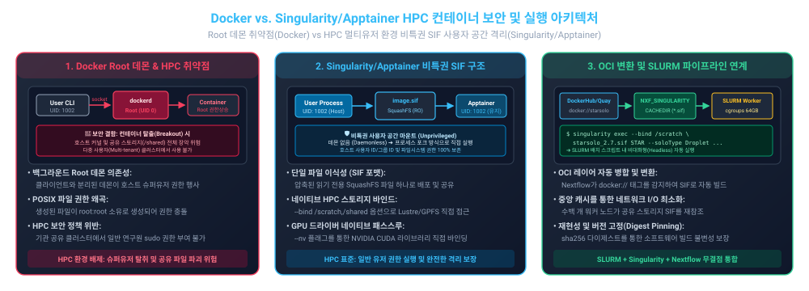

# 01. 컨테이너 가상화: Docker vs. Singularity/Apptainer HPC 아키텍처 (Containerization for Production Bioinformatics)

---

## 학습 목표 (Cognitive Goals)

1. **리눅스 커널 가상화 프리미티브(Namespaces, cgroups, OverlayFS)의 전산학적 메커니즘 규명**: 가상 머신(VM)과 컨테이너의 근본적인 하이퍼바이저 부재 차이를 이해하고, 주요 6종 Linux Namespaces(`PID`, `NET`, `MNT`, `IPC`, `UTS`, `USER`; 커널에는 `cgroup`, `time`을 포함해 총 8종이 있음), cgroups v1/v2 자원 할당 제약, OverlayFS 계층형 유니온 파일시스템(Layered Union Filesystem)의 복사-온-라이트(Copy-on-Write) 메커니즘을 상세히 분석한다.
2. **다중 사용자 HPC 클러스터에서 Docker 데몬(`dockerd`)의 보안 결함과 권한 상승(Privilege Escalation) 위험성 증명**: 클라이언트-서버 모델 기반 Docker가 호스트 루트 권한 데몬을 요구함으로써 발생하는 시스템 침해 시나리오(소켓 탈취, 루트 볼륨 바인드 마운트, CVE 취약점)를 구조적으로 증명한다.
3. **Singularity/Apptainer의 비특권(Unprivileged) 단일 바이너리 SIF 아키텍처 규명**: SUID 권한 없이 사용자 네임스페이스와 FUSE 기반 파일시스템(squashfuse)을 통해 사용자 공간에서 불변 SquashFS 이미지를 마운트하여 호스트 사용자 신원(UID/GID)을 100% 보존하면서 네이티브 속도로 구동되는 원리를 규명한다. (전통적인 SUID setuid 설치에서의 루프 디바이스 마운트와 달리, 비특권 모드는 FUSE로 SquashFS를 직접 읽는다.)
4. **프로덕션급 생물정보학 멀티스테이지 Dockerfile 및 Singularity Def 파일 설계**: STARsolo, Samtools, Scanpy 환경을 최소화된 이미지 크기와 레이어 캐싱 최적화 기법으로 패키징하고, GitHub Actions CI/CD를 통해 Docker 이미지를 자동으로 빌드하여 HPC 실행용 SIF 파일로 변환하는 프로덕션 워크플로우를 구축한다.

---

## 1. 리눅스 커널 가상화 프리미티브 (Linux Container Internals)

컨테이너는 완전한 하드웨어 가상화를 수행하는 전통적 가상 머신(Virtual Machine, Hypervisor Type-1/2)과 달리, 단일 호스트 리눅스 커널(Linux Kernel)을 공유하면서 커널이 제공하는 격리 프리미티브(Kernel Isolation Primitives)를 통해 프로세스 그룹을 캡슐화한 논리적 실행 단위이다.

```
┌────────────────────────────────────────────────────────┐
│ [User Space: Containerized Applications]              │
│  - App A (STARsolo)           - App B (Scanpy/PyTorch) │
│  - User Libraries (glibc 2.35) - User Libraries (glibc)│
├────────────────────────────────────────────────────────┤
│ [Linux Kernel Subsystems & Virtualization Primitives]  │
│  1. Namespaces: PID, MNT, NET, IPC, UTS, USER (+2)     │
│  2. Control Groups (cgroups v1/v2): CPU, Memory, IO    │
│  3. Storage Driver: OverlayFS (lowerdir / upperdir)    │
├────────────────────────────────────────────────────────┤
│ [Physical Hardware: x86_64 / ARM64, RAM, NVMe, GPU]    │
└────────────────────────────────────────────────────────┘
```

### 1.1 리눅스 네임스페이스 (Linux Namespaces): 시스템 뷰 격리

리눅스 네임스페이스는 특정 프로세스가 시스템 리소스를 바라보는 '시야(View)'를 격리하는 커널 서브시스템이다. `clone()`, `unshare()`, `setns()` 시스템 콜을 통해 프로세스 계층에 다음 6대 네임스페이스를 개별적으로 할당한다:

1. **`MNT` (Mount Namespace, CLONE_NEWNS)**:
   프로세스 그룹별로 파일시스템 마운트 테이블을 분리한다. 컨테이너 내부에서 마운트하거나 언마운트한 디스크는 호스트 파일시스템 테이블에 노출되지 않는다.
2. **`PID` (Process ID Namespace, CLONE_NEWPID)**:
   프로세스 번호 공간을 가상화한다. 컨테이너 내부의 메인 프로세스는 PID 1을 부여받아 자체적인 좀비 프로세스 수거(`waitpid`) 및 시그널 관리를 수행하지만, 호스트에서는 일반적인 PID(예: 42195)로 투명하게 관찰된다.
3. **`NET` (Network Namespace, CLONE_NEWNET)**:
   독립적인 네트워크 디바이스, IP 라우팅 테이블, 방화벽(iptables/nftables) 규칙, 포트 바인딩 공간을 제공한다. veth(Virtual Ethernet) 페어를 통해 호스트 브리지(docker0 등)와 연결된다.
4. **`IPC` (Inter-Process Communication, CLONE_NEWIPC)**:
   System V IPC 객체 및 POSIX 메시지 큐, 공유 메모리(`/dev/shm`) 세그먼트를 호스트와 격리한다.
5. **`UTS` (UNIX Timesharing System, CLONE_NEWUTS)**:
   호스트네임(Hostname)과 NIS 도메인네임을 독립적으로 설정한다.
6. **`USER` (User Namespace, CLONE_NEWUSER)**:
   컨테이너 내부의 UID/GID 매핑을 호스트와 완전히 분리한다. 예를 들어 컨테이너 내부에서는 `root` (UID 0)로 동작하더라도, 호스트 커널에서는 비특권 일반 사용자(UID 10001)로 매핑되어 권한 탈취를 방지할 수 있다.

### 1.2 제어 그룹 (cgroups v1 vs. cgroups v2): 물리 자원 할당 제약

네임스페이스가 '무엇을 볼 수 있는가'를 격리한다면, **cgroups(Control Groups)**는 '얼마나 많은 물리적 자원을 소모할 수 있는가'를 강제(Enforce)하는 회계·제약 서브시스템이다.

#### CPU 할당: 완전 공평 스케줄러(CFS) 대역폭 제어
리눅스 완전 공평 스케줄러(Completely Fair Scheduler, CFS)는 시간 슬라이스(Period) 동안 프로세스 그룹이 소모할 수 있는 최대 런타임(Quota)을 제한한다:

$$\text{CPU 할당 비율 } R_{\text{cpu}} = \frac{\text{cpu.cfs\_quota\_us}}{\text{cpu.cfs\_period\_us}} = \frac{Q}{P}$$

예를 들어 $P = 100,000\,\mu\text{s}$ (100ms)이고 $Q = 400,000\,\mu\text{s}$ (400ms)로 설정되면, 해당 컨테이너는 최대 4개의 물리 CPU 코어($R_{\text{cpu}} = 4.0$)의 연산량을 100% 점유할 수 있다. 작업량이 이를 초과하면 프로세스는 스케줄러에 의해 강제로 잠자는 CPU Throttling 상태에 빠지게 된다.

#### 메모리 제한 및 OOM(Out-Of-Memory) 킬러 작동 메커니즘
cgroups v2는 단일 계층 트리 구조에서 `memory.max` (Hard limit) 및 `memory.high` (Soft limit) 인터페이스를 제공한다. 컨테이너 내부의 익명 메모리(Anonymous memory, 힙·스택), 활성 페이지 캐시(Page cache), 커널 슬랩(Kernel slab) 메모리의 총합이 `memory.max`에 도달하면 커널은 먼저 회수 가능한 메모리(주로 파일 페이지 캐시)를 회수하며, **회수할 수 없어 한도를 줄일 수 없을 때** OOM killer를 호출한다. 따라서 "익명+파일 캐시+슬랩 합 > max ⇒ OOM"이라는 단순 부등식은 성립하지 않는다(09장 Q1의 "캐시를 먼저 회수" 서술이 정확하다). OOM이 발생하는 실질 조건은 회수 불가능한 메모리(주로 익명 메모리)가 한도를 넘을 때이다.

이때 리눅스 커널의 `oom-killer`는 프로세스 트리의 `oom_score`가 가장 높은 프로세스(통상 대규모 유전체 인덱스를 로드한 STAR 프로세스)를 타깃으로 선정하여 `SIGKILL` (Exit Code 137) 시그널을 즉시 브로드캐스트하여 메모리를 회수한다.

### 1.3 OverlayFS 계층형 유니온 파일시스템 (Layered Union Filesystem)

컨테이너 이미지는 수십 개의 불변(Immutable) 읽기 전용 레이어와 최상단의 단일 읽기-쓰기 레이어가 결합된 유니온 마운트 구조로 동작한다.

```
[Merged Directory: /var/lib/docker/overlay2/.../merged] (컨테이너 뷰)
                         ▲
                         │ Union Mount
  ┌──────────────────────┴──────────────────────┐
  │ [Upperdir (Read-Write Container Layer)]     │ (컨테이너 실행 중 생성/수정된 파일)
  ├─────────────────────────────────────────────┤
  │ [Lowerdir Layer N: pip install scanpy]      │ (불변 읽기 전용)
  ├─────────────────────────────────────────────┤
  │ [Lowerdir Layer 2: apt-get install samtools]│ (불변 읽기 전용)
  ├─────────────────────────────────────────────┤
  │ [Lowerdir Layer 1: Ubuntu 22.04 LTS Base]   │ (불변 읽기 전용)
  └─────────────────────────────────────────────┘
```

* **복사-온-라이트 (Copy-on-Write, CoW)**: 하위 읽기 전용 레이어(`lowerdir`)에 존재하는 기존 파일(예: `/etc/hosts`)을 컨테이너가 수정하려 할 때, 커널은 해당 파일을 최상단 쓰기 레이어(`upperdir`)로 즉시 복사(Copy-up)한 후 수정을 가한다.
* **성능 오버헤드**: 대용량 BAM 정렬 및 중간 임시 파일 수천 개를 OverlayFS 내부 쓰기 레이어에서 생성·삭제할 경우 기존 lower 레이어 파일을 수정할 때의 Copy-up 레이턴시와 오버레이 메타데이터 오버헤드가 발생할 수 있다(새 파일 생성은 copy-up 대상이 아님). 따라서 프로덕션 파이프라인에서는 **호스트 고성능 NVMe 디렉토리를 직접 마운트(`-v` 또는 `-B`)하여 OverlayFS 쓰기 오버헤드를 우회**해야 한다.

---

## 2. Docker vs. Singularity/Apptainer: 아키텍처 대조 및 HPC 보안 필연성



생물정보학 분야에서 클라우드/웹 서비스 표준인 Docker와 고성능 컴퓨팅(HPC) 표준인 Singularity(현 Apptainer)가 양립하는 이유는 **다중 사용자 보안 아키텍처의 근본적 차이** 때문이다.

### 2.1 Docker의 클라이언트-서버 모델과 루트 데몬 취약점

Docker는 전통적인 클라이언트-서버 아키텍처를 채택한다:
* 일반 사용자가 `docker run` 명령을 실행하면, 사용자의 명령은 UNIX 도메인 소켓(`/var/run/docker.sock`)을 통해 백그라운드에서 상시 구동 중인 **`dockerd` 루트 데몬**으로 전송된다.
* 실제 컨테이너의 생성과 호스트 커널 리소스 제어는 루트 권한을 가진 `dockerd`와 `containerd`, `runc`가 수행한다.

#### 다중 사용자 환경에서의 루트 권한 탈취 취약점 (Privilege Escalation Exploit)
HPC 클러스터 관리자가 연구원 계정을 `docker` 사용자 그룹에 추가하는 순간, 해당 연구원은 시스템의 완전한 루트(Root) 권한을 획득하게 된다:

```bash
# 악의적인 사용자의 호스트 루트 파일시스템 탈취 시나리오
docker run --rm -it -v /:/host_root alpine:latest chroot /host_root /bin/bash

# 결과: 호스트의 /etc/shadow 파일 조작, 타 사용자의 데이터 임의 삭제 및 시스템 완전 장악 가능!
```

`docker` 그룹 구성원이 사실상 루트와 같은 권한을 갖는 것은 데몬이 루트로 동작하는 구조 때문이다(runc 컨테이너 탈출 취약점 CVE-2019-5736은 이와 별개의 취약점 사례). 이 때문에 많은 공유 HPC 클러스터에서는 Docker 데몬 실행을 금지한다. 참고로 Docker의 rootless 모드나 Podman 같은 비특권 대안도 있으나, 다중 사용자 HPC에서는 Singularity/Apptainer가 흔히 쓰인다.

### 2.2 Singularity/Apptainer의 비특권(Unprivileged) SIF 아키텍처

Singularity(Apptainer)는 HPC 환경의 보안 제약을 극복하기 위해 설계된 **프로세스 통합형 단일 실행 모델**이다:

1. **상주 데몬 부재 (No Background Daemon)**:
   백그라운드에서 루트 권한으로 대기하는 데몬 프로세스가 전혀 없다. 사용자가 `singularity run`을 실행하면, 컨테이너 프로세스는 사용자의 쉘 프로세스로부터 직접 파생된 자식 프로세스(`fork()` & `execve()`)로 동작한다.
2. **엄격한 호스트 신원 일치 (Host Identity Preservation)**:
   컨테이너 내부에서의 UID 및 GID는 호스트에서의 사용자와 완전히 동일하다. 호스트에서 `uid=1052(researcher)`인 사용자는 컨테이너 내부에서도 동일하게 `uid=1052`이며, 호스트의 파일시스템 권한(POSIX permission)을 절대 우회할 수 없다.
3. **단일 불변 이미지 파일 (SIF, Singularity Image Format)**:
   도커의 파편화된 수십 개 레이어와 달리, Singularity는 전체 컨테이너 환경을 압축된 읽기 전용 파일시스템인 **SquashFS** 기반의 단일 바이너리 파일(`.sif`)로 패키징한다.
   * 전통적인 SUID setuid 설치에서는 루트 권한으로 커널 루프 디바이스(Loop Device)를 통해 읽기 전용 마운트(`mount -o loop,nosuid,nodev`)되며, 비특권(Unprivileged) 설치에서는 FUSE 기반 `squashfuse`가 사용자 공간에서 SquashFS를 직접 읽어 루프 디바이스 없이 동등한 파일시스템 뷰를 제공한다.
   * 단일 파일이므로 공유 분산 파일시스템(Lustre, GPFS, NFS)에서 수천 개의 계산 노드로 복사하거나 배포할 때 메타데이터 부하가 전혀 발생하지 않는다.

### 2.3 기술 사양 종합 비교

| 비교 항목 | Docker | Singularity / Apptainer |
| :--- | :--- | :--- |
| **주요 아키텍처** | 클라이언트-서버 (`docker` $\to$ `dockerd`) | 독립 실행형 바이너리 (No daemon) |
| **데몬 권한** | 호스트 `root` 권한 상시 구동 | 데몬 없음 (사용자 자식 프로세스) |
| **컨테이너 내부 기본 UID** | 기본값 `root` (UID 0) | 호스트 사용자 UID/GID 강제 보존 |
| **저장 포맷** | 계층화된 레이어 디렉토리 (`overlay2`) | 단일 불변 바이너리 파일 (`.sif`) |
| **HPC 파일시스템 친화성** | 매우 낮음 (수만 개의 작은 파일 I/O) | 매우 높음 (단일 파일 배포 및 마운트) |
| **GPU / InfiniBand 지원** | `nvidia-container-toolkit` 런타임 설정 필요 | `--nv` 플래그로 호스트 라이브러리 직접 주입 |
| **보안 적합성** | 퍼블릭 클라우드, 독립 전용 서버 | 다중 사용자 공유 HPC 클러스터, 병원 원내망 |

---

## 3. 프로덕션급 바이오인포매틱스 Dockerfile 작성 원칙

단일세포 업스트림 분석 도구(STARsolo, Samtools)와 다운스트림 파이썬 환경(Scanpy, PyTorch)을 결합할 때, 잘못 작성된 Dockerfile은 수십 기가바이트의 거대한 이미지와 캐시 무효화로 인한 빌드 지연을 초래한다. 프로덕션 환경의 4대 원칙을 적용한다:

1. **멀티스테이지 빌드 (Multi-stage Builds)**: 컴파일러(GCC, Make, CMake) 및 개발용 헤더 파일은 빌더(Builder) 스테이지에만 격리하고, 최종 런타임 이미지에는 컴파일된 실행 바이너리와 런타임 공유 라이브러리(`*.so`)만을 복사하여 이미지 크기를 80% 이상 압축한다.
2. **레이어 최소화 및 캐시 최적화**: 자주 변경되지 않는 기본 OS 패키지 설치를 상단에 배치하고, `&&` 연산자로 명령을 단일 `RUN` 레이어로 결합하며, 패키지 매니저 캐시(`/var/lib/apt/lists/*`)를 즉시 제거한다.
3. **버전 고정 (Deterministic Version Pinning)**: OS 패키지 및 툴 버전을 명시적으로 고정하여 향후 빌드 시 환경이 변질되는 것을 원천 차단한다.
4. **비루트 사용자 생성 (Non-root Execution)**: 보안 모범 사례를 준수하여 컨테이너 기본 실행 사용자를 일반 사용자(`bioinfo`)로 선언한다.

### 3.1 프로덕션 멀티스테이지 Dockerfile 예시

```dockerfile
# =========================================================================
# Stage 1: Build Environment (C/C++ 도구 컴파일 및 바이너리 빌드)
# =========================================================================
FROM ubuntu:22.04 AS builder

LABEL maintainer="Bioinformatics Pipeline Team <pipeline@precision.org>"

ENV DEBIAN_FRONTEND=noninteractive
ENV STAR_VERSION=2.7.11b
ENV SAMTOOLS_VERSION=1.19.2

# 빌드 필수 도구 체인 설치
RUN apt-get update && apt-get install -y --no-install-recommends \
    build-essential \
    cmake \
    zlib1g-dev \
    libbz2-dev \
    liblzma-dev \
    libncurses5-dev \
    libcurl4-gnutls-dev \
    libssl-dev \
    ca-certificates \
    wget \
    git \
 && rm -rf /var/lib/apt/lists/*

WORKDIR /tmp/build

# 1. STARsolo 소스 다운로드 및 컴파일
RUN wget https://github.com/alexdobin/STAR/archive/${STAR_VERSION}.tar.gz \
 && tar -xzf ${STAR_VERSION}.tar.gz \
 && cd STAR-${STAR_VERSION}/source \
 && make STARstatic -j$(nproc) \
 && cp STAR /usr/local/bin/

# 2. Samtools 소스 다운로드 및 정적 컴파일
RUN wget https://github.com/samtools/samtools/releases/download/${SAMTOOLS_VERSION}/samtools-${SAMTOOLS_VERSION}.tar.bz2 \
 && tar -xjf samtools-${SAMTOOLS_VERSION}.tar.bz2 \
 && cd samtools-${SAMTOOLS_VERSION} \
 && ./configure --prefix=/usr/local --without-curses \
 && make -j$(nproc) \
 && make install

# =========================================================================
# Stage 2: Final Runtime Environment (경량 런타임 및 파이썬 분석 환경)
# =========================================================================
FROM ubuntu:22.04 AS runtime

ENV DEBIAN_FRONTEND=noninteractive
ENV LANG=C.UTF-8 LC_ALL=C.UTF-8
ENV PATH=/usr/local/bin:$PATH

# 필수 런타임 공유 라이브러리 및 파이썬 런타임만 설치
# (빌더가 libcurl4-gnutls-dev로 링크했으므로 런타임에도 GnuTLS 변형 libcurl3-gnutls가 필요하다; libcurl4는 OpenSSL 변형)
RUN apt-get update && apt-get install -y --no-install-recommends \
    libgomp1 \
    libcurl3-gnutls \
    zlib1g \
    libbz2-1.0 \
    liblzma5 \
    python3 \
    python3-pip \
    ca-certificates \
 && rm -rf /var/lib/apt/lists/*

# Builder 스테이지에서 컴파일된 순수 바이너리만 복사
COPY --from=builder /usr/local/bin/STAR /usr/local/bin/STAR
COPY --from=builder /usr/local/bin/samtools /usr/local/bin/samtools

# 파이썬 의존성 고정 설치 (Scanpy 생태계)
RUN pip3 install --no-cache-dir \
    scanpy==1.9.8 \
    anndata==0.10.5 \
    pandas==2.2.1 \
    scipy==1.12.0 \
    matplotlib==3.8.3

# 비특권 사용자 생성 및 작업 디렉토리 설정
RUN groupadd -g 1000 bioinfo && \
    useradd -m -u 1000 -g bioinfo -s /bin/bash bioinfo

USER bioinfo
WORKDIR /home/bioinfo

# 바이너리 정상 동작 검증
RUN STAR --version && samtools --version && python3 -c "import scanpy; print(scanpy.__version__)"

CMD ["/bin/bash"]
```

---

## 4. Singularity Definition (`.def`) 및 고성능 HPC 최적화

HPC 환경에서는 Docker Hub 또는 OCI 레지스트리에 배포된 이미지를 기반(`Bootstrap: docker`)으로 Singularity 정의 파일(`.def`)을 작성하여 최적화된 `.sif` 이미지를 빌드한다.

### 4.1 `Singularity.def` 구조 명세

```singularity
Bootstrap: docker
From: ubuntu:22.04

%labels
    Author Precision_Bioinformatics_Team
    Version v1.0.0
    Description Production container for snRNA-seq upstream alignment and QC

%environment
    export LC_ALL=C
    export PATH=/usr/local/bin:$PATH

%post
    apt-get update && apt-get install -y --no-install-recommends \
        wget \
        ca-certificates \
        libgomp1 \
        zlib1g \
        python3 \
        python3-pip \
        unzip
    
    # 사전에 컴파일된 정적 바이너리 설치 (릴리스 자산은 STAR_2.7.11b.zip 하나이며 내부에 Linux_x86_64_static/STAR가 있다)
    wget -q -O /tmp/STAR.zip https://github.com/alexdobin/STAR/releases/download/2.7.11b/STAR_2.7.11b.zip
    unzip -q -j /tmp/STAR.zip 'STAR_2.7.11b/Linux_x86_64_static/STAR' -d /usr/local/bin
    chmod +x /usr/local/bin/STAR
    rm -f /tmp/STAR.zip

    pip3 install --no-cache-dir scanpy==1.9.8 anndata==0.10.5

    apt-get clean
    rm -rf /var/lib/apt/lists/*

%runscript
    echo "Container execution started: $(date)"
    exec "$@"

%test
    STAR --version
    python3 -c "import scanpy; print('Scanpy successfully loaded')"
```

### 4.2 HPC 런타임 바인드 마운트 및 GPU 가속 실행

Singularity는 실행 시 호스트의 파일시스템을 비특권 상태에서 컨테이너 내부로 매핑하는 매우 유연한 인터페이스를 제공한다:

```bash
# 1. 단일 SIF 파일 빌드 (루트 권한이 있는 머신 또는 fakeroot 환경)
apptainer build snrna_pipeline_v1.sif Singularity.def

# 2. HPC 클러스터에서의 실행: Lustre 고성능 스크래치 디렉토리 바인드 마운트
apptainer exec \
    --bind /scratch/project_crpc:/data \
    --bind /local_scratch:/tmp \
    snrna_pipeline_v1.sif \
    STAR --genomeDir /data/reference/GRCh38 \
         --readFilesIn /data/fastq/sample_R2.fq.gz /data/fastq/sample_R1.fq.gz \
         --readFilesCommand zcat \
         --soloType CB_UMI_Simple \
         --outFileNamePrefix /data/results/sample_

# 3. GPU 가속 딥러닝 모델(scVI 등)을 위한 NVIDIA 호스트 드라이버 패스스루
apptainer exec --nv snrna_pipeline_v1.sif python3 -c "import torch; print('CUDA Available:', torch.cuda.is_available())"
```

* `--bind` (`-B`): 컨테이너 내부의 격리된 네임스페이스에 호스트의 특정 대용량 파일 경로를 직접 마운트한다.
* `--nv`: 컨테이너 내부에 NVIDIA 드라이버 바이너리를 포함하지 않더라도, 호스트 커널의 `/dev/nvidia*` 장치 파일과 `libcuda.so`, `libnvidia-ml.so` 드라이버 라이브러리를 동적으로 컨테이너 런타임에 주입하여 즉시 GPU 가속을 가능하게 한다.

---

## 5. CI/CD 자동화: GitHub Actions를 통한 Docker 빌드 및 SIF 변환

엔터프라이즈 환경에서는 개발자가 수동으로 컨테이너를 빌드하지 않는다. GitHub 리포지토리에 코드가 푸시되면 GitHub Actions가 OCI Docker 이미지를 빌드하여 레지스트리에 등록하고, 이를 HPC에서 즉시 사용할 수 있는 `.sif` 파일로 변환하여 아티팩트로 배포한다.

```yaml
# .github/workflows/container_build.yml
name: Build and Deploy Production Bio-Containers

# 참고: 태그 푸시 이벤트에는 `paths` 필터가 적용되지 않는다(paths는 브랜치 푸시에만 적용). 태그 빌드를 막으려면 별도 조건이 필요하다.
on:
  push:
    tags:
      - 'v*.*.*'
    paths:
      - 'docker/**'
      - '.github/workflows/container_build.yml'

jobs:
  build-and-convert:
    runs-on: ubuntu-latest
    permissions:
      contents: read
      packages: write

    steps:
      - name: Check out pipeline code
        uses: actions/checkout@v4

      - name: Set up Docker Buildx
        uses: docker/setup-buildx-action@v3

      - name: Log in to GitHub Container Registry (GHCR)
        uses: docker/login-action@v3
        with:
          registry: ghcr.io
          username: ${{ github.actor }}
          password: ${{ secrets.GITHUB_TOKEN }}

      - name: Extract metadata for Docker
        id: meta
        uses: docker/metadata-action@v5
        with:
          images: ghcr.io/${{ github.repository }}/snrna-align

      # 1. 최적화된 Docker 이미지 빌드 및 GHCR 푸시
      - name: Build and push Docker image
        uses: docker/build-push-action@v5
        with:
          context: ./docker
          file: ./docker/Dockerfile
          push: true
          tags: ${{ steps.meta.outputs.tags }}
          labels: ${{ steps.meta.outputs.labels }}
          cache-from: type=gha
          cache-to: type=gha,mode=max

      # 2. Apptainer CLI 설치 및 Docker 이미지를 SIF로 변환
      - name: Set up Apptainer
        uses: eWaterCycle/setup-apptainer@v2
        with:
          apptainer-version: 1.2.5

      - name: Convert Docker image to Singularity SIF
        run: |
          IMAGE_TAG="ghcr.io/${{ github.repository }}/snrna-align:${{ github.ref_name }}"
          apptainer build snrna_align_${{ github.ref_name }}.sif docker://${IMAGE_TAG}

      # 3. HPC 배포를 위한 SIF 파일 아티팩트 업로드
      - name: Upload SIF Artifact
        uses: actions/upload-artifact@v4
        with:
          name: singularity-sif
          path: snrna_align_${{ github.ref_name }}.sif
          retention-days: 14
```

---

## 단원 핵심 점검 (Cognitive Checkpoint & Case Study)

### 문제 1: 다중 사용자 HPC에서 Docker 데몬 소켓 노출로 인한 권한 상승 취약점 공격 분석
한 연구 중심 병원의 IT 관리자가 연구원들의 편의를 위해 중앙 계산 서버의 `/var/run/docker.sock` 소켓 파일 권한을 `chmod 666`으로 개방하거나, 모든 연구원 계정을 `docker` 보조 그룹에 등록하였다.
1. 이 구성이 시스템 보안 관점에서 왜 치명적인 루트 권한 상승(Root Privilege Escalation) 결함인지, 일반 사용자가 루트 암호 없이 호스트 전체의 제어권을 획득하는 공격 명령어를 포함하여 설명하시오.
2. Singularity/Apptainer 아키텍처가 이 문제를 어떻게 구조적으로 원천 차단하는지 시스템 콜 및 프로세스 UID 모델 관점에서 비교 분석하시오.

<details>
<summary>💡 모범 답안 및 해설 확인</summary>

**1. Docker 데몬 소켓 노출 취약점 메커니즘**:
* **공격 벡터**: `/var/run/docker.sock`에 쓰기 권한이 부여된 모든 프로세스는 Docker REST API를 통해 백그라운드의 루트 권한 `dockerd`에게 임의의 컨테이너 생성 및 호스트 파일시스템 마운트를 명령할 수 있다.
* **공격 명령어 예시**:
  ```bash
  # 비특권 일반 사용자(UID 1001) 세션에서 실행
  docker run -v /:/host_fs --user 0 -it alpine sh -c "echo 'attacker ALL=(ALL:ALL) NOPASSWD:ALL' >> /host_fs/etc/sudoers"
  ```
* **결과**: 컨테이너 내부의 root(UID 0)는 마운트된 `/host_fs/etc/sudoers`에 쓰기 권한을 행사할 수 있으며, 이로써 호스트 시스템의 `sudoers` 파일이 즉시 변조된다. 이후 공격자는 `sudo su`를 통해 호스트의 무제한 루트 권한을 영구 획득하게 된다.

**2. Singularity의 구조적 방어 메커니즘**:
* **데몬 및 SUID 부재**: Singularity는 백그라운드에서 상주하는 데몬 프로세스가 전혀 없으며, 최신 Apptainer는 SUID 바이너리 없이 리눅스 커널의 비특권 사용자 네임스페이스(`CLONE_NEWUSER`)만을 활용하여 실행된다.
* **불변 UID 매핑**: 프로세스가 생성될 때 커널 레벨에서 호스트의 실제 UID(예: 1001)가 컨테이너 프로세스에 그대로 상속된다. 사용자가 컨테이너 내부에서 아무리 루트 권한을 행사하려 해도 호스트 커널은 이 프로세스의 시스템 콜(`setuid`, `chown`, 파일 쓰기)을 일반 사용자 UID 1001의 권한 범위 내로 엄격히 제한한다. 따라서 호스트의 `/etc/sudoers`나 타 환자의 데이터 파일에 접근하는 것이 불가능하다.

</details>

---

### 문제 2: 대규모 BAM 정렬 시 OverlayFS CoW 레이어 쓰기 오버헤드와 호스트 스크래치 바인드 마운트
단일세포 STAR 정렬 컨테이너를 구동하여 5천만 리드의 snRNA-seq FASTQ 데이터를 정렬하는 과정에서, 한 분석가가 컨테이너 내부의 기본 작업 경로(`/home/bioinfo/work`)에서 정렬을 수행하여 중간 정렬 파일(`_STARtmp`)과 정렬된 대용량 BAM 파일(약 15 GB)을 생성하도록 스크립트를 작성하였다. 실행 결과 호스트에서 네이티브로 실행할 때보다 I/O 처리량이 크게 감소하고(가상 시나리오, 배수는 환경 의존) 실행 시간이 대폭 증가하였다.
1. OverlayFS 계층형 유니온 파일시스템의 복사-온-라이트(Copy-on-Write) 및 디렉토리 구조 관점에서 이러한 극심한 I/O 성능 저하의 원인을 분석하시오.
2. 이 병목을 완전히 제거하기 위해 Docker 및 Singularity 실행 시 적용해야 하는 호스트 스크래치 바인드 마운트 옵션과 프로덕션 명령어를 제시하시오.

<details>
<summary>💡 모범 답안 및 해설 확인</summary>

**1. OverlayFS 성능 저하 원인 분석**:
* **Copy-up 레이턴시 및 다중 계층 순회**: OverlayFS 내부에서 파일 생성 및 수정은 최상단의 가변 `upperdir`에서 이루어진다. 수만 개의 중간 샤드(Shard)와 임시 정렬 블록이 생성되고 삭제될 때마다 유니온 파일시스템 드라이버는 하위 `lowerdir` 계층들의 dentry 및 inode 테이블을 검사하고 상위 계층에 메타데이터를 동기화하는 오버헤드를 발생시킨다.
* **POSIX 동기화 부하**: 컨테이너 내부 스토리지 드라이버(`overlay2`)는 로컬 NVMe 블록 디바이스의 다이렉트 I/O보다 추가적인 가상화 계층을 거치므로, 높은 쓰기 IOPS 환경에서 커널의 메모리 페이지 플러시 및 락 경합(Lock Contention)이 발생하여 심각한 I/O 병목이 초래된다.

**2. 호스트 스크래치 바인드 마운트 최적화**:
* 컨테이너 파일시스템 계층을 완전히 우회(Bypass)하여 호스트의 고속 로컬 NVMe 물리 디스크(`/local_scratch`)를 직접 프로세스에 노출해야 한다:
* **Docker 실행 최적화**:
  ```bash
  docker run --rm \
      -v /local_scratch:/workspace:rw \
      --workdir /workspace \
      snrna_align:v1 \
      STAR --genomeDir /workspace/ref --readFilesIn ... --outFileNamePrefix /workspace/sample_
  ```
* **Singularity 실행 최적화**:
  ```bash
  apptainer exec \
      --bind /local_scratch:/workspace \
      --pwd /workspace \
      snrna_align.sif \
      STAR --genomeDir /workspace/ref --readFilesIn ... --outFileNamePrefix /workspace/sample_
  ```
* 이렇게 바인드 마운트할 경우 I/O 연산이 커널의 네이티브 파일시스템(ext4/xfs) 블록 계층으로 직접 전달되므로 OverlayFS 가상화 오버헤드가 0%로 제거되어 네이티브 베어메탈과 동일한 I/O 처리량을 달성한다.

</details>

---

### 문제 3: Singularity `--nv` 플래그의 GPU 호스트 라이브러리 동적 바인딩 메커니즘
전립선암 단일세포 전사체 데이터의 배치 효과 제거 및 잠재 공간(Latent Space) 학습을 위해 PyTorch 기반의 `scVI` (Deep Generative Model) 알고리즘을 Singularity 컨테이너 환경에서 구동하고자 한다. 분석가는 컨테이너 이미지 크기를 줄이기 위해 1.5GB에 달하는 거대한 NVIDIA 드라이버 및 CUDA 툴킷을 이미지 내부에 포함하지 않았다.
1. Singularity 실행 시 `--nv` 플래그를 추가했을 때, 컨테이너 런타임이 호스트의 어떤 리눅스 장치 파일(Device Nodes)과 핵심 공유 라이브러리(`*.so`)를 감지하여 컨테이너 네임스페이스 내부로 동적 주입(Dynamic Injection)하는지 메커니즘을 설명하시오.
2. 만약 호스트 시스템의 NVIDIA 커널 드라이버 버전이 오래되어 컨테이너 내부 PyTorch가 요구하는 CUDA 런타임 최소 버전(예: CUDA 12.1 requires Driver >= 525.60.13)을 충족하지 못할 때 발생하는 런타임 에러(`CUDA driver version is insufficient for CUDA runtime version`)의 원인과 해결 방안을 제시하시오.

<details>
<summary>💡 모범 답안 및 해설 확인</summary>

**1. `--nv` 플래그의 동적 주입 메커니즘**:
* **장치 파일 바인딩**: Singularity 런타임은 호스트 커널의 `/dev/nvidia*` (예: `/dev/nvidia0`, `/dev/nvidiactl`, `/dev/nvidia-uvm`) 특수 장치 노드를 컨테이너의 `/dev` 네임스페이스로 즉시 바인드 마운트한다.
* **라이브러리 자동 감지 및 인젝션**: 호스트의 `ldconfig` 캐시 또는 `/etc/singularity/nvblist` 설정 파일에 등록된 NVIDIA 유저스페이스 라이브러리들을 탐색하여 컨테이너 내부의 `/usr/lib64` 또는 `LD_LIBRARY_PATH` 경로로 마운트한다:
  * 드라이버 인터페이스: `libcuda.so.1`, `libnvidia-ml.so.1` (NVML)
  * 디바이스 및 메모리 관리: `libnvidia-ptxjitcompiler.so`, `libnvidia-allocator.so`
* 이로 인해 컨테이너 내부는 거대한 드라이버 패키지 없이도 호스트 GPU 하드웨어에 다이렉트로 접근할 수 있다.

**2. CUDA 런타임 버전 불일치 원인 및 해결 방안**:
* **원인**: CUDA 아키텍처는 컨테이너 내부 유저스페이스의 CUDA 런타임(`libcudart.so`)과 호스트 커널에 로드된 NVIDIA 드라이버 커널 모듈(`nvidia.ko` 및 `libcuda.so`) 사이의 ABI 호환성을 요구한다. 상위 버전의 CUDA 런타임은 새로운 드라이버 API 심볼을 호출하므로, 구버전 호스트 드라이버는 이를 해석하지 못하고 `CUDA driver version is insufficient` 오류를 반환한다.
* **해결 방안**:
  1. 호스트 시스템의 NVIDIA 디스플레이/데이터센터 드라이버를 컨테이너 CUDA 버전에 부합하도록 최신 버전으로 업그레이드한다.
  2. 만약 HPC 호스트 관리 권한이 없어 드라이버 업데이트가 불가능하다면, 컨테이너 내부의 PyTorch 버전을 호스트 드라이버가 지원하는 하위 CUDA 버전(예: CUDA 11.8 빌드 버전)으로 다운그레이드하여 이미지를 재빌드해야 한다.
  3. NVIDIA Forward Compatibility 패키지(`cuda-compat`)를 컨테이너 내부에 설치하여 유저스페이스 레벨에서 상위 드라이버 인터페이스를 에뮬레이션하도록 설정한다.

</details>

---

<!-- REFERENCES:BEGIN (generated by scripts/apply_references.py; do not edit by hand) -->
## 참고문헌 (References)
### 소프트웨어 (표기 버전은 검수 시 API를 확인한 버전이며, 파이프라인 실행 환경은 requirements-pipelines.txt 참조)
- Docker (github.com/moby/moby).
- Apptainer (Singularity) (github.com/apptainer/apptainer). 원 논문: Kurtzer GM, Sochat V, Bauer MW. Singularity: Scientific containers for mobility of compute. *PLoS One*. 2017;12(5):e0177459. PMID: 28494014. doi: 10.1371/journal.pone.0177459
- STAR 2.7.11 (github.com/alexdobin/STAR). 원 논문: Dobin A, Davis CA, Schlesinger F, et al. STAR: ultrafast universal RNA-seq aligner. *Bioinformatics*. 2013;29(1):15-21. PMID: 23104886. doi: 10.1093/bioinformatics/bts635
- SAMtools (github.com/samtools/samtools). 원 논문: Danecek P, Bonfield JK, Liddle J, et al. Twelve years of SAMtools and BCFtools. *Gigascience*. 2021;10(2). PMID: 33590861. doi: 10.1093/gigascience/giab008
- Scanpy 1.12.4 (github.com/scverse/scanpy). 원 논문: Wolf FA, Angerer P, Theis FJ. SCANPY: large-scale single-cell gene expression data analysis. *Genome Biol*. 2018;19(1):15. PMID: 29409532. doi: 10.1186/s13059-017-1382-0
- scvi-tools 1.5.1 (github.com/scverse/scvi-tools). 원 논문: Gayoso A, Lopez R, Xing G, et al. A Python library for probabilistic analysis of single-cell omics data. *Nat Biotechnol*. 2022;40(2):163-166. PMID: 35132262. doi: 10.1038/s41587-021-01206-w
- PyTorch 2.14.1 (github.com/pytorch/pytorch).
- pandas 2.3.3 (github.com/pandas-dev/pandas). 원 논문: McKinney W. Data Structures for Statistical Computing in Python. *Proceedings of the Python in Science Conference*. 2010:56-61. doi: 10.25080/majora-92bf1922-00a
<!-- REFERENCES:END -->
