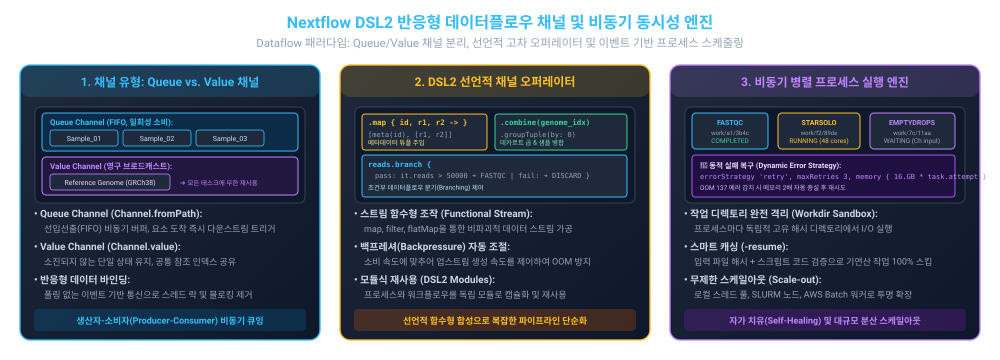

# 02. Nextflow DSL2 모듈형 아키텍처와 리액티브 데이터플로우 (Nextflow DSL2 Reactive Architecture)

---

## 학습 목표 (Cognitive Goals)

1. **리액티브 데이터플로우(Reactive Streams) 및 CSP(Communicating Sequential Processes) 전산 모델 규명**: 프로세스 간 공유 메모리 없이 비동기 채널을 통해서만 메시지를 전달하는 CSP 이론과 이벤트 주도형(Event-driven) 반응형 연산 메커니즘을 수학적으로 모델링한다.
2. **비동기 채널(Asynchronous Channel)의 내부 역학 및 스트림 변환 마스터**: 단일 소모성 큐 채널(Queue Channel)과 영구 브로드캐스트 밸류 채널(Value Channel)의 거동 차이를 분석하고, 5대 고급 채널 연산자(`map`, `filter`, `combine`, `join`, `branch`)를 활용하여 다중 샘플 데이터 스트림을 자유자재로 재구성한다.
3. **Nextflow DSL2 기반의 모듈화 및 계층형 워크플로우 아키텍처 구축**: 원자적 도구 실행 단위(`process`), 도구 체인 결합 단위(`subworkflow`), 최상위 진입점 파이프라인(`workflow`), 런타임 설정(`nextflow.config`)의 엄격한 관심사 분리(Separation of Concerns)를 구현한다.
4. **결함 허용(Fault-Tolerant) 동적 자원 스케줄링 및 nf-core 표준 명세 수립**: 리눅스 OOM(Exit Code 137) 발생 시 지수 백오프(Exponential Backoff)를 통한 자동 메모리 증설 재시도 전략과 `nextflow_schema.json` 기반 매개변수 유효성 검증 체계를 완성한다.

---

## 1. Nextflow 실행 모델: Reactive Streams와 CSP (Communicating Sequential Processes)

Nextflow의 근본적인 연산 모델은 1978년 토니 호어(C. A. R. Hoare)가 제안한 **CSP(Communicating Sequential Processes)**와 현대 소프트웨어 공학의 **리액티브 스트림(Reactive Streams)** 표준에 기반한다.

전통적인 절차형 파이프라인(Procedural Pipeline)은 프로세스 $A$가 모든 100개 샘플의 정렬을 완전히 마칠 때까지 대기한 후 프로세스 $B$가 일괄적으로 다음 연산을 시작한다. 반면 Nextflow의 데이터플로우 모델에서는 **데이터가 채널(Channel)에 도착하는 즉시 개별 태스크가 비동기적(Asynchronous)으로 트리거**된다.

```
[Procedural Batch Model: Lock-step Execution]
Time ────────────────────────────────────────────────────────►
Sample 1-100: [======== Step A (Alignment) ========]
Sample 1-100:                                        [==== Step B (QC) ====]
                                                     ▲ 심각한 대기 시간 발생!

[Nextflow Reactive Dataflow Model: Pipelined Streaming]
Time ────────────────────────────────────────────────────────►
Sample 1:     [== Step A ==]──►[== Step B ==]
Sample 2:        [== Step A ==]──►[== Step B ==]
Sample 3:           [== Step A ==]──►[== Step B ==]
              ▲ 샘플별 독립적 스트리밍 병렬화로 전체 처리 시간 극소화!
```

### 1.1 수학적 형식화: 유향 비순환 그래프(DAG)와 반응형 트리거

Nextflow 파이프라인의 연산 상태는 프로세스 집합 $P = \{p_1, p_2, \dots, p_n\}$와 비동기 FIFO 채널 집합 $C = \{c_1, c_2, \dots, c_m\}$로 구성된 유향 그래프(Directed Graph)로 모델링된다.

각 프로세스 $p_i$는 입력 채널들의 데카르트 곱으로부터 출력 채널들로의 변환 사상(Mapping Function)으로 정의된다:

$$p_i: \prod_{k \in \text{in}(p_i)} C_k \longrightarrow \prod_{l \in \text{out}(p_i)} C_l$$

이때 프로세스 $p_i$의 $j$번째 인스턴스가 스케줄러에 의해 큐로 디스패치(Dispatch)되는 발동 조건(Firing Condition) $\tau(p_i)$는 다음과 같이 정의된다:

$$\tau(p_i) \iff \forall C_k \in \text{in}(p_i), \quad |C_k| > 0$$

즉, 선언된 모든 입력 채널에 유효한 데이터 토큰(Tuple 또는 File)이 최소 하나 이상 도달하는 순간, Nextflow 엔진은 해당 토큰들을 팝(Pop)하여 격리된 작업 디렉토리(`work/xx/yyyy...`)를 생성하고 태스크를 즉각 실행한다.

---

## 2. 비동기 채널 메커니즘: Queue vs. Value Channels 및 채널 연산자



Nextflow 채널은 데이터가 흐르는 통로이며, 크게 두 가지 성질로 나뉜다:

### 2.1 큐 채널(Queue Channel) vs. 밸류 채널(Value Channel)

1. **큐 채널 (Queue Channel, Consumptive)**:
   * **소모성 FIFO 큐**: 데이터가 단 1회만 소비된다. 하위 프로세스가 채널에서 아이템을 가져가면 큐에서 즉시 삭제된다.
   * `Channel.fromPath()`, `Channel.fromFilePairs()`, `Channel.of()` 등으로 생성된다.
   * N개의 샘플 FASTQ 파일들을 병렬 처리할 때 사용된다.
2. **밸류 채널 (Value Channel, Non-consumptive / Broadcast)**:
   * **영구 브로드캐스트**: 데이터가 소비되더라도 삭제되지 않고 무한히 재사용된다.
   * `Channel.value()`, 단일 파일 패스 바인딩, 또는 프로세스에 단일 리터럴 값을 전달할 때 생성된다.
   * 모든 샘플이 공유해야 하는 **유전체 인덱스(STAR Genome Index)나 화이트리스트 텍스트 파일**에 반드시 사용해야 한다. (큐 채널로 인덱스를 전달하면 첫 번째 샘플만 인덱스를 읽고, 두 번째 샘플부터는 채널이 고갈되어 파이프라인이 영구 대착 상태에 빠진다!)

### 2.2 5대 고급 채널 연산자 (Channel Operators)

프로덕션 파이프라인에서 채널 연산자는 복잡한 실험 설계(예: 종양-정상 매칭, 다중 시퀀싱 레인 병합)를 조작하는 핵심 도구이다:

```groovy
// 1. map: 데이터 형태 변환 (Tuple 구조 재편성)
// [ meta, [r1, r2] ] -> [ meta.id, r1 ]
ch_reads
    .map { meta, reads -> [ meta.id, reads[0] ] }
    .set { ch_r1_only }

// 2. filter: 조건 필터링 (품질 또는 조건 검사)
ch_samples
    .filter { meta, reads -> meta.tissue == "mCRPC" }
    .set { ch_metastatic_only }

// 3. combine: 데카르트 곱 (Cartesian Product)
// 모든 샘플 채널에 단일 파라미터 또는 레퍼런스 채널을 결합
ch_samples
    .combine(ch_reference_gtf)
    .set { ch_sample_with_gtf }

// 4. join: 관계형 키 기반 내부 조인 (Inner Join)
// ch_expr: [ 'sample_01', count_matrix ]
// ch_meta: [ 'sample_01', clinical_data ]
// 결과: [ 'sample_01', count_matrix, clinical_data ]
ch_expr
    .join(ch_meta, by: 0)
    .set { ch_matched_data }

// 5. branch: 다자간 조건 분기 (Multi-way Splitting)
ch_raw_reads
    .branch {
        // branch는 위에서부터 첫 일치 조건에 할당하므로, 더 특수한 조건(corrupted)을 먼저 둔다
        corrupted:  it[1] == null
        single_end: it[0].single_end == true
        paired_end: true    // 나머지 모두
    }
    .set { ch_branched }
```

---

## 3. Nextflow DSL2 모듈형 아키텍처

Nextflow DSL2의 핵심 철학은 **코드 재사용성과 관심사의 완전한 분리**이다. 모듈(`modules/`), 서브워크플로우(`subworkflows/`), 엔드투엔드 워크플로우(`workflows/`), 그리고 실행 설정(`nextflow.config`)이 계층형으로 조립된다.

```
project_root/
├── main.nf                      # 파이프라인 글로벌 진입점
├── nextflow.config              # 환경별 실행 파라미터 및 리소스 프로파일
├── modules/
│   └── local/
│       └── starsolo/
│           ├── main.nf          # STARsolo 단일 도구 실행 모듈
│           └── meta.yml         # 입출력 메타데이터 명세
├── subworkflows/
│   └── local/
│       └── align_qc/
│           └── main.nf          # STARsolo + FastQC + MultiQC 결합 서브워크플로우
└── workflows/
    └── scrnaseq.nf              # 전체 파이프라인 DAG 조립 로직
```

### 3.1 원자적 프로세스 모듈 (`modules/local/starsolo/main.nf`)

각 프로세스는 `meta` 맵(Map)을 첫 번째 요소로 포함하는 튜플을 입출력 규격으로 사용하여, 샘플의 고유 속성(ID, Strandedness, Patient Group)이 데이터 스트림 전반에서 유실되지 않도록 한다:

```groovy
// modules/local/starsolo/main.nf
process STARSOLO {
    tag "$meta.id"
    label 'process_high'

    container 'quay.io/biocontainers/star:2.7.11b--h43eeafb_0'   // quay.io에 실재하는 태그(확인: 2026-10)

    input:
    tuple val(meta), path(reads)
    path index
    path whitelist

    output:
    tuple val(meta), path("${meta.id}_Solo.out/GeneFull/filtered/*"), emit: count_matrix
    tuple val(meta), path("${meta.id}_Aligned.sortedByCoord.out.bam"), emit: bam
    tuple val(meta), path("${meta.id}_Solo.out/GeneFull/Summary.csv"), emit: summary
    path "versions.yml"                                             , emit: versions

    when:
    task.ext.when == null || task.ext.when

    script:
    def args = task.ext.args ?: ''
    def prefix = task.ext.prefix ?: "${meta.id}"
    """
    STAR \\
        --genomeDir ${index} \\
        --readFilesIn ${reads[1]} ${reads[0]} \\
        --readFilesCommand zcat \\
        --runThreadN ${task.cpus} \\
        --soloType CB_UMI_Simple \\
        --soloCBwhitelist ${whitelist} \\
        --soloFeatures GeneFull \\
        --outSAMtype BAM SortedByCoordinate \\
        --outFileNamePrefix ${prefix}_ \\
        ${args}

    cat <<-END_VERSIONS > versions.yml
    "${task.process}":
        star: \$(STAR --version | sed -e "s/STAR_//g")
    END_VERSIONS
    """
}
```

### 3.2 서브워크플로우 조립 (`subworkflows/local/align_qc/main.nf`)

```groovy
// subworkflows/local/align_qc/main.nf
include { STARSOLO } from '../../modules/local/starsolo/main.nf'
include { SAMTOOLS_INDEX } from '../../modules/local/samtools_index/main.nf'

workflow ALIGN_AND_INDEX {
    take:
    ch_reads       // channel: [ val(meta), [ path(r1), path(r2) ] ]
    ch_index       // channel: path(index)
    ch_whitelist   // channel: path(whitelist)

    main:
    ch_versions = Channel.empty()

    // 1. STARsolo 정렬 실행
    STARSOLO (
        ch_reads,
        ch_index,
        ch_whitelist
    )
    ch_versions = ch_versions.mix(STARSOLO.out.versions)

    // 2. BAM 인덱싱 프로세스 연결
    SAMTOOLS_INDEX (
        STARSOLO.out.bam
    )
    ch_versions = ch_versions.mix(SAMTOOLS_INDEX.out.versions)

    emit:
    counts   = STARSOLO.out.count_matrix
    bam      = STARSOLO.out.bam
    bai      = SAMTOOLS_INDEX.out.bai
    versions = ch_versions
}
```

---

## 4. 프로세스 디렉티브 및 동적 리소스 프로파일링

프로덕션 파이프라인에서 가장 흔하게 발생하는 장애는 샘플별 전사체 다양성에 따른 메모리 요구량의 급변이다. Nextflow는 프로세스 실패 시 종료 코드(Exit Code)를 평가하여 **동적으로 자원을 증설하며 자동 재시도하는 결함 허용(Fault-Tolerant) 디렉티브**를 제공한다.

### 4.1 지수 백오프 기반 동적 재시도 설정 (`nextflow.config`)

```groovy
// nextflow.config
process {
    // 기본 실행 런타임 및 디스크 발행 규칙
    publishDir = [
        path: { "${params.outdir}/${task.process.tokenize(':')[-1].toLowerCase()}" },
        mode: 'copy',
        saveAs: { filename -> filename.equals('versions.yml') ? null : filename }
    ]

    // 공통 장애 시그널 (137: OOM Killer, 140/143: Walltime 초과) 감지
    errorStrategy = { task.exitStatus in [137, 140, 143, 104, 134] ? 'retry' : 'finish' }
    maxRetries    = 3
    maxErrors     = '-1'

    // 라벨 기반 동적 리소스 계산: task.attempt에 따라 지수적으로 증가
    withLabel: 'process_low' {
        cpus   = { 2 * task.attempt }
        memory = { 4.GB * task.attempt }
        time   = { 1.h * task.attempt }
    }
    withLabel: 'process_medium' {
        cpus   = { 8 * task.attempt }
        memory = { 16.GB * task.attempt }
        time   = { 4.h * task.attempt }
    }
    withLabel: 'process_high' {
        cpus   = { 16 * task.attempt }
        memory = { 32.GB * Math.pow(2, task.attempt - 1) }  // 32GB -> 64GB -> 128GB
        time   = { 8.h * task.attempt }
    }
}
```

* **수학적 자원 할당 모델**:
  $$\text{Memory}(a) = M_{\text{base}} \cdot 2^{a - 1}$$
  시도 횟수 $a=1$일 때 $32\,\text{GB}$, $a=2$일 때 $64\,\text{GB}$, $a=3$일 때 $128\,\text{GB}$로 자동 상향 제출된다.
* **불변 캐시 유지**: Nextflow의 `.nextflow/cache`는 실패한 태스크 인스턴스만을 무효화하고, 재시도하여 성공한 태스크의 결과를 즉각 DAG 그래프에 다시 연결하므로 전체 워크플로우를 중단하지 않는다.

---

## 5. nf-core 아키텍처 표준 및 커뮤니티 모범 사례

글로벌 생물정보학 커뮤니티 표준인 **nf-core**는 파이프라인의 엔터프라이즈 유지보수성을 위해 다음 3대 규격을 강제한다:

1. **JSON Schema 기반 파라미터 유효성 검증 (`nextflow_schema.json`)**:
   실행 시작 즉시 모든 CLI 인자의 타입(String, Boolean, Path), 필수 항목 여부, 유효 범위를 파싱하여 오타로 인한 런타임 중단(예: 10시간 연산 후 잘못된 파라미터로 다운스트림 실패)을 원천 방지한다.
2. **도구 버전 추적 (`versions.yml`)**:
   모든 프로세스는 자신이 실행한 바이너리의 정확한 버전(예: `star: 2.7.11b`)을 YAML 형태로 출력하고, 이를 MultiQC 모듈에서 통합 집계하여 규제 기관 제출용 감사 보고서를 자동 생성한다.
3. **독립된 프로파일 분리 (`-profile docker`, `-profile singularity`, `-profile test`)**:
   인프라 설정과 파이프라인 비즈니스 로직을 100% 분리하여, 동일한 코드가 로컬 맥북, 대학 HPC, AWS 클라우드에서 설정 플래그 변경만으로 네이티브하게 실행되도록 보장한다.

---

## 단원 핵심 점검 (Cognitive Checkpoint & Case Study)

### 문제 1: 큐 채널(Queue Channel)의 단일 소모성 특성으로 인한 조기 종료(1개 태스크만 실행) 분석
한 주니어 생물정보학자가 100개의 전립선암 snRNA-seq 샘플을 처리하기 위해 다음과 같은 Nextflow DSL2 스크립트를 작성하였다:
```groovy
ch_genome_index = Channel.fromPath('/data/ref/GRCh38_index') // 큐 채널 생성
ch_samples = Channel.fromFilePairs('/data/fastq/*_R{1,2}.fastq.gz')

process ALIGN_STARSOLO {
    input:
    tuple val(sample_id), path(reads)
    path index

    // ...
}

workflow {
    ALIGN_STARSOLO(ch_samples, ch_genome_index)
}
```
파이프라인을 실행하자 첫 번째 샘플만 정렬 프로세스가 실행되고, 나머지 99개 샘플은 실행되지 않은 채 워크플로우가 정상 종료되었다.
1. CSP(Communicating Sequential Processes) 채널 소모성 이론 관점에서 나머지 99개 태스크가 트리거되지 않는 근본 원인을 분석하시오.
2. 이 문제를 해결하기 위해 채널 생성 코드 또는 프로세스 입력을 수정하는 올바른 문법 2가지를 제시하시오.

<details>
<summary>💡 모범 답안 및 해설 확인</summary>

**1. 조기 종료의 근본 원인 분석**:
* `Channel.fromPath()` 팩토리 메서드는 기본적으로 **소모성 큐 채널(Queue Channel)**을 생성한다.
* 큐 채널 내부의 아이템은 하위 리스너에 의해 한 번 소비(Emitted & Consumed)되면 큐에서 즉시 제거된다.
* 첫 번째 샘플 태스크가 스케줄러에 의해 평가될 때, `ch_genome_index`로부터 인덱스 경로 토큰을 소비하여 입력 조건을 충족($\tau(p_1) = \text{True}$)하므로 성공적으로 발동된다.
* 그러나 이 순간 `ch_genome_index` 큐의 크기는 $|C_{\text{index}}| = 0$이 되어 고갈(Exhausted)된다.
* Nextflow의 CSP 발동 조건은 모든 입력 채널에 데이터가 존재해야 하므로($\forall C_k, |C_k| > 0$), 프로세스는 여러 입력 채널에서 한 항목씩 짝지어 가져오므로 가장 짧은 채널의 길이(여기서는 1)만큼만 실행된다. 즉 "영구 대기(교착)"가 아니라 나머지 99개 샘플은 입력 짝을 찾지 못해 실행되지 않고 워크플로우가 정상 종료된다(Nextflow 문서 및 커뮤니티 논의: 단일 항목 채널은 프로세스를 1회 실행).

**2. 올바른 해결 방안 (2가지)**:
* **해결책 A: 밸류 채널(Value Channel)로 선언**:
  `Channel.value()` 메서드를 사용하거나 파일 객체를 직접 바인딩하여 무한 브로드캐스트가 가능한 밸류 채널로 생성한다:
  ```groovy
  ch_genome_index = Channel.value(file('/data/ref/GRCh38_index'))
  ```
* **해결책 B: `collect` 연산자를 통한 밸류 변환**:
  경로 채널 뒤에 `.collect()` 연산자를 부착하면 큐 채널이 암묵적으로 단일 밸류 채널로 승격된다:
  ```groovy
  ch_genome_index = Channel.fromPath('/data/ref/GRCh38_index').collect()
  ```

</details>

---

### 문제 2: 대규모 snRNA-seq 처리 중 Exit Code 137 (OOM Killer) 발생 시 동적 복구 전략
NovaSeq 장비로 시퀀싱된 전립선암 환자 중 일부 샘플의 경우, 종양 조직의 높은 세포 이질성으로 인해 리드 수가 2억 개를 상회하여 STARsolo 정렬 중 기본 할당 메모리(32 GB)를 초과하고 커널에 의해 `SIGKILL` (Exit Code 137)을 수신하였다.
1. Exit Code 137의 전산학적 기원(128 + Signal Number)과 리눅스 커널 OOM Killer 작동 시그널을 규명하시오.
2. Nextflow DSL2에서 이 에러만을 선별적으로 감지하여, 1차 재시도 시 64GB, 2차 재시도 시 128GB로 메모리를 지수적(Exponentially)으로 증설하며, 최종 3회 실패 시에만 파이프라인을 중단하도록 만드는 프로세스 디렉티브 블록을 Groovy 코드로 완전하게 작성하시오.

<details>
<summary>💡 모범 답안 및 해설 확인</summary>

**1. Exit Code 137의 기원 및 메커니즘**:
* 리눅스/유닉스 표준에서 프로세스가 시그널에 의해 강제 종료될 때, 쉘 종료 코드는 $128 + N$ (여기서 $N$은 수신된 POSIX 시그널 번호)으로 반환된다.
* 리눅스 커널의 메모리 부족 시그널인 `SIGKILL`의 고유 번호는 **9**이다:
  $$\text{Exit Code} = 128 + 9 = 137$$
* cgroup 메모리 제한(`memory.max`)을 초과하거나 시스템 물리 메모리가 고갈되면, 커널의 `oom-killer`가 개입하여 가장 많은 RSS 메모리를 점유한 프로세스에 복구 불가능한 무조건 즉각 종료 시그널(`SIGKILL`)을 전송한다.

**2. 동적 복구 프로세스 디렉티브 구현**:
```groovy
process STARSOLO {
    tag "$meta.id (attempt: ${task.attempt})"
    
    // 137 (OOM Killer) 및 140/143 (HPC Walltime 초과) 시그널만 선별 재시도
    errorStrategy = { task.exitStatus in [137, 140, 143] ? 'retry' : 'finish' }
    maxRetries    = 3

    // attempt 1: 32GB, 2: 64GB, 3: 128GB, 4: 256GB (maxRetries=3이면 최대 4회 시도)
    memory = { 32.GB * Math.pow(2, task.attempt - 1) }
    
    // CPU 코어도 재시도 시 병합 정렬 가속을 위해 증설
    cpus   = { task.attempt == 1 ? 8 : 16 }
    
    // ...
}
```
* 이 설정을 통해 단순 메모리 부족으로 인한 간헐적 실패는 사람의 개입 없이 자동으로 상향된 노드에서 재실행되어 파이프라인의 자가 치유(Self-healing)가 완성된다.

</details>

---

### 문제 3: 복잡한 실험 설계에서의 `combine` vs. `join` 연산자 오용에 따른 조합 폭발(Combinatorial Explosion)
전립선암 환자 50명의 암 조직(Tumor)과 매칭된 정상 조직(Normal) FASTQ 채널(`ch_reads: [ val(patient_id), val(type), path(reads) ]`)과 각 환자의 임상 병리학적 메타데이터 채널(`ch_clinical: [ val(patient_id), path(clinical_tsv) ]`)이 존재한다. 개발자가 두 채널을 병합하기 위해 키 없이 `ch_reads.combine(ch_clinical)`을 사용하였다.
1. `combine` 연산자가 초래한 데이터 스트림의 행(Row) 수와 데카르트 곱(Cartesian Product)에 따른 심각한 데이터 오염(False Pairing) 메커니즘을 분석하시오.
2. 동일한 환자 ID를 기준으로 올바른 병합을 수행하기 위한 `combine(by: 0)` 코드와 메타데이터 튜플 구조를 제시하고, 환자당 항목이 둘(Tumor/Normal)이어서 `join`이 부적합한 이유를 설명하시오.

<details>
<summary>💡 모범 답안 및 해설 확인</summary>

**1. `combine` 연산자의 조합 폭발 및 데이터 오염**:
* `ch_reads`는 50명 환자 $\times$ 2개 조직 = 총 100개의 아이템을 갖는다.
* `ch_clinical`은 50명의 환자 = 총 50개의 아이템을 갖는다.
* `combine` 연산자는 두 채널 간의 데카르트 곱(Cartesian Product, $A \times B$)을 수행하므로, 생성되는 튜플의 총 개수는:
  $$100 \times 50 = 5,000 \text{ 개}$$
* 이로 인해 환자 P001의 종양 시퀀싱 리드에 환자 P002, P003, ..., P050의 임상 데이터가 무차별적으로 결합되는 치명적인 교차 오염(Cross-contamination)이 발생하며, 파이프라인은 50배 불필요한 연산을 수행하게 된다.

**2. 올바른 구현: `combine(by: 0)`**:
* `join`은 키당 항목이 하나씩 있을 때의 INNER JOIN이며 **중복 키를 지원하지 않는다**(Nextflow 문서). 환자당 Tumor/Normal 두 항목(`ch_reads`)이 같은 환자 ID를 가지므로 `join`은 부적합하고, 키를 지정한 `combine(by: 0)`을 사용해야 한다(같은 키끼리만 데카르트 곱):
  ```groovy
  // ch_reads: [ patient_id, [type, reads] ] 형태로 구조화
  ch_reads_keyed = ch_reads.map { patient_id, type, reads -> 
      tuple(patient_id, [type: type, reads: reads]) 
  }

  // ch_clinical: [ patient_id, clinical_tsv ]
  // by: 0 (첫 번째 요소인 patient_id를 조인 키로 지정)
  ch_reads_keyed
      .combine(ch_clinical, by: 0)
      .map { patient_id, read_info, clinical_tsv ->
          def meta = [ id: patient_id, type: read_info.type ]
          tuple(meta, read_info.reads, clinical_tsv)
      }
      .set { ch_matched_input }
  ```
* 이로써 정확히 100개의 정합된(Matched) 튜플만이 하위 분석 프로세스로 전달된다.

</details>

---

<!-- REFERENCES:BEGIN (generated by scripts/apply_references.py; do not edit by hand) -->
## 참고문헌 (References)
### 소프트웨어 (표기 버전은 검수 시 API를 확인한 버전이며, 파이프라인 실행 환경은 requirements-pipelines.txt 참조)
- Nextflow 24.04.4 (nextflow.io). 원 논문: Di Tommaso P, Chatzou M, Floden EW, et al. Nextflow enables reproducible computational workflows. *Nat Biotechnol*. 2017;35(4):316-319. PMID: 28398311. doi: 10.1038/nbt.3820
- STAR 2.7.11 (github.com/alexdobin/STAR). 원 논문: Dobin A, Davis CA, Schlesinger F, et al. STAR: ultrafast universal RNA-seq aligner. *Bioinformatics*. 2013;29(1):15-21. PMID: 23104886. doi: 10.1093/bioinformatics/bts635
- FastQC (github.com/s-andrews/FastQC).
- MultiQC (github.com/MultiQC/MultiQC). 원 논문: Ewels P, Magnusson M, Lundin S, et al. MultiQC: summarize analysis results for multiple tools and samples in a single report. *Bioinformatics*. 2016;32(19):3047-8. PMID: 27312411. doi: 10.1093/bioinformatics/btw354
<!-- REFERENCES:END -->
