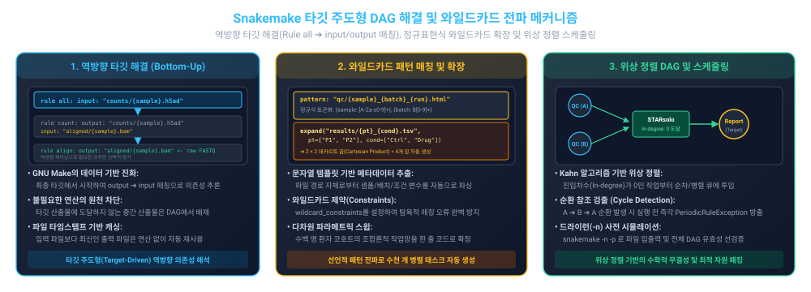

# 03. Snakemake 규칙 기반 실행 및 타깃 중심 DAG 아키텍처 (Snakemake Rule-Based Workflow Architecture)

---

## 학습 목표 (Cognitive Goals)

1. **타깃 중심(Target-driven) 역방향 의존성 해결 및 위상 정렬(Topological Sorting) 수학 모델 체계화**: GNU Make의 선언적 철학을 계승한 Snakemake가 사용자가 요구한 최종 출력 파일(Target)로부터 역방향(Bottom-up)으로 유향 비순환 그래프(DAG)를 탐색하고 사이클 검사 및 위상 정렬을 수행하는 전산학적 메커니즘을 규명한다.
2. **와일드카드(Wildcards) 패턴 매칭, 정규식 제약, `expand()` 집계 함수의 작동 원리 마스터**: 파일 경로 문자열 내 와일드카드 치환 규칙, 모호한 규칙 충돌(AmbiguousRuleException) 해결을 위한 `wildcard_constraints` 정규표현식 정의, 데카르트 곱 및 zip 결합 집계 패턴을 정복한다.
3. **자원 스케줄링(`threads`, `resources: mem_mb`), 벤치마킹(`benchmark`), 섀도 디렉토리(`shadow`) 격리 기법 구축**: 노드 리소스 포화 상태를 제어하는 동적 람다 자원 할당 기법과 멀티 프로세스 동시 쓰기 경쟁(Race Condition)을 방지하는 섀도 파일시스템 격리 메커니즘을 습득한다.
4. **Nextflow(데이터 스트림 중심 포워드 패스) vs. Snakemake(파일 타깃 중심 역방향 패스) 심층 패러다임 비교**: 두 대표 워크플로우 엔진의 계산 모델, 파일 추적 방식(Content Hash vs. mtime), 클라우드 이식성, 디버깅 편의성을 6대 핵심 축으로 다각도 비교 분석한다.

---

## 1. Snakemake 철학: 타깃 중심 선언적 DAG와 위상 정렬

Snakemake는 데이터 파이프라인을 절차적인 단계의 나열이 아니라, **"입력 파일(Input)을 출력 파일(Output)로 변환하는 선언적 규칙(Rule)들의 집합"**으로 정의한다.

Nextflow가 데이터가 소스에서 출발하여 싱크(Sink)로 흘러가는 '포워드 패스(Forward Reactive Stream)'라면, Snakemake는 사용자가 최종 결과물을 요청하면 그 결과물을 생성할 수 있는 규칙을 거꾸로 역추적하는 **'역방향 타깃 주도 패스(Backward Target-driven Pass)'** 방식을 취한다.

```
[Snakemake Target-driven Backward DAG Resolution]

1. User Request (Target): "results/multiqc_report.html"
           │
           ▼ Rule multiqc (Requires: "qc/{sample}_fastqc.zip")
2. Backward Dependency Search: Needs inputs for all samples
           │
           ▼ Rule fastqc (Requires: "data/fastq/{sample}.fq.gz")
3. Leaf Node Found: Raw FASTQ files exist on disk!
           │
4. Forward Execution via Topological Sort:
   [Raw FASTQ] ──► [Rule fastqc] ──► [Rule multiqc] ──► [Final Report]
```

### 1.1 그래프 이론 기반 DAG 구성 및 위상 정렬 (Topological Sorting)

Snakemake 파이프라인의 작업 실행 인스턴스(Job)들은 유향 그래프 $G = (V, E)$로 표현된다:
* 정점 집합 $V = \{j_1, j_2, \dots, j_N\}$: 구체화된(Instantiated) 개별 규칙 실행 작업.
* 유향 간선 집합 $E \subseteq V \times V$: 작업 간의 파일 의존 관계. 간선 $(u, v) \in E$는 작업 $u$의 출력 파일이 작업 $v$의 입력 파일로 요구됨을 의미한다.

#### 위상 정렬 알고리즘 (Kahn's Algorithm / DFS 기반)
엔진은 그래프 $G$에 순환 의존성(Cycle)이 존재하는지 검사한 후, 모든 간선 $(u, v) \in E$에 대해 작업 $u$가 항상 작업 $v$보다 먼저 실행되도록 선형 순서 $\pi$를 결정한다:

$$(u, v) \in E \implies \pi(u) < \pi(v)$$

진입 차수(In-degree)가 0인 리프 작업(Leaf Jobs, 원시 FASTQ를 소비하는 작업)들이 스케줄러의 실행 큐에 먼저 투입되며, 상위 작업이 성공적으로 출력 파일을 디스크에 기록하는 즉시 하위 작업의 진입 차수가 1씩 감소하여 0이 되는 순간 실행된다.

---

## 2. 와일드카드(Wildcards)와 동적 패턴 확장 메커니즘



Snakemake의 가장 강력한 추상화는 파일 이름의 일부분을 가변적인 변수로 치환하는 **와일드카드(Wildcards)** 메커니즘이다.

### 2.1 와일드카드 결정론과 정규식 제약 (`wildcard_constraints`)

규칙의 `output`에 중괄호 `{wildcard}`가 선언되면, Snakemake는 정규표현식 매칭을 통해 타깃 파일 이름으로부터 와일드카드 값을 역으로 추출(Extract)한다:

```snakemake
# 와일드카드 매칭 규칙 예시
rule starsolo_align:
    input:
        r1 = "data/fastq/{sample}_R1.fastq.gz",
        r2 = "data/fastq/{sample}_R2.fastq.gz"
    output:
        bam = "results/aligned/{sample}.Aligned.sortedByCoord.out.bam",
        counts = directory("results/aligned/{sample}_Solo.out")
    wildcard_constraints:
        sample = "[A-Za-z0-9_-]+"  # 언더스코어와 하이픈을 포함한 영숫자만 매칭
    shell:
        """
        STAR --readFilesIn {input.r2} {input.r1} \
             --outFileNamePrefix results/aligned/{wildcards.sample}_ \
             --outSAMtype BAM SortedByCoordinate
        """
```

* **모호한 규칙 충돌 (AmbiguousRuleException)**: 만약 두 개 이상의 규칙이 동일한 타깃 파일 패턴(예: `{sample}.bam`)을 출력할 수 있다면 Snakemake는 어떤 규칙을 선택해야 할지 알 수 없어 `AmbiguousRuleException`을 발생시킨다. 이를 방지하기 위해 `ruleorder: rule_a > rule_b` 지시어를 선언하거나 `wildcard_constraints`로 매칭 범위를 엄격히 제한해야 한다.

### 2.2 `expand()` 집계 함수와 조합 패턴

개별 샘플 단위로 분기된 연산을 단일 통합 리포트로 모으는 '수렴(Aggregation)' 단계에서는 `expand()` 헬퍼 함수를 사용한다:

```python
SAMPLES = ["PRAD_001", "PRAD_002", "PRAD_003"]
REPLICATES = ["rep1", "rep2"]

# 1. 데카르트 곱 (Cartesian Product Expansion): 총 3 × 2 = 6개 파일 생성
cartesian_files = expand("qc/{sample}_{rep}_fastqc.html", sample=SAMPLES, rep=REPLICATES)

# 2. 일대일 짝맞춤 (Zip Expansion): len(SAMPLES) == len(REPLICATES)일 때 동일 인덱스 결합
paired_files = expand("qc/{sample}_{rep}_fastqc.html", zip, sample=["S1", "S2"], rep=["R1", "R2"])
```

---

## 3. 자원 스케줄링, 벤치마킹 및 격리 실행 환경

### 3.1 동적 자원 스케줄링 (`threads`, `resources`)

Snakemake는 전체 시스템에 허용된 최대 코어 수(`--cores 64`)와 메모리(`--resources mem_mb=256000`) 한도 내에서 배낭 문제(Knapsack Problem) 휴리스틱을 사용하여 동시 실행 가능한 작업 조합을 동적으로 최적화한다:

```snakemake
rule scanpy_clustering:
    input:
        "results/aligned/{sample}_Solo.out"
    output:
        "results/scanpy/{sample}_processed.h5ad"
    threads: 16
    resources:
        mem_mb = lambda wildcards, attempt: attempt * 32000,  # 32GB -> 64GB 재시도 시 증설
        disk_mb = 50000
    benchmark:
        "benchmarks/scanpy/{sample}.benchmark.tsv"
    shadow:
        "minimal"  # 작업 전용 임시 디렉토리에서 격리 실행
    conda:
        "envs/scanpy_env.yaml"
    script:
        "scripts/run_clustering.py"
```

* **`benchmark` 지시어**: 작업 시작부터 종료까지의 벽시계 시간(Wall-clock time), CPU 사용자/시스템 시간, 최대 메모리 점유율(Max RSS), I/O 읽기/쓰기 바이트를 TSV 파일로 기록하여 파이프라인의 성능 병목을 프로파일링한다.
* **`shadow: "minimal"`**: 공유 디스크에서 작업 실행 시, 규칙 실행 전용의 고유한 임시 섀도 디렉토리(Symlink 기반)를 생성하여 작업을 수행한다. 중간 파일 충돌이나 불완전한 상태에서의 동시 접근을 방지하고 작업 성공 시에만 출력 파일을 대상 위치로 복사한다.

---

## 4. Nextflow vs. Snakemake 패러다임 심층 비교

엔터프라이즈 생물정보학에서 파이프라인 엔진을 선정할 때 고려해야 하는 Nextflow와 Snakemake의 핵심 차이는 다음과 같다:

| 평가 축 (Criteria) | Nextflow DSL2 | Snakemake |
| :--- | :--- | :--- |
| **패러다임 모델** | 데이터 주도형 리액티브 스트림 (Forward CSP) | 파일 타깃 주도형 선언적 규칙 (Backward DAG) |
| **기본 언어** | Groovy 기반 도메인 특화 언어 (DSL) | Python 3 확장 구문 (순수 파이썬 코드 혼용 가능) |
| **파일 조작 및 스테이징** | 고유한 임시 `work/` 디렉토리로 강제 심볼릭 링크 스테이징 | 파일시스템 상의 절대/상대 경로 기반 인플레이스(In-place) 조작 |
| **캐싱 및 재실행 메커니즘** | **작업 해시**(입력 파일 경로·크기·수정시각, 스크립트, 컨테이너 등) 기반 (`-resume`) | **파일 수정 시각(mtime)** 및 코드 변경 감지 (`--rerun-incomplete`) |
| **클라우드 네이티브 지원** | AWS Batch, GCP Batch, Fusion VFS 일급 객체 지원 | v8 이후 실행기는 플러그인 방식(`--executor slurm`, `kubernetes` 등; 내장은 local/dryrun/touch), 구 `--cluster` 옵션은 제거됨 |
| **파이썬 데이터 과학 연동** | 스크립트 블록 내 외부 프로세스로 분리 실행 | 규칙 내 `run:` 또는 `script:` 지시어로 파이썬 객체 직접 전달 |
| **커뮤니티 생태계** | **nf-core** 중심의 고도화된 글로벌 모듈 표준화 | **Snakemake Wrappers** 기반의 개별 도구 래퍼 생태계 |

### 4.1 Snakemake v8+ 실행 방식 (HPC·클라우드)
Snakemake 8부터 클러스터/클라우드 실행은 `--cluster` 대신 **실행기 플러그인**으로 이루어진다. 예: `pip install snakemake-executor-plugin-slurm` 후 `snakemake --executor slurm --jobs 100` 또는 프로파일(`--profile`)의 `executor: slurm`. Snakemake 9.27.0에서 `--cluster sbatch`를 지정하면 `unrecognized arguments: --cluster` 오류가 나고, 내장 실행기는 `local`, `dryrun`, `touch`뿐임을 확인했다. SLURM 설정은 04장에서 Nextflow와 비교하며 다룬다.

---

## 5. 프로덕션급 Snakefile 구현: 전립선암 snRNA-seq 처리 파이프라인

다음은 전립선암 임상 검체 100건을 대상으로 FASTQ 품질 관리, STARsolo 정렬, 그리고 Scanpy 단일세포 전처리까지 수행하는 완전한 프로덕션급 `Snakefile`이다.

```snakemake
# tracks/10_production_pipelines_mlops/workflow/Snakefile
import os
import pandas as pd

# 1. 샘플 메타데이터 로드
METADATA_FILE = config.get("samplesheet", "config/samples.tsv")
samples_df = pd.read_csv(METADATA_FILE, sep="\t").set_index("sample_id", drop=False)
SAMPLES = samples_df["sample_id"].tolist()

GENOME_DIR = config["genome_dir"]
WHITELIST = config["whitelist"]

# 2. 최종 타깃 정의 (최상위 수렴 규칙)
rule all:
    input:
        "results/reports/multiqc_report.html",
        expand("results/scanpy/{sample}_filtered.h5ad", sample=SAMPLES)

# 3. FASTQ 품질 관리 규칙
rule fastqc:
    input:
        r1 = "data/fastq/{sample}_R1.fastq.gz",
        r2 = "data/fastq/{sample}_R2.fastq.gz"
    output:
        html1 = "results/qc/{sample}_R1_fastqc.html",
        zip1  = "results/qc/{sample}_R1_fastqc.zip",
        html2 = "results/qc/{sample}_R2_fastqc.html",
        zip2  = "results/qc/{sample}_R2_fastqc.zip"
    threads: 4
    resources:
        mem_mb = 8000
    conda:
        "../envs/qc.yaml"
    shell:
        """
        fastqc -t {threads} -o results/qc/ {input.r1} {input.r2}
        """

# 4. STARsolo 단일핵 전사체 정렬 및 UMI 카운팅
rule starsolo_align:
    input:
        r1 = "data/fastq/{sample}_R1.fastq.gz",
        r2 = "data/fastq/{sample}_R2.fastq.gz",
        index = GENOME_DIR,
        whitelist = WHITELIST
    output:
        bam = protected("results/aligned/{sample}.Aligned.sortedByCoord.out.bam"),
        matrix_dir = directory("results/aligned/{sample}_Solo.out/GeneFull/filtered"),
        summary = "results/aligned/{sample}_Solo.out/GeneFull/Summary.csv"
    threads: 16
    resources:
        mem_mb = lambda wildcards, attempt: attempt * 40000
    benchmark:
        "benchmarks/starsolo/{sample}.tsv"
    shadow:
        "minimal"
    conda:
        "../envs/align.yaml"
    shell:
        """
        STAR \
            --genomeDir {input.index} \
            --readFilesIn {input.r2} {input.r1} \
            --readFilesCommand zcat \
            --runThreadN {threads} \
            --soloType CB_UMI_Simple \
            --soloCBwhitelist {input.whitelist} \
            --soloFeatures GeneFull \
            --outSAMtype BAM SortedByCoordinate \
            --outFileNamePrefix results/aligned/{wildcards.sample}_
        """

# 5. Scanpy 단일핵 품질 필터링 및 H5AD 변환
rule scanpy_qc_filter:
    input:
        matrix_dir = "results/aligned/{sample}_Solo.out/GeneFull/filtered"
    output:
        h5ad = "results/scanpy/{sample}_filtered.h5ad"
    threads: 4
    resources:
        mem_mb = 16000
    conda:
        "../envs/scanpy.yaml"
    script:
        "../scripts/scanpy_qc.py"

# 6. MultiQC 통합 품질 리포트 생성
rule multiqc_report:
    input:
        expand("results/qc/{sample}_R1_fastqc.zip", sample=SAMPLES),
        expand("results/aligned/{sample}_Solo.out/GeneFull/Summary.csv", sample=SAMPLES)
    output:
        report = "results/reports/multiqc_report.html"
    threads: 2
    resources:
        mem_mb = 4000
    conda:
        "../envs/qc.yaml"
    shell:
        """
        multiqc results/ -o results/reports/ -f -n multiqc_report.html
        """
```

---

## 단원 핵심 점검 (Cognitive Checkpoint & Case Study)

### 문제 1: 와일드카드 모호성(AmbiguousRuleException) 충돌과 제약식 해결
한 생물정보학자가 BAM 파일로부터 미토콘드리아 전사체 정량을 수행하기 위해 다음과 같은 두 개의 규칙을 작성하였다:
```snakemake
rule filter_nuclear:
    input: "aligned/{sample}.bam"
    output: "filtered/{sample}_nuclear.bam"
    # ...

rule filter_custom:
    input: "aligned/{sample}.bam"
    output: "filtered/{sample}_{filter_type}.bam"
    # ...
```
이후 `snakemake filtered/PRAD_001_nuclear.bam`을 실행하자 `AmbiguousRuleException`이 발생하며 워크플로우 컴파일이 즉시 중단되었다.
1. Snakemake의 패턴 매칭 알고리즘 관점에서 왜 두 규칙 사이에 모호성 충돌이 발생하는지 수학적 패턴 공간의 관점에서 설명하시오.
2. 이 충돌을 해결하기 위해 적용할 수 있는 두 가지 전산학적 해결 방안(`wildcard_constraints` 및 `ruleorder`)을 구체적인 코드로 제시하시오.

<details>
<summary>💡 모범 답안 및 해설 확인</summary>

**1. 모호성 충돌의 원인 분석**:
* 타깃 파일 문자열은 `filtered/PRAD_001_nuclear.bam`이다.
* `rule filter_nuclear`는 패턴 `filtered/{sample}_nuclear.bam`을 가지므로 `{sample} = 'PRAD_001'`로 고유하게 매칭된다.
* 그러나 `rule filter_custom`은 패턴 `filtered/{sample}_{filter_type}.bam`을 가지며, 기본 와일드카드 매칭 규칙(`.*`)에 따라:
  * `{sample} = 'PRAD'`, `{filter_type} = '001_nuclear'`
  * `{sample} = 'PRAD_001'`, `{filter_type} = 'nuclear'`
  등 복수의 유효한 매칭 분할(Partition)이 존재할 뿐만 아니라, 두 규칙 모두 동일한 타깃 파일을 생성할 수 있는 후보로 등록된다.
* Snakemake는 어떤 규칙을 실행해야 할지 결정론적으로 판단할 수 없으므로(Non-deterministic Ambiguity), 안전을 위해 `AmbiguousRuleException`을 던지고 실행을 중단한다.

**2. 해결 방안 (2가지)**:
* **해결책 A: 정규식 제약(`wildcard_constraints`)을 통한 패턴 분리**:
  `filter_type` 와일드카드가 `nuclear`라는 단어를 포함하지 못하도록 부정 선행형(Negative Lookahead) 정규식을 부여하거나, 허용된 특정 키워드만 매칭하도록 제약한다:
  ```snakemake
  rule filter_custom:
      input: "aligned/{sample}.bam"
      output: "filtered/{sample}_{filter_type}.bam"
      wildcard_constraints:
          filter_type = "(?!nuclear)[a-z]+"  # 'nuclear'를 제외한 소문자 문자열만 허용
  ```
* **해결책 B: `ruleorder` 지시어로 명시적 우선순위 부여**:
  동일한 파일이 매칭될 경우 더 구체적인 규칙을 우선하도록 선언한다:
  ```snakemake
  ruleorder: filter_nuclear > filter_custom
  ```

</details>

---

### 문제 2: 분산 파일시스템(NFS/Lustre) 타임스탬프 왜곡(mtime skew)과 불필요한 재실행 이슈
수백 대의 노드로 구성된 HPC 클러스터에서 Snakemake 파이프라인을 구동하던 중, 이전 실행에서 완벽하게 완료된 중간 BAM 파일들이 존재함에도 불구하고 Snakemake가 이전 단계를 다시 실행하는 현상이 발생하였다. 원인을 조사한 결과, 계산 노드 $A$와 스토리지 서버 간의 NTP(Network Time Protocol) 동기화 오류로 인해 노드 $A$의 시스템 시계가 5초 느리게 설정되어 있었다.
1. Snakemake의 기본 의존성 판단 메커니즘인 파일 수정 시각(`mtime`, Modification Time) 평가 공식 관점에서 이 비정상 재실행의 발생 원리를 분석하시오.
2. Nextflow의 작업 해시(Task Hash) 캐싱 방식과 비교하여, Snakemake에서 이러한 파일시스템 타임스탬프 왜곡을 무시하고 불필요한 재실행을 방지하기 위한 CLI 플래그 옵션을 제시하시오.

<details>
<summary>💡 모범 답안 및 해설 확인</summary>

**1. `mtime` 타임스탬프 왜곡 메커니즘**:
* Snakemake는 규칙 $R$의 실행 여부를 다음 조건으로 판단한다:
  $$\text{Rerun Rule } R \iff \exists \text{input } i, \exists \text{output } o \text{ such that } \text{mtime}(i) > \text{mtime}(o)$$
  즉, 입력 파일의 수정 시각이 출력 파일의 수정 시각보다 최신이면 입력 데이터가 변경된 것으로 간주하고 규칙을 재실행한다.
* 시계가 5초 느린 노드 $A$에서 상위 규칙(예: FastQC)의 출력을 디스크에 기록하면, 해당 파일의 `mtime`은 과거 시간 $t - 5$초로 타임스탬프가 찍힌다.
* 반면 이전 단계의 입력 파일이 정상 시계 노드에서 $t$ 시점에 기록되었다면, $\text{mtime}(\text{input}) > \text{mtime}(\text{output})$ 조건이 성립하여 Snakemake는 출력 파일이 이미 존재함에도 불구하고 입력보다 오래된 '오염된 아티팩트'로 판정하여 재실행을 유발한다.

**2. 해결 방안 및 비교**:
* **Nextflow의 방식**: Nextflow 기본 캐시(`cache true`)는 입력 파일의 경로(이름)·크기·최종 수정 시각을 작업 해시에 포함하므로 마찬가지로 mtime 왜곡의 영향을 받는다. 공식 문서는 NFS 같은 공유 파일시스템의 타임스탬프 불일치에는 `cache 'lenient'`(이름·크기만 사용)를, 내용 기준 비교에는 `cache 'deep'`(파일 내용 포함)을 사용하라고 안내한다.
* **Snakemake 해결 CLI 옵션**:
  * `--latency-wait 60`: 분산 파일시스템(NFS/Lustre)의 메타데이터 동기화 지연을 감안하여 파일 생성 후 최대 60초간 대기.
  * `--rerun-triggers code input params software-env`: 재실행 트리거에서 `mtime`을 제외하여 타임스탬프 왜곡에 둔감하게 하고 코드·입력·파라미터·소프트웨어 환경 변화에만 반응(유효 트리거: `code, input, mtime, params, software-env`).
  * 또는 과거 타임스탬프로 인한 강제 재실행을 방지하기 위해 파일 터치(`snakemake --touch`)를 적용하여 기존 산출물의 `mtime`을 최신으로 원자적 갱신한다.

</details>

---

### 문제 3: 대용량 단일세포 파이프라인의 디스크 공간 고갈과 `temp()` vs. `protected()` 수명 주기 제어
100개 샘플의 전립선암 snRNA-seq 파이프라인을 실행하는 과정에서, 중간 단계 산출물인 정렬 전 비압축 FASTQ, 필터링 전 미정렬 BAM, 정렬된 정렬 BAM, 그리고 최종 단일핵 카운트 행렬(H5AD)이 모두 디스크에 영구 저장되어 (가상 시나리오의 수치 예시) 총 40 TB의 스토리지 할당량을 초과(Disk Quota Exceeded)하고 파이프라인이 중단되었다.
1. 최종 분석 및 임상 보고서 생성에 필요한 파일은 오직 유전체 좌표 정렬된 최종 BAM 파일과 필터링된 H5AD 행렬뿐이다. Snakemake의 **`temp()`** 함수를 활용하여 중간 파일들을 하위 규칙 소비 즉시 자동으로 디스크에서 안전하게 소거하는 수명 주기(Lifecycle) 전략을 설계하시오.
2. 실수로 인한 핵심 임상 결과물 삭제를 방지하기 위해 **`protected()`** 지시어를 적용하는 원리와 파일시스템 권한(Read-only `chmod 444`) 변환 메커니즘을 설명하시오.

<details>
<summary>💡 모범 답안 및 해설 확인</summary>

**1. `temp()`를 활용한 자동 임시 파일 수명 주기 제어**:
* 중간 과정에서만 일시적으로 필요하고 후속 규칙에 의해 소비된 후에는 보관할 가치가 없는 파일(예: 트리밍된 중간 FASTQ, 좌표 정렬 전 원시 SAM/BAM)을 `temp()`로 선언한다:
  ```snakemake
  rule trim_reads:
      input: "raw/{sample}.fq.gz"
      output: temp("trimmed/{sample}_trimmed.fq.gz") # temp()는 이 파일을 '생성하는' 규칙의 output에 지정
      shell: "fastp -i {input} -o {output} ..."

  rule align_starsolo:
      input: 
          r = "trimmed/{sample}_trimmed.fq.gz"   # 소비 규칙의 input에는 일반 경로로 적는다
      output:
          bam = "aligned/{sample}.bam"
      shell: "STAR --readFilesIn {input.r} ..."
  ```
* **동작 원리**: Snakemake는 DAG 상에서 `temp()`로 표시된 파일의 모든 다운스트림 소비자 작업(여기서는 `align_starsolo`)이 성공적으로 종료 코드 0으로 완료되는 즉시, 해당 임시 파일(`trimmed/{sample}_trimmed.fq.gz`)을 디스크에서 자동 삭제(`unlink`)한다. 이를 통해 중간 파일 누적으로 인한 40TB의 디스크 점유율을 10TB 미만으로 압축할 수 있다.

**2. `protected()`를 활용한 핵심 임상 아티팩트 보호 메커니즘**:
* 재생산 비용이 매우 높거나 규정상 영구 보존해야 하는 최종 결과물(예: 좌표 정렬된 최종 BAM)은 `protected()`로 선언한다:
  ```snakemake
  rule align_starsolo:
      output:
          bam = protected("aligned/{sample}.Aligned.sortedByCoord.out.bam")
  ```
* **동작 원리**: 파일이 생성된 직후 Snakemake는 파일시스템 시스템 콜을 통해 해당 파일의 쓰기 권한을 박탈하여 읽기 전용 상태(`chmod 0444` 또는 `chmod a-w`)로 잠근다. 향후 파이프라인이 재실행되거나 실수로 상위 규칙이 재트리거되더라도 Snakemake가 보호된 파일을 덮어쓰지 않고 오류를 낸다. 다만 `protected`는 파일의 쓰기 권한만 제거할 뿐이며, POSIX에서는 상위 디렉터리에 쓰기 권한이 있으면 읽기 전용 파일도 삭제할 수 있으므로 의도치 않은 삭제를 "원천 방지"하지는 못한다(디렉터리 권한·백업·객체 스토리지 버전 관리가 필요).

</details>

---

<!-- REFERENCES:BEGIN (generated by scripts/apply_references.py; do not edit by hand) -->
## 참고문헌 (References)
### 소프트웨어 (표기 버전은 검수 시 API를 확인한 버전이며, 파이프라인 실행 환경은 requirements-pipelines.txt 참조)
- Snakemake 9.27.0 (github.com/snakemake/snakemake). 원 논문: Mölder F, Jablonski KP, Letcher B, et al. Sustainable data analysis with Snakemake. *F1000Res*. 2021;10:33. PMID: 34035898. doi: 10.12688/f1000research.29032.3
- STAR 2.7.11 (github.com/alexdobin/STAR). 원 논문: Dobin A, Davis CA, Schlesinger F, et al. STAR: ultrafast universal RNA-seq aligner. *Bioinformatics*. 2013;29(1):15-21. PMID: 23104886. doi: 10.1093/bioinformatics/bts635
- FastQC (github.com/s-andrews/FastQC).
- MultiQC (github.com/MultiQC/MultiQC). 원 논문: Ewels P, Magnusson M, Lundin S, et al. MultiQC: summarize analysis results for multiple tools and samples in a single report. *Bioinformatics*. 2016;32(19):3047-8. PMID: 27312411. doi: 10.1093/bioinformatics/btw354
- conda (docs.conda.io).
- Scanpy 1.12.4 (github.com/scverse/scanpy). 원 논문: Wolf FA, Angerer P, Theis FJ. SCANPY: large-scale single-cell gene expression data analysis. *Genome Biol*. 2018;19(1):15. PMID: 29409532. doi: 10.1186/s13059-017-1382-0
- pandas 2.3.3 (github.com/pandas-dev/pandas). 원 논문: McKinney W. Data Structures for Statistical Computing in Python. *Proceedings of the Python in Science Conference*. 2010:56-61. doi: 10.25080/majora-92bf1922-00a
<!-- REFERENCES:END -->
