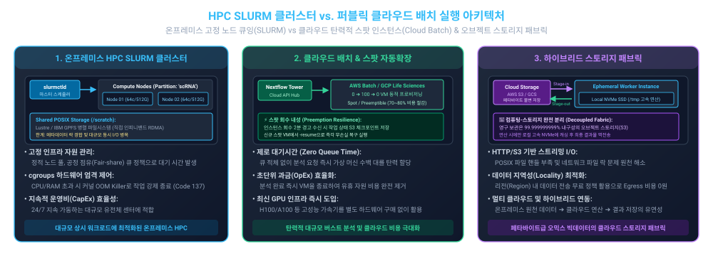

# 04. HPC SLURM 클러스터 및 퍼블릭 클라우드 분산 오케스트레이션 (HPC SLURM & Cloud Batch Orchestration)

---

## 학습 목표 (Cognitive Goals)

1. **SLURM(Simple Linux Utility for Resource Management) 워크로드 매니저의 작업 스케줄링 및 회계 아키텍처 규명**: `slurmctld`, `slurmd`, `slurmdbd` 간의 분산 통신 모델, 다요소 우선순위(Multifactor Priority) 및 페어셰어(Fair-Share) 수학적 수식, 백필(Backfill) 스케줄링 휴리스틱을 분석한다.
2. **Nextflow의 SLURM 연동 및 cgroup 메모리 초과(OOM) 동적 지수 백오프 전략 구축**: HPC 배치 큐에서 태스크의 리소스 요구량을 프로파일링하고, 런타임 실패 시 자원을 동적으로 2배씩 증설하여 자동 재제출하는 자가 치유(Self-healing) 아키텍처를 구현한다.
3. **퍼블릭 클라우드 배치 연산(AWS Batch / Google Cloud Batch) 및 스팟 인스턴스(Spot Instance) 최적화 설계**: 컨테이너화된 유전체 파이프라인을 온디맨드 대비 최대 90%까지 저렴한(AWS 공개 상한; 실제 할인율은 인스턴스·리전·시점에 따라 다름) 스팟 인스턴스 풀에서 구동하며, 클라우드 인터럽트(Spot Reclamation) 발생 시 무중단 복구 오케스트레이션을 설계한다.
4. **Fusion 가상 파일시스템(VFS)과 S3 스트리밍 원리 이해**: 클라우드 바이오 파이프라인의 최대 병목인 로컬 EBS 블록 디스크 스테이징(Staging) I/O 오버헤드를 줄이고 오브젝트 스토리지로부터 필요한 바이트 블록 위주로 읽는 분산 I/O 아키텍처를 수립한다(단, Fusion도 컨테이너 로컬 임시 디렉터리를 캐시·스크래치로 사용한다).

---

## 1. SLURM 워크로드 매니저 아키텍처와 작업 제출 메커니즘

대규모 유전체 분석을 수행하는 거의 모든 연구소 및 대학의 온프레미스 HPC는 **SLURM(Simple Linux Utility for Resource Management)**을 중앙 자원 관리자로 채택하고 있다.

```
┌────────────────────────────────────────────────────────┐
│ [Management Node: slurmctld (Central Controller)]      │
│  - 파티션 및 큐 관리 (Queue & Partition Policy)       │
│  - 다요소 우선순위 계산 (Multifactor Priority Engine)  │
│  - 백필 스케줄러 (Backfill Scheduler)                  │
├──────────────────────────┬─────────────────────────────┤
│                          │ slurmdbd (MySQL Accounting) │
│                          └─────────────────────────────┘
│ RPC via MUNGE Authentication
▼
┌────────────────────────────────────────────────────────┐
│ [Compute Nodes: slurmd (Execution Daemon)]             │
│  - Linux cgroups v1/v2 Enforcer (task/cgroup)          │
│  - Step launch, Task Affinity, GPU Passthrough         │
│  - Slurm Workdir Spooling                              │
└────────────────────────────────────────────────────────┘
```

### 1.1 다요소 우선순위(Multifactor Priority)와 페어셰어(Fair-Share) 알고리즘

SLURM은 제출된 작업들의 대기 순서를 단순한 선착순(FIFO)이 아니라, 복합적인 수학적 가중치 합으로 계산하여 큐에서의 우선순위 $P_{\text{job}}$를 산출한다:

$$P_{\text{job}} = W_{\text{age}} A + W_{\text{fairshare}} F + W_{\text{jobsize}} S + W_{\text{partition}} P + W_{\text{qos}} Q$$

여기서 가장 결정적인 변수는 **페어셰어 인자 $F$ (Fair-Share Factor)**이다:
* 연구 그룹이나 연구원이 과거 일정 기간(예: 최근 7일) 동안 소모한 CPU 시간 및 메모리 자원량이 사전에 할당된 지분(Target Share)보다 많을 경우 $F \to 0$으로 급감하여 새 작업의 우선순위가 뒤로 밀린다.
* 반면 최근 자원을 거의 쓰지 않은 사용자의 작업은 $F \to 1$로 극대화되어 큐의 최상단으로 신속히 진입한다.

### 1.2 표준 배치 스크립트(`sbatch`)와 대규모 작업 배열(Job Arrays)

수백 명의 전립선암 환자 FASTQ 파일을 처리할 때, 개별 샘플마다 독립적인 `sbatch` 명령을 100회 실행하면 스케줄러 메타데이터 서버에 불필요한 RPC 부하가 발생한다. 대신 **SLURM Job Array**를 사용하여 단일 마스터 작업으로 일괄 제출한다:

```bash
#!/bin/bash
#SBATCH --job-name=snrna_starsolo_array
#SBATCH --partition=compute_highmem
#SBATCH --nodes=1
#SBATCH --ntasks=1
#SBATCH --cpus-per-task=16
#SBATCH --mem=64G
#SBATCH --time=08:00:00
#SBATCH --output=logs/slurm_%A_%a.out
#SBATCH --error=logs/slurm_%A_%a.err
#SBATCH --array=1-100%10   # 100개 샘플을 최대 10개씩 동시 병렬 실행 (Throttling)

set -euo pipefail

# 샘플 시트에서 해당 인덱스의 샘플 ID 추출
SAMPLE_SHEET="config/samples.tsv"
SAMPLE_ID=$(sed -n "$((SLURM_ARRAY_TASK_ID + 1))p" ${SAMPLE_SHEET} | cut -f1)

echo "Executing Task ${SLURM_ARRAY_TASK_ID} for Sample: ${SAMPLE_ID} on $(hostname)"

# Singularity 컨테이너를 통한 STARsolo 정렬 실행
apptainer exec \
    --bind /scratch/project_crpc:/data \
    containers/snrna_pipeline.sif \
    STAR --genomeDir /data/reference/GRCh38 \
         --readFilesIn /data/fastq/${SAMPLE_ID}_R2.fq.gz /data/fastq/${SAMPLE_ID}_R1.fq.gz \
         --readFilesCommand zcat \
         --runThreadN ${SLURM_CPUS_PER_TASK} \
         --soloType CB_UMI_Simple \
         --outFileNamePrefix /data/results/${SAMPLE_ID}_
```

---

## 2. Nextflow의 SLURM 오케스트레이션 및 동적 리소스 복구

수동으로 `sbatch` 스크립트를 작성하고 종속성 플래그(`--dependency=afterok:jobid`)를 설정하는 대신, Nextflow는 자체 **SLURM 네이티브 익스큐터(Native SLURM Executor)**를 통해 워크플로우의 모든 프로세스를 자동으로 SLURM 작업으로 래핑하여 제출한다.

```
[Nextflow Master Node (Head Job)]
   │
   ├─► sbatch (STARsolo Task: Sample 1) ────► [HPC Node 01]
   ├─► sbatch (STARsolo Task: Sample 2) ────► [HPC Node 02]
   │       ▲ (Exit 137: OOM Killer 감지!)
   │       │
   │       └─► sbatch (Retry Task: Memory × 2) ──► [HPC HighMem Node 05]
   │
   └─► sbatch (Scanpy Task: Sample 1)   ────► [HPC Node 03]
```

### 2.1 SLURM 프로세스 디렉티브 및 동적 자원 복구 메커니즘

Nextflow 파이프라인에서 샘플의 크기에 따라 필요한 메모리가 상이할 때, 고정된 자원을 설정하면 작은 샘플은 자원을 낭비하고 큰 샘플은 OOM으로 실패한다. **지수 백오프(Exponential Backoff)**를 적용한 동적 리소스 디렉티브를 구성한다:

```groovy
// nextflow.config
process {
    executor = 'slurm'
    queue    = 'normal'
    clusterOptions = '--account=lab_genomics --qos=regular'

    // 실패 원인 평가: 137 (OOM), 140 (Node Fail), 143 (Walltime exceeded)
    errorStrategy = { task.exitStatus in [137, 140, 143] ? 'retry' : 'finish' }
    maxRetries    = 3

    // 클러스터 최대 자원 상한 (Nextflow 24.04+의 resourceLimits: 재시도로 증가한 요청을 이 값으로 자동 제한;
    // 이전 버전/nf-core 템플릿은 별도로 정의한 check_max() 함수를 사용)
    resourceLimits = [ cpus: 64, memory: 256.GB, time: 48.h ]

    // 재시도 횟수(task.attempt)에 비례한 동적 자원 확장
    cpus   = { 8 * task.attempt }
    memory = { 16.GB * task.attempt }
    time   = { 2.h * task.attempt }

    withName: 'STARSOLO' {
        queue  = { task.attempt > 1 ? 'highmem' : 'normal' }
        memory = { 32.GB * Math.pow(2, task.attempt - 1) }
    }
}
```

* **동작 원리**: 1회차 실행 시 32GB 메모리와 일반 파티션(`normal`)으로 제출된다. 만약 리눅스 커널 cgroups에 의해 32GB 제한을 초과하여 프로세스가 `SIGKILL (137)`을 수신하면, Nextflow는 실패를 즉시 인지하고 2회차 시도에서 대용량 메모리 파티션(`highmem`)으로 변경함과 동시에 $32 \times 2^1 = 64\,\text{GB}$를 요청하는 새 SLURM 작업을 자동 디스패치한다.

---

## 3. 퍼블릭 클라우드 배치 연산: AWS Batch & Google Cloud Batch



온프레미스 HPC의 용량이 포화 상태이거나 급박한 임상 진단 기한을 준수해야 할 때, 파이프라인을 퍼블릭 클라우드(AWS Batch, Google Cloud Batch)로 즉각 버스트(Burst)하여 수천 개의 CPU 코어를 수평 확장할 수 있다.

### 3.1 클라우드 배치 3대 구성 요소

1. **컴퓨트 환경 (Compute Environment)**:
   작업 부하에 따라 EC2 인스턴스(예: `c6i.4xlarge`, `r6i.8xlarge`)를 0개에서 최대 수백 대까지 자동으로 프로비저닝(Auto-scaling)하고 유휴 시 0대로 축소하는 관리형 인프라 클러스터.
2. **작업 큐 (Job Queue)**:
   제출된 파이프라인 태스크들이 대기하는 FIFO 큐. 스팟 인스턴스 환경을 우선순위 1위로, 온디맨드 인스턴스 환경을 폴백(Fallback) 2위로 연결한다.
3. **작업 정의 (Job Definition)**:
   실행할 OCI 컨테이너 이미지 URI, vCPU/메모리 사양, IAM 역할, 볼륨 마운트 정책을 정의하는 템플릿.

### 3.2 스팟 인스턴스(Spot Instance) 인터럽트와 결함 허용(Fault-Tolerance) 전략

클라우드 벤더의 유휴 연산 자원을 시장가로 사용하는 스팟 인스턴스(과거의 입찰/경매 방식은 AWS에서 더 이상 사용하지 않음)는 온디맨드 대비 **최대 90% 할인**(AWS 공개 상한; 실제 할인율은 시점·인스턴스별로 크게 다르며 Spot Instance Advisor에서 확인)을 제공하지만, 클라우드 수요 급증 시 **2분 사전 경고(Two-minute Warning)** 후 인스턴스가 강제 회수(Reclamation)된다.

스팟 회수로 실패한 태스크는 스케줄러 수준의 재시도로 복구한다. Nextflow의 AWS Batch executor는 `aws.batch.maxSpotAttempts`(22.04.0부터 지원), Google Batch는 `google.batch.maxSpotAttempts` 옵션으로 스팟 회수 시 Batch 서비스가 자동 재시도하는 횟수를 지정한다(공식 문서 기준 v24.04: AWS 기본값 5, 24.08.0-edge부터 0). 스팟 회수 시 컨테이너 종료 코드는 진단용으로 보장되지 않으므로 특정 종료 코드(예: 143)를 스팟 회수의 판별 기준으로 삼지 않는다. 온디맨드 큐로의 전환은 자동 기능이 아니라, 아래 문제 2처럼 `task.attempt`에 따라 큐를 바꾸는 사용자 설정이다.

---

## 4. Nextflow Fusion VFS 및 클라우드 제로 카피 스트리밍

전통적인 클라우드 바이오 파이프라인의 최대 병목은 연산 속도가 아니라 **스토리지 I/O 및 데이터 복사 지연(Data Transfer Latency)**이었다.

```
[전통적 클라우드 스테이징 (Legacy Disk Staging)]
Amazon S3 ──(50GB 다운로드: 5분 소요)──► Local EBS Disk ──► STAR 정렬 ──► Local EBS Disk ──(BAM 업로드: 3분 소요)──► Amazon S3
▲ 거대한 EBS 볼륨 프로비저닝 비용 발생, 느린 디스크 복사 대기!

[Nextflow Fusion VFS 제로 카피 스트리밍 (Nextflow Fusion VFS)]
Amazon S3 ════════════════════ (FUSE POSIX Block Streaming) ════════════════════► STAR 정렬 (Direct Memory Stream)
▲ 로컬 EBS 디스크 복사 제로! 필요한 유전체 블록만 온디맨드 스트리밍!
```

### 4.1 Fusion 가상 파일시스템(VFS)의 작동 원리

**Fusion VFS**는 Seqera Labs에서 개발한 FUSE(Filesystem in Userspace) 기반 가상 파일시스템이다:
1. **POSIX 호환 오브젝트 스토리지 직접 접근**: S3 또는 Google Cloud Storage 버킷의 파일을 별도의 다운로드 명령 없이 일반 리눅스 로컬 파일 경로(`/fusion/s3/my-bucket/data.fastq.gz`)처럼 직접 연다.
2. **지연 로딩(Lazy Loading) 및 바이트 범위 읽기**: 100GB 크기의 BAM 파일에서 특정 유전자 영역의 리드만 읽고자 할 때, 전체 파일을 다운로드하지 않고 HTTP `Range: bytes=X-Y` 헤더를 통해 해당 인덱스 블록과 데이터 청크만을 메모리로 직접 스트리밍한다.
3. **로컬 스토리지 요구량의 변화(0이 아님)**: Fusion은 객체 스토리지와의 병렬 전송을 위해 컨테이너 로컬 임시 디렉터리(`/tmp`)를 사용하며, Seqera 문서는 AWS에서 고처리량 NVMe 인스턴스 스토리지를 권장하고 소규모 워크로드에는 고처리량 EBS gp3(예: 325 MiB/s 이상)를 대안으로 제시한다. 이 스크래치 공간은 한 인스턴스에서 동시에 도는 모든 태스크가 공유하므로 동시 태스크가 많으면 충분한 용량이 필요하다. 따라서 "로컬 스토리지 불필요"가 아니라 "전체 입력 스테이징 대신 필요한 크기의 고속 로컬 캐시를 사용"으로 이해해야 한다.

#### 전산 지연 시간 수학적 정량화
전체 데이터 크기를 $D_{\text{total}}$, 실제 알고리즘이 소비하는 유효 데이터 크기를 $D_{\text{read}}$, 네트워크 대역폭을 $B_{\text{net}}$, 로컬 디스크 쓰기/읽기 대역폭을 $B_{\text{disk}}$라 할 때, 전통적 방식과 Fusion 방식의 I/O 소요 시간은 다음과 같이 대조된다:

$$T_{\text{legacy}} = \frac{D_{\text{total}}}{B_{\text{net}}} + \frac{D_{\text{total}}}{B_{\text{disk\_write}}} + \frac{D_{\text{read}}}{B_{\text{disk\_read}}} + \frac{D_{\text{out}}}{B_{\text{disk\_write}}} + \frac{D_{\text{out}}}{B_{\text{net}}}$$

$$T_{\text{fusion}} = \frac{D_{\text{read}}}{B_{\text{net}}} + \frac{D_{\text{out}}}{B_{\text{net}}}$$

특히 대규모 BAM의 특정 영역만 쿼리하는 경우 $D_{\text{read}} \ll D_{\text{total}}$이 성립하므로 이 단순 모델에서는 I/O 시간이 크게 줄어든다(위 식은 로컬 캐시 비용과 요청 지연을 무시한 이상화 모델이며, 실제 배수는 워크로드·캐시 구성에 따라 다르다).

---

## 5. 하이브리드 인프라 배포 실전 가이드 (`nextflow.config`)

엔터프라이즈 환경에서는 동일한 파이프라인 코드를 코드 수정 없이 다양한 컴퓨팅 백엔드(로컬 개발 머신, 원내 HPC SLURM, AWS Batch 클라우드)에서 실행할 수 있도록 프로파일(Profile)을 완벽하게 분리해야 한다.

```groovy
// nextflow.config
params {
    outdir       = "results"
    tracedir     = "${params.outdir}/pipeline_info"
    max_memory   = 256.GB
    max_cpus     = 64
    max_time     = 24.h
}

// 1. 실행 프로파일 정의
profiles {
    // A. 로컬 워크스테이션 프로파일
    standard {
        process.executor = 'local'
        docker.enabled   = true
        docker.runOptions = '-u $(id -u):$(id -g)'
    }

    // B. 온프레미스 HPC SLURM 클러스터 프로파일
    hpc_slurm {
        process {
            executor        = 'slurm'
            queue           = 'batch'
            clusterOptions  = '--account=precision_oncology'
            errorStrategy   = { task.exitStatus in [137, 140, 143] ? 'retry' : 'finish' }
            maxRetries      = 3
        }
        singularity.enabled    = true
        singularity.autoMounts = true
        singularity.cacheDir   = "/scratch/shared/singularity_cache"
    }

    // C. AWS Batch 및 Fusion VFS 클라우드 네이티브 프로파일
    aws_batch {
        process {
            executor       = 'awsbatch'
            queue          = 'arn:aws:batch:us-east-1:123456789012:job-queue/spot-queue'
            errorStrategy  = { task.exitStatus in [137, 143] ? 'retry' : 'finish' }
            maxRetries     = 3
        }
        aws {
            region = 'us-east-1'
            batch {
                cliPath = '/usr/local/bin/aws'
            }
        }
        workDir = 's3://my-clinical-genomics-bucket/work'
        fusion {
            enabled = true
            exportStorageCredentials = true
        }
        wave {
            enabled = true // Fusion 클라이언트를 OCI 컨테이너 레이어에 자동 주입
        }
    }
}

// 2. 런타임 보고서 및 메트릭 추적 활성화
timeline {
    enabled = true
    file    = "${params.tracedir}/execution_timeline.html"
}
report {
    enabled = true
    file    = "${params.tracedir}/execution_report.html"
}
trace {
    enabled = true
    file    = "${params.tracedir}/execution_trace.txt"
}
```

---

## 단원 핵심 점검 (Cognitive Checkpoint & Case Study)

### 문제 1: HPC 페어셰어(Fair-Share) 스코어 급락 현상과 단일 대규모 작업 제출 전략
한 연구원이 5,000개의 단일핵 전사체 개별 분할 FASTQ 파일을 정렬하기 위해, Nextflow 대신 개별 샘플마다 독립적인 SLURM 배치 스크립트(`sbatch align.sh`)를 루프로 실행하여 단시간에 5,000개의 독립 작업을 큐에 밀어 넣었다. 처음 100여 개 작업이 실행된 후, 나머지 4,900개 작업은 우선순위가 바닥으로 떨어져 일주일 동안 큐에서 대기(Pending) 상태에 머물렀으며, 동일 연구실 소속 동료들의 다른 작업들까지 모두 큐에서 실행되지 않는 사태가 발생하였다.
1. SLURM의 다요소 우선순위 방정식에서 **Fair-Share Factor ($F$)** 및 계정 계층 구조(Account Association) 관점에서 이 현상의 발생 원리를 규명하시오.
2. Nextflow의 워크플로우 오케스트레이션 및 파이프라인 레벨 작업 배치(Batching) 기법이 스케줄러 부하와 페어셰어 공정성에 어떤 영향을 주는지 설명하시오.

<details>
<summary>💡 모범 답안 및 해설 확인</summary>

**1. Fair-Share 점수 급락 원인 분석**:
* SLURM의 페어셰어 계수는 사용자와 소속 연구실(Account)의 **역사적 자원 사용량(Decayed Historical Usage)**을 기반으로 산출된다:
  $$F = 2^{-\frac{U_{\text{consumed}}}{S_{\text{allocated}}}}$$
  (여기서 $U$는 최근 사용 자원량의 반감기 지수 이동 평균, $S$는 할당된 자원 비율. 이 식은 고전적 Fair-Share 알고리즘의 형태이며, Slurm 19.05 이후 기본 알고리즘은 계정 트리 내 순위로 $F$를 산출하는 Fair Tree이다).
* Slurm 페어셰어는 **이미 소비된(감쇠 누적된) 자원 사용량**을 반영하며, 대기 중인 작업은 사용량에 포함되지 않는 것으로 추정된다(Assumption: 문서의 명시 문구가 아닌 추정. 확인은 `sshare`/`sprio` 출력으로).
* 연구원의 작업이 대량으로 노드를 점유해 실행되면서 해당 연구실 계정의 $U_{\text{consumed}}$가 빠르게 누적되어 $F$ 값이 낮아질 수 있다. 사이트의 `MaxSubmitJobs`/QOS 제한이나 다른 우선순위 요인도 대기 시간에 영향을 줄 수 있으므로 실제 원인은 `sprio -j`/`sshare`로 확인한다.
* 이로 인해 다요소 우선순위 $P_{\text{job}}$가 극도로 낮아져 해당 연구원의 후속 작업뿐만 아니라 동일 계정(Account)을 공유하는 연구실 동료들의 모든 작업까지 전체 클러스터에서 최하위 우선순위로 강등되어 스케줄러에 의해 무기한 연기(Pending, Priority Reason)되는 사태가 초래된다.

**2. Nextflow 기반 완화 및 스케줄러 조화 전략**:
* **동시 작업 제출 쓰로틀링 (Queue Size Limitation)**:
  Nextflow 설정에서 `executor.queueSize = 50` 지시어를 선언하면, 전체 태스크가 5,000개라 할지라도 SLURM 큐에는 항상 최대 50개의 작업만 제출된 상태를 유지한다. 완료된 작업이 생길 때만 새 작업을 디스패치하므로 스케줄러 부하와 동시 점유를 줄인다. 다만 이는 총 자원 소비량(따라서 누적 사용량 $U$)을 줄이지는 않으므로, 페어셰어 점수를 "보존"한다기보다 큐 폭주와 동료 작업 지연을 완화하는 수단이다.
* **프로세스 병합 (Task Batching)**:
  아주 짧은 시간(수 초~수 분) 동안 구동되는 미세 작업들은 개별 SLURM 작업으로 분리하지 않고, 채널 오퍼레이터(`collate` 또는 `buffer`)를 통해 수십 개씩 묶어서 단일 SLURM 작업 내에서 멀티프로세스로 일괄 처리함으로써 불필요한 스케줄링 오버헤드와 자원 회계 폭증을 방지한다.

</details>

---

### 문제 2: AWS Batch 스팟 인스턴스 중단 경고(Two-Minute Warning)와 체크포인트 복구 설계
AWS Batch 기반으로 전립선암 환자 100명의 snRNA-seq 파이프라인을 운영하던 중, 클라우드 시장의 EC2 스팟 수요 급증으로 인해 장시간 정렬 연산을 수행 중이던 인스턴스 3대가 강제 회수(Spot Interruption)되었다.
1. AWS EC2 스팟 인스턴스가 회수될 때 인스턴스 메타데이터 서비스(IMDSv2)를 통해 전달되는 중단 통지(Spot Instance Interruption Notice)의 시간적 제약과 종료 시그널 전달 과정을 설명하시오.
2. Nextflow가 AWS Batch와 통합되어 있을 때, 스팟 인스턴스 회수로 실패한 태스크를 재시도하고 재시도 시 온디맨드(On-Demand) 컴퓨팅 환경 큐를 사용하도록 하여 데이터 유실 없이 파이프라인을 완주하는 설정 전략을 제시하시오.

<details>
<summary>💡 모범 답안 및 해설 확인</summary>

**1. 스팟 인스턴스 중단 경고 메커니즘**:
* AWS EC2가 스팟 인스턴스를 회수하기로 결정하면, 인스턴스 내부의 로컬 메타데이터 서비스(`http://169.254.169.254/latest/meta-data/spot/instance-action`)에 2분 전 경고(Two-Minute Warning) JSON 이벤트가 게시된다.
* AWS는 회수 **2분 전**에 중단 통지(IMDS 및 EventBridge)를 게시하고, 그 후 인스턴스를 중지/종료(stop/terminate)한다. 통지 시점에 게스트로 `SIGTERM`이 전달된다고 가정하지 말고, 필요하면 통지를 폴링하는 핸들러로 체크포인트를 저장해야 한다.
* 컨테이너 프로세스가 SIGTERM을 받으면 종료 코드 143($128 + 15$)을 남길 수 있으나, 스팟 회수 시 AWS Batch 작업이 종료 코드 없이 "Host EC2 terminated"류의 상태 사유로 실패하는 경우도 있으므로 143을 스팟 회수의 판별 기준으로 가정하지 않는다(Assumption: 실제 상태 사유 문자열은 계정의 Batch 작업 상세에서 확인).

**2. 온디맨드 폴백 및 Nextflow 자동 복구 설정**:
* **AWS Batch 큐 다중화**: AWS 콘솔에서 단일 작업 큐(Job Queue)에 2개의 컴퓨트 환경을 우선순위 순으로 연결한다:
  * Priority 1: Spot Compute Environment (스팟 인스턴스 풀)
  * Priority 2: On-Demand Compute Environment (온디맨드 인스턴스 풀)
* **Nextflow 재시도 및 프로파일 설정**:
  ```groovy
  process {
      executor      = 'awsbatch'
      // 스팟 회수 자체는 aws.batch.maxSpotAttempts 로 Batch가 재시도한다. 아래는 일반 재시도 정책
      errorStrategy = { task.exitStatus in [137] ? 'retry' : 'finish' }   // 137: OOM/SIGKILL 예시
      maxRetries    = 3
      
      // 첫 시도는 스팟 큐에서 실행하고, 재시도(attempt >= 2)부터 온디맨드 큐 사용
      // (스팟 회수 외의 실패로 재시도될 때에도 온디맨드로 가는 단순화된 패턴)
      queue = { task.attempt == 1 ? 'arn:aws:batch:...:job-queue/spot-queue' : 
                                    'arn:aws:batch:...:job-queue/ondemand-queue' }
  }
  ```
* 이 설정을 통해 평상시에는 스팟 인스턴스(온디맨드 대비 할인율은 시점·인스턴스 유형에 따라 다름)를 활용하고, 재시도 시 온디맨드로 우회하여 마감 시한을 맞추는 것을 목표로 한다. 스팟 회수 재시도(`maxSpotAttempts`)와 `errorStrategy`의 재시도는 별개 메커니즘이다.
  ```groovy
  aws.batch.maxSpotAttempts = 3   // Batch 수준 스팟 재시도 횟수 (24.04 문서 기준 옵션명)
  ```

</details>

---

### 문제 3: 대규모 BAM 파일 전송 시 전통적 로컬 디스크 스테이징 vs. Fusion VFS 제로 카피 스트리밍
전립선암 환자의 전장 유전체 및 전사체 정렬 결과로 생성된 100GB 크기의 단일 BAM 파일에서 특정 약제 저항성 유전자좌(*AR*, *TMPRSS2*, *PTEN*)의 접합부 리드만을 선별 추출하기 위해 `samtools view sample.bam chrX:67543353-67730619 chr21:41464296-41531116 chr10:87862638-87971930` 명령(GRCh38 좌표: AR, TMPRSS2, PTEN)을 클라우드 워커에서 구동하고자 한다.
1. 전통적인 클라우드 파이프라인에서 S3로부터 워커 노드의 로컬 EBS 볼륨으로 100GB 전체 파일을 사전 다운로드(Staging)할 때 발생하는 전송 시간, 로컬 EBS 디스크 프로비저닝 비용, I/O 낭비 메커니즘을 정량적으로 분석하시오.
2. Nextflow Fusion VFS가 HTTP `Range` 요청 및 FUSE 인터페이스를 통해 100GB 파일을 다운로드하지 않고도 인덱스(`.bai`) 참조를 활용하여 필요한 수 메가바이트(MB) 영역만 즉각 읽어 들이는 제로 카피(Zero-copy) 스트리밍 메커니즘을 설명하시오.

<details>
<summary>💡 모범 답안 및 해설 확인</summary>

**1. 전통적 로컬 디스크 스테이징의 낭비 분석**:
* **전송 지연**: 100GB 파일을 1Gbps 네트워크 링크를 통해 S3에서 로컬 EBS로 다운로드하는 데 순수 네트워크 시간만 최소:
  $$T = \frac{100 \times 10^9 \times 8 \text{ bits}}{10^9 \text{ bps}} \approx 800 \text{ 초} \approx 13.3 \text{ 분}$$
* **스토리지 오버헤드**: 100GB 입력을 담고 출력 BAM을 작성하기 위해 최소 250GB 이상의 고성능 gp3/io2 EBS 볼륨을 프로비저닝해야 하며, 수백 개 샘플 동시 실행 시 막대한 클라우드 디스크 비용이 청구된다.
* **I/O 낭비**: 실제로 분석에 필요한 데이터는 *AR* 등 세 유전자 영역(각 수십~수백 kb, 합계 약 0.4 Mb)에 해당하는 리드 수 메가바이트(약 5~10 MB)에 불과함에도 불구하고, 나머지 99.99%의 불필요한 데이터를 모두 디스크에 다운로드하고 삭제하는 극심한 컴퓨팅 낭비가 발생한다.

**2. Fusion VFS 제로 카피 스트리밍 메커니즘**:
* **인덱스 기반 바이트 오프셋 탐색**: `samtools`는 로컬 파일시스템 경로로 마운트된 `/fusion/s3/.../sample.bam`에 접근할 때, 먼저 인덱스 파일(`sample.bam.bai`)을 읽어 타깃 게놈 구간(`chrX:67543353-67730619`(GRCh38 AR))의 리드들이 위치한 BAM 파일 내부의 가상 파일 오프셋(Virtual File Offset, BGZF 블록 시작 바이트 주소)을 즉각 계산한다.
* **HTTP Range 바이트 스트리밍**: Fusion VFS FUSE 드라이버는 커널의 파일 읽기 시스템 콜을 가로채어 Amazon S3 REST API로 필요한 바이트 블록만 요청하는 HTTP 헤더(`Range: bytes=35201400-38450000`)를 비동기로 전송한다.
* **결과(이상화된 예시)**: 전체 100GB 중 요청된 약 8MB 구간만 읽는 경우 이론적으로 13분의 전체 스테이징을 피할 수 있다. 실제 소요 시간(요청 지연, 캐시 적중 여부)과 로컬 스크래치 요구량은 환경에 따라 다르며, 위 수치(0.2초, 0바이트)는 측정값이 아닌 설명용 가정이다.

</details>

---

<!-- REFERENCES:BEGIN (generated by scripts/apply_references.py; do not edit by hand) -->
## 참고문헌 (References)
### 소프트웨어 (표기 버전은 검수 시 API를 확인한 버전이며, 파이프라인 실행 환경은 requirements-pipelines.txt 참조)
- Nextflow 24.04.4 (nextflow.io). 원 논문: Di Tommaso P, Chatzou M, Floden EW, et al. Nextflow enables reproducible computational workflows. *Nat Biotechnol*. 2017;35(4):316-319. PMID: 28398311. doi: 10.1038/nbt.3820
- Docker (github.com/moby/moby).
- Apptainer (Singularity) (github.com/apptainer/apptainer). 원 논문: Kurtzer GM, Sochat V, Bauer MW. Singularity: Scientific containers for mobility of compute. *PLoS One*. 2017;12(5):e0177459. PMID: 28494014. doi: 10.1371/journal.pone.0177459
- Slurm (slurm.schedmd.com).
- STAR 2.7.11 (github.com/alexdobin/STAR). 원 논문: Dobin A, Davis CA, Schlesinger F, et al. STAR: ultrafast universal RNA-seq aligner. *Bioinformatics*. 2013;29(1):15-21. PMID: 23104886. doi: 10.1093/bioinformatics/bts635
- nf-core/scrnaseq (nf-co.re/scrnaseq). 원 논문: Ewels PA, Peltzer A, Fillinger S, et al. The nf-core framework for community-curated bioinformatics pipelines. *Nat Biotechnol*. 2020;38(3):276-278. PMID: 32055031. doi: 10.1038/s41587-020-0439-x
- Scanpy 1.12.4 (github.com/scverse/scanpy). 원 논문: Wolf FA, Angerer P, Theis FJ. SCANPY: large-scale single-cell gene expression data analysis. *Genome Biol*. 2018;19(1):15. PMID: 29409532. doi: 10.1186/s13059-017-1382-0
<!-- REFERENCES:END -->
