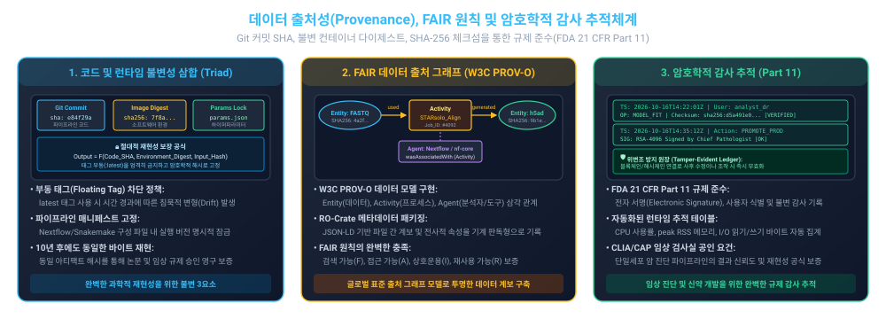

# 06. 데이터 출처 추적성(Provenance), FAIR 원칙 및 암호학적 재현성 보증 (Data Provenance, FAIR Principles & Cryptographic Reproducibility)

---

## 학습 목표 (Cognitive Goals)

1. **FAIR 데이터 원칙(Findable, Accessible, Interoperable, Reusable)의 전산 유전체학적 정립**: 대규모 단일세포 전사체 데이터 파이프라인에서 메타데이터 표준, 고유 식별자(Persistent Identifiers, PID), 온톨로지 매핑, 그리고 개방형 라이선스 규격을 설계한다.
2. **Nextflow 런타임 추적 리포트와 실행 메트릭의 수학적 분석**: `-with-report`, `-with-trace`, `-with-timeline` 지시자를 통해 방출되는 실행 지표를 해부하고, CPU 효율성 지수($\eta$) 및 메모리 피크 사용률($\mu$)을 정량화하여 파이프라인 병목을 진단한다.
3. **암호학적 데이터 불변성(Cryptographic Immutability) 및 머클 트리(Merkle Tree) 검증**: 원시 FASTQ, 중간 BAM, 최종 h5ad 단일세포 객체에 걸친 SHA-256 체크섬 해시 체인을 구축하고, 머클 트리의 일반 개념과 S3 멀티파트 체크섬(composite)의 차이를 구분한다.
4. **GitOps 기반 파이프라인 지속적 통합(CI/CD) 및 임상 규제 요건(21 CFR Part 11 등)을 지원하는 감사 요소 구축**: 시맨틱 버저닝(SemVer 2.0.0), Git 태그 불변성, GitHub Actions 자동화 테스트를 통해 mCRPC 환자 코호트의 연쇄 보관 기록(Chain-of-Custody)과 데이터 무결성 점검(체크섬 기반 변경 탐지) 예시를 다룬다. 이 예시들만으로 규정 준수가 달성되는 것은 아니다.

---

## 1. 전산 생명과학에서의 FAIR 데이터 원칙 체계

임상 시험 및 대규모 코호트 단일세포 전사체 연구에서 데이터의 가치는 분석 당시의 정확성뿐만 아니라, 수년 후 제3자의 독립적인 재현(Reproduction) 및 메타 분석(Meta-analysis) 가능성에 의해 좌우된다. **FAIR 원칙**은 이를 달성하기 위한 전산 유전체학의 필수 표준이다.



### 1.1 FAIR 원칙의 4대 핵심 축

1. **Findable (발견 가능성)**:
   - 모든 원시 FASTQ 파일과 분석 산출물은 전역 고유 영구 식별자(Global Unique Persistent Identifier, 예: DOI, Minid, Compact URI)를 부여받아야 한다.
   - 메타데이터는 데이터 자체와 분리되어 색인 가능한 데이터 카탈로그에 등록되어야 한다.
2. **Accessible (접근 가능성)**:
   - 식별자를 통해 표준화된 통신 프로토콜(HTTPS, S3 REST API, SFTP)로 데이터 및 메타데이터를 검색할 수 있어야 한다.
   - 환자 개인 식별 정보(PHI)를 보호하기 위해 OAuth 2.0 기반 인증(Authentication) 및 인가(Authorization) 계층이 통합되어야 한다.
3. **Interoperable (상호 운용성)**:
   - 메타데이터는 기계 판독 가능한 표준 온톨로지(Ontology)를 채택해야 한다. 예를 들어, 전립선암은 NCI Thesaurus(`NCIT:C4863`, Prostate Carcinoma), 전립선 내강 상피세포는 Cell Ontology(`CL:0002340`, luminal cell of prostate epithelium), 약물 치료는 ChEMBL ID(`CHEMBL1082407`, Enzalutamide)로 정규화된다.
   - 단일세포 데이터는 개방형 표준 이진 포맷(HDF5/AnnData, Zarr, Loom)으로 직렬화되어야 한다.
4. **Reusable (재사용 가능성)**:
   - 데이터 출처(Provenance)가 명확한 기계 판독형 라이선스(Creative Commons, Open Data Commons)와 함께 공개되어야 한다.
   - 데이터 생성에 사용된 모든 계산 도구, 알고리즘 매개변수, 컨테이너 이미지의 정확한 다이제스트가 부속 명세서로 첨부되어야 한다.

---

## 2. Nextflow 파이프라인 실행 추적성(Traceability) 아키텍처

Nextflow는 파이프라인이 실행되는 동안 커널 수준의 리소스 사용량과 태스크 간 의존성을 비동기적으로 로깅하여 정량적 추적 보고서를 생성한다.

### 2.1 런타임 추적 리포트 생성 메커니즘

`nextflow run` 명령 실행 시 다음 4가지 핵심 플래그를 결합하여 실행의 모든 국면을 기록한다:

```bash
nextflow run main.nf \
    -with-report reports/execution_report.html \
    -with-trace reports/trace.tsv \
    -with-timeline reports/timeline.html \
    -with-dag reports/pipeline_dag.svg
```

* **HTML 실행 보고서 (`-with-report`)**: 각 프로세스별 소요 시간, CPU 활용도, 물리 메모리 피크(Resident Set Size, RSS), 가상 메모리(VMS), 디스크 I/O 읽기/쓰기 볼륨을 시각화한다.
* **추적 TSV 테이블 (`-with-trace`)**: 모든 태스크 인스턴스의 작업 디렉토리 경로, 고유 해시(`hash`), 종료 코드(`exit`), 할당된 리소스 대비 실제 사용량을 기계 판독 가능한 탭 구분 텍스트로 기록한다.
* **타임라인 다이어그램 (`-with-timeline`)**: 각 태스크의 큐 대기 시간(Pending), 컨테이너 이미지 풀링 시간(Container Staging), 실제 쉘 연산 시간(Real Execution)을 간트 차트(Gantt Chart)로 표출한다.
* **DAG 그래프 (`-with-dag`)**: 채널 연결 기반의 비순환 유향 그래프를 렌더링하여 데이터 흐름 경로를 시각적으로 증명한다.

### 2.2 전산 자원 활용 메트릭의 수학적 정식화

Nextflow 추적 테이블(`trace.tsv`)에 기록되는 지표로부터 인프라 효율성을 평가하기 위해 다음과 같은 수리 모델을 적용한다.

#### 1) CPU 효율성 지수 ($\eta_{\text{CPU}}$)
할당된 vCPU 코어 수 $N_{\text{cpus}}$와 실제 벽시계 실행 시간(Real Elapsed Time, $T_{\text{real}}$), 그리고 프로세스가 사용자 공간 및 시스템 공간에서 소모한 총 CPU 시간 $T_{\text{cpu}}$의 비율:

$$\eta_{\text{CPU}} = \frac{T_{\text{cpu}}}{T_{\text{real}} \times N_{\text{cpus}}} = \frac{T_{\text{user}} + T_{\text{sys}}}{T_{\text{real}} \times N_{\text{cpus}}}$$

- $\eta_{\text{CPU}} \approx 1.0$: 완벽한 멀티스레드 병렬화 달성 (예: STARsolo 16-core 정렬 단계).
- $\eta_{\text{CPU}} \ll 0.3$: I/O 대기(I/O Wait), 단일 스레드 병목, 또는 지나친 과다 할당(Over-provisioning)을 의미.

#### 2) 메모리 효율성 지수 ($\mu_{\text{MEM}}$)
프로세스에 요청된 최대 허용 메모리 $M_{\text{req}}$ 대비 실제 물리적 메모리 피크(Peak RSS, $M_{\text{peak}}$)의 비율:

$$\mu_{\text{MEM}} = \frac{M_{\text{peak}}}{M_{\text{req}}}$$

- $\mu_{\text{MEM}} > 0.9$: 메모리 고갈 위험(OOM Killer invocation risk) 임박.
- $\mu_{\text{MEM}} < 0.2$: 클라우드 인스턴스 메모리 낭비 심각 (비용 누수의 주원인).

### 2.3 표준 출처(provenance) 모델과의 대응: W3C PROV, RO-Crate
이 장의 감사 매니페스트(4절)는 자체 JSON 형식이다. 공유·재사용을 위해서는 표준 출처 모델에 대응시키는 것이 좋다:

| W3C PROV 개념 | 이 장의 매니페스트 필드 (예시 대응) |
| :--- | :--- |
| `Entity` (데이터) | 입력 FASTQ, 중간 BAM, 최종 h5ad 및 각각의 SHA-256 체크섬 |
| `Activity` (처리) | 파이프라인 실행(run) 한 건: 시작·종료 시각, 파이프라인 버전 |
| `Agent` (주체) | 실행 사용자/기관, 소프트웨어 에이전트(컨테이너 이미지·도구 버전) |
| `used` / `wasGeneratedBy` | Activity가 읽은 입력 파일 / Activity가 만든 산출물 |

RO-Crate(Research Object Crate)는 이러한 정보를 `ro-crate-metadata.json`(JSON-LD)에 패키징하는 표준이며, Nextflow에서는 `nf-prov` 플러그인이 BioCompute Object와 Workflow Run RO-Crate 형식의 출처 보고서를 생성할 수 있다(nf-prov README). 본 장의 JSON은 PROV/RO-Crate 문서가 **아니므로** 표준 도구와 호환되려면 위 대응표에 따라 변환하거나 `nf-prov`를 사용해야 한다.

---

## 3. 암호학적 데이터 불변성과 머클 트리 해시 검증

임상 규제 표준(FDA Title 21 CFR Part 11 등)은 시스템 밸리데이션, 기록의 변경·위변조 탐지, 접근 통제, 시간기록 감사 추적(audit trail) 등을 요구하며 암호학적 해시 자체를 규정하지는 않는다. 환자의 생검 조직으로부터 추출된 원시 시퀀싱 데이터(FASTQ)와 최종 임상 바이오마커 리포트 간에 **손상이나 인위적 위변조가 없었음을 탐지**하는 지원 수단으로 암호학적 해시를 활용할 수 있다.

### 3.1 SHA-256 단방향 암호화 해시 함수

임의의 길이 $L$을 갖는 이진 데이터 블록 $M$에 대해, SHA-256 알고리즘은 256비트(32바이트, 64자리 16진수)의 고정 길이 다이제스트 $H(M)$을 생성한다:

$$H: \{0, 1\}^* \longrightarrow \{0, 1\}^{256}$$

SHA-256의 3대 수학적 보안 특성은 유전체 데이터 불변성의 기반이 된다:
1. **제1 역상 저항성(Pre-image Resistance)**: 주어진 해시값 $h$에 대해 $H(M) = h$를 만족하는 원본 데이터 $M$을 역산하는 계산 복잡도는 $O(2^{256})$으로 사실상 불가능하다.
2. **제2 역상 저항성(Second Pre-image Resistance)**: 특정 데이터 $M_1$이 주어졌을 때, $H(M_1) = H(M_2)$를 만족하는 다른 데이터 $M_2 \neq M_1$를 생성하는 복잡도는 $O(2^{256})$이다.
3. **충돌 저항성(Collision Resistance)**: $H(M_1) = H(M_2)$를 만족하는 임의의 서로 다른 쌍 $(M_1, M_2)$를 찾아내는 복잡도는 생일 공격(Birthday Attack)에 의해 $O(2^{128})$이다.

### 3.2 분할 업로드(Multi-part) 파일의 무결성과 머클 트리(Merkle Tree) 개념

수십 기가바이트에 달하는 단일세포 FASTQ 및 BAM 파일은 클라우드 객체 스토리지(AWS S3)에 8MB 또는 16MB 단위의 복수 파트(Parts)로 분할 병렬 업로드될 수 있다. **S3 멀티파트 업로드는 머클 트리를 사용하지 않는다.** 멀티파트 객체의 ETag는 각 파트의 MD5(이진값)를 이어붙여 다시 MD5한 값에 `-파트수`를 붙인 것이며, SHA-256 등 추가 체크섬을 쓰는 경우에도 파트 체크섬을 이어붙여 해시한 **composite(체크섬의 체크섬)** 값이다(AWS 문서 "Checking object integrity for data uploads"). 이 값은 같은 파트 크기로 업로드했을 때만 재현되며, 전체 파일 SHA-256과 같지 않다. 따라서 전체 파일 무결성은 업로드 전후 전체 파일 SHA-256(4절 스크립트)을 별도로 기록해 확인하는 것이 안전하다.

아래는 청크 해시를 트리로 결합하는 **머클 트리의 일반 개념**(S3의 내부 동작이 아님)이다. 크기 $S$인 파일을 $n$개의 청크 $C_1, C_2, \dots, C_n$으로 분할할 때:
1. 리프 노드(Leaf Nodes) 해시 계산:
   $$h_i = \text{SHA256}(C_i) \quad \text{for } i \in \{1, \dots, n\}$$
2. 부모 노드(Parent Nodes)의 연쇄 결합(Concatenation) 해시 계산:
   $$h_{i, i+1} = \text{SHA256}(h_i \mathbin{\Vert} h_{i+1})$$
3. 루트 노드(Merkle Root) $H_{\text{root}}$ 도출:
   모든 청크의 해시가 재귀적으로 결합되어 최종 단일 해시 $H_{\text{root}}$를 형성한다(이진 트리 구성 시 홀수 노드 처리 규칙은 구현마다 다르다).

$$\text{Merkle Root } H_{\text{root}} = \mathcal{T}_{\text{Merkle}}(C_1, C_2, \dots, C_n)$$

단 하나의 염기서열이나 품질 점수(Q-Score)가 훼손되더라도 눈사태 효과(Avalanche Effect)에 의해 리프 해시가 변하고, 결과적으로 머클 루트 $H_{\text{root}}$가 완전히 다른 값으로 변환되므로 루트 해시 비교 자체는 $O(1)$이지만, 손상 여부를 확인하려면 파일 전체를 읽어 해시를 다시 계산해야 하므로 전체 검증은 $O(S)$이다. 머클 트리의 이점은 루트가 다를 때 어느 청크가 손상되었는지 $O(\log n)$ 해시 비교로 좁힐 수 있다는 점이다.

---

## 4. 연쇄 보관 기록(Chain-of-Custody) 감사 스크립트 (규제 요건 지원 예시)

다음은 환자 생검 코어로부터 FASTQ, BAM, AnnData h5ad까지의 전체 수명주기 동안 암호학적 해시 체인을 계산하고 무결성 보고서를 발행하는 엔터프라이즈 감사 Python 스크립트이다.

```python
#!/usr/bin/env python3
"""
audit_integrity.py
임상 시험 및 전산 유전체학 규제 요건 지원을 위한 암호학적 데이터 무결성 점검 예시 도구(규정 준수 인증이 아님).
SHA-256 해시 체인(단순 연결 해시)을 수행한다(머클 트리 검증은 구현되어 있지 않다).
"""

import os
import sys
import hashlib
import json
import argparse
from datetime import datetime, timezone
from pathlib import Path
from typing import Dict, Any, List

def calculate_sha256(file_path: Path, chunk_size: int = 16 * 1024 * 1024) -> str:
    """대용량 유전체 파일에 대해 스트리밍 방식으로 SHA-256 체크섬을 계산한다."""
    sha256 = hashlib.sha256()
    with open(file_path, "rb") as f:
        while True:
            chunk = f.read(chunk_size)
            if not chunk:
                break
            sha256.update(chunk)
    return sha256.hexdigest()

def build_provenance_manifest(
    sample_id: str,
    patient_id: str,
    fastq_r1: Path,
    fastq_r2: Path,
    bam_file: Path,
    h5ad_file: Path,
    pipeline_version: str,
    nextflow_commit: str
) -> Dict[str, Any]:
    """임상 연쇄 보관 기록(Chain-of-Custody) 메타데이터 아티팩트를 조립한다."""
    files_to_hash = {
        "raw_fastq_r1": fastq_r1,
        "raw_fastq_r2": fastq_r2,
        "aligned_bam": bam_file,
        "filtered_anndata": h5ad_file
    }

    file_manifests = {}
    for role, path in files_to_hash.items():
        if not path.exists():
            raise FileNotFoundError(f"필수 감사 대상 파일이 존재하지 않습니다: {path}")
        
        stat = path.stat()
        file_manifests[role] = {
            "file_name": path.name,
            "absolute_path": str(path.resolve()),
            "size_bytes": stat.st_size,
            "sha256_checksum": calculate_sha256(path),
            "last_modified_utc": datetime.fromtimestamp(stat.st_mtime, tz=timezone.utc).isoformat()
        }

    # 전체 아티팩트의 암호학적 연쇄 해시(Chain Digest) 계산
    concatenated_hashes = "".join([
        file_manifests[role]["sha256_checksum"]
        for role in sorted(file_manifests.keys())
    ])
    chain_digest = hashlib.sha256(concatenated_hashes.encode("utf-8")).hexdigest()

    manifest = {
        "schema_version": "1.0.0",
        "regulatory_context": "supports 21 CFR Part 11-style traceability (not a compliance certification)",
        "audit_timestamp_utc": datetime.now(timezone.utc).isoformat(),
        "sample_metadata": {
            "sample_id": sample_id,
            "patient_id": patient_id,
            "disease_indication": "Metastatic Castration-Resistant Prostate Cancer (mCRPC)"
        },
        "pipeline_provenance": {
            "pipeline_name": "nf-core/scrnaseq",
            "semantic_version": pipeline_version,
            "git_commit_hash": nextflow_commit
        },
        "cryptographic_chain_digest": chain_digest,
        "artifacts": file_manifests
    }
    return manifest

def main():
    parser = argparse.ArgumentParser(description="Cryptographic Provenance Audit Tool")
    parser.add_argument("--sample-id", required=True, help="샘플 고유 ID")
    parser.add_argument("--patient-id", required=True, help="환자 식별 번호")
    parser.add_argument("--r1", type=Path, required=True, help="Read 1 FASTQ 경로")
    parser.add_argument("--r2", type=Path, required=True, help="Read 2 FASTQ 경로")
    parser.add_argument("--bam", type=Path, required=True, help="정렬 BAM 경로")
    parser.add_argument("--h5ad", type=Path, required=True, help="최종 h5ad 객체 경로")
    parser.add_argument("--version", default="v2.5.1", help="파이프라인 릴리스 버전")
    parser.add_argument("--commit", required=True, help="Nextflow 워크플로우 Git 커밋 해시")
    parser.add_argument("--output", type=Path, default=Path("audit_manifest.json"), help="출력 JSON 경로")

    args = parser.parse_args()

    manifest = build_provenance_manifest(
        sample_id=args.sample_id,
        patient_id=args.patient_id,
        fastq_r1=args.r1,
        fastq_r2=args.r2,
        bam_file=args.bam,
        h5ad_file=args.h5ad,
        pipeline_version=args.version,
        nextflow_commit=args.commit
    )

    with open(args.output, "w", encoding="utf-8") as f:
        json.dump(manifest, f, indent=2)

    print(f"[AUDIT SUCCESS] 암호학적 감사 보고서가 성공적으로 생성되었습니다: {args.output}")
    print(f"Chain Digest: {manifest['cryptographic_chain_digest']}")

if __name__ == "__main__":
    main()
```

---

## 5. GitOps 및 GitHub Actions 기반 CI/CD 파이프라인 자동화

파이프라인 코드 자체의 무결성과 재현성을 보증하기 위해 **GitOps** 패러다임을 파이프라인 수명주기에 적용한다. 개발자가 코드를 수정할 때마다 축소된 임상 테스트 데이터셋(Minimal Test Dataset)을 대상으로 자동화된 CI/CD 워크플로우가 가동된다.

### 5.1 시맨틱 버저닝(SemVer 2.0.0) 규칙

파이프라인의 Git 태그는 엄격한 의미론적 규칙(`MAJOR.MINOR.PATCH`)을 준수한다:
- **MAJOR (v2.0.0)**: 입력 채널 구조의 근본적 파괴, 지원 얼라이너 기본값 변경 등 하위 호환성이 결여된 대규모 변경.
- **MINOR (v1.3.0)**: 새로운 QC 필터링 모듈 추가, MultiQC 리포트 플러그인 확장 등 하위 호환성을 유지하는 신규 기능 추가.
- **PATCH (v1.2.4)**: 컨테이너 종속성 버전 패치, 특정 클라우드 엑시큐터 버그 픽스 등 결과물에 생물학적 왜곡을 주지 않는 버그 수정.

### 5.2 GitHub Actions 자동화 테스트 워크플로우 명세

다음은 커밋 및 풀 리퀘스트(PR) 발생 시 파이프라인 구문 문법(Linting)과 실제 Docker 컨테이너 엔드투엔드 테스트를 자동으로 실행하는 워크플로우 YAML 파일이다:

```yaml
# .github/workflows/pipeline_ci.yml
name: nf-core Pipeline Continuous Integration

on:
  push:
    branches:
      - main
      - dev
    tags:
      - 'v*.*.*'
  pull_request:
    branches:
      - main
      - dev

jobs:
  lint:
    name: Nextflow Syntax & Code Quality Linting
    runs-on: ubuntu-latest
    steps:
      - name: Check out repository
        uses: actions/checkout@v4

      - name: Set up Java 17
        uses: actions/setup-java@v4
        with:
          distribution: 'temurin'
          java-version: '17'

      - name: Install Nextflow
        run: |
          curl -s https://get.nextflow.io | bash
          sudo mv nextflow /usr/local/bin/

      - name: Run nf-core lint
        run: |
          pip install nf-core
          nf-core pipelines lint .

  test_pipeline:
    name: End-to-End Test Execution (Minimal mCRPC Dataset)
    needs: lint
    runs-on: ubuntu-latest
    strategy:
      matrix:
        aligner: ['alevin', 'star']   # nf-core/scrnaseq 2.5.1 유효값 (4.x 이후는 'simpleaf', 'star')
    steps:
      - name: Check out repository
        uses: actions/checkout@v4

      - name: Set up Java 17
        uses: actions/setup-java@v4
        with:
          distribution: 'temurin'
          java-version: '17'

      - name: Install Nextflow
        run: |
          curl -s https://get.nextflow.io | bash
          sudo mv nextflow /usr/local/bin/

      - name: Execute Test Pipeline with Docker
        run: |
          nextflow run main.nf \
            -profile test,docker \
            --aligner ${{ matrix.aligner }} \
            --outdir ./results_${{ matrix.aligner }} \
            -with-report report_${{ matrix.aligner }}.html \
            -with-trace trace_${{ matrix.aligner }}.tsv

      - name: Verify Cryptographic Artifacts
        run: |
          # 최종 산출된 h5ad 파일의 존재 여부 및 SHA-256 체크섬 방출 검증
          test -f results_${{ matrix.aligner }}/anndata/test_sample.filtered.h5ad
          sha256sum results_${{ matrix.aligner }}/anndata/test_sample.filtered.h5ad > checksum_${{ matrix.aligner }}.txt
          cat checksum_${{ matrix.aligner }}.txt

      - name: Upload Test Artifacts
        uses: actions/upload-artifact@v4
        with:
          name: execution-reports-${{ matrix.aligner }}
          path: |
            report_${{ matrix.aligner }}.html
            trace_${{ matrix.aligner }}.tsv
            checksum_${{ matrix.aligner }}.txt
```

---

## 단원 핵심 점검 (Cognitive Checkpoint & Case Study)

### 문제 1: SHA-256 체크섬 해시 체인 기반 임상 데이터 위변조 감지 및 감사 로그 검증
전이성 거세저항성 전립선암(mCRPC) 환자의 표적 항암제 임상 2상 시험에서, 한 환자(P042)의 생검 조직으로부터 생산된 최종 단일세포 전사체 객체(`P042_BoneMet.filtered.h5ad`)의 SHA-256 체크섬이 초기 중앙 데이터 저장소 등록 시점에는 `a1b2c3...d4e5`였으나, 6개월 후 독립 감사관이 검증했을 때 `f9e8d7...c2b1`로 완전히 달라져 있었다.
1. 단 하나의 세포 바코드의 유전자 카운트 1개가 수정되었을 때, SHA-256 알고리즘의 어떤 수학적 원리에 의해 64자리 16진수 체크섬 전체가 예측 불가능하게 전면 변경(Avalanche Effect)되는지 설명하시오.
2. 환자의 원시 FASTQ 파일 쌍의 SHA-256 체크섬은 최초 등록값과 100% 일치함을 확인하였다. 감사관으로서 파이프라인의 Git 커밋 해시, 컨테이너 다이제스트, 그리고 Nextflow 실행 보고서(`trace.tsv`)를 활용하여 이 불일치의 근본 원인(Root Cause)이 악의적 조작인지, 아니면 비결정론적 알고리즘(Non-deterministic Algorithm)에 의한 것인지 역추적하는 절차를 기술하시오.

<details>
<summary>💡 모범 답안 및 해설 확인</summary>

**1. SHA-256 눈사태 효과(Avalanche Effect)의 수학적 원리**:
* SHA-256은 입력 메시지를 512비트 블록으로 패딩한 후, 64라운드의 비선형 압축 함수(Compression Function)를 순환 적용한다.
* 각 라운드마다 비트 회전(Rotate Right, $\text{ROTR}$), 비트 시프트(Shift Right, $\text{SHR}$), 그리고 모듈로 덧셈($+ \pmod{2^{32}}$)과 비선형 논리 함수($\text{Ch}(x, y, z) = (x \land y) \oplus (\neg x \land z)$, $\text{Maj}(x, y, z) = (x \land y) \oplus (x \land z) \oplus (y \land z)$)이 교차 적용된다.
* 입력 데이터에서 단 1비트의 변화(Flip)가 발생하더라도 1라운드를 거치며 여러 워드로 파급되고, 64라운드를 완주한 시점에는 출력 256비트 중 평균 $50\%$의 비트가 무작위로 반전되는 **엄격한 눈사태 기준(Strict Avalanche Criterion)**을 만족한다. 따라서 h5ad 내부의 카운트 단 하나가 변경되어도 완전히 무관한 16진수 문자열이 도출된다.

**2. 감사관의 근본 원인 역추적 절차**:
1. **소프트웨어 버전 및 파이프라인 불변성 검증**:
   - `audit_manifest.json`에 기록된 Git 커밋 해시와 Nextflow 파이프라인 코드가 동일한지 `git checkout <commit_hash>`로 대조한다.
   - 컨테이너 이미지 태그(예: `:latest`와 같은 플로팅 태그 사용 여부) 대신 고유 OCI 해시 다이제스트(`quay.io/...@sha256:...`)가 고정되었는지 확인한다.
2. **비결정론적(Non-deterministic) 연산 요소 추적**:
   - UMI 중복 제거 또는 세포 분할 알고리즘에서 난수 생성기(Random Seed)가 고정되지 않았는지 검토한다.
   - 다중 스레드 정렬 도구(STARsolo 등)에서 리드 순서(Read Order)의 비동기적 쓰기로 인해 BAM 파일의 헤더나 레코드 순서가 비결정론적으로 변경되었는지 확인한다.
3. **작업 디렉토리 캐시 해시 대조**:
   - Nextflow `trace.tsv`에 기록된 프로세스 고유 해시(`hash`)를 대조하여 재실행 시 캐시 미스(Cache Miss)가 발생하여 상이한 버전의 중간 라이브러리가 주입되었는지 규명한다. 원시 FASTQ가 일치하는데 h5ad가 다르다면 스크립트 실행 환경의 비결정론성 또는 수동 파일 덮어쓰기가 원인이다.

</details>

---

### 문제 2: Nextflow 실행 보고서(`trace.tsv`)를 활용한 대규모 코호트 자원 할당 과다(Over-provisioning) 진단
100명의 mCRPC 환자 코호트 전사체 데이터를 클라우드 인프라에서 일괄 처리한 후 수집된 `trace.tsv` 파일에서 단일세포 QC 필터링 프로세스(`SCRNASEQ_FILTER_ANNDATA`)의 성능 지표가 다음과 같이 집계되었다:
- 프로세스 정의 할당량: `cpus = 16`, `memory = 64.GB`, `time = 4.h`
- 실제 100개 작업의 평균 관측값: $T_{\text{real}} = 15\text{ 분}$, $T_{\text{cpu}} = 16.5\text{ 분}$, $M_{\text{peak}} = 4.2\text{ GB}$
1. 이 프로세스의 CPU 효율성 지수 $\eta_{\text{CPU}}$와 메모리 효율성 지수 $\mu_{\text{MEM}}$을 계산하시오.
2. 계산된 지표를 기반으로 전산 자원 낭비의 원인을 진단하고, 클라우드 비용을 최소화하기 위한 Nextflow 라벨(`label 'process_low'`) 및 동적 지시자 재조정 방안을 제시하시오.

<details>
<summary>💡 모범 답안 및 해설 확인</summary>

**1. 전산 자원 효율성 지수 계산**:
* **CPU 효율성 지수 ($\eta_{\text{CPU}}$)**:
  $$T_{\text{real}} = 15\text{ 분}, \quad T_{\text{cpu}} = 16.5\text{ 분}, \quad N_{\text{cpus}} = 16$$
  $$\eta_{\text{CPU}} = \frac{T_{\text{cpu}}}{T_{\text{real}} \times N_{\text{cpus}}} = \frac{16.5}{15 \times 16} = \frac{16.5}{240} \approx 0.06875 \quad (\mathbf{6.88\%})$$
* **메모리 효율성 지수 ($\mu_{\text{MEM}}$)**:
  $$M_{\text{peak}} = 4.2\text{ GB}, \quad M_{\text{req}} = 64.0\text{ GB}$$
  $$\mu_{\text{MEM}} = \frac{4.2}{64.0} \approx 0.065625 \quad (\mathbf{6.56\%})$$

**2. 자원 과다 할당 진단 및 최적화 방안**:
* **진단**:
  - CPU 효율성이 $6.88\%$에 불과하다는 것은 해당 파이썬 스크립트(Scanpy/Pandas 기반 QC 필터링)가 단일 스레드로 동작하고 있음을 의미한다. 16개의 코어를 할당했으나 15개 코어가 15분 동안 완전히 유휴 상태로 방치되어 클라우드 vCPU 비용의 $93\%$ 이상이 허공에 낭비되었다.
  - 메모리 효율성 역시 $6.56\%$로 64 GB 중 4.2 GB만 사용되고 59.8 GB가 미사용 상태로 묶여 인스턴스 프로비저닝 단가를 불필요하게 폭증시켰다.
* **최적화 설정 제안**:
  Nextflow 설정 파일에서 해당 모듈을 경량 라벨(`process_low`)로 재배정하고 필요 자원을 현실화한다:
  ```groovy
  withLabel: 'process_low' {
      cpus   = { 2 }
      memory = { 8.GB * task.attempt }
      time   = { 30.min * task.attempt }
  }
  ```
  - 코어를 16개에서 2개로 축소하고 RAM을 64 GB에서 8 GB로 줄임으로써, 작업당 클라우드 컴퓨팅 비용을 기존 대비 약 **$80\% \sim 85\%$ 즉각 절감**할 수 있으며 동시 실행 가능한 컨테이너 밀도를 극대화할 수 있다.

</details>

---

### 문제 3: FAIR 원칙 준수를 위한 전립선암 임상 메타데이터 온톨로지 정규화 및 영구 식별자(PID) 아키텍처
다기관(Multi-center) 임상 연구 컨소시엄에서 전립선암 환자의 단일세포 전사체 데이터를 공유하고자 한다. 서로 다른 병원에서 수집된 샘플시트에는 조직 부위가 `"Prostate"`, `"prostate gland"`, `"PR"`, `"Prost_Tumor"` 등 제각각으로 기재되어 있고, 약물 치료 이력도 `"Enza"`, `"Xtandi"`, `"MDV3100"` 등으로 혼재되어 있어 기계적 통합 분석이 불가능한 상태이다.
1. FAIR의 상호 운용성(Interoperable) 원칙에 입각하여, 이 비구조화된 텍스트들을 표준화하기 위한 Biomedical Ontology 매핑 체계를 구축하시오 (조직명 및 약물명 대상).
2. 임상시험 환자의 프라이버시(HIPAA/GDPR)를 완벽히 준수하면서도 전산 유전체학 데이터의 재사용성(Reusable)을 극대화하기 위해, 원시 데이터와 익명화된 공개 메타데이터를 분리하여 영구 식별자(PID)를 발급하는 2-계층(Two-tier) 아키텍처를 설계하시오.

<details>
<summary>💡 모범 답안 및 해설 확인</summary>

**1. 표준 온톨로지(Biomedical Ontology) 매핑 체계 구축**:
* **조직 부위 (Tissue/Anatomy)**:
  - 통제 어휘집: **Uberon Multi-species Anatomy Ontology (UBERON)** 및 **NCI Thesaurus (NCIT)**.
  - 매핑 규칙:
    - `"prostate gland"`, `"Prostate"`, `"PR"` $\longrightarrow$ `UBERON:0002367` (prostate gland)
    - `"Prost_Tumor"` $\longrightarrow$ `NCIT:C4863` (Prostate Carcinoma)
* **약물 치료 이력 (Therapy/Compound)**:
  - 통제 어휘집: **ChEMBL**, **DrugBank**, **RxNorm**.
  - 매핑 규칙:
    - `"Enza"`, `"Xtandi"`, `"MDV3100"` $\longrightarrow$ `ChEMBL:CHEMBL1082407` (Enzalutamide) / `DrugBank:DB08899` / `RxNorm:1307298`
* **세포 유형 (Cell Types)**:
  - 통제 어휘집: **Cell Ontology (CL)**.
  - 전립선 내강 상피세포 $\to$ `CL:0002340` (luminal cell of prostate epithelium), 신경내분비세포 $\to$ `CL:0000165` (neuroendocrine cell).

**2. 2-계층 영구 식별자(Two-tier PID) 아키텍처 설계**:
1. **계층 1: 공개 메타데이터 및 집계 통계 (Open Tier)**:
   - 생물학적 메타데이터(연령대, 질환 병기, 표준 온톨로지 매핑 코드, h5ad의 UMAP 2차원 좌표 및 유전자 발현 평균치)는 비식별화(De-identified)되어 누구나 검색 가능한 저장소(예: Zenodo, GEO, CellxGene)에 등재된다.
   - 공개 DOI(Digital Object Identifier)를 발급하여 논문 및 학술 커뮤니티에서 발견 가능성(Findable)을 보장한다.
2. **계층 2: 환자 원시 유전체 데이터 (Controlled Access Tier)**:
   - 개인 식별이 가능한 원시 FASTQ, 전장 정렬 BAM, 환자 생식세포계열 변이 정보는 통제형 암호화 저장소(EGA: European Genome-phenome Archive, dbGaP)에 격리 보관된다.
   - 데이터 접근 위원회(Data Access Committee, DAC)의 심사를 통과한 연구자에게만 시간 제한형 토큰(OAuth 2.0 / JWT)을 통해 접근이 인가되며, 내부 식별자(EGA Dataset Accession PID)와 암호학적 SHA-256 서명으로 무결성이 통제된다.

</details>

---

<!-- REFERENCES:BEGIN (generated by scripts/apply_references.py; do not edit by hand) -->
## 참고문헌 (References)
### 소프트웨어 (표기 버전은 검수 시 API를 확인한 버전이며, 파이프라인 실행 환경은 requirements-pipelines.txt 참조)
- Nextflow 24.04.4 (nextflow.io). 원 논문: Di Tommaso P, Chatzou M, Floden EW, et al. Nextflow enables reproducible computational workflows. *Nat Biotechnol*. 2017;35(4):316-319. PMID: 28398311. doi: 10.1038/nbt.3820
- Docker (github.com/moby/moby).
- nf-core/scrnaseq (nf-co.re/scrnaseq). 원 논문: Ewels PA, Peltzer A, Fillinger S, et al. The nf-core framework for community-curated bioinformatics pipelines. *Nat Biotechnol*. 2020;38(3):276-278. PMID: 32055031. doi: 10.1038/s41587-020-0439-x
- alevin-fry (github.com/COMBINE-lab/alevin-fry). 원 논문: He D, Zakeri M, Sarkar H, et al. Alevin-fry unlocks rapid, accurate and memory-frugal quantification of single-cell RNA-seq data. *Nat Methods*. 2022;19(3):316-322. PMID: 35277707. doi: 10.1038/s41592-022-01408-3
<!-- REFERENCES:END -->
