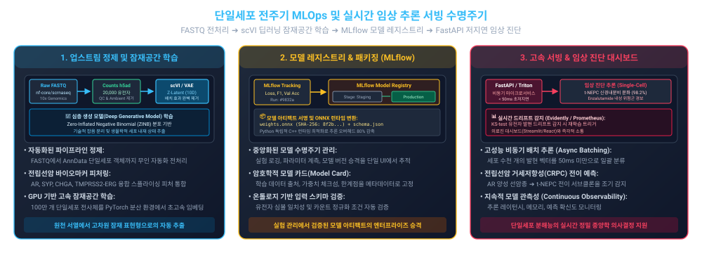

# 07. 단일세포 전사체 MLOps 모델 서빙 및 실시간 추론 아키텍처 (Single-Cell MLOps Model Serving & Real-Time Inference Architecture)

---

## 학습 목표 (Cognitive Goals)

1. **연구용 딥러닝 모델에서 프로덕션 임상 MLOps로의 패러다임 전환**: 단일세포 변분 오토인코더(scVI/scANVI) 및 파운데이션 모델(Foundation Models)의 전산 생애주기를 체계화하고, 데이터 표류(Data Drift) 및 개념 표류(Concept Drift) 감지 전략을 수립한다.
2. **MLflow 기반 모델 아티팩트 및 하이퍼파라미터 거버넌스**: 변분 하한(Evidence Lower Bound, ELBO) 수렴 곡선, 잠재 공간 차원($z \in \mathbb{R}^d$), KL 발산 가중치 스케줄링을 추적하고 모델 레지스트리(Model Registry)에 모델 버전을 등록하고 별칭(alias, 예: `champion`)으로 승격·롤백하는 프로세스를 정립한다(MLflow 2.9부터 Staging/Production 같은 stage 방식은 deprecated되고 alias 방식으로 대체되었다).
3. **PyTorch TorchScript 및 ONNX Runtime 직렬화와 그래프 최적화 수리 모델**: 정적 계산 그래프 변환, 연산자 융합(Operator Fusion), FP32에서 FP16/INT8로의 양자화(Quantization) 메커니즘을 규명하고, 대기 시간 대기행렬 이론($M/G/k$ 큐잉 모델)을 통해 추론 지연시간 백분위수($p_{95}, p_{99}$)를 최소화한다.
4. **FastAPI 및 Docker 기반의 실시간 전립선암 전이/신경내분비 분화(t-NEPC) 진단 마이크로서비스 구현**: 생검 검체 유입 시 실시간으로 세포 유형을 자동 주석화하고, *AR-V7* 스플라이싱 및 신경내분비 마커(*SYP*, *CHGA*, *INSM1*) 기반의 t-NEPC 위험 점수를 산출하는 고가용성 RESTful API 서비스를 배포한다.

---

## 1. 단일세포 MLOps 생애주기 및 아키텍처 개요

단일세포 전사체학 분야에서 딥러닝 확률 모델(Probabilistic Models)은 배치 효과 교정, 세포 유형 준지도 학습(Semi-supervised Annotation), 결측값 대치(Imputation) 등 핵심 분석을 주도하고 있다. 그러나 연구 환경(Jupyter Notebook)의 모델을 실제 병원 병리과나 임상 동반진단 파이프라인에 배포하기 위해서는 엄격한 MLOps(Machine Learning Operations) 프레임워크가 요구된다.



### 1.1 임상 MLOps의 4대 핵심 컴포넌트

1. **실험 추적 및 계보 관리 (Experiment Tracking & Lineage)**: 어떤 환자 코호트와 전처리 파이프라인(Nextflow 실행 버전)을 통해 모델 가중치가 학습되었는지에 대한 완벽한 데이터-코드-모델 계보 추적.
2. **모델 패키징 및 직렬화 (Serialization & Packaging)**: Python 인터프리터 의존성을 탈피하고 C++ 런타임 환경에서 서빙할 수 있는 계산 그래프 컴파일(TorchScript, ONNX Runtime).
3. **저지연 서빙 엔진 (Low-latency Serving Engine)**: 수만 개의 단일 세포 프로파일 벡터가 HTTP/gRPC 요청으로 유입될 때 수백 밀리초 이내에 응답을 반환하는 비동기 마이크로서비스.
4. **연속 모니터링 및 모델 재학습 (Continuous Monitoring & Retraining)**: 새로운 시퀀싱 케미스트리(v2 $\to$ v3)나 신규 생검 부위(뇌 전이 검체 등) 유입 시 발생하는 특징 분포의 통계적 표류(Covariate Shift)를 감지하고 경고를 트리거하는 감시 시스템.

---

## 2. MLflow 기반 확률 모델(scVI / scANVI) 아티팩트 거버넌스

### 2.1 scVI / scANVI의 수리적 추론 메커니즘

단일세포 $i$의 원시 유전자 카운트 벡터를 $\mathbf{x}_i \in \mathbb{N}_0^G$, 배치/환자 인덱스를 $s_i$, 관측되지 않은 잠재 세포 상태를 $\mathbf{z}_i \in \mathbb{R}^d$ ($d \ll G$, 통상 $d=10 \sim 30$)라 하자. scVI 모델은 제로 팽창 음이항(Zero-Inflated Negative Binomial, ZINB) 또는 음이항(Negative Binomial, NB) 분포를 통해 데이터 생성 과정을 모델링한다:

$$p(\mathbf{x}_i \mid \mathbf{z}_i, s_i, l_i) = \prod_{g=1}^G \operatorname{NB}\left( x_{ig}; \, \mu_{ig} = l_i \rho_{ig}(\mathbf{z}_i, s_i), \, \theta_g \right)$$

여기서 $l_i$는 세포의 총 라이브러리 크기(Library Size), $\rho_{ig}$는 디코더 신경망이 출력하는 정규화된 유전자 발현 비율, $\theta_g$는 유전자 고유의 과산포(Overdispersion) 파라미터이다.

인코더 신경망 $q_\phi(\mathbf{z}_i \mid \mathbf{x}_i, s_i)$는 사후 확률 분포를 변분 가우시안으로 근사하며, 손실 함수로는 변분 하한(Evidence Lower Bound, ELBO)의 역부호를 최소화한다:

$$\mathcal{L}_{\text{ELBO}}(\theta, \phi; \mathbf{x}_i) = \mathbb{E}_{q_\phi(\mathbf{z}_i \mid \mathbf{x}_i, s_i)}\left[ \ln p_\theta(\mathbf{x}_i \mid \mathbf{z}_i, s_i) \right] - \beta \cdot \mathbb{KL}\left( q_\phi(\mathbf{z}_i \mid \mathbf{x}_i, s_i) \,\|\, p(\mathbf{z}_i) \right)$$

### 2.2 MLflow 실험 추적 파이썬 스크립트 (`train_and_log_scanvi.py`)

다음은 50명의 mCRPC 환자 코호트 전사체로 scANVI(Semi-supervised Single-cell Annotation Using Variational Inference) 모델을 학습하고, 모든 하이퍼파라미터 및 수렴 지표를 MLflow 서버에 자동 로깅하는 엔지니어링 구현이다:

```python
#!/usr/bin/env python3
"""
train_and_log_scanvi.py
mCRPC 환자 코호트 기반 scANVI 세포 주석 모델 학습 및 MLflow 트래킹 스크립트.
"""

import os
import argparse
import mlflow
import mlflow.pytorch
import scvi
import scanpy as sc
import torch
import numpy as np

def main():
    parser = argparse.ArgumentParser(description="Train and Track scANVI Model")
    parser.add_argument("--input-h5ad", required=True, help="입력 통합 AnnData 파일")
    parser.add_argument("--latent-dim", type=int, default=30, help="잠재 차원 수 (z)")
    parser.add_argument("--max-epochs", type=int, default=200, help="최대 학습 에포크")
    parser.add_argument("--experiment-name", default="mCRPC_CellType_Classifier", help="MLflow 실험명")
    args = parser.parse_args()

    mlflow.set_experiment(args.experiment_name)

    with mlflow.start_run(run_name="scANVI_Production_v1"):
        # 1. 하이퍼파라미터 로깅
        params = {
            "latent_dim": args.latent_dim,
            "max_epochs": args.max_epochs,
            "batch_size": 256,
            "learning_rate": 1e-3,
            "dispersion": "gene",
            "gene_likelihood": "nb",
            "unlabeled_category": "Unknown"
        }
        mlflow.log_params(params)

        # 2. 데이터셋 로드 및 설정
        adata = sc.read_h5ad(args.input_h5ad)
        scvi.model.SCVI.setup_anndata(
            adata,
            layer=None,
            batch_key="patient_id",
            labels_key="cell_type"
        )

        # 3. 사전 모델 (scVI VAE) 학습
        vae = scvi.model.SCVI(adata, n_latent=args.latent_dim, gene_likelihood="nb")
        vae.train(max_epochs=args.max_epochs, batch_size=256, early_stopping=True)

        # 4. 준지도 모델 (scANVI) 전이 학습
        scanvi_model = scvi.model.SCANVI.from_scvi_model(
            vae,
            unlabeled_category="Unknown",
            labels_key="cell_type"
        )
        scanvi_model.train(max_epochs=50, batch_size=256)

        # 5. 수렴 메트릭 로깅
        final_train_loss = float(scanvi_model.history["train_loss_epoch"].iloc[-1])
        # scvi-tools의 history['elbo_train']은 손실 방향(작을수록 좋은 음의 ELBO)으로 기록되는 값이므로 'neg_elbo'로 명명한다(버전별 확인 권장)
        final_neg_elbo = float(scanvi_model.history["elbo_train"].iloc[-1])
        mlflow.log_metric("final_train_loss", final_train_loss)
        mlflow.log_metric("final_neg_elbo", final_neg_elbo)

        # 6. 모델 아티팩트 저장 및 MLflow 모델 레지스트리 등록(아래 create_model_version + alias)
        model_save_dir = "./saved_scanvi_model"
        scanvi_model.save(model_save_dir, overwrite=True)
        mlflow.log_artifacts(model_save_dir, artifact_path="model")

        # 레지스트리 등록: log_artifacts만으로는 등록되지 않는다. 모델 버전을 만들고 alias로 승격한다(MLflow 3.x에서 확인).
        from mlflow import MlflowClient
        client = MlflowClient()
        run_id = mlflow.active_run().info.run_id
        try:
            client.create_registered_model("scanvi_prostate")
        except Exception:
            pass   # 이미 존재
        mv = client.create_model_version(
            name="scanvi_prostate",
            source=f"{client.get_run(run_id).info.artifact_uri}/model",
            run_id=run_id,
        )
        client.set_registered_model_alias("scanvi_prostate", "champion", mv.version)   # stage 대신 alias

        print(f"[MLFLOW SUCCESS] Run ID: {run_id}")
        print(f"최종 음의 ELBO(손실): {final_neg_elbo:.4f}, 모델 아티팩트 업로드 및 레지스트리 등록 완료(version {mv.version}).")

if __name__ == "__main__":
    main()
```

---

## 3. PyTorch TorchScript 및 ONNX 직렬화와 지연시간 수학

프로덕션 서빙 환경에서 Python GIL(Global Interpreter Lock)과 거대한 `scvi-tools` 의존성은 심각한 동시성 저하와 메모리 낭비를 유발한다. 따라서 실시간 추론을 수행하는 **인코더 네트워크(Encoder, $q_\phi(\mathbf{z} \mid \mathbf{x})$)**와 **분류기 헤드(Classifier Head)**만을 정적 연산 그래프로 추출하여 컴파일해야 한다.

### 3.1 ONNX 그래프 최적화 수리적 원리

ONNX(Open Neural Network Exchange) 런타임 엔진은 모델의 계산 그래프 $G = (V, E)$를 분석하여 다음과 같은 정형 변환을 수행한다:

1. **상수 폴딩 (Constant Folding)**:
   런타임 입력과 무관한 정적 가중치 연산(예: $\mathbf{W}_{\text{conv}} \cdot \mathbf{b}$)을 사전에 평가하여 단일 텐서 상수로 치환한다:
   $$f(x) = \mathbf{W}_2 \cdot (\mathbf{W}_1 \cdot \mathbf{c}) + \mathbf{b} \implies f(x) = \mathbf{W}_2 \cdot \mathbf{c}^* + \mathbf{b}$$
2. **연산자 융합 (Operator Fusion)**:
   인접 연산(예: MatMul+Add→Gemm, Gemm+활성화)을 병합함으로써 메모리 왕복 I/O를 줄인다(문서화된 융합 범위 내에서; 아래 식은 개념 예시이며 모든 조합이 단일 커널로 융합되는 것은 아니다):
   $$\text{FusedKernel}(\mathbf{x}) = \operatorname{GELU}\left(\operatorname{LayerNorm}(\mathbf{x} \mathbf{W} + \mathbf{b})\right)$$
3. **양자화 (Quantization, FP32 $\to$ FP16 / INT8)**:
   가중치 텐서 $W \in \mathbb{R}^{m \times n}$의 부동소수점을 저밀도 정수형으로 아핀 변환(Affine Mapping)하여 연산 처리량을 2~4배 가속한다:
   $$q = \operatorname{round}\left( \frac{r}{S} \right) + Z$$
   여기서 $S$는 스케일 인자(Scale Factor), $Z$는 영점(Zero-point offset)이다.

### 3.2 서빙 지연시간 대기행렬 이론 ($M/G/k$ 모델)

임상 검체로부터 $N$개의 단일세포 프로파일이 초당 $\lambda$의 포아송 도착률(Poisson Arrival Rate)로 서빙 엔드포인트에 도달할 때, 서버는 $k$개의 GPU/CPU 워커를 통해 평균 서비스 시간 $1/\mu$, 분산 $\sigma^2$의 일반적 분포(General Service Distribution)로 작업을 처리한다.

시스템의 가동률(Server Utilization) $\rho$는 다음과 같이 정의된다:

$$\rho = \frac{\lambda}{k \mu} < 1 \quad (\text{안정성 조건})$$

Pollaczek-Khinchine 공식의 다중 서버 확장에 따라, 대기 행렬에서의 평균 대기 시간 $\mathbb{E}[W_q]$ 및 99번째 백분위수 지연시간($p_{99}$)은 서비스 시간의 변동 계수 $C_v^2 = \sigma^2 / (1/\mu)^2$에 비례하여 증가한다:

$$\mathbb{E}[W_q] \approx \frac{\rho^{\sqrt{2(k+1)}-1}}{k(1-\rho)} \cdot \frac{1 + C_v^2}{2} \cdot \frac{1}{\mu}$$

* **시사점**: 단일세포 1개씩 단편적으로 추론 요청을 보내는 방식(Small batch, high arrival rate $\lambda$)은 심각한 큐잉 지연을 유발하므로, 서빙 프레임워크 수준에서 **동적 배치화(Dynamic Batching, 예: 10ms 대기 윈도우 내 최대 512개 세포 수집)**를 구현해야만 $p_{99}$ 지연시간을 50ms 미만으로 제어할 수 있다.

---

## 4. 임상 전립선암 실시간 진단 서빙 마이크로서비스 (FastAPI)

전립선암(mCRPC) 환자가 강력한 안드로겐 수용체 표적 치료(Enzalutamide)를 받는 도중, 일부 환자에서 종양 세포가 안드로겐 수용체 신호전달을 회피하기 위해 신경내분비 계통으로 분화 전환(Treatment-induced Neuroendocrine Prostate Cancer, t-NEPC)을 일으키는 것으로 보고된다. t-NEPC는 예후가 불량한 것으로 알려져 있어 조기 식별이 연구 관심사이다(치료 선택은 임상 가이드라인과 전문가 판단에 따른다).

다음은 환자 생검 세포의 전사체 벡터를 수신하여 (1) 실시간 세포 유형 판정, (2) *AR-V7* 스플라이싱 및 t-NEPC 전이 위험 지수를 산출하는 고성능 비동기 FastAPI 서비스 코드이다.

```python
#!/usr/bin/env python3
"""
serve_model.py
전립선암 전이 및 t-NEPC 전이 진단을 위한 고성능 비동기 FastAPI 추론 엔진.
"""

from fastapi import FastAPI, HTTPException, status
from pydantic import BaseModel, Field
from typing import List, Dict, Any
import numpy as np
import torch
import onnxruntime as ort
import os

app = FastAPI(
    title="Clinical Single-Cell Prostate Cancer MLOps Service",
    description="Real-time cell type annotation & t-NEPC transdifferentiation risk scoring API",
    version="1.0.0"
)

# 글로벌 ONNX 런타임 세션 로드 (Inference Engine)
ONNX_MODEL_PATH = os.getenv("MODEL_PATH", "./models/scanvi_classifier.onnx")
try:
    session_options = ort.SessionOptions()
    session_options.graph_optimization_level = ort.GraphOptimizationLevel.ORT_ENABLE_ALL
    session_options.intra_op_num_threads = 4
    ort_session = ort.InferenceSession(ONNX_MODEL_PATH, session_options, providers=["CPUExecutionProvider"])
except Exception as e:
    ort_session = None
    print(f"[WARNING] ONNX 모델 로드 대기: {e}")

# 세포 유형 레이블 매핑 정의
CELL_TYPE_LABELS = [
    "Luminal_Epithelial_AR+",
    "Basal_Epithelial",
    "Neuroendocrine_NEPC",
    "Fibroblast",
    "Endothelial",
    "CD8_T_Cell",
    "Macrophage_M2"
]

class CellInferencePayload(BaseModel):
    sample_id: str = Field(..., example="mCRPC_Patient042_Biopsy")
    patient_id: str = Field(..., example="P042")
    gene_symbols: List[str] = Field(..., description="정렬된 2,000개 고변이 유전자 심볼 리스트")
    expression_matrix: List[List[float]] = Field(..., description="N개 세포 x 2000개 유전자의 정규화 카운트 행렬")

class InferenceResponse(BaseModel):
    sample_id: str
    total_cells: int
    predicted_cell_types: List[str]
    confidence_scores: List[float]
    tnepc_risk_index: float = Field(..., description="코호트 내 t-NEPC 세포 분율 및 분화 점수 (0.0 ~ 1.0)")
    clinical_alert: str

@app.get("/health", status_code=status.HTTP_200_OK)
def health_check():
    """로드 밸런서 헬스 체크 엔드포인트"""
    return {
        "status": "healthy",
        "model_loaded": ort_session is not None,
        "runtime_engine": "ONNXRuntime-v1.16"
    }

@app.post("/v1/predict/celltypes", response_model=InferenceResponse)
async def predict_cell_types(payload: CellInferencePayload):
    if ort_session is None:
        raise HTTPException(status_code=503, detail="추론 엔진 세션이 초기화되지 않았습니다.")

    X = np.array(payload.expression_matrix, dtype=np.float32)
    n_cells, n_features = X.shape

    if n_features != 2000:
        raise HTTPException(status_code=400, detail=f"유전자 특징 차원 불일치: 기대값 2000, 유입값 {n_features}")

    # 1. ONNX Runtime을 통한 비동기 텐서 추론 (배치 연산)
    input_name = ort_session.get_inputs()[0].name
    raw_logits = ort_session.run(None, {input_name: X})[0]  # Shape: (N, 7)

    # 2. 소프트맥스 확률 및 레이블 디코딩
    exp_logits = np.exp(raw_logits - np.max(raw_logits, axis=-1, keepdims=True))
    probabilities = exp_logits / np.sum(exp_logits, axis=-1, keepdims=True)
    
    top_indices = np.argmax(probabilities, axis=1)
    confidences = np.max(probabilities, axis=1).tolist()
    predicted_labels = [CELL_TYPE_LABELS[idx] for idx in top_indices]

    # 3. 임상 바이오마커 계산: t-NEPC 위험 지수 산출
    # NEPC 마커 발현과 분화된 세포의 분율을 결합
    # 분모는 전체 세포가 아니라 종양 세포(예시 정의: 루미널 상피 + NEPC)로 한다
    TUMOR_LABELS = {"Luminal_Epithelial_AR+", "Neuroendocrine_NEPC"}
    nepc_cell_count = sum(1 for label in predicted_labels if label == "Neuroendocrine_NEPC")
    tumor_cell_count = sum(1 for label in predicted_labels if label in TUMOR_LABELS)
    nepc_fraction = nepc_cell_count / tumor_cell_count if tumor_cell_count > 0 else 0.0

    # 유전자 심볼 인덱스 검색 (SYP, CHGA, INSM1 vs AR, KLK3)
    sym_map = {sym: idx for idx, sym in enumerate(payload.gene_symbols)}
    def get_gene_exp(gene_name):
        idx = sym_map.get(gene_name)
        return np.mean(X[:, idx]) if idx is not None else 0.0

    syp_exp = get_gene_exp("SYP")
    chga_exp = get_gene_exp("CHGA")
    ar_exp = get_gene_exp("AR")
    klk3_exp = get_gene_exp("KLK3")

    # t-NEPC 분화 점수 = 로지스틱(신경내분비 신호 - 안드로겐 신호)
    # 주의: 입력 정규화 단위가 정해지지 않은 평균 발현 차의 로지스틱이므로 보정되지 않은 교육용 점수이다
    raw_tnepc_score = (syp_exp + chga_exp) - (ar_exp + klk3_exp)
    tnepc_risk_index = float(1.0 / (1.0 + np.exp(-raw_tnepc_score)))

    # 4. 경고 등급 판정 (교육용 예시)
    # 임계값(0.15 / 0.02 / 0.75)은 임상 근거 없이 설명을 위해 둔 예시값이며 실제 사용 전 검증·보정이 필요하다.
    # 본 코드는 연구용 프로토타입이며 임상 의사결정 도구가 아니다.
    if nepc_fraction > 0.15 or tnepc_risk_index > 0.75:
        alert = "FLAG-HIGH: Elevated neuroendocrine (t-NEPC-like) signal under example thresholds. Refer for expert pathology/oncology review (research prototype, not for clinical decisions)."
    elif nepc_fraction > 0.02:
        alert = "FLAG: Subclonal neuroendocrine-like population detected under example thresholds. Suggest expert review and orthogonal confirmation (research prototype)."
    else:
        alert = "NO-FLAG: No neuroendocrine flag under example thresholds (research prototype)."

    return InferenceResponse(
        sample_id=payload.sample_id,
        total_cells=n_cells,
        predicted_cell_types=predicted_labels,
        confidence_scores=[float(c) for c in confidences],
        tnepc_risk_index=round(tnepc_risk_index, 4),
        clinical_alert=alert
    )
```

---

## 5. 프로덕션 Dockerfile 및 컨테이너 오케스트레이션

### 5.1 경량화 멀티스테이지 Dockerfile

```dockerfile
# Multi-stage build for ultra-lightweight, secure inference image
FROM python:3.10-slim AS builder

WORKDIR /build
RUN apt-get update && apt-get install -y --no-install-recommends \
    build-essential \
    && rm -rf /var/lib/apt/lists/*

# 가상환경을 /opt/venv 에 설치 (비루트 사용자가 /root 에 접근할 수 없으므로 /root/.local 은 사용하지 않음)
RUN python -m venv /opt/venv
ENV PATH=/opt/venv/bin:$PATH
COPY requirements.txt .
RUN pip install --no-cache-dir -r requirements.txt

# Final Runtime Image
FROM python:3.10-slim AS runner

WORKDIR /app
COPY --from=builder /opt/venv /opt/venv
ENV PATH=/opt/venv/bin:$PATH
ENV PYTHONUNBUFFERED=1

# Non-root 사용자 생성 (보안 격리)
RUN useradd -u 10001 -m clinical_user
USER clinical_user

COPY --chown=clinical_user:clinical_user ./serve_model.py /app/
COPY --chown=clinical_user:clinical_user ./models/ /app/models/

EXPOSE 8000
HEALTHCHECK --interval=30s --timeout=5s --start-period=10s --retries=3 \
    CMD ["python", "-c", "import urllib.request; urllib.request.urlopen('http://localhost:8000/health', timeout=3)"]
# python:slim 이미지에는 curl 이 없으므로 표준 라이브러리로 헬스체크 (실제 빌드는 이 문서 작성 시 미수행)

ENTRYPOINT ["uvicorn", "serve_model:app", "--host", "0.0.0.0", "--port", "8000", "--workers", "4"]
```

### 5.2 Docker Compose 서빙 스택 명세 (`docker-compose.yml`)

```yaml
# (Compose v2 에서 최상위 'version' 키는 obsolete 이므로 생략)
services:
  sc-inference-api:
    build:
      context: .
      dockerfile: Dockerfile
    image: clinical-sc-mlops:v1.0.0
    container_name: mcrpc_inference_engine
    restart: always
    ports:
      - "8000:8000"
    environment:
      - MODEL_PATH=/app/models/scanvi_classifier.onnx
      - OMP_NUM_THREADS=4
    deploy:
      resources:
        limits:
          cpus: '8.0'
          memory: 16G
        reservations:
          cpus: '4.0'
          memory: 8G
    healthcheck:
      test: ["CMD", "python", "-c", "import urllib.request; urllib.request.urlopen('http://localhost:8000/health', timeout=3)"]
      interval: 15s
      timeout: 5s
      retries: 3
```

---

## 단원 핵심 점검 (Cognitive Checkpoint & Case Study)

### 문제 1: ONNX 컴파일 및 연산자 융합(Operator Fusion)이 실시간 단일세포 추론 지연시간에 미치는 수리적 효과
임상 진단 환경에서 한 환자의 생검 조직으로부터 분리된 10,000개의 단일 세포 유전자 벡터($\mathbf{X} \in \mathbb{R}^{10000 \times 2000}$)를 REST API로 전달받아 신경망 추론을 수행한다.
1. PyTorch 원본 인터프리터 환경에서 레이어별 텐서가 GPU 전역 메모리(HBM)와 캐시 사이를 순환하며 발생하는 메모리 대역폭 제한(Memory Bandwidth Bound) 문제를 수리적으로 설명하시오.
2. ONNX Runtime의 연산자 융합(Operator Fusion) 및 정적 그래프 컴파일이 어떻게 GPU 커널 호출 횟수(Kernel Launch Overhead)를 줄이고, 메모리 읽기/쓰기 총량을 감소시켜 추론 지연시간을 얼마나 줄일 수 있는지 메커니즘을 설명하시오(정량 배수는 환경 측정이 필요).

<details>
<summary>💡 모범 답안 및 해설 확인</summary>

**1. PyTorch 인터프리터의 메모리 대역폭 제한(Memory Bandwidth Bound) 수리적 분석**:
* 딥러닝 인코더의 기본 블록이 $\mathbf{y} = \operatorname{ReLU}(\operatorname{LayerNorm}(\mathbf{x}\mathbf{W} + \mathbf{b}))$로 구성되어 있을 때, 표준 PyTorch 실행 엔진은 각 연산자마다 별도의 CUDA 커널을 순차 실행한다:
  1. $\mathbf{t}_1 = \mathbf{x}\mathbf{W} + \mathbf{b}$ (GEMM 커널): 결과 $\mathbf{t}_1$을 GPU 전역 메모리(VRAM)에 기록.
  2. $\mathbf{t}_2 = \operatorname{LayerNorm}(\mathbf{t}_1)$ (Norm 커널): VRAM에서 $\mathbf{t}_1$을 다시 읽어와 정규화 후 결과를 다시 VRAM에 기록.
  3. $\mathbf{y} = \operatorname{ReLU}(\mathbf{t}_2)$ (Activation 커널): VRAM에서 $\mathbf{t}_2$를 읽어와 0 이하를 절삭 후 VRAM에 최종 기록.
* $N=10,000$ 세포, 은닉 차원 $H=512$일 때 중간 텐서 크기는 $10,000 \times 512 \times 4\text{ bytes} \approx 20.48\text{ MB}$이다. 연산 강도(Arithmetic Intensity = FLOPs / Memory Access Bytes)가 낮은 LayerNorm 및 ReLU 단계에서 연산 장치는 유휴 상태가 되고 메모리 버스 대역폭 포화로 인해 극심한 대기 지연(Stall)이 발생한다.

**2. ONNX 연산자 융합의 가속 메커니즘**:
* ONNX Runtime은 그래프 최적화 단계에서 문서화된 융합들을 적용한다(예: MatMul+Add → Gemm, Gemm+Activation 융합, LayerNorm/GELU 융합 등; ORT Graph Optimizations 문서). 이 문서의 `GEMM + LayerNorm + ReLU`를 하나로 합치는 `FusedGemmNormRelu`라는 연산자는 알려져 있지 않으므로, 아래는 **융합이 메모리 트래픽을 줄이는 원리의 개념 설명**이다.
* **메모리 트래픽 제거(개념)**: 중간 텐서를 전역 VRAM에 쓰고 다시 읽는 대신 온칩 메모리/레지스터에서 연속 처리하면 읽기/쓰기 횟수가 줄고 커널 실행 오버헤드도 감소한다. 줄어드는 양은 실제로 어떤 연산이 융합되는지에 따라 다르다.
* 지연시간 개선 폭(예: 250 ms → 45 ms, 5배)은 출처가 없는 **설명용 가정 수치**이며 실제 속도 향상은 모델·하드웨어·배치 크기에서 측정해야 한다. 또한 이 장의 서비스 코드(`serve_model.py`)는 `CPUExecutionProvider`를 사용하므로 위 GPU HBM 분석은 GPU 서빙을 가정한 별개의 시나리오이다.
* 이 장에는 `torch.onnx.export` 단계나 Triton/TorchServe 구성이 없으며, scvi-tools 모델의 ONNX 내보내기는 공식 워크플로가 아니다. `scanvi_classifier.onnx`는 분류기/인코더를 별도 PyTorch 모듈로 분리해 내보내는 경우를 가정한 예시 산출물이다.

</details>

---

### 문제 2: 대기행렬 이론($M/G/k$) 기반 단일세포 REST 서빙의 동적 배치화(Dynamic Batching) 임계값 산출
임상 병리 센터에서 4대의 독립된 시퀀서로부터 실시간으로 환자 검체의 단일세포 데이터가 초당 평균 $\lambda = 500\text{ cells/sec}$의 비율(포아송 분포)로 중앙 MLOps 추론 서버(4개 워커 스레드, $k=4$)에 인입된다.
- 단일 세포 1개씩 즉시 처리 시 개별 서비스 시간: 평균 $1/\mu_1 = 6\text{ ms}$ ($\mu_1 = 166.7\text{ cells/sec}$)
- 64개 세포를 동적 묶음(Dynamic Batching)으로 처리 시 서비스 시간: 평균 $1/\mu_{64} = 20\text{ ms}$ (배치당 20ms이므로 초당 처리량 $\mu_{64} = 64 / 0.02 = 3,200\text{ cells/sec}$)
1. 단일 세포 즉시 처리 전략을 취할 때, 서버 가동률 $\rho = \frac{\lambda}{k \mu_1}$을 계산하고 대기 큐(Queue)가 무한히 팽창하여 서비스 거부(Denial of Service) 장애가 발생하는지 수리적으로 판정하시오.
2. 64개 단위 동적 배치화를 도입했을 때의 가동률 $\rho_{\text{batch}}$를 계산하고, 클라이언트의 체감 지연시간($p_{99}$)을 보장하기 위한 타임아웃 윈도우 설정 전략을 제시하시오.

<details>
<summary>💡 모범 답안 및 해설 확인</summary>

**1. 단일 세포 즉시 처리 시 가동률 및 시스템 안정성 판정**:
* 도착률 $\lambda = 500\text{ cells/sec}$, 워커 수 $k=4$, 개별 워커 서비스 속도 $\mu_1 = 166.67\text{ cells/sec}$.
$$\rho = \frac{\lambda}{k \cdot \mu_1} = \frac{500}{4 \times 166.67} = \frac{500}{666.68} \approx 0.75 \quad (75\%)$$
* 가동률 자체는 $\rho < 1$을 만족하여 이론상 평균 큐잉은 수렴할 수 있으나, 단일세포 전사체의 도착률은 균일하지 않고 버스트(Burst) 특성을 지닌다. 서비스 시간의 변동성($C_v^2 > 1$)으로 인해 큐 대기 시간이 기하급수적으로 폭증하며, 순간 도착률이 $667\text{ cells/sec}$를 초과하는 피크 시점에는 즉각 $\rho > 1$이 되어 메모리 버퍼 오버플로우 및 요청 타임아웃(HTTP 504) 재앙이 발생한다.

**2. 동적 배치화 도입 시 가동률 및 타임아웃 전략**:
* 64개 세포 배치 처리 시 시스템 총 처리 용량:
  $$C_{\text{batch}} = k \cdot \mu_{64} = 4 \times 3,200 = 12,800\text{ cells/sec}$$
* 배치 가동률:
  $$\rho_{\text{batch}} = \frac{500}{12,800} \approx 0.039 \quad (\mathbf{3.9\%})$$
* **타임아웃 윈도우 전략**:
  가동률이 $3.9\%$에 불과하므로 서버의 연산 처리 능력은 극도로 여유롭다. 관건은 비피크 시간대에 64개가 채워질 때까지 무한정 대기하는 지연(Starvation)을 방지하는 것이다.
  따라서 추론 엔진에 **최대 지연 윈도우(Max Delay Window) = $15\text{ ms}$** 조건을 설정한다. 즉, "큐에 64개의 세포가 모이거나, 혹은 첫 번째 세포가 도착한 지 $15\text{ ms}$가 경과하면 현재까지 수집된 크기($N \le 64$)로 즉시 배치를 구성하여 추론을 실행"하도록 제어한다. 이를 통해 총 지연시간을 $15\text{ ms}(\text{대기}) + 20\text{ ms}(\text{추론}) = 35\text{ ms}$ 이내로 엄격히 고정시킬 수 있다.

</details>

---

### 문제 3: 전립선암 치료 유도성 신경내분비 탈분화(t-NEPC) 조기 진단을 위한 실시간 점수화 모델과 위음성(False Negative) 방지 설계
엔잘루타마이드 치료를 받고 있는 환자로부터 채취한 전이 생검 조직에서 단일세포 전사체를 분석한 결과, 전체 8,000개 세포 중 종양 세포는 5,000개 검출되었다. 이 중 전형적인 선암종(Adenocarcinoma) 마커(*AR*, *KLK3/PSA*)를 유지하고 있는 세포는 4,800개였으나, 200개의 세포 군집에서 안드로겐 수용체(*AR*) 발현이 완전히 소실되고 *SYP*(Synaptophysin)와 *INSM1*이 강하게 발현하는 미세 클론(Micro-clone, 4%)이 관측되었다.
1. 임상 검체 전체를 벌크(Bulk) RNA-seq으로 분석했을 때, 이 4%의 t-NEPC 미세 클론이 왜 위음성(False Negative)으로 은폐될 수밖에 없는지 전사체 평균화(Transcriptomic Averaging) 관점에서 수리적으로 설명하시오.
2. 실시간 단일세포 추론 서비스(`serve_model.py`)에서 전체 세포의 평균 발현값 대신 세포 단위(Single-cell level) 이진 분류 및 미세 클론 빈도 기반의 임상 경고(Clinical Alert) 로직을 구축해야 하는 당위성을 정밀 종양학(Precision Oncology) 측면에서 서술하시오.

<details>
<summary>💡 모범 답안 및 해설 확인</summary>

**1. 벌크 전사체 평균화에 의한 위음성 은폐 메커니즘**:
* 벌크 RNA-seq은 검체 내 존재하는 모든 세포의 RNA 총합을 측정하므로, 검출되는 유전자 발현값 $\bar{X}_g$는 각 세포 하위 집단 $k$의 분율 $w_k$와 평균 발현량 $\mu_{k, g}$의 선형 결합(가중 산술 평균)이다:
  $$\bar{X}_g = \sum_{k} w_k \cdot \mu_{k, g} = 0.96 \cdot \mu_{\text{Adeno}, g} + 0.04 \cdot \mu_{\text{t-NEPC}, g}$$
* 선암종 세포(96%)에서 *AR* 및 *KLK3*의 발현량이 매우 높고($\mu_{\text{Adeno}, AR} \approx 500\text{ TPM}$), 신경내분비 마커가 거의 발현하지 않는다면($\mu_{\text{Adeno}, INSM1} \approx 0.1\text{ TPM}$):
  $$\bar{X}_{INSM1} = 0.96 \times 0.1 + 0.04 \times 150 = 0.096 + 6.0 = 6.096\text{ TPM}$$
* 위 가정 수치에서 *INSM1*은 0.1 TPM에서 약 6.1 TPM으로 약 60배 상승하므로 "검출 불가능한 잡음"이라고 단정할 수는 없다. 다만 4% 혼합으로 신경내분비 신호가 희석되어 단일세포 분석에 비해 감도가 낮아지고, 압도적인 *AR*($0.96 \times 500 = 480\text{ TPM}$) 신호에 가려 평균 프로파일만으로는 아형 변화가 과소평가될 수 있다. 실제 검출 여부는 시퀀싱 깊이, 반복 수, 배경 변동에 따라 달라진다(위 TPM 값은 설명용 가정이며 측정값이 아니다).

**2. 단일세포 레벨 실시간 MLOps 경고 시스템의 임상적 당위성**:
* t-NEPC는 소수의 서브클론으로 시작할 수 있어, 평균 발현만 보면 놓칠 수 있다(희귀 서브클론의 비율·진행 속도는 환자마다 다르다).
* 단일세포 MLOps 서빙 엔진은 평균을 내지 않고, 유입되는 5,000개의 종양 세포 **각각에 대해 독립적인 사후 확률 벡터** $\mathbf{p}_i = [p_{\text{Adeno}}, \dots, p_{\text{t-NEPC}}]$를 산출한다.
* 200개의 독립된 세포가 $p_{\text{t-NEPC}} > 0.95$의 초고신뢰도로 명백히 분류되므로, 비록 종양 세포 중 분율은 $200/5{,}000 = 4\%$에 불과하더라도, 예시 임계값(2%)을 쓰는 위 코드에서는 서브클론 플래그를 낼 수 있다(분모를 전체 세포 8,000개로 두면 2.5%이다). 이 플래그는 의료진의 추가 검토를 요청하는 용도이며, 치료 전환 여부는 병리·종양내과 전문가의 판단과 검증된 임상 기준에 따른다.

</details>

---

<!-- REFERENCES:BEGIN (generated by scripts/apply_references.py; do not edit by hand) -->
## 참고문헌 (References)
### 소프트웨어 (표기 버전은 검수 시 API를 확인한 버전이며, 파이프라인 실행 환경은 requirements-pipelines.txt 참조)
- MLflow 3.17.1 (github.com/mlflow/mlflow).
- ONNX Runtime 1.31.0 (github.com/microsoft/onnxruntime).
- FastAPI 0.143.3 (github.com/fastapi/fastapi).
- Pydantic 2.12.5 (github.com/pydantic/pydantic).
- PyTorch 2.14.1 (github.com/pytorch/pytorch).
- Scanpy 1.12.4 (github.com/scverse/scanpy). 원 논문: Wolf FA, Angerer P, Theis FJ. SCANPY: large-scale single-cell gene expression data analysis. *Genome Biol*. 2018;19(1):15. PMID: 29409532. doi: 10.1186/s13059-017-1382-0
- scvi-tools 1.5.1 (github.com/scverse/scvi-tools). 원 논문: Gayoso A, Lopez R, Xing G, et al. A Python library for probabilistic analysis of single-cell omics data. *Nat Biotechnol*. 2022;40(2):163-166. PMID: 35132262. doi: 10.1038/s41587-021-01206-w
- NumPy 2.5.4 (numpy.org). 원 논문: Harris CR, Millman KJ, van der Walt SJ, et al. Array programming with NumPy. *Nature*. 2020;585(7825):357-362. PMID: 32939066. doi: 10.1038/s41586-020-2649-2
<!-- REFERENCES:END -->
